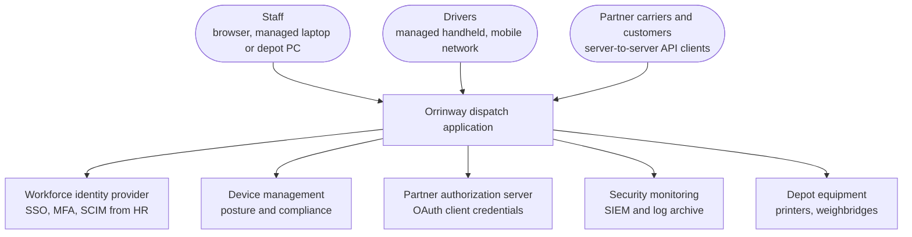
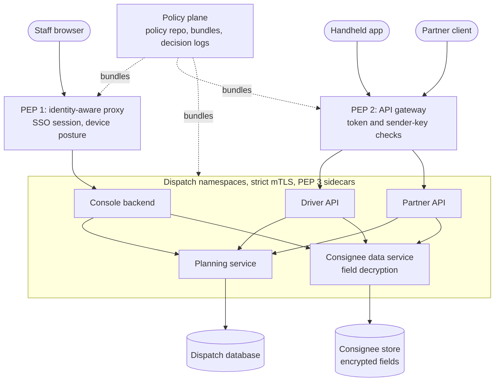
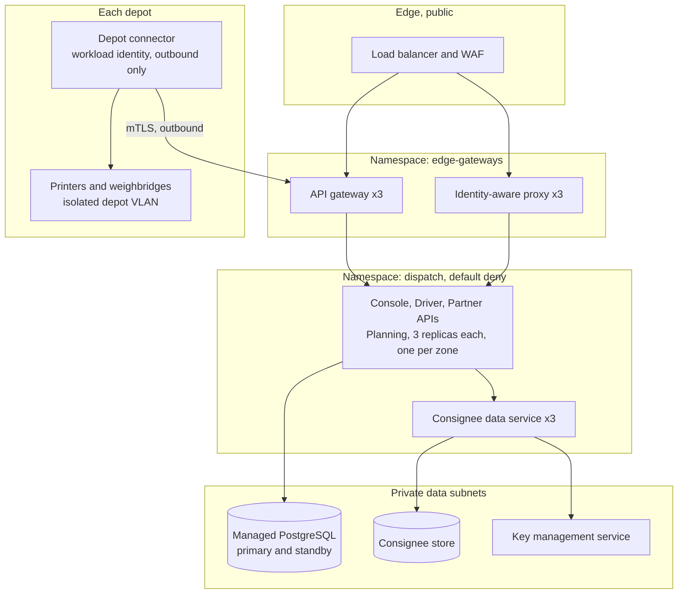
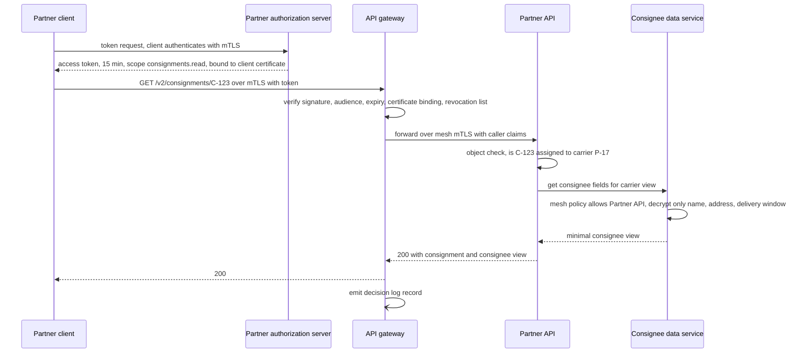
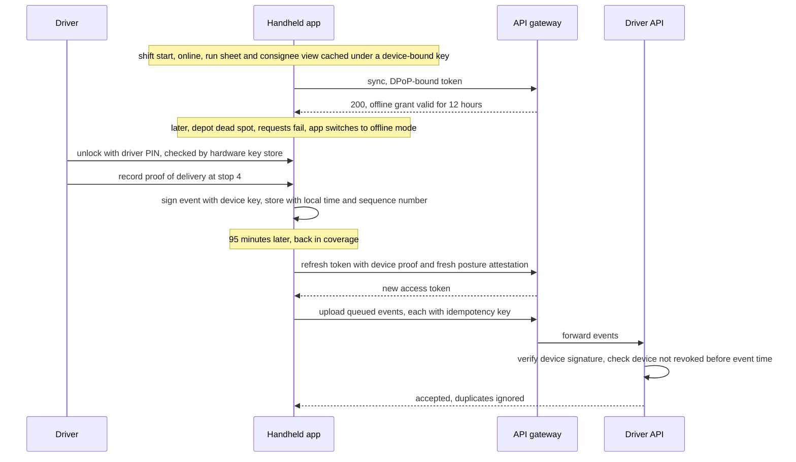
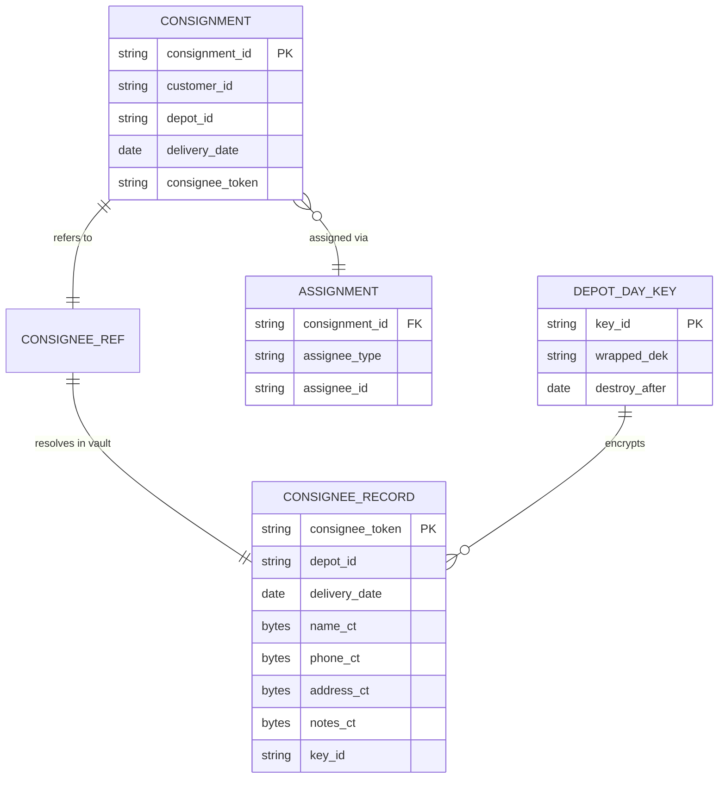
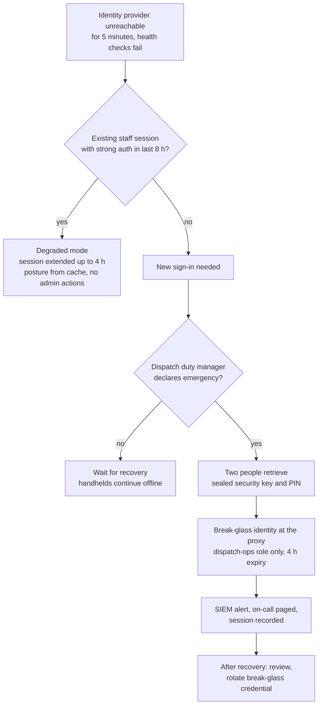
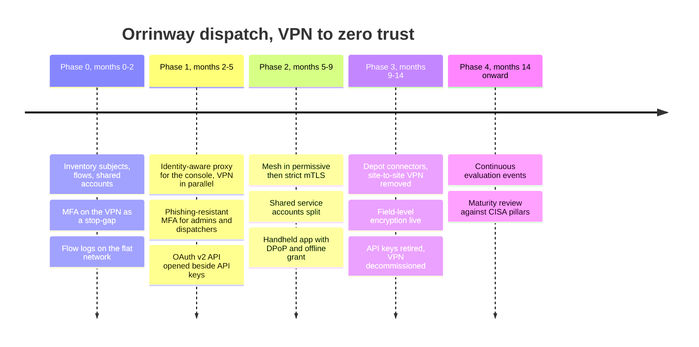

# Case study 15: Zero-trust application architecture

> Orrinway Freight trusts its dispatch application because it is "inside". This case study removes
> the word "inside" from the design: every person, handheld, service, and partner proves who it is on
> every request, and the architecture still lets a driver finish a delivery in a mobile dead spot and
> a dispatcher keep working when the identity provider is down.

!!! abstract "Case facts"
    **Level:** Advanced · **Time:** 90-120 minutes · **Status:** Draft · **Last verified:** 2026-11-21
    · **Applies:** [security principles and threat modeling](../security-architecture/security-principles-and-threat-modeling.md),
    [identity and access management](../security-architecture/identity-and-access-management.md),
    [network security architecture](../security-architecture/network-security-architecture.md),
    [data security and privacy](../security-architecture/data-security-and-privacy.md),
    [security operations](../security-architecture/security-operations.md),
    [application security](../security-architecture/application-security.md)

## Business context and outcome

Orrinway Freight (orrinway.example) is a fictional road-freight company. It runs 40 depots, employs
2,400 drivers who carry rugged handheld devices on public mobile networks, and has 600 office and
depot staff (dispatchers, customer service, finance, depot supervisors). About 60 partner carriers
take overflow work, and 250 business customers book collections and track consignments through
Orrinway's APIs. Every company detail and number on this page is a labelled assumption for this
case study (O-A1 onwards) or arithmetic from one.

The heart of the business is the **dispatch application**: it plans routes, assigns consignments to
drivers and partner carriers, sends each driver's run sheet to the handheld, and records proof of
delivery. Today it is protected the way many applications of its age are:

- Staff, handhelds (remote-access VPN), and depots (site-to-site VPN) all land in one **flat virtual
  network** (10.60.0.0/16, assumption O-A9), where every service trusts any caller that reaches it.
- Services and reporting tools share three **service accounts**; one database login is used by five
  services and by finance's spreadsheets. Nobody can say who changed what.
- Partners call the API with one static API key each, some years old and shared with subcontractors.

A security review after a phishing incident (a dispatcher's VPN password was captured on a look-alike
sign-in page and used from abroad for two days before anyone noticed) concluded that a single stolen
credential reaches everything. The board asked for a design that makes that impossible without
stopping deliveries. **The outcome:** within 14 months, every access to the dispatch application is
decided per request from identity, device state, and context; no shared credentials remain; a leaver
or a stolen handheld loses access within minutes; and drivers can still complete a full shift offline.

## Stakeholders and users

| Stakeholder | Needs | Decides |
|---|---|---|
| Chief operating officer (sponsor) | Deliveries never stop because of a security control | Go or no-go for each migration phase |
| Head of security | No implicit trust, evidence for the board, fewer incidents | Policy baseline, risk acceptance |
| Dispatch product team (8 engineers) | A design they can operate, no rewrite of the planning engine | Service changes, release timing |
| Platform team (4 engineers) | One way to run identity, mesh, and logging | Cluster, mesh, and gateway configuration |
| Drivers | Sign in once per shift, work in dead spots, no extra taps per stop | Nothing formally; adoption decides success |
| Dispatchers and depot supervisors | Console as fast as today, from depot or home | Nothing formally |
| Partner carriers and customers | A stable API, clear onboarding, time to migrate off API keys | Their own integration schedule |
| Data protection officer | Consignee personal data minimized, protected, deleted on time | Retention and access rules for personal data |

## Functional requirements

1. **FR-1 Staff access.** Staff open the dispatch console in a browser from a depot, an office, or
   home, with no VPN, after single sign-on.
2. **FR-2 Driver access.** A driver signs in on a managed handheld at the start of a shift, downloads
   the run sheet, and records arrival, proof of delivery (signature and photo), exceptions, and
   departure at each stop.
3. **FR-3 Offline work.** A handheld that loses connectivity continues FR-2 from its local copy and
   uploads queued events when it reconnects.
4. **FR-4 Partner API.** Partner carriers read and update only consignments assigned to them;
   customers create bookings and read only their own consignments.
5. **FR-5 Revocation.** Security can revoke a person, a handheld, a workload, or a partner client,
   and the revocation takes effect at every enforcement point.
6. **FR-6 Administration.** Engineers get privileged access to production only just in time, with
   approval, for a limited period, recorded.
7. **FR-7 Emergency access.** A documented break-glass path keeps dispatch operating if the
   identity provider is unavailable.
8. **FR-8 Evidence.** Every access decision for an external request is logged with subject, device,
   resource, action, decision, and the policy version that made it.

## Non-functional requirements (measurable targets)

| Id | Attribute | Target | How measured |
|---|---|---|---|
| NFR-1 | Time to revoke | Staff leaver: ≤ 15 min at phase 2, ≤ 2 min at phase 4. Partner client and online handheld: ≤ 2 min. Offline handheld: local data unusable ≤ 12 h after shift sign-in | Quarterly revocation drill timing from HR or console action to first denied request |
| NFR-2 | MFA coverage | 100% of interactive staff sign-ins use MFA; phishing-resistant MFA for 100% of administrators and dispatchers by phase 2, all staff by phase 3 | Identity provider sign-in logs, share by authenticator type |
| NFR-3 | Service authentication | 100% of service-to-service calls in dispatch namespaces carry a verified workload identity (strict mTLS); any plaintext attempt alerts | Mesh telemetry: connections with a peer identity ÷ all connections |
| NFR-4 | Shared credentials | 0 credentials used by more than one person or workload | Credential inventory and database login audit |
| NFR-5 | Partner access | 100% of partner calls with scoped, sender-constrained tokens; 0 API keys after phase 3; an object-level check on every partner request | Gateway logs; per-endpoint cross-tenant tests in CI |
| NFR-6 | Availability | Console and partner API 99.9% monthly (≈ 43.8 min); drivers can work 12 h without connectivity | Synthetic probes; offline drill on a test route |
| NFR-7 | Latency overhead | Enforcement adds ≤ 10 ms p95 per external request and ≤ 2 ms p95 per internal hop | Gateway and mesh latency histograms, compared with a bypass baseline in staging |
| NFR-8 | Detection | High-severity identity alerts (impossible travel, token replay, break-glass use) raised ≤ 15 min after the event | Detection tests replaying recorded events |
| NFR-9 | Consignee data | Consignee fields encrypted at field level, readable through four authorized paths only, destroyed 90 days after delivery | Data access logs; key destruction records |
| NFR-10 | Decision logs | 100% of external decisions and all denies logged, retained 1 year | Log pipeline completeness check (requests at gateway versus decision records) |

## Workload assumptions and capacity estimates

| Id | Assumption | Value |
|---|---|---|
| O-A1 | Depots | 40 |
| O-A2 | Drivers, one handheld each; shift window 06:00-16:00 | 2,400; 10 h = 36,000 s |
| O-A3 | Stops per driver per day | 15 |
| O-A4 | Handheld calls: per stop; run-sheet sync every 2 min while online | 4; 30 per hour |
| O-A5 | Staff, console requests per person per 8-hour day | 600; 400 |
| O-A6 | Partner clients; partner API calls per day; partner peak factor | 310 (60 carriers, 250 customers); 1,200,000; 4 |
| O-A7 | Internal calls per external request (fan-out) | 4 |
| O-A8 | Decision log record size | 1 KB |
| O-A9 | Today's flat network | 10.60.0.0/16 |
| O-A10 | Consignee record (encrypted fields) and retention after delivery | 600 B; 90 days |

**Request rates.**

- **Handhelds:** 15 stops × 4 = 60 event calls, plus 10 h × 30 = 300 sync calls, so 360 calls per
  handheld per day × 2,400 = **864,000 calls/day**. Over the 36,000 s shift window that is
  **24 calls/s**; with a shift-start factor of 3 (everyone downloads run sheets at once), **72/s**.
- **Staff:** 600 × 400 = 240,000 requests/day ÷ 28,800 s ≈ **8.3/s**; × 3 at the morning peak ≈ **25/s**.
- **Partners:** 1,200,000 ÷ 86,400 s ≈ **13.9/s**; × 4 ≈ **56/s** at peak.
- **External peak:** 72 + 25 + 56 = **153 requests/s**, each one an access decision at an edge
  enforcement point. Internally, × 4 fan-out = **612 mTLS service calls/s**, each one authorized by
  a sidecar.

**Decision log volume.** External requests per day: 864,000 + 240,000 + 1,200,000 = 2,304,000;
internal calls: × 4 = 9,216,000; total ≈ 11.5 million decisions/day × 1 KB ≈ **11.5 GB/day**, or
about 4.2 TB a year. Logging every external decision and every deny, but only 10% of internal allows,
gives 2.3 GB + 0.92 GB ≈ **3.2 GB/day**, about 97 GB for 30 days of hot search and about 1.2 TB for a
year in the archive. Sampling internal allows is a deliberate trade: denies and edge decisions are
the evidence NFR-10 needs; internal allows matter mostly in aggregate.

**Token traffic.** With 15-minute partner tokens cached by the client, each client needs at most
4 × 24 = 96 tokens a day: 310 × 96 = 29,760 per day ≈ **0.34 token requests/s**. A client that
fetches a new token for every call instead would send up to 56 token requests/s at peak, about 160
times more, so the token endpoint enforces a per-client rate limit. Handhelds refresh a 15-minute
token about 40 times per 10-hour shift: 2,400 × 40 = 96,000 refreshes/day; 2,400 sign-ins in the
first 30 minutes of a shift is 2,400 ÷ 1,800 s ≈ **1.3 sign-ins/s**. Identity load is small; identity
availability is what matters.

**Consignee data.** 2,400 × 15 = 36,000 consignments/day × 90 days ≈ 3.24 million live records ×
600 B ≈ **1.9 GB**. Storage is trivial; key operations are the design point (see the data section).

## Constraints and assumptions

| Id | Constraint |
|---|---|
| C-1 Planning engine | A third-party route-planning library inside the Planning service cannot be rewritten; everything around it can change |
| C-2 Platform | One managed Kubernetes cluster in one cloud region with three zones, and managed PostgreSQL (assumption); the target stays there |
| C-3 Handhelds | Company-owned, enrolled in mobile device management (MDM), with a hardware-backed key store; poor coverage in rural areas and some depots |
| C-4 Depot equipment | Label printers and weighbridges speak only plain network protocols and cannot hold credentials |
| C-5 Partners | Need at least six months' notice to change authentication; some use an integration vendor |
| C-6 People | No new security team; the platform team adds two engineers for the programme |
| C-7 Personal data | Consignee names, phones, addresses, and notes are personal data; which privacy laws apply depends on where Orrinway operates and other facts (ask counsel); treated as Confidential with field-level protection |

## Architecture options considered

| Option | Summary | Strengths | Weaknesses |
|---|---|---|---|
| A. Hardened VPN | Keep the VPN, add phishing-resistant MFA, split the flat network into segments, rotate shared accounts | Fast, familiar, cheap to start | Still network-level trust; a compromised device reaches its whole segment; partners unchanged |
| B. ZTNA in front, app unchanged | Identity-aware proxy for staff; app internals and service accounts unchanged | Removes the VPN for people quickly | Trust stops at the proxy; shared accounts and flat east-west traffic remain; handhelds and partners untouched |
| C. Zero-trust application architecture (chosen) | Policy decision and enforcement for every subject type: proxy for staff, gateway for handhelds and partners, mesh for services, field-level protection for data | Meets NFR-1 to NFR-5; limits blast radius at every layer | Most work; new dependencies (identity, policy, mesh) that must be highly available |
| D. Replace with SaaS | Buy a transport management SaaS | Security of the platform becomes the vendor's job | Conflicts with C-1; long migration; partner integrations rebuilt |

Option C was chosen, delivered in phases that pass through B on the way. Option A survives in a
narrow form for depot equipment (see the alternatives section).

## Chosen architecture and rationale

The design follows the logical model in [NIST SP 800-207](https://csrc.nist.gov/pubs/sp/800/207/final):
a **policy engine** decides, a **policy administrator** turns decisions into session state, and
**policy enforcement points** (PEPs) sit in front of every resource. Orrinway's twist is that the
policy engine is centralized for authoring but **distributed for evaluation**: policies are written
as code in one repository, compiled into bundles, and pushed to each PEP, which decides locally in
microseconds and keeps deciding if the central plane is briefly unreachable.

**Figure 1 — System context.** Who uses the dispatch application and what it depends on.

How to read it: three kinds of subject (people with browsers, devices with a driver, other
companies' servers) reach one system, and each kind is authenticated by a different trust anchor:
the identity provider, device management, and the partner authorization server.

**Figure 2 — Containers and enforcement points.** Every arrow into a service passes a PEP; the
policy plane feeds them all.

How to read it: solid arrows are requests; dashed arrows are policy distribution. The only path to
consignee personal data is through the Consignee data service, and only four callers may use it:
the console, driver, and partner backends, plus the retention job (not drawn).

**Why these choices.**

- **Identity-aware proxy for staff** (PEP 1) replaces the VPN with per-application access. It
  checks the SSO session, the device's posture signal (managed and compliant, or a depot PC with a
  device certificate), and re-evaluates every 10 minutes (assumption) and on pushed risk events.
- **API gateway for handhelds and partners** (PEP 2) validates tokens locally, checks they are bound
  to the caller's key (DPoP for handhelds, mTLS certificate binding for partners), applies scopes and
  rate limits, and checks a revocation list pushed every 60 seconds.
- **Service mesh sidecars** (PEP 3) give every workload a certificate-based identity, require mTLS,
  and authorize each call by caller identity: "the Partner API may call the Consignee data service
  `GET /consignees/{id}/for-carrier`" rather than "anything in 10.60.0.0/16 may call anything".
- **Object authorization stays in the service.** Only the service knows whether consignment C-123
  belongs to carrier P-17. NIST SP 800-207A describes the same layering for cloud-native
  applications: identity-based policy at gateways and sidecars, not just network rules.

**Figure 3 — Deployment and microsegmentation.** Namespaces are segments; the database and the
consignee store accept connections only from named workloads.

How to read it: four layers stack from internet to data. Network policy denies by default inside
each namespace, and mesh policy adds identity rules on top, so a misconfigured network rule alone
does not open a path. Depot equipment never joins the cloud network: a small connector per depot
holds a workload identity, connects outbound, and talks to the printers on an isolated local VLAN.
That connector is NIST SP 800-207's enclave-based deployment applied to devices that cannot be
made zero-trust themselves.

## Request and data flow walkthrough

**Figure 4 — Happy path: a partner carrier reads a consignment assigned to it.** The token is
short-lived, scoped, and bound to the partner's certificate; the object check happens in the service.

How to read it: four independent checks happen in order (token at the gateway, workload identity at
the mesh, object ownership in the Partner API, field-level view in the Consignee data service). A
stolen token is useless without the partner's private key; a compromised Partner API still cannot
ask for consignees of other carriers' consignments because the Consignee data service applies the
same assignment rule again (defense in depth for the most sensitive data).

**Figure 5 — Failure path: a handheld goes offline at a depot and reconnects.** The driver keeps
working; trust is re-established on reconnection, not assumed.

How to read it: the offline grant (NFR-1) runs 12 hours from shift sign-in and later syncs do not
extend it, so it bounds how long a lost handheld's cached data stays usable without contact. Events are signed by a key that never leaves the device, so the
server can prove which handheld created each proof of delivery even though no server saw it at the
time. Events signed after the device's revocation time go to a review queue instead of being applied.

The staff path is simpler: SSO with a phishing-resistant authenticator at the proxy, posture from
device management, then a session to the console only, with no network route to anything else.

## Data model and storage decisions

**Figure 6 — Data model around consignee details.** Personal data lives in one store, keyed by a
token that the rest of the system uses instead of the data itself.

How to read it: the dispatch database holds consignments, assignments, and an opaque
`consignee_token`; it never holds a name or address. The consignee store holds ciphertext columns
(`_ct`) plus the identifier of the data key that encrypted them.

**Decisions.**

- **Field-level envelope encryption with one data key per depot per day.** Each depot-day gets a
  data encryption key (DEK), wrapped by a key encryption key in the key management service, as
  described on the [data security](../security-architecture/data-security-and-privacy.md) page.
  40 depots × 1 key per day = 40 new DEKs a day, about 3,600 live keys over 90 days.
- **Key operations, not storage, drive the choice.** One DEK per record would mean a key management
  call per read: 36,000 writes plus about 5 reads per consignee (run sheet, console views, partner
  and customer queries; assumption) = 36,000 + 180,000 = **216,000 calls/day**. With depot-day keys
  and a 5-minute in-memory DEK cache per replica, the worst case is 3 replicas × 40 keys × 12
  refreshes an hour × 10 hours = **14,400 calls/day**, fifteen times fewer.
- **Crypto-shredding for retention.** Destroying a depot-day key 90 days after its date makes every
  copy of those consignee fields unreadable, including database backups, which satisfies NFR-9
  without editing backups. Earlier deletion of one person's record (for a valid request) deletes the
  row; backups age out within the backup retention period.
- **Views, not tables.** The Consignee data service exposes purpose-specific views: the driver sees
  name, address, phone, and notes for today's run only; a partner carrier sees name, address, and
  delivery window; customer service sees phone numbers masked unless it records a reason.

## API and integration contracts

| Contract | Caller and authentication | Scopes and checks | Notes |
|---|---|---|---|
| `GET /v2/consignments/{id}` | Partner client, mTLS-bound token | `consignments.read`; assignment or ownership check | Returns `404` for "not yours" and "does not exist" alike |
| `POST /v2/bookings` | Customer client | `bookings.write`; `Idempotency-Key` required | The customer id comes from the token, never from the body |
| `POST /v2/consignments/{id}/events` | Partner carrier | `consignments.update`; assignment check | Status events only; no consignee changes |
| `GET /driver/v1/runsheet` | Handheld, DPoP-bound token | Driver's own run for today; device compliant | Returns an offline grant expiry |
| `POST /driver/v1/events` | Handheld | Device signature per event; idempotency key per event | Accepts events up to 12 h old |
| Token endpoint | Partner client | `private_key_jwt` or mTLS client authentication; per-client rate limit | Tokens 15 min; no refresh tokens for machine clients |

**Versioning and migration.** API keys work only on `/v1` paths, which are frozen. `/v2` accepts
only OAuth tokens. Partners get six months' notice (C-5) and a sandbox at `sandbox.orrinway.example`;
the gateway reports each partner's remaining `/v1` traffic so account managers can chase stragglers.
Client authentication uses either mutual TLS with certificate-bound tokens
([RFC 8705](https://www.rfc-editor.org/rfc/rfc8705)) or a signed JWT assertion
([RFC 7523](https://www.rfc-editor.org/rfc/rfc7523)); a shared client secret is accepted only for
the transition and only from registered source addresses. Handheld tokens are bound with DPoP
([RFC 9449](https://www.rfc-editor.org/rfc/rfc9449)) because mobile networks and middleboxes make
client certificates awkward.

## Security and trust boundaries

### Threat model summary (STRIDE highlights)

The team ran STRIDE per element (method on the [threat modeling](../security-architecture/security-principles-and-threat-modeling.md)
page) over the target design. The highlights include threats against the zero-trust machinery
itself, which NIST SP 800-207 lists explicitly: subversion of the decision process, denial of
service against it, stolen credentials, and the policy plane's own administrators.

| Element | Threat (STRIDE) | Control |
|---|---|---|
| Staff sign-in | S: phishing captures a password or a one-time code | Phishing-resistant authenticators (passkeys or security keys); device posture required |
| Handheld | S, I: stolen handheld used or its cached data read | PIN plus hardware-bound key; offline grant 12 h; MDM wipe; revocation list at gateway |
| Partner token | S: token stolen from a partner's logs and replayed | Sender-constrained tokens; 15-minute lifetime; audience per API |
| Partner API | E, I: a carrier reads another carrier's consignments (BOLA) | Assignment check in service and again in the Consignee data service; cross-tenant tests |
| Offline events | T, R: events forged or later denied | Per-event device signature, sequence numbers, decision log |
| Policy plane | T, E: a malicious policy change opens access | Policies as code, two-person review, signed bundles, PEPs reject unsigned bundles |
| Policy plane | D: plane unreachable | PEPs keep the last signed bundle for 24 h; new bundles only after verification |
| Mesh CA | S: issuing authority compromised mints identities | CA key in an HSM-backed KMS; short certificate lifetime; issuance logged and alerted |
| Break-glass | E: emergency path becomes a standing back door | Two-person retrieval, alerts on use, 4-hour expiry, quarterly tests |
| Decision logs | R, I: logs altered or leak personal data | Immutable archive account; logs carry tokens and ids, never consignee fields |

### Trust boundaries and controls

- **Identity is the boundary.** Each subject has one trust anchor: the identity provider for
  people, device management plus a hardware key for handhelds, the partner authorization server for
  partner clients, and the mesh certificate authority for workloads. No component trusts a source
  address.
- **Devices.** Posture for handhelds is a signed compliance statement from device management
  (enrolled, OS patch level within policy, not rooted, screen lock) refreshed at each token refresh
  and at least every 24 hours, because intermittent connectivity rules out continuous checks.
- **Privileged access.** Engineers have read-only access by default and request a just-in-time role
  for production (1 hour, approved by a second engineer). The database has no shared login: each
  service has its own role via workload identity, and finance reporting reads a replica through a
  reporting service with row-level filters.
- **Microsegmentation.** Namespace default-deny network policies, mesh authorization policies per
  service pair, and private data subnets. The [network security](../security-architecture/network-security-architecture.md)
  page explains why segmentation stays as a second layer even when identity is the first.

## Reliability, failover, and disaster recovery

The zero-trust components are now **critical dependencies**: if the proxy, gateway, or identity
provider fails closed, dispatch stops. The design makes each of them either redundant or survivable.

| Component fails | What still works | What stops | Design response |
|---|---|---|---|
| Identity provider | Existing staff sessions (up to 4 h of degraded mode), all valid tokens until expiry, handhelds in offline mode, partners with unexpired tokens | New staff sign-ins, handheld token refresh | Proxy fails static for existing sessions; break-glass for new ones (below) |
| Partner authorization server | Partners with cached tokens for up to 15 min | New partner tokens | Runs in two zones; separate failure domain from the workforce identity provider |
| Policy plane | Every PEP, on its last signed bundle | Policy changes | Bundles valid 24 h; alert after 1 h without a successful refresh |
| Mesh CA | Existing certificates (24 h lifetime, renewed at 12 h) | New pods after about 12 h | CA in two zones; alert when renewal fails |
| Key management service | Cached DEKs for 5 minutes | New consignee decryptions | Regional service, multi-zone; console shows consignments without consignee details |

**Figure 7 — Identity provider outage and break-glass.** Existing sessions degrade gracefully; new
access goes through a controlled emergency path, never back to the VPN.

How to read it: the left branch is automatic and covers most staff, because a morning sign-in keeps
working through a typical outage. The right branch is manual, needs two people, grants only the
operational dispatch role (no data export, no administration), is alerted the moment it is used,
and ends with the credential rotated. The break-glass identity is verified by the proxy itself, so
the emergency path is still a policy decision, not a network bypass.

**Disaster recovery.** Dispatch data has RPO 5 minutes and RTO 1 hour (assumption) via a synchronous
standby and backups; policies, mesh, and gateway configuration are redeployable from version control.
For the managed identity provider's objectives, check the provider's current documentation.

## Scaling and performance strategy

- **Decisions and token checks are local.** At 153 external and 612 internal decisions per second at
  peak, a remote policy call per request would add a round trip to every hop. Gateways and sidecars
  evaluate in-process and verify JWTs with cached signing keys (no introspection call); NFR-7's
  budgets are measured in staging against a bypass baseline.
- **10 times the load** (1,530 external, 6,120 internal per second): gateways scale horizontally,
  sidecar CPU grows with calls and belongs in pod sizing, and decision logs reach about 32 GB/day.

## Observability and operations

**Logging and continuous verification** make the "continuous" in zero trust real:

- **Sources:** identity provider sign-ins and MFA type, posture changes, decision logs (subject,
  device, resource, action, decision, policy version), mesh telemetry (peer identities, mTLS mode),
  key management calls, and break-glass use, shipped to an immutable archive and the SIEM
  ([security operations](../security-architecture/security-operations.md)).
- **Signals flow back into decisions.** A device falling out of compliance, a credential change, or
  an "impossible travel" detection is published as an event that the proxy and gateway consume to
  end sessions early. The OpenID Foundation's Continuous Access Evaluation Profile (CAEP) defines
  standard event types for exactly this (session revoked, device compliance change, credential
  change, and others); Orrinway adopts it in phase 4 where its products support it.
- **Detections tied to the threat model:** token use from two countries within an hour; a DPoP proof
  reused; a partner calling consignments not assigned to it (many `404`s); any plaintext connection
  in a strict namespace; policy bundle signature failure; any break-glass sign-in.
- **Security outcome dashboard:** the measures behind NFR-1 to NFR-5 (revocation drill time,
  phishing-resistant MFA share, authenticated-call share, shared credential count, partners still on
  API keys) reviewed monthly by the head of security and the sponsor.

## Deployment and release strategy

Policies, gateway routes, and mesh rules are code: reviewed, tested with recorded allow and deny
requests, signed, and shipped by the service pipeline; risky changes run a week in **audit mode**
(decide and log, do not enforce) first.

**Phased migration from the VPN.** The phases follow the migration steps NIST SP 800-207 describes
(identify actors, assets, and processes, then deploy and expand), and run the old and new paths in
parallel until the new one is proven.

**Figure 8 — Migration timeline.** Each phase ends with a measurable gate.

How to read it: left to right is time. Phase gates are the NFRs: phase 1 exits when 100% of
console traffic arrives through the proxy for two weeks; phase 2 when NFR-3 reads 100% for a week;
phase 3 when the VPN carries no production traffic for 30 days.

**Maturity view.** CISA's [Zero Trust Maturity Model](https://www.cisa.gov/zero-trust-maturity-model)
(version 2.0, April 2023; the CISA page is now marked as archived but names no newer version) scores
five pillars (identity, devices, networks, applications and workloads, data) across four stages
(traditional, initial, advanced, optimal). Orrinway uses it to set targets, not as a checklist:

| Pillar | Today | Target at month 14 | Evidence |
|---|---|---|---|
| Identity | Traditional: passwords, shared accounts | Advanced: phishing-resistant MFA, no shared accounts | NFR-2, NFR-4 |
| Devices | Traditional: VPN client only | Advanced: MDM posture in every decision | Posture field in decision logs |
| Networks | Traditional: flat network | Advanced: per-namespace segmentation, mTLS everywhere | NFR-3 |
| Applications and workloads | Traditional: trusted because inside | Advanced: per-request authorization at three PEPs | Decision log completeness, NFR-10 |
| Data | Traditional: plaintext columns | Advanced: field-level encryption, retention by key destruction | NFR-9 |

## Cost model

No prices; check each provider's current pricing. The drivers and the arithmetic:

| Driver | Quantity (from assumptions) | What changes it most |
|---|---|---|
| Identity-aware proxy and ZTNA licensing or capacity | 600 staff users | Per-user versus per-hour pricing models |
| Device management | 2,400 handhelds + 600 staff devices = 3,000 devices | Whether depot PCs are managed or treated as kiosks |
| Phishing-resistant authenticators | 600 staff + 10% spares ≈ 660 security keys, if platform passkeys are not used | Using built-in platform authenticators instead |
| Mesh sidecars | One per pod; CPU and memory add to every pod's requests | Sidecar-less mesh modes; fan-out per request |
| Decision and security logs | 3.2 GB/day sampled (11.5 GB unsampled); 97 GB hot, 1.2 TB archive per year | Sampling policy for internal allows |
| Key management calls | About 14,400 per day with depot-day keys (216,000 with per-record keys) | Key granularity and DEK cache lifetime |
| Programme effort | 2 extra platform engineers for 14 months; partner support | Partner readiness |
| Savings | VPN concentrator capacity, 40 depots × 2 = 80 site-to-site tunnels, fewer incident hours | Speed of decommissioning |

## Risks and mitigations

| Risk | Likelihood | Impact | Mitigation |
|---|---|---|---|
| Identity provider outage stops dispatch | Medium | High | Fail-static sessions, offline handhelds, tested break-glass (ADR-04) |
| Partners miss the API key deadline | High | Medium | Six months' notice, sandbox, per-partner traffic reports, a paid integration-vendor option |
| Handheld offline grace abused after theft | Low | Medium | 12 h limit, PIN with lockout, signed events reviewed if after revocation |
| Policy misconfiguration denies drivers at shift start | Medium | High | Audit mode first, canary depots, rollback of signed bundles in minutes |
| Mesh adds latency or instability | Medium | Medium | Permissive mode first; latency budget in NFR-7; sidecar resource limits |
| Break-glass becomes routine | Low | High | Alert on every use; monthly review; credential rotated after each use |
| Team runs out of capacity mid-migration | Medium | Medium | Phase gates let the programme pause safely after any phase |

## Architecture Decision Records

Short-form ADRs (Context / Decision / Consequences); each is a separate file in Orrinway's repository.

| ADR | Context | Decision | Consequences |
|---|---|---|---|
| ADR-01 Identity-aware proxy and distributed policy | One stolen VPN credential reached the whole flat network; staff work from anywhere | Staff reach the console only through a proxy requiring SSO, phishing-resistant MFA, and device posture; policies authored centrally as code, evaluated locally from signed bundles | Network invisible to staff devices; proxy and policy plane become critical dependencies; policy changes need a release process |
| ADR-02 Workload identity and strict mTLS | Five services and a spreadsheet share one database login; east-west traffic unauthenticated | Short-lived certificate identities (SPIFFE-style names) from the mesh; strict mTLS; caller-callee authorization policies; one database role per service | NFR-3 and NFR-4 measurable; sidecar overhead and rotation to operate; depot equipment needs connectors |
| ADR-03 OAuth client credentials for partners | Static API keys shared with subcontractors cannot be scoped or revoked quickly | Client credentials with mTLS or signed-JWT client authentication; 15-minute sender-constrained tokens; scopes per operation; object checks in every service | A leaked token alone is useless; partners must change integrations (six months' notice); authorization server is a dependency for new tokens |
| ADR-04 Fail static, then break-glass | Failing closed on an identity outage stops dispatch; failing open invites attacks on the identity provider | Existing strongly authenticated sessions continue up to 4 h without admin actions; new access via two sealed break-glass identities verified by the proxy, dispatch-ops role only, alerted, rotated after use | A just-revoked user with a live session may keep working briefly (accepted, logged, reviewed); quarterly drills mandatory |
| ADR-05 12-hour offline grant for handhelds | Drivers lose coverage for hours; deliveries cannot wait | Run sheet cached under a device-bound key for 12 h; PIN checked by the hardware key store; events signed per device and uploaded idempotently | A stolen offline handheld exposes one run's consignee data for up to 12 h; offline revocation is eventual |
| ADR-06 Field-level encryption with depot-day keys | Consignee data readable by anyone with the shared login | One service holds consignee data, encrypted per field with one key per depot per day; others hold tokens; keys destroyed after 90 days | About 14,400 key operations a day; retention enforced across backups; no search on consignee fields (search by consignment id) |

## Alternative designs and why they were rejected

**Hardened VPN plus segmentation for depots and staff (option A in full).** Keep the remote-access
VPN with phishing-resistant MFA and device checks at connection time, split the flat network into
segments (staff, depots, services, data) with firewall rules, and rotate the shared accounts into
per-service accounts. NIST SP 800-207 recognizes such hybrids of zero-trust and perimeter-based
architecture as a normal, sometimes long-lived state.

It would be the better choice when:

- Most access is from fixed sites with reliable links, and depot equipment cannot run connectors.
- The team is too small to operate a mesh and a policy plane, and the application is due to be
  replaced within two years anyway.
- No partner or handheld traffic needs per-request decisions (for example if partners exchanged
  files rather than calling APIs).

Orrinway rejected it as the end state because drivers on mobile networks and partners on the
internet never sit on a network Orrinway controls, and a segment still trusts everything inside it.
It kept the idea for depot equipment: isolated local VLANs behind an identity-aware connector.

**Central policy engine called on every request.** Always current, but a round trip on each of 765
decisions per second at peak and a single point of failure. It wins when decisions need fresh data
no bundle can carry (per-request risk scores) and request rates are low. **SaaS (option D)** wins if
C-1 is lifted; access then becomes SSO and conditional access to the vendor, plus its partner APIs.

## Questions for the learner

1. The identity provider is down for 6 hours, longer than degraded mode. Which staff can still work,
   how many break-glass sessions might the duty manager need, and what would you change in ADR-04?
2. Recalculate the decision log volume if internal allows are logged at 100% and fan-out rises to 6.
   Which NFR justifies the extra cost, if any?
3. A partner's integration vendor serves 20 small carriers with one client. How do you keep object-level
   authorization per carrier without issuing 20 sets of credentials to the vendor?
4. A handheld is reported stolen at 10:00; it was last online at 09:30 and its offline grant runs to
   18:10. What exactly can the thief see and do, until when, and what would shorten that window?
5. Draw the STRIDE table for the depot connector. Which threats does an outbound-only connection
   remove, and which remain?
6. Which CISA pillar would you push to "optimal" first, and what evidence would show you got there?

## Related topics

- **Before:** [Security principles and threat modeling](../security-architecture/security-principles-and-threat-modeling.md);
  [Identity and access management](../security-architecture/identity-and-access-management.md);
  [Network security architecture](../security-architecture/network-security-architecture.md).
- **Alongside:** [Data security and privacy](../security-architecture/data-security-and-privacy.md);
  [Application security](../security-architecture/application-security.md);
  [Security operations](../security-architecture/security-operations.md);
  [Kubernetes networking, storage, and service mesh](../containers-and-kubernetes/kubernetes-networking-storage-and-service-mesh.md);
  [Hybrid connectivity and VPNs](../networking/hybrid-connectivity-and-vpns.md);
  [Zero-trust enterprise exercise](../system-design-exercises/zero-trust-enterprise.md) (workforce-wide counterpart);
  [Lab 10: REST API authentication and validation](../labs/lab-10-rest-api-auth-and-validation.md);
  [Lab 14: network segmentation](../labs/lab-14-network-segmentation.md).
- **Planned:** reliability engineering for critical security dependencies (D13-T02); observability
  and SRE for decision-log pipelines (D15); DevSecOps and policy as code in delivery pipelines (D16).

## References

| Source | Type | Checked |
|---|---|---|
| [NIST SP 800-207: Zero Trust Architecture](https://csrc.nist.gov/pubs/sp/800/207/final) — NIST, August 2020 | Standard (logical components, deployment variations, threats to ZTA, migration steps) | 2026-11-21 |
| [NIST SP 800-207A: A Zero Trust Architecture Model for Access Control in Cloud-Native Applications in Multi-Cloud Environments](https://csrc.nist.gov/pubs/sp/800/207/a/final) — NIST, September 2023 | Standard (gateways, sidecars, and workload identity as enforcement points) | 2026-11-21 |
| [Zero Trust Maturity Model, version 2.0](https://www.cisa.gov/zero-trust-maturity-model) — CISA, April 2023 | Government guidance (pillars and maturity stages) | 2026-11-21 |
| [RFC 8705: OAuth 2.0 Mutual-TLS Client Authentication and Certificate-Bound Access Tokens](https://www.rfc-editor.org/rfc/rfc8705) — IETF | Standard | 2026-11-21 |
| [RFC 9449: OAuth 2.0 Demonstrating Proof of Possession (DPoP)](https://www.rfc-editor.org/rfc/rfc9449) — IETF | Standard | 2026-11-21 |
| [RFC 7523: JWT Profile for OAuth 2.0 Client Authentication and Authorization Grants](https://www.rfc-editor.org/rfc/rfc7523) — IETF | Standard (signed client assertions) | 2026-11-21 |
| [SPIFFE overview](https://spiffe.io/docs/latest/spiffe-about/overview/) — SPIFFE project (CNCF) | Open standard (workload identity) | 2026-11-21 |
| [OpenID Continuous Access Evaluation Profile 1.0](https://openid.net/specs/openid-caep-1_0-final.html) — OpenID Foundation, 2025 | Standard (session and device-compliance events) | 2026-11-21 |

## Review notes

- Case study 15 (Core track). Orrinway Freight and every number are fictional: O-A1 to O-A10, plus
  inline assumptions (10-minute proxy re-evaluation, 60-second revocation-list push, 15-minute tokens,
  12-hour offline grant, 4-hour degraded mode, 24-hour bundles and certificates, 5 reads per
  consignee, 5-minute DEK cache, RPO 5 min and RTO 1 h, 14-month programme). The CISA stage given to
  each pillar is the fictional team's judgement, not CISA's wording.
  Arithmetic to recheck: 864,000 handheld calls/day; 153 external and 612 internal requests/s at peak;
  11.5 GB versus 3.2 GB/day of decision logs; 0.34 token requests/s; 216,000 versus 14,400 key
  operations/day; 3,600 live depot-day keys; 1.9 GB of consignee data.
- NIST SP 800-207 sections used (enclave-based deployment, threats in section 5, hybrid ZTA in 7.2,
  migration steps in 7.3) were checked against its table of contents on 2026-11-21. CISA ZTMM v2.0
  (April 2023) pillars and stages were checked against the PDF; the CISA web page is marked
  "archived" and points to zerotrust.cyber.gov without naming a newer version.
- CAEP: page dated 29 August 2025 lists the event types named here; confirm its final status.
- Vendor-neutral (ZTNA product equivalents are on the network security page). No law is said to
  apply to Orrinway (C-7: ask counsel).
- Mermaid: check Figure 2 (13 nodes, dashed arrows into a subgraph), Figure 3 (five linked
  subgraphs), and Figure 8 (`timeline` with long labels) render legibly in both themes.
