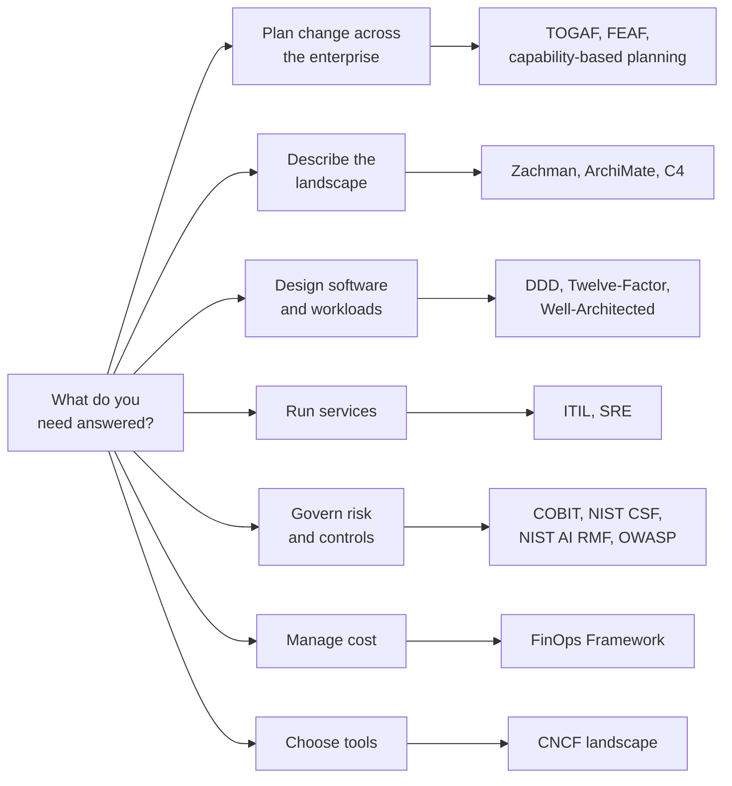
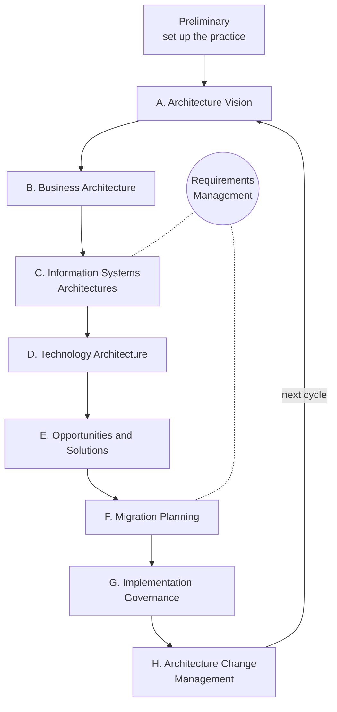
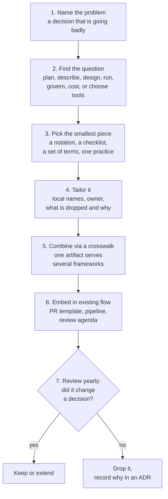
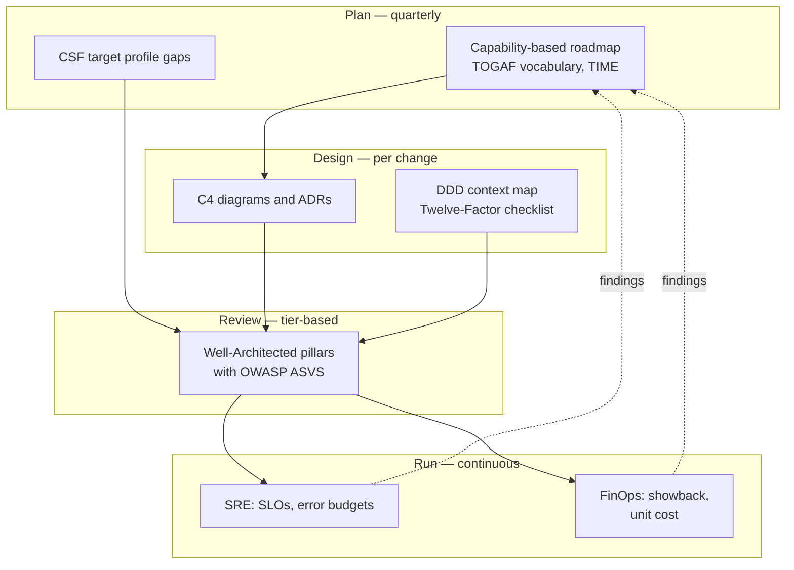

# Enterprise architecture frameworks

> A framework is someone else's hard-won answer to one recurring question: how to plan change,
> how to describe a landscape, how to run services, how to control risk, how to manage cost. Used
> as a toolbox, frameworks save years. Used as a religion, they produce binders nobody reads. The
> skill is knowing which question each one answers, borrowing the smallest piece that answers
> yours, and dropping it when it stops changing decisions.

!!! abstract "Page facts"
    **Level:** Intermediate (what each framework is for is Level 1; tailoring and combining them is
    Level 2-3) · **Status:** Draft · **Time:** 60-75 minutes · **Last verified:** 2026-11-27

## Learning objectives

After this page you should be able to:

- Say, for each of fifteen widely used frameworks and reference models, what question it answers,
  who maintains it, and its current version as of the check date.
- Explain the purpose, scope, strengths, and limitations of TOGAF, Zachman, ArchiMate, ITIL, COBIT,
  and FEAF, and where Gartner concepts, DDD, capability-based planning, and reference architectures
  fit.
- Pick, tailor, and combine framework pieces for a given organization without adding ceremony.
- Recognize framework theatre and the other ways frameworks fail in practice.
- Defend which frameworks an organization should deliberately not adopt, and what would change
  that decision.

## Prerequisites

- [Enterprise architecture practice](enterprise-architecture-practice.md) — the artifacts
  (capability map, portfolio, roadmap, repository) that frameworks help produce.
- [Trade-offs, principles, ADRs, and architecture governance](../architecture-fundamentals/trade-offs-principles-adrs-and-architecture-governance.md)
  — ADRs and review boards, which every framework below either uses or replaces.
- [C4 model](../architecture-fundamentals/c4-model.md) — one framework in depth; this page does
  not repeat it.

## The problem this solves

An architect joining a large organization meets a wall of acronyms: the EA team speaks TOGAF, the
operations team speaks ITIL, internal audit speaks COBIT, security speaks NIST CSF, finance has just
discovered FinOps, and developers quote Twelve-Factor and DDD. Each group believes its framework is
"the" framework. Two failures follow. Some organizations adopt one framework wholesale and spend
their energy producing its deliverables instead of improving systems. Others reject all of them and
reinvent, badly, things that were solved decades ago: how to classify architecture views, how to
run a change process, how to tie cost to value.

The way out is to treat frameworks as answers to specific questions and to combine small pieces of
several, on purpose, with a written reason for each piece used and each piece skipped.

## What it is

A **framework**, in this page's sense, is a published, maintained body of structure that someone
outside your organization keeps current: a vocabulary, a set of views, a method, a list of
controls, or a set of principles. They come in recognizably different kinds:

| Kind | What it gives you | Examples on this page |
|---|---|---|
| Method | A sequence of steps for doing architecture work | TOGAF's Architecture Development Method, FEAF's Collaborative Planning Methodology |
| Classification schema (ontology) | A grid that says which descriptions a complete architecture needs | Zachman |
| Modelling notation | Element and relationship types for diagrams | ArchiMate, C4 |
| Reference model | A standard taxonomy for one domain, shared across organizations | FEAF reference models |
| Reference architecture | A reusable template solution for a recurring problem | Provider reference architectures, the [landing zone](../cloud-architecture/cloud-building-blocks-and-landing-zones.md) |
| Practice framework | Practices and roles for running something well | ITIL, SRE, FinOps |
| Control or risk framework | Outcomes or controls to govern and assess against | COBIT, NIST CSF, NIST AI RMF, OWASP projects |
| Design approach or principles | Rules of thumb for designing software | DDD, Twelve-Factor App, Well-Architected pillars |
| Ecosystem map | An organized catalogue of available tools | CNCF landscape |

The kinds matter because they combine differently: two methods compete, but a method, a notation,
a control framework, and a practice framework can sit side by side if each owns a different
question.

## Mental model

Think of a set of maps. A road map, a geological survey, a nautical chart, and a transit diagram
all describe the same region, and nobody argues which one is "correct": you pick by the journey. A
hiker carries one sheet, not the whole atlas, and folds it to the part that matters. A good map
also tells you what it leaves out.

**Where the analogy breaks:** maps describe; many frameworks also prescribe process, and their
prescriptions can conflict (two change processes, two risk registers). Frameworks also come with
training and certification industries whose incentives favour adopting more of them. And unlike a
map, a framework can become the destination: teams start producing its artifacts for their own
sake.

## Key terms

| Term | Meaning on this page |
|---|---|
| Framework | A published, externally maintained structure (vocabulary, views, method, controls, or principles) for a recurring kind of work |
| Method | An ordered set of steps with inputs and outputs, such as TOGAF's ADM |
| Ontology / classification schema | A structure that says what kinds of description exist and how they relate, without saying in which order to produce them |
| Reference model | A shared taxonomy for one domain (business functions, data, technology) that lets organizations compare and reuse |
| Reference architecture | A reusable solution template for a recurring problem, with components, patterns, and decisions already made |
| Capability-based planning | Sequencing investment by the capability increments it delivers rather than by projects ([As-Is/To-Be page](../architecture-fundamentals/as-is-and-to-be-architecture-gap-analysis-and-build-vs-buy.md)) |
| Profile (NIST CSF) | A description of an organization's current or target cybersecurity outcomes, selected from the framework's catalogue |
| Tailoring | Choosing which parts of a framework to use, renaming them in local terms, and dropping the rest, on purpose and in writing |
| Crosswalk | A mapping between two frameworks' items (a Well-Architected pillar to CSF functions) so one artifact satisfies both |
| Framework theatre | Producing a framework's artifacts and ceremonies without them changing any decision |

## How it works

### Which question does each framework answer

**Figure 1 — Frameworks grouped by the question they answer.** Start from the question on the
left; the right-hand box lists frameworks that answer it.

How to read it: an organization usually needs one answer per row, not one framework for all rows.
Frameworks in the same box compete (pick one notation per audience); frameworks in different boxes
combine.

### The fifteen, at a glance

Versions and dates below were checked on the owners' sites on 2026-11-27 (references).

| Framework | Owner; current version | What it is for | Main strength | Main limitation |
|---|---|---|---|---|
| TOGAF | The Open Group; the TOGAF Standard, 10th Edition | A method and content model for developing and governing enterprise architecture | Complete, widely taught vocabulary; modular since the 10th Edition | Large; taken literally it produces deliverables faster than decisions |
| Zachman Framework | Zachman International; ontology (no method) | Checking that an architecture description is complete across questions and levels of detail | Simple, tool- and method-neutral completeness check | Says nothing about order, priority, or how to decide |
| ArchiMate | The Open Group; ArchiMate 4 Specification (announced April 2026) | Formal notation for modelling how business, application, and technology parts relate | Precise semantics; tool support; aligned with TOGAF | Steep for non-architect audiences; needs a modelling tool and discipline |
| ITIL | PeopleCert (AXELOS); ITIL (Version 5), released February 2026 | Guidance for managing digital products and services | Shared operations vocabulary (incident, problem, change) | Easily turned into ticket bureaucracy |
| COBIT | ISACA; COBIT 7 (press release 19 November 2026), succeeding COBIT 2019 | Governance and management of enterprise information and technology | Auditors and boards recognize it; ties IT to enterprise goals | Control-centric; heavy for organizations without audit pressure |
| FEAF | US Office of Management and Budget; FEAF Version 2 (January 2013) | Common reference models and a planning method for US federal agencies | Six reusable reference models; a simple five-step planning method | Built for government portfolio reporting; dated |
| C4 model | Simon Brown; community | Diagrams of software architecture at four zoom levels | Easy for any technical audience | Software only; not an enterprise or business view |
| Domain-Driven Design (DDD) | Eric Evans (2004 book); community | Aligning software models and boundaries with the business domain | Bounded contexts give principled service boundaries | Strategic part is hard to learn; tactical patterns are over-applied |
| Twelve-Factor App | Community; manifesto from 2011, open source since November 2024 | Principles for building portable, scalable web services | Short, testable checklist | Predates containers and Kubernetes; silent on data and security design |
| NIST CSF | NIST; CSF 2.0 (CSWP 29, February 2024) | Organizing cybersecurity outcomes: Govern, Identify, Protect, Detect, Respond, Recover | Outcome-based, sector-neutral, free; profiles show current vs target | Not a control catalogue; needs mapping to concrete controls |
| NIST AI RMF | NIST; AI RMF 1.0 (January 2023), under revision | Managing risks of AI systems: Govern, Map, Measure, Manage | Lifecycle view of AI risk; Generative AI Profile (NIST AI 600-1) | Voluntary and broad; requires local interpretation |
| OWASP | OWASP Foundation; community projects (Top 10:2025, API Security Top 10:2023, ASVS) | Application security awareness, verification requirements, and tools | Free, practical, developer-facing | A collection of projects, not one framework; Top 10 is an awareness list, not a standard |
| FinOps Framework | FinOps Foundation; living framework | Managing technology cost and value collaboratively | Principles, personas, phases, domains, and capabilities in one model | Organizational change, not a tool; needs engineering buy-in |
| SRE | Google (books); community practice | Running reliable services with SLOs, error budgets, and limits on toil | Turns reliability into measurable, negotiable targets | Needs telemetry and organizational backing for error-budget policy |
| CNCF landscape | Cloud Native Computing Foundation | A categorized map of cloud native projects and products | Quick orientation; project maturity levels (sandbox, incubating, graduated, archived) | Inclusion is not a recommendation; overwhelming without a filter |

For AWS, Azure, and Google Cloud Well-Architected frameworks and cloud adoption frameworks, see
[Well-Architected frameworks](../cloud-architecture/well-architected-frameworks.md) and
[Cloud adoption frameworks](../cloud-architecture/cloud-adoption-frameworks.md). The AWS framework's
six pillars are operational excellence, security, reliability, performance efficiency, cost
optimization, and sustainability; AtlasMart uses them below.

### TOGAF

**Purpose and scope.** The TOGAF Standard is The Open Group's framework for developing and
governing enterprise architecture. The 10th Edition splits it into **Fundamental Content** (core
concepts and the method) and **Series Guides** (advice on applying it to particular situations),
so organizations can take the core and add guides as needed.

Its centre is the **Architecture Development Method (ADM)**, an iterative cycle of phases with
requirements management at the middle.

**Figure 2 — The TOGAF ADM cycle.** Each phase hands its outputs to the next; requirements
management feeds and is fed by every phase.

How to read it: B, C, and D describe the business, data and application, and technology views
(the domains on the [practice page](enterprise-architecture-practice.md)); E and F turn gaps into
work packages and a roadmap of transition architectures; G and H govern delivery and change. The
dotted links stand for requirements management's connection to every phase.

**Strengths:** a shared vocabulary that many architects already know (architecture vision,
baseline and target, transition architecture, architecture contract), an explicit place for
governance, and room for tailoring. **Limitations:** the full method assumes an EA function with
time to produce many deliverables; organizations that follow it literally can spend a cycle on
documents while delivery teams move on. **Practical application:** borrow the vocabulary, the
phase questions as a checklist for large programmes, and capability-based planning; run the ADM in
weeks, not quarters, and only for change that crosses many systems.

### Zachman

**Purpose and scope.** The Zachman Framework is an **ontology**, explicitly not a methodology: a
grid whose columns are the six interrogatives (what, how, where, who, when, why) and whose rows run
from identification through definition, representation, specification, and configuration to
instantiation. Each cell is a distinct kind of description. **Strength:** a fast completeness
check ("we have described *how* and *what* at the specification level, but nobody has described
*why*"). **Limitation:** it says nothing about order, priority, or decisions, and filling every
cell is expensive and pointless. **Practical application:** use the grid to spot gaps in a design
pack, then stop.

### ArchiMate

**Purpose and scope.** ArchiMate is The Open Group's modelling language for enterprise
architecture, describing processes, organization, information, applications, and infrastructure,
and the relationships between them. The ArchiMate 4 Specification was announced on 27 April 2026
as an evolution that keeps user-level compatibility with earlier versions and stays aligned with
TOGAF. **Strength:** precise semantics, so a tool can answer "which business processes depend on
this server?". **Limitation:** audiences outside architecture rarely read it, and a model is only
as current as its upkeep. **Practical application:** worth it when a repository tool holds many
interlinked models; for communicating a system to engineers, [C4](../architecture-fundamentals/c4-model.md)
is usually enough. The two coexist: ArchiMate for the enterprise model, C4 for each system.

### ITIL

**Purpose and scope.** ITIL is a body of guidance for managing services. PeopleCert released ITIL
(Version 5) in February 2026, positioned for digital product and service management and including
guidance on adopting AI. **Strength:** shared terms for incidents, problems, changes, and service
requests let operations, vendors, and auditors talk. **Limitation:** implemented as heavyweight
ticket workflows (change advisory boards for every deployment), it fights continuous delivery.
**Practical application:** adopt the vocabulary and the intent of the practices; implement change
enablement as automated pipeline evidence and incident management with SRE methods
([incident management](../observability-and-sre/incident-management-and-sre-practices.md)).

### COBIT

**Purpose and scope.** COBIT, from ISACA, is a framework for the governance and management of
enterprise information and technology. COBIT 7, announced on 19 November 2026, succeeds COBIT 2019;
its governance system is organized into five domains and forty governance and management
objectives, tailored to an enterprise through design factors. **Strength:** recognized by boards
and auditors; connects technology objectives to enterprise goals and assessment. **Limitation:**
control-centric and large; without audit or regulatory pressure, much of it is overhead.
**Practical application:** when internal audit uses COBIT, map your existing evidence (ADRs,
pipeline logs, access reviews, the CSF profile) to its objectives instead of creating parallel
documents.

### FEAF

**Purpose and scope.** The Federal Enterprise Architecture Framework, Version 2 (January 2013), was
published for US federal agencies. It defines six reference models (performance, business, data,
application, infrastructure, security) and a five-step **Collaborative Planning Methodology**
(identify and validate, research and leverage, define and plan, invest and execute, perform and
measure). **Strength:** shared taxonomies let agencies compare and reuse across organizations.
**Limitation:** built for government portfolio reporting and not updated in step with cloud
practice. **Practical application:** outside government, its reference models are a useful
starting list of domains; its planning steps are a plain-language alternative to the ADM.

### Gartner concepts, DDD, capability-based planning, and reference architectures

- **Gartner EA concepts.** Gartner's research is subscription-only, so this atlas uses only what it
  can cite: the **TIME** rationalization model (Tolerate, Invest, Migrate, Eliminate), explained
  on the [practice page](enterprise-architecture-practice.md) through a publicly available source.
- **Domain-Driven Design.** DDD's strategic design (bounded contexts, a ubiquitous language per
  context, and context maps showing how contexts relate) is the enterprise-relevant part: it tells
  architects where service and data-ownership boundaries should fall. Its tactical patterns
  (entities, aggregates) belong to solution design
  ([microservices](../software-architecture/microservices-architecture.md)).
- **Capability-based planning.** Fund and sequence change by capability increments; defined on the
  [As-Is/To-Be page](../architecture-fundamentals/as-is-and-to-be-architecture-gap-analysis-and-build-vs-buy.md)
  and used on the practice page's roadmap.
- **Reference architectures.** Reusable solution templates (a landing zone, a three-tier web
  application, an event-driven pipeline). Strength: they encode decisions already reviewed.
  Limitation: they encode someone else's constraints; read the assumptions before adopting one.

### Engineering, risk, and cost frameworks in brief

- **Twelve-Factor App.** Twelve rules for web services: codebase, dependencies, config, backing
  services, build/release/run, processes, port binding, concurrency, disposability, dev/prod parity,
  logs, admin processes. Open-sourced in November 2024 for community updating. Use it as a
  review checklist for new services; add what it omits (security, data, observability).
- **NIST CSF 2.0.** Six functions and a catalogue of outcomes; organizations describe a current and
  a target **profile** and plan the gap. Detail on the
  [compliance page](../security-architecture/compliance-and-regulatory-frameworks.md).
- **NIST AI RMF 1.0.** Four functions (Govern, Map, Measure, Manage) across the AI lifecycle, with a
  Playbook and a Generative AI Profile; NIST states it is being revised.
- **OWASP.** A foundation hosting many community projects; for architects the Top 10, the API
  Security Top 10, and the Application Security Verification Standard (ASVS) matter most
  ([application security](../security-architecture/application-security.md)).
- **FinOps Framework.** Six principles, personas (practitioner, engineering, finance, leadership,
  procurement, product), three phases (Inform, Optimize, Operate), a crawl-walk-run maturity
  model, and four domains (understand usage and cost, quantify business value, optimize usage and
  cost, manage the FinOps practice) ([FinOps page](../finops-and-sustainability/cloud-cost-models-and-finops.md)).
- **SRE.** Reliability as an engineering discipline: SLOs and error budgets, limits on toil,
  blameless postmortems ([monitoring and on-call](../observability-and-sre/monitoring-alerting-and-on-call.md)).
- **CNCF landscape.** An overview of cloud native projects and products. Filter by CNCF maturity
  (graduated first) and by what your platform already runs before adding anything
  ([cloud native ecosystem tools](../containers-and-kubernetes/cloud-native-ecosystem-tools.md)).

### Applying frameworks in practice: pick, tailor, combine

This sub-section is the D28-T04 lens: how to use the frameworks above without ceremony.

**Figure 3 — Picking, tailoring, and combining framework pieces.** Each step removes material;
nothing enters without a decision it improves.

How to read it: the flow starts with a problem, never with a framework. Step 3 picks a piece, not
a whole framework. Step 5 is where most of the saving happens: one design review that records C4
diagrams, ADRs, and pillar findings can satisfy the EA repository, the security profile, and the
cost review at once.

Practical rules for each step:

1. **Problem first.** "Our designs miss failure modes" leads to Well-Architected reliability
   questions. "We should adopt TOGAF" is not a problem.
2. **One answer per question.** One diagram notation per audience, one change process, one risk
   register. Two competing answers produce two sets of artifacts and one ignored.
3. **Pieces, not packages.** Most value lives in a framework's vocabulary and its checklists, not
   its full process.
4. **Tailor in writing.** A one-page "how we use X" with owner, used parts, dropped parts, and
   reasons. Tailoring is an ADR.
5. **Crosswalk once.** Map items between frameworks once (a pillar to CSF functions to COBIT
   objectives) and reuse the evidence.
6. **Embed, do not add.** If a framework needs a new meeting, question it; prefer a field in an
   existing template or a pipeline check.
7. **Retire.** Framework pieces get the same lifecycle as technologies: assess, trial, adopt, hold,
   retire.

## Worked example: AtlasMart's framework kit

AtlasMart (fictional) has eight product teams, a platform team, two enterprise architects (from
the [practice page](enterprise-architecture-practice.md); assumption), no regulator mandating a
specific framework (assumption), and an annual external security assessment (assumption). Its
enterprise architects wrote one tailoring ADR per framework piece below.

### What AtlasMart uses

| Piece | From | Used for | Where it lives | Why this piece |
|---|---|---|---|---|
| C4 levels 1-2 (level 3 rarely) | C4 model | Every design review and service README | Service repositories, Mermaid | Engineers read it without training |
| ADRs with the repository template | Lightweight ADR practice | Every significant decision, tailoring decisions included | Service repositories, indexed centrally | Already the governance backbone |
| Well-Architected review, six pillars | AWS Well-Architected (provider-neutral questions) | Tier-1 services before launch and yearly; tier 2 every two years (assumption) | Review notes plus ADRs for findings accepted as risk | Structured failure, security, and cost questions |
| CSF 2.0 Organizational Profile | NIST CSF | Current and target profile, reviewed yearly; gaps feed the roadmap | Security team repository | Outcome-based; maps to the assessment |
| FinOps phases and unit metrics | FinOps Framework | Inform (showback by tags), Optimize (rightsizing), Operate (monthly review); "cost per 1,000 tracking reads" and "cost per order" | FinOps dashboard, CU units | Matches the tags and showback already in place |
| SLOs and error budgets | SRE | Paging only on SLO burn; release decisions | Service SLO files and dashboards | Already the on-call model |
| ASVS and Top 10 | OWASP | Security requirements in design reviews; test checklists | Review template | Developer-facing and free |
| Bounded contexts and context maps | DDD (strategic only) | OMS decomposition and data-ownership boundaries | Domain architecture notes | Gives the [legacy modernization](legacy-modernization-and-migration.md) its seams |
| Vocabulary and capability-based planning | TOGAF | Transition architectures, baseline and target, architecture contracts in roadmaps | EA repository | Terms new hires already know |
| Twelve-Factor checklist | Twelve-Factor App | New-service review, with added security and telemetry items | Platform golden-path template | Short and testable |

### One design review, several frameworks

A single tier-1 review produces one artifact set. The crosswalk (assumption) records which
framework item each part satisfies:

| Review section | Well-Architected pillar | CSF 2.0 function | Other framework served |
|---|---|---|---|
| C4 context and container diagrams, trust boundaries | Security | Identify | C4; EA repository (application domain) |
| Threat model and ASVS level | Security | Protect | OWASP |
| SLOs, alerting, runbooks, DR tier | Reliability, operational excellence | Detect, Respond, Recover | SRE |
| Load test against NFR-4 (210 reads/s, 70 events/s under 70% CPU) | Performance efficiency | none | none |
| Unit cost and tags | Cost optimization, sustainability | none | FinOps |
| ADRs and accepted risks | All | Govern | TOGAF architecture contract; COBIT evidence if ever needed |

**Cost of the review (illustrative arithmetic).** Five reviewers each reading for 1 hour plus a
1-hour meeting is 5 × 2 = 10 person-hours per review. With 3 tier-1 services (checkout, payments,
tracking) reviewed yearly, that is 3 × 10 = 30 person-hours a year, against which one avoided
sale-day outage is the benchmark. Running the full TOGAF ADM deliverable set for the same three
services would not find more risks; it would produce more documents.

### What AtlasMart deliberately skips

| Skipped | Reason (assumption-based) | Revisit when |
|---|---|---|
| Full TOGAF ADM cycle and deliverable set | Two enterprise architects and eight autonomous teams; the roadmap and ADRs already cover the decisions | A merger or a programme spanning most of the portfolio |
| Zachman grid | No need for completeness classification at this size | Never as a process; occasionally as a gap checklist |
| ArchiMate models | Audiences are engineers; no modelling tool; C4 suffices | The repository grows past what YAML and C4 can answer, or a regulator asks for formal models |
| ITIL processes as written | SRE practices already run incidents; changes ship through the canary pipeline with automated evidence | An outsourced service desk or a supplier contract requires ITIL terms |
| COBIT | No regulator or auditor requires it today | Listing on a stock exchange or an audit committee adopting it; then map existing evidence |
| FEAF | Designed for US federal agencies | Not applicable |
| NIST AI RMF | No AI system in production yet (assumption) | Before the first AI feature ships (for example, product recommendations) |
| CNCF landscape as a shopping list | Platform standards catalogue governs adoption | Used for discovery only, filtered by maturity |

**Figure 4 — Where AtlasMart's framework pieces sit in the delivery flow.** Each stage uses only
the pieces listed; nothing runs as a separate ceremony.

How to read it: framework pieces enter where a decision is made and feed findings back to the
roadmap. A piece that does not appear on this figure is not in use, which is the point.

## Real-world architecture example

Two common shapes. A regulated bank typically runs TOGAF-derived EA governance, COBIT-mapped
controls for audit, ITIL-based service management, and NIST CSF for security reporting, and the
best of them maintain one crosswalk so engineering evidence (pipeline logs, ADRs, access reviews)
serves all four. A product company of similar engineering size often runs C4, ADRs, SRE,
Well-Architected reviews, and FinOps, with no named EA framework at all, and adopts COBIT or ITIL
terms only when an acquirer or auditor asks. Both can be well governed; the difference is who must
be convinced, not which framework is better.

## Design choices and trade-offs

| Choice | Favor when | Avoid when |
|---|---|---|
| Adopt one framework wholesale | A regulator, contract, or acquirer requires that specific framework | Choice is free; tailor instead |
| Tailored subset of several frameworks | Most organizations; each piece has a named decision it improves | The organization cannot maintain tailoring ADRs |
| Formal certification of architects | Shared vocabulary across a large architecture community or with suppliers | It substitutes for practice; certify only those who will use it |
| ArchiMate in a repository tool | Many architects, a large portfolio, formal impact analysis | Engineer audiences and small teams; use C4 and YAML |
| ITIL-style change advisory board | Infrequent, high-risk manual changes | Continuous delivery with automated evidence |
| Crosswalk between frameworks | Two or more frameworks are in use | One framework only |
| Provider reference architecture as the starting point | Common problem, constraints match | Constraints differ (residency, scale); copy the reasoning, not the diagram |

## Failure modes and anti-patterns

- **Framework theatre.** Artifacts and meetings exist because the framework lists them. Detect:
  ask of each artifact "which decision did this change in the last year?"; theatre has no answer.
  Prevent: the yearly review in Figure 3, and dropping pieces with a recorded reason.
- **Framework collecting.** Every team adopts its favourite, so there are three risk registers.
  Detect: the same risk recorded in different places with different ratings. Prevent: one answer
  per question; a crosswalk instead of parallel artifacts.
- **Certification without practice.** Architects hold certificates while roadmaps stay unwritten.
  Detect: certificates rising, decisions unchanged. Prevent: tie training to a live problem.
- **Tool-first adoption.** A repository tool is bought before anyone agrees what goes in it.
  Detect: empty or stale models. Prevent: start with YAML and Markdown; buy a tool when its
  absence blocks a decision.
- **Vocabulary wars.** Meetings argue whether something is a "capability" or a "service".
  Prevent: a local glossary, like this atlas's, that picks one meaning.
- **Compliance mistaken for architecture.** Passing a control assessment is treated as a good
  design. Prevent: keep design reviews separate from control evidence, while sharing artifacts.
- **Stale tailoring.** The framework moves on (ITIL, COBIT, and ArchiMate all had new versions in
  2026) but the local tailoring still cites the old one. Prevent: an owner and a yearly check date
  on each tailoring ADR.

## Security considerations

- **Security frameworks overlap; pick a spine.** Use one outcome framework (CSF 2.0 for AtlasMart)
  as the spine and map OWASP, cloud provider pillars, and any audit framework to it, so a control
  gap is visible in one place.
- **Frameworks are not compliance verdicts.** A voluntary framework (CSF, AI RMF, OWASP) shows
  intent and structure; whether a law or contract is satisfied is a separate, legal question
  ([compliance page](../security-architecture/compliance-and-regulatory-frameworks.md); not legal
  advice).
- **AI risk needs its own lens early.** AI RMF's Map function (context, intended use, harms) is
  cheapest before the first model ships; retrofitting it after launch is the expensive path.
- **Crosswalk evidence must be protected.** A single store of control evidence and architecture
  weaknesses is sensitive; restrict and log access to it.

## Performance, reliability, and cost

- **Reliability and performance** come from the engineering frameworks (SRE, Well-Architected,
  Twelve-Factor), not from EA methods; EA frameworks only decide where they apply and in what order.
- **Cost of ceremony is real.** Every framework artifact costs reading and maintenance time.
  Measure it as in the worked example (person-hours per review) and compare it with what the
  artifact prevents.
- **FinOps is the cost framework that touches architecture most directly:** unit metrics and
  showback change design choices, while the other frameworks mostly change documents.

## Hands-on lab: audit a framework kit for theatre

A local, free exercise with Python's standard library (PyYAML optional).

1. Write `framework-kit.yaml` listing 8-10 framework pieces your organization (or AtlasMart) uses.
   For each give `piece`, `framework`, `owner`, `artifact`, `last_decision_changed` (a date or
   null), and `question` (plan, describe, design, run, govern, cost, tools).
2. Write a script that flags as possible theatre every piece with no `last_decision_changed`
   within 12 months of a given date.
3. Flag every question answered by more than one piece of the same kind (two diagram notations,
   two risk registers) as possible framework collecting.
4. Add a `crosswalk` list to two pieces (for example, a Well-Architected pillar mapped to CSF
   functions) and print, for each CSF function, which review sections provide evidence.
5. Write the one-paragraph tailoring ADR for the piece you would drop first.

??? question "Hint: is a piece with no recent decision always theatre?"
    No. Some pieces exist for rare events: a DR runbook format or an incident severity scale may
    not change a decision for a year and still be essential. Add a `kind: insurance` field for
    those and review them on game days instead. The flag is a prompt for a conversation, not a
    verdict.

## Knowledge check

1. Which question does each of these answer: TOGAF, Zachman, ArchiMate, COBIT, FinOps Framework?
2. Why can C4 and ArchiMate coexist in one organization, while two change processes cannot?
3. What is a NIST CSF profile, and how does it connect to an EA roadmap?
4. Give two signs of framework theatre and one mechanism that prevents it.
5. AtlasMart skips COBIT and the NIST AI RMF. What event would make each one worth adopting, and
   how would AtlasMart adopt it without starting over?

??? success "Answers"
    1. TOGAF: how to plan and govern change across the enterprise (method). Zachman: is our
       architecture description complete (ontology). ArchiMate: how to model enterprise
       relationships formally (notation). COBIT: how to govern and assess information and
       technology against enterprise goals (control framework). FinOps: how to manage technology
       cost and value collaboratively (practice framework).
    2. They answer the same question for different audiences and can link (ArchiMate for the
       enterprise model, C4 per system). Two change processes govern the same event and contradict
       each other, so one is ignored.
    3. A statement of current or target cybersecurity outcomes chosen from CSF's catalogue. The gap
       between current and target becomes roadmap items, sequenced like any other capability
       increment.
    4. Artifacts nobody can link to a changed decision; meetings that exist because the framework
       lists them; parallel registers for the same thing. Prevention: a yearly "did it change a
       decision?" review with recorded drops, and embedding pieces in existing templates.
    5. COBIT: an auditor or audit committee requiring it; adopt by mapping existing evidence (ADRs,
       pipeline logs, CSF profile) to its objectives. AI RMF: the first AI feature heading for
       production; adopt by adding its Map and Measure questions to the existing design review.

## Architecture discussion questions

1. A new CIO wants AtlasMart "TOGAF-certified within a year". Write the argument you would make,
   including which TOGAF pieces AtlasMart already uses and what certification would and would not
   change.
2. Internal audit asks for ITIL change management. AtlasMart ships through a canary pipeline with
   SLO gates. Design the crosswalk that shows the pipeline meets the intent of change enablement.
3. Your organization uses three security frameworks with overlapping controls. How do you pick the
   spine, and what do you do with the other two?

## Summary

Frameworks are answers to specific questions: TOGAF and FEAF plan change; Zachman, ArchiMate, and C4
describe; DDD, Twelve-Factor, and Well-Architected guide design; ITIL and SRE run services; COBIT,
NIST CSF, NIST AI RMF, and OWASP govern risk; FinOps manages cost; the CNCF landscape maps tools.
Versions move (ArchiMate 4, ITIL Version 5, and COBIT 7 all arrived in 2026), so cite the owner's
page and date. Apply them by starting from a problem, picking the smallest piece, tailoring it in
an ADR, combining pieces through a crosswalk, embedding them in existing templates, and dropping
any piece that no longer changes a decision. AtlasMart uses C4, ADRs, Well-Architected reviews, a
CSF profile, FinOps, SRE, OWASP, strategic DDD, and TOGAF vocabulary, and skips the rest with a
stated trigger for revisiting.

## Related topics

- **Before:** [Enterprise architecture practice](enterprise-architecture-practice.md);
  [Trade-offs, principles, ADRs, and architecture governance](../architecture-fundamentals/trade-offs-principles-adrs-and-architecture-governance.md);
  [C4 model](../architecture-fundamentals/c4-model.md)
- **Alongside:** [Well-Architected frameworks](../cloud-architecture/well-architected-frameworks.md);
  [Cloud adoption frameworks](../cloud-architecture/cloud-adoption-frameworks.md);
  [Compliance and regulatory frameworks](../security-architecture/compliance-and-regulatory-frameworks.md);
  [Application security](../security-architecture/application-security.md);
  [Cloud cost models and FinOps](../finops-and-sustainability/cloud-cost-models-and-finops.md);
  [Incident management and SRE practices](../observability-and-sre/incident-management-and-sre-practices.md);
  [Microservices architecture](../software-architecture/microservices-architecture.md);
  [Legacy modernization and migration](legacy-modernization-and-migration.md)
- **Planned:** AI governance and agent frameworks (D19-D25); data governance (D06-T04).

## References

| Source | Type | Checked |
|---|---|---|
| The Open Group, [The TOGAF Standard, 10th Edition](https://www.opengroup.org/togaf) and [The Open Group Announces ArchiMate 4 Specification](https://www.opengroup.org/The-Open-Group-Announces-ArchiMate%C2%AE-4-Specification) | Standards owner (edition structure; ArchiMate 4 announcement, 27 April 2026) | 2026-11-27 |
| Zachman International, [About the Zachman Framework](https://zachman-feac.com/zachman/about-the-zachman-framework) | Framework owner (ontology, interrogatives, rows) | 2026-11-27 |
| US Office of Management and Budget, [Federal Enterprise Architecture Framework Version 2](https://obamawhitehouse.archives.gov/sites/default/files/omb/assets/egov_docs/fea_v2.pdf) | Government framework (six reference models, Collaborative Planning Methodology) | 2026-11-27 |
| PeopleCert, [ITIL certifications](https://www.peoplecert.org/browse-certifications/it-governance-and-service-management/ITIL-1) and [news and announcements](https://www.peoplecert.org/en/news-and-announcements); ISACA, [COBIT 7 press release](https://www.isaca.org/about-us/newsroom/press-releases/2026/isaca-launches-updated-cobit-7-with-enhanced-assessment-model-and-modern-digital-platform) and [COBIT resources](https://www.isaca.org/resources/cobit) | Framework owners (ITIL Version 5; COBIT 7, domains and objectives) | 2026-11-27 |
| NIST, [CSWP 29: The NIST Cybersecurity Framework 2.0](https://csrc.nist.gov/pubs/cswp/29/the-nist-cybersecurity-framework-csf-20/final) and [AI Risk Management Framework](https://www.nist.gov/itl/ai-risk-management-framework) | Standards body (CSF functions and profiles; AI RMF 1.0, profile, revision status) | 2026-11-27 |
| FinOps Foundation, [FinOps Framework](https://www.finops.org/framework/); [The Twelve-Factor App](https://12factor.net/) and [open-source announcement](https://12factor.net/blog/open-source-announcement) | Practice frameworks (principles, phases, domains; the twelve factors) | 2026-11-27 |
| AWS, [AWS Well-Architected Framework](https://docs.aws.amazon.com/wellarchitected/latest/framework/welcome.html) (title "AWS Well-Architected Framework - AWS Well-Architected Framework"); Google, [Site Reliability Engineering book](https://sre.google/sre-book/table-of-contents/); OWASP, [Top 10:2025](https://owasp.org/Top10/2025/); CNCF, [projects and maturity levels](https://www.cncf.io/projects/) and [landscape](https://landscape.cncf.io/) | Official documentation and community projects | 2026-11-27 |
| Eric Evans, *Domain-Driven Design* (Addison-Wesley, 2004) and the [DDD Reference](https://www.domainlanguage.com/ddd/reference/); Simon Brown, [The C4 model](https://c4model.com/) | Book and companion reference (CC BY 4.0); method site | 2026-11-27 |

## Review notes

- Canonical page for D18-T02, D28-T03, and D28-T04. In depth: what each framework is for, TOGAF,
  Zachman, ArchiMate, ITIL, COBIT, FEAF, and the pick-tailor-combine method with framework
  theatre. Only defined or briefly treated (deep elsewhere): C4, DDD, Twelve-Factor, NIST CSF,
  NIST AI RMF, OWASP, FinOps, SRE, CNCF landscape, capability-based planning, reference
  architectures, and Well-Architected (six AWS pillars named; D28-T01 page covers them).
  "Applying frameworks in practice" (D28-T04) is an H3 inside How it works, to keep the standard
  H2 order.
- Versions verified on owners' pages on 2026-11-27: TOGAF Standard, 10th Edition (Fundamental
  Content and Series Guides); ArchiMate 4 Specification (announced 27 April 2026; the
  `archimate-forum/archimate-overview` page still says 3.1 and is stale, which matters because the
  C4 page links it); ITIL (Version 5) (PeopleCert news dated 12 February 2026); COBIT 7 (ISACA
  press release dated 19 November 2026; five domains and forty objectives are from ISACA's COBIT
  page, domain names not verified and not printed); AI RMF 1.0 (26 January 2023, under revision).
- `pubs.opengroup.org` now redirects to an Open Group sign-in page, so TOGAF chapter pages could not
  be read. The ADM phase names in Figure 2 were checked against the ADM table of contents as
  indexed by a web search of opengroup.org; a reviewer with an Open Group account should confirm.
  Existing pages that cite `pubs.opengroup.org/togaf-standard/` now land on a sign-in page.
- Zachman row labels are the reification terms on zachman-feac.com; the audience-perspective names
  often quoted for the rows were not verified and are omitted. No version number is printed.
- ArchiMate 4 layer and element changes were not verifiable without a licence and are not described.
- Gartner concepts are limited to TIME (cited on the practice page via SAP LeanIX).
- New AtlasMart assumptions: no regulator mandating a framework; an annual external security
  assessment; no AI system in production; Well-Architected review cadence (tier 1 yearly and before
  launch, tier 2 every two years); the crosswalk table; review cost 10 person-hours (5 reviewers ×
  2 hours) and 3 tier-1 reviews a year = 30 person-hours.
- Figures 1 and 4: verify the LR tree and the four stacked subgraphs render legibly.
