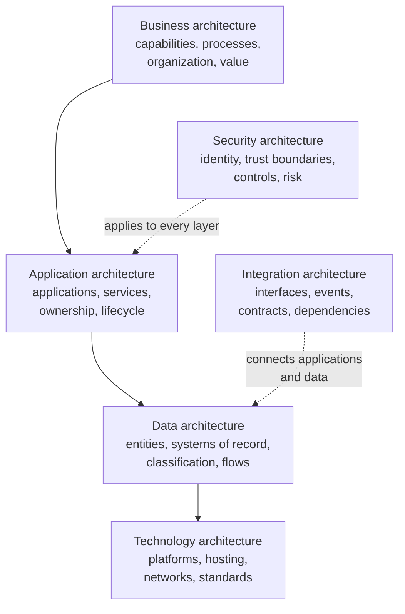
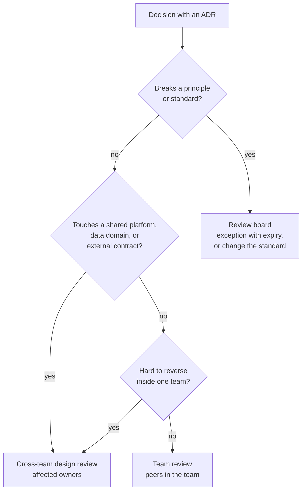
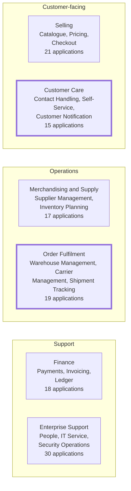
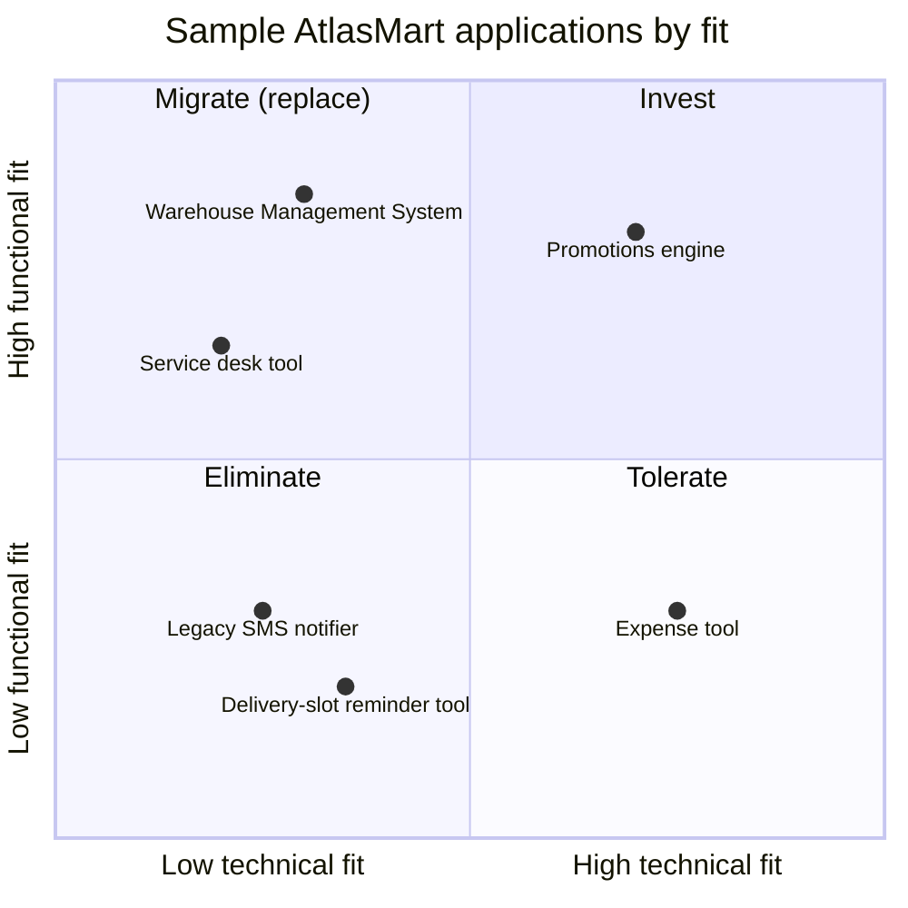
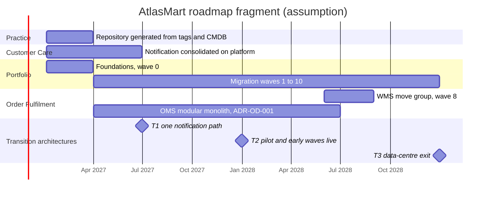

# Enterprise architecture practice

> A solution architect asks "what should this system be?". An enterprise architect asks "given
> everything we already run and everything the business wants next, which changes should we make,
> in what order, and under which shared rules?". The practice answers with a handful of living
> artifacts: a capability map, an application portfolio, a dependency map, a few principles and
> standards, a roadmap, and a repository that keeps them true.

!!! abstract "Page facts"
    **Level:** Intermediate (the six domains and the artifacts are Level 1-2; portfolio
    rationalization, governance design, and operating models are Level 3) · **Status:** Draft ·
    **Time:** 60-75 minutes · **Last verified:** 2026-11-27

## Learning objectives

After this page you should be able to:

- Explain what enterprise architecture (EA) is for, and recognize four things it is often mistaken
  for.
- Name the six architecture domains (business, application, data, technology, security,
  integration) and the main artifact and question of each.
- Build an application portfolio, classify it with a rationalization model such as TIME, and say
  when to override the model's answer.
- Use a dependency map to sequence change across many applications.
- Choose between lightweight and heavy governance, and design a review flow scaled by blast radius.
- Write a roadmap as a sequence of transition architectures, and describe the operating model,
  domain ownership, and repository that keep EA artifacts current.

## Prerequisites

- [Stakeholders, business capabilities, and success metrics](../architecture-fundamentals/stakeholders-business-capabilities-and-success-metrics.md)
  — what a capability is and how a single initiative uses a capability map.
- [Trade-offs, principles, ADRs, and architecture governance](../architecture-fundamentals/trade-offs-principles-adrs-and-architecture-governance.md)
  — principles, ADRs, review boards, and fitness functions at the level of one solution.
- [As-Is and To-Be architecture, gap analysis, and build vs buy](../architecture-fundamentals/as-is-and-to-be-architecture-gap-analysis-and-build-vs-buy.md)
  — transition architectures and capability-based planning for one initiative.

## The problem this solves

Each solution page in this atlas designs one system; an organization runs a hundred. Without a
view across them, predictable problems appear: four applications send customer notifications, each
with its own opt-out list; a database reaches end of life in an application nobody owns; a migration
moves a system and discovers eleven others call it over a hard-coded address; two initiatives fund
the same capability twice; and the review board re-argues questions no shared rule settles.

These are failures of visibility, ownership, and sequencing across the estate, not of any single
design. Enterprise architecture supplies all three.

## What it is

**Enterprise architecture** is the practice of keeping an organization's business strategy, its
capabilities, and its portfolio of applications, data, and technology aligned over years. It does so
by making the current landscape visible, agreeing a small set of shared rules, and planning change
across many systems at once. The glossary's [Enterprise Architect](../start-here/glossary.md) entry
describes the role; this page describes the practice.

What EA is **not**:

| Mistaken for | Why it is not that |
|---|---|
| A diagram library | Diagrams are outputs; the practice is the decisions they support. A repository nobody consults is shelfware |
| An approval gate | EA sets the rules and the sequence; teams decide inside them. A board that approves every change becomes the bottleneck it was meant to remove |
| Solution architecture at a larger scale | A solution architect optimizes one system; EA trades off across systems, sometimes making one system worse to make the estate better (retiring a team's favourite tool, for example) |
| A framework certification | TOGAF, Zachman, and others are toolkits; adopting one is not the same as practising EA ([frameworks page](enterprise-architecture-frameworks.md)) |
| An IT-only activity | Half the work is business architecture: which capabilities matter, which differentiate, which can be bought |

The practice has six recurring artifacts, each answering one question:

| Artifact | Question it answers | Updated |
|---|---|---|
| Capability map (with heat map) | What must the business be able to do, and where does it hurt? | Yearly, or when strategy changes |
| Application portfolio | What do we run, who owns it, what does it cost, how healthy is it? | Continuously, generated where possible |
| Dependency map | What breaks or must move together if this changes? | Continuously, discovered where possible |
| Principles and standards | Which trade-offs are already decided for everyone? | When a rule collects too many exceptions |
| Roadmap | Which changes happen in which order, through which intermediate states? | Quarterly |
| Architecture repository | Where do all of the above live, linked, versioned, and searchable? | Always |

## Mental model

Think of an airline's fleet planning office. It does not design aircraft (that is solution
architecture). It knows which routes the airline must fly (capabilities), which aircraft it owns,
their age, their running cost, and which routes each one serves (the application portfolio). It keeps
the fleet to a few types so pilots, parts, and maintenance can be shared (standards). It knows which
aircraft are booked onto which connecting flights (dependencies). And it publishes a multi-year plan
for retiring old types and introducing new ones without grounding the schedule (the roadmap, with
transition states the airline actually flies through).

**Where the analogy breaks:** applications decay by falling behind the business, not on a known
schedule, and they change in flight, so EA plans continuous change. And no regulator forces an
application inventory to be accurate; only automation and ownership do.

## Key terms

| Term | Meaning on this page |
|---|---|
| Enterprise architecture (EA) | The practice of aligning strategy, capabilities, and the technology portfolio across the whole organization over years |
| Capability map | A hierarchy of business capabilities (level 1 coarse, level 2 and 3 finer), often coloured by pain or importance (a heat map) |
| Process map | A sequence of activities across roles that produces an outcome, showing hand-offs, used to find delay and error |
| Application portfolio | The inventory of applications with owner, capabilities served, cost, technical health, business fit, and lifecycle dates |
| Application rationalization | Deciding, application by application, whether to keep investing, tolerate, replace, or retire |
| TIME | A rationalization model attributed to Gartner: Tolerate, Invest, Migrate, Eliminate, placed by technical fit and functional fit |
| Dependency map | The interfaces, data flows, and shared infrastructure between applications, with direction and criticality |
| Standard | A specific, enforceable technology or practice choice ("PostgreSQL for relational data"), narrower than a principle |
| Transition architecture | An intermediate state the organization will actually run for a period between As-Is and To-Be |
| Operating model | How the business integrates and standardizes its processes; separately, how the EA function itself is organized |
| Domain ownership | One accountable team per capability, application, or data domain |
| System of record | The one application whose copy of a data entity is authoritative |
| Architecture repository | The versioned, linked store of EA artifacts, ideally generated from live sources |

## How it works

### Six architecture domains

EA keeps several views of the same enterprise. Four are layers, each built on the one below; two
cut across all of them.

**Figure 1 — The six architecture domains.** Solid arrows mean "is realized by"; the two
cross-cutting domains apply to every layer.

How to read it: read the solid chain top to bottom. A capability is realized by applications,
which own data, which run on technology. Security and integration are drawn beside the chain
because a change in any layer must be checked against both.

The split is not arbitrary. TOGAF organizes its method around business, data, application, and
technology architecture; the US Federal Enterprise Architecture Framework (FEAF v2) uses reference
models for performance, business, data, applications, infrastructure, and security (references).
This atlas adds integration as a named domain because at enterprise scale the interfaces between
applications cause as many failures as the applications themselves.

| Domain | Describes | Key artifact | Question it settles | Deep page |
|---|---|---|---|---|
| Business | Capabilities, processes, value streams, organization | Capability map, process maps | Where should investment go? | [Stakeholders and capabilities](../architecture-fundamentals/stakeholders-business-capabilities-and-success-metrics.md) |
| Application | Applications and services, what each does, owner, lifecycle | Application portfolio | Which applications do we keep, change, or retire? | This page |
| Data | Data entities, systems of record, classification, flows | Data catalogue, entity-to-system map | Who owns customer, order, and product data? | [Data security and privacy](../security-architecture/data-security-and-privacy.md) |
| Technology | Hosting, platforms, networks, technology standards | Technology standards catalogue, platform map | Which platforms and versions do we support? | [Cloud building blocks and landing zones](../cloud-architecture/cloud-building-blocks-and-landing-zones.md) |
| Security | Identity, trust boundaries, control coverage, risk | Control map, threat models | Is every application inside the security baseline? | [Security principles and threat modeling](../security-architecture/security-principles-and-threat-modeling.md) |
| Integration | Interfaces, events, contracts, shared integration platforms | Interface catalogue, dependency map | What breaks or must move together? | [Integration architecture](../application-and-api-architecture/integration-architecture.md) |

### Capability maps and process maps

The capability map (defined on the
[stakeholders page](../architecture-fundamentals/stakeholders-business-capabilities-and-success-metrics.md))
becomes an enterprise tool when every application in the portfolio is linked to the capabilities it
realizes. Three overlays then do most of the work:

- **Application count per capability.** One level-2 capability realized by four applications is a
  consolidation candidate; one realized by none is a gap or a spreadsheet.
- **Heat.** Strategic importance and current pain, scored with the capability's business owner.
  "Important and painful" is where investment goes.
- **Differentiation.** Capabilities where the company competes are candidates to build; commodity
  capabilities are candidates to buy (developed on the
  [As-Is/To-Be page](../architecture-fundamentals/as-is-and-to-be-architecture-gap-analysis-and-build-vs-buy.md)).

A **process map** (usually swimlanes per role) shows *how work flows today* across capabilities,
while the capability map shows *what* exists. Architects use it to find hand-offs (manual
re-keying between two applications is an integration gap) and to check that a roadmap step does
not break a process that crosses several capabilities.

### Application portfolios and rationalization

An **application portfolio** is an inventory with enough attributes to make decisions. The minimum
useful record per application:

| Attribute | Why it matters |
|---|---|
| Purpose, owning team, and business owner | Every decision needs a purpose to test and someone who can say yes |
| Capabilities realized and criticality (DR tier) | Links to the capability map; sets the cost of getting a change wrong |
| Data held and its classification | Drives security, residency, and retention obligations |
| Hosting, technologies with versions, lifecycle dates | Feeds end-of-life tracking, contract renewals, and migration planning |
| Run cost (consistent unit), functional and technical fit | Makes "is it worth keeping?" answerable; inputs to rationalization |

**Rationalization** turns the inventory into decisions. A widely used model is **TIME**, which the
software vendor SAP LeanIX publishes guidance on and attributes to Gartner (references). Each
application is scored on **functional fit** (how well it supports the business capabilities it
serves) and **technical fit** (supportability, security, operability, alignment with standards),
then placed in a quadrant:

| Functional fit | Technical fit | TIME disposition | Meaning |
|---|---|---|---|
| Low | High | Tolerate | Keep running as is, with no new investment, and review again |
| High | High | Invest | Worth improving; it is part of the target landscape |
| High | Low | Migrate | The need is real but this application is the wrong vehicle; move the capability to a better one |
| Low | Low | Eliminate | Retire it; move or archive its data |

Two cautions. First, TIME's "Migrate" means *replace the application*, not "move it to the cloud";
the cloud migration strategies (rehost, replatform, refactor, and the rest) are a separate,
later decision on the [legacy modernization page](legacy-modernization-and-migration.md). Second, the
quadrant is a starting hypothesis. An application with a good fit for the business but low technical
fit only because its hardware is old needs new hosting, not a new application; the architect
overrides the quadrant and records why.

### Dependency mapping across the estate

At solution level, a dependency map lists what one workload needs (the
[landing-zone page](../cloud-architecture/cloud-building-blocks-and-landing-zones.md) maps them by scope
and plane). At enterprise level, it is a graph of applications: who calls whom, which data flows
where, and which applications share a database, a file drop, or a batch schedule. Sources, from most
to least trustworthy: network flow logs and distributed traces, integration platform configuration,
configuration management database (CMDB) records, and interviews.

Three uses dominate:

- **Sequencing.** Applications with high **fan-in** (many consumers) move late, behind stable
  interfaces; leaf applications move early. Tightly coupled clusters move together in one wave.
- **Blast radius.** Fan-in tells you how many applications a failure or a breaking change affects,
  which feeds DR tiering.
- **Safe retirement.** An application cannot be eliminated until its inbound dependencies are zero;
  "nobody uses it" is a hypothesis to test with flow logs, not an assumption.

### Standards, principles, and governance at enterprise scale

The [governance page](../architecture-fundamentals/trade-offs-principles-adrs-and-architecture-governance.md)
covers principles, ADRs, review boards, and fitness functions for one solution. At enterprise scale
three additions matter:

1. **A standards catalogue.** Principles say "prefer managed services"; standards say which ones.
   Each technology sits in a ring such as adopt, trial, assess, or hold, a format popularized by the
   Thoughtworks Technology Radar. "Hold" means no new uses; existing ones get a retirement date on the
   roadmap.
2. **Exceptions with expiry.** Every approved deviation from a standard is an ADR with an end date.
   A standard that collects many exceptions is wrong and gets revised.
3. **Review scaled by blast radius.** Most decisions stay inside teams; only changes that cross a
   shared platform, a data domain, or a standard go to a cross-team review.

**Figure 2 — Where a decision is reviewed.** Each question routes the decision to the lightest
review that can catch its risk.

How to read it: the board sees only exceptions and standards changes; cross-team reviews see
shared-impact or irreversible decisions. If most decisions reach the board, the standards are wrong.

Lightweight and heavy governance differ in mechanism more than intent:

| Aspect | Lightweight governance | Heavy governance |
|---|---|---|
| Who decides | Teams, inside published principles and standards | A central board approves designs |
| How rules are enforced | Fitness functions, pipeline checks, landing-zone guardrails | Document review and sign-off |
| Board's role | Sets standards, grants time-boxed exceptions, meets monthly | Gate on every project phase |
| Fits | Many autonomous teams, fast change, automated platforms | Heavily regulated change, few large programmes, external audit demands sign-off evidence |
| Fails by | Drift when rules are not automated | Queues, bypassing, and decisions taken before the review that only rubber-stamps them |

### Roadmaps and transition architectures

An EA **roadmap** sequences change across many applications. Good roadmaps share four traits:

- **Stated as capability increments**, not projects ("Customer Notification consolidated on one
  platform"), so funding follows capabilities ([capability-based planning](../architecture-fundamentals/as-is-and-to-be-architecture-gap-analysis-and-build-vs-buy.md)).
- **Punctuated by transition architectures**: named intermediate states the business will really
  run, each with its own data flows, security review, and DR posture.
- **Dependency-ordered**: the dependency map, not enthusiasm, decides what goes first.
- **Honest about horizon**: the next two quarters are committed, the following quarters are
  intentions, and beyond that are themes. A two-year roadmap with week-level dates is fiction.

### Operating models

The term has two meanings, and EA needs both.

The **business operating model** describes how much the business integrates data across its units
and how much it standardizes processes. Ross, Weill, and Robertson's four models (diversification,
coordination, replication, unification) make the point that the right architecture depends on it:
a unified business needs shared systems of record and shared processes; a diversified one needs
mostly shared infrastructure and little else (references).

The **EA function's operating model** describes how architects are organized:

| Model | How it works | Strength | Weakness |
|---|---|---|---|
| Central | One EA team owns all artifacts and reviews | Consistency | Distance from delivery; bottleneck |
| Federated | A small central team sets rules and keeps the repository; architects sit in domains or product teams | Close to delivery, still coherent | Needs a strong community of practice to stay aligned |
| Embedded only | No central team; each team's architect follows shared principles | Fast, cheap | No one owns the cross-estate view; portfolio decays |

Microsoft's Cloud Adoption Framework draws the same spectrum for cloud operations (centralized,
shared management, decentralized), favouring shared management for larger estates (references).

### Domain ownership

Every capability, application, and data domain needs exactly one accountable owner: a heat map
with no owner cannot be funded, an application with no owner cannot be retired. Data ownership
matters most: for each core entity
(customer, order, product, shipment) one application is the **system of record** and one team owns
its definition and quality; everyone else consumes copies. Data mesh writing argues for pushing
analytical data ownership into the same business domains, which follows the same idea (references).
Conway's law (glossary) applies: if ownership boundaries do not match the capability map, the
architecture will drift toward the organization chart instead.

### Architecture repositories

The **architecture repository** links the capability map, portfolio, dependency map, standards,
ADRs, roadmaps, and diagrams. The hard part is keeping it true: form-based repositories go stale
within months. Durable ones are **generated where possible** (tags give owner, environment, cost
centre, and classification; the CMDB gives on-premises hosts; flow logs and traces give
dependencies; ADRs are indexed in place). Humans curate only business fit, strategic importance,
and the target state.

## Worked example: AtlasMart's capability map, portfolio, and roadmap

Existing facts used: the migration brief's 120 applications in waves of 10 to 15, the legacy Order
Management System (OMS), the on-premises Warehouse Management System (WMS), and the tagging
scheme. Everything else is a labelled assumption.

### Step 1 — The enterprise capability map

**Scope (assumption, shared with the legacy modernization page):** the 120 applications in the
distribution-centre data centre. The product teams' 40 platform services, such as the Order
Tracking System, and the OMS are in the repository but not in this exercise. The architects extend the stakeholders page's map to six level-1 capabilities.

**Figure 3 — AtlasMart's level-1 capability map with application counts.** Each box lists level-2
capabilities and the number of the 120 applications that realize it. A thick border marks a
capability the heat map rates "important and painful".

How to read it: the counts add to 21 + 15 + 17 + 19 + 18 + 30 = 120. Customer Care is hot because
Customer Notification is realized by four systems (three legacy applications plus the platform's
Notification Worker), each with its own opt-out list. Order Fulfilment is hot because Warehouse
Management runs on ageing on-premises virtual machines. Enterprise Support has the most applications
and the least strategic weight, so it is where Eliminate candidates cluster.

### Step 2 — Score and classify the portfolio

Scoring rules (assumption): each capability's business owner scores **functional fit** 1-5; the
platform and security teams score **technical fit** 1-5 from supportability, end-of-life dates,
open security findings, and whether a restore has been tested. A score of 3 or more counts as high.

| TIME disposition | Applications | Share | Usual migration strategy (starting hypothesis) |
|---|---|---|---|
| Invest | 34 | 34 ÷ 120 ≈ 28% | Replatform (26) or refactor and re-architect (8) |
| Tolerate | 60 | 60 ÷ 120 = 50% | Rehost (42), relocate (8), or retain (10) |
| Migrate (replace) | 12 | 12 ÷ 120 = 10% | Repurchase as SaaS (12) |
| Eliminate | 14 | 14 ÷ 120 ≈ 12% | Retire (14) |
| Total | 34 + 60 + 12 + 14 = 120 | 100% | Matches the classification on the [legacy modernization page](legacy-modernization-and-migration.md) |

**Figure 4 — A sample of the portfolio on the TIME grid.** Points are individual applications
(assumptions); the quadrant labels are the default dispositions.

How to read it: the vertical axis is business value, the horizontal axis is technical health.
Two points sit in the Migrate quadrant for different reasons, which the next table resolves.

| Application | Functional / technical fit | Default | Decision and reason |
|---|---|---|---|
| Warehouse Management System | 4 / 2 | Migrate | **Override to Invest (in hosting):** the package fits the warehouse well; the low technical score comes from end-of-support hardware. Replatforming it fixes the score without replacing it ([case study 09](../end-to-end-case-studies/cs-09-hybrid-migration-with-private-connectivity.md)) |
| Service desk tool | 3 / 1 | Migrate | Migrate: commodity capability, unsupported version; replace with SaaS |
| Legacy SMS notifier | 2 / 1 | Eliminate | Eliminate: the platform's Notification Worker already sends SMS through the Notification Provider |
| Delivery-slot reminder tool | 1 / 2 | Eliminate | Eliminate: reminders move to the same Notification Worker |
| Promotions engine | 4 / 4 | Invest | Invest: differentiating, healthy, on the target landscape |
| Expense tool | 2 / 4 | Tolerate | Tolerate: adequate, cheap, not strategic; rehost, review at contract renewal |

**What elimination is worth.** Assume each Eliminate application averages 25 CU per month
(illustrative): 14 × 25 = 350 CU per month, or 350 × 12 = 4,200 CU per year, released. Assume
decommissioning takes 10 person-days each: 14 × 10 = 140 person-days, which the roadmap must fund.
Eliminating barely shortens the programme (a retirement still waits for its last consumer to move,
so the legacy modernization page schedules it in a wave), but 14 applications are switched off
instead of being moved, tested, secured, and paid for in the cloud.

### Step 3 — Map the dependencies that set the order

From flow logs at the hub and the integration platform's configuration (fan-in counts are
assumptions). The Order Management System is not one of the 120 (its route is fixed by ADR-OD-001
on the [architecture styles page](../software-architecture/architecture-styles.md)) but sits on the
map because so much depends on it.

| Application | Fan-in (consumers) | Notable consumers | Consequence for the roadmap |
|---|---|---|---|
| Order Management System | 11 | Checkout, Order Tracking, WMS, ledger, contact-centre desktop | Never replaced in one step; change it behind its existing interfaces |
| Warehouse Management System | 6 | OMS, Logistics Vendor Platform interface, label printing, floor scanners, reports | Moves late as one move group, after the runbook is proven |
| Legacy SMS notifier | 2 | OMS, delivery-slot reminder tool | Both consumers must switch to the Notification Worker before retirement |
| Expense tool | 0 | none | Leaf: no sequencing constraint |

The SMS row shows why the dependency map precedes elimination: switching off the notifier on its
planned date would silently stop OMS order messages.

### Step 4 — Governance and ownership

- **Principles and standards:** the seven principles from the
  [governance page](../architecture-fundamentals/trade-offs-principles-adrs-and-architecture-governance.md)
  apply enterprise-wide. Standards catalogue (assumption): managed Kubernetes, PostgreSQL, the
  managed queue, and OpenTelemetry in "adopt"; the on-premises virtualization stack in "hold".
- **Review board (assumption):** monthly, 60 minutes, two enterprise architects plus the platform
  and security leads; only exceptions (6-month expiry) and standards changes, as in Figure 2.
- **Operating model:** AtlasMart is one brand with shared customers, orders, and stock across
  channels, which is closest to Ross, Weill, and Robertson's unification model: shared systems of
  record matter more than local freedom. The EA function is federated: two central enterprise
  architects (assumption) and a named architecture owner in each of the eight product teams.
- **Data domain ownership (assumption):** customer (Identity and Customer team), order (Order
  Management team, OMS as system of record), shipment events (Order Tracking team, Tracking Event
  Store), product (Catalogue team), stock (Inventory team).
- **Repository:** one YAML record per application in git; ownership and classification fields are
  generated from the mandatory tags (`owner-team`, `environment`, `cost-centre`,
  `data-classification`, `backup-tier`) and the CMDB; fit scores are curated quarterly.

### Step 5 — A two-year roadmap fragment

**Figure 5 — AtlasMart roadmap fragment, January 2027 to December 2028 (assumption).** Bars are
capability increments; diamonds are transition architectures. Wave timing follows the legacy
modernization page (a 3-month foundations wave, then 10 waves; the WMS in wave 8).

How to read it: the first six months are committed; 2028 is intention. T1 comes first because it
is cheap, unblocks two eliminations, and reduces a privacy risk (one opt-out list instead of four).
The WMS goes late because its move group is large and the hybrid link must first prove itself on
earlier waves. T3 leaves only the retained floor systems on premises. Each transition architecture
gets its own short review of data flows, duplicates, and DR tier.

## Real-world architecture example

A typical arc: an EA team formed after a merger or audit finding spends a year documenting every
application by interview; the result is wrong six months later. The second attempt inverts the
effort: the portfolio is generated from cloud tags, the CMDB, and the licence list, and architects
spend their time on capability heat, fit scoring with business owners, and the dependency map for
the next two waves. The board shrinks to a monthly exceptions meeting, and the most-read artifact
becomes a one-page roadmap with three transition states.

## Design choices and trade-offs

| Choice | Favor when | Avoid when |
|---|---|---|
| Federated EA operating model | Several product teams with their own architects; fast change | A tiny organization (one architect is the EA) or a crisis needing central control for a period |
| Central EA team | Merger, heavy regulation, or a portfolio no one has mapped | Teams are autonomous and the team would become a queue |
| TIME rationalization | Large portfolio with obvious overlap; a funding cycle to feed | A handful of applications; just decide each one |
| Generated repository (tags, CMDB, flow logs) | Cloud estate with enforced tagging; CMDB in use | Data sources are themselves wrong; fix tagging first |
| Commercial EA repository tool | Many architects, formal modelling needs, regulator-facing reporting | No one will maintain it; a git repository of YAML and Markdown is enough |
| Roadmap by transition architectures | Multi-year, multi-system change | Single-team change; a backlog is enough |
| Heavy, gated governance | Regulated change where sign-off evidence is mandatory | Many teams shipping daily; automate the rules instead |

## Failure modes and anti-patterns

- **Ivory-tower EA.** Target-state pictures delivery never sees. Detect: roadmap items with no
  funded team. Prevent: federated model, architects in delivery reviews, roadmap tied to funding.
- **Shelfware repository.** Detect: owner fields naming teams that no longer exist. Prevent:
  generate fields from tags and the CMDB; fail deployments without owner tags.
- **Capability map drawn as the org chart.** Detect: a reorganization changes the map. Prevent:
  noun-phrase capabilities that would still exist if the work were outsourced.
- **Rationalization without owners.** Detect: Eliminate applications still running a year later.
  Prevent: each disposition has a business owner, a date, and a decommissioning budget.
- **Retiring by assumption.** Detect: flow logs show traffic to "unused" systems. Prevent: zero
  inbound dependencies for 30 days before shutdown, plus a scream test with quick rollback.
- **Roadmap as wish list.** Detect: no dependencies or transition states on it. Prevent:
  dependency-ordered increments and a committed horizon of two quarters.
- **Framework theatre.** The practice is measured by artifacts produced rather than decisions
  improved; see the [frameworks page](enterprise-architecture-frameworks.md).

## Security considerations

- **The portfolio is the attack-surface inventory.** Unknown applications are unpatched
  applications. End-of-life dates and data classification per application drive security priorities.
- **Security architecture is a domain, not a review step.** Each roadmap step and transition
  architecture needs its own trust-boundary review; temporary integrations (file drops, VPN-only
  paths during migration) are where controls lapse.
- **The repository is sensitive.** A map of systems of record and weak points helps an attacker:
  restrict write access, log full exports, and keep credentials out of it.
- **Retirement is a security event.** Remove accounts, keys, firewall rules, and DNS records, and
  archive data under its retention rule; orphaned access outlives orphaned servers.

## Performance, reliability, and cost

- **Reliability:** fan-in sets DR tiers and hardening order; an application with eleven consumers
  deserves a stricter SLO than a leaf, whatever its own users say.
- **Performance:** transition architectures often add latency (calls crossing the hybrid link while
  part of a cluster has moved). Budget it per transition, not only for the end state.
- **Cost:** the portfolio, with run cost in a consistent unit, makes cost per capability visible;
  showback by the `cost-centre` and `owner-team` tags connects it to FinOps
  ([cloud cost models and FinOps](../finops-and-sustainability/cloud-cost-models-and-finops.md)).
  Rationalization before migration is usually the largest single cost lever: work not done is
  cheaper than work done well.

## Hands-on lab: classify a small portfolio

A local, free exercise with Python's standard library (PyYAML optional).

1. Write `portfolio.yaml` with 12 fictional applications, each with `name`, `owner`, `capability`,
   `functional_fit` and `technical_fit` (1-5), `run_cost_cu_month`, and a `consumers` list.
2. Write a script that assigns a TIME disposition with the rule "3 or more is high", prints the
   count per disposition, and checks the counts add up to 12.
3. Print each capability with its application count, and flag any capability realized by three or
   more applications.
4. Compute fan-in for each application from the `consumers` lists, and print the Eliminate
   candidates that still have consumers.
5. Add an `override` field with a `reason` to one application and make the script prefer it,
   printing the reason next to the default.

??? question "Hint: what should the script do with an Eliminate candidate that has consumers?"
    It should not silently retire it. Report it as "blocked by N consumers", list them, and leave
    the disposition as Eliminate with a dependency to clear. That mirrors the legacy SMS notifier
    in the worked example: the decision is right, but the date depends on the OMS switching first.

## Knowledge check

1. Name the six architecture domains and say which two cut across the others.
2. What is the difference between TIME's "Migrate" and a cloud migration strategy such as rehost?
3. Why does an application's fan-in matter when planning a roadmap?
4. Give two signs that a review board has become heavy governance in the harmful sense.
5. Why should most fields in an architecture repository be generated rather than entered by hand,
   and which fields cannot be?

??? success "Answers"
    1. Business, application, data, technology, security, and integration; security and integration
       cut across all layers.
    2. TIME's Migrate means the capability should move to a better application (replacement). A
       cloud migration strategy decides how an application that stays is moved (rehost, replatform,
       and so on). TIME comes first; only applications that remain need a migration strategy.
    3. High fan-in means many applications break if it changes or fails, so it moves late, behind
       stable interfaces, and in small steps; leaves can move early. Fan-in also raises its DR tier.
    4. Most decisions queue for board approval, and decisions are taken before the review so the
       board only rubber-stamps them, or teams bypass it.
    5. Hand-entered data goes stale within months; tags, the CMDB, and flow logs stay current
       because operations depend on them. Business fit, strategic importance, target state, and
       overrides with reasons need human judgement.

## Architecture discussion questions

1. Finance proposes eliminating the 30 applications with the highest run cost. Argue against the
   method, and propose a rule that still gives finance a cost target.
2. The OMS has eleven consumers and low technical fit. One team proposes replacing it with a
   packaged order management product in one release. Use the dependency map and transition
   architectures to evaluate the proposal.
3. AtlasMart acquires a retailer with 80 applications. Which operating model assumptions change,
   and what should the first ninety days of EA work produce?

## Summary

Enterprise architecture keeps strategy, capabilities, and the technology portfolio aligned across
many systems and years. It works through six domains (business, application, data, technology, plus
cross-cutting security and integration) and a few living artifacts: a capability map with heat, an
application portfolio scored for functional and technical fit, a dependency map, principles and a
standards catalogue, a roadmap of transition architectures, and a repository generated from live
sources. Governance stays light: teams decide inside published rules, the board handles expiring
exceptions, and automation enforces the rest. AtlasMart's 120 applications sort into 34 Invest,
60 Tolerate, 12 Migrate, and 14 Eliminate, a starting hypothesis for each one's migration strategy;
fan-in puts the notification clean-up first and the WMS move group late.

## Related topics

- **Before:** [Stakeholders, business capabilities, and success metrics](../architecture-fundamentals/stakeholders-business-capabilities-and-success-metrics.md);
  [Trade-offs, principles, ADRs, and architecture governance](../architecture-fundamentals/trade-offs-principles-adrs-and-architecture-governance.md);
  [As-Is and To-Be architecture, gap analysis, and build vs buy](../architecture-fundamentals/as-is-and-to-be-architecture-gap-analysis-and-build-vs-buy.md);
  [C4 model](../architecture-fundamentals/c4-model.md)
- **Alongside:** [Enterprise architecture frameworks](enterprise-architecture-frameworks.md);
  [Legacy modernization and migration](legacy-modernization-and-migration.md);
  [Hybrid and multi-cloud architecture](hybrid-and-multi-cloud-architecture.md);
  [Integration architecture](../application-and-api-architecture/integration-architecture.md);
  [Cloud building blocks and landing zones](../cloud-architecture/cloud-building-blocks-and-landing-zones.md);
  [Cloud cost models and FinOps](../finops-and-sustainability/cloud-cost-models-and-finops.md);
  [Case study 09: hybrid migration with private connectivity](../end-to-end-case-studies/cs-09-hybrid-migration-with-private-connectivity.md)
- **Planned:** data architecture and governance in depth (D06-T02..T04); AI governance at
  enterprise scale (D19-D25).

## References

| Source | Type | Checked |
|---|---|---|
| The Open Group, [The TOGAF Standard, 10th Edition](https://www.opengroup.org/togaf) | Standard (architecture domains, repository, transition architectures) | 2026-11-27 |
| US Office of Management and Budget, [Federal Enterprise Architecture Framework Version 2](https://obamawhitehouse.archives.gov/sites/default/files/omb/assets/egov_docs/fea_v2.pdf) (29 January 2013) | Government framework (performance, business, data, application, infrastructure, and security reference models) | 2026-11-27 |
| SAP LeanIX, [Gartner TIME framework: Tolerate](https://leanix.net/en/blog/gartner-time-tolerate) | Vendor explainer of the TIME model, attributed to Gartner (Gartner's own research is subscription-only) | 2026-11-27 |
| Jeanne W. Ross, Peter Weill, David C. Robertson, *Enterprise Architecture as Strategy: Creating a Foundation for Business Execution* (Harvard Business School Press, 2006) | Book (business operating models) | 2026-11-27 |
| Zhamak Dehghani, [Data Mesh Principles and Logical Architecture](https://martinfowler.com/articles/data-mesh-principles.html) — martinfowler.com | Article (domain-oriented data ownership) | 2026-11-27 |
| Thoughtworks, [Technology Radar](https://www.thoughtworks.com/radar) | Industry publication (adopt, trial, assess, hold rings) | 2026-11-27 |
| Microsoft, [Prepare your organization for the cloud](https://learn.microsoft.com/azure/cloud-adoption-framework/plan/prepare-organization-for-cloud) — Cloud Adoption Framework | Official guidance (centralized, shared, and decentralized operating models; strategy per workload before migration) | 2026-11-27 |

## Review notes

- Canonical page for D18-T01. In depth: six domains, portfolio and TIME rationalization,
  dependency mapping, enterprise governance (standards catalogue, expiring exceptions, review
  routing, lightweight vs heavy), roadmaps, operating models, domain ownership, repositories. Only
  defined: process maps (no notation such as BPMN), integration and data architecture (linked).
- TIME is cited through SAP LeanIX's explainer: Gartner's pages return 403 to scripts and its
  research is subscription-only. Some sources name the axes business value and technical quality.
  Ross, Weill, and Robertson's operating models are cited from the book (no URL).
- **Aligned with V10's legacy modernization page:** the 120 applications all sit in the
  distribution-centre data centre; the OMS is outside the count (ADR-OD-001); TIME counts map onto
  V10's 7 Rs (Invest 34 = replatform 26 + refactor 8; Tolerate 60 = rehost 42 + relocate 8 + retain
  10; Migrate 12 = repurchase 12; Eliminate 14 = retire 14); WMS in wave 8 (about mid-2028 if the
  programme starts January 2027, an assumption here). Case study 09 (V12) should match.
- New AtlasMart assumptions: six level-1 capabilities with counts 21/15/17/19/18/30; the TIME
  split and its mapping; fit-scoring rule (1-5, 3+ is high) and the sample scores; 25 CU per month
  per Eliminate application (illustrative), 10 person-days to decommission each; fan-in OMS 11,
  WMS 6, SMS notifier 2; four notification systems; monthly 60-minute board, 6-month exception
  expiry; two central enterprise architects; data domain owners; roadmap dates and T1-T3.
- Figure 3 stacks subgraphs with `~~~`; Figure 5 is a `gantt` with milestones; check both themes.
