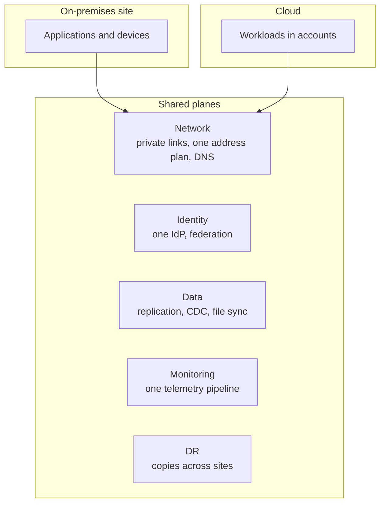
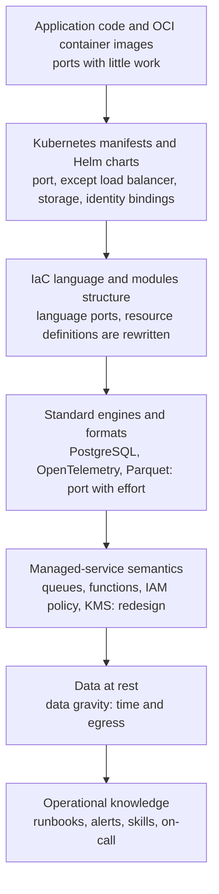
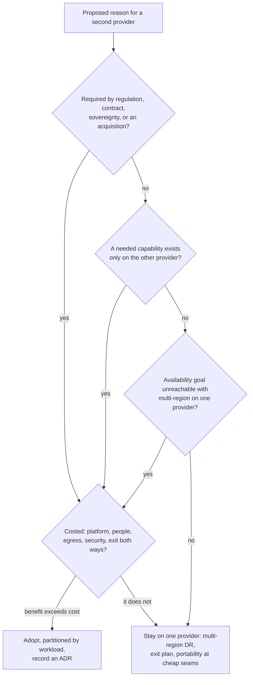
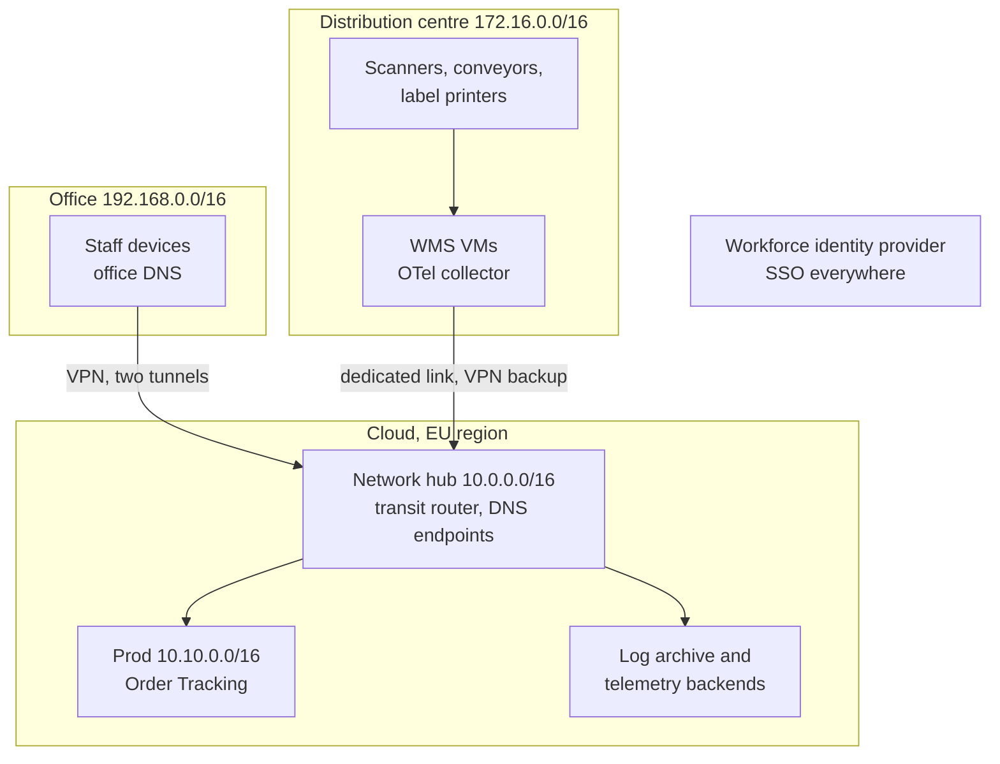

# Hybrid and multi-cloud architecture

> Hybrid means one estate spread across your own sites and a cloud; multi-cloud means more than one
> cloud provider. Both are normal, both are expensive in the same places (identity, network, data
> movement, and people), and the architect's job is to integrate what must be integrated and to
> refuse a second provider unless a reason survives the arithmetic.

!!! abstract "Page facts"
    **Level:** Intermediate (hybrid planes and portability are Level 1-2; the multi-cloud decision,
    exit planning, and sovereignty trade-offs are Level 3) · **Status:** Draft · **Time:** 60-75
    minutes · **Last verified:** 2026-11-27

## Learning objectives

After this page you should be able to:

- Describe how identity, network, storage, databases, monitoring, and DR are integrated between
  on-premises sites and a cloud, and name the usual failure for each.
- Explain cloud bursting and why it rarely works for stateful workloads.
- Say what really ports between providers (containers, much of Kubernetes, the IaC language, open
  data formats) and what does not (data gravity, identity and policy, managed-service semantics,
  operational knowledge).
- Estimate cross-cloud data movement in volume and transfer time, and list the parts of an exit plan.
- Separate data residency from sovereignty and recognize the providers' sovereign-cloud offerings.
- Apply a decision guide to "should we add a second cloud provider?" and record the result as an ADR.

## Prerequisites

- [Hybrid connectivity and VPNs](../networking/hybrid-connectivity-and-vpns.md) — tunnels, BGP,
  dedicated links, hybrid DNS; this page does not repeat them.
- [Cloud providers: principles before catalogs](../cloud-architecture/cloud-providers-principles-before-catalogs.md)
  — the seven lenses, provider equivalence, and provider hardware on your site.
- [Cloud service and deployment models](../cloud-architecture/cloud-service-and-deployment-models.md)
  — lock-in as exit cost and the lock-in register (D10-T01).
- [Data security and privacy](../security-architecture/data-security-and-privacy.md) — residency and
  sovereignty.

## The problem this solves

Few organizations live in one place. Warehouses and shops keep equipment that cannot move; a
migration takes years; an acquisition arrives with another provider; a regulator asks what happens if
the provider fails. Without a design, each of these becomes a one-off: a second directory, an
overlapping address range, a copy of the database nobody reconciles, dashboards that stop at the
data-centre boundary, and a second cloud adopted "to avoid lock-in" that doubles the platform work
without making anything more available. Hybrid and multi-cloud architecture decides which planes are
shared across environments, which are kept separate on purpose, and which reasons for adding an
environment are real.

## What it is

**Hybrid cloud** is an estate in which on-premises or private infrastructure and at least one public
cloud run as one system: shared identity, routed private networks, data that flows between them, and
common operations. **Multi-cloud** is the use of two or more public cloud providers. They combine:
"hybrid multi-cloud" is common in large enterprises.

Multi-cloud comes in two very different shapes:

- **Partitioned (by workload):** each workload runs on one provider; different workloads use
  different providers. Most real multi-cloud is this.
- **Redundant (the same workload on several providers):** for failover, bursting, or active-active
  across providers. Rare, because it multiplies the hardest problems.

Google Cloud's architecture patterns catalog makes the same split, grouping its patterns into
distributed ones (tiered hybrid, partitioned multicloud, analytics hybrid and multicloud, edge
hybrid) and redundant ones (environment hybrid, business continuity hybrid and multicloud, cloud
bursting). The names are useful vocabulary for any provider.

## Mental model

Think of a company with a head office and a regional branch that also hires an outside firm. To work
as one company they need one staff directory and badge system (identity), internal phone lines
(network), shared filing rules (data), one set of performance reports (monitoring), and a plan if one
building burns (DR). Hiring a **second outside firm** for the same work (multi-cloud redundancy)
means a second contract, induction, set of procedures, and coordinator, and it helps only if the two
firms do not share the same weak point.

**Where the analogy breaks:** data is heavy in a way paperwork is not. Moving terabytes between
providers takes hours and costs per gigabyte, and every chatty call between sites pays a network
round trip. And the "outside firms" do not speak the same language: identity models, policy
languages, and managed-service behaviour differ under similar names.

## Key terms

| Term | Meaning on this page |
|---|---|
| Hybrid cloud | On-premises or private infrastructure and at least one public cloud operated as one estate |
| Multi-cloud | Using two or more public cloud providers, partitioned by workload or redundant for the same workload |
| Hybrid identity | One workforce identity source federated to every environment, so people and workloads authenticate the same way everywhere |
| Cloud bursting | Running a workload on premises (or in one cloud) and overflowing excess load into a cloud when demand peaks |
| Portability | How easily the system moves to a different environment |
| Data gravity | The tendency of large data sets to keep applications near them, because moving the data costs time and money |
| Egress | Data leaving a provider's network (to the internet, another provider, or on premises), usually metered |
| Lock-in | The cost, time, and risk of moving a workload to another provider or platform |
| Exit plan | A documented, periodically tested procedure and estimate for leaving a provider |
| Data residency | Where data is stored, processed, and accessed from; sometimes required by law, contract, or policy |
| Sovereign cloud | A cloud offering designed so that operations, access, and legal control stay within one jurisdiction |

## How it works

**Figure 1 — The planes a hybrid estate must integrate.** Each plane is a decision: shared across
environments, or deliberately separate.

How to read it: both environments attach to the same five planes. A plane that is not shared (two
directories, two monitoring stacks) is where incidents take longest to diagnose.

### On-premises integration and hybrid identity

Integration starts with **identity**, because everything else is authorized by it. One workforce
identity provider (IdP) is federated to every cloud account and to on-premises applications, with
groups or SCIM provisioning driving access; a legacy directory on premises is synchronized to it or
retired, never run as a second source of truth. For **workloads**, avoid static keys crossing the
boundary: modern clouds can trust short-lived tokens from an external OIDC issuer (often called
workload identity federation), so an on-premises job or another cloud's service can obtain cloud
credentials without a stored secret. Typical failure: an on-premises directory outage blocks cloud
sign-in because federation depends on it; keep break-glass access that does not.

### Hybrid network

The [hybrid connectivity page](../networking/hybrid-connectivity-and-vpns.md) covers the mechanics.
The architectural decisions are: one non-overlapping address plan across every site and cloud; DNS
that resolves both ways; all hybrid traffic inspected once; and a latency budget for anything that
crosses. Latency is what breaks **tiered hybrid** designs (front end in the cloud, back end on
premises): a page that makes 20 sequential database calls across a link with a 10 ms round trip
spends 20 × 10 = 200 ms on the network alone. Chatty interfaces must be batched, cached, or moved
with their data.

### Hybrid storage and databases

Data crosses the boundary in four ways, each with its own consistency and failure behaviour:

| Mechanism | Use | Watch for |
|---|---|---|
| Asynchronous database replication or change data capture (CDC) | Migration, read copies in the cloud, analytics | Lag, schema changes breaking the stream, one-way only unless designed otherwise |
| File or object sync and storage gateways | File shares, backups, media | Conflicting edits; a gateway cache that hides link outages until it fills |
| Batch transfer | Nightly extracts, bulk seeding | Transfer windows; checksums; reruns |
| API calls across the link | Live integration | Latency, availability coupling to the link |

Keep **one writer per data set**; a hybrid design with writers on both sides of the link needs the
conflict handling described in [Consistency models, CAP, and PACELC](../distributed-systems/consistency-models-cap-and-pacelc.md).

### Hybrid monitoring and DR

**Monitoring:** run the same telemetry agents everywhere (OpenTelemetry collectors on on-premises
virtual machines as well as in clusters), send to the same backends, keep clocks synchronized, and
use the same resource attributes (site, environment, owner team) so one query spans the estate. Monitor
the hybrid links themselves: tunnel state, BGP sessions, and throughput are tier 1 signals once
operations depend on them.

**DR:** hybrid works in both directions. The cloud is a cheap DR site for on-premises systems
(backups to immutable cloud storage, or a pilot light of replicated virtual machines), and an
on-premises site is occasionally the DR site for the cloud. Either way the link is now a DR
dependency: size it for the restore, not only for daily traffic. Strategies and arithmetic are on
[Disaster recovery strategies](../reliability-and-disaster-recovery/disaster-recovery-strategies.md).

### Cloud bursting

**Cloud bursting** runs a workload on premises and overflows to the cloud at peak. It sounds like
buying only the baseline in hardware and renting the peaks; it rarely works for stateful systems,
because the burst capacity is far from the data (latency or a replica to maintain), the two
environments must be kept identical (images, configuration, secrets, quotas), and licences may not
transfer. It works for **stateless or batch** work that can carry its input with it: rendering,
simulations, test runs, and analytics on a data set already copied to the cloud. Many organizations
now do the reverse: run in the cloud and keep steady, predictable load on owned hardware.

### Portability: what really ports

**Figure 2 — Portability by layer.** Higher layers move easily; the lower ones carry the real exit
cost.

How to read it: the arrows point toward higher exit cost. Containers and Kubernetes make the top
of the stack portable; they do nothing for the bottom three, which is where an exit plan spends its
time. "Terraform or OpenTofu makes us portable" is the common misreading: the language and workflow
port, but each resource is provider-specific and is rewritten.

The [lock-in discussion on the deployment models page](../cloud-architecture/cloud-service-and-deployment-models.md#portability-and-lock-in)
gives the mitigations in order of value: standard interfaces where they are cheap, adapters at a few
seams, everything as code, and a written exit plan. Building every workload on the lowest common
denominator of several providers is usually the most expensive mitigation.

### Multi-cloud network, identity, governance, and security

When a second provider is in the estate, each plane needs a decision:

| Plane | Usual design | Cost of getting it wrong |
|---|---|---|
| Network | Each cloud has its own hub; clouds connect through private interconnects or VPNs, often meeting at a colocation or on-premises hub; one address plan across all | Overlaps, hairpin routing through on premises, double egress |
| Identity | One workforce IdP federated to both; workload identity federation between clouds instead of keys | Two sources of truth, orphaned access after leavers |
| Governance | Per-provider landing zones built from the same policy intent (tags, regions, encryption, logging), each in its own policy language | Rules drift apart; audits find a provider without the guardrail |
| Security | Logs from both clouds into one SIEM; posture management across both; keys per provider with one key inventory | Blind spots at the seams; incident response that knows only one provider |

### Cross-cloud data movement and egress

Data moving out of a provider is usually charged per gigabyte, and it also takes time. Check the
provider's current pricing pages for rates; design with volumes and durations. Transfer time for a
data set of S gigabytes over a link of B Gbit/s at efficiency e is S × 8 ÷ (B × e) seconds: 1 TB over
1 Gbit/s at 70% efficiency takes 1,000 × 8 ÷ 0.7 ≈ 11,400 s, a little over 3 hours. Ongoing
replication volume matters more than the seed: a design that copies every event, log, and backup
across providers pays egress on all of it forever. Aim to move results, not raw data, and keep
analytics next to the data it reads.

### Exit strategy, lock-in, residency, and sovereignty

An **exit plan** names, per provider: the triggers (provider failure, contract, regulation,
price), the target, the order in which workloads leave, how data is exported and in what format, the
estimated duration and cost, the skills needed, and the date it was last tested (at least a sample
export and a restore elsewhere). In the EU, the Data Act sets a framework for customers switching
between data-processing service providers; check with counsel which obligations apply to your
contracts.

**Residency** is where data is; **sovereignty** is whose law governs it and who can compel access.
Providers now sell **sovereign cloud** offerings that add jurisdiction-bound operations, staffing,
and key control, sometimes run by a local partner or fully disconnected. Names checked on 2026-11-27
(each links to the provider's own page):

| Provider | Offerings named on the provider's sovereignty pages |
|---|---|
| AWS | [AWS European Sovereign Cloud](https://docs.aws.amazon.com/whitepapers/latest/overview-aws-european-sovereign-cloud/introduction.html), described as a new, independent cloud for Europe |
| Microsoft | [Microsoft Sovereign Cloud](https://learn.microsoft.com/en-us/azure/azure-sovereign-clouds/), with Sovereign Public Cloud, Sovereign Private Cloud (on Azure Local), and National Partner Clouds |
| Google Cloud | [Sovereign Cloud from Google](https://cloud.google.com/sovereign-cloud): Google Cloud Data Boundary (public cloud), Google Cloud Dedicated (partner-operated), and Google Distributed Cloud air-gapped |

These are different services from the provider's standard regions, often with a narrower service
catalog and separate accounts; adopting one is closer to adding a provider than to adding a region.

Hybrid management planes let one provider's tools see resources elsewhere:
[Azure Arc](https://learn.microsoft.com/en-us/azure/azure-arc/overview) (servers and Kubernetes
clusters on premises and in other clouds), [GKE attached clusters](https://docs.cloud.google.com/kubernetes-engine/multi-cloud/docs/attached/eks/concepts/overview)
(registering conformant clusters, including Amazon EKS and Azure AKS, with Google's Kubernetes
management), and [Amazon EKS Hybrid Nodes](https://docs.aws.amazon.com/eks/latest/userguide/hybrid-nodes-overview.html)
(on-premises and edge machines as nodes of an EKS cluster; AWS documents that other clouds are not
supported). Each one makes that provider the control plane for the others, which is itself a
dependency to place in the lock-in register.

### Decision guide: why multi-cloud?

**Figure 3 — Should this workload use a second cloud provider?** Each "no" sends you to the cheaper
alternative; only a reason that survives every question justifies the second provider.

How to read it: the three questions are the reasons that hold up; the cost gate stops even a valid
reason from winning when the price is higher than the benefit. "Partitioned" is the default shape;
redundant multi-cloud needs its own, stronger case.

| Reason given | Holds up when | Does not hold up when |
|---|---|---|
| Regulation or a regulator's concentration concern | A rule or supervisor requires a tested exit or alternative for a critical service | It is a general worry; a tested exit plan usually satisfies it |
| Acquisition or merger | The acquired estate already runs elsewhere and moving it costs more than integrating | It is used to justify new workloads on the acquired provider by default |
| Unique capability | A service with no equivalent is central to the workload, and its data can live there | The capability is a feature gap the incumbent is closing, or the data would have to cross clouds constantly |
| Sovereignty or residency | Only one provider meets a jurisdiction's requirement | The incumbent has a compliant region or sovereign offering |
| Customer demand | Business-to-business customers require deployment in their provider | The demand is hypothetical |
| Availability | A provider-wide failure is a credible, unacceptable risk and multi-region cannot address it | Multi-region on one provider was not tried; shared dependencies (DNS, IdP, CI) would fail both anyway |
| "Avoid lock-in" | Backed by a costed exit scenario with a real trigger | It is the whole argument; the result is lowest-common-denominator design at double cost |
| Cheaper by arbitrage | Large, portable, stateless batch with little data | Egress, duplicated platforms, and lost discounts exceed the saving |

## Worked example: AtlasMart's hybrid estate and the second-provider question

AtlasMart is hybrid today and will stay hybrid: the distribution centre's 120 applications migrate
over two years ([legacy modernization](legacy-modernization-and-migration.md)), but the scanners,
conveyors, and label printers on the warehouse floor never leave (an **edge hybrid** pattern).

### The estate

| Site | Address range | Connection | What runs there |
|---|---|---|---|
| Cloud, one EU region, three zones | hub `10.0.0.0/16`, prod `10.10.0.0/16`, staging `10.20.0.0/16`, dev `10.30.0.0/16` | Hub-and-spoke, transit router ASN 64512 | 29 accounts, one cluster per environment, Order Tracking |
| Corporate office | `192.168.0.0/16`, ASN 65010 | Site-to-site VPN, two tunnels | Staff devices, office DNS for `corp.atlasmart.example` |
| Distribution centre | `172.16.0.0/16`, ASN 65020 | Planned dedicated private connection with VPN backup (case study 09) | WMS on virtual machines, floor devices |

**Figure 4 — AtlasMart's hybrid estate.** One cloud region, two sites, five shared planes.

How to read it: every site reaches the cloud only through the hub; the identity provider is shared
by all three. The floor-to-WMS arrow stays on premises before and after the WMS migrates; after
cs-09 it crosses the dedicated link, which then becomes a warehouse-operations dependency.

### The planes, decided

| Plane | AtlasMart decision |
|---|---|
| Identity | Workforce SSO federated into every account and into the WMS; the on-premises directory synchronizes from it (assumption) and is retired with the WMS migration |
| Network | One address plan, cloud advertises `10.0.0.0/8` to both sites, hybrid traffic through the hub firewall, conditional DNS forwarding both ways |
| Data | WMS database moves by bulk copy plus CDC (cs-09); until then, stock updates flow to the cloud by API through the hub |
| Monitoring | OpenTelemetry collectors on the WMS virtual machines export through the hub to the same backends; tunnel, BGP, and link throughput are alerting signals |
| DR | WMS backups copied to an immutable vault in the cloud (assumption), restore-tested as tier 2 until it migrates |

### The question: is a second cloud provider justified?

A board member asks whether AtlasMart should add a second provider "for resilience and to avoid
lock-in". The platform team writes an ADR.

| ADR-HM-001 | Second cloud provider |
|---|---|
| Context | One provider, one EU region today; tier 1 (checkout, payments, tracking) needs RPO 5 min / RTO 1 h including region loss; C-2 requires AtlasMart's accounts and pipeline; no regulation, acquisition, sovereignty gap, or customer requires another provider (checked with legal, an assumption of this example) |
| Options | A: one provider with a warm standby in a second EU region. B: a second provider as the tier 1 DR site. C: a second provider for one partitioned workload. D: active-active across two providers |
| Reasons tested (Figure 3) | Regulation: none applies. Unique capability: none needed. Availability: the RTO is met by option A (40-minute critical path on the DR page); a provider-wide failure is accepted as a residual risk, partly covered by the exit plan |
| Cost of B (assumption-based) | A second landing zone (identity federation, network hub, logging, guardrails in a second policy language), a second cluster platform, cross-provider replication, and 6-engineer on-call rotations in every product team trained on two providers. Compute for the standby alone equals option A's 8,760 CU per month (3 nodes × 4 vCPU × 730 h, illustrative 1 vCPU-hour = 1 CU); the platform team estimates the rest at two additional platform engineers' time ongoing (assumption) |
| Data movement | Tracking events: 480,000 × 500 B = 240 MB per day, about 7.2 GB per 30 days, plus the 430 GB seed. Small for tracking; checkout and payments add their own volumes, and every log, backup, and image copy crosses providers too |
| Decision | Option A. No second provider now |
| Consequences | Tier 1 DR stays within one provider's failure domain; the exit plan is written and a sample export (event store to an open format, restored on a local PostgreSQL) is tested yearly; portability is kept at cheap seams: OCI images, PostgreSQL engine, OpenTelemetry, the queue adapter from the lock-in register |
| Revisit when | An acquisition brings another provider; a regulator or contract requires an alternative; the incumbent cannot provide a compliant second EU region; a needed capability is missing for more than a year |

The arithmetic that decided it: option B buys protection against one event class (a provider-wide
failure) that option A does not, at the price of a second platform and permanent dual skills, while
both options share the identity provider, the DNS provider, and the CI system, which would have to be
duplicated too for B to be truly independent.

## Real-world architecture example

A typical European retailer (fictionalized) runs stores and warehouses with local equipment,
a head office, and one main cloud. It also inherited a second provider through an acquired
e-commerce brand, and runs a few analytics workloads where its data science team prefers another
provider's tooling. The resulting estate is hybrid and multi-cloud, but **partitioned**: each workload
lives on one provider, one IdP federates to all, one SIEM receives all logs, and each provider has
its own landing zone built from a shared policy catalogue. Its DR is multi-region within each
provider; its exit plans are reviewed yearly. The redundant multi-cloud designs it considered were
rejected on the same grounds as AtlasMart's option B.

## Design choices and trade-offs

| Choice | Favor when | Avoid when |
|---|---|---|
| Tiered hybrid (front end in cloud, back end on premises) | Early migration; back end cannot move yet; interfaces are coarse | Interfaces are chatty; the link is not redundant |
| Edge hybrid | Equipment must stay on site and keep working when the link fails | The site could run as a thin client of the cloud |
| Cloud as DR site for on premises | On-premises systems need off-site recovery cheaply | Restore over the link would exceed the RTO and no seeded copy exists |
| Cloud bursting | Stateless or batch work that carries its input | Stateful systems far from their data; licences tied to hardware |
| Partitioned multi-cloud | Acquisition, unique capability, or a customer requirement | The reason is "avoid lock-in" alone |
| Redundant multi-cloud | Regulation or a credible provider-wide risk demands it and funding covers two platforms | Multi-region on one provider meets the target |
| Sovereign cloud offering | A jurisdiction's legal or operational requirement cannot be met by standard regions | Residency alone is the requirement; a standard in-country region meets it |
| Hybrid management plane from one provider | Consistent policy and inventory across sites | It becomes a new single dependency without an exit path |

## Failure modes and anti-patterns

- **Two identity sources of truth.** Leavers keep access in one environment. Detect: access reviews
  find accounts with no matching IdP identity. Prevent: one IdP, SCIM, and federation everywhere.
- **Overlapping address ranges.** A merger or a new site reuses a cloud range. Detect: the address
  registry. Prevent: one plan for every site and provider, reserved blocks for growth.
- **Chatty tiered hybrid.** Page latency jumps after the front end moves. Detect: traces showing
  sequential cross-link calls. Prevent: batch, cache, or move the data with the code.
- **The link as a hidden SPOF.** Warehouse operations stop when the dedicated link fails. Detect:
  dependency mapping. Prevent: VPN backup, local degraded mode for floor devices, tested failover.
- **Lowest-common-denominator platform.** Every service avoids anything provider-specific, so the
  team runs its own databases and queues on two providers. Detect: no managed services in use and a
  large platform team. Prevent: portability only at cheap seams plus an exit plan.
- **Egress surprise.** A cross-cloud analytics copy or log shipment grows unnoticed. Detect: data
  transfer as a tagged cost line reviewed monthly. Prevent: move results, not raw data.
- **Paper exit plan.** The plan was never exercised. Detect: no test date. Prevent: a yearly sample
  export and restore elsewhere.

## Security considerations

- **The seams are the attack surface.** Interconnects, federation trusts, and cross-cloud roles need
  the same least privilege, logging, and review as anything else; a trust from another cloud's
  workload identity should be scoped to named workloads.
- **One security view.** Logs from every site and provider in one SIEM, one asset inventory, and
  posture management across providers; an incident that crosses a seam must be traceable across it.
- **Keys and sovereignty.** Customer-managed keys, or keys held outside the provider, are the usual
  technical lever for sovereignty requirements; they add availability dependencies of their own.
- **Residency covers copies.** Replicas, backups, telemetry, and support access in every provider
  must respect C-4; a log pipeline to another provider's region outside the EU breaks it silently.
- **Hybrid management agents are privileged.** An agent that lets one provider manage on-premises
  servers is a remote administration path; treat its identity as tier 0.

## Performance, reliability, and cost

- **Performance:** every crossing between sites or providers adds a round trip and a bandwidth limit;
  design the interface for it (coarse calls, asynchronous events, local caches).
- **Reliability:** a multi-environment system is less available than its parts unless each part can
  run when the others fail; links, the IdP, and DNS are the shared dependencies to examine first.
  Redundancy across providers helps only for failures that do not also hit those shared parts.
- **Cost:** hybrid and multi-cloud cost is mostly people and platform duplication, then data transfer,
  then lost volume discounts. Report data transfer as its own tagged cost line, in cost units, per
  connection and per provider.

## Hands-on lab: score a multi-cloud proposal and size a data move

This runs locally with Python 3 and no network.

1. Write a function `transfer_hours(size_gb, link_gbps, efficiency)` and check that 1,000 GB over
   1 Gbit/s at 0.7 gives about 3.2 hours; then compute AtlasMart's 430 GB event-store seed over the
   same link.
2. Encode the reasons table from the decision guide as data and write a function that takes a
   proposal (a list of reasons with "holds up" flags) and returns "adopt", "stay", or "cost it".
3. Run it for AtlasMart (no reason holds up) and for a variant where an acquisition brings 40
   services on another provider.
4. Add a cost comparison in cost units: standby compute (3 nodes × 4 vCPU × 730 h) plus a parameter
   for platform engineers expressed in CU per engineer-month (an illustrative value you choose), and
   find the break-even value of avoided risk.
5. Write a five-line exit plan for the Tracking Event Store: trigger, target, export format, duration
   estimate from step 1, last-test date.

??? question "Hint: why does the acquisition variant change the answer?"
    The acquired services already run on the other provider, so the comparison is no longer "add a
    provider" but "migrate 40 services or integrate a provider that is already there". Integration
    (one IdP, one SIEM, a landing zone on the second provider, partitioned workloads) is often
    cheaper in the short term; the ADR should still set a date to revisit migration.

## Knowledge check

1. What distinguishes partitioned from redundant multi-cloud, and which one is more common?
2. Why does cloud bursting rarely work for a stateful order-processing system?
3. A team says "we use Terraform and Kubernetes, so we are portable". What ports and what does not?
4. How long does a 2 TB data set take to move over a 10 Gbit/s link at 60% efficiency?
5. Name two reasons for a second provider that usually hold up and two that usually do not.

??? success "Answers"
    1. Partitioned puts each workload on one provider (different workloads, different providers);
       redundant runs the same workload on several providers for failover or bursting. Partitioned is
       far more common.
    2. The burst capacity is far from the data, so it needs a replica (consistency, lag) or pays a
       round trip per call; both environments must be kept identical; and licences may not move.
    3. Container images and most manifests port; the IaC language and workflow port, but every
       resource definition is provider-specific; identity, policy, managed-service semantics, data,
       and operational knowledge do not port and are most of the exit cost.
    4. 2,000 GB × 8 ÷ (10 × 0.6) ≈ 2,667 s, about 45 minutes.
    5. Hold up: a regulatory or contractual requirement; an acquisition already on another provider;
       a unique capability with its data alongside. Usually do not: "avoid lock-in" without a costed
       exit; "more available" when multi-region on one provider was not tried; cost arbitrage that
       ignores egress and duplication.

## Architecture discussion questions

1. After the WMS migrates, the warehouse floor depends on the dedicated link for every scan. What
   should run locally in the distribution centre so the floor keeps working when both links fail?
2. A regulator in a new market requires a sovereign offering that AtlasMart's provider does not
   offer there. Compare entering with a second provider for that market only, a partner-operated
   sovereign offering, and not entering.
3. Which of AtlasMart's shared dependencies (identity provider, DNS provider, CI system, registry)
   would you duplicate first if the board insisted on option B, and why?

## Summary

Hybrid cloud integrates on-premises sites and a cloud through shared planes: one identity provider,
one address plan and DNS, explicit data flows with one writer per data set, one telemetry pipeline,
and DR across sites. Multi-cloud is either partitioned by workload (common and manageable) or
redundant (rare and expensive). Containers and Kubernetes make the top of the stack portable; data
gravity, identity and policy, managed-service semantics, and operational knowledge are the real exit
cost, so keep portability at cheap seams and write a tested exit plan. Residency is about location,
sovereignty about jurisdiction, and providers' sovereign offerings behave like separate clouds.
AtlasMart stays hybrid permanently (edge hybrid) and declines a second provider in ADR-HM-001,
because multi-region DR meets its targets and no reason in the decision guide holds up.

## Related topics

- **Before:** [Hybrid connectivity and VPNs](../networking/hybrid-connectivity-and-vpns.md);
  [Cloud providers: principles before catalogs](../cloud-architecture/cloud-providers-principles-before-catalogs.md);
  [Cloud service and deployment models](../cloud-architecture/cloud-service-and-deployment-models.md)
  (lock-in, D10-T01); [Data security and privacy](../security-architecture/data-security-and-privacy.md).
- **Alongside:** [Legacy modernization and migration](legacy-modernization-and-migration.md);
  [Disaster recovery strategies](../reliability-and-disaster-recovery/disaster-recovery-strategies.md);
  [Enterprise architecture practice](enterprise-architecture-practice.md);
  [Cloud cost models and FinOps](../finops-and-sustainability/cloud-cost-models-and-finops.md) (data
  transfer as a cost line); [Case study 09: hybrid migration with private connectivity](../end-to-end-case-studies/cs-09-hybrid-migration-with-private-connectivity.md).
- **Planned:** data platforms and analytics placement (D07); event-driven integration across sites
  (D08-T02).

## References

| Source | Type | Checked |
|---|---|---|
| [Hybrid and multicloud architecture patterns](https://docs.cloud.google.com/architecture/hybrid-multicloud-patterns-and-practices) — Google Cloud Architecture Center | Official guidance (distributed and redundant patterns, cloud bursting) | 2026-11-27 |
| [Build hybrid and multicloud architectures using Google Cloud](https://docs.cloud.google.com/architecture/hybrid-multicloud-patterns) — Google Cloud Architecture Center | Official guidance (drivers, strategy, portability) | 2026-11-27 |
| [Get started with Azure hybrid and adaptive cloud architecture](https://learn.microsoft.com/en-us/azure/architecture/hybrid/hybrid-start-here) — Azure Architecture Center | Official guidance (hybrid scenarios and reference architectures) | 2026-11-27 |
| [Hybrid Networking Lens](https://docs.aws.amazon.com/wellarchitected/latest/hybrid-networking-lens/hybrid-networking-lens.html) — AWS Well-Architected Framework | Official guidance (hybrid network design questions) | 2026-11-27 |
| [Overview of the AWS European Sovereign Cloud](https://docs.aws.amazon.com/whitepapers/latest/overview-aws-european-sovereign-cloud/introduction.html) — AWS | Whitepaper (sovereign cloud design goals) | 2026-11-27 |
| [Welcome to Microsoft Sovereign Cloud](https://learn.microsoft.com/en-us/azure/azure-sovereign-clouds/) — Microsoft Learn | Official documentation (sovereign public, private, and partner clouds) | 2026-11-27 |
| [Sovereign Cloud from Google](https://cloud.google.com/sovereign-cloud) — Google Cloud | Product page (Data Boundary, Dedicated, air-gapped) | 2026-11-27 |
| [Data Act](https://digital-strategy.ec.europa.eu/en/policies/data-act) — European Commission | Policy page (cloud switching framework) | 2026-11-27 |

## Review notes

- Canonical page for D18-T04. In depth: hybrid planes (identity, network, data, monitoring, DR),
  portability by layer, cross-cloud data movement, exit plans, the multi-cloud decision guide, and the
  ADR. Only defined or covered briefly: hybrid storage (one table), multi-cloud network, identity,
  governance, and security (one table), cloud bursting (one subsection), sovereign cloud (names and
  one paragraph), and the EU Data Act (one sentence, no dates or obligations stated).
- Product names were read from the providers' pages on 2026-11-27: AWS European Sovereign Cloud
  (AWS whitepaper `<title>` "Introduction - Overview of the AWS European Sovereign Cloud"); Microsoft
  Sovereign Cloud with Sovereign Public Cloud, Sovereign Private Cloud (Azure Local), and National
  Partner Clouds; Google Cloud Data Boundary, Google Cloud Dedicated, Google Distributed Cloud
  air-gapped; Azure Arc; GKE attached clusters (supports EKS and AKS); Amazon EKS Hybrid Nodes (AWS
  `<title>` "Amazon EKS Hybrid Nodes overview - Amazon EKS"; other clouds not supported). Google's
  pattern names come from its patterns page. The AWS sovereign whitepaper still describes the first
  region as planned; launch status was not checked and is not stated.
- The old Azure CAF hybrid URL now redirects to the Azure Architecture Center page cited.
- New AtlasMart assumptions: the on-premises directory synchronizes from the workforce IdP and is
  retired with the WMS; WMS backups to an immutable cloud vault, tier 2 until migration; ADR-HM-001
  and its legal check; "two additional platform engineers" for option B. Derived: 240 MB per day and
  7.2 GB per 30 days of tracking events; 8,760 CU per month standby compute (same as the DR page).
  Illustrative non-AtlasMart numbers: 20 calls × 10 ms; 1 TB and 2 TB transfer times.
- Figure 1 places the two environment subgraphs side by side above the planes subgraph and stacks the
  five plane nodes with invisible links; check it does not render as a thin strip. Figure 2 is a seven-node TB chain with two-line labels.
