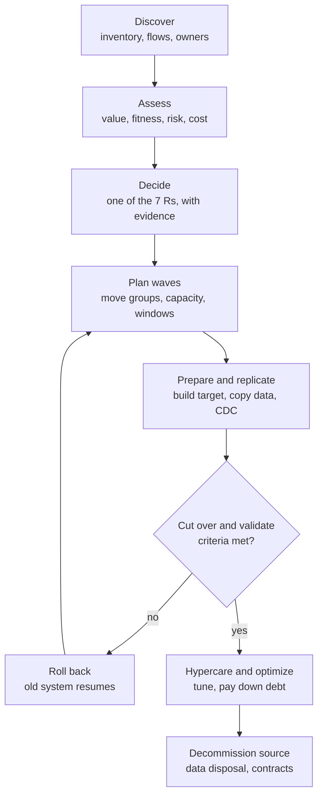
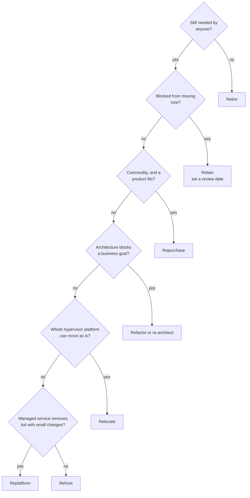
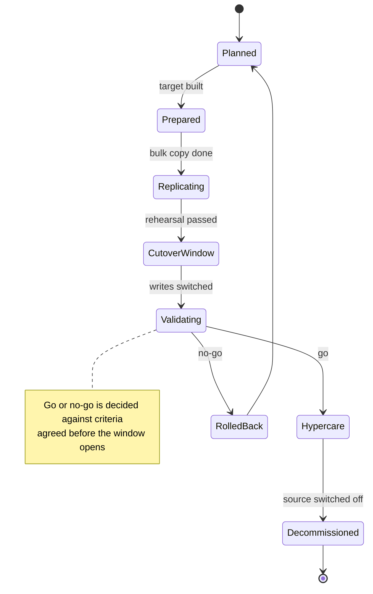
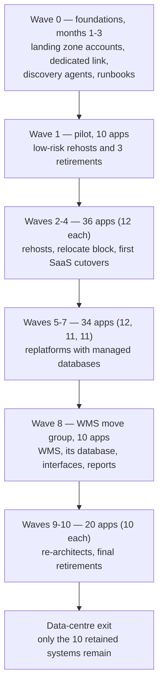

# Legacy modernization and migration

> A migration programme is a gap analysis run a hundred times in a row: for every application you
> decide what to do with it, prove you know what it depends on, move it with the people who use it in
> mind, and keep a way back until the new version has earned trust.

!!! abstract "Page facts"
    **Level:** Intermediate (the 7 Rs and migration vocabulary are Level 1-2; portfolio
    classification, wave design, cutover and rollback planning are Level 3) · **Status:** Draft ·
    **Time:** 60-75 minutes · **Last verified:** 2026-11-27

## Learning objectives

After this page you should be able to:

- Run a portfolio assessment: the attributes to collect per application and where dependency data
  really comes from.
- Choose one of the 7 Rs for an application with evidence, and explain why the providers' lists
  differ in wording but not in substance.
- Compare the modernization routes for mainframes, monoliths, databases, and middleware, at the level
  of concepts.
- Group applications into dependency-respecting migration waves and size the programme with
  arithmetic.
- Plan a cutover with explicit validation, a rollback point, and, where it pays, a parallel run.
- Keep a migration from turning into a technical-debt transfer.

## Prerequisites

- [As-Is and To-Be architecture, gap analysis, and build vs buy](../architecture-fundamentals/as-is-and-to-be-architecture-gap-analysis-and-build-vs-buy.md)
  — every migration decision on this page is a gap type per application.
- [Microservices architecture](../software-architecture/microservices-architecture.md) — decomposition
  by bounded context, which this page applies but does not repeat.
- [Hybrid connectivity and VPNs](../networking/hybrid-connectivity-and-vpns.md) — the links that carry
  replication and split-environment traffic during a migration.

## The problem this solves

Most organizations carry decades of applications: a warehouse system bought long ago, a batch job
nobody dares touch, a database on an unsupported operating system, a data-centre lease with a fixed end
date. Moving them one by one as heroic projects fails predictably: hidden dependencies break on cutover
night, teams rehost a problem and pay for it twice, big-bang replacements slip for years, and nobody
can say when the data centre will be empty.

The discipline on this page turns that into a programme: assess the whole portfolio, decide a
strategy per application with recorded evidence, sequence the work into waves sized to the team's
capacity, and run each cutover with the same validation and rollback discipline as a production
deployment.

## What it is

**Legacy modernization** is changing existing systems so they keep meeting business needs at
acceptable cost and risk: new hosting, new platforms, new architecture, a new product, or no system at
all. **Migration** is the subset that moves an application or its data to a new environment, usually
from a data centre to a cloud. A migration can modernize nothing (rehost) or a great deal
(re-architect); deciding how much, per application, is the core architectural choice.

The work has five recurring parts: **assessment and dependency discovery** (what exists, what it is
worth, what it talks to); **strategy selection**, one of the **7 Rs** per application as named in AWS
Prescriptive Guidance; **wave planning** into **migration waves**; **cutover** with **validation**, a
**rollback** plan, and optionally a **parallel run**; and **decommissioning and debt reduction**.

## Mental model

Moving house while still living in it. You list every item, decide whether each moves as is, gets
repaired on the way, is replaced, stays in storage, or goes to the tip (the 7 Rs). Things that only
work together go on the same van (a move group in a wave). You move the spare room first to learn how
long a van takes (pilot wave), and keep the old keys until the new heating works (rollback).

**Where the analogy breaks:** in a house move nobody is cooking dinner in the van. Legacy systems keep
serving customers while they move, their data keeps changing during the copy, and the "items" talk to
each other over networks whose latency changes when one of them has moved and the other has not.

## Key terms

| Term | Meaning on this page |
|---|---|
| Portfolio assessment | Collecting comparable facts (value, owner, technology, risk, dependencies, cost) for every application so strategies can be chosen consistently |
| Dependency discovery | Finding every runtime, data, and operational dependency of an application from evidence (flows, configs, schedules) rather than memory |
| 7 Rs | The migration strategies rehost, replatform, refactor or re-architect, repurchase, retain, retire, and relocate |
| Migration wave | A batch of applications whose changes go live in the same planned window, grouped by dependency and risk |
| Move group | The smallest set of components that must change together because splitting them breaks or slows them |
| Cutover | The controlled switch of traffic, writes, and ownership from the old system to the new one |
| Rollback point | The last moment at which returning to the old system is cheap; after it, going back needs reverse data migration |
| Parallel run | Running old and new systems on the same inputs for a period and comparing outputs before trusting the new one |
| Change data capture (CDC) | Reading a database's change log to replicate inserts, updates, and deletes continuously to another store |
| Strangler fig | Replacing a legacy system piece by piece behind an interception point until nothing routes to the old system |
| Technical debt | The future cost of a shortcut taken now; a migration can pay it down, carry it along, or add to it |

Note that "refactor" in the 7 Rs means changing the application's architecture as it moves, which is
broader than **refactoring** in the glossary sense (restructuring code without changing behaviour).

## How it works

### The modernization lifecycle

**Figure 1 — The modernization lifecycle for a portfolio.** Each application passes through it; waves
batch many applications through the lower half together.

How to read it: the top three boxes happen once for the portfolio; the rest repeats per wave. The
rollback arrow returns to planning, not to cutover: a failed cutover means the plan was wrong.

### Assessment and dependency discovery

A portfolio assessment collects the same attributes for every application so strategies can be
compared:

| Attribute | Why it matters for the decision |
|---|---|
| Business owner, users, criticality, DR tier | Who decides, who notices downtime, which cutover window and RPO/RTO apply |
| Business value and fit (keep, grow, shrink) | Separates "modernize" from "keep alive" from "retire" |
| Technology stack and support status | Operating systems and runtimes out of support push towards replatform or retire |
| Licensing | Some licences are tied to hardware or forbid certain hosting; check before choosing rehost |
| Data classification and residency | Constrains target regions and services (AtlasMart: C-4, EU data stays in the EU) |
| Utilization | Idle or near-idle applications are retirement candidates; peaks size the target |
| Change rate | Frequently changed applications benefit from modern delivery; frozen ones rarely justify a rewrite |
| Dependencies | Decide move groups, wave order, and hybrid link sizing |

**Dependency discovery** needs evidence, because the people who built a system have often left. Use
several sources and reconcile them:

- **Network flows** from host agents or flow logs, over a full business cycle (month-end, a sale)
  so rare but critical flows appear.
- **Configuration and schedules**: connection strings, hard-coded addresses, file shares, database
  links, queue names, certificates, batch schedulers, cron tables, file transfer jobs.
- **Shared infrastructure**: directory, licence servers, time sync, mail relays, printers, and the
  shared database three applications quietly use.
- **People**: operators confirm the data and add the manual workarounds (the Monday spreadsheet).

Dependencies are then typed. A **direct** dependency is chatty or latency-sensitive and the two sides
should move together; an **indirect** one tolerates the hybrid link for a while; a **business**
dependency is organizational (shared reporting, the same owner, the same freeze calendar). Microsoft's
Cloud Adoption Framework uses this three-way split for wave grouping, and it matches practice.

Why direct dependencies must not be split for long: a hybrid link adds round-trip time. Illustrative
assumption, not an AtlasMart measurement: an application that makes 200 sequential database calls per
user action, moved to the cloud while its database stays on premises, with 5 ms of added round trip per
call, gains 200 × 5 ms = 1,000 ms per action. A one-second regression from a "no change" rehost is the
classic sign of a split move group.

### Choosing among the 7 Rs

The seven strategies, as AWS Prescriptive Guidance names them, with the evidence that justifies each:

| Strategy | What happens | Typical evidence | Main risk |
|---|---|---|---|
| Retire | Switch it off and archive its data | No users or connections for a business cycle; capability duplicated elsewhere | A rare consumer (year-end report) appears after shutdown |
| Retain | Keep it where it is, for now | Hardware tie, residency, recent investment, waiting for a vendor's SaaS | "For now" becomes forever; it still needs patching and hybrid links |
| Rehost (lift and shift) | Move the servers unchanged to cloud virtual machines | Stable, supported stack, deadline-driven move | Carries existing debt and inefficiency into a more expensive per-hour model |
| Relocate | Move a whole hypervisor platform to a provider-hosted version of the same platform, or move cloud resources between accounts, networks, or regions | Many VMs on one platform, very tight deadline | Keeps the old operating model; licences and platform costs continue |
| Replatform | Move with targeted changes, such as a managed database or containers | Toil that a managed service removes; few code changes needed | Hidden incompatibilities in the new platform version |
| Repurchase | Replace with a product or SaaS (drop and shop) | Commodity capability; a product fits without heavy customization | Data migration, integration, and process change are underestimated |
| Refactor or re-architect | Redesign while moving, to use cloud-native capabilities | The architecture itself blocks a business goal (scale, release speed, cost) | Highest cost and duration; scope grows with discovery |

AWS's guidance for large migrations advises against refactoring during the move: rehost, relocate, or
replatform first, then modernize in the cloud. That is the default this page uses: **separate the move
from the redesign** unless the redesign is the reason for the move.

**Figure 2 — A decision flow for the 7 Rs.** The order of questions matters: cheap exits first.

How to read it: stop at the first answer that names a strategy. Retire and retain come first because
they avoid work; re-architecture is asked before the cheap moves so a design problem is not rehosted
only to be rebuilt a year later.

The providers use slightly different lists. Map them rather than arguing about them:

| Idea | AWS (7 Rs) | Microsoft Cloud Adoption Framework | Google Cloud migration guide |
|---|---|---|---|
| Switch off | Retire | Retire | (not listed as a type) |
| Keep where it is | Retain | Retain | (not listed as a type) |
| Move unchanged | Rehost | Rehost | Rehost (lift and shift) |
| Move the hypervisor platform | Relocate | (covered by the Azure VMware Solution scenario, not a strategy) | (not listed as a type) |
| Move with platform changes | Replatform | Replatform | Replatform (lift and optimize) |
| Change the code | Refactor or re-architect (one strategy) | Refactor (code) and Rearchitect (architecture) are separate | Refactor (move and improve) and Re-architect are separate |
| Rewrite from scratch | Inside refactor or re-architect | Rebuild | Rebuild (remove and replace) |
| Buy instead | Repurchase | Replace | Repurchase |

Names verified on each provider's page on 2026-11-27 (see References). The lesson: "refactor" is the
word most likely to mean different things in one meeting; define it in the programme's glossary.

### Modernization routes by kind of system

**Monolith decomposition.** When a monolith is the bottleneck, decompose by bounded context as on the
[microservices page](../software-architecture/microservices-architecture.md), usually through a modular
monolith first, and extract with a strangler fig behind an interception point as on the
[distributed system patterns page](../software-architecture/distributed-system-patterns.md). At
portfolio level, the point is sequencing: move the monolith first (rehost or replatform), then
decompose it in the cloud, unless the decomposition is what justifies the move.

**Strangler fig versus replacement.** Martin Fowler's strangler fig application replaces a system
gradually, each step small and reversible. **Replacement** (a big-bang switch to a rebuilt or bought
system) is simpler to describe and fails more often for large systems: the old system keeps changing
during the years the new one is built, and "feature parity" turns out to include behaviours nobody
documented. Choose replacement when the system is small enough to replace in one tested release, or
when a product replaces it wholesale (repurchase) and a strangler would mean integrating two vendors.

**Database modernization.** Three steps of increasing change: same engine on virtual machines (rehost),
same engine as a managed service (replatform), or a different engine (re-architect: schema, stored
procedures, and queries are converted, and behaviour differences in types, collation, and transactions
are tested). Data moves by a bulk copy followed by **change data capture** so the target stays current
until cutover; replication mechanics are on the
[scaling, partitioning, and replication page](../distributed-systems/scaling-partitioning-and-replication.md).
Shared databases with several applications writing to them are the hardest case: they tie those
applications into one move group, or they need an ownership split first.

**Middleware modernization.** Application servers, brokers, enterprise service buses (ESBs), file
transfer, and schedulers have managed equivalents, but routing rules and transformations inside an ESB
are application logic in disguise: move them to the owning services or a thin integration layer (see
[integration architecture](../application-and-api-architecture/integration-architecture.md)).

**Mainframe modernization (concepts only).** The options form the same spectrum: **retain and wrap**
(expose mainframe transactions through APIs so new channels do not touch the old code); **offload
reads** (replicate data out with CDC into read models the cloud serves); **rehost** onto a compatible
runtime or emulation in the cloud; **convert** code with tool-assisted translation (a refactor whose
quality depends on the generated code being maintainable); **rewrite** by capability behind a
strangler; or **replace** with a package. Batch windows, character encodings, and data formats are
the recurring surprises. Treat products and vendors in this space as assessments in their own right.

**Data-centre migration.** A data-centre exit is usually driven by a date (lease end, hardware refresh,
support contract), which turns the portfolio into a schedule with a hard end. The architect's extra
concerns: what remains on site (retained systems, devices, the network edge) and how it connects;
hybrid links sized for replication plus split-environment traffic; and decommissioning that includes
data disposal, licence and contract termination, and removing firewall rules and DNS records that
point at the old site.

**Incremental modernization** is the umbrella principle: move in reversible slices that each deliver
value, keep a dated **transition architecture** for each stage, and fund decommissioning as explicitly
as the start.

### Wave planning

A **migration wave** is a batch of applications whose changes go live in the same planned window.
Rules common to the providers' guidance and practice:

1. **Move groups first, waves second.** Build move groups from direct dependencies; never split one
   across waves. When unsure whether a dependency is direct, keep the components together.
2. **Pilot wave of low-risk applications.** It tests the runbook, tooling, and team, not the
   technology. Include one representative complex application in each early wave so the hard problems
   surface early.
3. **Non-production before production** for each application, to rehearse the cutover.
4. **Critical systems after the method is proven**, unless a deadline forces them earlier.
5. **Plan the next wave in detail while executing the current one**; keep later waves coarse.
6. **Respect business calendars**: no cutovers in peak trading, financial close, or a sale.
7. **Wave size follows team capacity**, measured from the pilot and adjusted after each wave.

**Figure 3 — Lifecycle of one wave.** Every application in a wave goes through these states; the
rollback path exists until the wave reaches hypercare.

How to read it: "Replicating" can last weeks (bulk copy, then CDC keeping the target current);
"CutoverWindow" and "Validating" last hours. The source is kept intact through hypercare so a late
problem can still be handled by reverse replication or a planned rollback.

### Cutover, validation, rollback, and parallel run

**Cutover styles**, from cheapest to safest:

| Style | How it works | Fits when |
|---|---|---|
| Stop-the-world | Freeze writes, final sync, switch everything, validate | A downtime window is acceptable and data volume makes the final sync short |
| Phased | Switch by site, user group, or tenant, one at a time | Users or sites are separable, as with warehouses or regions |
| Parallel run | Both systems process the same inputs; outputs are compared before the new one becomes authoritative | Correctness is critical and outputs are comparable (calculations, allocations) |
| Dark launch or shadow traffic | Copies of real requests go to the new system; its responses are discarded and compared | Read-heavy services; side effects can be suppressed |

**Validation** is agreed before the window, in four layers: technical (row counts and checksums per
table, replication lag zero, health checks), functional (scripted business transactions end to end),
non-functional (latency and throughput against the baseline measured before the move), and
operational (alerts firing to the right team, backups running, runbooks updated, access working).

**Rollback** needs a defined trigger and a defined **rollback point**. Until new writes land on the
target, rollback is a re-point: cheap and fast. After the target accepts writes, going back means
copying those writes back (reverse replication, if it was set up, or a manual reconciliation). State
explicitly in the runbook where the point of no return is and who may call rollback.

**Parallel run** is the most expensive safety net: double running cost, a comparison harness, and a
side-effect rule (only one system sends the email or prints the label; the other computes and
compares). Use it where a silent error is worse than a visible outage.

### Technical-debt reduction

A migration either pays debt down, carries it along, or adds to it. Rehost carries it along (and
Microsoft's guidance warns against rehosting problematic workloads for that reason); quick fixes made
to hit a cutover add to it. Keep a **debt register** per application: the shortcut, its interest (the
recurring cost: toil, incidents, slower change), and the trigger for paying it. Martin Fowler's
technical-debt quadrant (deliberate or inadvertent, prudent or reckless) is a useful way to discuss it
without blame. Plan the **optimize** stage after each wave, with capacity reserved for it, or the
programme ends with every application in the cloud and none of the benefits.

## Worked example: AtlasMart's 120-application portfolio

The [cloud migration exercise brief](../system-design-exercises/cloud-and-enterprise-platform-exercises.md)
fixes the scale: 120 on-premises applications, waves of 10 to 15, two years, and one critical
warehouse system with a cutover window of at most 2 hours. This example classifies the portfolio and
plans the waves. Everything not in the brief is a labelled assumption.

### Step 1 — Inputs and assumptions

| Item | Value | Basis |
|---|---|---|
| Portfolio | 120 applications | Exercise brief |
| Location | The distribution-centre data centre, `172.16.0.0/16` | Hybrid connectivity page (assumption there); assumption that all 120 run there |
| Programme length | 24 months; the first 3 months build foundations (wave 0) | Brief (two years); split is an assumption |
| Wave size | 10 to 15 applications | Brief |
| Target | AtlasMart's landing zone (29 accounts, EU region, C-4) | Platform pages |
| Connectivity | Planned dedicated private connection with the VPN as backup | Hybrid connectivity page, case study 09 |
| Warehouse Management System (WMS) | Legacy, on virtual machines, at most 2 hours of downtime at cutover | Conventions; exercise brief |
| Order Management System | 12-year-old monolith owned by another team; its route (modular monolith, then services) is already decided | Architecture styles page (ADR-OD-001); not part of this portfolio count |

### Step 2 — Classify the portfolio

The assessment results below are assumptions for the fictional company; each row would be backed by
the per-application evidence in the assessment table above.

| Strategy | Count | Share | Typical AtlasMart members (assumption) |
|---|---|---|---|
| Retire | 14 | 11.7% | Duplicate reporting tools, a replaced intranet, idle test systems with no connections for 90 days |
| Retain | 10 | 8.3% | Systems tied to warehouse-floor equipment (conveyor control, label-printer servers) and two awaiting a vendor's SaaS release |
| Rehost | 42 | 35.0% | Stable internal web applications and line-of-business tools on supported operating systems |
| Relocate | 8 | 6.7% | One cluster of virtual machines moved as a block to a provider-hosted version of the same hypervisor platform, to clear a hardware refresh date |
| Replatform | 26 | 21.7% | Applications whose self-managed databases, queues, or file transfer move to managed services |
| Repurchase | 12 | 10.0% | HR, expenses, service desk, and similar commodity capabilities replaced with SaaS |
| Refactor or re-architect | 8 | 6.7% | Customer-facing or high-change applications whose design blocks scale or delivery speed |
| Total | 120 | 100% | 14 + 10 + 42 + 8 + 26 + 12 + 8 = 120 |

Checks on the result: refactor is small (8 of 120 ≈ 6.7%), consistent with "move first, modernize
later"; 14 + 10 = 24 applications need no move at all, which is a fifth of the portfolio (24 ÷ 120 =
20%) of work avoided before a single wave runs.

### Step 3 — Size the programme

The brief's arithmetic on the raw portfolio: 120 ÷ 15 = 8 waves at the largest wave size and 120 ÷ 10
= 12 waves at the smallest, so 8 to 12 waves.

After classification, every application except the 10 retained ones needs a scheduled change (a move,
a SaaS cutover, or a decommissioning that must wait until its last consumer has moved): 120 − 10 = 110.
That gives 110 ÷ 15 ≈ 7.3, rounded up to 8 waves, and 110 ÷ 10 = 11 waves, so 8 to 11 waves, inside the
brief's range. AtlasMart plans **10 waves** (assumption) to leave one wave of slack below the maximum.

Cadence: 24 − 3 = 21 months after the foundations, ÷ 10 waves ≈ 2.1 months per wave, with the next
wave's planning overlapping the current wave's execution.

### Step 4 — The wave plan

**Figure 4 — AtlasMart's wave plan.** Counts are applications whose change goes live in each wave.

How to read it: 10 + 36 + 34 + 10 + 20 = 110 applications in waves 1-10, plus 10 retained = 120. The
WMS is deliberately late: by wave 8 the team has run seven waves of the same runbook, and the
dedicated link has carried production replication for months. Peak trading periods are excluded from
the cutover calendar (assumption: no cutovers in the four weeks before a planned sale).

### Step 5 — The hard case: the distribution-centre WMS

The WMS is hard for reasons a classification table hides:

- **Its move group is large.** The WMS application servers, its database, the interfaces to the Order
  Management System and the Logistics Vendor Platform, label printing, and nightly reports form one
  group of about ten applications (assumption), which is why wave 8 is the WMS alone.
- **Part of it cannot move.** Handheld scanners, conveyor control, and label printers stay on the
  warehouse floor and keep calling the WMS, so they are retained and the link becomes a critical
  dependency (latency and availability) of warehouse operations.
- **The window is 2 hours** (exercise brief) for a system that runs around the clock.

First-pass classification (assumption): **replatform** — application servers rehosted on cloud virtual
machines, the database moved to a managed relational service of the same engine by bulk copy plus
CDC weeks before the window, and the floor devices retained. Rearchitecting the WMS is out of scope
for the migration and goes onto the debt register. [Case study 09](../end-to-end-case-studies/cs-09-hybrid-migration-with-private-connectivity.md)
designs this migration in depth and owns the final decision and runbook.

An illustrative cutover budget shows how the 2 hours is spent (all durations are assumptions to be
measured in the rehearsals):

| Step | Minutes | Running total |
|---|---|---|
| Pause floor transactions; scanners queue locally | 5 | 5 |
| Drain CDC lag to zero; compare row counts and checksums | 20 | 25 |
| Re-point application servers and interfaces to the cloud database; switch DNS | 10 | 35 |
| Scripted smoke tests: receive, pick, pack, ship a test order | 25 | 60 |
| Go or no-go decision | 0 | 60 |
| Reserved for rollback (re-point to the untouched on-premises database) | 15 | 75 |
| Buffer | 45 | 120 |

The rollback point is the go decision at minute 60: before it, the on-premises database has received
no writes since the pause, so rollback is a re-point (15 minutes). After it, the floor writes to the
cloud database and going back needs reverse replication, which case study 09 must decide whether to
build.

## Real-world architecture example

A typical retail migration programme (fictionalized) starts with a deadline and an interview-based
spreadsheet; a month of flow data then finds a third more applications, mostly the file shares and
batch jobs that broke the first rehearsal. It settles into a pilot, a migration factory with one
runbook, a cutover calendar negotiated with the business, and a retire list that grows as owners admit
systems are unused. The delays come from shared databases and floor devices, which is why mature
programmes find those first and schedule them late.

## Design choices and trade-offs

| Choice | Favor when | Avoid when |
|---|---|---|
| Rehost first, modernize later | Deadline-driven exits, large portfolios, teams new to the cloud | The application's problems are the reason to move; rehosting just relocates them |
| Refactor or re-architect during the move | The design blocks a business goal and the team has the skills and time | The deadline is fixed and the application is poorly understood |
| Repurchase (SaaS) | Commodity capabilities with mature products | The capability differentiates the business or needs heavy customization |
| Strangler fig | Large, live, risky systems; capabilities separable behind an interception point | The system is small enough to replace in one tested release |
| Big-bang replacement | Small systems, or a product replacing a whole capability | The old system keeps changing during a long build |
| Large waves | A proven runbook, many similar applications | Early in the programme, or applications with complex dependencies |
| Parallel run | Silent errors are costly and outputs are comparable | Side effects cannot be suppressed, or double running is unaffordable |

## Failure modes and anti-patterns

- **Assessment by interview only.** Hidden consumers break at cutover. Detect: flows observed that are
  not in the inventory. Prevent: flow and configuration evidence over a full business cycle.
- **Split move group.** A chatty pair split across the hybrid link; latency jumps after a "no change"
  move. Detect: per-action latency against the baseline. Prevent: type dependencies, move direct ones
  together.
- **Rollback that was never tested.** The team discovers in the window that the old system cannot
  resume. Detect: rehearsal reports without a rollback step. Prevent: rehearse rollback as often as
  cutover.
- **Undefined go or no-go criteria, endless retain.** Decisions become 2 a.m. debates; retained
  systems never get reviewed. Prevent: criteria, owner, and deadline before the window; a review date
  and owner on every retain.
- **Stalled strangler or eternal parallel run.** Two systems run for years. Detect: no capability
  moved in a quarter. Prevent: exit criteria and a funded decommissioning step.
- **Debt transfer.** Everything moved, nothing optimized. Prevent: an optimize stage per wave with
  reserved capacity and a debt register.

## Security considerations

- **The hybrid period doubles the attack surface.** Both sites are live, linked, and partly trusted;
  firewall rules opened for migration need an expiry date.
- **Replication carries production data.** Encrypt it in transit over the link, give replication tools
  least-privilege credentials, and remove them after cutover.
- **Old configurations carry old secrets.** Rehosted applications bring hard-coded passwords and
  certificates; rotate them into the platform's secrets store as part of the move, not afterwards.
- **Residency is checked per application.** C-4 constrains where each data store lands; SaaS
  replacements must also meet it (this is a design constraint, not legal advice).
- **Retirement includes data disposal.** Archive what retention rules require, then destroy the rest
  and record it; decommissioned servers leave the inventory only after their disks are wiped.

## Performance, reliability, and cost

- **Performance:** measure a baseline before each move (latency per key transaction, batch durations),
  compare after; split move groups and cross-link chattiness are the usual regressions.
- **Reliability:** during the hybrid period the link is a hard dependency of whatever is split across
  it; size it and give it a backup (the VPN). Each cutover is a planned change with an error budget
  cost; schedule them away from peaks.
- **Bulk data movement:** time is size ÷ effective throughput. Illustrative only: 1 TB over a link
  that sustains 500 Mbit/s for replication takes 8 × 10^12 bits ÷ 5 × 10^8 bit/s = 16,000 s ≈ 4.4 hours,
  which is why bulk copies happen weeks before the window and CDC keeps the target current.
- **Cost:** a migration pays twice for a while. Illustrative rates: a wave whose applications cost
  100 CU per month on premises and 90 CU per month in the cloud costs 190 CU in a month of overlap; the
  saving starts only when the source is decommissioned, so slow decommissioning is a cost failure.

## Hands-on lab: classify a portfolio and pack it into waves

A local, free exercise using Python's standard library. No lab page in this batch covers it.

1. Write a list of 30 fictional applications, each with `name`, `users_last_90_days`,
   `blocked_reason` (empty or a reason), `saas_fit` (true or false), `design_blocks_goal`,
   `managed_service_fit`, and `depends_on` (a list of names).
2. Implement the Figure 2 decision flow as a function that returns one of the 7 Rs per application, and
   print the counts per strategy.
3. Build move groups as the connected components of the `depends_on` graph (treat dependencies as
   undirected), ignoring applications classified retain.
4. Pack move groups into waves of at most 15 applications without splitting a group; put groups that
   contain a refactor into later waves.
5. Add a group of 18 applications and see what your packer does.

??? question "Hint: what should happen to a move group larger than the wave size?"
    It must not be split silently. Either the wave limit is raised for that wave (with the extra
    rehearsal that implies), or the group is broken deliberately: find the weakest dependency in it,
    decide it can tolerate the hybrid link for a few weeks (an indirect dependency), and record that
    decision. AtlasMart's WMS wave is exactly this case at the size limit.

## Knowledge check

1. Name the 7 Rs and say which two avoid moving anything.
2. Why does AWS recommend against refactoring during a large migration, and what does it recommend
   instead?
3. An application was rehosted and its user actions became one second slower. What is the most likely
   cause, and how would you have found it before the move?
4. Using the brief's numbers, show the arithmetic for the range of wave counts, and explain why
   AtlasMart's classified portfolio gives 8 to 11.
5. Where is the rollback point in the WMS cutover budget, and why does it move once writes land on the
   cloud database?

??? success "Answers"
    1. Rehost, replatform, refactor or re-architect, repurchase, retain, retire, relocate. Retain and
       retire move nothing (retire switches the application off).
    2. Refactoring is the most complex strategy and is hard to manage across many applications at
       once; AWS recommends rehosting, relocating, or replatforming first and modernizing after the
       migration.
    3. A split move group: a chatty dependency (often its database) stayed on premises, so every call
       crosses the hybrid link. Dependency discovery from network flows would have shown the call
       volume, and a direct dependency would have kept them in one move group.
    4. 120 ÷ 15 = 8 and 120 ÷ 10 = 12, so 8 to 12 waves. After classification, 10 retained applications
       need no change, leaving 110: 110 ÷ 15 ≈ 7.3 rounds up to 8, and 110 ÷ 10 = 11.
    5. At the go decision, minute 60. Before it the on-premises database has had no writes since the
       pause, so rollback is a re-point; afterwards new writes exist only in the cloud and must be
       copied back.

## Architecture discussion questions

1. A business owner insists their application must be re-architected "while we are moving it anyway".
   What evidence would make you agree, and what would you offer instead if it is missing?
2. AtlasMart could move the WMS in wave 2 to retire its ageing hardware sooner. Argue for and against,
   including what the first seven waves would have taught the team.
3. Ten applications are retained. What would make the data-centre exit "done" while they remain, and
   who owns their hybrid connectivity afterwards?

## Summary

Legacy modernization is a portfolio discipline. Assess every application with the same attributes and
discover dependencies from evidence, not memory. Choose one of the 7 Rs per application, asking first
whether it can be retired or must be retained, and separate moving from redesigning unless the
redesign is the point. Build move groups from direct dependencies, then waves sized to proven
capacity, pilot first and critical systems late. Cut over with validation agreed in advance, a named
rollback point, and parallel runs where silent errors are expensive. Finish with decommissioning and
a funded optimize stage, or the programme only moves its debt. AtlasMart's 120 applications become
110 scheduled changes in 10 waves over 21 months after a 3-month foundation, with the WMS late and
alone in wave 8.

## Related topics

- **Before:** [As-Is and To-Be architecture, gap analysis, and build vs buy](../architecture-fundamentals/as-is-and-to-be-architecture-gap-analysis-and-build-vs-buy.md);
  [Microservices architecture](../software-architecture/microservices-architecture.md);
  [Hybrid connectivity and VPNs](../networking/hybrid-connectivity-and-vpns.md)
- **Alongside:** [Distributed system patterns](../software-architecture/distributed-system-patterns.md)
  — strangler fig and anti-corruption layer in depth; [Integration architecture](../application-and-api-architecture/integration-architecture.md);
  [Scaling, partitioning, and replication](../distributed-systems/scaling-partitioning-and-replication.md);
  [Cloud building blocks and landing zones](../cloud-architecture/cloud-building-blocks-and-landing-zones.md);
  [Cloud adoption frameworks](../cloud-architecture/cloud-adoption-frameworks.md);
  [Hybrid and multi-cloud architecture](hybrid-and-multi-cloud-architecture.md);
  [Disaster recovery strategies](../reliability-and-disaster-recovery/disaster-recovery-strategies.md);
  [Case study 09: hybrid migration with private connectivity](../end-to-end-case-studies/cs-09-hybrid-migration-with-private-connectivity.md);
  [Cloud and enterprise platform exercises](../system-design-exercises/cloud-and-enterprise-platform-exercises.md)
  (cloud migration brief)
- **Planned:** CDC and low-downtime database migration (D06-T03); data platform modernization (D07-T03).

## References

| Source | Type | Checked |
|---|---|---|
| Amazon Web Services, [About the migration strategies](https://docs.aws.amazon.com/prescriptive-guidance/latest/large-migration-guide/migration-strategies.html) — AWS Prescriptive Guidance | Official guidance (the 7 Rs; modernize after large migrations) | 2026-11-27 |
| Amazon Web Services, [Guide for AWS large migrations](https://docs.aws.amazon.com/prescriptive-guidance/latest/large-migration-guide/introduction.html) — AWS Prescriptive Guidance | Official guidance (assess, mobilize, migrate and modernize phases) | 2026-11-27 |
| Microsoft, [Select your cloud migration strategies](https://learn.microsoft.com/azure/cloud-adoption-framework/plan/select-cloud-migration-strategy) — Cloud Adoption Framework | Official guidance (Microsoft's list of strategies; do not rehost problematic workloads) | 2026-11-27 |
| Microsoft, [Migration wave planning](https://learn.microsoft.com/azure/cloud-adoption-framework/migrate/migration-wave-planning) and [Plan your migration](https://learn.microsoft.com/azure/cloud-adoption-framework/migrate/plan-migration) — Cloud Adoption Framework | Official guidance (dependency types, wave grouping, rollback plans) | 2026-11-27 |
| Google Cloud, [Migrate to Google Cloud: Get started](https://docs.cloud.google.com/architecture/migration-to-gcp-getting-started) — Cloud Architecture Center | Official guidance (assess, plan, deploy, optimize; migration types) | 2026-11-27 |
| Martin Fowler, [Strangler Fig Application](https://martinfowler.com/bliki/StranglerFigApplication.html) | Article (incremental replacement) | 2026-11-27 |
| Ian Cartwright, Rob Horn, and James Lewis, [Patterns of Legacy Displacement](https://martinfowler.com/articles/patterns-legacy-displacement/) | Article series (transitional architecture, cutover and coexistence patterns) | 2026-11-27 |
| Martin Fowler, [Technical Debt Quadrant](https://martinfowler.com/bliki/TechnicalDebtQuadrant.html) | Article (classifying debt without blame) | 2026-11-27 |

## Review notes

- Canonical page for D18-T03. In depth: assessment, dependency discovery, portfolio assessment, the
  7 Rs, wave planning, cutover, validation, rollback, parallel run, data-centre migration. Concept level
  only: mainframe (no products named), monolith decomposition (deep on D03-T02/T04, linked), database
  and middleware modernization, replacement, incremental modernization, technical-debt reduction.
- Strategy names verified on 2026-11-27: AWS lists seven (retire, retain, rehost, relocate,
  repurchase, replatform, refactor or re-architect); Microsoft's page lists eight (retire, retain,
  rehost, replatform, refactor, rearchitect, rebuild, replace; no relocate); Google's page lists
  rehost, replatform, refactor, re-architect, rebuild, and repurchase. The "Patterns of Legacy
  Displacement" article does not have a standalone "parallel run" pattern, so it is cited for
  transitional architecture and cutover patterns in general.
- New AtlasMart assumptions: all 120 applications run in the distribution-centre data centre; the
  7 Rs distribution (14 / 10 / 42 / 8 / 26 / 12 / 8); 3-month wave 0; 10 waves with sizes 10, 12, 12,
  12, 12, 11, 11, 10, 10, 10; WMS move group of about ten applications in wave 8; no cutovers in the
  four weeks before a sale; WMS first-pass classification (replatform, floor devices retained) and the
  illustrative cutover budget (go or no-go at minute 60, 15-minute rollback, 45-minute buffer).
  Case study 09 (V12) owns the WMS design; the coordinator should check it does not contradict the
  classification or cutover budget, or adjust this page to match.
- The Order Management System is deliberately not counted in the 120 (its hosting is not fixed by
  earlier pages; its route is ADR-OD-001 on the architecture styles page).
- Illustrative numbers not about AtlasMart: 200 calls × 5 ms; 1 TB at 500 Mbit/s; 100 / 90 CU.
- Figure 2 has 13 nodes (`flowchart TB`); Figure 3 is a `stateDiagram-v2` with a note.
