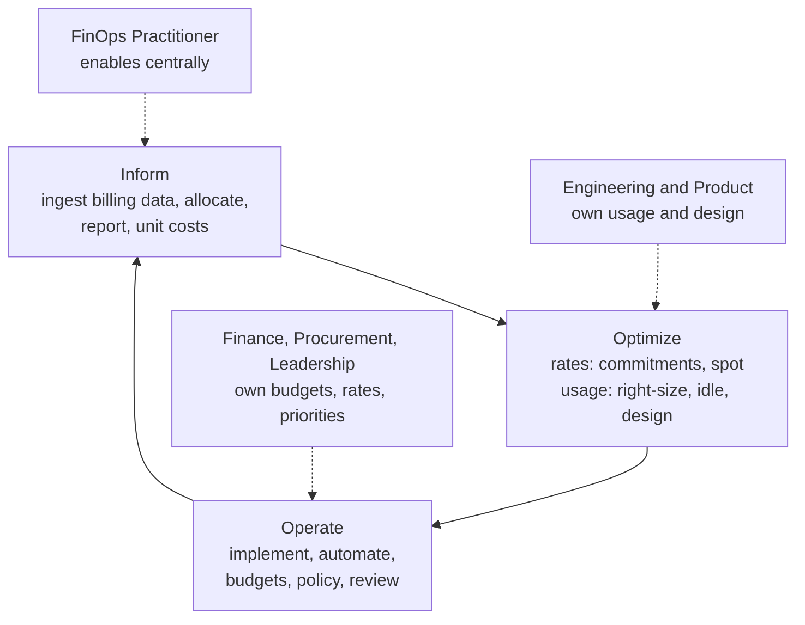
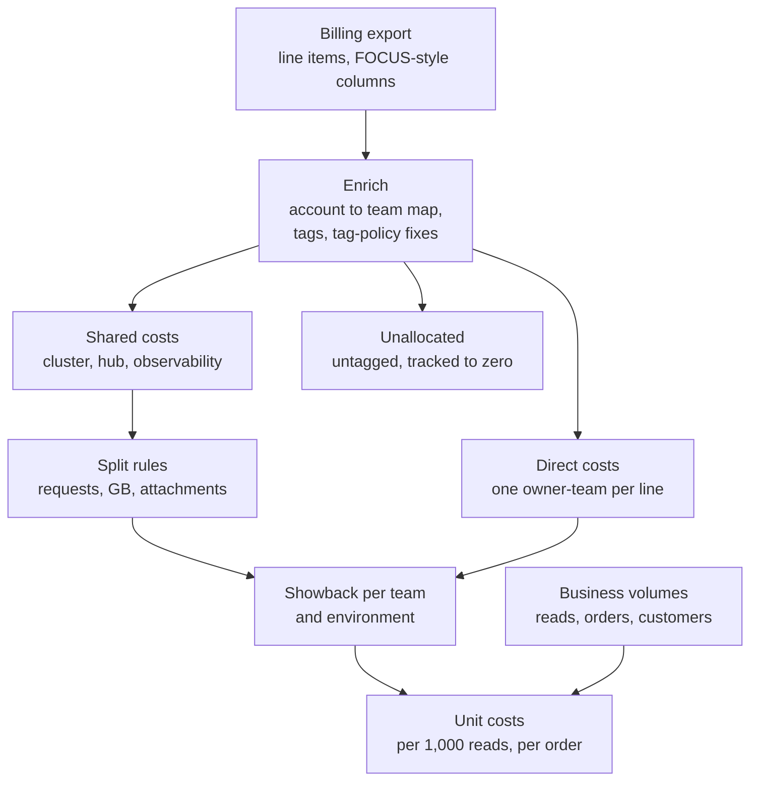
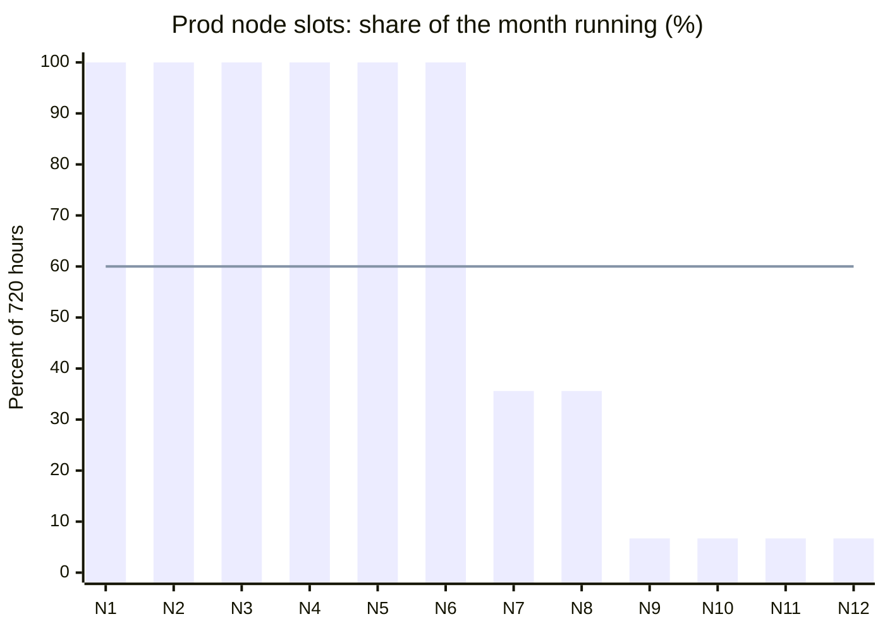
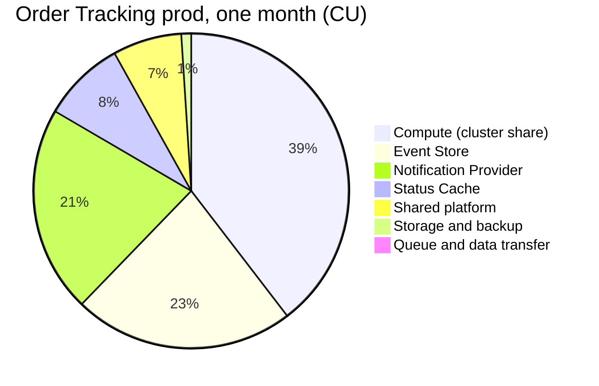

# Cloud cost models and FinOps

> A cloud bill is the sum of thousands of design decisions, priced by the hour, the gigabyte, and the
> request. FinOps is the practice that traces each line of that bill back to an owner and a unit of
> business value, so that cost becomes something architects design for instead of something finance
> discovers a month later.

!!! abstract "Page facts"
    **Level:** Intermediate (pricing models, tagging, and showback are Level 1-2; commitment coverage,
    shared-cost allocation, unit economics, and governance design are Level 3) · **Status:** Draft ·
    **Time:** 60-75 minutes · **Last verified:** 2026-11-27

## Learning objectives

After this page you should be able to:

- Explain pay-as-you-go, reserved capacity, savings plans, and spot capacity, and match each to the
  part of a load profile it suits.
- Decide how much of a steady baseline to cover with a commitment, using break-even utilization
  arithmetic and the risk of the baseline shrinking.
- Name the cost drivers at each layer (compute, storage, database, network), including data transfer
  and egress, and the design levers that change them.
- Build an allocation model from tags, accounts, and split rules for shared costs, and choose between
  showback and chargeback.
- Compute unit costs (per order, customer, API call, AI inference), use budgets, forecasts, and anomaly
  detection, and calculate TCO, ROI, and break-even.
- Describe the FinOps Foundation's framework (principles, phases, domains, personas) and FOCUS.

## Prerequisites

- [Cloud service and deployment models](../cloud-architecture/cloud-service-and-deployment-models.md)
  — capex versus opex, the on-demand versus owned break-even, and why elasticity saves money only at
  the billed layer. This page builds on that arithmetic and does not repeat it.
- [Compute options and sizing](../cloud-architecture/compute-options-and-sizing.md) — spot capacity,
  requests versus usage, and the AtlasMart cluster sizing used below.
- [Cloud building blocks and landing zones](../cloud-architecture/cloud-building-blocks-and-landing-zones.md)
  — the mandatory tags and budgets every AtlasMart account receives.

## The problem this solves

In a data centre, cost was decided once, at purchase, by a small procurement group. In the cloud, any
engineer with a deployment pipeline can commit the company to spend: a forgotten test cluster, a debug
log level left on, a replica copied to another region, a chatty service pair placed in different zones.
The bill arrives weeks later, aggregated by service rather than by team or product, and nobody can
answer the questions that matter: *who* spent this, *on what*, and *was it worth it*?

So spend grows faster than the business, savings efforts are blunt (a freeze, a blanket cut), and
architecture reviews ignore cost because there is no number to discuss. FinOps fixes the feedback loop:
timely, attributable cost data, in front of the people who make design decisions, per unit of value.

## What it is

**Cloud cost models** are the ways a provider charges for a resource. The same capacity can be bought
in four ways, conceptually:

| Pricing model | What you agree to | What you get | Fits |
|---|---|---|---|
| Pay-as-you-go (on-demand) | Nothing in advance; pay per second, hour, GB, or request used | Full flexibility, highest unit rate | Spiky, new, or short-lived load |
| Reserved capacity | A specific resource type (and often region) for a fixed term | A lower rate for that resource, and sometimes a capacity guarantee | Always-on resources whose shape will not change: databases, caches, baseline nodes |
| Savings plan (spend commitment) | A fixed amount of spend per hour for a term, across a family of services | A lower rate on whatever eligible usage fills the commitment | A steady baseline whose exact instance types will change |
| Spot capacity | Nothing, but the provider can reclaim the capacity at short notice | A deep discount on spare capacity | Interruptible, stateless, checkpointed work (see the [compute page](../cloud-architecture/compute-options-and-sizing.md)) |

This page quotes no prices or discounts (they vary by provider, region, term, and date; read current
pricing pages). Its arithmetic uses **cost units (CU)** at explicitly illustrative rates.

**FinOps** is, in the FinOps Foundation's framing, an operational framework and cultural practice
that helps an organization get the most business value from technology through timely, data-driven
decisions and shared financial accountability between engineering, finance, and business teams. It is
not a cost-cutting project; the goal is value per unit of spend, which sometimes means spending more.

## Mental model

Think of a shared flat's electricity. Pay-as-you-go is the standard tariff; reserved capacity is a
fixed-term contract for one appliance; a savings plan is a prepaid allowance for whatever you plug in;
spot is a cheap tariff the supplier can cancel at short notice. Tagging is a sub-meter per room;
showback pins each reading to the fridge, chargeback makes each flatmate pay their own meter. Unit
economics asks "what does one load of washing cost?" rather than "why is the bill high?".

**Where the analogy breaks:** a household has a handful of meters and one bill payer; a cloud estate
has millions of metered line items, shared resources that serve many teams at once (a Kubernetes
cluster, a network hub, a logging platform), and prices that change with architecture, not just
behaviour. Splitting a shared resource fairly is the hard part, and the analogy hides it.

## Key terms

| Term | Meaning on this page |
|---|---|
| Commitment discount | A lower rate in exchange for committing to a resource (reserved capacity) or to an amount of spend (savings plan) for a term |
| Commitment coverage | The share of eligible usage that is billed at a committed rate |
| Commitment utilization | The share of what was committed that was actually used; unused commitment is still paid |
| Amortized cost (billing sense) | An up-front commitment payment spread over the hours of its term so each month carries its share; not the algorithmic "amortized cost" in the glossary |
| Data transfer / egress | Charges for moving data between zones, regions, providers, or out to the internet; egress is data leaving a network |
| Allocation | Assigning every cost to an owner (team, product, cost centre), including a fair share of shared costs |
| Showback | Reporting allocated costs to the teams that caused them, without moving money |
| Chargeback | Billing allocated costs to the teams' budgets, so the money moves |
| Unit economics | Cost expressed per unit of business output: per order, per customer, per API call, per inference |
| TCO | Total cost of ownership: every cost of an option over a time horizon, including people, migration, and exit |
| FOCUS | The FinOps Open Cost and Usage Specification, a common format for billing data across providers |

## How it works

### The FinOps framework: principles, phases, domains, personas

The FinOps Foundation publishes the FinOps Framework (checked 2026-11-27 on finops.org; it was last
updated in April 2026). Its pieces, in brief:

- **Six principles:** teams need to collaborate; business value drives technology decisions; everyone
  takes ownership for their technology usage; FinOps data should be accessible, timely, and accurate;
  FinOps should be enabled centrally; take advantage of the variable cost model of the cloud.
- **Three phases**, worked through iteratively: **Inform** (visibility, allocation, reporting),
  **Optimize** (find better rates and less waste), **Operate** (implement changes, automate, govern).
- **Four domains**, each a group of capabilities: Understand Usage & Cost (data ingestion, allocation,
  reporting and analytics, anomaly management); Quantify Business Value (planning and estimating,
  forecasting, budgeting, KPIs and benchmarking, unit economics); Optimize Usage & Cost (architecting
  and workload placement, rate optimization, usage optimization, sustainability, licensing and SaaS);
  Manage the FinOps Practice (governance, policy and risk, invoicing and chargeback, and others).
- **Personas:** six core personas (FinOps Practitioner, Engineering, Finance, Leadership, Procurement,
  Product) and allied personas such as ITAM, ITFM, ITSM, Security, and Sustainability.
- **Maturity** is described as crawl, walk, run. The framework now also covers SaaS, licensing, data
  centres, and AI spend, and frames decisions within **scopes** (for example a product or cost centre).

**Figure 1 — The FinOps lifecycle and who acts in each phase.** The three phases form a loop; each
pass through it is short, and different capabilities can be in different phases at once.

How to read it: solid arrows are the loop; dotted arrows show which personas lead each phase, though
all take part in every phase. An architect acts mostly in *Optimize* (cheaper ways to deliver the same
outcome) and supports *Inform* (a taggable design with measurable unit metrics).

### Rate optimization: commitments and spot

There are two ways to lower a bill: pay a **lower rate** for the same usage, or **use less**. Rate
optimization is mostly a commitment decision, and it is arithmetic:

- Write `r` for the on-demand rate and `c` for the committed rate of the same capacity, so `c / r`
  is below 1.
- A committed unit of capacity costs `c` for every hour of the term, used or not. Used for a fraction
  `u` of the hours, it would have cost `u × r` on demand.
- Commit when `u × r > c`, that is when **`u > c / r`**. The ratio `c / r` is the **break-even
  utilization**.

So slice the load profile from the bottom: commit the always-on baseline; keep slices used a few hours
a day on demand, or on spot if they tolerate interruption. Two refinements matter:

1. **Use expected utilization over the whole term**, not today's. A baseline that right-sizing,
   a re-architecture, or a migration to another instance family will shrink within the term is a
   commitment that will be partly wasted.
2. **Prefer flexible commitments where the shape will change.** A savings plan covers usage across
   instance families; a reserved instance covers one shape. Databases and caches whose engine and size
   are stable suit reserved capacity; Kubernetes node pools that may change family suit spend-based
   plans.

Commitments are a finance instrument with an architecture input: finance buys, but only engineering
knows whether the baseline will exist next year.

### Usage optimization by layer

| Layer | Main cost drivers | Architecture levers |
|---|---|---|
| Compute | Provisioned vCPU and memory per hour (requests, not usage, on Kubernetes), idle nodes, headroom, instance family | Right-size requests from measured usage; autoscale the billed layer (nodes), not just pods; schedule non-production off; spot for interruptible work; benchmark newer or Arm-based families per unit of work |
| Storage | GB-months by tier, request counts, snapshots and backups, replicas | Lifecycle rules to cheaper tiers and deletion; compress; delete orphaned volumes and snapshots; retention tied to classification |
| Database | Provisioned instance size and count (billed per hour at any load), standby replicas, provisioned IOPS, storage growth | Cache reads; right-size instances; reserved capacity for stable engines; archive cold rows; serverless or auto-pausing options for spiky or dev databases |
| Network | Internet egress, cross-region and cross-zone transfer, NAT or firewall per-GB processing, load balancer hours | Compress and cache at the edge; keep chatty calls in-zone where availability allows; avoid unneeded cross-region copies; private endpoints instead of hairpinning through NAT |

### Data transfer and egress as an architecture cost driver

Data transfer is a property of *where components sit relative to each other*, not of any one resource,
so design decisions create it silently. The charged paths, conceptually (check current pricing):

- **To the internet:** every response byte served to users; often the largest transfer line.
- **Between regions:** cross-region replication, DR copies, calls to a dependency in another region.
- **Between zones:** often charged per GB, so a three-zone design pays on every cross-zone hop (load
  balancer to pod, pod to cache, primary to synchronous standby).
- **Through managed appliances:** NAT gateways, egress firewalls, and transit routers often charge per
  GB processed, on top of the transfer.
- **Out of the provider:** to another cloud or on premises, which is also the price of exit (see the
  [service models page](../cloud-architecture/cloud-service-and-deployment-models.md)).

Transfer cost is `bytes × path rate`: reduce bytes (compression, caching, fewer round trips) or change
the path (co-location, a CDN, fewer region crossings). Zone-spread replicas and synchronous standbys pay
cross-zone transfer by design, and that is usually money well spent on availability.

### Idle detection

Idle resources produce cost with no output. Signals to look for, and the usual fix:

| Idle pattern | Detection signal | Fix |
|---|---|---|
| Non-production running nights and weekends | Utilization near zero outside working hours | Scheduled scale-to-zero of node pools and databases |
| Unattached volumes, old snapshots, unused IPs | Resource with no attachment or reads for N days | Tag-driven expiry and deletion after owner notice |
| Over-requested pods | Requests far above observed usage percentiles | Right-size requests from measured p95 usage |
| Forgotten experiments | Resources without mandatory tags or with an expired `expires-on` date | Detective guardrail plus auto-stop |

### Tagging, allocation, and attribution

**Allocation** answers "whose cost is this?" for 100% of the bill. It uses three sources in order of
strength: the **account** a resource lives in (strongest, because it cannot be mislabelled), its
**tags**, and **split rules** for shared costs. **Attribution** goes one step further and links cost to
an outcome or driver (a product, a feature, a customer segment) so it can feed unit economics.

**Figure 2 — From billing data to showback and unit costs.** Direct costs flow straight to an owner;
shared costs are split by an agreed driver.

How to read it: every billing line leaves *Enrich* down one of three paths. *Unallocated* is a quality
metric that should trend to zero. Split rules are agreed and published in advance; a rule invented after
the bill arrives is a negotiation, not an allocation.

Good split drivers are measurable and controlled by the consumer: requested vCPU-hours for a cluster
(requests reserve capacity), GB ingested for observability, attachments or GB processed for a network
hub. Idle cluster capacity is either spread proportionally (simple, hides waste) or shown as the
platform team's own line (exposes waste, needs an owner who acts on it).

### Showback versus chargeback

| | Showback | Chargeback |
|---|---|---|
| What happens | Teams see their allocated cost and unit metrics | Allocated cost is debited from team budgets |
| Needs | Good-enough allocation, a regular report | Allocation accurate enough to survive disputes, finance processes, agreed rates for shared services |
| Changes behaviour by | Visibility, comparison, and conversation | Budget pressure |
| Risk | Ignored if nobody owns acting on it | Teams avoid shared platforms or argue split rules instead of optimizing |

Most organizations start with showback and move to chargeback only when allocation is mature.

### Budgets, forecasts, and anomaly detection

- **Budgets** set expected spend per scope and period, with alerts on actual and forecast spend. An
  alert is a prompt to look, not a cap: budgets usually do not stop resources.
- **Forecasts** project spend from run rate, seasonality (sale days), and planned changes. Forecast unit
  cost too: "orders up 20%, cost per order flat" is healthy; "orders flat, cost per order up" is a
  design question.
- **Anomaly detection** compares spend with a learned baseline and alerts on deviation. Run it per
  service and charge category: a large anomaly in one category can vanish in the account total.

### Unit economics

Total cost rises with success; **unit cost** tells you whether the system is getting more or less
efficient. The pattern is always `unit cost = allocated cost of the scope / business volume in the same
period`, with the scope and volume chosen to match:

| Unit metric | Numerator | Denominator | Useful for |
|---|---|---|---|
| Cost per transaction (per order) | All cost the order path causes | Orders | Margin per order, pricing |
| Cost per customer | Cost of customer-facing services | Active or registered customers | Customer lifetime value, segment pricing |
| Cost per API call | Cost of an API's serving path | Calls | Partner pricing, efficiency trend per release |
| Cost per AI inference | Accelerator or model-API cost plus serving overhead | Inferences, or input and output tokens | Feature pricing, model choice, caching decisions |

For AI inference, self-hosted cost is `accelerator-hours × rate ÷ inferences` (device utilization is
everything); model-API cost is `input tokens × input rate + output tokens × output rate` per request
(prompt length, output length, and caching are everything). Model serving is D24-T02 (planned).

### TCO, ROI, and break-even

- **TCO** compares options over a horizon with *all* costs: infrastructure, licences, support, staff
  time (operations, patching, on-call, at an illustrative CU per engineer-hour), migration, and exit.
  Managed services often look dearer on infrastructure and cheaper on TCO.
- **ROI** for an optimization is `(savings over the horizon − one-off cost) ÷ one-off cost`.
- **Break-even** is `one-off cost ÷ net monthly saving`, the time until savings repay the effort.

### Governance

Cost governance is rules and owners that keep spend within agreed bounds, enforced as configuration
where possible: proactive tag checks, budgets per account, guardrails on unapproved resource types and
regions, a commitment owner reviewing coverage and utilization monthly, a cost section in every ADR,
and a regular unit-cost review. These rules live in the
[landing zone](../cloud-architecture/cloud-building-blocks-and-landing-zones.md).

### Provider equivalents

| Concept | AWS | Microsoft Azure | Google Cloud |
|---|---|---|---|
| Resource-specific commitment | Reserved Instances for Amazon EC2 | Azure Reservations | Resource-based committed use discounts |
| Spend-based commitment | Savings Plans | Azure savings plan for compute | Spend-based committed use discounts |
| Interruptible capacity | Spot Instances | Azure Spot Virtual Machines | Spot VMs |
| Cost labels | Cost allocation tags | Tags, with cost allocation rules in Microsoft Cost Management | Labels |
| Budgets and alerts | AWS Budgets | Budgets in Microsoft Cost Management | Cloud Billing budgets and budget alerts |
| Anomaly detection | AWS Cost Anomaly Detection | Anomaly alerts in Microsoft Cost Management | Cost anomalies in Cloud Billing |

The FOCUS site lists FOCUS-format data downloads from AWS, Microsoft, Google Cloud, and Oracle Cloud;
the specification itself was at version 1.4 when checked. A common format matters when an estate
spans several providers or SaaS vendors and the allocation model should not be rebuilt for each.

## Worked example: AtlasMart's unit costs, commitment, and showback

AtlasMart reports cost in cost units (assumption), uses the unit metrics "cost per 1,000 tracking
reads" and "cost per order", and uses showback, not chargeback. Tags
`owner-team`, `environment`, `cost-centre`, `data-classification`, and `backup-tier` come from the
landing zone. Every rate and volume below that is not an existing AtlasMart fact is a labelled
**assumption**, and all rates are illustrative, not provider prices. A month is 30 days (720 hours).

### Step 1 — Illustrative rates and volumes

| Input | Value | Source |
|---|---|---|
| On-demand compute | 1 vCPU-hour = 1 CU, so one 4-vCPU / 16 GiB node-hour = 4 CU (memory included) | Assumption (illustrative) |
| Committed compute | `c / r` = 0.6 for a one-year commitment, so 2.4 CU per committed node-hour | Assumption (illustrative, not any provider's discount) |
| Status Cache (managed Redis) | 1.5 CU per hour | Assumption |
| Tracking Event Store (primary + synchronous standby) | 2 instances × 2 CU per hour | Assumption |
| Database storage / backup storage | 0.2 / 0.1 CU per GB-month | Assumption |
| Event Queue | 0.4 CU per million requests | Assumption |
| Internet egress / cross-zone transfer | 0.1 / 0.01 CU per GB | Assumption |
| Notification Provider | 0.0005 CU per notification, 3 notifications per order | Assumption |
| Tracking reads | 1.2M/day × 30 = 36M per month, 4 KB each | Existing facts |
| Orders | 60,000/day × 30 = 1.8M per month | Existing fact |
| Scan events | 480,000/day × 30 = 14.4M per month | Existing fact |

### Step 2 — Commitment coverage for the prod cluster

The prod cluster (6 nodes, autoscaling to 18, an existing platform fact) has this monthly node profile
across all tenants (assumption): nodes 1-6 run all 720 hours; nodes 7-8 run 8 hours on each of 26
normal days plus 12 hours on each of 4 sale days (208 + 48 = 256 hours); nodes 9-12 run only on sale
days (4 × 12 = 48 hours). Total: 6 × 720 + 2 × 256 + 4 × 48 = 4,320 + 512 + 192 = **5,024
node-hours**, or 5,024 × 4 = **20,096 CU** all on demand.

**Figure 3 — Utilization of each prod node slot over a month against the break-even line.** Bars are
hours running as a percentage of 720; the line is the illustrative break-even utilization of 60%.

How to read it: a bar above the line is worth committing *if it stays there for the whole term*; bars
below it are cheaper on demand (or spot). Nodes 7-8 run 256 / 720 = 35.6% of the month.

| Nodes committed | Committed cost | On-demand cost | Monthly total |
|---|---|---|---|
| 0 | 0 | 5,024 × 4 = 20,096 | 20,096 |
| 4 | 4 × 720 × 2.4 = 6,912 | (2 × 720 + 704) × 4 = 8,576 | 15,488 |
| 5 | 5 × 720 × 2.4 = 8,640 | (720 + 704) × 4 = 5,696 | **14,336** |
| 6 | 6 × 720 × 2.4 = 10,368 | 704 × 4 = 2,816 | 13,184 |
| 8 | 8 × 720 × 2.4 = 13,824 | 192 × 4 = 768 | 14,592 |

(704 = 512 + 192, the hours of nodes 7-12.) Committing six is cheapest *today*, but the decision
covers the whole term. The [sizing page](../cloud-architecture/compute-options-and-sizing.md) found the
cluster sized by availability rather than load, and a planned right-sizing pass (assumption) may remove
one baseline node within about six months. If node 6
runs for only 6 of the 12 months, its expected utilization over the term is 50%, below the 60%
break-even. **Decision (assumption): commit 5 nodes (20 vCPU) for one year**: 5 / 6 ≈ 83% coverage of
the baseline and 3,600 / 5,024 ≈ 72% coverage of all node-hours. The 1,152 CU per month forgone versus
committing six is the price of flexibility; the commitment owner revisits after the right-sizing pass.
The always-on managed database and cache are separate candidates for reserved capacity, decided the same
way once their instance sizes have been confirmed.

### Step 3 — From the cluster bill to a loaded rate

After the commitment the cluster costs **14,336 CU** per month, split by requested vCPU-hours with idle
spread proportionally (assumption). Tenants request 12,800 vCPU-hours (assumption; 73% of the 5,024 ×
3.5 = 17,584 allocatable), so the **loaded rate is 14,336 / 12,800 = 1.12 CU per requested
vCPU-hour**: the on-demand rate, discounted by the commitment, inflated by idle and system overhead.

Order Tracking's requests (from the sizing page): Tracking API 3 replicas × 1 vCPU × 720 h = 2,160,
plus 6 extra replicas × 12 h × 4 sale days = 288, so **2,448 vCPU-hours** on the read path; event-path
services (Webhook Ingestor, Event Processor, Notification Worker) 2.85 vCPU × 720 h = **2,052
vCPU-hours**.

### Step 4 — Order Tracking's monthly cost and the showback report

| Line | Arithmetic | CU | Allocation basis |
|---|---|---|---|
| Compute, read path | 2,448 × 1.12 | 2,741.76 | Split rule (requests) |
| Compute, event path | 2,052 × 1.12 | 2,298.24 | Split rule (requests) |
| Status Cache | 1.5 × 720 | 1,080.00 | Direct (account and `owner-team` tag) |
| Tracking Event Store | 2 × 2 × 720 | 2,880.00 | Direct |
| Database and backup storage | 430 × 0.2 + 430 × 0.1 | 129.00 | Direct |
| Event Queue | 14.4M events × 3 requests × 0.4 per million | 17.28 | Direct |
| Internet egress | 36M × 4 KB = 144 GB × 0.1 | 14.40 | Direct |
| Cross-zone transfer | 200 GB (assumption) × 0.01 | 2.00 | Direct |
| Notification Provider | 1.8M orders × 3 × 0.0005 | 2,700.00 | Direct (invoice mapped to `cost-centre`) |
| Shared platform (observability, hub, registry) | Platform's published allocation (assumption) | 900.00 | Split rule (GB ingested, attachments) |
| **Total** | | **12,762.68** | |

**Figure 4 — Showback: Order Tracking prod, one month, by component (CU).**

How to read it: four slices make up about 92% of the month (5,040 + 2,880 + 2,700 + 1,080 = 11,700 of
12,763). Data transfer, often the surprise on other bills, is tiny here because responses are 4 KB.
The external Notification Provider, which no cloud bill shows, is a fifth of the total; leaving it out
of unit economics would understate Order Tracking's cost per order by about a fifth (5.59 instead of
7.09 CU per 1,000 orders, from Step 5).

The showback report sent to the tracking team each month (assumptions: budget 14,000 CU per month for
`owner-team=tracking`, `environment=prod`; alerts at 80% and 100% as in the landing zone):

| Report line | Value |
|---|---|
| Actual, month | 12,762.68 CU, 91% of the 14,000 CU budget; the 80% alert fired on day 27 (11,200 ÷ 425.4 per day ≈ 26.3 days) |
| Unallocated cost in the tracking accounts | Target 0; any untagged line is listed by resource |
| Cost per 1,000 tracking reads | 0.143 CU (Step 5) |
| Order Tracking's contribution to cost per order | 7.09 CU per 1,000 orders (Step 5) |

### Step 5 — Unit costs

Shared lines are split between the read path and the event path (assumption: the Event Store 30% read
path and 70% event path, from measured database CPU time by query type; cross-zone transfer and shared
platform 50/50).

- **Read path:** 2,741.76 + 1,080 + 0.3 × 2,880 + 14.40 + 1 + 450 = **5,151.16 CU**. Per 1,000 reads:
  5,151.16 ÷ 36,000 = **0.143 CU**. Per API call: about 0.000143 CU.
- **Event path:** 2,298.24 + 0.7 × 2,880 + 129 + 17.28 + 1 + 2,700 + 450 = **7,611.52 CU**. Per
  order: 7,611.52 ÷ 1.8M = 0.00423 CU, or **4.23 CU per 1,000 orders**.
- **Order Tracking per order:** customers read their tracking page 1.2M ÷ 60,000 = 20 times per order on
  average, so the read path adds 20 × 0.000143 = 0.00286 CU per order. Total 0.00286 + 0.00423 =
  0.00709 CU, or **7.09 CU per 1,000 orders** (check: 12,762.68 ÷ 1.8M = 0.00709).
- **Per registered customer per month:** 12,762.68 ÷ 2,000,000 ≈ 0.0064 CU.

What the numbers tell the architect: reads are cheap because the cache absorbs them; the biggest levers
on cost per order are notifications and the always-on database, not compute. Suppressing duplicate
notifications (the at-least-once queue can redeliver, so the Notification Worker must deduplicate as
the Event Processor does) protects both cost and customer experience.

### Step 6 — An anomaly the account total would miss

Suppose a release accidentally disables response compression and the average response grows from 4 KB
to 40 KB. Egress goes from 144 GB to 1,440 GB, and its line from 14.40 to 144 CU per month: a tenfold jump
in one category, but only about 1% of the team's 12,763 CU total. Anomaly detection on the account
total misses it; detection per service and charge category catches it within a day.

### Step 7 — ROI and break-even of scheduling non-production

The dev and staging clusters each run 2 nodes on demand all month (assumption): 2 × 2 × 4 × 720 =
11,520 CU. Running node pools only 12 hours on weekdays is 60 of 168 hours a week, so the saving is
11,520 × 108 ÷ 168 ≈ 7,405.71 CU per month, minus 300 CU per month to run and support the scheduler
(assumption) = 7,105.71 CU net. Building it takes 60 engineer-hours at an illustrative loaded 50 CU per
engineer-hour = 3,000 CU. **Break-even:** 3,000 ÷ 7,105.71 ≈ 0.42 months (about 13 days). **ROI over
12 months:** (12 × 7,105.71 − 3,000) ÷ 3,000 ≈ 27.4, or about 2,740%. Large returns like this are
typical of idle removal; the real constraint is that nightly CI and staging jobs must move into the
window, which is a delivery-process change, not a cost one.

## Real-world architecture example

A common arc: the first monthly report shows much of the spend unallocated, so the first quarter goes
on tag policy, account-to-team mapping, and split rules for shared platforms. Then come the easy wins
(idle non-production, orphaned storage, a first database commitment). After that, savings come from
architecture (payload sizes, caching, data lifecycle, cross-zone chatter, managed-service choices),
discussed in design reviews with unit costs on the table. Organizations that skip allocation tend to
buy commitments against a baseline nobody understands, and see low commitment utilization.

## Design choices and trade-offs

| Choice | Favor when | Avoid when |
|---|---|---|
| Commit to the full current baseline | The baseline is stable for the whole term and the shape will not change | Right-sizing, migration, or re-architecture is planned within the term |
| Spend-based commitment (savings plan) | Instance families and services will change | Stable single-shape resources where a resource commitment may offer more |
| Spot for burst and batch | Work is interruptible, idempotent, and checkpointed | Stateful primaries, strict latency SLOs, shutdown longer than the notice |
| Showback only | Allocation is still maturing; the aim is awareness and conversation | Finance requires budgets to carry actual consumption |
| Chargeback | Mature allocation, agreed shared-service rates, finance process ready | Split rules are disputed or shared platforms are new |
| Cross-zone replicas and traffic | Availability requires them (NFR-2) | Chatty non-critical calls that could be zone-local |
| Managed service over self-run | TCO including staff time and on-call is lower | Infrastructure cost dominates and the team already runs it well |

## Failure modes and anti-patterns

- **Commitment against an unknown baseline.** Detect: commitment utilization below 100% for weeks.
  Prevent: commit after allocation and right-sizing, use expected utilization over the term, stagger
  purchases so that not everything expires at once.
- **Unallocated spend that never shrinks.** Detect: the unallocated share in each monthly report.
  Prevent: proactive tag checks in pipelines, account-per-team structure, tag-policy auto-fixes.
- **Optimizing totals instead of units.** Teams are blamed for spend that grew with orders. Detect:
  totals reported without volumes. Prevent: report unit costs next to totals.
- **Elasticity that saves nothing.** Pods scale but the billed nodes do not. Detect: flat node-hours
  under variable load. Prevent: autoscale the billed layer.
- **Egress surprise.** Large data crosses regions or leaves to the internet. Detect: per-category
  anomaly detection. Prevent: bytes per path in every design's data-flow review.
- **Chargeback wars.** Teams argue split rules instead of optimizing. Prevent: publish rules in
  advance, change them only at period boundaries, start with showback.
- **Cost-cutting that breaks reliability.** Removing standbys or zones. Prevent: record cost decisions
  in ADRs alongside the NFRs they affect.

## Security considerations

- **Billing data is sensitive:** it reveals architecture, vendors, and scale; restrict it by role.
- **Tags are not a security boundary:** anyone who can edit a tag can change allocation, so never base
  access control on cost tags without guarding who may change them.
- **Cost anomalies are a security signal:** a compute or egress spike can be cryptomining with stolen
  credentials or data exfiltration; route anomalies to the security team too.
- **Purchasing rights** for commitments belong to a few people with approvals; a mistaken multi-year
  purchase is hard to undo.

## Performance, reliability, and cost

- **Performance:** caching and smaller payloads cut cost and latency; cheaper storage tiers, fewer
  replicas, and spot interruption can hurt it. Check NFR-3 (p95 300 ms) before and after.
- **Reliability:** the synchronous standby, three zones, and headroom are deliberate costs that buy
  NFR-2 and NFR-7; report them as the cost of reliability, not as waste.
- **Cost:** Order Tracking's drivers are always-on capacity (commitments help) and the external
  notification charge (deduplication and channel choice help).

## Hands-on lab: a showback and commitment calculator

A local, free exercise with Python's standard library only.

1. Write a CSV of line items (`service`, `owner_team`, `environment`, `cost_cu`, `shared`) with the
   ten lines from Step 4 plus two untagged lines.
2. Sum direct costs per team and environment, split shared lines by driver shares, and print the
   unallocated total separately.
3. Divide by 36,000 thousand reads and 1,800 thousand orders; check you get 0.143 and 7.09.
4. Write a function taking hours-running per node slot, a node rate, and `c / r`, returning the
   monthly total per commitment level; check it reproduces the Step 2 table.
5. Make node 6 run only half the year and compare the 12-month average for 5 and 6 committed nodes.

??? question "Hint: why does step 5 change the answer?"
    Committing six nodes keeps paying 2.4 CU per hour for node 6 after it is gone. Over 12 months its
    expected utilization is 50%, below the 60% break-even, so five nodes becomes cheaper; the one-month
    table in Step 2 could not see this.

## Knowledge check

1. A database runs 24 hours a day and its size will not change for two years. Which pricing model
   fits, and which would you avoid?
2. With an illustrative `c / r` of 0.6, a node slot runs 400 hours of a 720-hour month. Should it be
   committed?
3. Why do many shared-cluster split rules use requested vCPU-hours rather than measured usage?
4. Give one difference between showback and chargeback, and one reason to start with showback.
5. Why did AtlasMart's compression anomaly in Step 6 need per-category detection?

??? success "Answers"
    1. Reserved capacity (or a savings plan) for an always-on, stable resource; avoid spot, because a
       database primary cannot be interrupted at short notice.
    2. 400 / 720 ≈ 55.6%, below the 60% break-even, so no: on demand is cheaper for that slot.
    3. Requests are what reserve capacity on the nodes and therefore what the platform must provision
       and pay for; usage-based splits let a team over-request for free.
    4. Showback reports cost without moving money; chargeback debits team budgets. Start with showback
       because allocation and split rules must mature before teams will accept being billed by them.
    5. Egress rose tenfold but stayed about 1% of the total, inside the normal variation of the total,
       so only a baseline per service and charge category shows the jump.

## Architecture discussion questions

1. The finance team wants to move AtlasMart from showback to chargeback next quarter. What would you
   require first, and how would you handle the shared cluster's idle capacity?
2. The notification line is a fifth of Order Tracking's cost. Which architecture and product options
   reduce it, and which of them would conflict with NFR-1 (freshness) or customer experience?
3. A product manager proposes an AI assistant that answers "where is my order?" questions. Which unit
   metric would you add, what would dominate its numerator, and how would caching change it?

## Summary

Capacity can be bought on demand, as reserved capacity, through a savings plan, or as spot capacity.
Commitments pay off when expected utilization over the term exceeds `c / r`, so baselines are committed
and peaks are not. Data transfer is the cost placement decisions create silently. FinOps makes spend
attributable through accounts, tags, and agreed split rules, reports it as showback or chargeback, and
expresses it as unit costs. AtlasMart commits five of six baseline nodes, publishes a loaded rate of
1.12 CU per requested vCPU-hour, and reports 0.143 CU per 1,000 tracking reads and 7.09 CU per 1,000
orders, with the external notification charge as a major driver.

## Related topics

- **Before:** [Cloud service and deployment models](../cloud-architecture/cloud-service-and-deployment-models.md);
  [Compute options and sizing](../cloud-architecture/compute-options-and-sizing.md);
  [Cloud building blocks and landing zones](../cloud-architecture/cloud-building-blocks-and-landing-zones.md)
- **Alongside:** [Sustainable and carbon-aware architecture](sustainable-and-carbon-aware-architecture.md);
  [Capacity estimation](../performance-and-scalability/capacity-estimation.md);
  [Quality attributes and trade-offs](../architecture-fundamentals/quality-attributes-and-trade-offs.md);
  [Platform engineering](../devops-and-platform-engineering/platform-engineering.md);
  [Infrastructure as code](../devops-and-platform-engineering/infrastructure-as-code.md);
  [Well-Architected frameworks](../cloud-architecture/well-architected-frameworks.md)
- **Planned:** storage architecture and tiers (D06-T04); model serving and inference cost (D24-T02).

## References

| Source | Type | Checked |
|---|---|---|
| [FinOps Framework overview](https://www.finops.org/framework/), [Principles](https://www.finops.org/framework/principles/), [Phases](https://www.finops.org/framework/phases/), [Domains](https://www.finops.org/framework/domains/), [Personas](https://www.finops.org/framework/personas/) — FinOps Foundation | Framework (principles, phases, domains, capabilities, personas) | 2026-11-27 |
| [What is FinOps?](https://www.finops.org/introduction/what-is-finops/) — FinOps Foundation | Definition | 2026-11-27 |
| [FOCUS: FinOps Open Cost and Usage Specification](https://focus.finops.org/) | Specification (billing data format, version, provider downloads) | 2026-11-27 |
| AWS: [What are Savings Plans?](https://docs.aws.amazon.com/savingsplans/latest/userguide/what-is-savings-plans.html), [Reserved Instances for Amazon EC2 overview](https://docs.aws.amazon.com/AWSEC2/latest/UserGuide/ec2-reserved-instances.html), [cost allocation tags](https://docs.aws.amazon.com/awsaccountbilling/latest/aboutv2/cost-alloc-tags.html), [AWS Budgets](https://docs.aws.amazon.com/cost-management/latest/userguide/budgets-managing-costs.html), [AWS Cost Anomaly Detection](https://docs.aws.amazon.com/cost-management/latest/userguide/manage-ad.html) | Official documentation | 2026-11-27 |
| Microsoft: [What are Azure Reservations?](https://learn.microsoft.com/azure/cost-management-billing/reservations/save-compute-costs-reservations), [What are savings plans?](https://learn.microsoft.com/azure/cost-management-billing/savings-plan/savings-plan-compute-overview), [Overview of Cost Management](https://learn.microsoft.com/azure/cost-management-billing/costs/overview-cost-management), [Introduction to cost allocation](https://learn.microsoft.com/azure/cost-management-billing/costs/cost-allocation-introduction), [Identify anomalies](https://learn.microsoft.com/azure/cost-management-billing/understand/analyze-unexpected-charges) | Official documentation | 2026-11-27 |
| Google Cloud: [Committed use discounts](https://cloud.google.com/docs/cuds), [Spot VMs](https://cloud.google.com/compute/docs/instances/spot), [Labels overview](https://cloud.google.com/resource-manager/docs/labels-overview), [Budgets and budget alerts](https://cloud.google.com/billing/docs/how-to/budgets), [View and manage cost anomalies](https://cloud.google.com/billing/docs/how-to/manage-anomalies) | Official documentation | 2026-11-27 |
| [AWS Well-Architected Framework: Cost optimization](https://docs.aws.amazon.com/wellarchitected/latest/framework/cost-optimization.html), [Azure Well-Architected Framework: Cost optimization](https://learn.microsoft.com/azure/well-architected/cost-optimization/), [Google Cloud Well-Architected Framework: Cost optimization pillar](https://cloud.google.com/architecture/framework/cost-optimization) | Official guidance (cost pillars) | 2026-11-27 |

## Review notes

- Canonical page for D17-T01. In depth: pricing models, commitment break-even and coverage, egress,
  tagging and allocation with split rules, showback versus chargeback, unit economics, the FinOps
  Framework. Only defined or brief: storage and database optimization (table rows), idle detection
  (table), budgets and forecasts, anomaly detection (one example), cost per AI inference (formula only;
  D24-T02 planned), TCO (definition, no worked TCO), governance (one paragraph).
- No price, discount percentage, or quota is quoted. `c / r` = 0.6 is explicitly illustrative.
- FinOps Framework names (six principles, three phases, four domains and their capabilities, six core
  personas and allied personas, "crawl, walk, run", last update April 2026) were read on finops.org on
  2026-11-27. FOCUS version 1.4 and the provider list (AWS, Microsoft, Google Cloud, Oracle Cloud) were
  read on focus.finops.org the same day; recheck both, as they change.
- Provider table names were checked against the linked pages' titles and text on 2026-11-27.
  "Resource-based" and "spend-based" CUDs follow Google's CUD page (which lists compute flexible
  commitments and Flexible Savings Plans as spend-based forms).
- New AtlasMart assumptions: illustrative rates in Step 1; prod node profile (nodes 7-8 256 h, nodes 9-12
  48 h, 5,024 node-hours); commitment of 5 nodes for one year; planned right-sizing pass; tenant requests
  12,800 vCPU-hours and loaded rate 1.12 CU; Event Store split 30/70; 200 GB cross-zone; shared platform
  900 CU; 3 notifications per order; tracking prod budget 14,000 CU; dev and staging 2 nodes each;
  scheduler 300 CU per month, 60 engineer-hours, 50 CU per engineer-hour.
- Figure 3 uses `xychart-beta` (bar plus line), Figure 4 `pie`; check both in light and dark mode.
