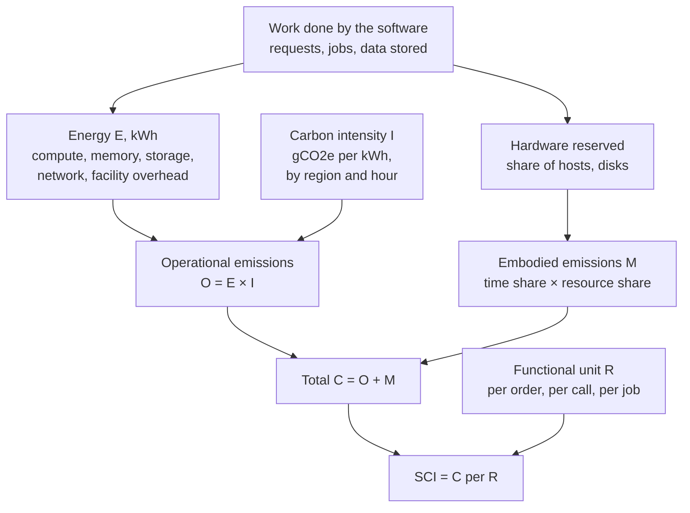
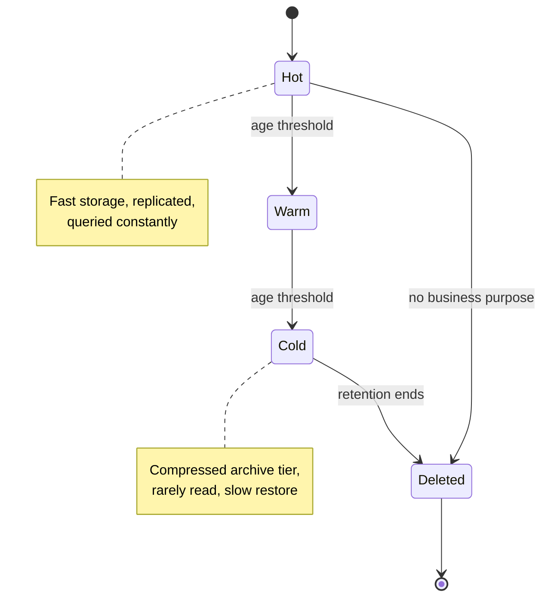
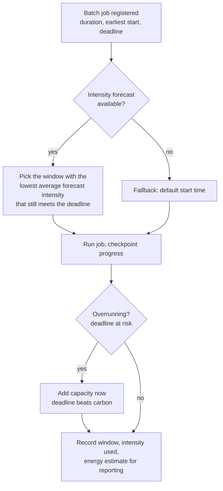
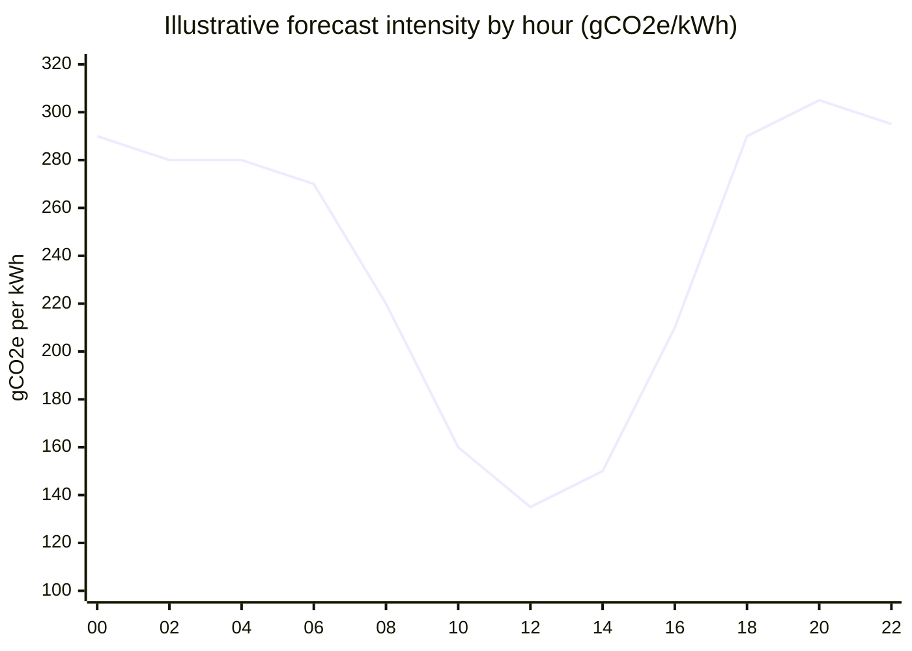

# Sustainable and carbon-aware architecture

> Every request a system serves consumes electricity, and every server it runs on was manufactured.
> Sustainable architecture treats both as design inputs: do less work, do it on fewer and fuller
> machines, keep less data, and run flexible work when and where electricity is cleaner, then measure
> the result per unit of useful output.

!!! abstract "Page facts"
    **Level:** Intermediate (the emission sources and levers are Level 1-2; carbon-aware scheduling,
    region trade-offs under residency constraints, and SCI measurement design are Level 3) ·
    **Status:** Draft · **Time:** 50-65 minutes · **Last verified:** 2026-11-27

## Learning objectives

After this page you should be able to:

- Explain where a software system's emissions come from (operational and embodied) and the three
  levers that reduce them: energy efficiency, hardware efficiency, and carbon awareness.
- Apply utilization, right-sizing, compute and storage efficiency, and data lifecycle rules as
  sustainability measures, and say where they align or conflict with cost and reliability.
- Design a carbon-aware schedule for flexible work (time shifting, location shifting, demand shaping),
  including deadlines, fallbacks, and residency constraints on region choice.
- Calculate a Software Carbon Intensity (SCI) score from labelled inputs and explain what does and does
  not change it.
- Describe what provider carbon-reporting tools report, and why they suit accounting better than
  day-to-day engineering decisions.

## Prerequisites

- [Cloud cost models and FinOps](cloud-cost-models-and-finops.md) — unit metrics, idle detection, and
  the non-production schedule this page reuses.
- [Compute options and sizing](../cloud-architecture/compute-options-and-sizing.md) — requests,
  utilization targets, spot, and batch capacity.
- [Cloud building blocks and landing zones](../cloud-architecture/cloud-building-blocks-and-landing-zones.md)
  — the region guardrail that enforces AtlasMart's residency constraint C-4.

## The problem this solves

Cloud resources feel weightless: a cluster appears in minutes and disappears without a trace. But each
vCPU-hour draws power from a real grid whose carbon intensity changes by region and by hour, and each
server, disk, and network switch carries the emissions of its manufacture. Architects historically
optimized for latency, availability, and cost; energy and carbon were the data centre operator's
problem. Three changes moved them onto the architect's desk: organizations now report emissions,
including those of their cloud use; providers publish per-customer carbon data; and the same few
design choices (idle capacity, over-provisioning, data kept forever, work scheduled out of habit) waste
both money and carbon. Without a method, teams either ignore the topic or buy offsets and call the
system green, which changes nothing about how the software runs.

## What it is

**Sustainable architecture** designs a system to deliver its function with the least environmental
impact, treating energy and carbon as quality attributes alongside cost (the glossary's
*sustainability*). For software, emissions come from two sources:

- **Operational emissions:** the electricity the system consumes (compute, memory, storage,
  networking, and the facility overhead around them) multiplied by the **carbon intensity** of that
  electricity, in grams of CO2-equivalent per kWh.
- **Embodied emissions:** the emissions of manufacturing, transporting, and disposing of the hardware,
  of which a system is responsible for a share proportional to how much of the hardware it reserves and
  for how long.

The Green Software Foundation (GSF) frames the reductions in three action categories, which its
Software Carbon Intensity specification is designed to reward:

| Lever | What it means | Typical architecture moves |
|---|---|---|
| Energy efficiency | Use less electricity for the same function | Efficient code paths, caching, fewer round trips, efficient instance families, less data moved |
| Hardware efficiency | Use fewer physical resources for the same function | Higher utilization, right-sizing, consolidation, extending hardware life, scale to zero |
| Carbon awareness | Run work when and where electricity is cleaner | Time shifting, location shifting, demand shaping |

**Carbon-aware computing** is the third lever in practice: software that reads a signal about grid
carbon intensity and changes *when*, *where*, or *how much* it computes.

## Mental model

Think of running a household dishwasher. Energy efficiency is an eco programme. Hardware efficiency
is waiting until the machine is full instead of running it half empty, and keeping a working machine
for years rather than replacing it. Carbon awareness is setting it to run when the rooftop solar panels
are producing, which you can do only because clean dishes are needed by the evening, not right now. The
dirty-dish backlog is flexible; the morning coffee is not.

**Where the analogy breaks:** you can see your solar panels, but a cloud region's grid mix is invisible
and must come from a forecast; a shared cloud host runs many tenants, so "running it full" depends on
the provider's packing as much as yours; and if everyone shifts work into the same clean hours, the
shift itself can change which power stations run. The analogy also hides measurement: in the cloud you
usually estimate energy rather than read a meter.

## Key terms

| Term | Meaning on this page |
|---|---|
| Carbon intensity | Grams of CO2-equivalent emitted per kWh of electricity consumed, for a given grid, region, and time |
| Operational emissions | Energy consumed by the software multiplied by the carbon intensity of that energy |
| Embodied emissions | Emissions from manufacturing, transporting, and disposing of hardware, allocated by time and resource share |
| Energy efficiency | Using less electricity to perform the same function |
| Hardware efficiency | Using fewer physical resources to perform the same function |
| Carbon awareness | Shifting computation in time or location toward lower-carbon electricity |
| Time shifting | Running deferrable work in the hours with the lowest forecast carbon intensity, inside its deadline |
| Location shifting | Running movable work in a region whose electricity is cleaner, within residency and latency constraints |
| Demand shaping | Changing how much work is done (quality, frequency, resolution) depending on carbon intensity |
| Software Carbon Intensity (SCI) | A GSF specification, published as ISO/IEC 21031:2024, that scores carbon emissions per functional unit |
| Functional unit (R) | The unit of useful output an SCI score is divided by: per API call, per user, per order, per job |
| Power usage effectiveness (PUE) | Total facility energy divided by the energy delivered to IT equipment; 1.0 would mean no overhead |
| Location-based / market-based | Two ways to account for electricity emissions: the physical grid's intensity, or intensity after contractual instruments such as renewable energy purchases |
| Data lifecycle | The stages data moves through (hot, warm, cold, deleted) and the rules that move it |

## How it works

### Where a system's emissions come from

**Figure 1 — The parts of an SCI score.** Operational emissions come from energy and grid intensity;
embodied emissions from a share of the hardware; both are divided by the functional unit.

How to read it: each box on the left is a lever. Energy efficiency shrinks E; carbon awareness picks a
lower I; hardware efficiency shrinks the hardware share and therefore M. Dividing by R turns the total
into a rate, so a system that grows can still improve its score.

### Energy-efficient computing and compute efficiency

The cheapest kWh is the one not consumed. At the code and design level that means fewer CPU cycles per
unit of work: caching results instead of recomputing them (AtlasMart's Status Cache absorbs most
tracking reads), avoiding chatty call chains, using efficient serialization, compressing data in
transit, and choosing an algorithm whose cost grows slowly with input size. At the platform level it
means instance families with more work per watt; providers' newer generations and Arm-based instances
are often more efficient, but benchmark your own workload per unit of work, as the
[compute sizing page](../cloud-architecture/compute-options-and-sizing.md) recommends for cost.

### Utilization and right-sizing

Servers draw substantial power even when idle, so work packed onto fewer, busier machines uses less
energy than the same work spread thin. AWS's sustainability guidance makes the same point when it asks
designers to maximize utilization. Right-sizing (matching requests to measured usage) and scaling the
billed layer to demand are therefore both cost and carbon measures, and they also reduce embodied
emissions, because fewer reserved hosts means a smaller hardware share.

The limit is reliability: a design that must survive a zone loss deliberately keeps headroom, and that
headroom is idle most of the time. The right question is not "why is utilization low?" but "is this
headroom buying an availability requirement, or is it habit?". Non-production environments, by
contrast, have no availability requirement at night: scheduling them off is the clearest win in both
ledgers.

### Storage efficiency and data lifecycle

Stored data consumes energy continuously (disks spin or flash is powered, replicas multiply it, backups
copy it again) and its hardware has embodied emissions. Data lifecycle rules are the storage lever:

**Figure 2 — A data lifecycle with tiering and deletion.** Each transition is a rule driven by age
and classification, not a manual cleanup.

How to read it: data should only ever move right or end. A data set with no exit to *Deleted* is kept
forever by default, which costs money, energy, and privacy risk. Retention is set by the data's
classification and legal requirements (see [data security and privacy](../security-architecture/data-security-and-privacy.md)),
not by the storage team's caution.

Storage efficiency also means compressing data, deduplicating it, keeping only as many replicas as the
recovery objectives need, and not logging at debug level in production.

### Carbon-aware computing

Grid carbon intensity varies by **location** (generation mix differs by country and region) and by
**time** (solar output peaks at midday, wind follows the weather, demand peaks in the evening). Work
that is **deferrable** or **movable** can follow the cleaner electricity:

- **Time shifting:** a batch job, a model training run, a backup, or a report with a deadline runs in
  the lowest-intensity window before that deadline.
- **Location shifting:** movable work runs in a region with cleaner electricity, if data residency,
  latency, data-transfer cost, and capacity allow.
- **Demand shaping:** the system does less when intensity is high: lower video resolution, less
  frequent refreshes, deferring non-essential features.

**Figure 3 — A carbon-aware scheduler for a deferrable batch job.** The scheduler chooses a window; it
never relaxes the deadline.

How to read it: the carbon signal only chooses among windows that already satisfy the business
requirement. A missing forecast degrades to the old schedule, not to a failed job, and the record at
the end is what makes the saving reportable. Two cautions: the intensity signal can be **average**
(the mix of the whole grid) or **marginal** (the plant that responds to extra demand), and they can
rank hours differently; the SCI specification accepts either, so record which one you use. And shifting
only helps work that is genuinely flexible; moving an interactive request to save carbon is a latency
regression.

### Region selection trade-offs

Region choice fixes a workload's baseline carbon intensity for years, so it is the biggest single
carbon decision, and the most constrained:

| Factor | Effect on region choice |
|---|---|
| Data residency and sovereignty | Hard constraint: it removes regions from the list before carbon is considered |
| Latency to users | Interactive paths must stay near users; batch and training are more movable |
| Grid carbon intensity | Differs widely by region; some providers publish per-region data |
| Price and service availability | Prices and the set of services differ by region |
| Disaster recovery | A second region doubles some infrastructure; its intensity counts too |
| Data gravity and transfer | Moving data to a cleaner region costs transfer, time, and another copy |

Google Cloud, for example, publishes a carbon-free energy percentage and grid carbon intensity for each
of its regions and marks low-carbon locations; check what your provider publishes, and treat the data as
annual averages, not real-time signals.

### Scheduling as a sustainability tool

Scheduling joins the levers together: scale-to-zero schedules for non-production, batch windows chosen by
forecast, spot or batch capacity for flexible work (spare capacity that would otherwise idle), and
retention jobs that delete what lifecycle rules expire. Most schedules already exist for cost reasons;
adding a carbon signal to them is often a small change.

### Green software engineering and the SCI specification

The **Green Software Foundation** is a non-profit that develops standards, tooling, and training for
green software. Its training material frames green software around carbon efficiency (the least carbon
per unit of work), energy efficiency, hardware efficiency, and carbon awareness, with measurement as the
way to know whether any of it worked.

The **Software Carbon Intensity (SCI) specification** (version 1.1.0 on the GSF's SCI site, and
published by ISO and IEC as **ISO/IEC 21031:2024**) defines a score, not a total:

`SCI = ((E × I) + M) per R`

- **E** is the energy consumed by the software within its boundary, in kWh, including facility
  overhead such as cooling (often applied through PUE).
- **I** is location-based carbon intensity of that energy, in gCO2e per kWh; average or marginal
  intensity are both allowed, at the finest time resolution available.
- **M** is the embodied emissions share: total embodied emissions of the hardware × the share of its
  life the software reserves it × the share of its resources the software reserves.
- **R** is the functional unit that best describes how the software scales.

Two properties make SCI useful to architects. **Market-based measures do not reduce the score**:
offsets, renewable energy certificates, and power purchase agreements are excluded, so the only way to
improve it is to change the system (energy, hardware, or carbon awareness). And the **boundary** must
include everything that materially supports the software: compute, storage, networking, monitoring,
logging, backups, redundancy, build pipelines, and, where relevant, end-user devices. The GSF has also
ratified an SCI for AI specification that builds on ISO/IEC 21031:2024 for AI workloads.

### Carbon reporting

Organizations report emissions in scopes (direct emissions, purchased electricity, and value-chain
emissions); for a cloud customer, cloud use sits in its value chain. Providers now supply per-customer
estimates:

| Concept | AWS | Microsoft Azure | Google Cloud |
|---|---|---|---|
| Customer carbon data | AWS Sustainability (the Customer Carbon Footprint Tool was deprecated on 30 June 2026 in its favour) | Carbon optimization in the Azure portal; Emissions Impact Dashboard for Azure (Power BI, announced for retirement on 31 March 2027) | Carbon Footprint (location-based and market-based views) |
| Region carbon data | Check current AWS documentation | Check current Azure documentation | Carbon free energy for Google Cloud regions (CFE% and grid intensity) |
| Architecture guidance | Well-Architected Framework sustainability pillar | Well-Architected sustainability workload guidance | Well-Architected Framework sustainability pillar |

These tools are built for **accounting**: monthly data, published with a lag of weeks, aggregated by
service, region, and account, and estimated with methodologies that the providers revise. They are the
right source for an annual report and a poor source for an engineering decision this sprint. For
engineering, use **proxies** that respond immediately and correlate with emissions: vCPU-hours,
GB-months stored, GB transferred, and requests per vCPU-hour, plus a carbon-intensity signal for
scheduling. Then confirm the trend in the monthly provider data.

### Sustainable cloud architecture, in one checklist

- Measure a unit metric (energy or carbon proxy per order, per request, per job) and trend it.
- Remove idle: non-production schedules, orphaned resources, debug logging.
- Right-size and raise utilization where the headroom is not buying an availability requirement.
- Keep less data: lifecycle rules, compression, replicas sized to recovery objectives.
- Make flexible work carbon-aware, with deadlines and fallbacks.
- Choose regions with carbon in the criteria, after residency and latency.
- Prefer managed and shared services where the provider runs them at higher utilization than you could.

## Worked example: carbon-aware scheduling of AtlasMart's nightly analytics batch

**Context (assumptions, all labelled).** AtlasMart runs a nightly analytics batch that reads the
previous day's orders (60,000, an existing fact) and scan events (480,000, an existing fact) and builds
delivery-performance aggregates per carrier for the logistics team. It starts at 01:00 local time on a
batch node pool of four 4-vCPU nodes (16 vCPU) that scales to zero afterwards, and runs for 4 hours:
16 × 4 = **64 vCPU-hours per run** (assumption). The results are reviewed in an afternoon carrier
meeting, so they must be ready by **16:00** (assumption): any 4-hour window starting between 00:00 and
12:00 meets the deadline. Constraint C-4 keeps the data in the EU, so AtlasMart's options are its
primary EU region and the second EU region used for disaster recovery (assumption, see
[Disaster recovery strategies](../reliability-and-disaster-recovery/disaster-recovery-strategies.md)).

### Step 1 — Illustrative inputs

| Input | Value | Status |
|---|---|---|
| Energy per vCPU-hour, all-in (CPU, memory, storage, network share, facility overhead) | e = 0.01 kWh | Illustrative, not a measured or published factor |
| Energy per run | E = 64 × 0.01 = 0.64 kWh | Arithmetic |
| Grid carbon intensity forecast for one day, by hour | Figure 4 series, 135 to 310 gCO2e/kWh | Illustrative, not any real grid |
| Embodied emissions of one host | TE = 1,200,000 gCO2e for a 48-vCPU host | Illustrative |
| Host expected life | 4 years = 4 × 8,760 = 35,040 hours | Illustrative |
| Functional unit | R = per 1,000 orders processed, so R = 60 per run | Choice |

**Figure 4 — An illustrative day's carbon-intensity forecast for the region.** Hourly values in
gCO2e/kWh; a sunny day lowers intensity around midday. Not data from any real grid.

How to read it: the chart shows every second hour of the 24-hour series used below. The default 01:00
start sits in a high-intensity plateau; the trough is late morning to early afternoon. On a windy night
the shape could invert, which is why the scheduler reads a forecast every day instead of hard-coding
"run at noon".

### Step 2 — Choose the window

The scheduler averages the forecast over each 4-hour window that meets the deadline (starts 00:00 to
12:00). From the hourly series (assumption): the default window 01:00-05:00 averages (285 + 280 + 275 +
280) ÷ 4 = **280**; the best window, 11:00-15:00, averages (145 + 135 + 140 + 150) ÷ 4 = **142.5**
gCO2e/kWh. It finishes at 15:00, an hour before the deadline, which leaves a margin for an overrun.

### Step 3 — SCI before and after

Embodied share per run (the same in both windows, because the same hardware is reserved for the same
time): M = TE × time share × resource share = 1,200,000 × (4 ÷ 35,040) × (16 ÷ 48) ≈ **45.66 gCO2e**.

| | Default 01:00-05:00 | Shifted 11:00-15:00 |
|---|---|---|
| Operational O = E × I | 0.64 × 280 = 179.2 g | 0.64 × 142.5 = 91.2 g |
| Embodied M | 45.66 g | 45.66 g |
| Total C = O + M | 224.86 g | 136.86 g |
| SCI = C ÷ R (R = 60) | **3.75 gCO2e per 1,000 orders** | **2.28 gCO2e per 1,000 orders** |

The time shift lowers the illustrative score by about 39% (1 − 2.28 ÷ 3.75) without changing a line
of the batch's code, and the cost is unchanged because on-demand capacity is priced the same at both
times (if the pool used spot capacity, spot availability at midday would need checking).

### Step 4 — The next lever is efficiency

After the shift, embodied emissions are a third of the total (45.66 ÷ 136.86), so carbon awareness alone
has reached its limit. Making the batch incremental, so it reprocesses only the partitions that changed
instead of the whole day's history, is assumed to halve its vCPU-hours to 32. That halves E (0.32 kWh)
and the time share of M: (0.32 × 142.5 + 22.83) ÷ 60 = (45.6 + 22.83) ÷ 60 ≈ **1.14 gCO2e per 1,000
orders**, roughly a third of the original 3.75. It also halves the batch's compute cost, which is what
gets it prioritised.

### Step 5 — Why not shift location?

Moving the batch to the second EU region would satisfy C-4, and the tier 1 warm-standby database there
(DR assumption) already holds replicated data. The team still declines for now: the DR region's
capacity is reserved for failover, running analytics there adds a new data flow to the residency
register and a new dependency to the DR runbook, and the carbon data for comparing the two regions is an
annual average while the time shift uses a daily forecast. Revisit when the provider's region data shows
a large, persistent gap and the DR region has separate batch capacity.

### Step 6 — Other AtlasMart measures in the same ledger

- **Non-production schedule:** the [FinOps page](cloud-cost-models-and-finops.md) schedules dev and
  staging node pools to 60 of 168 hours a week, removing 108 ÷ 168 ≈ 64% of their node-hours; energy
  falls roughly in proportion, minus any always-on control-plane share.
- **Tracking events lifecycle (assumption):** events older than 90 days move from the Tracking Event Store
  to compressed files in a cold object-storage tier, and are deleted when the retention period set by the
  data-classification policy ends. NFR-7 (RPO 5 minutes) applies to recent events, not to the archive.
- **Logs:** 300 GB per day of logs is an existing fact; the log archive keeps audit, flow, and DNS logs for
  1 year by policy, while application debug logs are off in production and kept 30 days elsewhere
  (assumption).
- **Reporting:** the batch's SCI and the vCPU-hours per 1,000 orders are reported monthly next to its cost;
  the provider's carbon tool confirms the trend quarterly.

## Real-world architecture example

The usual sequence in companies that take software emissions seriously: first, a provider carbon report
shows a total nobody can act on. Next, a sustainability lead and the FinOps team notice that the
largest reductions available are the same as the cost reductions (idle environments, over-provisioned
clusters, unbounded data retention), and fold carbon proxies into the existing cost reports. Then
deferrable workloads (training, rendering, reprocessing, backups) get a carbon-aware scheduler with a
forecast feed. Region choice comes last, because it is constrained by residency and latency and changes
rarely; when it does change, carbon intensity is one of the criteria in the decision record.

## Design choices and trade-offs

| Choice | Favor when | Avoid when |
|---|---|---|
| Time-shift a batch job | It has a deadline hours away and a forecast feed exists | Results are needed immediately or the job is on the critical path of a customer request |
| Location-shift a job | Residency allows it, data is small or already replicated, capacity exists | Residency constraints, large data gravity, or the target region is reserved for DR |
| Demand shaping | Quality can degrade gracefully (video resolution, refresh rate) | The degraded quality breaks an SLO or a contractual commitment |
| Consolidate onto fewer, fuller nodes | Headroom is habit, not an availability requirement | It removes zone-failure headroom required by the SLO |
| Extend hardware or instance life | Embodied emissions dominate and performance is adequate | Newer hardware does much more work per watt for this workload |
| Aggressive data deletion | Data has no business or legal purpose after a known age | Legal holds, audit, or recovery objectives require it |
| Choose a lower-carbon region | Greenfield workload, no residency or latency conflict | Residency forbids it, or users would see latency regressions |

## Failure modes and anti-patterns

- **Offsets as architecture.** Buying certificates and calling the system green. Detect: no change in
  energy or utilization metrics. Prevent: report SCI, which offsets do not reduce.
- **Carbon-aware scheduling that misses deadlines.** Detect: late batch outputs after the scheduler
  was introduced. Prevent: the scheduler only picks among windows that meet the deadline, with a
  fallback.
- **Shifting everyone into the same hour.** Many jobs follow the same signal and spike demand.
  Detect: queueing and capacity shortfalls at the "green" hour. Prevent: spread jobs across acceptable
  windows; use marginal signals where available.
- **Reporting without proxies.** Teams wait a month for provider data and cannot link it to changes.
  Prevent: engineering proxies (vCPU-hours, GB-months, GB transferred) per unit, trended per release.
- **Efficiency that removes resilience.** Consolidation that deletes zone headroom. Prevent: sustainability
  changes go through the same review as any change affecting NFR-2.
- **Data kept forever.** Detect: storage growing with no lifecycle rule. Prevent: lifecycle rules as a
  landing-zone requirement keyed on the data-classification tag.

## Security considerations

- **Forecast feeds are inputs to scheduling.** A spoofed or unavailable carbon signal must not delay
  critical work: validate the source, authenticate it, and fall back to a default schedule.
- **Deletion is a security control and a risk.** Lifecycle rules reduce exposure of old personal data,
  but a wrong rule destroys evidence or backups; protect lifecycle policies like other guardrails.
- **Location shifting moves data.** Every new region processing customer data enters the residency
  register, the threat model, and the key-management design (C-4 for AtlasMart).
- **Carbon data can reveal footprint.** Detailed per-region and per-service emissions say where and how
  much a company runs; treat them like billing data.

## Performance, reliability, and cost

- **Performance:** efficiency measures (caching, compression, fewer round trips) usually improve
  latency; demand shaping and lower tiers can worsen it, so check NFR-3.
- **Reliability:** time shifting moves the batch into working hours, when engineers are around to fix a
  failure, a minor reliability benefit; consolidation and fewer replicas can harm reliability and need the
  same review as any capacity change.
- **Cost:** idle removal, right-sizing, and data lifecycle cut cost and carbon together; time shifting
  is usually cost-neutral; location shifting may add transfer cost; extending hardware life can cost
  performance per CU.

## Hands-on lab: a carbon-aware window picker

A local, free exercise with Python's standard library only.

1. Put the 24 hourly values used in Step 2 into a list (00:00 to 23:00: 290, 285, 280, 275, 280, 285,
   270, 250, 220, 190, 160, 145, 135, 140, 150, 175, 210, 250, 290, 310, 305, 300, 295, 290).
2. Write `best_window(series, duration, earliest, deadline)` that returns the start hour with the
   lowest average intensity among windows that finish by the deadline.
3. Compute the SCI for the default and the chosen windows with the Step 1 inputs; check you get 3.75 and
   2.28.
4. Model a windy night by rotating the series 12 hours (new value at hour h = old value at hour
   h + 12, wrapping) and confirm the picker now chooses an early-morning window.
5. Add a fallback: if the series is empty or contains a missing value, return the default start of 01:00.

??? question "Hint: what happens if the deadline moves to 08:00?"
    Only windows starting 00:00 to 04:00 finish by 08:00. Their averages in the series range from about
    271 to 283, so the best saving is a few percent. Carbon awareness needs flexibility: the value of
    the shift comes from the business accepting a later deadline, which is a requirement conversation,
    not a technical one.

## Knowledge check

1. Name the three action categories that reduce an SCI score and give one architecture move for each.
2. Why does buying renewable energy certificates not change an SCI score?
3. In Step 3, why is the embodied share M the same in both windows?
4. Give two reasons why provider carbon tools are a poor basis for sprint-level engineering decisions.
5. Why did AtlasMart not move the batch to its second EU region, even though C-4 allows it?

??? success "Answers"
    1. Energy efficiency (caching, fewer round trips), hardware efficiency (right-sizing, higher
       utilization, scale to zero), carbon awareness (time or location shifting of flexible work).
    2. SCI uses location-based intensity and explicitly excludes market-based measures such as
       certificates, power purchase agreements, and offsets, so only changes to the system improve it.
    3. M depends on how much hardware is reserved and for how long; the shift changes when the job runs,
       not the 16 vCPU for 4 hours it reserves.
    4. Their data is monthly with a lag of weeks and aggregated by service and region, so it cannot show
       the effect of a change quickly; and methodologies are revised, so values can be restated.
    5. The DR region's capacity is reserved for failover, analytics there adds a new data flow and DR
       dependency, and the only region comparison available is an annual average, while the time shift
       already captures a large part of the saving.

## Architecture discussion questions

1. AtlasMart's analytics team wants to retrain a delivery-time prediction model weekly. Design a
   carbon-aware schedule for it, and say which constraints you would ask the business to relax.
2. A colleague proposes running the prod cluster at 85% CPU utilization "for sustainability". Using the
   zone-failure argument from the sizing page, argue for the utilization target you would accept.
3. Which functional unit would you choose for an SCI score of the whole Order Tracking System, and how
   would you draw its software boundary?

## Summary

Software emissions are operational (energy times grid carbon intensity) plus embodied (a share of the
hardware's manufacture). They fall through energy efficiency, hardware efficiency, and carbon awareness.
Utilization, right-sizing, idle removal, and data lifecycle rules serve cost and carbon together; region
choice sets the baseline intensity but is constrained by residency and latency; carbon-aware scheduling
moves flexible work to cleaner hours inside its deadline. The GSF's SCI specification (ISO/IEC
21031:2024) scores emissions per functional unit and ignores offsets. Provider carbon tools serve
accounting; engineering needs fast proxies. Shifting AtlasMart's nightly batch from 01:00 to 11:00
lowers its illustrative SCI from 3.75 to 2.28 gCO2e per 1,000 orders, and making it incremental takes
it to about 1.14.

## Related topics

- **Before:** [Cloud cost models and FinOps](cloud-cost-models-and-finops.md);
  [Compute options and sizing](../cloud-architecture/compute-options-and-sizing.md);
  [Cloud building blocks and landing zones](../cloud-architecture/cloud-building-blocks-and-landing-zones.md)
- **Alongside:** [Quality attributes and trade-offs](../architecture-fundamentals/quality-attributes-and-trade-offs.md);
  [Constraints, assumptions, dependencies, risks, and scope](../architecture-fundamentals/constraints-assumptions-dependencies-risks-and-scope.md)
  — constraint C-4; [Data security and privacy](../security-architecture/data-security-and-privacy.md)
  — retention and residency; [Disaster recovery strategies](../reliability-and-disaster-recovery/disaster-recovery-strategies.md);
  [Well-Architected frameworks](../cloud-architecture/well-architected-frameworks.md)
- **Planned:** storage architecture and tiers (D06-T04); batch and data pipelines (D07); GPU
  infrastructure and model serving (D24).

## References

| Source | Type | Checked |
|---|---|---|
| [Software Carbon Intensity (SCI) Specification](https://sci.greensoftware.foundation/) — Green Software Foundation | Specification (formula, terms, boundary, exclusions, version 1.1.0) | 2026-11-27 |
| [ISO/IEC 21031:2024, Software Carbon Intensity (SCI) specification](https://www.iso.org/standard/86612.html) — ISO (returns 403 to scripts; primary source) and [SCI for AI](https://greensoftware.foundation/standards/sci-ai/) — GSF (states the ISO basis) | International standard | 2026-11-27 |
| [Green Software Foundation](https://greensoftware.foundation/) | Foundation (green software principles and training) | 2026-11-27 |
| AWS: [What is AWS Sustainability?](https://docs.aws.amazon.com/sustainability/latest/userguide/what-is-sustainability.html), [Customer Carbon Footprint Tool release notes](https://docs.aws.amazon.com/ccft/latest/releasenotes/what-is-ccftrn.html) (deprecation on 30 June 2026), [Well-Architected Framework: Sustainability](https://docs.aws.amazon.com/wellarchitected/latest/framework/sustainability.html), [Design principles for sustainability in the cloud](https://docs.aws.amazon.com/wellarchitected/latest/framework/sus-design-principles.html) | Official documentation | 2026-11-27 |
| Microsoft: [What is Carbon optimization in Azure](https://learn.microsoft.com/azure/carbon-optimization/overview), [Emissions Impact Dashboard for Azure](https://learn.microsoft.com/power-bi/connect-data/service-connect-to-emissions-impact-dashboard), [Azure Well-Architected sustainability guidance](https://learn.microsoft.com/azure/well-architected/sustainability/) | Official documentation | 2026-11-27 |
| Google Cloud: [Carbon Footprint](https://cloud.google.com/carbon-footprint/docs), [Carbon free energy for Google Cloud regions](https://cloud.google.com/sustainability/region-carbon), [Well-Architected Framework: Sustainability pillar](https://cloud.google.com/architecture/framework/sustainability) | Official documentation | 2026-11-27 |
| [FinOps Framework domains](https://www.finops.org/framework/domains/) — FinOps Foundation | Framework (sustainability as a FinOps capability) | 2026-11-27 |

## Review notes

- Canonical page for D17-T02. In depth: emission sources, the three levers, utilization and
  right-sizing, carbon-aware computing (time and location shifting), region selection, SCI, carbon
  reporting. Treated briefly: energy-efficient computing (two paragraphs), storage efficiency and data
  lifecycle (one figure, short text; storage tiers are D06-T04), scheduling (one paragraph), sustainable
  cloud architecture (checklist).
- No emission factor, grid intensity, PUE value, or embodied figure is real: e = 0.01 kWh per vCPU-hour,
  the hourly intensity series, TE = 1,200,000 gCO2e, and the 4-year life are labelled illustrative.
- SCI facts (name, version 1.1.0, formula, location-based I with average or marginal allowed, exclusion
  of market-based measures, boundary contents, score not total) were read on sci.greensoftware.foundation
  on 2026-11-27. The ISO number ISO/IEC 21031:2024 is stated on the GSF's SCI for AI page; iso.org returns
  403 to scripts (primary source, kept). The SCI site does not say which SCI version the ISO edition
  corresponds to, so the page does not claim one.
- The GSF principle names (carbon efficiency, energy efficiency, hardware efficiency, carbon awareness)
  come from GSF pages found by search; the GSF learning site returns 403 to scripts and is not cited.
- Provider tools verified on 2026-11-27: AWS Sustainability (CCFT deprecated 30 June 2026, per the CCFT
  release notes); Azure Carbon optimization and the Emissions Impact Dashboard retirement date of
  31 March 2027 (Carbon optimization overview page); Google Carbon Footprint (location- and market-based
  views) and per-region CFE% and grid intensity. AWS and Azure region carbon data were not verified, so
  the table says "check current documentation".
- New AtlasMart assumptions: nightly analytics batch (16 vCPU, 4 hours, 64 vCPU-hours, 01:00 default
  start, 16:00 deadline, scales to zero); incremental processing halving it to 32 vCPU-hours; tracking
  events older than 90 days tiered to cold storage; application debug logs off in production and kept
  30 days elsewhere. The DR region assumption (second EU region, warm standby) is reused, not changed.
- Figure 4 is `xychart-beta` (line only) and Figure 2 a `stateDiagram-v2` with notes; check rendering in
  light and dark mode.
