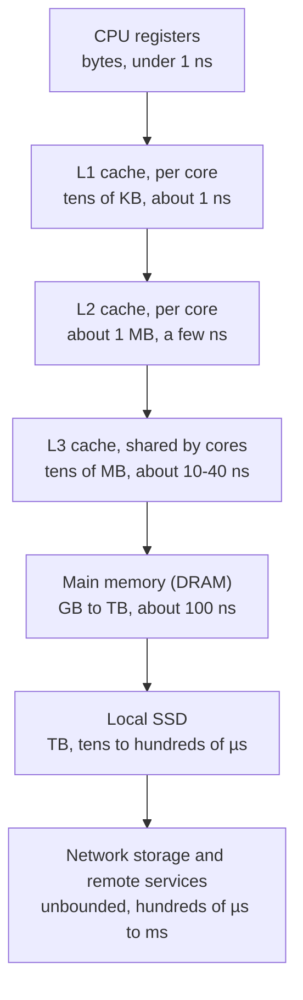
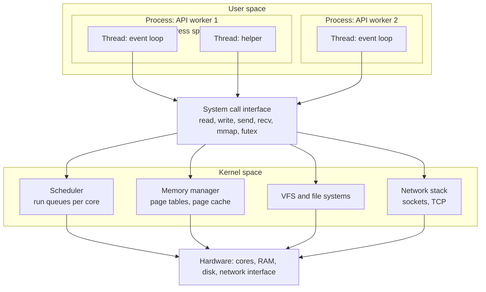
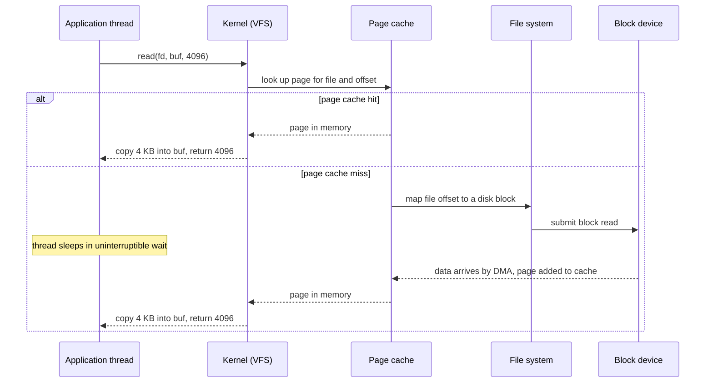

# Computers, operating systems, and Linux for architects

> Every capacity number on an architecture diagram is a claim about a machine: so many cores, so much
> memory, so many I/O operations per second. This page gives you enough of that machine to check the
> claim, and to read the signals when a service stops scaling.

!!! abstract "Page facts"
    **Level:** Mixed (hardware, memory, and processes are Level 1-2; sizing and reading saturation
    signals are Level 3) · **Status:** Draft · **Time:** 60-75 minutes · **Last verified:** 2026-11-20

## Learning objectives

After this page you should be able to:

- Explain what cores, hardware threads, and vCPUs are, and why the cache hierarchy makes memory
  access patterns a performance decision.
- Describe virtual memory, paging, processes, threads, scheduling, and system calls well enough to
  interpret memory limits, context switches, and CPU throttling in a container.
- Distinguish IOPS, throughput, and latency for storage, and relate them with Little's Law.
- Use rough orders of magnitude (the latency ladder) to reject designs that cannot meet their targets.
- Work out where a single service instance saturates and name the Linux tools that would confirm it.

## Prerequisites

- [Performance fundamentals and Little's Law](../performance-and-scalability/performance-fundamentals-and-littles-law.md)
  — utilization, saturation, and service time are used throughout.
- [Capacity estimation](../performance-and-scalability/capacity-estimation.md) — the AtlasMart load
  numbers and the per-instance capacity assumption come from there.

## The problem this solves

Architects work several layers above the hardware, but the machine has not gone away; it has been
hidden behind a quota. "Two vCPUs and 1 GiB per task" is a hardware decision, and an incident in
which latency doubles while average CPU sits at 40% is usually a kernel effect (CPU throttling, page
cache eviction, a disk queue, steal time) invisible to anyone who treats a server as a box that runs
code. Knowing the machine lets you check whether a design can meet its targets before building it,
choose instance shapes and limits from the workload rather than a default, and ask precise questions
during an incident.

## What it is

A computer, for this page, is a set of **resources** (CPU, memory, storage, network) that an
**operating system** (OS) shares among many programs. The OS has a privileged core, the **kernel**,
which owns the hardware and offers programs a safer, simpler abstraction: processes with private
memory, files instead of disk blocks, sockets instead of network frames. **Linux** is the kernel that
runs the large majority of cloud servers and containers; together with its user-space tools and
**shell** it is the environment in which most production services run and are debugged.

| Layer | What it provides | What an architect sizes or reads |
|---|---|---|
| Hardware | Cores, caches, RAM, disks, network interfaces, accelerators | Instance type, vCPU count, memory, volume type |
| Virtualization | Virtual machines on shared physical hosts | Steal time, noisy neighbors, instance families |
| Kernel | Processes, scheduling, virtual memory, file systems, network stack | Limits (cgroups), page cache, run queues |
| User space | Runtimes, libraries, shells, tools | Worker counts, thread pools, diagnostic tools |
| Application | Your service | Requests per second, latency, errors |

## Mental model

Think of a restaurant kitchen. Cooks are CPU cores; some can alternate between two orders when one
is waiting (hardware threads). The counter in front of each cook is the L1 cache, the shelves behind
are L2 and L3, the walk-in fridge is RAM, and the delivery truck is the disk. The head chef (the
kernel) decides who works on what and for how long (scheduling), hands out ingredients on request
(system calls), and keeps popular ingredients in the fridge so nobody waits for the truck (the page
cache). Renting cooks in someone else's kitchen is a virtual machine; a station with its own labelled
shelves but the same head chef is a container.

**Where the analogy breaks:** the distances are far more extreme. If reaching the counter took one
second, the fridge would be minutes away and a network-attached disk days away. That ratio is why
access patterns and caching dominate performance; cores do not tire, they stall waiting on memory.

## Key terms

| Term | Meaning on this page |
|---|---|
| Core | An independent execution unit in a CPU that runs one instruction stream at a time |
| Hardware thread | One of two (sometimes more) instruction streams a core interleaves; also called simultaneous multithreading (SMT) |
| vCPU | A virtual CPU given to a virtual machine or container; often one hardware thread, check the provider's documentation |
| Cache line | The fixed-size block (commonly 64 bytes) in which data moves between memory and CPU caches |
| Virtual memory | Each process sees a private address space that the kernel maps to physical memory in pages |
| Page fault | An access to a page not currently mapped; minor if the data is in memory, major if it must be read from disk |
| Process | A running program with its own address space, file descriptors, and one or more threads |
| Thread | A schedulable stream of execution inside a process, sharing its memory |
| Context switch | The kernel saving one thread's state and restoring another's on a core |
| System call | A controlled entry from user space into the kernel to request a service such as `read` or `send` |
| Page cache | Kernel memory holding recently used file data so repeat reads avoid the disk |
| IOPS | Input/output operations per second: a storage throughput measure, distinct from bandwidth (bytes per second) |
| Utilization | The fraction of a resource's capacity in use |
| Saturation | The state in which a resource has no spare capacity, so extra work only lengthens the queue |
| cgroup | A Linux kernel control group that limits and accounts CPU, memory, and I/O for a set of processes |
| Hypervisor | Software that runs virtual machines and shares physical hardware among them |

## How it works

### CPU: cores, hardware threads, and vCPUs

A server CPU has many **cores**, each running one instruction stream. Many cores also support
**hardware threads** (SMT): the core interleaves two streams, switching when one stalls on memory.
They share one core's execution units, so two threads deliver well under twice the work of one. Cloud
**vCPUs** are, on many instance types, hardware threads rather than whole cores; check the provider's
documentation before comparing a "4 vCPU" instance with a 4-core laptop. Two consequences:

- **Parallel capacity is the number of cores, not clock speed.** A single-threaded process (including
  a Python process held to one core by its global interpreter lock; see
  [programming paradigms and concurrency](programming-paradigms-and-concurrency.md)) uses one core
  however many vCPUs the container has.
- **CPU time per request is the unit of compute sizing.** At 5 ms of CPU per request, one core serves
  at most 200 requests per second at 100% utilization; plan for far less.

### The cache hierarchy and why access patterns matter

Main memory (DRAM) is roughly a hundred times slower to reach than the fastest on-chip cache. CPUs
hide this with a hierarchy: small, fast caches per core (L1, L2) and a larger shared cache (L3, also
called the last-level cache). Data moves in **cache lines** (commonly 64 bytes), and the hardware
prefetches the next lines when it sees sequential access.

**Figure 1 — The memory hierarchy.** Each step down is larger, cheaper per byte, and slower. Values are
rough orders of magnitude; see the latency ladder below for ranges and sources.

How to read it: a program whose working data fits in the top three boxes runs at the speed of the
CPU; one that touches memory randomly runs at the speed of DRAM; one that reads from disk on every
request runs at the speed of the bottom two boxes, whatever the CPU.

What this means for design:

- **Sequential beats random.** Scanning an array uses every byte of each cache line and lets the
  prefetcher work; chasing scattered pointers pays a DRAM trip per hop. The same holds for disks, and
  log-structured storage engines exist because appending is the cheapest write.
- **Working sets decide performance.** When hot data fits in cache (or a database's hot pages fit in
  memory) performance is stable; when it outgrows them, latency steps up, as with the working set on
  the [caching architecture](../databases-and-storage/caching-architecture.md) page.
- **Sharing a cache line between cores is expensive.** Threads writing to neighboring variables make
  the line bounce between cores (false sharing); shared counters are a classic cause.

### The latency ladder

The table below gives rough orders of magnitude for common operations. The values vary by hardware
generation, configuration, and load, sometimes by a factor of ten; treat them as ranges for reasoning,
never as measurements. They are consistent with the widely cited figures in Jeff Dean's 2009 talk and
the updated interactive version by Colin Scott (both in References), and with Brendan Gregg's
*Systems Performance*. Measure your own platform before relying on any single number.

| Operation | Rough range | Design consequence |
|---|---|---|
| CPU cycle at 2-4 GHz | 0.25-0.5 ns | Billions of simple operations per second per core |
| L1 cache hit | about 1 ns | Tight loops over small data are nearly free |
| L3 cache hit | about 10-40 ns | Shared-cache data is still cheap |
| Main memory access | about 50-150 ns | Pointer chasing costs about 100 cycles per hop |
| Simple system call round trip | about 0.1-1 µs | Batch small reads and writes; avoid one call per byte |
| Thread context switch, direct cost | about 1-10 µs | Thousands of threads switching constantly waste CPU |
| Read 4 KB already in the page cache | about 1 µs | Repeat file reads are memory-speed |
| Random 4 KB read from local NVMe SSD | about 10-100 µs | Tens of thousands of random reads per second per device are feasible |
| Round trip within one availability zone | about 0.1-0.5 ms | A cache call costs more than a thousand memory accesses |
| Random read from network-attached block storage | about 0.5-2 ms | Database volumes are slower than local disk; check the provider's documentation |
| Round trip between zones in a region | about 0.5-2 ms | Synchronous cross-zone replication adds this to every commit |
| Hard disk seek | about 3-10 ms | Random I/O on spinning disks is a design smell |
| Round trip between regions on one continent | about 10-50 ms | Chatty cross-region calls break latency budgets |
| Round trip between continents | about 100-200 ms | Physics: light in fiber needs this long |

Two habits follow: count the slow steps in a request path (two zone-local round trips and a database
read cost milliseconds before any code runs), and compare ratios (moving from the memory rows to the
network rows costs a thousand times more, which is why a remote call inside a loop is so damaging).

### Virtual memory and paging

Every process sees its own **virtual address space**. The kernel divides memory into **pages** (4 KiB
is the common default on x86-64 Linux, with larger "huge pages" available) and keeps **page tables**
that map each virtual page to a physical frame. A small hardware cache of recent translations, the
translation lookaside buffer (TLB), keeps this fast. This gives isolation (one process cannot read
another's memory), lets the kernel share read-only pages such as libraries between processes, and
lets the kernel promise more memory than exists and supply it lazily.

Touching an unmapped page causes a **page fault**: a **minor fault** is resolved from memory, a
**major fault** needs a disk read at storage latency. Under pressure the kernel reclaims page cache
first, then swaps if swap is configured; many container platforms run without swap, so exhausting
memory leads straight to the **out-of-memory (OOM) killer**. A container's memory limit is a cgroup
setting (`memory.max` in cgroup v2); exceeding it kills a process in that container even if the host
has memory free. Watch **resident set size** (RSS, physical memory in use) rather than virtual size,
plus page fault rates and, in containers, cgroup usage and OOM-kill counts.

### Processes, threads, and the kernel

A **process** is a running program with its own address space, open files, and credentials; its
**threads** share its memory, which makes communication cheap and races easy. Code runs in **user
space** and enters **kernel space** through system calls, interrupts, and faults.

**Figure 2 — Processes, threads, and the kernel.** Two worker processes of a service, each with its
own address space and threads, call into the kernel, which owns scheduling, memory, files, and the
network.

How to read it: everything a service does that touches the outside world (files, sockets, memory
allocation, sleeping, waking another thread) crosses the system call boundary into the kernel. The
two processes cannot see each other's memory; the threads inside one process can.

### Scheduling and context switches

The kernel **scheduler** decides which runnable thread runs on each core. Linux's general-purpose
scheduler (the Completely Fair Scheduler for many years, replaced by an earliest-eligible-virtual-
deadline design in kernel 6.6) shares CPU among runnable threads by weight; threads waiting on I/O,
locks, or timers use no CPU. A **context switch** saves one thread's registers and restores another's:
microseconds directly, more once the resumed thread's cold cache is counted. Signals worth knowing:

- **Run queue length** (`r` in `vmstat`): persistently more runnable threads than cores means CPU
  saturation.
- **Load average** on Linux also counts threads in uninterruptible sleep (usually disk waits), so a
  high value can be an I/O problem.
- **Involuntary context switches** (preemption) rising with load suggest more runnable threads than
  cores; voluntary ones (blocking on I/O or locks) are normal.
- **CPU throttling:** a cgroup limit (`cpu.max`) of 200 ms per 100 ms period means two CPUs; processes
  that spend the quota early in a period wait for the next one, adding latency at moderate average
  utilization. `nr_throttled` and `throttled_usec` in `cpu.stat` reveal it.
- **Steal time** (`st` in `top` and `vmstat`): the hypervisor ran someone else when your vCPU wanted
  to run; sustained steal means an oversubscribed host.

### System calls

A **system call** is how user code asks the kernel to open a file, read a socket, allocate memory, or
create a thread. Crossing the boundary costs far more than a function call (mitigations for CPU
side-channel attacks raised the cost further on many systems). So buffer small writes, read in large
chunks, and use event-driven interfaces (such as `epoll` on Linux) that let one thread wait on
thousands of sockets. Tracing system calls with `strace` slows the traced process heavily; use it in
test environments or for short, deliberate production samples.

### File systems and the page cache

A **file system** (ext4 and XFS are common on Linux servers) maps names to **inodes** (metadata
records) and inodes to device blocks; journaling records metadata changes first so a crash leaves it
consistent; the virtual file system layer (VFS) gives all file systems one interface.

The **page cache** sits between file system and application. Reads are served from it when possible;
writes land in it as "dirty" pages flushed later. That is why a healthy server shows little "free"
memory (watch "available" in `free` instead), and why **durability needs `fsync`**: a successful
`write` means the data is in kernel memory, not on the device. Databases flush at commit, so commit
latency is bounded below by the device's flush latency.

**Figure 3 — The path of a `read()`.** A hit is served from memory; a miss blocks the calling thread
while the block device fetches the data.

How to read it: the hit path costs about a microsecond; the miss path adds the device latency from
the ladder (tens of microseconds on local NVMe, around a millisecond on network-attached storage).
The second read of the same data takes the hit path, which is why the first request after a deploy
or a restart is often the slowest.

### Storage I/O: IOPS, throughput, and latency

Storage performance has three numbers, and confusing them is a frequent sizing error:

| Measure | Unit | Matters for |
|---|---|---|
| IOPS | operations per second | Small random reads and writes: database lookups, index updates, commits |
| Throughput (bandwidth) | MB/s | Large sequential transfers: backups, log shipping, analytics scans |
| Latency | ms or µs per operation | Anything a user waits on synchronously, such as commits |

They are linked by two identities, both arithmetic rather than vendor claims:

- **Throughput = IOPS × I/O size.** 3,000 IOPS of 16 KB pages is 48 MB/s; the same 3,000 IOPS of 4 KB
  reads is only 12 MB/s.
- **Outstanding I/Os = IOPS × latency** (Little's Law). A device with 1 ms latency serving one request
  at a time delivers 1,000 IOPS; to reach 10,000 IOPS at the same latency the workload must keep 10
  requests in flight (queue depth 10). A single-threaded process issuing synchronous reads can never
  reach a volume's advertised IOPS.

Cloud block volumes cap IOPS and throughput separately, sometimes with burst credits; check the
provider's current documentation for limits and prices. In `iostat -x`, watch **await** (time per I/O
including queueing) and **aqu-sz** (queue size). `%util` only means "busy at some point"; for SSDs and
network volumes that serve requests in parallel, 100% does not mean saturated.

### Linux, permissions, and the shell

Linux runs every process as a **user** with one or more **groups**. Files carry an owner, a group, and
read/write/execute bits for owner, group, and others (`-rw-------` is mode `600`: owner only). Root
bypasses these checks; **capabilities** split root's powers (for example binding ports below 1024)
so a process can get one without the rest. Hence: services run as unprivileged users, key files are
readable only by them, and containers do not run as root.

The **shell** (bash, or a minimal `sh` in slim containers) runs programs, connects them with pipes
(`|`), redirects output, and scripts operations. Every command returns an **exit status** (0 means
success), which deployment scripts and health checks rely on. Environment variables are visible to
the owner and root through `/proc`, so they are a weak place for secrets.

### Virtualization and hypervisors

A **hypervisor** runs several **virtual machines** (VMs), each with its own kernel, on one host. A
**type 1** (bare-metal) hypervisor runs on the hardware and is what clouds use; a **type 2** runs as an
application on a host OS. CPU virtualization extensions give near-native compute; I/O is the costly
part, which clouds offload to dedicated hardware. Lightweight micro-VMs start in a fraction of a
second and isolate serverless functions behind a VM boundary. What leaks through: **noisy
neighbors** (steal time, variable I/O latency), instance families with different CPU-to-memory
ratios, burstable instances that slow when CPU credits run out, and network-attached disks by default.

### Containers: process isolation, not virtual machines

A **container** is a group of ordinary Linux processes that the kernel isolates with **namespaces**
(separate views of process IDs, network interfaces, mount points, users) and limits with **cgroups**
(CPU, memory, I/O). All containers on a host share one kernel, which is why they start fast and why
a kernel vulnerability can cross container boundaries in a way it cannot cross a VM boundary. For an
architect sizing a container, the important facts are on this page: CPU limits are quotas that
throttle, memory limits end in an OOM kill, and the page cache is charged to the container that
caused it. Images, registries, and orchestration are covered in the planned containers and images
topic (D11-T01).

### Hardware acceleration

Some work runs far better on specialized hardware than on general cores:

| Accelerator | Typical work | Architecture note |
|---|---|---|
| SIMD instructions in the CPU | Vector math, checksums, compression, parsing | Free if libraries use them; one reason library versions affect throughput |
| Crypto instructions (for example AES instructions) | TLS encryption, disk encryption | Makes encryption in transit and at rest cheap enough to be the default |
| GPUs | Parallel numeric work: model training and inference, video | Separate capacity planning (memory per device, batch size); planned in GPU infrastructure (D24-T01) |
| Other AI accelerators and FPGAs | Model training and inference; custom pipelines such as packet processing | Provider-specific or specialist; portability and skills are the trade-off |
| Smart network interfaces and offload cards | Network virtualization, storage, encryption offload | Mostly invisible; explains why cloud VMs get near-native I/O |

## Worked example: where one AtlasMart Tracking API instance saturates

### Assumptions

| Assumption | Value | Basis |
|---|---|---|
| Instance shape | 2 vCPUs, 1 GiB memory limit, one container | New assumption for this page |
| Process model | 2 worker processes (one per vCPU), each an async event loop | New assumption for this page |
| Measured capacity | 300 requests/s at 70% CPU, p95 under 200 ms | [Capacity estimation](../performance-and-scalability/capacity-estimation.md) (labelled assumption there) |
| Average latency | 50 ms; cache hit 80% at about 3 ms, miss about 40 ms in the database | [Performance fundamentals](../performance-and-scalability/performance-fundamentals-and-littles-law.md) |
| Response size | 4 KB | Capacity estimation |
| Memory per worker process | about 180 MB resident at steady state | New assumption for this page |
| Log output | one line of about 300 bytes per request, to standard output | New assumption for this page |

### CPU: the first ceiling

- CPU time per request = 2 vCPUs × 0.70 ÷ 300 requests/s ≈ **4.7 ms of CPU per request**.
- Theoretical ceiling at 100% of both vCPUs = 2 ÷ 0.0047 ≈ **430 requests/s**. Queueing makes latency
  climb long before (the M/M/1 multiplier 1 ÷ (1 − ρ) is 3.3 at 70% and 10 at 90%).
- With a **single** worker process, Python code is held to about one core: ceiling 1 ÷ 0.0047 ≈
  **215 requests/s**, so the 210 requests/s design peak would run it at about 98% of a core while the
  second vCPU sits idle on the invoice.
- At design peak each of three instances handles 70 requests/s: 70 × 4.7 ms ≈ 0.33 vCPU, about
  **16%**. With one zone down, 105 requests/s each ≈ 0.49 vCPU, **25%**. Availability, not CPU, sizes
  the fleet, as the capacity page concluded.

### Concurrency: mostly waiting

- Requests in flight per instance at 300 requests/s = 300 × 0.05 s = **15** (Little's Law), while
  only 300 × 4.7 ms ≈ 1.4 vCPUs are busy. Of each request's 50 ms, under 5 ms is computation; the
  rest is waiting on the cache, the database, and the network. An event loop holds 15 waiting
  requests on one thread per process; thread-per-request would pay a context switch at every wait.

### Memory: the cliff, not the slope

- Resident memory ≈ 2 × 180 MB = 360 MB of a 1 GiB limit, plus kernel memory and page cache charged
  to the container. Comfortable.
- Suppose a developer adds an in-process cache of every in-transit status: 300,000 × 4 KB = 1.2 GB
  **per worker process**, over the limit by itself. The OOM killer ends a worker, it restarts cold,
  and the cycle repeats. Memory fails at a line rather than degrading like CPU, which is why the
  Status Cache is shared and in-process caches need a size bound.

### I/O: not the bottleneck here, and why

- Network out = 300 × 4 KB = 1.2 MB/s ≈ **9.6 Mbit/s**; logs = 300 × 300 B = 90 KB/s to standard
  output. Both trivial, unless each log line became a synchronous `fsync` to a network volume.
- The API reads no files per request. Disk I/O matters in the Tracking Event Store, where each commit
  waits for a device flush and a synchronous standby in another zone.

### Conclusion

CPU saturates first: 430 requests/s in theory, 300 in practice (70%). Memory is far from its limit
unless someone adds unbounded in-process state, and network and disk I/O are orders of magnitude
below saturation. Two configuration mistakes would move the ceiling: a single worker process (about
215 requests/s, right at the design peak) and a CPU limit below the worker count (throttling).

### What an architect would ask for

| Tool | Question it answers | What saturation would look like here |
|---|---|---|
| `uptime`, `top`, or `htop` | Is load rising, and which processes use CPU and memory now? | Load average above 2 and rising; both workers near 100% of one CPU; steal time if oversubscribed |
| `vmstat 1` | Run queue, blocked threads, swap, CPU split (user, system, I/O wait, steal) | `r` persistently above 2; `wa` near zero (so not I/O); `si`/`so` at zero (no swap) |
| `mpstat -P ALL 1` | Is load spread across cores or stuck on one? | One core at 100% and one idle: the single-process mistake |
| `pidstat 1` and `pidstat -w 1` | CPU per process and context switches (voluntary and involuntary) | Involuntary switches rising with load: more runnable threads than cores |
| `free -m` | Memory used, cache, and available | Available memory shrinking steadily: a leak or an unbounded cache |
| `iostat -xz 1` | Per-device IOPS, throughput, await, queue size | For the API, near idle; for the database host, await rising with commit rate |
| `ss -s` and `ss -tan` | Socket counts and states; listen-queue backlog with `ss -lnt` | Many sockets in `TIME_WAIT` (no connection reuse) or a full accept queue |
| cgroup files (`cpu.stat`, `memory.events`) | CPU throttling counts, OOM kills inside the container | `nr_throttled` rising; `oom_kill` above zero |
| `/proc/pressure/cpu`, `memory`, `io` | Pressure stall information: how much time tasks waited for each resource | CPU pressure rising while memory and I/O stay flat |
| `dmesg` or the kernel log | OOM kills, disk errors, network driver errors | "Out of memory: Killed process" lines |
| A profiler or flame graph | Which code paths spend the CPU | Serialization or ownership checks dominating the 4.7 ms |

The method behind the table is Brendan Gregg's USE method (References): for every resource, check
Utilization, Saturation (queueing), and Errors.

## Real-world architecture example

Large services are tuned at this level. Managed databases sell IOPS and throughput separately because
commits are IOPS-bound and backups throughput-bound. Platform teams set container CPU from measured
CPU per request and alert on throttling, not average CPU. Runtimes with a global lock run one worker
per core. Storage engines follow the ladder: logs append sequentially, B-tree pages match the device's
I/O size, and memory caches exist because DRAM is about ten thousand times faster than a network disk
read. Observability stacks export run queue, steal, pressure, and throttling as metrics.

## Design choices and trade-offs

| Choice | Favor when | Avoid when |
|---|---|---|
| More, smaller instances | Availability needs one per zone; load is stateless and spreads evenly | Per-instance overhead (runtime memory, connections) dominates; work needs shared memory |
| Worker processes per core | Runtime has a global interpreter lock or per-process event loop | Processes need to share large in-memory state |
| Threads per request | Blocking libraries; modest concurrency | Thousands of concurrent waits; use event-driven I/O instead |
| CPU limits on containers | Multi-tenant hosts need isolation and fairness | Latency-sensitive services with bursty CPU; set a request without a tight limit and measure throttling |
| Local NVMe storage | Lowest latency, high IOPS, data can be rebuilt (caches, replicas, scratch) | Data must survive the instance; it disappears with the host |
| Network-attached block storage | Durable volumes that survive instance replacement | Commit latency or IOPS needs exceed the volume's provisioned performance |
| Swap enabled | Batch workloads that tolerate slowdowns more than kills | Latency-sensitive services; swapping turns a memory problem into a latency outage |
| Virtual machines over containers | Strong isolation between tenants, different kernels | Fast start and dense packing of trusted workloads matter more |

## Failure modes and anti-patterns

- **The idle second core.** A single-process runtime in a multi-vCPU container. Detect: one core at
  100% in `mpstat`, total at 50%. Prevent: one worker process per vCPU.
- **Invisible throttling.** CPU limit below peak demand; p99 spikes at moderate average CPU. Detect:
  `nr_throttled` in `cpu.stat`. Prevent: limits from measured CPU per request; alert on throttling.
- **The OOM restart loop.** Unbounded in-process caches or queues. Detect: `oom_kill` counts and
  periodic restarts with cold caches. Prevent: bounded structures, headroom, long load tests.
- **Swap storm.** Everything slows rather than fails. Detect: `si`/`so` in `vmstat` above zero.
  Prevent: no swap for latency-sensitive services, or memory sized to the working set.
- **Synchronous I/O in the request path.** Detect: high `wa`, threads in uninterruptible sleep, high
  `await`. Prevent: buffer, batch, or move durable writes to a component designed for them.
- **Advertised IOPS, single-threaded client.** One synchronous read at a time never approaches the
  volume's limit. Detect: low queue size and low IOPS. Prevent: outstanding I/Os = IOPS × latency.
- **Noisy neighbor blamed on code.** Detect: steal time uncorrelated with your load. Prevent: larger
  or dedicated instance types for latency-critical tiers.

## Security considerations

- **Least privilege at the OS level:** run services as an unprivileged user, drop Linux capabilities
  the service does not need, and use read-only root file systems where the platform allows.
- **File permissions for secrets:** key files readable only by the service user (mode `600` or
  `400`); prefer a secrets manager to environment variables, which `/proc` and crash dumps expose.
- **Shared kernel risk:** a kernel vulnerability can cross container boundaries; untrusted or
  multi-tenant code belongs behind a VM boundary (micro-VMs or separate VMs).
- **Side channels:** CPU cache side-channel mitigations cost system-call-heavy workloads; do not
  disable them for performance without a security decision.
- **Diagnostic tools are powerful:** `strace`, profilers, and `/proc` can read process memory;
  restrict and log their use in production.

## Performance, reliability, and cost

- **Performance:** CPU time per request and the latency ladder predict most behavior; measure the
  first in a load test and count slow steps in each request path.
- **Reliability:** memory limits are cliffs; set them with headroom over measured peak RSS and alert
  on OOM kills and throttling. Check the fleet minus one zone stays under target (25% here).
- **Cost:** instances run at about 16% CPU at design peak because three zones set the floor, so the
  lever is instance size, not count, validated by a load test. Storage cost tracks provisioned IOPS
  and throughput as well as capacity; check the provider's current pricing.

## Hands-on lab: see the cache and the page cache from Python

This mini-lab runs locally with only Python 3 and needs no cloud account. It is free and takes about
20 minutes. Commands in steps 5 and 6 are Linux tools; on macOS, run them inside a Linux container if
you have Docker, or read the output descriptions.

1. Write `memwalk.py`: build a list of 5,000,000 integers and sum it in order, then via a shuffled
   list of indexes, timing both with `time.perf_counter()`. Same work, different access pattern.
2. Create a 512 MB test file in a scratch directory (random bytes from `os.urandom` in 1 MB chunks).
   Time reading it in 1 MB sequential chunks.
3. Time reading 20,000 random 4 KB blocks from the same file with `os.pread`. Compute the achieved
   IOPS (operations ÷ seconds) and throughput (IOPS × 4 KB) and compare with the sequential read.
4. Repeat steps 2 and 3. The second run is usually much faster because the file is now in the page
   cache; note how much.
5. On Linux, run `vmstat 1` while running two copies of step 1 in parallel, then cores + 2 copies;
   watch `r` exceed the core count.
6. Delete the test file. Write down which ladder rows your measurements correspond to.

??? question "Hint: why the second read is fast, and why random is slow"
    The first read may already hit the page cache because you just wrote the file; a true cold read
    on Linux needs dropping caches as root (optional). In step 1, random order defeats the prefetcher
    and pays main-memory latency per element. Absolute numbers vary by machine; compare ratios.

## Knowledge check

1. A container has four vCPUs and runs one Python process doing CPU-heavy request handling. CPU
   reads 25% at saturation. Explain.
2. A volume has 2 ms average latency. A batch job reads one 8 KB block at a time, synchronously. What
   IOPS and throughput can it reach, and how would you raise them without changing the volume?
3. Why does Linux show almost no free memory on a healthy database server, and which number should
   you watch instead?
4. Latency p99 doubles but average CPU is 45%. Name two kernel-level causes and the counter that
   would confirm each.
5. A design calls a remote pricing service once per item in a 50-item basket, sequentially, with 1 ms
   zone-local round trips. What is the minimum added latency, and what would you change?

??? success "Answers"
    1. The process can use about one core of four, so it saturates at about 25% of the container's
       total CPU. Run one worker process per vCPU (or reduce the vCPU allocation to one).
    2. One outstanding I/O at 2 ms gives 1 ÷ 0.002 = 500 IOPS, and 500 × 8 KB = 4 MB/s. Issue reads in
       parallel: with 8 in flight the job could approach 4,000 IOPS (Little's Law), up to the
       volume's provisioned limit.
    3. The page cache uses otherwise idle memory and releases it on demand. Watch "available" memory,
       reclaim activity, and in containers the cgroup's usage against its limit.
    4. CPU throttling from a cgroup limit (`nr_throttled` in `cpu.stat`); steal time from an
       oversubscribed host (`st` in `vmstat` or `top`). Others: major page faults after cache eviction,
       or I/O wait on a shared volume.
    5. 50 × 1 ms = 50 ms of round trips at minimum, before the service's own processing. Batch the
       request (one call with 50 items), call in parallel, or cache prices locally.

## Architecture discussion questions

1. AtlasMart's instances run at about 16% CPU at design peak. Would you choose a smaller shape, fewer
   workers, or neither, what would you measure first, and what does a smaller memory limit risk?
2. The platform team proposes CPU limits equal to CPU requests for every container to make capacity
   predictable. Argue for or against for the Tracking API and for a nightly batch job.
3. A team wants the Tracking Event Store on local NVMe instance storage for faster commits. What must
   be true about replication and recovery (NFR-7, RPO 5 minutes) for that to be safe?

## Summary

A server is a set of resources shared by a kernel. Cores set parallel capacity, and vCPUs are often
hardware threads. The cache hierarchy and latency ladder explain why access patterns, working sets,
and remote calls dominate performance. Container memory limits end in OOM kills, not slowdowns. Run
queues, context switches, throttling, and steal time explain most "slow but not busy" incidents. The
page cache makes repeat reads memory-fast and `fsync` necessary for durability. Storage IOPS,
throughput, and latency are linked by I/O size and Little's Law. One 2-vCPU AtlasMart Tracking API
instance is CPU-bound at about 430 requests/s in theory and 300 in practice, and a short list of
Linux tools confirms that in minutes.

## Related topics

- **Before:** [Performance fundamentals and Little's Law](../performance-and-scalability/performance-fundamentals-and-littles-law.md);
  [Capacity estimation](../performance-and-scalability/capacity-estimation.md)
- **Alongside:** [Programming fundamentals, data structures, and algorithms](programming-fundamentals-data-structures-and-algorithms.md)
  — access patterns and complexity; [Programming paradigms and concurrency](programming-paradigms-and-concurrency.md)
  — threads, locks, and async in code; [Relational databases and SQL internals](../databases-and-storage/relational-databases-and-sql-internals.md)
  — B-tree pages and commits; [Caching architecture](../databases-and-storage/caching-architecture.md);
  [Lab 01: latency and throughput](../labs/lab-01-latency-and-throughput.md)
- **Planned:** storage architecture (D06-T04); compute options and sizing (D10-T03); containers and
  images (D11-T01); observability fundamentals (D15-T01); GPU infrastructure and distributed training
  (D24-T01).

## References

| Source | Type | Checked |
|---|---|---|
| Remzi H. Arpaci-Dusseau and Andrea C. Arpaci-Dusseau, [*Operating Systems: Three Easy Pieces*](https://pages.cs.wisc.edu/~remzi/OSTEP/) (free online) | Book (processes, scheduling, virtual memory, file systems) | 2026-11-20 |
| Brendan Gregg, [The USE Method](https://www.brendangregg.com/usemethod.html) | Article (utilization, saturation, errors) | 2026-11-20 |
| Brendan Gregg, [Linux Performance](https://www.brendangregg.com/linuxperf.html) | Reference page (tools by subsystem) | 2026-11-20 |
| Jeff Dean, ["Designs, Lessons and Advice from Building Large Distributed Systems"](http://www.cs.cornell.edu/projects/ladis2009/talks/dean-keynote-ladis2009.pdf), LADIS 2009 keynote | Talk slides (latency figures) | 2026-11-20 |
| Colin Scott, [Latency Numbers Every Programmer Should Know (interactive)](https://colin-scott.github.io/personal_website/research/interactive_latency.html) | Interactive reference (latency figures by year) | 2026-11-20 |
| Ulrich Drepper, ["What Every Programmer Should Know About Memory"](https://people.freebsd.org/~lstewart/articles/cpumemory.pdf), 2007 | Paper (caches, memory access patterns) | 2026-11-20 |
| Linux kernel documentation, [Control Group v2](https://docs.kernel.org/admin-guide/cgroup-v2.html) | Official documentation (cpu.max, cpu.stat, memory.events) | 2026-11-20 |
| Linux man-pages project: [read(2)](https://man7.org/linux/man-pages/man2/read.2.html), [vmstat(8)](https://man7.org/linux/man-pages/man8/vmstat.8.html), [iostat(1)](https://man7.org/linux/man-pages/man1/iostat.1.html), [ss(8)](https://man7.org/linux/man-pages/man8/ss.8.html) | Official documentation (tools and system calls) | 2026-11-20 |
| Brendan Gregg, *Systems Performance: Enterprise and the Cloud*, 2nd edition (Addison-Wesley, 2020) | Book | 2026-11-20 |

## Review notes

- Canonical page for D02-T01. Depth is on cores and vCPUs, caches, virtual memory, scheduling and
  throttling, the page cache, storage I/O, and the worked example. Kernels (no monolithic versus
  microkernel discussion), file systems, shells, hypervisor types, and hardware acceleration are only
  defined; containers are brief and forward-linked to D11-T01.
- The latency ladder gives ranges, not points, and cites Dean (2009), Scott (interactive), and
  Gregg's book. A reviewer should confirm the ranges remain reasonable for current hardware; the
  network-attached storage and cross-zone rows vary most by provider.
- The statement that Linux 6.6 replaced CFS with an EEVDF-based scheduler should be checked against
  kernel release notes at review time.
- New AtlasMart assumptions: 2 vCPUs and a 1 GiB memory limit per Tracking API instance, 2 worker
  processes, about 180 MB resident per worker, about 300 bytes of log per request. The 4.7 ms CPU per
  request is derived from the capacity page's 300 requests/s at 70% CPU. The lab ships no scripts.
