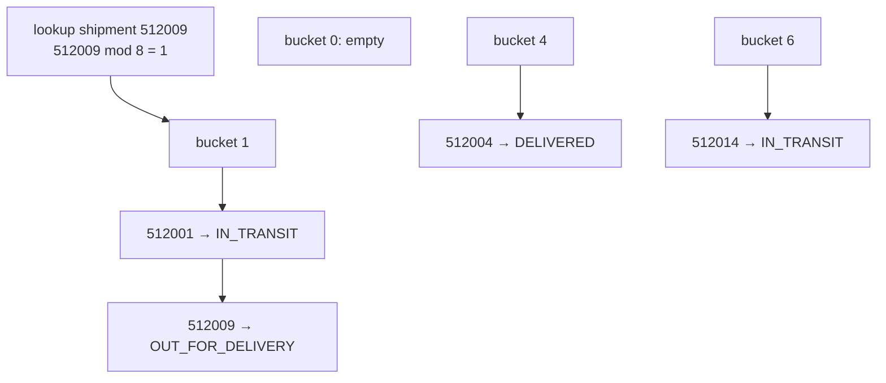
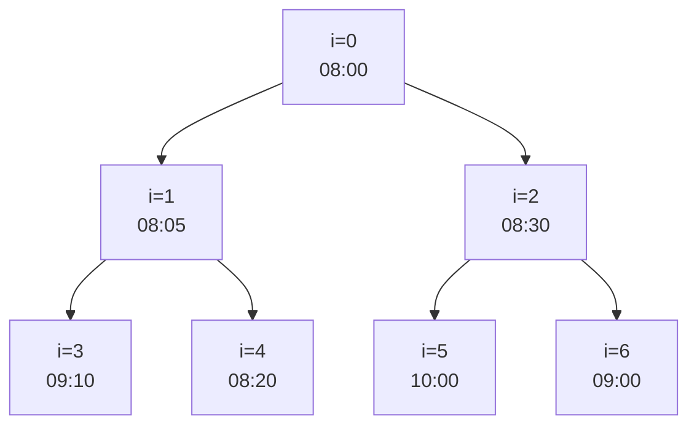
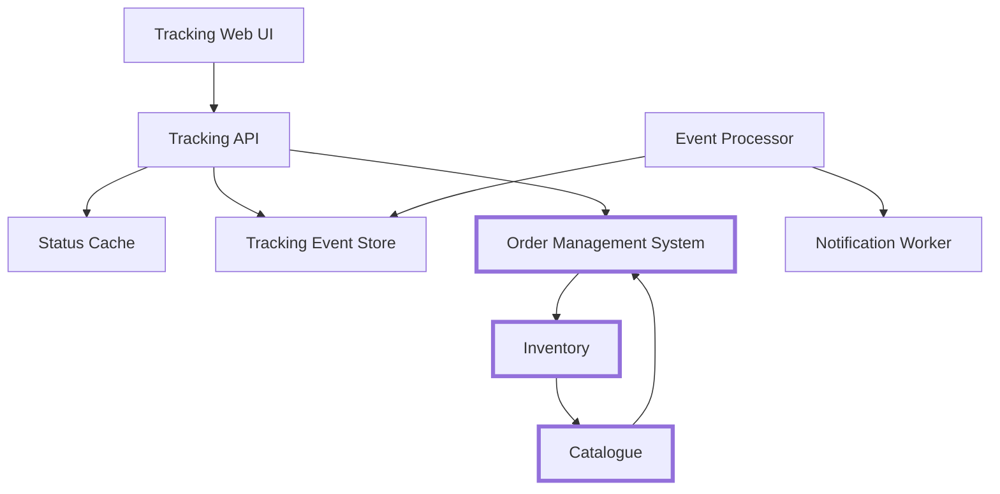
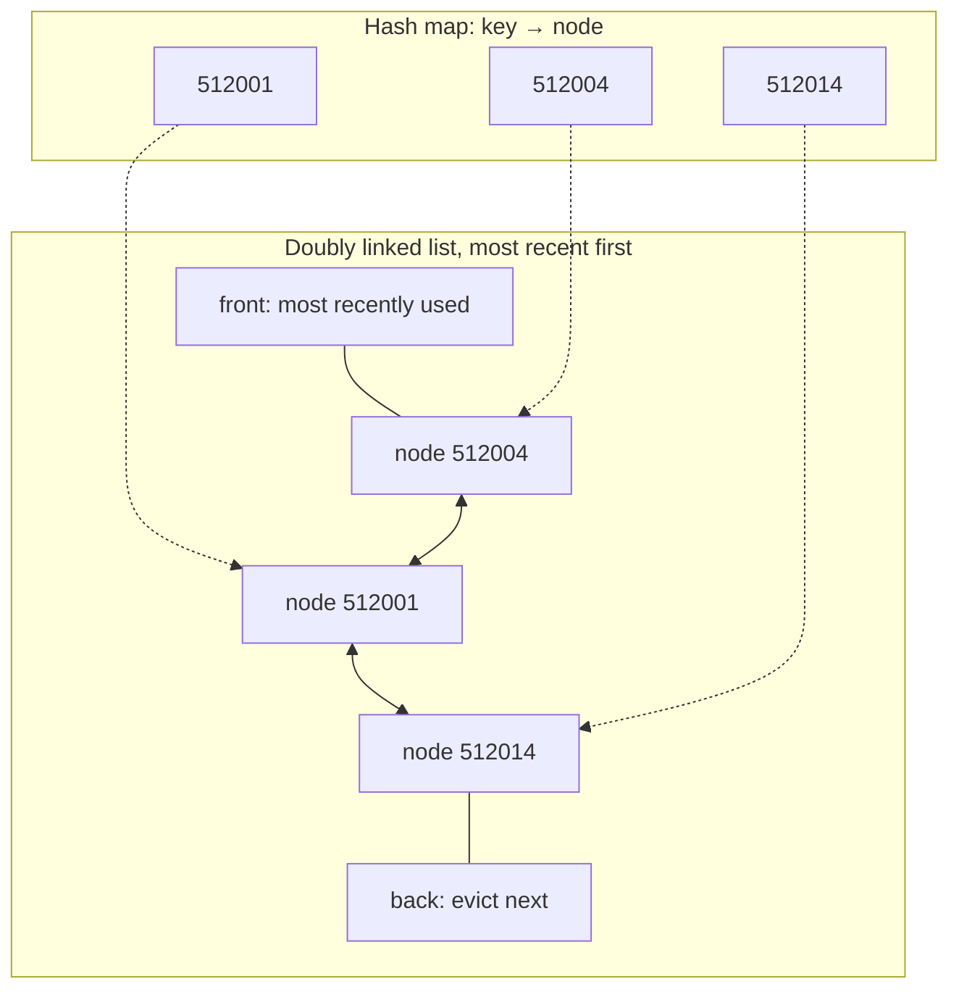

# Programming fundamentals, data structures, and algorithms

> A database index is a B-tree, a cache is a hash map with a list for eviction, a job scheduler is a
> heap, and consistent hashing is a sorted ring. Architects who recognize the data structure inside a
> component can predict how it behaves at ten times the load.

!!! abstract "Page facts"
    **Level:** Mixed (structures and Big O are Level 1-2; complexity reasoning at production volumes
    and component choice are Level 3) · **Status:** Draft · **Time:** 60-75 minutes ·
    **Last verified:** 2026-11-20

## Learning objectives

After this page you should be able to:

- Define the core programming building blocks (variables, types, recursion) and the standard data
  structures, with the time and space cost of their main operations.
- Explain how hash tables, balanced trees, B-trees, heaps, and graphs work well enough to predict their
  behavior inside databases, caches, schedulers, and dependency tools.
- Reason with Big O at AtlasMart volumes (300,000 shipments in transit, 480,000 events per day) and
  turn a complexity class into CPU seconds or disk reads.
- Recognize which data structure a familiar architecture component is built on, and what that implies
  for its limits.

## Prerequisites

- [Computers, operating systems, and Linux for architects](computers-operating-systems-and-linux-for-architects.md)
  — the cache hierarchy and latency ladder explain why constants and access patterns matter.
- [Capacity estimation](../performance-and-scalability/capacity-estimation.md) — the AtlasMart volumes
  used throughout come from there.

## The problem this solves

Most performance disasters are the wrong algorithm meeting a larger input than its author imagined.
Comparing every event with every other works with 100 events and takes over an hour with 480,000; a
table without an index works in development and scans gigabytes per request in production. The
choices are made in code, but the consequences land in instance counts, latency budgets, and
incidents. Architects also choose components whose behavior is a data structure's behavior (a cache's
eviction, an index's range queries, a partitioning scheme's rebalancing cost); knowing the structure
is the shortest path to knowing the limits.

## What it is

**Programming fundamentals** are the building blocks every language shares: **variables** (named
storage), **types** (what values a variable may hold and which operations apply), control flow, and
functions, including **recursion** (a function defined in terms of itself on a smaller input). A
**data structure** is a way of organizing values in memory so that certain operations are cheap. An
**algorithm** is a finite procedure that solves a problem, such as **sorting** or **searching**.
**Big O** notation describes how an algorithm's time or space grows with input size n, ignoring
constant factors, so that choices can be compared before anything is measured.

| Building block | What it is | Where it shows up in architecture |
|---|---|---|
| Variables and types | Named storage with rules on allowed values | ID width (32-bit IDs overflow at about 2.1 billion), money as integer minor units or decimals rather than binary floating point, text encoding (UTF-8) at every boundary |
| Static and dynamic typing | Types checked before running or while running | Schema contracts at APIs compensate for dynamic typing inside services |
| Arrays | Contiguous, indexed storage | Column stores, ring buffers, heaps, anything cache-friendly |
| Lists (linked) | Nodes connected by pointers | LRU eviction lists, free lists; poor cache locality |
| Stacks | Last in, first out | Call stacks, depth-first traversal, undo |
| Queues | First in, first out | Message queues, request backlogs, breadth-first traversal |
| Hash maps (hash tables) | Key to value by hashing | Caches, key-value stores, deduplication, hash joins, hash partitioning |
| Trees, binary trees | Hierarchical nodes, at most two children for binary | Balanced search trees in memory, B-trees on disk, tries for prefixes |
| Heaps | A tree where every parent is no larger (min-heap) than its children | Schedulers, timers, top-k, merging sorted streams |
| Graphs | Nodes and edges | Service dependencies, networks, workflows, routing |
| Sorting | Putting items in order | Query `ORDER BY`, merge joins, compaction, ranked results |
| Searching | Finding items | Indexes, binary search, full-text search |

## Mental model

Think of a warehouse. An **array** is a numbered row of shelves: go straight to shelf 4,312, but
inserting in the middle shifts everything after it. A **hash table** is a wall of pigeonholes chosen
by a formula on the box's ID. A **balanced tree** is aisle signage ("A-M left, N-Z right"): a few
decisions to any box, everything in order for a range pick. A **B-tree** prints the signage on boards
listing hundreds of aisles each, so three boards reach any box among millions. A **heap** is the
dispatch desk that knows the most urgent order without sorting the rest; a **graph** is the map of
which departments depend on which.

**Where the analogy breaks:** in a warehouse every shelf is as far as its distance on the floor. In a
computer, distance is the latency ladder: the next element of an array is almost free because it is in
the same cache line, while a pointer to "the next box" may cost a trip to main memory. Big O ignores
this; real performance does not, so two structures with the same Big O can differ tenfold in practice.

## Key terms

| Term | Meaning on this page |
|---|---|
| Big O | An upper bound on growth of time or space as input size n grows, ignoring constant factors |
| Time and space complexity | How the number of steps, or the memory used, grows with n |
| Amortized cost | Average cost per operation over a long sequence, even if a few operations are expensive |
| Expected (average) case | Cost under typical inputs, for example a hash table with a good hash function |
| Worst case | Cost under the most unfavorable input, which an attacker may be able to choose |
| Hash function | A function that maps a key to a number used to pick a bucket |
| Load factor | Entries ÷ buckets in a hash table; resizing keeps it bounded |
| Balanced tree | A tree whose height stays proportional to log n regardless of insertion order |
| B-tree | A balanced tree with many keys per node, sized to a disk or memory page |
| Index | A data structure (usually a B-tree) that lets a database find rows by a column value without scanning the table |
| Heap | A tree-shaped structure, usually stored in an array, giving the minimum (or maximum) in O(1) |
| Graph | A set of nodes (vertices) and connections (edges), directed or undirected |
| Recursion | A function calling itself on a smaller part of the problem until a base case |

## How it works

### Big O and complexity reasoning at scale

Big O keeps the term that dominates as n grows and drops constants: 3n² + 50n + 7 is O(n²). The
common classes, with what they mean at AtlasMart's sizes, are below. Here n = 300,000 is the number of
shipments in transit and n = 480,000 is the number of scan events per day (both from the capacity
page). Logarithms are base 2.

| Class | Name | n = 300,000 | n = 480,000 | Typical source |
|---|---|---|---|---|
| O(1) | Constant | 1 | 1 | Array index, hash lookup (expected) |
| O(log n) | Logarithmic | about 18 | about 19 | Binary search, balanced tree, heap push or pop |
| O(n) | Linear | 300,000 | 480,000 | One pass: scan, filter, count |
| O(n log n) | Linearithmic | about 5.5 million | about 9.1 million | Comparison sorting, building a balanced tree |
| O(n²) | Quadratic | 9 × 10¹⁰ | about 2.3 × 10¹¹ | Nested loop comparing all pairs |
| O(2ⁿ) | Exponential | astronomically large | astronomically large | Trying every subset; never at these sizes |

Arithmetic: log₂ 300,000 ≈ 18.2 and log₂ 480,000 ≈ 18.9; 300,000 × 18.2 ≈ 5.46 million;
480,000 × 18.9 ≈ 9.07 million; 480,000² = 2.304 × 10¹¹.

To turn steps into time, multiply by a cost per step. That cost is an assumption that must be
measured, and it varies by language and by where the data sits on the latency ladder. For
illustration only, **assume 20 ns per simple step** (a C-level loop over integers in memory). Then:

- O(n log n) over a day's events: 9.07 million × 20 ns ≈ **0.18 s**. Sorting a day of events is
  trivial.
- O(n²) over a day's events: 2.3 × 10¹¹ × 20 ns ≈ **4,600 s, about 77 minutes** of CPU. A pairwise
  deduplication that "worked in test" becomes a batch job that overruns its window.

Four refinements an architect needs:

- **Amortized cost.** A dynamic array doubles when full, so appends average O(1), but the rare
  copy is a latency spike for one unlucky request: a tail-latency concern.
- **Expected versus worst case.** Hash tables are O(1) expected, O(n) if keys collide; quicksort is
  O(n log n) expected, O(n²) worst. If attackers choose inputs, design for the worst case.
- **Space is a budget too.** 300,000 entries at 4 KB is 1.2 GB; that, not lookup time, decided where
  AtlasMart's status cache lives.
- **Constants and locality matter at small n.** Below a few hundred items a linear array scan often
  beats a hash table because it stays in cache. Big O says what breaks at scale; measurement says
  what wins at your size.

### Arrays, lists, stacks, and queues

An **array** stores elements contiguously: O(1) index access, amortized O(1) append, O(n) insert or
delete in the middle, and scans that are fast thanks to cache lines and prefetching. A **linked list**
links nodes by pointer: O(1) insert or remove at a node you hold, O(k) to reach the k-th, and a
possible cache miss per hop.

A **stack** (last in, first out) pushes and pops in O(1); the call stack is one. A **queue** (first
in, first out) is O(1) at both ends when built on a linked list or a circular buffer (a fixed array
whose ends wrap). A bounded queue is the simplest backpressure: when full, producers wait or are
refused. A **deque** allows O(1) at both ends and suits sliding-window rate limiters. Message brokers
are queues with durability and acknowledgements added
([message queues and brokers](../messaging-and-streaming/message-queues-and-brokers.md)).

### Hash tables

A **hash table** stores key-value pairs in an array of **buckets**, choosing the bucket with
`hash(key) mod number_of_buckets`. Keys sharing a bucket **collide** and are handled by **chaining** (a
small list per bucket) or **open addressing** (probing other buckets). With an even hash and a bounded
**load factor**, buckets hold about one entry and operations are O(1) expected; past a threshold the
table grows and **rehashes** every entry, an O(n) step amortized over many inserts.

**Figure 1 — A hash table with chaining.** Eight buckets; shipment IDs hashed with a simple
`id mod 8` for illustration. Shipments 512001 and 512009 collide in bucket 1 and are chained.

How to read it: the lookup computes bucket 1 in constant time, then walks a two-entry chain to
512009. With a good hash (real ones mix bits far better than `mod 8`) and a bounded load factor,
chains stay short however many shipments are stored.

Properties that matter in architecture:

- **Fast equality, no order.** No "keys between A and B" or "smallest key", which is why database hash
  indexes serve only equality and ranges need trees.
- **Resizing is a latency event.** Rehashing a large table at once stalls the caller; some in-memory
  stores rehash incrementally to keep latency flat.
- **Hash partitioning is the same idea across machines.** `hash(key) mod N` works until N changes and
  nearly every key moves; consistent hashing (below) fixes that.
- **Deduplication is a set.** A hash set of seen carrier event IDs turns O(n²) pairwise comparison into
  O(n); a database unique index does the same with a B-tree.

### Trees, binary trees, and B-trees

A **tree** is a hierarchy of nodes with one root; a **binary tree** gives each node at most two
children. A **binary search tree** keeps smaller keys left and larger right, so operations follow one
path: O(height). Sorted inserts turn a naive tree into a chain of height n, so production code uses
**balanced** trees (red-black, AVL) that keep height O(log n). Their advantage over hash tables is
**order**: sorted traversal and range queries in O(log n + k) for k results.

A **B-tree** holds many keys per node (hundreds, sized to a page), so the tree is very shallow and each
level costs one page read. Most database indexes use the **B+ tree** variant, with all values in leaves
linked left to right: a range scan is one descent plus a walk along the leaves (see Figure 1 on the
[relational databases page](../databases-and-storage/relational-databases-and-sql-internals.md)).

How shallow at AtlasMart's sizes? Assume about 300 keys per 8 KB index page (illustrative; it depends
on key size and fill). Thirteen months of events is 480,000 × 395 days ≈ 190 million rows.

- Height ≈ log₃₀₀(190,000,000) = ln(1.9 × 10⁸) ÷ ln(300) ≈ 19.1 ÷ 5.7 ≈ 3.3, so **4 levels**.
- A binary tree over the same rows would need log₂(1.9 × 10⁸) ≈ 27.5, so **28 levels**, each potentially
  a separate page read.
- The top two or three B-tree levels are a few thousand pages at most and stay in memory, so a lookup
  costs at most one or two reads from storage. Without the index, a lookup scans 190 million rows ×
  500 B ≈ 95 GB.

Also worth recognizing: **tries** (prefix trees) for IP routing and autocomplete; **LSM trees**, which
buffer writes in memory and merge sorted files to favor write throughput; and **Merkle trees**, whose
subtree hashes let replicas find differences cheaply.

### Heaps

A **binary heap** is a complete binary tree in which every parent is no larger than its children (a
min-heap), stored in an array: the children of position i sit at 2i + 1 and 2i + 2. Peek is O(1); push
appends and sifts up, O(log n); pop moves the last element to the root and sifts down, O(log n);
building from n items is O(n). Being only partly ordered is what makes it cheaper than a sorted list.

**Figure 2 — A min-heap of notification due times.** The array `[08:00, 08:05, 08:30, 09:10, 08:20,
10:00, 09:00]` drawn as a tree; each parent is earlier than its children.

How to read it: the next notification to send (08:00) is always at the root. Siblings are not ordered
(09:10 sits left of 08:20). Popping 08:00 moves 09:00 to the root and swaps it down past 08:05 and
08:20, three levels, which is log₂ of seven rounded up.

Heaps appear in schedulers and timers, priority queues, Dijkstra's algorithm, **top-k** (a size-k
heap over a stream: O(n log k)), and **k-way merge** in external sorting and compaction. Huge timer
populations may use **timer wheels** (buckets per time slot) for O(1) operations at coarser precision.

### Graphs

A **graph** is a set of nodes and edges, **directed** (A depends on B) or undirected, optionally
weighted. It is stored as an **adjacency list** (O(V + E) space, for sparse graphs) or an **adjacency
matrix** (O(V²) space, O(1) edge test, for dense graphs). The core algorithms:

- **Breadth-first search** (BFS, with a queue), O(V + E): fewest-hop paths and blast-radius questions
  ("what is within two hops of this service?").
- **Depth-first search** (DFS, with a stack or recursion), O(V + E): finds cycles as an edge back to
  a node still on the current path.
- **Topological sort**, O(V + E): orders a directed acyclic graph (DAG) so dependencies come first, as
  build systems, deployers, and workflow engines do; if none exists, there is a cycle.
- **Shortest weighted path** (Dijkstra with a heap), O((V + E) log V): what link-state routing computes.

**Figure 3 — A service dependency graph with a cycle.** An illustrative slice of AtlasMart services;
an arrow means "calls synchronously". The thick-bordered nodes form a cycle.

How to read it: following arrows from Order Management leads back to Order Management through
Inventory and Catalogue. DFS finds this when it meets the edge Catalogue → Order Management while
Order Management is still on its path. A synchronous cycle means a slow node slows itself, and
retries at each hop multiply.

### Sorting and searching

Comparison sorts cannot beat O(n log n) in the worst case. **Merge sort** is O(n log n) and stable
(equal keys keep their order); **quicksort** is O(n log n) expected; Python's Timsort is stable and
near O(n) on nearly sorted data such as event streams. **Counting and radix sorts** reach O(n) for
small integer keys. **External merge sort** sorts memory-sized runs and merges them with a heap, as
databases do when a sort spills to disk.

**Searching:** linear search is O(n); **binary search** over a sorted array is O(log n) and is the
heart of B-tree page lookups, consistent-hash rings, and sorted-file formats; hash lookup is O(1)
expected; **full-text search** uses an **inverted index** (a hash or tree from each word to the
documents containing it), planned in search architecture (D27-T03).

### Recursion

A recursive function calls itself on a smaller input until a **base case**; traversals, divide-and-
conquer sorts, and parsers are naturally recursive. Each call uses a stack frame: Python's default
limit is about 1,000 frames, which a long dependency chain or deeply nested JSON can hit. Use an
explicit stack for deep inputs, or bound the depth.

### LRU caches: a hash map plus a doubly linked list

A **least-recently-used (LRU)** cache must find any key in O(1) and evict the oldest-used key in O(1).
No single structure does both, so it combines two: a hash map from key to list node, and a doubly
linked list ordered by recency. A read finds the node via the map and moves it to the front (O(1),
because the node knows its neighbors); an insert into a full cache removes the node at the back and
deletes its key from the map.

**Figure 4 — An LRU cache.** The map gives direct access to any node; the list order gives the eviction
victim.

How to read it: reading 512001 follows the dashed pointer to its node and moves it to the front;
inserting a new key into a full cache evicts 512014 from the back and removes its map entry. Both are
O(1). Distributed caches often approximate LRU by sampling a few keys and evicting the oldest of the
sample, saving the memory of the list pointers (Redis documents this approach).

### Consistent hashing: a sorted ring

**Consistent hashing** places both servers and keys on a ring of hash values. A key belongs to the first
server clockwise from its hash. The ring is stored as a **sorted array** of server positions, so a
lookup is a binary search: O(log(S × v)) for S servers with v virtual positions each. Adding or
removing a server moves only the keys between it and its neighbor, roughly 1/S of them, instead of
nearly all of them as with `hash mod N`. Lab 08 builds one; see
[Lab 08: sharding and consistent hashing](../labs/lab-08-sharding-and-consistent-hashing.md) and
[scaling, partitioning, and replication](../distributed-systems/scaling-partitioning-and-replication.md).

### Complexity summary

| Structure | Access or lookup | Insert | Delete | Min or ordered scan | Space | Architecture appearance |
|---|---|---|---|---|---|---|
| Array (dynamic) | O(1) by index, O(n) by value | O(1) amortized at end, O(n) middle | O(n) | O(n) unless sorted | O(n) | Buffers, column stores, heap storage |
| Sorted array | O(log n) binary search | O(n) | O(n) | O(1) min, O(k) range after search | O(n) | Consistent-hash rings, sorted files, B-tree pages |
| Linked list | O(n) | O(1) at a known node | O(1) at a known node | O(n) | O(n) plus pointers | LRU lists, free lists |
| Stack | O(1) top | O(1) | O(1) | n/a | O(n) | Call stacks, DFS |
| Queue (or deque) | O(1) front | O(1) | O(1) | n/a | O(n) | Message queues, backlogs, BFS, sliding windows |
| Hash table | O(1) expected, O(n) worst | O(1) amortized expected | O(1) expected | Not supported | O(n) | Caches, dedupe, hash joins, key-value stores |
| Balanced binary tree | O(log n) | O(log n) | O(log n) | O(log n + k) range | O(n) | In-memory ordered maps, sorted sets |
| B-tree or B+ tree | O(log n), few page reads | O(log n) | O(log n) | O(log n + k) range | O(n) | Database and file system indexes |
| Binary heap | O(1) min only | O(log n) | O(log n) pop min | O(1) min, no ordered scan | O(n) | Schedulers, timers, top-k, k-way merge |
| Graph (adjacency list) | O(degree) neighbors | O(1) edge | O(degree) | Traversal O(V + E) | O(V + E) | Dependencies, networks, workflows |

## Worked example: AtlasMart's three data structure choices

### 1. Latest status by shipment ID

**Need:** the Tracking API answers "what is the latest status of shipment X?" at up to 210 reads/s
(design peak) over 300,000 shipments in transit.

| Option | Cost per lookup | At 210 lookups/s |
|---|---|---|
| Unsorted list scan | n/2 = 150,000 comparisons ≈ 3 ms at the assumed 20 ns | 210 × 3 ms ≈ 0.63 CPU-seconds per second: 63% of a core |
| Sorted array plus binary search | about 19 comparisons | about 4,000 comparisons/s, negligible, but each new shipment insert shifts up to 300,000 entries |
| Hash table (Status Cache key per shipment) | O(1) expected, one or two comparisons | Negligible |
| Database B-tree index on `shipment_id` (cache miss) | 4 levels, upper levels in memory, about 1-2 page reads | 20% misses × 210 = 42 index lookups/s, trivial for the database |
| Database without an index | 190 million rows ≈ 95 GB scanned | 42 scans/s × 95 GB: impossible |

The linear scan alone would cost about 3 ms of CPU per request against the Tracking API's whole
budget of about 4.7 ms per request
([derived on the computers and OS page](computers-operating-systems-and-linux-for-architects.md)),
a 64% increase in CPU per request. The chosen design is the one already in the architecture: a hash
table in the Status Cache for the hot path, and a B-tree index on `(shipment_id, occurred_at)` in the
Tracking Event Store for misses and history. The space cost decides where the hash table lives:
300,000 × 4 KB = 1.2 GB (1.8 GB with overhead, from the capacity page) is too large to copy into
every API worker, so it is one shared cache.

### 2. The next notification to send by due time

**Need:** the Notification Worker must always pick the notification with the earliest due time. FR-3
sends one notification per out-for-delivery and per delivered transition: 60,000 orders × 2 =
**120,000 sends per day**. Some are deferred (for example to respect a customer's quiet hours), so
**assume up to 50,000 pending at once** (new assumption for this page).

| Option | Cost per "next due" | Per day (120,000 pops) |
|---|---|---|
| Unsorted list, scan for the minimum | 50,000 comparisons | 6 × 10⁹ comparisons ≈ 120 s of CPU at 20 ns |
| Sorted list | O(1) pop, but O(n) insert (shift about 25,000 entries on average) | About 3 × 10⁹ element moves; fast memory moves, still wasteful |
| Binary heap | O(log n): about 16 levels, about 32 comparisons per pop | 120,000 × 32 ≈ 3.8 million comparisons ≈ 0.08 s |
| Database table with a B-tree index on `due_at` (pending rows only) | O(log n + k) for the next k due | One indexed query per batch; survives restarts |

The heap is about 1,500 times cheaper than the scan (6 × 10⁹ ÷ 3.8 × 10⁶), yet the scan would have
cost only two CPU-minutes a day. The decisive factor is not speed but **durability and sharing**: an
in-memory heap disappears when a worker restarts, and two workers in two zones would each hold half
the work. AtlasMart therefore keeps pending notifications in the Tracking Event Store with a partial
B-tree index on due time for unsent rows, and each worker fetches the next small batch with a locking
query that skips rows another worker holds. The heap remains the right mental model (and the right
in-memory structure inside a worker for its current batch); the index is the durable heap. The
[job scheduler exercise](../system-design-exercises/job-scheduler.md) develops this design.

### 3. Detecting dependency cycles between services

**Need:** before a deployment, check that synchronous calls between services contain no cycle, and
compute a safe start-up order. **Assume AtlasMart has 40 services and 120 synchronous dependency
edges** (new assumptions for this page).

- **Structure:** a directed graph as an adjacency list, built from each service's declared
  dependencies.
- **Algorithm:** DFS with three states per node (unvisited, on the current path, finished); an edge
  to a node "on the current path" is a cycle. Equivalently, a topological sort that cannot place every
  node has found a cycle (Python's `graphlib.TopologicalSorter` raises `CycleError`).
- **Cost:** O(V + E) = 40 + 120 = **160 steps**. Even a naive approach that runs a separate search from
  every service, O(V × (V + E)) = 40 × 160 = 6,400 steps, takes microseconds.

At this size correctness and clarity matter, not the complexity class: run the standard library's
topological sorter in the deployment pipeline, report the cycle (Figure 3's Order Management →
Inventory → Catalogue → Order Management), and fail the build. Over runtime call traces (millions of
edges from 480,000 events a day) DFS stays linear, while an all-pairs O(V³) approach would not finish.

## Real-world architecture example

Almost every infrastructure component has a textbook structure inside. Relational databases use B+
tree indexes, hash joins, and external merge sort. Key-value stores and caches are hash tables with
approximate LRU or LFU eviction, with skip lists or trees for sorted sets. LSM storage engines use
Bloom filters (compact probabilistic sets that answer "definitely not present") to skip files.
Message brokers are append-only logs with offset indexes; partitioned stores use consistent-hash
rings; schedulers use heaps or timer wheels; routers use tries; build tools and orchestrators sort
dependency graphs topologically. The structure tells you, without a benchmark, which queries are
cheap (equality on a hash, range on a tree, minimum on a heap) and which are scans.

## Design choices and trade-offs

| Choice | Favor when | Avoid when |
|---|---|---|
| Hash table | Equality lookups by key; deduplication; joins on equality | You need ranges, ordering, or prefix queries; attacker-chosen keys without a seeded hash |
| Balanced tree or B-tree | Range queries, ordering, prefix matching, sorted iteration | Pure equality at very high rates where a hash is cheaper |
| Sorted array plus binary search | Read-mostly data that changes rarely (rings, lookup tables) | Frequent inserts; each costs O(n) |
| Linked list | O(1) removal at known nodes (LRU, free lists) | Iteration-heavy code; poor cache locality |
| Binary heap | Repeatedly taking the minimum or maximum; top-k over streams | You need arbitrary lookups or ordered iteration |
| In-memory structure | Data rebuildable on restart and fits per process | Durability, sharing between instances, or data larger than memory |
| Durable index (database) | Work must survive restarts and be shared by workers | Microsecond latency at very high rates is required |
| Recursion | Naturally recursive data with bounded depth | Unbounded or attacker-controlled depth; use an explicit stack |
| Approximate structures (Bloom filters, sampled LRU) | Memory is the constraint and small error is acceptable | Exact answers are required |

## Failure modes and anti-patterns

- **Accidental quadratic.** List membership inside a loop, pairwise deduplication. Detect: duration
  quadrupling when input doubles in load tests. Prevent: hash sets; production-sized test inputs.
- **Missing index.** Detect: sequential scans in query plans, latency growing with table size.
  Prevent: index review for each new query path.
- **Unbounded collections.** Detect: steady memory growth, OOM kills. Prevent: size bounds,
  eviction, backpressure.
- **Degenerate tree or resize stall.** Sorted keys into an unbalanced tree; a huge table rehashing
  mid-request. Prevent: library balanced structures; pre-sizing or incremental resizing.
- **Wrong structure for the query.** Range scans against a hash-partitioned store. Prevent: choose
  structures and partition keys from written-down access patterns.
- **Optimizing the irrelevant.** Tuning the 40-node cycle check while the API scans a list per
  request. Prevent: estimate with the actual n first.

## Security considerations

- **Algorithmic complexity attacks.** Attacker-chosen colliding keys make hash operations O(n) and a
  request O(n²). Seeded, randomized string hashing (Python's default) mitigates it; keep it on and cap
  keys per request.
- **Unbounded input sizes.** Limit body size, array lengths, and nesting depth at the API boundary;
  sorting or deduplicating attacker-supplied lists costs CPU and memory in proportion.
- **Catastrophic regex backtracking** (ReDoS) takes exponential time on crafted input; prefer
  linear-time engines or simple patterns for untrusted input.
- **Recursion on untrusted structure** (deeply nested JSON) can exhaust the stack; enforce depth limits.
- **Timing leaks:** compare secrets in constant time, as in the webhook HMAC check, never with an
  early-exit comparison.

## Performance, reliability, and cost

- **Performance:** count n, pick the class, multiply by a measured cost per step. The three AtlasMart
  choices show the range: a missing hash table costs 63% of a core, a missing index makes reads
  impossible, and the dependency check is too small to matter.
- **Reliability:** in-memory structures die with the process; pending notifications and dedupe state
  need a durable index or unique constraint. Unbounded structures end in an OOM kill.
- **Cost:** CPU saved becomes smaller instances; memory spent on a per-process structure (1.2 GB per
  worker for a status map) forces a larger shape for every replica, so shared structures are cheaper.

## Hands-on lab: measure complexity at AtlasMart's sizes

This mini-lab needs only Python 3, runs locally, costs nothing, and takes about 20 minutes.

1. In `lookups.py`, build a list and a set of 300,000 integer shipment IDs and use `timeit` to time
   1,000 membership tests of a value near the list's end against each; compare per-lookup times.
2. Generate 480,000 event IDs with about 1% duplicates. Deduplicate them with a set and time it. Then
   time a pairwise approach on only the first 5,000 IDs and extrapolate to 480,000 using O(n²); compare
   with the set's measured time.
3. Push 50,000 random due times into a list with `heapq.heappush`, then pop 10,000 of them and time
   the pops. Repeat using `min()` and `list.remove()` on a plain list for 1,000 pops and extrapolate.
4. Build the dependency graph from Figure 3 as a dictionary and run `graphlib.TopologicalSorter` on
   it. Catch `CycleError` and print the cycle; remove the Catalogue → Order Management edge and print
   the start-up order.
5. Optional: open [Lab 08](../labs/lab-08-sharding-and-consistent-hashing.md) and compare how many keys
   move when a node is added under `hash mod N` versus a consistent-hash ring.

??? question "Hint: extrapolating from a small run"
    For an O(n²) step measured at n = 5,000, multiply the time by (480,000 ÷ 5,000)² = 9,216. For an
    O(n) step, multiply by the ratio of sizes. Your per-step cost replaces the 20 ns assumption on
    this page; if your numbers differ by a factor of a few, the conclusions should not change.

## Knowledge check

1. Why can a hash index not serve `WHERE occurred_at BETWEEN '08:00' AND '09:00'`, and what structure
   can?
2. A B-tree index over 190 million rows has a fan-out of about 300. How many levels does it have, and
   why does a lookup cost only one or two reads from storage?
3. Why does an LRU cache need both a hash map and a doubly linked list?
4. A scheduler holds 50,000 pending jobs and pops 120,000 per day. Compare the work for a heap and for
   scanning a list, and name the property that matters more than either.
5. A teammate says "our cycle check is O(V × (V + E)), we must rewrite it". With 40 services and 120
   edges, how do you respond?

??? success "Answers"
    1. A hash scatters keys with no order, so it can only find exact keys. A B-tree (or other ordered
       tree) keeps keys sorted, so a range is one descent plus a walk along the leaves.
    2. log₃₀₀(1.9 × 10⁸) ≈ 3.3, so four levels. The upper levels are small and stay in memory, leaving
       one or two page reads from storage.
    3. The map finds any key in O(1); the list keeps recency order so the eviction victim is found and
       entries move to the front in O(1). Neither alone does both.
    4. Heap: about 32 comparisons per pop, about 3.8 million per day. Scan: 50,000 per pop, 6 × 10⁹ per
       day. Durability and sharing between workers matter more, which is why the pending set lives in
       a database index.
    5. 40 × 160 = 6,400 steps run in microseconds; the rewrite buys nothing. Spend the effort where n is
       large, such as per-request paths at 210 reads/s.

## Architecture discussion questions

1. AtlasMart wants to show "all shipments delayed more than two days" to operations staff. Which
   structure would answer this cheaply in the Status Cache, in the Tracking Event Store, or in a
   separate store, and how would each be kept up to date?
2. The Event Processor deduplicates on carrier event ID. Compare an in-memory set per worker, a shared
   cache set with a TTL, and a database unique index, considering restarts, two workers, and the
   at-least-once queue.
3. Where in the AtlasMart architecture would an approximate structure (a Bloom filter or sampled
   eviction) be acceptable, and where would the error be unacceptable?

## Summary

Data structures make some operations cheap, and Big O predicts which choices survive large n. Arrays
are cache-friendly, lists cheap to splice, stacks and queues ordered by arrival. Hash tables give O(1)
expected equality but no order; trees give O(log n) with ranges, and B-tree fan-out keeps a
190-million-row index at four levels. Heaps give the minimum in O(1) and updates in O(log n); DFS and
topological sort find graph cycles in O(V + E). At AtlasMart's volumes, a missing hash table costs 63%
of a core, a missing index is fatal, a heap beats a scan a thousandfold but durability decides the
design, and a 40-service cycle check is too small to optimize.

## Related topics

- **Before:** [Computers, operating systems, and Linux for architects](computers-operating-systems-and-linux-for-architects.md);
  [Capacity estimation](../performance-and-scalability/capacity-estimation.md)
- **Alongside:** [Relational databases and SQL internals](../databases-and-storage/relational-databases-and-sql-internals.md)
  — B-tree indexes in practice; [Caching architecture](../databases-and-storage/caching-architecture.md)
  — eviction policies; [Message queues and brokers](../messaging-and-streaming/message-queues-and-brokers.md);
  [Programming paradigms and concurrency](programming-paradigms-and-concurrency.md);
  [Scaling, partitioning, and replication](../distributed-systems/scaling-partitioning-and-replication.md);
  [Lab 08: sharding and consistent hashing](../labs/lab-08-sharding-and-consistent-hashing.md);
  [Distributed cache exercise](../system-design-exercises/distributed-cache.md);
  [Job scheduler exercise](../system-design-exercises/job-scheduler.md)
- **Planned:** storage architecture (D06-T04); search architecture (D27-T03).

## References

| Source | Type | Checked |
|---|---|---|
| Thomas H. Cormen, Charles E. Leiserson, Ronald L. Rivest, and Clifford Stein, *Introduction to Algorithms*, 4th edition (MIT Press, 2022) | Book | 2026-11-20 |
| Robert Sedgewick and Kevin Wayne, [*Algorithms*, 4th edition, companion site](https://algs4.cs.princeton.edu/home/) | Book and course site (structures and algorithms) | 2026-11-20 |
| PostgreSQL documentation, [B-Tree Indexes](https://www.postgresql.org/docs/current/btree.html) | Official documentation (B-tree implementation) | 2026-11-20 |
| David Karger et al., ["Consistent Hashing and Random Trees"](https://www.cs.princeton.edu/courses/archive/fall09/cos518/papers/chash.pdf), STOC 1997 | Paper (consistent hashing) | 2026-11-20 |
| Python documentation, [heapq](https://docs.python.org/3/library/heapq.html) and [graphlib](https://docs.python.org/3/library/graphlib.html) | Official documentation (heaps, topological sort, CycleError) | 2026-11-20 |
| Python Wiki, [TimeComplexity](https://wiki.python.org/moin/TimeComplexity) | Reference (operation costs of built-in types) | 2026-11-20 |
| Redis documentation, [Key eviction](https://redis.io/docs/latest/develop/reference/eviction/) | Official documentation (approximated LRU) | 2026-11-20 |
| Martin Kleppmann, *Designing Data-Intensive Applications* (O'Reilly, 2017), chapter 3 "Storage and Retrieval" | Book (hash indexes, B-trees, LSM trees) | 2026-11-20 |

## Review notes

- Canonical page for D02-T02. Depth is on Big O at AtlasMart volumes, hash tables, trees and B-trees,
  heaps, graphs, and the three worked choices. Variables, types, static and dynamic typing, stacks,
  sorting algorithms, and recursion are defined with their architecture consequences but not
  developed; tries, LSM trees, Merkle trees, skip lists, Bloom filters, and timer wheels are only
  named.
- The 20 ns per step and 300 keys per B-tree page are illustrative assumptions, stated as such; the
  lab asks readers to measure their own per-step cost.
- New AtlasMart assumptions: up to 50,000 pending notifications at once (quiet-hours deferrals), and
  40 services with 120 synchronous dependency edges. Derived figures: 120,000 sends per day
  (60,000 orders × 2 transitions, FR-3) and about 190 million event rows over 13 months
  (480,000 × 395 days).
- Figure 3's cycle (Order Management → Inventory → Catalogue) is invented to illustrate detection; it
  is not a claim about AtlasMart's real dependencies, and the Catalogue and Inventory services come
  from broader AtlasMart context.
- Figure 4 uses `---` (open links) and an invisible link between subgraphs; verify layout in the
  browser.
- The statement that Python's default recursion limit is about 1,000 frames should be checked against
  `sys.getrecursionlimit()` documentation at review time.
