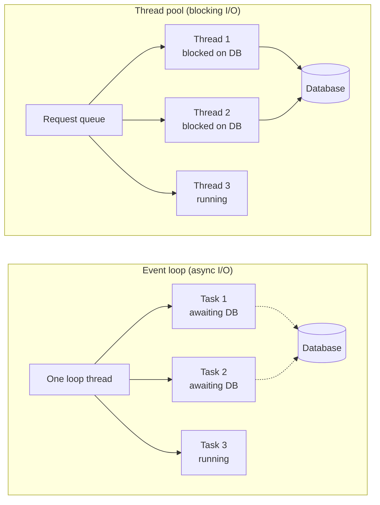
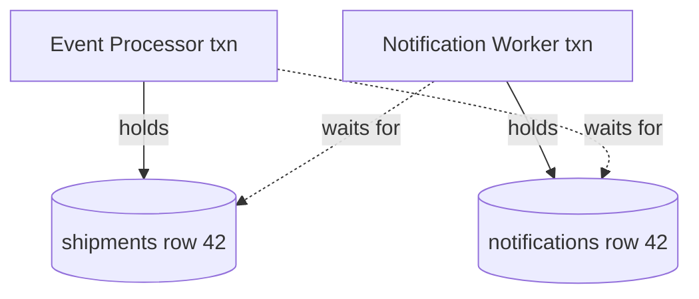
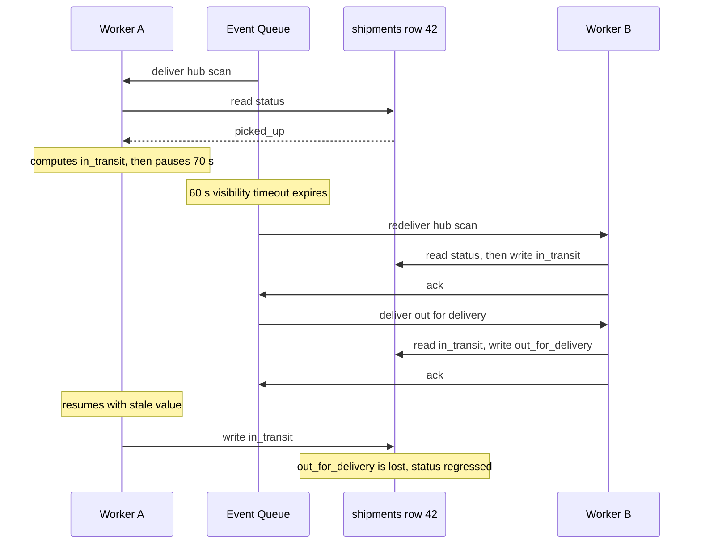

# Programming paradigms and concurrency

> The bugs that survive code review and unit tests are mostly concurrency bugs. They appear only
> under load, only on some interleavings, and they look identical whether the two competing actors
> are threads in one process or workers in two availability zones.

!!! abstract "Page facts"
    **Level:** Mixed (paradigms, exceptions, and memory are Level 1-2; concurrency hazards across
    services are Level 3) · **Status:** Draft · **Time:** 60-90 minutes · **Last verified:** 2026-11-20

## Learning objectives

After this page you should be able to:

- Contrast object-oriented and functional programming and explain why immutable data makes
  concurrent code easier to reason about.
- Explain how exceptions, manual memory management, reference counting, and tracing garbage
  collection behave, and how a collection pause can break a timeout or a lease.
- Distinguish concurrency from parallelism, and choose between a thread pool and an asynchronous
  event loop for a given workload.
- Recognize race conditions, deadlocks (and their four necessary conditions), and starvation, and
  pick the right primitive (mutex, lock, semaphore, compare-and-set) to prevent each.
- Carry the same reasoning across process boundaries: diagnose and fix a lost update between two
  Event Processor workers that share a database row.

## Prerequisites

- [Computers, operating systems, and Linux for architects](computers-operating-systems-and-linux-for-architects.md)
  — processes, threads, and the scheduler that interleaves them.
- [Relational databases and SQL internals](../databases-and-storage/relational-databases-and-sql-internals.md)
  — row locks, isolation levels, and the conditional `UPDATE` used by the Event Processor.
- [Message queues and brokers](../messaging-and-streaming/message-queues-and-brokers.md) — visibility
  timeouts and redelivery, which is how two workers end up handling the same shipment at once.

## The problem this solves

A program that does one thing at a time is easy to reason about: read the code top to bottom and you
know what happens. Real systems never run that way. A web service handles hundreds of requests at
once, a consumer processes messages on several threads, and two copies of the same service in
different zones write to the same database. Every one of those situations lets two actions on shared
state interleave in an order nobody wrote down. The result is a class of bug that is rare, depends on
timing, disappears when you add logging, and corrupts data silently.

Architects need this because runtime choices (threads or event loop, garbage-collected or not) set
latency behavior that NFRs measure; because the same hazards appear from two threads to two data
centers with fixes of the same shape; and because design review is where they are cheapest to catch.

## What it is

This topic spans two related groups of ideas:

| Group | Concepts | Architecture consequence |
|---|---|---|
| Paradigms | Object-oriented programming (OOP), functional programming (FP), exception handling | How state is organized and who may change it; how errors cross boundaries |
| Runtime | Memory management: manual, reference counting, tracing garbage collection (GC) | Latency spikes from pauses, memory headroom in containers, a class of security bugs |
| Concurrency model | Concurrency, parallelism, multithreading, asynchronous programming | How many things one instance can do at once, and what a blocking call costs |
| Hazards | Race conditions, deadlocks, starvation (and livelock) | Lost updates, stalls, unfair latency, corrupted state |
| Primitives | Mutexes, locks, semaphores, condition variables, atomic compare-and-set | The tools that prevent the hazards, inside one process and, by analogy, across many |

**Concurrency** is about structure: a program is concurrent when it is made of several activities
whose executions overlap in time. **Parallelism** is about execution: several activities literally
run at the same instant on different cores or machines. A single-core machine can run a concurrent
program but not a parallel one; an event loop is concurrent without parallelism; a batch job split
across eight cores is parallel. Hazards come from concurrency, so they exist even without
parallelism.

## Mental model

Picture a restaurant kitchen. Cooks are threads. Orders pinned to a shared board are shared state.
Two cooks who both read "table 4 needs a dessert" and both make one have caused a race condition.
The single blowtorch for crème brûlée is a mutex: one cook at a time. Three ovens are a semaphore
with three permits. Cook A holding the blowtorch while waiting for the oven, and cook B holding the
oven while waiting for the blowtorch, is a deadlock. A head chef who always gives the oven to the
loudest cook starves the quiet one. A single cook who starts the pasta, then plates a salad while the
water boils, then returns to the pasta, is an event loop: lots of concurrency, no parallelism, and
everything stops if that cook is ever blocked on a long task.

**Where the analogy breaks:** cooks see each other and notice mistakes; threads do not. A real
interleaving can split a single line of code (`count += 1` is a read, an add, and a write), and a
garbage-collection pause can freeze a cook mid-sentence for longer than anyone expects, without the
cook knowing time has passed.

## Key terms

| Term | Meaning on this page |
|---|---|
| Thread | An independent sequence of execution inside a process, sharing its memory with the other threads |
| Event loop | A single thread that runs many tasks by switching between them whenever one waits on I/O |
| Concurrency (program structure) | Overlapping activities in one program; distinct from the glossary sense of requests in flight, though more concurrency in code usually means more requests in flight |
| Parallelism | Activities executing at the same instant on separate cores or machines |
| Critical section | Code that touches shared state and must not interleave with other code touching the same state |
| Race condition | A bug whose outcome depends on the timing or order of concurrent operations |
| Data race | Two threads access the same memory without synchronization and at least one writes; a specific kind of race condition |
| Lost update | A race in which two read-modify-write sequences interleave and one write overwrites the other |
| Mutex | A lock that one owner holds at a time and only the owner releases |
| Semaphore | A counter of permits; acquiring takes one (waiting if none are left), releasing returns one |
| Compare-and-set (CAS) | An atomic "write the new value only if the current value is still what I read" |
| Deadlock | A set of actors each waiting for a resource held by another in the set, so none proceeds |
| Starvation | An actor that is runnable but never gets the resource because others are always chosen first |
| Garbage collection | Automatic reclamation of memory the program can no longer reach |

## How it works

### Paradigms: object-oriented and functional

**Object-oriented programming** bundles state with the operations that change it. A `Shipment`
object owns its status and exposes `apply_scan(event)`; callers cannot set the status directly. The
benefit is that invariants live in one place. The risk under concurrency is that objects are mutable
by design: two threads calling `apply_scan` on the same object need a lock, and the lock is invisible
in the method signature.

**Functional programming** treats computation as functions from inputs to outputs, avoids mutable
state, and builds new values instead of changing old ones. `next_status(current, event)` returns a
status and changes nothing. Pure functions have no hidden interaction, so any number of threads can
call them at once. The shared state does not disappear; it moves to the edges (a database row, a
queue offset), where it can be protected in one place.

| Aspect | Object-oriented | Functional |
|---|---|---|
| Unit of design | Objects with identity and state | Functions and immutable values |
| State changes | In place, through methods | By returning new values |
| Polymorphism | Subclasses and interfaces | Higher-order functions, pattern matching |
| Concurrency | Needs locks around mutable objects | Pure core is safe to share; locks only at the edges |
| Common fit | Domain models with rich behavior, UI frameworks | Data transformation, event processing, rules |

Most production code mixes the two: an object-oriented shell (services, repositories) around a
functional core (pure decision functions). The worked example uses exactly that shape: the status
state machine is a pure function, and only the database write is shared.

### Exceptions and error handling

An **exception** transfers control from the point of failure to the nearest handler up the call
stack, carrying an error object. It keeps the happy path readable, but it hides control flow: any
call may jump out. Alternatives return errors as values (error codes, result types) so callers must
inspect them. Practical rules that hold in either style:

- Catch only what you can handle meaningfully; let the rest propagate to a boundary that logs and
  translates it.
- Distinguish **transient** errors (timeouts, connection resets; worth retrying) from **permanent**
  ones (validation failure; retrying wastes work) in the type or code you raise.
- Release resources (locks, connections, files) in `finally` blocks or context managers, or a thrown
  exception leaves a lock held forever, which is a deadlock with extra steps.
- At a service boundary an exception becomes a status code or a message outcome: an HTTP 4xx or 5xx,
  a negative acknowledgement, a dead-lettered message. Stack traces must not cross that boundary.

### Memory management

Every runtime must reclaim memory the program no longer uses. The approach determines both latency
behavior and a class of security bugs.

| Approach | How it works | Cost | Typical risk |
|---|---|---|---|
| Manual | The programmer allocates and frees explicitly | No runtime overhead; full control | Leaks, use-after-free, double free, buffer overruns |
| Ownership checked by compiler | The compiler proves each value has one owner and frees it when the owner ends | Compile-time effort, a learning curve | Few at runtime; complexity in shared, cyclic data |
| Reference counting | Each object counts references; at zero it is freed immediately | Counter updates on every reference change; atomic updates if threads share objects | Cycles are never freed without an extra cycle detector |
| Tracing GC | The runtime periodically finds all reachable objects from roots and frees the rest | CPU and extra memory headroom; pauses | Stop-the-world pauses, memory growth before collection |

A **tracing garbage collector** starts at roots (stacks, globals) and marks everything reachable;
the rest is garbage. Simple collectors stop all application threads while they work
(**stop-the-world**); generational collectors exploit the fact that most objects die young and scan
the young generation often and cheaply; concurrent collectors do most work alongside the
application to shorten pauses, paying in CPU and memory. CPython combines reference counting with a
cycle-detecting collector; most managed runtimes for Java, .NET, Go, and JavaScript use tracing
collectors with different pause trade-offs. Check the runtime's own documentation for its current
collector options; they change between versions.

The architecture consequence is that **a pause is indistinguishable from a network partition** to
everyone else. A process paused longer than its queue visibility timeout, lease, or health-check
interval comes back to find its message redelivered, its lease granted to another node, or its
traffic drained. The [distributed systems page](../distributed-systems/distributed-systems-fundamentals-time-and-coordination.md)
shows why fencing tokens exist for exactly this case. Two practical rules follow: set memory limits
with headroom for the collector (a container killed for exceeding its limit is a crash, not a
slowdown), and compare worst observed pauses against every timeout that assumes the process is
"alive".

### Concurrency models: threads and event loops

There are two main ways for one instance to handle many requests at once.

A **thread pool** gives each in-flight request its own thread. Blocking calls (a database query, an
HTTP call) simply park that thread while others run. It is easy to write, and the operating system
schedules threads across cores, so CPU-heavy work can run in parallel. The costs: each thread has a
stack and scheduling overhead, so pools are bounded, and every piece of shared state needs
synchronization because the scheduler can switch threads at almost any instruction.

An **asynchronous event loop** runs many tasks on one thread. Each task runs until it awaits I/O, then
yields; the loop resumes whichever task's I/O is ready. Thousands of mostly waiting connections cost
little, and because switches happen only at `await` points, code between two awaits cannot be
interleaved by another task on the same loop. The costs: one blocking call (a synchronous database
driver, a CPU-heavy loop) freezes every task on that loop, and races still happen across `await`
points and across processes.

In CPython's default build, a global interpreter lock lets only one thread execute Python bytecode
at a time, so threads give concurrency for I/O but not parallel CPU work; a free-threaded build
exists in recent versions (see the Python documentation for its status). The lock does **not**
prevent races: `count += 1` compiles to several steps, and a thread switch between them loses
increments.

**Figure 1 — Thread pool versus event loop.** The same three requests, each waiting on the database,
handled two ways inside one Tracking API instance.



How to read it: in the pool each waiting request occupies a thread; in the loop a waiting task
occupies only a small object, and the single thread serves whichever task is ready. If Task 3 runs a
long synchronous computation, Tasks 1 and 2 cannot resume even when their data arrives. CPU-heavy
work needs processes or threads on several cores either way; the design choices table below compares
the models.

### Race conditions

A **race condition** exists when correctness depends on the order in which concurrent operations
happen to run. The two shapes that cause most incidents are:

- **Read-modify-write:** read a value, compute a new one, write it back. Two actors who both read
  before either writes produce a **lost update**.
- **Check-then-act:** check a condition ("no notification sent yet"), then act on it ("send"). The
  condition can change between the check and the act; the security variant is called
  time-of-check to time-of-use (TOCTOU).

A **data race** is the low-level case: two threads touch the same memory without synchronization and
one writes. Many languages define the result of a data race as undefined, which is worse than wrong:
the compiler and CPU may reorder operations in ways no source-level reasoning predicts. The fix in
every case is to make the critical section **atomic** with respect to the other actors: a lock, an
atomic instruction such as compare-and-set, or a design with no shared mutable state.

### Synchronization primitives

| Primitive | What it guarantees | Use it for | Watch out for |
|---|---|---|---|
| Mutex (mutual exclusion lock) | One holder at a time; only the holder unlocks | Protecting a short critical section | Holding it across I/O; forgetting to release on an exception |
| Reentrant lock | The same thread may acquire it again without blocking itself | Recursive code paths | Hides lock nesting that should be redesigned |
| Read-write lock | Many readers or one writer | Read-mostly shared data | Writer starvation if readers never pause |
| Semaphore | At most N concurrent holders | Bounding concurrency (connections, calls to a rate-limited provider) | A semaphore of 1 lacks a mutex's ownership checks |
| Condition variable | Wait until another thread signals that a condition may now hold | Producer-consumer handoff | Always re-check the condition after waking |
| Atomic compare-and-set | Update succeeds only if the value is unchanged since it was read | Counters, version checks, lock-free structures | Retry loops under heavy contention |

"Lock" is the general word; a mutex is the most common kind. The same vocabulary maps onto distributed
equivalents: a database row lock is a mutex scoped to a row, a connection pool is a semaphore, a
conditional `UPDATE ... WHERE version = ?` is compare-and-set, and a lease is a mutex with an expiry.

### Deadlock, starvation, and livelock

A **deadlock** requires four conditions to hold at once (named after Coffman and colleagues, 1971).
Breaking any one prevents it:

| Condition | Meaning | How to break it |
|---|---|---|
| Mutual exclusion | A resource can be held by only one actor | Use shareable resources (immutable data, read locks) where possible |
| Hold and wait | An actor holds one resource while waiting for another | Acquire everything at once, or release before waiting |
| No preemption | A resource cannot be taken away from its holder | Use timeouts and try-lock, so a waiter gives up and retries; databases abort a victim |
| Circular wait | A cycle of actors each waiting on the next | Impose a global acquisition order (for example, by primary key) |

The fourth is the one most designs break: if every actor acquires locks in the same order, no cycle
can form.

**Figure 2 — A deadlock cycle in the Tracking Event Store.** The Event Processor's transaction and the
Notification Worker's transaction lock the same two rows in opposite orders.



How to read it: solid arrows are locks held, dashed arrows are locks requested. Following the
arrows P, notifications row, N, shipments row, P closes a cycle, so all four conditions hold.
PostgreSQL detects the cycle and aborts one transaction; the fix is to make both transactions lock
`shipments` first.

**Starvation** is unfairness rather than a cycle: an actor could run but is always passed over. A
read-write lock that admits new readers while a writer waits can starve the writer forever; a queue
consumer that always takes the busiest partition first can starve the quiet ones. **Livelock** is the
busy cousin of deadlock: actors keep reacting to each other (both back off, both retry at the same
moment) and none makes progress; randomized backoff (jitter) breaks it.

### The same hazards across services

An in-process lock protects memory inside one process. It does nothing for two processes, two
containers, or two zones. Once state lives in a database or another service, the primitives move
there:

| In one process | Across services |
|---|---|
| Mutex around a critical section | Database row lock (`SELECT ... FOR UPDATE`) inside a short transaction |
| Atomic compare-and-set | Conditional update on a version column or expected state |
| Semaphore | Connection pool size, concurrency limit, rate limit |
| Lock with timeout | Lease with expiry, plus a fencing token checked by the resource |
| Deadlock from lock ordering | Distributed deadlock across services or database rows; prevent with ordering and timeouts |
| Lock-free immutable data | Append-only event log; idempotent operations keyed by an event identifier |

Two differences make the distributed versions harder. A distributed holder can pause or be
partitioned without releasing anything, so locks need expiry and fencing. And the cost of a lock is
a network round trip, so the cheapest correct design avoids shared mutable state where it can and
pushes the remaining conflicts into the database, which already has well-tested concurrency control.

## Worked example: AtlasMart lost update between two Event Processor workers

The AtlasMart Event Processor runs **2 workers** in different zones, consumes the Event Queue with
per-shipment ordering, a **60 s visibility timeout**, and a prefetch of 10, and spends about **20 ms**
per event (all from the [message queues page](../messaging-and-streaming/message-queues-and-brokers.md)).
Per-shipment ordering normally means only one worker handles a given shipment at a time. That
guarantee has an escape hatch: if a worker holds a message longer than the visibility timeout, the
broker assumes the worker is dead and redelivers.

### How the race happens

Shipment 42 is at status `picked_up`. A naive processor version does this in application code:

```python
# Naive read-modify-write (illustrative)
row = db.fetch_one("SELECT status FROM shipments WHERE shipment_id = %s", [sid])
new_status = next_status(row.status, event)          # pure state-machine function
db.execute("UPDATE shipments SET status = %s WHERE shipment_id = %s", [new_status, sid])
```

1. Worker A receives the hub-scan event, reads `picked_up`, computes `in_transit`, and then pauses
   (a long collection, a stalled disk, a host freeze) for longer than 60 s. Assume a 70 s pause for
   this example; the number is illustrative.
2. At 60 s the hub-scan message becomes visible again. Worker B receives it, reads `picked_up`,
   writes `in_transit`, acknowledges, and then quickly processes the next event for shipment 42,
   out for delivery, writing `out_for_delivery`. FR-3 fires the out-for-delivery notification.
3. Worker A resumes. It still holds its computed value `in_transit` and writes it. Shipment 42 now
   says `in_transit` although the parcel is in the van. Worker B's update is lost.

**Figure 3 — Interleaving timeline of the lost update.** Time runs downward; each worker's reads and
writes interleave on the same `shipments` row.



How to read it: the bug is the gap between Worker A's read and its write. Anything that happened to
the row during that gap is overwritten, because A's write does not check what is there now.

Normally one shipment's events are hours apart (8 events over a 5-day transit), so the race needs a
pause longer than 60 s or a carrier backlog (the capacity page's 50,000 events in one minute). Rare at
480,000 events a day still means it will happen.

### Four candidate fixes

| Fix | What it does | Verdict |
|---|---|---|
| In-process `threading.Lock` around the handler | Serializes threads inside one worker | Useless here: Worker A and Worker B are separate processes in separate zones |
| Pessimistic row lock: `SELECT ... FOR UPDATE` then `UPDATE` in one transaction | Worker B blocks until Worker A commits | Correct, but a paused Worker A holds the row lock (and a connection) for the whole pause, stalling the shipment; needs a statement or lock timeout |
| Optimistic compare-and-set on a version column | `UPDATE ... SET status = ?, version = version + 1 WHERE shipment_id = ? AND version = ?`; zero rows updated means someone else won, so re-read and re-apply the state machine | Correct and holds no lock during the pause; the chosen fix |
| State-machine guard in the `WHERE` clause | Only update if the new status is a legal successor of the stored one (or newer, as with the timestamp guard on the databases page) | Also prevents out-of-order events; combine it with the version check |

The fixed version (illustrative):

```python
# Optimistic compare-and-set with retry (illustrative)
for attempt in range(3):
    row = db.fetch_one("SELECT status, version FROM shipments WHERE shipment_id = %s", [sid])
    new_status = next_status(row.status, event)       # pure function, safe to re-run
    if new_status == row.status:
        break                                         # nothing to change (duplicate or stale event)
    updated = db.execute(
        "UPDATE shipments SET status = %s, version = version + 1 "
        "WHERE shipment_id = %s AND version = %s",
        [new_status, sid, row.version],
    )
    if updated == 1:
        break                                         # we won the race
# after three conflicts, raise a transient error so the message is retried later
```

Replay the timeline with this code: Worker A resumes holding version 1, but Worker B's two writes
moved the row to version 3. Worker A's `UPDATE` matches zero rows; it re-reads `out_for_delivery`,
and the state machine says a hub scan after out-for-delivery changes nothing, so it records the scan
as history and stops. The scan event itself is still inserted once, protected by the unique
constraint on the carrier event identifier.

The pure `next_status` function is what makes the retry loop safe: re-running it with fresh input has
no side effects. This is the functional-core, imperative-shell pattern from earlier on this page.

### Deadlock and starvation in the same system

- **Deadlock:** the Notification Worker records "sent" by locking its `notifications` row and then
  updating `shipments.last_notified`; the Event Processor locks `shipments` then inserts into
  `notifications`. Under load the two orders occasionally cross (Figure 2). Fix: both transactions
  touch `shipments` first; PostgreSQL's deadlock detector remains the backstop, and the aborted
  transaction is retried as a transient error.
- **Starvation:** during one carrier's backlog, both workers' prefetch buffers (10 messages each)
  fill with that carrier's events and other carriers' events wait behind them; the NFR-8 per-carrier
  lag dashboard shows every carrier's lag rising. Fix: per-carrier groups with fair consumption, or a
  per-carrier concurrency cap (a semaphore). Similarly, a semaphore of 5 permits per Notification
  Worker (an assumption) keeps a slow provider from tying up every thread.

### Concurrency inside the Tracking API

At 210 reads/s and 50 ms average latency, Little's Law gives 210 × 0.05 ≈ 10.5 requests in flight,
about 4 per instance across 3 instances (the capacity page). An async FastAPI handler calling a
synchronous database driver blocks the loop, so those 4 requests are served one at a time and latency
stacks up against NFR-3 (p95 300 ms, p99 800 ms). Rule: async drivers only, or explicit offload.

## Real-world architecture example

The same patterns appear in almost every enterprise stack. Web frameworks offer thread-per-request
and event-loop servers, chosen per service. Managed runtimes expose collector settings that trade
throughput against pause length, and platform teams set container memory headroom for them.
Databases provide row locks and multiversion concurrency control, and object-relational mappers
commonly offer optimistic locking that adds the version check for you. Brokers give per-key ordering,
yet consumers must still tolerate concurrent, out-of-order redelivery. Languages with compiler-checked
ownership are increasingly chosen where memory-safety bugs are a security concern.

## Design choices and trade-offs

| Choice | Favor when | Avoid when |
|---|---|---|
| Thread pool | Modest concurrency; blocking libraries; CPU work that benefits from cores | Thousands of idle connections per instance |
| Async event loop | Many concurrent, mostly waiting I/O operations | Libraries are blocking and cannot be offloaded; the team is new to async |
| Pessimistic locking (row lock) | Conflicts are frequent; the critical section is short and never spans a network call or pause-prone work | Holders can pause or call out while holding the lock |
| Optimistic compare-and-set | Conflicts are rare; the decision can be safely recomputed | Conflicts are constant, so retries waste work |
| Immutable data and pure functions | Decision logic, event processing, shared configuration | Large structures updated in place at high rates where copying dominates |
| Tracing GC runtime | Developer productivity; most services | Hard real-time latency where any pause is unacceptable |
| Manual or ownership-based memory | Latency-critical or memory-constrained components; security-sensitive parsers | Teams without the skills; ordinary business services |
| Single writer per key (actor or partition) | Hot state touched by one logical owner | Ownership must change often; owner failure must be instant |

The assumption behind most of this table is that conflicts are rare relative to total work, which
holds for AtlasMart (one shipment's events are hours apart). A ticketing system selling the last
seat in a popular event has the opposite profile and should prefer short pessimistic locks or a
single writer per seat block.

## Failure modes and anti-patterns

- **Unconditional read-modify-write against shared storage.** Lost updates under redelivery or
  parallel workers. Detect: status regressions, counters that undercount, audit logs showing two
  writers within milliseconds. Prevent: version checks, conditional updates, or row locks.
- **Local lock for a distributed problem.** A `threading.Lock` or in-memory set used to "ensure only
  one" across instances. Detect: works on one instance, fails after scaling out. Prevent: put the
  check in the database or use a lease with fencing.
- **Inconsistent lock order.** Deadlocks that appear only under load. Detect: database deadlock
  errors in logs, stuck threads in a thread dump. Prevent: a documented acquisition order; short
  transactions; lock timeouts.
- **Holding a lock across I/O.** A mutex or row lock held while calling another service. Detect: lock
  wait time correlating with downstream latency. Prevent: compute outside, lock only for the write.
- **Blocking the event loop.** A synchronous call in an async handler. Detect: latency rises for all
  requests on an instance at once; event-loop lag metrics. Prevent: async drivers, explicit offload.
- **Swallowed exceptions.** `except Exception: pass` around a write; the message is acknowledged and
  the event silently dropped (an NFR-7 violation). Prevent: catch narrowly, propagate, dead-letter.
- **GC pauses longer than timeouts.** Leases and visibility timeouts expire during pauses. Detect:
  GC logs against redelivery counts. Prevent: memory headroom, collector tuning, fencing tokens.
- **Unbounded concurrency.** Spawning a task per message with no cap. Detect: memory growth,
  connection pool exhaustion. Prevent: semaphores and bounded pools sized with Little's Law.

## Security considerations

- **Races are vulnerabilities.** Check-then-act on balances, coupon redemptions, or permissions
  (TOCTOU) lets an attacker win by sending parallel requests. Enforce invariants atomically in the
  database (constraints, conditional updates), not in application checks alone.
- **Memory-safety bugs** (buffer overruns, use-after-free) in manually managed code are a major
  source of exploitable flaws; prefer memory-safe languages for code that parses untrusted input such
  as carrier webhook payloads.
- **Denial of service by blocking.** One expensive request (a huge payload, a pathological regular
  expression) can freeze an event loop and every other user on it. Bound input sizes and time.
- **Exceptions leak information.** Translate stack traces and SQL errors at the boundary; log the
  detail privately. Versions and fencing tokens must come from a trusted component, never a client.

## Performance, reliability, and cost

- **Performance:** contention, not CPU, is usually the concurrency ceiling. Amdahl's law bounds the
  speedup from N parallel workers when a fraction s of the work is serialized: speedup ≤ 1 ÷ (s + (1 −
  s) ÷ N). With s = 0.1 and N = 8 that is 1 ÷ (0.1 + 0.1125) ≈ 4.7, not 8. A hot lock or a hot row is
  that serial fraction.
- **Reliability:** every timeout in the system (visibility timeout, lease, health check, client
  timeout) is a statement about how long a healthy process can be silent. Pauses longer than that turn
  into duplicate work or split ownership, so measure them and design for them.
- **Cost:** threads cost memory (a stack each) and context switches; event loops cost developer care.
  Optimistic concurrency costs retries under contention; pessimistic locking costs held connections.
  Tracing GC costs CPU and memory headroom, which is paid for in instance size.

## Hands-on lab: reproduce a race condition and fix it

The full lab is [Lab 05: reproduce a race condition and fix it](../labs/lab-05-race-condition.md). It
runs locally with the Python standard library. In summary:

1. Start several Python threads that each increment a shared counter many times without a lock;
   observe a final total lower than expected, and repeat to see that the shortfall varies.
2. Add a `threading.Lock` around the increment and confirm the total is now exact every run, at some
   cost in time.
3. Simulate the Event Processor: two threads perform a read-modify-write on a shared status record
   with a deliberate delay between read and write; reproduce the lost update from Figure 3.
4. Fix the status record two ways, first with a lock and then with a compare-and-set version check
   that retries on conflict; compare which fix would still work if the two threads were separate
   processes on separate machines.

??? question "Hint: why the race appears less often than you expect"
    The window between read and write is tiny unless you widen it. A short sleep between the read and
    the write makes the interleaving almost certain; in production, a GC pause or a slow network call
    widens the same window by accident.

## Knowledge check

1. A service runs on a single CPU core with an async event loop. Can it have a race condition? Give
   an example.
2. Name the four conditions for deadlock and say which one a "always lock `shipments` before
   `notifications`" rule breaks.
3. Why does a `threading.Lock` in the Event Processor not prevent the lost update in the worked
   example?
4. What is the difference between starvation and deadlock? Give an AtlasMart example of each.
5. A Java service has a worst observed collection pause longer than its 10-second lease. What two
   things can go wrong, and what fixes them?

??? success "Answers"
    1. Yes. Concurrency without parallelism still interleaves tasks at `await` points. Task 1 reads a
       status, awaits a database call, Task 2 reads and writes the same status, Task 1 resumes and
       writes its stale value: a lost update. Races across processes need no shared core at all.
    2. Mutual exclusion, hold and wait, no preemption, circular wait. A global lock order breaks
       circular wait.
    3. The lock exists inside one process; Workers A and B are separate processes in separate zones
       sharing only the database row. The fix must live where the shared state lives: a row lock or a
       conditional update.
    4. Deadlock is a cycle in which no one can proceed (Processor and Notification Worker each holding
       the row the other needs). Starvation is unfairness in which others proceed but one actor never
       does (other carriers' events stuck behind one carrier's backlog in the prefetch buffers).
    5. The lease expires during the pause and another node takes the role, then the paused node
       resumes and acts as if it still holds it (split ownership). Fencing tokens checked by the
       resource stop the stale writes; reducing pause length or lengthening the lease reduces
       frequency.

## Architecture discussion questions

1. The Event Processor team proposes raising the visibility timeout from 60 s to 15 minutes "so
   redelivery during pauses never happens". What does that buy, what does it cost against NFR-1's
   60-second freshness when a worker really dies, and what would you do instead?
2. A new Returns service will let customers and agents edit the same return request. Would you
   choose pessimistic locking, optimistic versioning, or a single-writer design, and how would the
   choice show up in the API (for example, `ETag` and `If-Match`)?
3. The platform team wants every Python service to move to async for performance. Using the Tracking
   API's numbers (about 4 requests in flight per instance), argue whether that is worth the risk.

## Summary

Paradigms decide where state lives: object-oriented code bundles mutable state with behavior,
functional code keeps a pure core and pushes mutation to the edges, which is the easiest shape to
make concurrent. Memory management sets latency behavior; a garbage-collection pause looks like a
partition to everyone else and must be weighed against every timeout and lease. Concurrency is
overlapping work, parallelism is simultaneous work, and hazards come from the first. Race conditions
(read-modify-write, check-then-act), deadlocks (four conditions, break circular wait with ordering),
and starvation (unfair scheduling) are prevented with mutexes, semaphores, and compare-and-set
inside a process, and with row locks, conditional updates, leases, and fencing across services. The
AtlasMart lost update shows the pattern: an in-process lock is useless across workers, and a version
check in the database fixes it without holding anything during a pause.

## Related topics

- **Before:** [Computers, operating systems, and Linux for architects](computers-operating-systems-and-linux-for-architects.md);
  [Programming fundamentals, data structures, and algorithms](programming-fundamentals-data-structures-and-algorithms.md)
- **Alongside:** [Relational databases and SQL internals](../databases-and-storage/relational-databases-and-sql-internals.md)
  — isolation and row locks; [Message queues and brokers](../messaging-and-streaming/message-queues-and-brokers.md)
  — redelivery and ordering; [Distributed systems fundamentals](../distributed-systems/distributed-systems-fundamentals-time-and-coordination.md)
  — leases and fencing tokens; [Software design principles and clean code](software-design-principles-and-clean-code.md)
  — immutability and pure functions; [Performance fundamentals and Little's Law](../performance-and-scalability/performance-fundamentals-and-littles-law.md)
  — concurrency as requests in flight.
- **Planned:** [Transactions, sagas, and delivery guarantees](../distributed-systems/transactions-sagas-and-delivery-guarantees.md)
  (D04-T03); [Resilience mechanics: timeouts, retries, and backpressure](../distributed-systems/resilience-mechanics-timeouts-retries-and-backpressure.md)
  (D04-T04).

## References

| Source | Type | Checked |
|---|---|---|
| Remzi and Andrea Arpaci-Dusseau, [*Operating Systems: Three Easy Pieces*](https://pages.cs.wisc.edu/~remzi/OSTEP/), concurrency chapters: [threads](https://pages.cs.wisc.edu/~remzi/OSTEP/threads-intro.pdf), [locks](https://pages.cs.wisc.edu/~remzi/OSTEP/threads-locks.pdf), [semaphores](https://pages.cs.wisc.edu/~remzi/OSTEP/threads-sema.pdf), [concurrency bugs](https://pages.cs.wisc.edu/~remzi/OSTEP/threads-bugs.pdf), [event-based concurrency](https://pages.cs.wisc.edu/~remzi/OSTEP/threads-events.pdf) | Book (free online) | 2026-11-20 |
| [threading: thread-based parallelism](https://docs.python.org/3/library/threading.html) — Python documentation | Official docs | 2026-11-20 |
| [asyncio: asynchronous I/O](https://docs.python.org/3/library/asyncio.html) — Python documentation | Official docs | 2026-11-20 |
| [Python support for free threading](https://docs.python.org/3/howto/free-threading-python.html) — Python documentation | Official docs (GIL status) | 2026-11-20 |
| [gc: garbage collector interface](https://docs.python.org/3/library/gc.html) — Python documentation | Official docs (reference counting plus cycle collection) | 2026-11-20 |
| [Explicit locking](https://www.postgresql.org/docs/current/explicit-locking.html) — PostgreSQL documentation | Official docs (row locks, deadlock detection) | 2026-11-20 |
| [sem_overview(7)](https://man7.org/linux/man-pages/man7/sem_overview.7.html) — Linux man-pages | Official docs (POSIX semaphores) | 2026-11-20 |
| Rob Pike, ["Concurrency is not parallelism"](https://go.dev/blog/waza-talk), 2013 | Talk | 2026-11-20 |

## Review notes

- Canonical page for D02-T03. Deep coverage: concurrency vs parallelism, threads vs event loops, race
  conditions, deadlocks with the four conditions, starvation, mutexes, locks, semaphores, and their
  distributed equivalents. Object-oriented and functional programming, exception handling, and memory
  management are covered at an overview level; livelock, condition variables, and reentrant and
  read-write locks are defined only.
- The four deadlock conditions are attributed to Coffman, Elphick, and Shoshani, "System Deadlocks",
  ACM Computing Surveys, 1971; no link is given because ACM pages return 403 to automated checks.
- The glossary's "Concurrency" is the Little's Law sense (requests in flight); Key terms flags the
  program-structure sense used here. The GIL statement is version-neutral; confirm the free-threaded
  build's status against the current Python documentation.
- New AtlasMart assumptions: a 70 s worker pause (illustrative), a `version` column on `shipments`
  (the databases page uses a timestamp guard; both are conditional updates), a `notifications` table
  and `shipments.last_notified`, and a Notification Worker semaphore of 5 permits. The lab summary
  follows Lab 05's brief; check it against the finished lab page.
