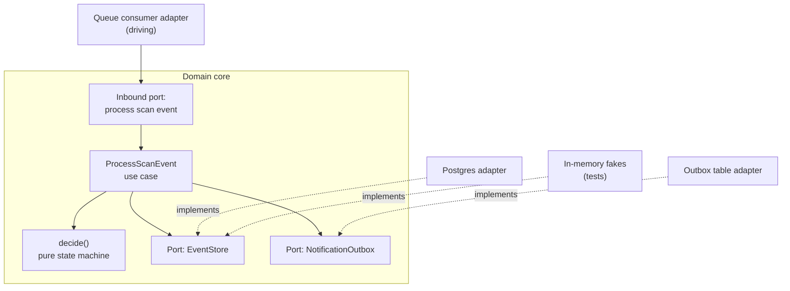
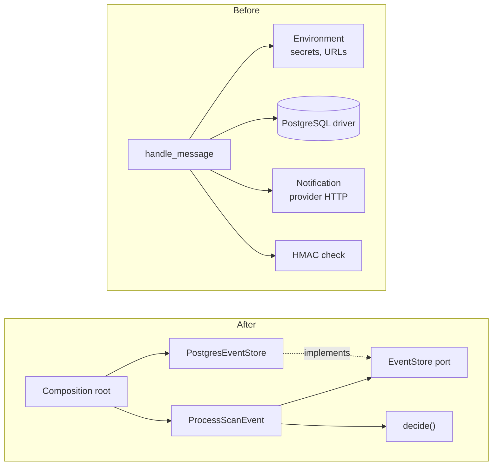

# Software design principles and clean code

> Design principles are heuristics for one goal: keeping a system cheap to change. The same ideas
> that decide whether a function is easy to test decide whether two services can be deployed
> independently.

!!! abstract "Page facts"
    **Level:** Mixed (the principles and examples are Level 1-2; mapping them onto service boundaries
    and hexagonal architecture is Level 3) · **Status:** Draft · **Time:** 60-90 minutes ·
    **Last verified:** 2026-11-20

## Learning objectives

After this page you should be able to:

- Explain coupling and cohesion and use them to judge any boundary, from a function to a service.
- Apply each SOLID principle, recognize a violation in code, and name its architecture-level
  counterpart.
- Use dependency injection and inversion of control to make business logic independent of
  databases, queues, and vendors.
- Weigh DRY, KISS, and YAGNI against each other and against coupling, instead of applying any one
  mechanically.
- Use immutability, defensive programming, and design by contract, and refactor a tangled function
  into small, testable units without changing its behavior.

## Prerequisites

- [Programming paradigms and concurrency](programming-paradigms-and-concurrency.md) — object-oriented
  and functional styles, and why pure functions are easy to share and test.
- [The C4 model](../architecture-fundamentals/c4-model.md) — containers and components, the levels at
  which these principles reappear.

## The problem this solves

Most software cost is spent changing code that already exists. A system where every change touches
ten files and nobody can test a rule without a database is slow because of its structure, not its
algorithms. Design principles are the vocabulary for that structure: what belongs together, what
stays apart, which way dependencies point, and when to stop abstracting.

For architects the same principles describe service boundaries: two services sharing a database
are coupled like two classes sharing global state, and a domain model that imports the HTTP framework
points its dependencies the wrong way whether it is a class or a container.

## What it is

The principles fall into five groups. Each is a heuristic with a cost, not a law.

| Group | Principles | Core question |
|---|---|---|
| Structure | Separation of concerns, loose coupling, high cohesion, encapsulation, abstraction | What belongs together, and what must be hidden? |
| Dependencies | SOLID, dependency injection, inversion of control, composition over inheritance | Which way do dependencies point, and who wires them? |
| Simplicity | DRY (don't repeat yourself), KISS (keep it simple), YAGNI (you aren't gonna need it), clean code | How much design is enough? |
| Correctness | Immutability, defensive programming, design by contract | How does the code make its assumptions explicit? |
| Evolution | Refactoring | How does the design improve without breaking behavior? |

**Clean code** is code that someone other than its author can understand and change safely.

## Mental model

Think of a well-run workshop. Each tool has one job (single responsibility) and hangs in a labelled
place (cohesion). Power tools plug into standard sockets rather than being wired into the walls
(dependency inversion): you can swap a drill without rewiring the building, and test a drill on a
bench supply. The workshop manager decides which drill goes on which bench (inversion of control);
the drill does not choose its own socket. Safety guards refuse to start when the guard is open
(design by contract). Nobody buys a lathe "in case we need it" (YAGNI).

**Where the analogy breaks:** software changes shape constantly, every socket (interface) is a
promise you must keep, and principles conflict: over-applied, they produce indirection harder to
follow than the tangle they replaced.

## Key terms

| Term | Meaning on this page |
|---|---|
| Coupling | The degree to which a change in one module forces a change in another |
| Cohesion | The degree to which the parts of a module belong to one purpose |
| Encapsulation | Hiding a module's internal state and details behind an interface so callers depend only on the interface |
| Abstraction | A simplified view that exposes what matters for a purpose and omits the rest |
| Interface (port) | The set of operations a module offers or requires, independent of any implementation |
| Dependency injection | Passing a module the collaborators it needs instead of letting it create or look them up |
| Inversion of control | The framework or a composition root calls your code and wires it, rather than your code controlling the flow |
| Composition root | The one place, near the program's entry point, where concrete implementations are created and connected |
| Precondition, postcondition, invariant | What a caller must guarantee, what the callee guarantees in return, and what is always true of an object |
| Code smell | A surface symptom that often indicates a deeper design problem |
| Refactoring | Changing code structure in small steps without changing its observable behavior |

## How it works

### Coupling and cohesion: the root of the rest

Almost every other principle is a way to lower coupling between modules or raise cohesion within
them. Coupling comes in kinds, from worst to most benign, and every kind has a service-level twin:

| Coupling kind | In code | Between services |
|---|---|---|
| Content | One module edits another's internals | One service writes another service's tables |
| Common (shared state) | Modules communicate through global variables | Services integrate through a shared database |
| Control | A caller passes a flag that tells the callee what to do internally | A request carries "mode" fields that change the callee's behavior |
| Temporal | Operations must happen in a fixed order or at the same time | Synchronous call chains: one service down takes the caller down |
| Stamp | A callee receives a whole structure but uses one field | Events carry a full entity that consumers then depend on |
| Data | Modules exchange only the values they need | Narrow, versioned API contracts and small events |

**Cohesion** asks whether a module's parts change for the same reason. A `TrackingUtils` module with
date formatting, HMAC helpers, and SQL is low-cohesion: three unrelated reasons to change. A
`ShipmentStatus` module holding the status values and the legal transitions between them is
high-cohesion.

### Separation of concerns, encapsulation, and abstraction

**Separation of concerns** divides a program so each part addresses one concern: parsing,
business rules, persistence, transport, presentation. **Encapsulation** keeps each part's internals
private, so a change inside does not ripple out. **Abstraction** chooses what the interface reveals.
In the Event Store, callers should see "record this scan event, tell me if it was new", not table
names or SQL; the schema can then change without touching callers. The architecture form is
"database per service": the tables are the service's private state, and other services see only its
API or events.

### SOLID, one principle at a time

SOLID is five object-oriented design principles grouped by Robert C. Martin. Each has a small code
form and an architecture form.

**Single responsibility principle (SRP):** a module should have one reason to change, which in
practice means it serves one actor or concern.

```python
# Violation: three reasons to change (carrier format, storage, notification policy)
class ScanEventService:
    def handle(self, body): ...          # parse JSON, write SQL, call the email provider

# Better: one reason each
class ScanEventParser: ...               # changes when a carrier format changes
class EventStore: ...                    # changes when the schema changes
class NotificationPolicy: ...            # changes when the business changes who is told what
```

**Open/closed principle (OCP):** modules should be open for extension but closed for modification;
new behavior arrives as new code, not as edits to working code.

```python
# Violation: every new channel edits this function
def notify(channel, message):
    if channel == "email": ...
    elif channel == "sms": ...

# Better: new channels register themselves
class Channel(Protocol):
    def send(self, message: Message) -> None: ...

CHANNELS: dict[str, Channel] = {"email": EmailChannel(), "sms": SmsChannel()}
```

**Liskov substitution principle (LSP):** any implementation of an interface must be usable wherever
the interface is expected, honoring its promises, not only its method signatures.

```python
class StatusReader(Protocol):
    def current_status(self, shipment_id: str) -> Status:
        """Postcondition: result reflects events received up to 60 s ago (NFR-1)."""

class CachedStatusReader:          # signature matches, behavior must too
    ttl_seconds = 600              # violation: 10-minute staleness breaks the promise
```

The cached reader type-checks but is not substitutable: callers relying on 60-second freshness get
ten-minute-old data. The real Status Cache uses a 30 s TTL precisely to stay inside the promise.

**Interface segregation principle (ISP):** clients should not depend on operations they do not use.

```python
# Violation: the Notification Worker depends on fifteen repository methods
class TrackingRepository(Protocol):
    def save_event(self, e): ...
    def notification_history(self, order_id): ...   # ...and thirteen more

# Better: small, role-based interfaces
class NotificationHistory(Protocol):
    def for_order(self, order_id: str) -> list[Notification]: ...
```

**Dependency inversion principle (DIP):** high-level policy should not depend on low-level detail;
both should depend on an abstraction, and the abstraction belongs to the high-level side.

```python
# Violation: the business rule imports the database driver
import psycopg
def apply_scan(event):
    with psycopg.connect(DSN) as conn: ...

# Better: the rule depends on a port it owns; the adapter implements it
class EventStore(Protocol):                      # defined next to the domain logic
    def save_if_new(self, event: ScanEvent) -> bool: ...

class PostgresEventStore:                        # infrastructure, depends on the domain's port
    def save_if_new(self, event: ScanEvent) -> bool: ...
```

### Dependency injection and inversion of control

**Dependency injection** is the mechanism that makes DIP practical: a component receives its
collaborators (usually through its constructor) instead of constructing them or fetching them from
globals. **Inversion of control** is the broader idea that something else controls the flow and the
wiring: a web framework calls your handler; a composition root at startup builds the object graph.
Injection makes fakes, vendor swaps, and visible dependencies easy. An IoC container library is
optional; in Python a plain startup function is usually clearer.

### Composition over inheritance

Inheritance couples a subclass to its parent's internals; a change in the parent can break every
child (the fragile base class problem). Composition builds behavior by holding collaborators and
delegating to them.

```python
# Inheritance: a retrying, logging, metered sender needs a class per combination
class RetryingLoggingSmsSender(LoggingSmsSender): ...

# Composition: wrap any Channel with any behavior
sender = Metered(Retrying(Logging(SmsChannel()), attempts=3))
```

Use inheritance for stable "is a" relationships and composition for cross-cutting behavior (retries,
logging, metrics, caching); at service level the same choice favors sidecars and middleware.

### DRY, KISS, and YAGNI, and their tensions

- **DRY:** every piece of knowledge should have one authoritative representation. Duplicate the
  status transition rules in the Event Processor and the Tracking API and they will drift.
- **KISS:** prefer the simplest design that meets the requirements; complexity must earn its place.
- **YAGNI:** do not build for requirements you do not have yet; a plugin system for "future
  carriers" with one carrier is cost without benefit.

The tension: DRY applied across boundaries creates coupling. Two services that share a "common"
library for their domain models now deploy together. Duplicating a ten-line mapping in two services
is often cheaper than coupling them. A useful rule: DRY within a boundary, tolerate duplication
across boundaries, and wait for the third occurrence before extracting an abstraction (the "rule of
three"), because the wrong abstraction is costlier than duplication.

### Immutability, defensive programming, and design by contract

**Immutability** means a value cannot change after it is created. Immutable values can be shared
across threads without locks, cached safely, and reasoned about locally. In Python, frozen
dataclasses and tuples are the everyday tools. At architecture scale: append-only event logs,
immutable build artifacts, and immutable infrastructure (replace a server, never patch it in place).

**Design by contract** (from Bertrand Meyer) states a routine's obligations explicitly:
preconditions the caller must meet, postconditions the routine guarantees, and invariants that always
hold for an object. "A shipment's status only moves forward through legal transitions" is an
invariant of the `Shipment` model. Contracts can be checked with assertions in development and become
documentation everywhere.

**Defensive programming** assumes inputs and collaborators may misbehave: validate at trust
boundaries, fail fast with a clear error, set timeouts on every call, and handle the "impossible"
branch. The balance: validate thoroughly at the edge (the Webhook Ingestor sees untrusted carrier
payloads) and trust already-validated types inside, or every function re-checks everything and the
real rules disappear in noise.

### Clean code and refactoring

Clean code is a set of habits rather than a rule book: names that state intent, functions that do one
thing at one level of abstraction, no hidden side effects, no flag arguments, comments that explain
why rather than what, and errors handled where they can be handled. **Refactoring** is how code gets
there: small behavior-preserving transformations (extract function, rename, introduce parameter
object, replace conditional with polymorphism), each verified by tests. Common smells and their
usual refactorings:

| Smell | What it suggests | Typical refactoring |
|---|---|---|
| Long function | Several concerns in one place | Extract function, one per concern |
| Shotgun surgery | One change touches many modules: low cohesion | Move the related logic together |
| Hidden global state | Coupling through environment or singletons | Inject the dependency |
| Duplicated conditional | The same `if status == ...` in many places | Replace with a single state-machine function |

Refactoring needs characterization tests that pin current behavior first; without them it is rewriting.

### From classes to services: the principles at architecture scale

| Principle | Architecture form |
|---|---|
| Single responsibility, high cohesion | A service owns one business capability or bounded context |
| Loose coupling, encapsulation | Database per service; integration through APIs and events, not shared tables |
| Open/closed | Extension through events and webhooks: new consumers subscribe without the producer changing |
| Liskov substitution | Backward-compatible API versions: a new version must honor every promise of the old one |
| Interface segregation | Consumer-specific APIs (backend for frontend), small focused events |
| Dependency inversion | Hexagonal architecture (ports and adapters): the domain defines ports, infrastructure implements them |
| Design by contract | Published API and event contracts, checked by contract tests |
| Immutability | Event logs, immutable artifacts, immutable infrastructure |

**Hexagonal architecture** makes dependency direction visible: business logic sits in the center
and defines ports (interfaces) for everything it needs; adapters on the outside implement those ports
for a specific queue, database, or provider. All source-code dependencies point inward.

**Figure 1 — Hexagonal view of the Event Processor.** A driving adapter (the queue consumer) calls
in at the top; driven adapters at the bottom implement ports the core owns.



How to read it: solid arrows are calls; dashed arrows are "implements", and they point into the
core. Nothing inside the core imports a driver, a framework, or a vendor SDK, so the core can be
tested with fakes and the Postgres adapter can be replaced without touching business rules.

## Worked example: AtlasMart refactoring the Event Processor

An early prototype of the tracking service combined ingestion and processing into one function. It
works on the demo, but every change is risky and nothing can be tested without a real database, a
real notification provider, and a valid carrier secret.

### Before

```python
# Illustrative prototype: parse, verify, dedupe, store, notify, all in one function
def handle_message(raw_body, headers):
    secret = os.environ["CARRIER_SECRET"]
    sig = hmac.new(secret.encode(), raw_body, hashlib.sha256).hexdigest()
    if sig != headers.get("X-Signature"):                 # timing-unsafe comparison
        print("bad signature")
        return
    data = json.loads(raw_body)
    conn = psycopg.connect(os.environ["DATABASE_URL"])    # new connection per message
    cur = conn.cursor()
    cur.execute("SELECT 1 FROM scan_events WHERE carrier_id=%s AND carrier_event_id=%s",
                (data["carrier"], data["event_id"]))
    if cur.fetchone():                                    # check-then-act: racy dedupe
        return
    cur.execute("INSERT INTO scan_events (...) VALUES (...)", (...))
    if data["type"] in ("OUT_FOR_DELIVERY", "DELIVERED"):
        requests.post(NOTIFY_URL, json={"order": data["order_id"], "type": data["type"]})
    cur.execute("UPDATE shipments SET current_status=%s WHERE shipment_id=%s",
                (data["type"], data["shipment_id"]))      # no version or order check
    conn.commit()                                         # notification already sent
```

Problems, by principle:

| Problem | Principle violated | Consequence |
|---|---|---|
| Five concerns in one function | Single responsibility, separation of concerns | A carrier format change risks breaking notifications |
| Reads secrets and creates connections itself | Dependency inversion, dependency injection | Untestable without real infrastructure; a connection per message |
| Signature check inside the processor | Separation of concerns at service level | Verification belongs at the trust boundary, the Webhook Ingestor (NFR-5) |
| `SELECT` then `INSERT` for dedupe | Design by contract (no atomic invariant) | Two workers can both insert: the race from the concurrency page |
| Notification sent before commit | Encapsulation of a transaction | If the commit fails, the customer is told about an event that was never stored; a retry sends a second notification (FR-3) |
| Unconditional status update from the raw type | Invariant not enforced | A late scan can move the status backwards |
| `print` and silent `return` | Defensive programming, clean code | Rejected events vanish without metrics or dead-lettering |

### After

The refactoring proceeds in small steps under characterization tests: extract parsing, move
verification to the ingestor, extract the decision as a pure function, introduce ports, then inject
adapters at a composition root.

```python
# Illustrative refactoring: small units, explicit dependencies

@dataclass(frozen=True)                      # immutable value object
class ScanEvent:
    carrier_id: str
    carrier_event_id: str
    shipment_id: str
    status: Status
    occurred_at: datetime

def parse_scan_event(body: bytes) -> ScanEvent:
    """Precondition: body was signature-verified by the Webhook Ingestor.
    Raises InvalidEvent (permanent) on unknown fields or statuses."""
    ...

def decide(current: Shipment, event: ScanEvent) -> Decision:
    """Pure. Postcondition: new status is current status or a legal successor."""
    ...

class EventStore(Protocol):                  # ports owned by the domain
    def transaction(self) -> ContextManager["StoreTx"]: ...

class ProcessScanEvent:
    def __init__(self, store: EventStore):   # injected, not created
        self._store = store

    def __call__(self, event: ScanEvent) -> Outcome:
        with self._store.transaction() as tx:
            if not tx.insert_if_new(event):              # unique constraint does the dedupe
                return Outcome.DUPLICATE
            shipment = tx.load_shipment(event.shipment_id)
            decision = decide(shipment, event)
            if decision.status_changed:
                tx.update_status(shipment, decision.new_status)   # version check inside
            for note in decision.notifications:
                tx.add_to_outbox(note)                   # sent later by the Notification Worker
        return Outcome.APPLIED
```

The composition root wires concrete adapters once, at startup:

```python
# Illustrative composition root
def build_consumer(settings: Settings) -> QueueConsumer:
    pool = make_connection_pool(settings.database_url, size=10)
    store = PostgresEventStore(pool)
    use_case = ProcessScanEvent(store)
    return QueueConsumer(queue=settings.queue_name, parse=parse_scan_event, handle=use_case)
```

And the business rule is now testable in microseconds, with no infrastructure:

```python
# Illustrative unit test with an in-memory fake
def test_late_hub_scan_does_not_regress_status():
    store = InMemoryEventStore(shipments={"42": Shipment("42", Status.OUT_FOR_DELIVERY, version=3)})
    ProcessScanEvent(store)(scan("42", Status.HUB_SCAN))
    assert store.shipment("42").status is Status.OUT_FOR_DELIVERY
    assert store.outbox == []
```

**Figure 2 — Dependencies before and after.** Before, one function depends on everything; after,
dependencies point at the domain's ports.



How to read it: in the lower graph only the composition root knows concrete classes. The use case
knows a port and a pure function, which is why it can be tested with a fake and why the notification
provider no longer appears at all: notifications leave through the outbox, which the Notification
Worker reads.

### What changed, in numbers

Concerns per unit went from 5 to 1. Network calls inside the transaction went from 1 to 0. Connection
setups at the 70 events/s peak went from 70 per second to none, using a pool of 10 per worker (an
assumption matching the capacity page's pool size). Status rules no longer need infrastructure to
test; adapter tests against real PostgreSQL remain ([testing page](software-testing-types-and-strategies.md)).

## Real-world architecture example

A well-structured enterprise service has this shape: thin transport (HTTP handlers, queue
consumers), use cases coordinating pure domain logic, repository and gateway interfaces owned by the
domain, and adapters wired at startup. It scales up: boundaries drawn around cohesive capabilities,
data hidden behind APIs, events so new consumers need no producer change (open/closed at system
scale), and anti-corruption layers in front of vendor models (dependency inversion across
organizations). Skipping this discipline usually surfaces as a distributed monolith: services that
cannot deploy separately because they share tables, domain-model libraries, or synchronous chains.

## Design choices and trade-offs

| Choice | Favor when | Avoid when |
|---|---|---|
| Interfaces (ports) for every dependency | The dependency is infrastructure or a vendor; logic needs isolated tests | The "dependency" is a pure helper with one implementation forever |
| Inheritance | Stable "is a" hierarchy, framework extension points | Sharing behavior across unrelated types; cross-cutting concerns |
| Strict DRY | Knowledge inside one boundary (status rules, validation) | Across service boundaries, where sharing creates deployment coupling |
| Abstraction now | Third concrete case, or a known near-term requirement | Speculative flexibility (YAGNI) |
| Immutable domain values | Shared, concurrent, cached, or event-sourced data | Very large structures updated at high rates where copying dominates |
| Assertions for contracts | Internal invariants that indicate bugs if broken | Validating untrusted input (use explicit validation that cannot be disabled) |
| Big refactoring branch | Rarely; only with strong tests and a freeze | Almost always; prefer small steps merged continuously |

## Failure modes and anti-patterns

- **Big ball of mud.** No visible structure; everything depends on everything. Detect: change
  amplification (files touched per change), cyclic imports. Prevent: module boundaries enforced by
  fitness functions (import rules checked in CI).
- **Speculative generality.** Interfaces, factories, and plugin points for cases that never arrive.
  Detect: interfaces with one implementation and no test fake. Prevent: YAGNI, rule of three.
- **Shared domain library across services.** DRY across boundaries; every service redeploys for any
  model change. Detect: coordinated releases. Prevent: duplicate small mappings; share only stable,
  generic utilities.
- **Anemic domain model.** Data classes with no behavior, all rules in "service" classes that
  duplicate checks. Detect: the same transition check in several places. Prevent: put invariants
  with the data.
- **Leaky abstraction.** A repository that returns ORM sessions or SQL errors to callers. Detect:
  infrastructure types in domain signatures. Prevent: translate at the adapter.
- **Defensive overkill.** Every function re-validates everything; real rules disappear. Prevent:
  validate at trust boundaries, use types to carry "already validated".
- **Refactoring without tests.** Behavior changes unnoticed. Prevent: characterization tests first.
- **God class or god service.** One unit every change touches. Prevent: split by reason to change.

## Security considerations

- **Separation of concerns is a security control.** Signature verification at one trust boundary
  (the Webhook Ingestor) is auditable; verification scattered through processing is not, and is easy
  to skip on a new code path.
- **Defensive programming at the edge:** validate size, schema, and allowed values of untrusted
  input before parsing deeper; compare signatures with a constant-time function
  (`hmac.compare_digest` in Python), not `==`.
- **Dependency injection keeps secrets out of logic.** Adapters receive credentials from the
  composition root, which reads them from a secret store; business code never touches environment
  variables, and tests never need real secrets.
- **Encapsulation limits blast radius:** an adapter with a narrowly scoped database role can do only
  what its port requires. Immutable values stop a validated object being modified after the check.

## Performance, reliability, and cost

- **Performance:** an extra interface call is negligible next to I/O; the refactor removed a
  per-message connection setup and an HTTP call inside a transaction, which matter far more.
  Immutability can cost allocation in hot loops; measure before optimizing.
- **Reliability:** the outbox removed the duplicate-or-missing notification failure mode entirely.
- **Cost:** the main driver is engineering time per change. Low coupling lowers it; excess
  abstraction raises it. Track change lead time and change failure rate per module.

## Hands-on lab: refactor under a safety net

Local and free; Python 3 standard library only.

1. Copy the "before" function into a file and replace its infrastructure calls with module-level
   fakes (a dictionary for the database, a list for sent notifications) so it runs locally.
2. Write three characterization tests that pin current behavior: a new event is stored, a duplicate
   is ignored, and an out-for-delivery event produces one notification.
3. Extract `parse_scan_event` and `decide` as pure functions; rerun the tests after each extraction.
4. Introduce an `EventStore` protocol and an in-memory implementation; inject it into a
   `ProcessScanEvent` class; rerun the tests.
5. Add a fourth test for a late hub scan after out for delivery, watch it fail against the original
   behavior, then make `decide` enforce the state machine.

??? question "Hint: where to start when everything is tangled"
    Start with the step that has no dependencies: parsing. Once `parse_scan_event` returns an
    immutable value, `decide` can take that value and a plain `Shipment`, and neither needs a fake.
    Introduce the store port last, when only the persistence calls are left in the original function.

## Knowledge check

1. Two services read and write the same `shipments` table. Which kind of coupling is that, and what
   is its class-level equivalent?
2. A `CachedStatusReader` implements the same methods as `StatusReader` but returns data up to ten
   minutes old. Which principle does it violate, and why do type checks not catch it?
3. What is the difference between dependency injection and dependency inversion?
4. When can duplicating code be the better choice than applying DRY?
5. In the refactored Event Processor, why was sending the notification moved out of the transaction?

??? success "Answers"
    1. Common (shared-state) coupling, equivalent to two classes communicating through a global
       variable. Either side's schema change can break the other, and neither can deploy alone.
    2. Liskov substitution: it is not substitutable because it breaks the freshness postcondition
       callers rely on. Signatures match, but contracts are about behavior, which types do not check.
    3. Inversion is a design rule about direction: high-level policy and low-level detail both depend
       on an abstraction owned by the policy side. Injection is a technique: passing collaborators in
       from outside. Injection is the usual way to achieve inversion, but you can inject concrete
       classes without inverting anything.
    4. When the duplicates sit on opposite sides of a boundary (two services, two teams) and sharing
       would couple their deployments, or when the two copies only look alike today and are likely to
       evolve differently.
    5. An external call inside a transaction can succeed while the commit fails (customer told about
       an unrecorded event) or be repeated on retry (duplicate notification, violating FR-3). Writing
       an outbox row in the same transaction makes "stored" and "will be notified" atomic.

## Architecture discussion questions

1. The Tracking API and the Event Processor both need the shipment status state machine. Do you put
   it in a shared library, duplicate it, or make one service the authority? Argue with coupling,
   deployment, and correctness in mind.
2. A team proposes a generic "carrier plugin framework" for the one carrier AtlasMart integrates with
   today and the two it might add next year. Apply YAGNI and open/closed together: what is the
   smallest design that keeps the next carrier cheap?
3. Where would you draw the ports for the Notification Worker so that changing notification provider
   is a one-adapter change, and what contract would you write for that port?

## Summary

Design principles are heuristics for changeability, rooted in coupling and cohesion. SOLID gives
five checks (one reason to change, extend without editing, substitutable behavior, small interfaces,
dependencies pointing at abstractions), and dependency injection with a composition root makes them
practical. DRY, KISS, and YAGNI pull against each other and against coupling: DRY inside a boundary,
tolerate duplication across one. Immutability, contracts, and validation at trust boundaries make
correctness explicit; refactoring under tests turns a tangle into a design. Every principle has an
architecture form, from database per service to hexagonal ports and adapters.

## Related topics

- **Before:** [Programming paradigms and concurrency](programming-paradigms-and-concurrency.md);
  [The C4 model](../architecture-fundamentals/c4-model.md)
- **Alongside:** [Software testing types and strategies](software-testing-types-and-strategies.md) —
  the tests that make refactoring safe; [Integration architecture](../application-and-api-architecture/integration-architecture.md)
  — anti-corruption layers and coupling between organizations; [Trade-offs, principles, ADRs, and architecture governance](../architecture-fundamentals/trade-offs-principles-adrs-and-architecture-governance.md)
  — principles as governance.
- **Planned:** [Architecture styles](../software-architecture/architecture-styles.md) (D03-T01,
  including hexagonal, clean, and onion); [Application design patterns](../software-architecture/application-design-patterns.md)
  (D03-T03); [Microservices architecture](../software-architecture/microservices-architecture.md)
  (D03-T02).

## References

| Source | Type | Checked |
|---|---|---|
| David L. Parnas, ["On the Criteria to Be Used in Decomposing Systems into Modules"](https://www.win.tue.nl/~wstomv/edu/2ip30/references/criteria_for_modularization.pdf), Communications of the ACM, 1972 (university-hosted copy) | Paper (information hiding) | 2026-11-20 |
| Barbara Liskov and Jeannette Wing, ["A Behavioral Notion of Subtyping"](https://www.cs.cmu.edu/~wing/publications/LiskovWing94.pdf), ACM TOPLAS, 1994 (author's copy) | Paper (substitutability) | 2026-11-20 |
| Martin Fowler, ["Inversion of Control Containers and the Dependency Injection pattern"](https://martinfowler.com/articles/injection.html) | Article | 2026-11-20 |
| Alistair Cockburn, ["Hexagonal architecture"](https://alistair.cockburn.us/hexagonal-architecture/) | Article (ports and adapters) | 2026-11-20 |
| Robert C. Martin, ["Solid Relevance"](https://blog.cleancoder.com/uncle-bob/2020/10/18/Solid-Relevance.html), 2020 | Article (SOLID) | 2026-11-20 |
| Martin Fowler, ["Yagni"](https://martinfowler.com/bliki/Yagni.html) | Article | 2026-11-20 |
| [Refactoring](https://refactoring.com/) — Martin Fowler, catalog and book site | Reference catalog | 2026-11-20 |
| Bertrand Meyer, *Object-Oriented Software Construction*, 2nd edition (Prentice Hall, 1997) | Book (design by contract) | 2026-11-20 |

## Review notes

- Canonical page for D02-T04. Deep coverage: coupling and cohesion, each SOLID principle,
  dependency injection and inversion of control, DRY/KISS/YAGNI tensions, and the mapping to service
  boundaries and hexagonal architecture. Composition over inheritance, immutability, defensive
  programming, design by contract, clean code, and refactoring are covered at a working level;
  abstraction and encapsulation are defined with one example each.
- Code blocks are illustrative, not executed; they omit imports and some types (`Status`,
  `Shipment`, `Decision`, `InMemoryEventStore`, `scan`). The coupling-kinds table adapts the classic
  structured-design taxonomy, adding "temporal"; wording is original.
- New AtlasMart assumptions: an early prototype combining ingestion and processing (the "before"
  code), a `version` column on `shipments` (shared with the concurrency page), a notification outbox
  table, and a pool of 10 connections per Event Processor worker. Hexagonal architecture is shown
  only for dependency direction; the full treatment belongs to D03-T01.
