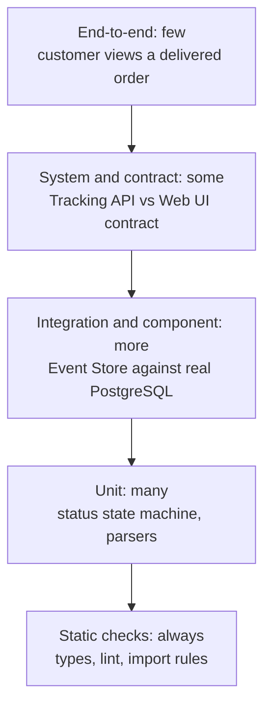
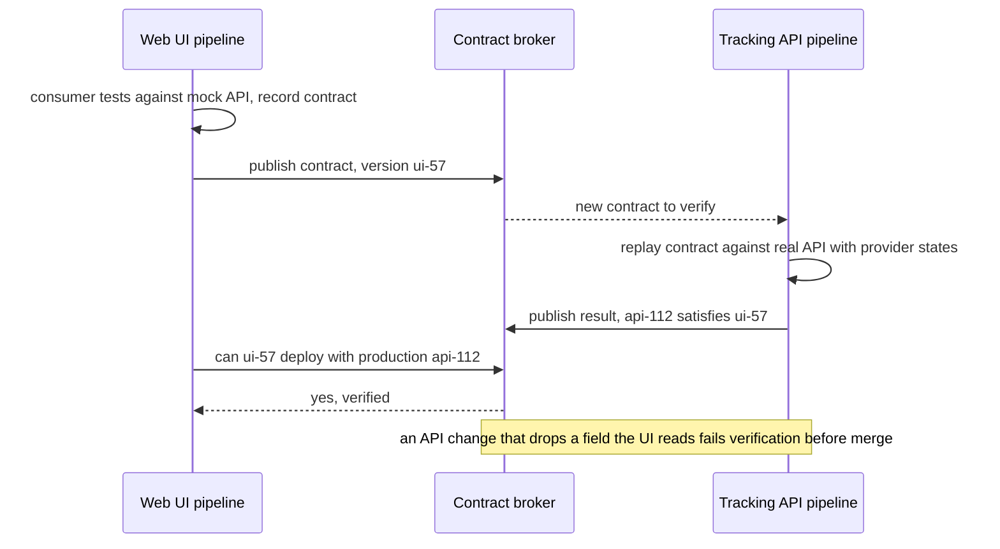
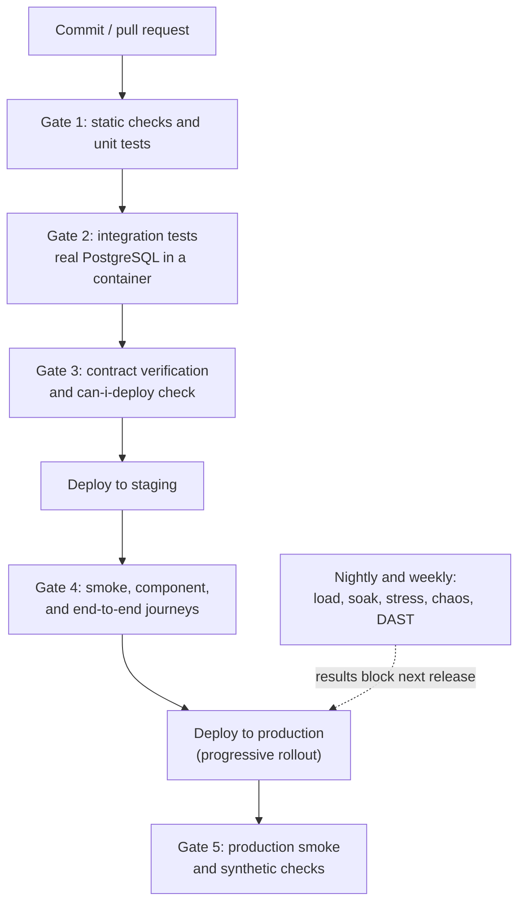

# Software testing types and strategies

> A test strategy is a risk budget: for each way the system can fail, decide which test catches it,
> how early, and how much CI time it may spend doing so. The test types are tools; the strategy is
> the choice of where to point them.

!!! abstract "Page facts"
    **Level:** Mixed (test types and TDD are Level 1-2; contract, performance, and chaos testing and
    the CI strategy are Level 3) · **Status:** Draft · **Time:** 60-90 minutes ·
    **Last verified:** 2026-11-20

## Learning objectives

After this page you should be able to:

- Classify tests by scope (unit, component, integration, system, end-to-end) and by purpose (smoke,
  regression, acceptance, contract, performance, chaos, security, fuzz).
- Present the test pyramid and the testing trophy fairly and choose a shape for a given system.
- Design contract tests between an API and its consumers, and integration tests against a real
  database in a container.
- Turn latency and scale NFRs into load, stress, spike, and soak tests with pass criteria.
- Plan chaos experiments with a steady-state hypothesis and a bounded blast radius.
- Lay out a CI pipeline with test gates and time budgets for a real system.

## Prerequisites

- [Software design principles and clean code](software-design-principles-and-clean-code.md) —
  dependency injection and ports are what make fast, isolated tests possible.
- [Functional vs non-functional requirements](../architecture-fundamentals/functional-vs-non-functional-requirements.md)
  — acceptance criteria and NFRs are the things tests verify.
- [Capacity estimation](../performance-and-scalability/capacity-estimation.md) — the load numbers the
  performance tests use.

## The problem this solves

Every change to a running system is a bet that nothing else broke. Without tests, the only way to
find out is production, where defects cost customer trust, incident time, and sometimes data. With
the wrong tests, teams pay the cost of testing without the confidence: suites that take an hour,
fail randomly, and still miss the bug that matters because it lived between two services or only
appeared under load.

Architects own testing at the strategy level because the riskiest failures are architectural: a
consumer broken by an API change, a query that is fine at 10 requests per second and collapses at
200, a failover that has never been exercised, a race that only appears when two workers run at once.
These are not caught by unit tests, and they are expensive to catch late. A good strategy makes each
risk the job of a specific, fast-enough test.

## What it is

Tests vary along two independent axes: **scope** (how much of the real system runs) and **purpose**
(what risk the test reduces). Most named test types are a point on one of them.

| Axis | Type | Meaning |
|---|---|---|
| Scope | Unit | One function or class, dependencies replaced by test doubles |
| Scope | Component | One service in isolation, its own adapters real, its external dependencies stubbed |
| Scope | Integration | Two or more real parts together, typically code plus a real database or broker |
| Scope | System | The whole deployed system in a test environment, tested against requirements |
| Scope | End-to-end | A user journey through the full stack, usually through the UI or public API |
| Purpose | Smoke | A few fast checks that a build or deployment is alive enough to test further |
| Purpose | Regression | Any re-run of existing tests to show old behavior still works after a change |
| Purpose | Acceptance | Checks that a requirement's acceptance criteria are met, often written with the business |
| Purpose | Contract | Checks that a provider and a consumer agree on an interface, without deploying both |
| Purpose | Performance (load, stress, spike, soak) | Checks latency, throughput, and resource behavior under defined load |
| Purpose | Chaos | Deliberately injects failures to verify the system tolerates them |
| Purpose | Security | Checks for vulnerabilities: static analysis, dependency scanning, dynamic scanning, authorization tests |
| Purpose | Fuzz | Feeds large volumes of generated, malformed, or random input to find crashes and unhandled cases |

**Test-driven development (TDD)** and **behavior-driven development (BDD)** are not test types but
ways of working that decide when tests are written and in whose language. **Test automation** is the
practice of running all of this without humans, on every change, as gates in a pipeline.

## Mental model

Think of building a car. Each part is tested on a bench (unit). The assembled engine runs on a
dynamometer with fake wheels (component). Engine and gearbox are tested together (integration). The
whole car goes round a test track (system and end-to-end). The wheel supplier and the car maker agree
on a bolt pattern written down in a specification, and each checks their own side against it without
shipping parts back and forth (contract). The car is driven at top speed (stress), for a week without
stopping (soak), and has a tyre deliberately blown at speed (chaos). Before each drive, someone checks
the engine starts (smoke).

**Where the analogy breaks:** cars are built once and tested once; software changes many times a day,
so tests must be cheap enough to rerun on every change. And unlike a test track, a test environment
is never quite production: real traffic, real data shapes, and real failures always differ, which is
why some testing (chaos, synthetic checks) eventually moves into production itself.

## Key terms

| Term | Meaning on this page |
|---|---|
| System under test (SUT) | The code or system a test exercises |
| Test double | A stand-in for a real dependency: a stub returns canned answers, a fake is a working lightweight implementation, a mock also verifies how it was called |
| Flaky test | A test that passes and fails on the same code; it erodes trust in every other test |
| Test pyramid | A suite shape with many unit tests, fewer integration tests, and few end-to-end tests |
| Testing trophy | A suite shape with static checks at the base and the largest share in integration tests |
| Consumer-driven contract | A contract generated from the consumer's tests describing exactly what it uses of a provider |
| Provider verification | Replaying a consumer's contract against the real provider to prove it still satisfies it |
| Quality gate | A pipeline stage that blocks promotion when its tests fail |
| Steady-state hypothesis | In chaos testing, the measurable normal behavior expected to hold during an experiment |
| Blast radius | The share of users or traffic an experiment or failure can affect |
| Acceptance criteria | Conditions that decide whether a requirement is met (glossary sense) |
| Closed-loop / open-loop load | Clients that wait for responses versus arrivals at a fixed rate (glossary sense); performance tests should be open-loop |

## How it works

### Tests by scope

| Scope | What is real | What is faked | Typical speed | Catches | Misses |
|---|---|---|---|---|---|
| Unit | One function or class | Everything it calls | Milliseconds each | Logic errors, edge cases in rules | Wiring, SQL, configuration, anything between units |
| Component | One service and its adapters, often an in-memory or containerized database | Other services (stubs) | Seconds | Request handling, serialization, the service's own persistence | Disagreements with real neighbors |
| Integration | Code plus real infrastructure (database, broker) | Remote services | Seconds | SQL errors, constraints, transactions, driver behavior | Cross-service contracts |
| System | The deployed system in a test environment | External third parties | Minutes | Configuration, deployment, cross-service flows | Production-only data and scale |
| End-to-end | A user journey through everything | Little or nothing | Minutes, and fragile | Broken journeys | The cause: failures are hard to localize |

Moving up the table buys realism and costs speed, stability, and diagnosability. That trade-off is
the whole debate about suite shape.

### The test pyramid and the testing trophy

**The test pyramid** (popularized by Mike Cohn and widely discussed by Martin Fowler) recommends
many fast unit tests at the base, fewer integration or service tests in the middle, and a thin layer
of end-to-end tests at the top. Its argument: unit tests are cheap, fast, precise about the cause of a
failure, and stable; end-to-end tests are slow and flaky, so they should cover only the most
important journeys. Its warning sign is the inverted "ice-cream cone": mostly manual and UI tests,
few unit tests.

**Figure 1 — The test pyramid with AtlasMart examples.** Width in the original metaphor is test
count; here each layer lists what it covers.



How to read it: top to bottom is slower to faster and fewer to more tests. The static layer at the
bottom is the trophy's addition; the classic pyramid starts at unit tests.

**The testing trophy** (proposed by Kent C. Dodds for front-end and web applications) puts static
analysis (types, linters) at the base, a modest layer of unit tests, the **largest** layer of
integration tests, and a small top of end-to-end tests. Its argument: confidence comes from testing
the way software is used; unit tests with heavy mocking verify implementation details, break on
refactoring, and miss the wiring where bugs live; modern tooling (fast containers, in-process
servers) has made integration tests cheap enough to be the bulk.

Both positions are right about something:

| Question | Pyramid answer | Trophy answer |
|---|---|---|
| Where do most bugs live? | In logic; test it in isolation | In integration between parts; test them together |
| What does mocking cost? | Little, if interfaces are well designed | A lot: mocks drift from reality and pin implementation |
| What is cheap now? | Unit tests are always cheapest | Integration tests are cheap enough with modern tooling |
| Where does it fit best? | Logic-heavy back ends, libraries | UI-heavy applications, thin services over a database |

The synthesis for architects: **the shape should follow where the risk is**. A service whose value
is a complex rule engine (the shipment state machine) earns many unit tests. A service that is mostly
SQL and HTTP plumbing earns mostly integration tests. A system of many services earns contract tests
in the middle, which neither original shape emphasized. What both agree on: end-to-end tests are a
thin top, static checks are free, and a flaky test must be fixed or deleted.

### Integration tests against a real PostgreSQL in a container

The Event Processor's correctness depends on database behavior: the unique constraint on
`(carrier_id, carrier_event_id)`, the conditional status update, transaction isolation, and
PostgreSQL's SQL dialect. A mock cannot reproduce any of that, and a different embedded database
behaves differently on exactly these points. The practical answer is a real PostgreSQL, the same
major version as production, started in a throwaway container by the test suite (libraries such as
Testcontainers do this from test code), with the production migrations applied.

```python
# Illustrative integration test (pytest style)
@pytest.fixture(scope="session")
def database():
    with PostgresContainer("postgres:<same major version as production>") as pg:
        apply_migrations(pg.get_connection_url())
        yield pg

def test_duplicate_event_is_stored_once(database):
    store = PostgresEventStore(make_pool(database.get_connection_url()))
    event = scan("42", Status.HUB_SCAN, carrier_event_id="c-1")
    assert ProcessScanEvent(store)(event) is Outcome.APPLIED
    assert ProcessScanEvent(store)(event) is Outcome.DUPLICATE
    assert store.count_events("42") == 1
```

Keeping this fast: start one container per test session, not per test; isolate tests by running each
in a transaction that is rolled back, or by truncating tables between tests; and run concurrency tests
(two connections racing on one row) explicitly, because they are the reason the real database is
there.

### Contract tests between the Tracking API and its consumers

The Tracking API has several consumers: the Tracking Web UI, the support agent tooling, and later
partner carriers. An end-to-end test of every consumer against every provider version does not
scale, and a provider team cannot know which fields consumers actually read. **Consumer-driven
contract testing** solves this:

1. The consumer's own tests run against a mock provider and record each interaction they rely on
   (request, and the parts of the response they read) into a contract file.
2. The contract is published to a shared contract store (a broker) tagged with the consumer's
   version.
3. The provider's pipeline fetches every consumer's contracts and replays them against the real
   provider (provider verification), with its database seeded by provider states such as "order 1001
   exists and belongs to customer C".
4. Before either side deploys, the pipeline asks the broker whether the versions about to run
   together have a passing verification; if not, deployment stops.

**Figure 2 — Consumer-driven contract flow.** The Web UI and the Tracking API are verified against
each other without ever being deployed together for the test.



How to read it: the contract carries only what the consumer uses, so the provider can change
anything else freely. Schema-based checks (comparing the OpenAPI document across versions for
breaking changes) are a complementary, cheaper gate: they catch removed fields but not changed
meanings or provider states.

The same idea applies in reverse to the inbound carrier webhook: AtlasMart publishes the contract and
each carrier integration is checked against recorded sample payloads, including the HMAC headers.

### Performance tests: load, stress, spike, and soak

Performance tests verify NFRs under defined load. Four types answer four different questions:

| Type | Question | Load shape | Typical pass criteria |
|---|---|---|---|
| Load | Do we meet the NFRs at expected peak? | Ramp to design peak and hold | Latency percentiles and utilization within targets |
| Stress | Where and how do we break? | Increase beyond peak in steps until failure | Graceful degradation (shedding, errors) rather than collapse; recovery after load drops |
| Spike | Do we survive a sudden jump? | From normal to peak in seconds | Errors bounded during the spike; autoscaling or queues absorb it |
| Soak (endurance) | Does anything degrade over hours? | Realistic load for a long period | No memory growth, connection leaks, or latency drift |

Two rules make the results trustworthy. Use an **open-loop** load generator that sends at a fixed
arrival rate, because a closed-loop one slows down when the system does and hides the queueing delay
users would see (coordinated omission). And run against an environment whose instance sizes, data
volume, and cache state resemble production, or state clearly what differs.

### Chaos tests

Chaos testing (chaos engineering) runs controlled experiments that inject real failures (killing
instances, adding latency, partitioning networks, failing over databases) to check that resilience
mechanisms actually work. The discipline that separates it from breaking things:

1. Define the **steady state** as metrics (for AtlasMart: tracking-read error rate, p95 latency, and
   event lag).
2. State a **hypothesis**: steady state holds when this failure occurs.
3. Inject the failure with the smallest **blast radius** that tests the hypothesis, with an abort
   condition and a way to stop immediately.
4. Compare, learn, fix, and automate the experiment so it reruns.

Start in a test environment, move to production only when the system and the team are ready, and
always with a bounded blast radius.

### TDD and BDD

**Test-driven development** is a loop: write a failing test for the next small behavior (red), write
the simplest code that passes (green), then improve the structure with the test as a safety net
(refactor). Its main benefit is design pressure: code written to be testable first tends to have
injected dependencies and small units. It suits logic with clear inputs and outputs (the state
machine) and fits poorly with exploratory work where the shape is unknown.

**Behavior-driven development** writes acceptance criteria as examples in a shared, structured
language that business people can read, and automates them. FR-3's acceptance criterion becomes:

```gherkin
Feature: Delivery notifications (FR-3)
  Scenario: Out-for-delivery scan triggers exactly one notification
    Given shipment 42 is "in transit" and its customer has email notifications on
    When the carrier sends an out-for-delivery scan for shipment 42
    And the carrier sends the same scan again
    Then exactly one out-for-delivery notification is queued for shipment 42
```

BDD's value is the conversation that produces the examples; its cost is a step-definition layer that
must be maintained. Use it for acceptance criteria the business cares about, not for every unit.

### Test automation and pipeline gates

Automation turns tests into **quality gates**: each pipeline stage runs a set of tests, and a failure
stops promotion. Fast, precise tests run first; slow, broad tests run later and less often.

**Figure 3 — CI pipeline stages with test gates.** Each gate must pass before the next stage runs.



How to read it: solid arrows are the per-change path; the dashed arrow is the scheduled path, whose
findings block promotion until resolved rather than blocking every commit.

## Worked example: AtlasMart test strategy for the Order Tracking System

The Order Tracking System's main risks, from its requirements: wrong or regressed status (FR-1,
FR-2), duplicate or missing notifications (FR-3), a broken contract with the Web UI or a carrier,
latency and scale (NFR-3, NFR-4), lost events (NFR-7), freshness under bursts (NFR-1), and access
control (NFR-5). The strategy assigns each risk to the cheapest test that can catch it.

### Tests by level

CI time budgets are AtlasMart targets (assumptions), set so that a pull request gets feedback within
about 15 minutes: 2 + 8 + 3 = 13 minutes for gates 1 to 3, with 2 minutes of slack.

| Level | What is tested | What it catches | CI budget (assumption) | Runs |
|---|---|---|---|---|
| Static | Types, lint, import rule "domain imports no adapter" (a fitness function) | Type errors, dependency direction violations | Within gate 1 | Every commit |
| Unit | `decide()` state machine, parsers, notification policy, API request validation | Illegal transitions, late scans regressing status, malformed payloads | Gate 1 total ≤ 2 min | Every commit |
| Integration | `PostgresEventStore` against real PostgreSQL (same major version), migrations, the version check under two racing connections, outbox writes | Constraint and SQL errors, lost updates, migration failures | ≤ 8 min | Every pull request |
| Contract | Web UI and agent-tooling contracts verified against the Tracking API; carrier webhook samples against the Ingestor; OpenAPI breaking-change check | Removed or renamed fields, changed status codes, signature header changes | ≤ 3 min | Every pull request; can-i-deploy before each deploy |
| Component | Each service started alone with stubs for neighbors | Configuration, serialization, health endpoints | ≤ 5 min | On merge, in staging |
| End-to-end | Three journeys: carrier scan to customer view; out-for-delivery to one notification; agent view matches customer view (FR-5) | Broken wiring across Ingestor, Queue, Processor, API, UI | ≤ 10 min | On merge, in staging |
| Smoke | Health endpoints and one tracking read after each deploy | Bad deploys, missing configuration | ≤ 1 min | Every deploy, staging and production |
| Acceptance (BDD) | FR-1 to FR-5 acceptance criteria as scenarios, including FR-2's replay of 1,000 events yielding 1,000 stored | Requirement regressions | Within end-to-end budget | On merge |
| Security | Dependency and static scanning per commit; authorization tests (customer A requesting customer B's order gets 404, NFR-5); webhook with bad signature rejected; nightly dynamic scan | Vulnerable libraries, broken access control, signature bypass | Scans within gate 1; DAST nightly | Mixed |
| Fuzz | Webhook payload parser fed generated malformed JSON and oversized fields | Crashes, unhandled exceptions, unbounded memory | 10 min nightly | Nightly |
| Regression | All of the above, re-run on every change | Re-broken old behavior | (the sum) | Continuous |

### Performance tests and the NFR each verifies

Numbers come from the [capacity page](../performance-and-scalability/capacity-estimation.md): design
peak 210 reads/s and 70 events/s, daily peak 70 reads/s and about 22 events/s, year-two 270 reads/s
and 90 events/s, and a measured per-instance capacity of 300 req/s at 70% CPU.

| Test | Load profile | Verifies | Pass criteria |
|---|---|---|---|
| Load | Ramp over 5 min to 210 reads/s plus 70 events/s, hold 30 min (210 × 1,800 = 378,000 reads; 70 × 1,800 = 126,000 events) | NFR-3, NFR-4 | p95 ≤ 300 ms and p99 ≤ 800 ms at the gateway; CPU < 70% on every API instance; event lag within NFR-1 |
| Stress | Steps of 10 min at 270, 420, and 630 reads/s (year-two, then 2× and 3× design peak) with events scaled alike | Headroom beyond NFR-4; graceful degradation | Year-two step meets NFR-3; beyond it, errors are fast rejections (429 or 503), not timeouts; recovery within 5 min after load drops |
| Spike | From 14 reads/s (daily average) to 210 reads/s within 10 s, hold 10 min; separately a carrier backlog of 50,000 events in 60 s (833/s) | NFR-3 during a sale launch; NFR-1 and NFR-8 during a backlog | Reads: p99 ≤ 800 ms after the first minute. Backlog: queue drains in about 8 minutes (50,000 ÷ 100 events/s processor capacity), lag alert fires, no event lost (NFR-7) |
| Soak | 8 h at daily peak, 70 reads/s and 22 events/s (70 × 28,800 = 2,016,000 reads) | NFR-3 stability over time; NFR-2 risks such as leaks | No upward trend in memory, connections, or p95 between the first and last hour |

The ramp durations, step levels, and the 8-hour soak are AtlasMart assumptions; the rates are from the
capacity page. Load and spike tests run weekly and before sale events; stress and soak run before
major releases. A load test that fails NFR-3 blocks the release, which is how an NFR becomes a
fitness function rather than a sentence in a document.

### Chaos experiments

| Experiment | Hypothesis (steady state holds) | Verifies |
|---|---|---|
| Kill one of the 2 Event Processor workers at 70 events/s | The other worker carries 1.4 workers' worth of load; lag recovers; no event lost | NFR-1, NFR-7 |
| Pause one worker for 70 s (longer than the 60 s visibility timeout) | Redelivery occurs, but the version check prevents a lost update | The race fix on the [concurrency page](programming-paradigms-and-concurrency.md) |
| Fail over the Event Store primary to the standby | Writes resume within the RTO; no acknowledged event lost | NFR-7 (RTO 1 h, RPO 5 min) |
| Make the Status Cache unavailable | Reads fall back to the database within NFR-3 at daily peak | NFR-3, NFR-2 |
| Partition one zone from the other two | Traffic drains to healthy zones; minority side serves cached reads only | NFR-2 |

## Real-world architecture example

Mature engineering organizations converge on similar structures regardless of stack. Every pull
request runs static checks, unit tests, and integration tests against containerized dependencies in
minutes; service teams publish consumer contracts to a shared broker and gate deploys on
verification, which lets dozens of services deploy independently; a small set of critical journeys
runs end to end in staging; production deploys roll out progressively with automated smoke checks
and rollback; synthetic checks run continuously from outside (AtlasMart's NFR-2 measurement is one);
performance tests run on a schedule and before known peaks; and resilience is verified through
regular, scoped failure experiments, sometimes organized as game days with the on-call team. The
strategy, more than any tool, is what lets such organizations deploy often without fear.

## Design choices and trade-offs

| Choice | Favor when | Avoid when |
|---|---|---|
| Pyramid shape (unit-heavy) | Logic-rich services, libraries, rule engines | Thin services that are mostly SQL and HTTP glue |
| Trophy shape (integration-heavy) | Database-backed services, UI applications, fast container tooling available | Integration tests are slow or unstable in your CI |
| Real database in a container | Correctness depends on constraints, transactions, or dialect | Pure logic that a fake covers fully |
| Consumer-driven contract tests | Several independently deployed consumers per provider | One consumer deployed together with its provider |
| Broad end-to-end suites | A handful of revenue-critical journeys | As the main safety net; they become slow and flaky |
| TDD | Well-understood logic; design pressure wanted | Spikes and prototypes whose shape is still unknown |
| BDD | Acceptance criteria that business people review | Low-level technical behavior |
| Chaos in production | Mature observability, automated abort, proven in staging | No steady-state metrics or rollback; immature on-call |
| Performance tests per pull request | Latency-critical hot paths with stable micro-benchmarks | Full load tests: too slow and noisy for every change |

## Failure modes and anti-patterns

- **Ice-cream cone.** Mostly manual and end-to-end tests. Detect: slow pipelines, failures that take
  hours to localize. Prevent: push each check to the lowest level that can catch it.
- **Flaky tests tolerated.** Retries until green; real failures get ignored. Detect: track pass rate
  per test. Prevent: quarantine within a day, then fix or delete.
- **Mocking what you do not own.** Mocks of the database or a vendor API encode your assumptions,
  not their behavior. Prevent: real dependencies in containers, contract tests, adapters behind ports.
- **Testing implementation details.** Tests that break on every refactor. Prevent: test behavior
  through public interfaces.
- **Closed-loop load tests.** The generator slows with the system and reports flattering latency.
  Prevent: open-loop, fixed-arrival-rate generators; report percentiles, not averages.
- **Unrepresentative performance environments.** Tiny data sets, warm caches, or different instance
  sizes. Prevent: production-like data volume and configuration; document the differences.
- **Chaos without a hypothesis or abort.** An outage, not an experiment. Prevent: steady-state
  metrics, small blast radius, an automated stop condition.
- **Coverage as the goal.** Line coverage targets met by assertion-free tests. Prevent: review
  tests for assertions; consider mutation testing on critical modules.

## Security considerations

- **Security testing is layered:** static analysis and dependency scanning on every commit, secret
  scanning to stop credentials entering the repository, authorization tests at the API level
  (owner-only access for NFR-5), and dynamic scanning against a deployed test environment.
- **Fuzz the trust boundary.** The webhook parser processes untrusted carrier input; fuzzing it finds
  the crashes and unbounded allocations an attacker would otherwise find.
- **Test data must not be production personal data.** Generate synthetic orders and customers;
  NFR-6 also means tracking tests never need delivery addresses at all.
- **Test environments hold secrets too.** Use separate, low-privilege credentials per environment;
  never reuse production keys in CI.
- **Chaos and load tools are powerful.** Restrict who can run them against shared or production
  environments, and log every run.

## Performance, reliability, and cost

- **Performance:** CI time is developer time. The 15-minute pull-request budget above assumes tests
  run in parallel and one database container is shared per session; measure suite duration and treat
  regressions like product regressions.
- **Reliability:** tests that verify NFRs (load against NFR-3 and NFR-4, chaos against NFR-1 and
  NFR-7) are the only evidence that reliability designs work before an incident proves otherwise.
- **Cost:** performance and chaos environments cost money while running; schedule them, size them
  deliberately, and tear them down afterwards. Flaky tests cost the most of all, in reruns and in
  ignored failures. Check the provider's current documentation for the pricing of CI minutes and test
  environments rather than estimating from memory.

## Hands-on lab: build a small test strategy locally

Local and free; Python 3 standard library only (`unittest`).

1. Write a pure `next_status(current, event)` function for the shipment state machine and five unit
   tests, including "a hub scan after out for delivery does not change the status". Write the tests
   first (TDD) and watch them fail.
2. Add a fuzz-style test that feeds 10,000 randomly generated event dictionaries (missing fields,
   wrong types, unknown statuses) to a parser and asserts it either returns a valid event or raises
   your `InvalidEvent` error, never anything else.
3. Write a consumer "contract" as a JSON file listing the fields the UI reads from a tracking
   response; write a provider test that checks a sample response satisfies it, then remove a field
   and see it fail.
4. Reuse the load generator from [Lab 01](../labs/lab-01-latency-and-throughput.md) to run a short
   load test against the lab service, record p95 and p99, and write a pass or fail check against a
   latency target you choose.
5. Arrange the four checks into a script that runs them in order and stops at the first failing
   gate, mimicking Figure 3.

??? question "Hint: making the fuzz test reproducible"
    Seed the random generator (`random.Random(1234)`) and print the seed in the failure message. A
    fuzz failure you cannot reproduce is only a rumor; with the seed, it becomes a regression test.

## Knowledge check

1. What is the difference between a component test and an integration test?
2. Give one argument for the test pyramid and one for the testing trophy, and say what decides between
   them for a given service.
3. Why test the Event Store against a real PostgreSQL in a container rather than a mock or an
   embedded database?
4. In consumer-driven contract testing, who writes the contract, who verifies it, and what blocks a
   breaking change?
5. Which performance test type would reveal a slow memory leak, and which would verify NFR-4?

??? success "Answers"
    1. A component test runs one service in isolation with its neighbors stubbed; an integration test
       exercises real parts together, typically code plus real infrastructure such as a database. A
       component test can include integration with its own database; the distinction is whether other
       services are real.
    2. Pyramid: unit tests are fast, stable, and pinpoint failures. Trophy: integration tests catch the
       wiring bugs mocks hide and survive refactoring. Where the service's risk lives decides it: in
       complex logic (pyramid) or in integration with infrastructure (trophy).
    3. Correctness depends on PostgreSQL behavior (unique constraints, conditional updates,
       transactions, dialect) that mocks do not reproduce and other engines implement differently.
    4. The consumer's tests generate it; the provider's pipeline verifies it against the real provider;
       a can-i-deploy check against the broker blocks deploying versions without a passing
       verification.
    5. A soak test reveals slow leaks; a load test at 210 reads/s plus 70 events/s with CPU under 70%
       verifies NFR-4.

## Architecture discussion questions

1. The end-to-end suite takes 40 minutes and fails one run in five. The team proposes running it
   nightly only. What would you move down the pyramid first, and what risk remains uncovered?
2. Partner carriers will consume the Tracking API next year. Would you require them to publish
   consumer contracts, rely on OpenAPI breaking-change checks, or both? What does each cost them?
3. Should AtlasMart run chaos experiments in production before a sale day, after it, or never? Argue
   using the error budget from NFR-2 (about 43.8 minutes a month).

## Summary

Tests vary by scope (unit, component, integration, system, end-to-end) and by purpose (smoke,
regression, acceptance, contract, performance, chaos, security, fuzz). The pyramid and the trophy
disagree about where the bulk of tests should sit; the useful answer is that the shape follows the
risk, with a thin end-to-end top and free static checks in both. Database-backed code is tested against
the real database in a container; independently deployed services are kept compatible by consumer-driven
contracts; NFRs become load, stress, spike, and soak tests with numeric pass criteria; chaos experiments
verify resilience against a steady-state hypothesis. TDD adds design pressure, BDD turns acceptance
criteria into shared examples, and automation arranges everything into fast gates and scheduled checks.
The AtlasMart strategy fits gates 1 to 3 into 13 minutes and maps each performance test to the NFR it
proves.

## Related topics

- **Before:** [Software design principles and clean code](software-design-principles-and-clean-code.md);
  [Functional vs non-functional requirements](../architecture-fundamentals/functional-vs-non-functional-requirements.md)
- **Alongside:** [Capacity estimation](../performance-and-scalability/capacity-estimation.md) — the
  load numbers; [Performance fundamentals and Little's Law](../performance-and-scalability/performance-fundamentals-and-littles-law.md)
  — percentiles and open-loop load; [API design](../application-and-api-architecture/api-design-rest-graphql-grpc-and-async-apis.md)
  — the contract being tested; [Programming paradigms and concurrency](programming-paradigms-and-concurrency.md)
  — the race a chaos experiment verifies; [SLAs, SLOs, SLIs, and error budgets](../architecture-fundamentals/slas-slos-slis-error-budgets-and-recovery-objectives.md)
  — budgets for risky experiments.
- **Planned:** [Microservices architecture](../software-architecture/microservices-architecture.md)
  (D03-T02, testing across services); [Resilience mechanics](../distributed-systems/resilience-mechanics-timeouts-retries-and-backpressure.md)
  (D04-T04, what chaos experiments exercise).

## References

| Source | Type | Checked |
|---|---|---|
| Ham Vocke, ["The Practical Test Pyramid"](https://martinfowler.com/articles/practical-test-pyramid.html) — martinfowler.com | Article | 2026-11-20 |
| Martin Fowler, ["Test Pyramid"](https://martinfowler.com/bliki/TestPyramid.html) | Article | 2026-11-20 |
| Kent C. Dodds, ["The Testing Trophy and Testing Classifications"](https://kentcdodds.com/blog/the-testing-trophy-and-testing-classifications) | Article | 2026-11-20 |
| Ian Robinson, ["Consumer-Driven Contracts: A Service Evolution Pattern"](https://martinfowler.com/articles/consumerDrivenContracts.html) — martinfowler.com | Article | 2026-11-20 |
| [Pact documentation](https://docs.pact.io/) | Official docs (contract testing tool) | 2026-11-20 |
| [Testcontainers](https://testcontainers.com/) | Official docs (containerized test dependencies) | 2026-11-20 |
| ["Testing for Reliability"](https://sre.google/sre-book/testing-reliability/), *Site Reliability Engineering* — Google | Book chapter (free online) | 2026-11-20 |
| [Principles of Chaos Engineering](https://principlesofchaos.org/) | Community statement | 2026-11-20 |

## Review notes

- Canonical page for D02-T05. Deep coverage: pyramid versus trophy, integration tests with a real
  PostgreSQL in a container, consumer-driven contract tests, the four performance test types tied to
  NFR-3 and NFR-4, chaos experiments, TDD and BDD, and the CI strategy. System, smoke, regression,
  acceptance, security, and fuzz testing are covered by definition and one or two examples each; test
  automation is covered through the pipeline gates.
- Further sources a reviewer may add: Dan North, "Introducing BDD" (dannorth.net), OWASP's fuzzing
  page, and Grafana k6's test-type guide; all returned 200 on 2026-11-20 but were left out to stay
  within eight references.
- The PostgreSQL container image tag is written as a placeholder in angle brackets on purpose; no
  version is asserted.
- New AtlasMart assumptions: CI time budgets (2, 8, 3, 5, 10, 1 minutes; 15-minute pull-request
  target), load ramp 5 min and hold 30 min, stress steps at 270/420/630 reads/s for 10 min each, spike
  from 14 to 210 reads/s within 10 s, an 8-hour soak at daily peak, 10-minute nightly fuzzing, and
  stress recovery within 5 min. The processor capacity of 100 events/s during a backlog, the
  50,000-event backlog, and all rates come from the capacity and queue pages.
- The contract-flow figure uses generic "contract broker" and "can-i-deploy" wording; Pact uses the
  same terms, but the flow is tool-neutral.
