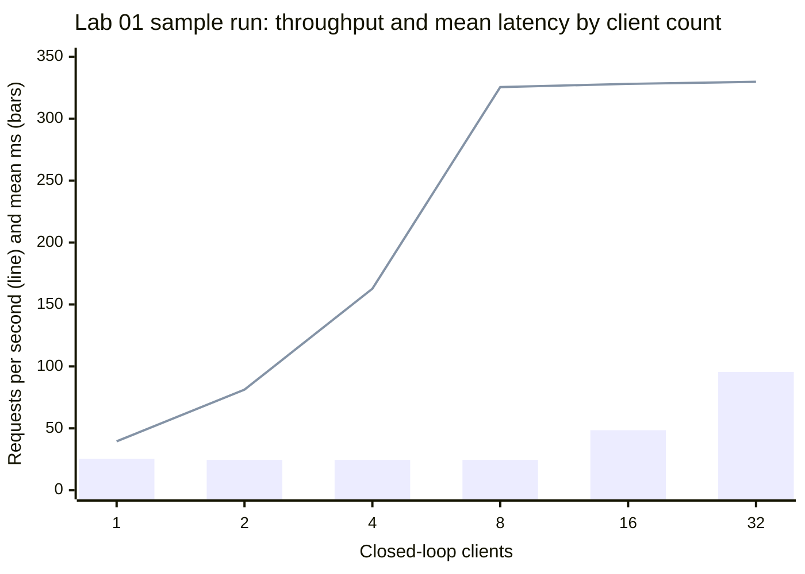

# Lab 01: Measure latency and throughput for a simple HTTP service

!!! abstract "Lab facts"
    **Level:** Beginner · **Time:** 45-60 minutes · **Cost:** Free, local only, Python standard library ·
    **Status:** Draft · **Last verified:** 2026-11-15 (macOS, Python 3.14; CI runs the smoke test on
    Python 3.12)

## Goal and expected result

You will run a small HTTP service whose capacity you control (a fixed number of workers, each taking a
fixed service time per request) and load it with 1 to 32 closed-loop clients. You should see
throughput grow linearly with clients until it hits a plateau equal to workers ÷ service time, after
which adding clients only increases latency. In every row of the results, throughput × mean latency
will equal the number of clients: Little's Law, measured rather than quoted.

## Concepts practiced

- Latency versus throughput versus concurrency, and why they are linked
  ([Performance fundamentals and Little's Law](../performance-and-scalability/performance-fundamentals-and-littles-law.md)).
- Percentiles (p50, p95, p99) and why the tail grows faster than the median under load.
- Saturation and queueing: what a capacity ceiling looks like in measurements.
- Per-instance capacity as an input to [capacity estimation](../performance-and-scalability/capacity-estimation.md).

## Prerequisites

- Knowledge: how to run a Python script from a terminal; what an HTTP request is.
- Completed labs: none. This is the first lab.

## Tools and versions

| Tool | Version tested | Install |
|---|---|---|
| Python | 3.14 locally; 3.12 in CI | <https://www.python.org/downloads/> or your package manager |
| Two terminal windows | any | one for the server, one for the load generator |

No third-party packages. Both scripts use only the standard library.

## Cost and account warnings

!!! warning "Before you start"
    This lab runs entirely on your machine and listens only on `127.0.0.1`. No cloud account, API key,
    or payment is required. It creates no files outside the folder you choose for results.

## Setup

1. Clone or download the repository and open `labs/local/lab-01-latency-and-throughput/`.
2. Check Python: `python3 --version` should print 3.10 or newer.
3. Read the two scripts (about 100 lines each). `server.py` serves `GET /status/<id>` after sleeping
   for a configurable service time, with a semaphore that limits concurrent requests. `loadgen.py`
   runs closed-loop clients and prints throughput, percentiles, and the Little's Law product.

## Exercise

### Step 1 — Start the service

In the first terminal:

```bash
python3 server.py --port 8080 --service-ms 20 --max-workers 8
```

It prints its configuration and waits. Keep it running. The service has a theoretical capacity of
8 workers ÷ 0.020 s = 400 requests per second, before overhead.

### Step 2 — Measure a single client

In the second terminal:

```bash
python3 loadgen.py --url http://127.0.0.1:8080/status/42 --concurrency 1 --duration 3
```

Note the p50 latency. It will be a little above 20 ms; the difference is the fixed overhead of the
HTTP round trip on your machine. Note the throughput: with one client it is roughly 1 ÷ latency.

### Step 3 — Sweep the concurrency

```bash
python3 loadgen.py --url http://127.0.0.1:8080/status/42 --concurrency 1 2 4 8 16 32 --duration 3 --json results.json
```

Watch the per-level lines as they appear, then the summary table. Questions to answer in writing:

1. Up to which client count does throughput grow in proportion to clients?
2. At what throughput does it plateau, and how does that compare to workers ÷ measured service time?
3. What happens to p50, p95, and p99 beyond the plateau? Which grows fastest?
4. Check the last column against the first: does throughput × mean latency equal the client count?

### Step 4 — Change the capacity

Stop the server (Ctrl+C) and restart it with twice the workers:

```bash
python3 server.py --port 8080 --service-ms 20 --max-workers 16
```

Repeat the sweep. Predict the new plateau before you run it. Then try halving the service time
instead (`--service-ms 10 --max-workers 8`) and compare: which change helped latency, which helped
throughput, and which helped both?

### Step 5 — Add variability

Restart with jitter: `--service-ms 20 --jitter-ms 40 --max-workers 8`. Service time is now uniformly
20-60 ms per request. Run the sweep and compare p50 against p99 at 8 and 32 clients with the earlier
run. Variability widens the tail even below saturation.

## Expected output

A run on one laptop (your absolute numbers will differ; the shape should not):

```text
   clients |   requests |     errors |      req/s |    mean ms |     p50 ms |     p95 ms |     p99 ms |     max ms | rps x mean
-----------+------------+------------+------------+------------+------------+------------+------------+------------+-----------
         1 |        139 |          0 |       39.5 |       25.3 |       25.9 |       26.5 |       27.7 |       27.7 |        1.0
         4 |        572 |          0 |      162.7 |       24.6 |       25.0 |       26.6 |       27.1 |       27.9 |        4.0
         8 |       1147 |          0 |      325.5 |       24.5 |       25.0 |       26.5 |       27.4 |       37.4 |       7.96
        16 |       1160 |          1 |      328.1 |       48.5 |       48.9 |       70.8 |       75.4 |      100.2 |      15.92
        32 |       1187 |          0 |      329.8 |       95.5 |       96.7 |      154.1 |      174.0 |      245.1 |      31.51
```

Throughput plateaus at about 330 requests per second (8 workers ÷ roughly 25 ms measured service
time, including overhead). Past that point, doubling the clients doubles the latency and leaves
throughput unchanged.

**Figure 1 — What the sweep shows.** Throughput (clients × 1 ÷ latency) rises until the worker limit,
then flattens; latency is flat until the same point, then rises in proportion to clients.



How to read it: the line is throughput, the bars are mean latency, both from the sample run above;
the knee at 8 clients is the server's worker limit.

## Validation

- Your summary table shows a throughput plateau within about 20% of workers ÷ measured service time.
- The `rps x mean` column is within 10% of the client count on every row (closed-loop property).
- Beyond the plateau, p99 grows faster than p50.
- The automated smoke test passes from the repository root:

```bash
python3 -m unittest tests.examples.test_lab01 -v
```

## Cleanup

Press Ctrl+C in the server terminal. Delete `results.json` if you created it. Nothing else was
created.

## Troubleshooting

| Symptom | Likely cause | Fix |
|---|---|---|
| `Address already in use` | Another process on port 8080 | Use `--port 8081` on both scripts |
| Throughput plateau far below workers ÷ service time | Load generator and server share a few CPU cores; Python overhead dominates | Use fewer clients or a longer `--service-ms` (for example 50) so the sleep dominates |
| One or two errors at a level | A keep-alive connection was reset while reconnecting | Expected occasionally; rerun the level; the count is reported, not hidden |
| p50 much higher than service time even at 1 client | A slow or busy machine, or an antivirus scanning sockets | Rerun; compare ratios between levels rather than absolute values |
| Latency never rises | `--max-workers` larger than the client count | Use more clients or fewer workers |

## Stretch challenge

1. Write an **open-loop** load generator that sends requests at a fixed rate regardless of responses
   (one thread scheduling sends, a pool handling responses). Run it at 80%, 100%, and 120% of the
   measured plateau and watch what happens to latency over a 20-second run. This is what real traffic
   does to an overloaded service.
2. Add a `--timeout-ms` option to the client and count timed-out requests separately. Observe how a
   timeout converts "slow" into "failed" and how that changes the throughput number you report.
3. Replace the sleep in `server.py` with real CPU work (for example hashing a buffer in a loop) and
   compare how the plateau now depends on CPU cores rather than on `--max-workers`.

## Solution and hints

??? question "Hint 1: predicting the plateau"
    Capacity of a closed set of workers is workers ÷ time per request. Use the measured single-client
    latency (not the configured 20 ms) as the time per request, because overhead counts.

??? question "Hint 2: reading the Little's Law column"
    With closed-loop clients, requests in flight are exactly the client count, so L is known and
    throughput × latency must reproduce it. If it does not, your measurement window or timing is
    wrong, not the law.

??? success "Full solution"
    Sample results with commentary are in
    [`labs/solutions/lab-01/expected-results.md`](https://github.com/vinay9354/architecture-atlas/blob/main/labs/solutions/lab-01/expected-results.md)
    in the repository. Summary: latency is flat and throughput linear until clients = workers; the
    plateau equals workers ÷ measured service time; beyond it, latency grows in proportion to clients,
    the tail grows faster than the median, and throughput × mean latency equals clients on every row.

## Simplifications

- Work is a sleep, so the server uses almost no CPU; a real service's capacity would also depend on
  CPU, memory, and downstream calls.
- The client and server share one machine, so the load generator's own overhead appears in the
  latency numbers. Comparing ratios between levels is robust to that; absolute values are not.
- Closed-loop load caps the queue at the number of clients. Production traffic is open-loop, which is
  why overload in production is worse than this lab suggests (see the stretch challenge).

## References

| Source | Type | Checked |
|---|---|---|
| [Python `http.server` documentation](https://docs.python.org/3/library/http.server.html) | Official documentation | 2026-11-15 |
| [Python `http.client` documentation](https://docs.python.org/3/library/http.client.html) | Official documentation | 2026-11-15 |
| Jeffrey Dean and Luiz André Barroso, ["The Tail at Scale"](https://cacm.acm.org/research/the-tail-at-scale/), Communications of the ACM 56(2), 2013 | Paper (tail latency) | 2026-11-15 |
| [The Site Reliability Workbook: Managing Load](https://sre.google/workbook/managing-load/) — Google | Book chapter (free online) | 2026-11-15 |
| [Capacity estimation](../performance-and-scalability/capacity-estimation.md) — this repository | Topic page (Little's Law section) | 2026-11-15 |
