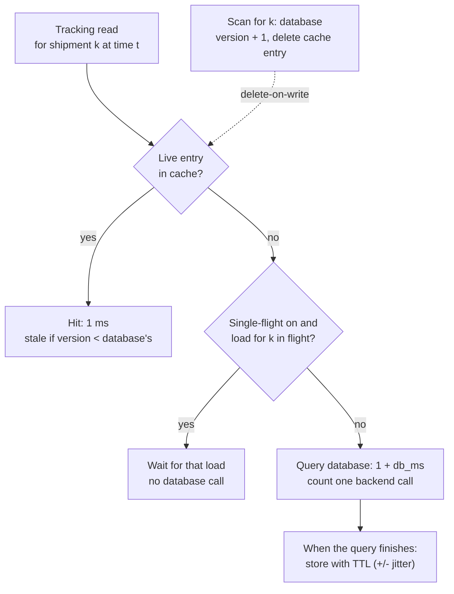
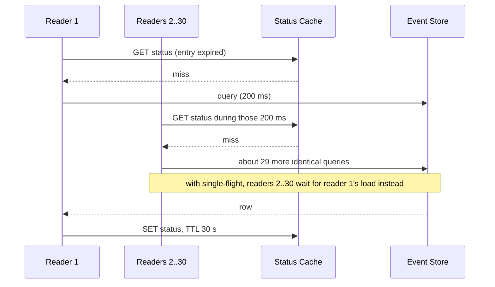

# Lab 02: Add a cache and compare hit/miss behavior

!!! abstract "Lab facts"
    **Level:** Intermediate · **Time:** 45-60 minutes · **Cost:** Free, local only, Python standard
    library · **Status:** Draft · **Last verified:** 2026-11-27 (macOS, Python 3.14 and 3.9; CI runs
    the smoke test on Python 3.12)

## Goal and expected result

You will put a cache-aside layer in front of a simulated Tracking Event Store and replay seeded
AtlasMart workloads through it. The cache has a fixed number of slots, evicts the least recently used
entry, and expires entries after a TTL; the "database" counts simulated milliseconds instead of
sleeping, so ten simulated minutes of traffic replay in about a second and every run with the same
seed prints the same numbers. By the end you should be able to show, from your own output, that the
hit ratio rises with cache size and then stops at a ceiling set by the TTL; that a longer TTL buys
hits and pays for them in stale reads, which delete-on-write almost removes; that one hot key
expiring brings about 30 identical database queries at once unless reads are coalesced; that keys
loaded together expire together unless their TTLs are jittered; and that a hit ratio is enough to
predict database load and average latency.

## Concepts practiced

- Cache-aside, TTL, delete-on-write invalidation, LRU eviction, stampedes, and hot keys from
  [Caching architecture](../databases-and-storage/caching-architecture.md).
- Working set and read rate from [Capacity estimation](../performance-and-scalability/capacity-estimation.md).
- Average latency as a weighted mix of fast and slow paths from
  [Performance fundamentals and Little's Law](../performance-and-scalability/performance-fundamentals-and-littles-law.md).
- Bounded staleness from [Consistency models, CAP, and PACELC](../distributed-systems/consistency-models-cap-and-pacelc.md).

## Prerequisites

- Knowledge: what a cache hit and miss are; reading a short Python program; percentages.
- Completed labs: none required. [Lab 01](lab-01-latency-and-throughput.md) introduces latency
  percentiles, and [Lab 09](lab-09-replication-lag.md) uses the same simulated-clock approach for
  stale reads from replicas.

## Tools and versions

| Tool | Version tested | Install |
|---|---|---|
| Python | 3.14.7 and 3.9.6 locally (identical output); 3.12 in CI | <https://www.python.org/downloads/> or your package manager |
| One terminal window | any | no server, database, or network is involved |

The code uses only the standard library (`collections.OrderedDict`, `heapq`, `bisect`, `random`,
`dataclasses`).

## Cost and account warnings

!!! warning "Before you start"
    This lab runs entirely on your machine, opens no network connections, and needs no cloud
    account, API key, or payment. It writes no files.

## Setup

1. Clone or download the repository and open `labs/local/lab-02-cache-hit-and-miss/`.
2. Check Python: `python3 --version` should print 3.9 or newer.
3. Skim the files. The parts that matter:

| File | What to read |
|---|---|
| `lab02_cache.py` | `LRUCache.get()` (lazy expiry, move to most recently used) and `set()` (evict the least recently used) |
| `lab02_backend.py` | `SimulatedDatabase`: versions per shipment, commit times, and the `busy_ms` counter |
| `lab02_workload.py` | `Zipf` (popularity skew) and the three workloads |
| `lab02_cache_aside.py` | `simulate()`: the read path, delete-on-write, single-flight, and how stale reads are counted |
| `lab02_run.py` | The five experiments and the arithmetic model |

The AtlasMart framing, with lab assumptions labelled:

| Input | Default | Source |
|---|---|---|
| Tracking reads | 210 per second | AtlasMart sale-day design peak |
| Carrier scans (status changes) | 70 per second, uniform over shipments | AtlasMart scan-event peak |
| Status Cache TTL | 30 s, delete-on-write from the Event Processor | AtlasMart design ([caching page](../databases-and-storage/caching-architecture.md)) |
| Cached entry size | 4 KB | Capacity page |
| Shipments in the lab | 50,000 (a sample of the 300,000 in transit) | Lab assumption |
| Popularity | Zipf-like, exponent 1.0 | Lab assumption (a skewed burst: campaign, sale day) |
| Cache hit / database read | 1 ms / 20 ms | Lab assumptions |
| Viral shipment | 150 reads/s, 200 ms database read | Caching page's illustrative hot key; the 200 ms is a lab assumption |
| Campaign | 2,000 customers in 1 s, page refresh every 5 s on average | Lab assumption |

!!! note "Why a skewed workload"
    The [caching page](../databases-and-storage/caching-architecture.md) found that AtlasMart's
    *average* tracking reads (about four per shipment per day, hours apart) cache poorly with a 30 s
    TTL, and that the Status Cache exists for bursts and hot keys. This lab replays the burst case,
    where popularity is skewed, so that cache behavior is visible.

**Figure 1 — The read path this lab simulates.** Single-flight is a switch; the database query takes
`db_ms` of simulated time, and the cache is filled only when it finishes.



How to read it: the gap between "query database" and "store" is where stampedes and the
invalidation race live. A scan that lands inside that gap is deleted from the cache, then overwritten
by the older value when the slow query finishes.

## Exercise

### Step 1 — The cache's rules

```bash
python3 lab02_cache.py
```

Predict before running: in a full two-slot cache holding `SHP-1` and `SHP-2`, where `SHP-1` was just
read, which entry does inserting `SHP-3` evict? Is an entry written at t = 0 with a 30 s TTL still
served at t = 30.0 s? Then explain why an expired entry can still occupy a slot.

### Step 2 — The workload's skew

```bash
python3 lab02_workload.py
```

What share of reads goes to the top 100 shipments (0.2% of keys)? To the top 5,000? Keep the second
number; Step 3 compares it with a hit ratio.

### Step 3 — Hit ratio versus cache size

```bash
python3 lab02_run.py size
```

Seven cache sizes, from 100 slots (0.4 MB) to 50,000 (200 MB), with the AtlasMart TTL and
delete-on-write. Answer in writing:

1. At what size does the hit ratio stop rising, and what is the ceiling?
2. Why is the ceiling below the share of reads that the top 5,000 shipments receive (Step 2)?
3. Why are there still evictions at 10,000 slots, when far fewer distinct shipments are read in any
   30 seconds?
4. How many bytes of cache does it take to reach the ceiling, and how does that compare with the
   Status Cache's 1.8 GB?

### Step 4 — TTL, hit ratio, and stale reads

```bash
python3 lab02_run.py ttl
```

Five TTLs from 1 s to 600 s, first with TTL only (no invalidation), then with delete-on-write. A read
is stale when the cached version is older than the database's; staleness is how long ago the first
missed version was committed.

1. How do hit ratio and stale reads move as the TTL grows? What bounds the maximum staleness?
2. NFR-1 requires a status to be visible within 60 s. Which TTL-only settings break it?
3. What does delete-on-write cost, and why does it not drive stale reads to exactly zero?

### Step 5 — A stampede on one hot key

```bash
python3 lab02_run.py stampede
```

One viral shipment is read 150 times a second for 300 s; its database query takes 200 ms.

**Figure 2 — One expiry without and with single-flight.** Without coalescing, every reader that
arrives during the 200 ms load also misses.



1. How many database queries does each expiry cause without single-flight, and why is it close to
   150 × 0.2?
2. What is the peak number of concurrent identical queries, with and without single-flight?
3. Average latency is lower with single-flight although no read became faster than a hit. Why? Why
   is the worst read 201 ms in both runs?

### Step 6 — Many keys expiring together, and jittered TTL

```bash
python3 lab02_run.py jitter
```

A notification sends 2,000 customers to their own tracking pages within one second; each page
refreshes every 5 s on average. Each customer reads a different shipment, so this is not one hot key.

1. In which second do database reads peak with a fixed 30 s TTL, and why then?
2. What does a ±20% jitter do to the peak, to the total number of database reads, and to the hit
   ratio?
3. Would single-flight help here? Why not?

### Step 7 — From hit ratio to backend load and latency

```bash
python3 lab02_run.py arithmetic
```

The model is: database reads = reads × (1 − hit ratio); average latency = 1 ms + (1 − hit ratio) ×
20 ms.

1. Does the model match the simulation? Why exactly?
2. At AtlasMart's 210 reads/s, what database read rate and average latency correspond to 90% and 99%
   hit ratios? Why do people talk about hit ratios in "nines"?

## Expected output

Every number is deterministic for a seed; your output should match these exactly with the default
seed 2. From a real run, Step 3:

```text
$ python3 lab02_run.py size
Experiment 1: hit ratio vs cache size (Zipf s=1.0 over 50,000 shipments, 210 reads/s, 70 scans/s, TTL 30 s, delete-on-write)
  slots    memory hit ratio backend calls  backend ms  avg ms evictions  stale
    100    0.4 MB     31.2%        86,914   1,738,280   14.77    86,321      0
    500    2.0 MB     47.2%        66,618   1,332,360   11.55    65,189      0
  1,000    4.0 MB     53.6%        58,612   1,172,240   10.28    55,401      1
  2,000    8.0 MB     58.6%        52,264   1,045,280    9.28    44,560      1
  5,000   20.0 MB     60.0%        50,500   1,010,000    9.00    27,746      3
 10,000   40.0 MB     60.0%        50,500   1,010,000    9.00    11,882      3
 50,000  200.0 MB     60.0%        50,500   1,010,000    9.00         0      3
reads: 126,259   scans: 41,832
```

Step 5:

```text
$ python3 lab02_run.py stampede
Experiment 3: one viral shipment, 150 reads/s for 300 s, TTL 30 s, 200 ms database read
single-flight   reads   hits coalesced backend calls peak in flight  avg ms  max ms
off            45,010 44,716         0           294             36    2.31   201.0
on             45,010 44,708       292            10              1    1.68   201.0
loads per expiry without single-flight: 294 / 10 = 29.4
```

Summary of a correct run:

| Check | Result |
|---|---|
| Hit ratio vs size | 31.2% at 100 slots, rising to a 60.0% ceiling from 5,000 slots (20 MB) |
| TTL only, 1 s → 600 s | Hit ratio 30.4% → 82.2%; stale reads 32 → 33,408 (0.03% → 26.46%); max staleness just under the TTL |
| Delete-on-write, same TTLs | Stale reads 0 to 13; hit ratio 79.2% at 600 s |
| Stampede | 294 database calls and 36 in flight without single-flight; 10 and 1 with it |
| Aligned expiry | Peak 317 database reads in one second with a fixed TTL; 162 with ±20% jitter; totals 18,164 and 18,220 |
| Arithmetic | Model and simulation agree; 90% hits at 210 reads/s = 21 database reads/s and 3 ms average |

The full output of every step, with answers, is in the solution file linked below.

## Validation

- Step 3: the hit-ratio column never falls as slots grow, and reaches its ceiling at 5,000 slots.
- Step 4: in the TTL-only rows, both the hit ratio and the stale reads rise with the TTL, and the
  maximum staleness is below the TTL in every row.
- Step 5: backend calls with single-flight equal the number of expiries plus the cold start (10).
- Step 6: jitter lowers the one-second peak while the total stays within about 1%.
- The automated smoke test passes from the repository root:

```bash
python3 -m unittest tests.examples.test_lab02 -v
```

## Cleanup

Nothing keeps running and no files are written. Delete any `__pycache__` folder the run created in
the lab directory if you want a clean tree.

## Troubleshooting

| Symptom | Likely cause | Fix |
|---|---|---|
| Numbers differ from the expected output | A different `--seed` or `--duration`, or edited code | Run with no options; `git diff` the lab folder |
| `ModuleNotFoundError: No module named 'lab02_cache'` | Running from another directory | `cd labs/local/lab-02-cache-hit-and-miss` first |
| `SyntaxError` or `TypeError` on start | Python older than 3.9 | Use Python 3.9 or newer |
| `all` takes more than a few seconds | Slow machine; about twenty simulations, most replaying 168,000 events | Run the experiments one at a time, or pass `--duration 120` |

## Stretch challenge

1. **LFU or FIFO.** Add a `policy` option to `LRUCache` that evicts the least frequently used or the
   oldest entry. Rerun Step 3 with a long TTL (edit `run_size` to pass `ttl_s=3600`). Which policy
   wins at 500 slots, and why does the difference shrink at 5,000?
2. **Serve stale while revalidating.** On a miss for an expired entry, return the old value at once
   and let one reader refresh it. Rerun Step 5: what happens to the 201 ms worst case, and what
   happens to stale reads?
3. **Probabilistic early expiration.** Refresh an entry before its TTL with a probability that grows
   as expiry nears (the Vattani et al. method). Compare it with single-flight on Step 5's workload.
4. **Negative caching.** Add reads for shipment IDs that do not exist (5% of reads) and count how many
   reach the database with and without caching "not found" for 60 s.

## Solution and hints

??? question "Hint 1: why does the hit ratio stop at 60%?"
    A shipment's first read in each 30-second window is always a miss, and every scan deletes its
    entry. Count how many distinct shipments are read within 30 seconds: once the cache holds those,
    more slots only hold expired entries.

??? question "Hint 2: where do stale reads come from with delete-on-write?"
    Look for a database query that starts before a scan and finishes after it. The scan's delete
    happens first; the slow query's older value is stored afterwards and served until the TTL ends.

??? success "Full solution"
    Real output of every step with answers is in
    [`labs/solutions/lab-02/expected-results.md`](https://github.com/vinay9354/architecture-atlas/blob/main/labs/solutions/lab-02/expected-results.md)
    in the repository. Summary: size helps until the cache holds the working set of one TTL window
    (5,000 entries, 20 MB here), then the TTL and invalidations set the ceiling; longer TTLs trade
    staleness for hits and delete-on-write buys most of the freshness back; single-flight turns about
    29 loads per expiry into 1; jitter halves the expiry wave without saving work; and a hit ratio
    predicts database load and mean latency directly.

## Simplifications

- Time is simulated and costs are fixed: a database query always takes `db_ms`, however many run at
  once. A real database slows down under 36 concurrent identical queries, so real stampedes hurt
  more than Step 5 shows.
- One process, one cache, no network: the cache never fails, never times out, and has no per-node
  hot-key limit. Failure handling (fail-open with a concurrency limit) is on the caching page, not
  in this lab.
- Capacity is counted in entries, not bytes; every entry is assumed to be 4 KB.
- Expiry is lazy and LRU is exact. Real engines approximate LRU by sampling and also expire entries
  in the background; their eviction documentation describes how.
- The Zipf exponent, the shipment count, and the campaign shape are lab assumptions chosen to make
  the mechanisms visible, not measurements of AtlasMart traffic.

## References

| Source | Type | Checked |
|---|---|---|
| [Key eviction](https://redis.io/docs/latest/develop/reference/eviction/) — Redis documentation | Official documentation (LRU approximation, policies) | 2026-11-27 |
| A. Vattani, F. Chierichetti, K. Lowenstein, ["Optimal Probabilistic Cache Stampede Prevention"](https://www.vldb.org/pvldb/vol8/p886-vattani.pdf), PVLDB 8(8), 2015 | Paper (early expiration, Stretch 3) | 2026-11-27 |
| R. Nishtala et al., ["Scaling Memcache at Facebook"](https://www.usenix.org/conference/nsdi13/technical-sessions/presentation/nishtala), NSDI 2013 | Paper (leases against stampedes and stale sets) | 2026-11-27 |
| [`singleflight` package](https://pkg.go.dev/golang.org/x/sync/singleflight) — Go | Library documentation (request coalescing in practice) | 2026-11-27 |
| [`collections.OrderedDict`](https://docs.python.org/3/library/collections.html) — Python documentation | Official documentation (`move_to_end`, `popitem(last=False)`) | 2026-11-27 |
| [`random`](https://docs.python.org/3/library/random.html) — Python documentation | Official documentation (seeding, `expovariate`) | 2026-11-27 |

## Review notes

- Executed: every command on this page with Python 3.14.7 and with the macOS system Python 3.9.6
  (byte-identical output), plus `--seed 3` for the size and stampede experiments, and the smoke test.
  Nothing on this page is unexecuted.
- The smoke test asserts relationships only (hit ratio non-decreasing with size, stale reads rising
  with TTL, single-flight cutting backend calls by more than 10×, jitter lowering the peak), using
  120-second runs so it finishes in about a second.
- The 50,000 shipments, Zipf exponent, 1 ms and 20 ms costs, 200 ms hot-key query, and the campaign
  shape are lab assumptions; the 210 reads/s, 70 scans/s, 30 s TTL, and 4 KB entries are existing
  AtlasMart facts.
