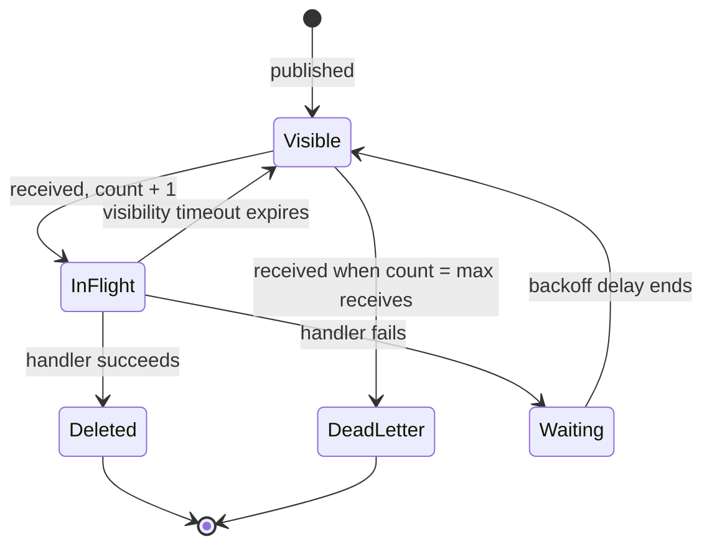

# Lab 03: Simulate a queue with multiple consumers, retries, and a dead-letter queue

!!! abstract "Lab facts"
    **Level:** Intermediate · **Time:** 45-60 minutes · **Cost:** Free, local only, Python standard
    library · **Status:** Draft · **Last verified:** 2026-11-20 (macOS, Python 3.14; CI runs the smoke
    test on Python 3.12)

## Goal and expected result

You will run a small simulation of an at-least-once queue: a backlog of 300 messages, a pool of
competing consumers, a dependency that is down for the first two seconds, a 5% transient failure
rate, and one poison message that can never succeed. Failed messages come back after an exponential
backoff delay, with or without jitter, and a message received too many times moves to a dead-letter
queue (DLQ). Time is simulated, so each run takes milliseconds and gives the same numbers for the same
seed. By the end you should be able to explain, from your own measurements, why retries need jitter,
why the maximum receive count is a business decision, why more consumers can mean more pressure on a
failing dependency, and why a visibility timeout shorter than the processing time creates duplicates.

## Concepts practiced

- Visibility timeouts, acknowledgments (deletes), competing consumers, poison messages, and
  dead-letter queues
  ([Message queues and brokers](../messaging-and-streaming/message-queues-and-brokers.md)).
- Retries with exponential backoff and full jitter, retry synchronization, and retry amplification
  ([Resilience mechanics: timeouts, retries, and backpressure](../distributed-systems/resilience-mechanics-timeouts-retries-and-backpressure.md)).
- At-least-once delivery and why a handler can run twice for one message (Lab 04 shows how to make
  that harmless).
- Percentiles of time-to-process, from [Performance fundamentals and Little's Law](../performance-and-scalability/performance-fundamentals-and-littles-law.md).

## Prerequisites

- Knowledge: how to run a Python script from a terminal; what a message queue is (the first sections
  of [Message queues and brokers](../messaging-and-streaming/message-queues-and-brokers.md) are enough).
- Completed labs: none required. [Lab 01](lab-01-latency-and-throughput.md) helps with percentiles.

## Tools and versions

| Tool | Version tested | Install |
|---|---|---|
| Python | 3.14 locally; 3.12 in CI | <https://www.python.org/downloads/> or your package manager |
| One terminal window | any | the simulation is a single script |

No third-party packages, no network, no broker. The script uses only the standard library.

## Cost and account warnings

!!! warning "Before you start"
    This lab runs entirely on your machine as a single Python process. It opens no network
    connections and needs no cloud account, API key, or payment. It writes no files unless you pass
    `--json`.

## Setup

1. Clone or download the repository and open `labs/local/lab-03-queue-retries-and-dead-letter/`.
2. Check Python: `python3 --version` should print 3.10 or newer.
3. Read `queue_sim.py` (about 250 lines). The docstring lists the model's rules. The two functions
   that matter most are `backoff_delay()` (the retry schedule) and `simulate()` (the event loop:
   consumers receive, process, delete, or fail and reschedule).

The fixed scenario, all of it lab assumptions rather than measurements of any real queue:

| Setting | Default | Meaning |
|---|---|---|
| `--messages` | 300 | backlog published at t = 0, for example a carrier's batch of scan events |
| `--consumers` | 4 | competing consumers |
| `--outage-s` | 2 | the dependency fails every call for the first 2 simulated seconds |
| `--failure-rate` | 0.05 | each later attempt fails with probability 5% |
| `--poison` | 1 | one message fails on every attempt |
| `--process-ms` | 100 | mean processing time (uniform 50-150 ms); a failure fails fast in 10 ms |
| `--slow-rate` | 0.01 | 1% of successful attempts take 1.2-2 times the visibility timeout |
| `--visibility-timeout` | 5 s | how long a received message stays hidden |
| `--max-receives` | 5 | receives allowed before the message goes to the DLQ |
| `--base-backoff`, `--max-backoff` | 1 s, 60 s | retry *n* waits up to 1 × 2^(n-1) s, capped at 60 s |

## Exercise

### Step 1 — Run the default configuration

```bash
python3 queue_sim.py
```

Read the single row. The columns are: `processed` (messages handled successfully at least once),
`retried` (failed attempts that were scheduled to come back), `DLQ` and `DLQ ok msg` (messages in the
dead-letter queue, and how many of those were healthy rather than poison), `duplicates` (successful
runs of the handler beyond the first for the same message), `p50 s` and `p99 s` (time from publish to
first successful processing), `drain s` (when the last message was settled), and `retry peak` (the
most retried messages that became visible again in the same simulated second).

Check that `processed + DLQ = 300`: every message ends up handled or parked, none vanish.

### Step 2 — Compare no jitter with full jitter

```bash
python3 queue_sim.py --jitter none full
```

Without jitter, every message that failed during the outage waits exactly 1 s, then 2 s, then 4 s.
Questions to answer in writing:

1. What is `retry peak` with no jitter, and why is it equal to the whole backlog?
2. Which configuration drains sooner and has the lower p99?
3. Full jitter made *more* retries. Why? (Look at the average delay of a uniform draw between 0 and
   the ceiling.)
4. Did full jitter send any healthy message to the DLQ? Explain how that can happen during an outage.

### Step 3 — Compare a maximum receive count of 1 with 5

```bash
python3 queue_sim.py --max-receives 1 5
python3 queue_sim.py --max-receives 1 5 --outage-s 0
```

Before running, predict how many healthy messages the DLQ will hold with `--max-receives 1` when the
dependency is down for the first two seconds. Then check the second command, without the outage: how
many healthy messages are parked for a 5% transient failure rate, and what happens to `drain s` for
the poison message as the receive limit rises? Try `--max-receives 10` as well.

### Step 4 — Compare one consumer with four

```bash
python3 queue_sim.py --consumers 1 4
```

Compare p50, p99, and drain time. Then compare `retried`: how many more failing calls did four
consumers make against the dependency while it was down, and why?

### Step 5 — Make the visibility timeout too short

```bash
python3 queue_sim.py --consumers 16 --visibility-timeout 0.1 5
```

With a 0.1 s visibility timeout, about half of the 50-150 ms processing runs outlive their lease. The
message reappears, another idle consumer receives it, and the handler runs twice. Compare the
`duplicates` column, and the `DLQ ok msg` column: redeliveries also consume the receive count.

### Step 6 — Change the seed

Repeat Step 2 with `--seed 1` and `--seed 2`. Individual numbers change; the direction of every
comparison should not. Use `--json results.json` if you want the numbers in a file.

## Expected output

A run of Step 2 (deterministic: with the same seed and Python 3.10 or newer, you should see the same
numbers):

```text
messages=300 outage=2.0s failure_rate=0.05 poison=1 process=100ms slow_rate=0.01 backoff=1.0s..60.0s seed=7

 consumers |     jitter |    max rcv |      vis s |  processed |    retried |        DLQ | DLQ ok msg | duplicates |      p50 s |      p99 s |    drain s | retry peak
-----------+------------+------------+------------+------------+------------+------------+------------+------------+------------+------------+------------+-----------
         4 |       none |          5 |        5.0 |        299 |        616 |          1 |          0 |          3 |       6.71 |      17.63 |      37.52 |        300
         4 |       full |          5 |        5.0 |        298 |        742 |          2 |          1 |          3 |       5.64 |      14.09 |      23.23 |        234
```

Without jitter all 300 first retries land in the same simulated second; with full jitter the peak
drops, p99 falls from 17.6 s to 14.1 s, and the queue drains about 14 s sooner.

**Figure 1 — The life of one message in the simulation.** Every message starts visible and ends
either deleted or in the dead-letter queue.



How to read it: the only ways out are success (Deleted) and too many receives (DeadLetter). The
transition to watch is InFlight back to Visible on a timeout, because the first consumer may still be
working when a second consumer receives the same message.

## Validation

- `processed + DLQ` equals `--messages` in every row.
- The poison message is always in the DLQ (`DLQ` minus `DLQ ok msg` is 1).
- `retry peak` is lower with `--jitter full` than with `--jitter none`.
- `--max-receives 1` parks far more healthy messages than `--max-receives 5`.
- Four consumers give a lower p50 and drain time than one consumer.
- The automated smoke test passes from the repository root:

```bash
python3 -m unittest tests.examples.test_lab03 -v
```

## Cleanup

Nothing to stop. Delete `results.json` if you created it.

## Troubleshooting

| Symptom | Likely cause | Fix |
|---|---|---|
| `p50 s` and `p99 s` show `nan` | No message was processed (for example `--max-receives 1` during an outage) | Expected; there is no time-to-process to report |
| Your numbers differ from the sample | Different `--seed`, different defaults, or an edited script | Run with no extra arguments and compare the first row; the simulation is deterministic |
| `processed + DLQ` is greater than `--messages` | A slow handler finished after its message had already been dead-lettered | Rare with the defaults; it is a real at-least-once effect, not a bug |
| `error: argument --jitter: invalid choice` | A typo, or a mode the script does not implement | Use `none` or `full`; adding `equal` is a stretch challenge |
| The run takes more than a second | A very large `--messages` or `--max-receives` | Keep messages in the hundreds or low thousands |

## Stretch challenge

1. Add an `equal` jitter mode (half the ceiling fixed, half random) and a `decorrelated` mode (each
   delay random between the base and three times the previous delay). Compare retry peak, retries, and
   healthy messages in the DLQ against `none` and `full`.
2. Classify failures: treat the poison message as non-retryable and send it to the DLQ on the first
   failure. How much does `drain s` improve with `--max-receives 10`?
3. Add a heartbeat: a consumer that is still working halfway through its lease extends the visibility
   timeout. Rerun Step 5 and check that duplicates disappear without making the timeout long for every
   message.
4. Model the outage as overload instead of a fixed window: the dependency fails any call beyond a
   capacity of *k* calls per 100 ms. Does jitter now change how quickly the queue recovers?

## Solution and hints

??? question "Hint 1: why the no-jitter retry peak equals the backlog"
    During the outage four consumers fail all 300 messages in about 300 × 10 ms ÷ 4 = 0.75 s. Each
    failure is rescheduled exactly 1 s later, so all 300 come back between 1.0 s and 1.75 s: one
    simulated second.

??? question "Hint 2: why more jitter means more retries here"
    Full jitter draws a delay uniformly between zero and the ceiling, so its average is half the
    ceiling. Messages come back sooner, and some come back while the dependency is still down, which
    costs another attempt and another receive.

??? success "Full solution"
    Sample results with commentary are in
    [`labs/solutions/lab-03/expected-results.md`](https://github.com/vinay9354/architecture-atlas/blob/main/labs/solutions/lab-03/expected-results.md)
    in the repository. Summary: without jitter, retries stay synchronized and arrive as a wall; full
    jitter spreads them and drains the backlog sooner, at the cost of more attempts. A receive limit of
    1 turns any transient failure into a parked message; a high limit keeps poison messages cycling
    for minutes. More consumers finish sooner but also hit a failing dependency harder. A visibility
    timeout shorter than processing time produces duplicates and burns receive counts.

## Simplifications

- One process, simulated time, no network, no persistence. A real broker adds network latency,
  partial failures, and its own limits; check your provider's current documentation for those.
- Consumers pick a random visible message, approximating a queue with best-effort ordering; there are
  no message groups or FIFO guarantees.
- A late success deletes the message even if its lease has expired. Some brokers reject a delete with
  a stale receipt handle; either way the handler's side effect has already happened.
- The outage is a fixed window, not a function of load, so the consumer pool (not jitter) is what
  limits pressure on the dependency here. Stretch challenge 4 explores the load-dependent case.
- Failed attempts take 10 ms. Timeouts in a real system usually take much longer and hold the consumer
  for that time.

## References

| Source | Type | Checked |
|---|---|---|
| [Amazon SQS visibility timeout](https://docs.aws.amazon.com/AWSSimpleQueueService/latest/SQSDeveloperGuide/sqs-visibility-timeout.html) — AWS | Official documentation | 2026-11-20 |
| [Amazon SQS dead-letter queues](https://docs.aws.amazon.com/AWSSimpleQueueService/latest/SQSDeveloperGuide/sqs-dead-letter-queues.html) — AWS | Official documentation | 2026-11-20 |
| Marc Brooker, [Exponential backoff and jitter](https://aws.amazon.com/blogs/architecture/exponential-backoff-and-jitter/) — AWS Architecture Blog | Article (simulation of jitter strategies) | 2026-11-20 |
| [Timeouts, retries, and backoff with jitter](https://aws.amazon.com/builders-library/timeouts-retries-and-backoff-with-jitter/) — Amazon Builders' Library | Article | 2026-11-20 |
| [Competing Consumers pattern](https://learn.microsoft.com/en-us/azure/architecture/patterns/competing-consumers) — Azure Architecture Center | Pattern description | 2026-11-20 |
| [Python `heapq` documentation](https://docs.python.org/3/library/heapq.html) | Official documentation (the event loop's priority queue) | 2026-11-20 |
