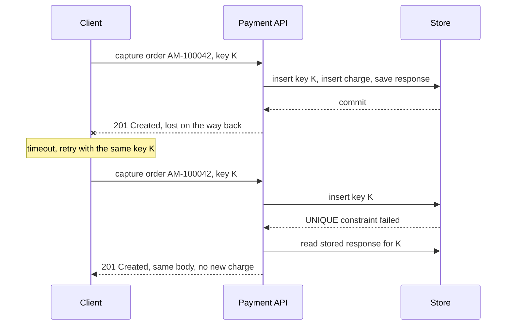

# Lab 04: Demonstrate idempotency and duplicate message handling

!!! abstract "Lab facts"
    **Level:** Intermediate · **Time:** 45-60 minutes · **Cost:** Free, local only, Python standard
    library (sqlite3 in memory) · **Status:** Draft · **Last verified:** 2026-11-20 (macOS, Python 3.14;
    CI runs the smoke test on Python 3.12)

## Goal and expected result

You will run a fictional AtlasMart payment capture API and a client that retries when it does not hear
back. The channel between them always delivers the request but sometimes loses the response, which is
the case that makes retries dangerous: the server did the work, the client cannot know that, and it
asks again. In the first mode you will count double charges. In the second, the client sends an
idempotency key and the server stores the key and its response in the same transaction as the charge;
you should see zero double charges and retries answered with byte-identical copies of the lost
response. In the third, a downstream consumer receives `PaymentCaptured` events with at-least-once
delivery; you will compare a naive consumer, which applies every redelivery, with one that records
each message ID in an inbox table. In every fixed mode it is a database UNIQUE constraint, not
application logic, that rejects the duplicate.

## Concepts practiced

- At-least-once delivery, idempotent consumers, the inbox table, and why exactly-once *processing* is
  built rather than given
  ([Transactions, sagas, and delivery guarantees](../distributed-systems/transactions-sagas-and-delivery-guarantees.md)).
- Idempotency keys on non-idempotent API operations, replayed responses, and rejecting a reused key
  with a different request
  ([API design: REST, GraphQL, gRPC, and async APIs](../application-and-api-architecture/api-design-rest-graphql-grpc-and-async-apis.md)).
- Timeouts and retries: a timeout tells the client nothing about whether the server acted
  ([Resilience mechanics: timeouts, retries, and backpressure](../distributed-systems/resilience-mechanics-timeouts-retries-and-backpressure.md)).
- Using a primary key or UNIQUE constraint as the arbiter
  ([Relational databases and SQL internals](../databases-and-storage/relational-databases-and-sql-internals.md)).

## Prerequisites

- Knowledge: how to run a Python script; basic SQL (`INSERT`, `SELECT`, primary keys); what a retry is.
- Completed labs: none required. [Lab 03](lab-03-queue-retries-and-dead-letter.md) shows where
  duplicate deliveries come from.

## Tools and versions

| Tool | Version tested | Install |
|---|---|---|
| Python | 3.14 locally; 3.12 in CI | <https://www.python.org/downloads/> or your package manager |
| sqlite3 module | the one bundled with Python | nothing to install |

No third-party packages and no database server: every store is an in-memory SQLite database that
disappears when the script exits.

## Cost and account warnings

!!! warning "Before you start"
    This lab runs entirely on your machine as one Python process. No payment provider, network, cloud
    account, or API key is involved; the "charges" are rows in an in-memory table. It writes no files
    unless you pass `--json`.

## Setup

1. Clone or download the repository and open `labs/local/lab-04-idempotency-and-duplicates/`.
2. Check Python: `python3 --version` should print 3.10 or newer.
3. Read `idempotency_sim.py` (about 250 lines). Look first at the two `CREATE TABLE` blocks at the top,
   then at `PaymentService.capture()`, `run_api()`, and `consume()`.

Lab assumptions, chosen for the exercise and not taken from any real system: 1,000 orders; order
amounts between 10.00 and 200.00 currency units; 20% of responses lost; the client makes up to 4
attempts per order; 10% of event deliveries are redelivered later because the consumer committed but
crashed before acknowledging.

## Exercise

### Step 1 — Retry without an idempotency key

```bash
python3 idempotency_sim.py --mode no-key
```

Columns: `requests` sent, `lost resp` (responses dropped on the way back), `gave up` (orders where all
attempts timed out), `charges` (rows in the `charges` table), `double chgd` (orders with more than one
charge), `overcharged` (total charged minus total owed, in currency units), `replays` (stored
responses returned instead of doing the work), `retried ok` (orders that needed a retry and then got a
response), and `identical` (of those, how many received exactly the response that had been lost).

Questions to answer in writing:

1. How does `charges` compare with `requests`, and why?
2. How many orders were charged more than once? Relate the number to the loss rate.
3. The `gave up` orders: was the customer charged? Does the client know?

### Step 2 — Add an idempotency key

```bash
python3 idempotency_sim.py --mode no-key key
```

The same seed gives both modes the same amounts and the same lost responses, so the rows are directly
comparable. Compare `charges`, `double chgd`, `replays`, and `identical`. Read the line printed below
the table: the script reuses one key with a different amount and expects HTTP 422.

### Step 3 — Find the constraint that does the work

Open `idempotency_sim.py` and find `idem_key TEXT PRIMARY KEY`. In `capture()`, follow what happens on
a repeated key: the `INSERT` into `idempotency_keys` raises `sqlite3.IntegrityError` before any charge
is written, and the handler returns the stored response. Then answer: why does the code insert the key
*first* and the charge *second*, inside one transaction, rather than checking `SELECT ... WHERE
idem_key = ?` and inserting afterwards? (Lab 05 shows what goes wrong with check-then-act.)

### Step 4 — Deduplicate redelivered events with an inbox

```bash
python3 idempotency_sim.py --mode inbox
```

Both consumers process the same delivery log. Compare `applied`, `dup dropped`, `double appl` (orders
with more than one payment row), and `ledger total` against `expected`.

### Step 5 — Change the failure rates

```bash
python3 idempotency_sim.py --mode no-key key --max-attempts 1
python3 idempotency_sim.py --mode no-key key --loss-rate 0.5
python3 idempotency_sim.py --mode inbox --redelivery-rate 0.3
```

With one attempt there are no double charges in either mode. What is the cost instead? With a 50%
loss rate, does the key mode still hold? How does the naive ledger error grow with the redelivery
rate?

## Expected output

The default run (deterministic: the same seed gives the same numbers on any machine with Python 3.10
or newer):

```text
orders=1000 loss_rate=0.2 max_attempts=4 redelivery_rate=0.1 seed=11

Payment capture API (client retries on timeout)
        mode |     requests |    lost resp |      gave up |      charges |  double chgd |  overcharged |      replays |   retried ok |    identical
-------------+--------------+--------------+--------------+--------------+--------------+--------------+--------------+--------------+-------------
      no-key |         1238 |          240 |            2 |         1238 |          194 |     25041.73 |            0 |          192 |            0
         key |         1238 |          240 |            2 |         1000 |            0 |          0.0 |          238 |          192 |          192

same key, different amount -> HTTP 422 (refused, not replayed)

PaymentCaptured consumer (at-least-once delivery)
    consumer |       events |   deliveries |      applied |  dup dropped |  double appl | ledger total |     expected
-------------+--------------+--------------+--------------+--------------+--------------+--------------+-------------
       naive |         1000 |         1105 |         1105 |            0 |           97 |    116760.81 |    105671.04
       inbox |         1000 |         1105 |         1000 |          105 |            0 |    105671.04 |    105671.04
```

**Figure 1 — A lost response and a safe retry.** The server finished the work; only the answer was
lost. The retry carries the same key, the key insert fails on the UNIQUE constraint, and the stored
response is returned.



How to read it: without the key, the second request would look new to the server and create a
second charge; with it, the database refuses the duplicate before any money moves.

## Validation

- `no-key`: `charges` equals `requests` and `double chgd` is greater than zero.
- `key`: `charges` equals the number of orders, `double chgd` and `overcharged` are zero, and
  `identical` equals `retried ok`.
- Reusing a key with a different amount returns 422, not a replay.
- `inbox`: `applied` equals `events`, `dup dropped` equals `deliveries - events`, and `ledger total`
  equals `expected`; the naive consumer's total is higher.
- The automated smoke test passes from the repository root:

```bash
python3 -m unittest tests.examples.test_lab04 -v
```

## Cleanup

Nothing to stop: the in-memory databases vanish when the script exits. Delete `results.json` if you
created one with `--json`.

## Troubleshooting

| Symptom | Likely cause | Fix |
|---|---|---|
| Numbers differ from the sample | A different `--seed` or changed defaults | Run with no arguments first and compare |
| `sqlite3.OperationalError: no such table` | The schema string was edited and a table name no longer matches | Restore the `SCHEMA` and `CONSUMER_SCHEMA` blocks from the repository |
| `key` mode shows double charges after your changes | The key insert and the charge are no longer in the same transaction, or the key column lost its primary key | Keep `with self.db:` around both and keep `idem_key TEXT PRIMARY KEY` |
| 422 where you expected a replay | The retry changed the request body (for example a recomputed amount) | A retry must send the same request; build the body once and reuse it |

## Stretch challenge

1. **Concurrent duplicates.** Run two client threads that send the same key at the same moment, each
   with its own connection to a shared database file. Make the second request see an "in progress"
   row and return 409 instead of charging; then make it wait and replay.
2. **Key expiry.** Store a creation time with each key and delete keys older than a retention window.
   What happens to a retry that arrives after its key expired? How long should the window be relative
   to the client's maximum retry time?
3. **Reconciliation.** For the `gave up` orders, add a `GET` by idempotency key so the client can find
   out what happened instead of guessing.
4. **Transactional outbox.** Write the `PaymentCaptured` event into an `outbox` table in the same
   transaction as the charge, and have a relay publish from it. Which duplicates does the outbox
   prevent, and which does the inbox still have to catch?

## Solution and hints

??? question "Hint 1: where the double charges come from"
    Every lost response is followed by a retry. Without a key, each retry is a new charge. With a 20%
    loss rate and up to 4 attempts, about one order in five needs at least one retry.

??? question "Hint 2: why insert first instead of check first"
    Two requests with the same key can both run the `SELECT`, both see nothing, and both charge. The
    `INSERT` against a primary key can succeed for only one of them, and the database guarantees that
    regardless of timing.

??? success "Full solution"
    Sample results with commentary are in
    [`labs/solutions/lab-04/expected-results.md`](https://github.com/vinay9354/architecture-atlas/blob/main/labs/solutions/lab-04/expected-results.md)
    in the repository. Summary: without a key, 240 lost responses produced 238 extra charges on 194
    orders; with a key the same 238 retries became replays and every retried client received exactly
    the response it had missed. The inbox consumer dropped all 105 redeliveries; the naive consumer
    over-recorded payments on 97 orders.

## Simplifications

- One process and one thread: requests with the same key never overlap, so the "in progress" state
  that a real idempotency store needs does not appear (stretch challenge 1 adds it).
- The channel loses only responses. Lost requests are harmless for duplicates (the server never saw
  them) and are left out.
- Keys never expire, and there is no payment provider behind the API; the "charge" is a row.
- The inbox table grows forever. A real one needs a retention policy longer than the broker's longest
  possible redelivery delay.
- The inbox row and the side effect share one SQLite transaction. When the side effect is in another
  system (an email, a call to a provider), this guarantee is gone and you need that system's own
  idempotency key.

## References

| Source | Type | Checked |
|---|---|---|
| [Making retries safe with idempotent APIs](https://aws.amazon.com/builders-library/making-retries-safe-with-idempotent-APIs/) — Amazon Builders' Library | Article | 2026-11-20 |
| [The Idempotency-Key HTTP header field](https://datatracker.ietf.org/doc/draft-ietf-httpapi-idempotency-key-header/) — IETF HTTPAPI working group | Internet-Draft | 2026-11-20 |
| [RFC 9110: HTTP Semantics](https://www.rfc-editor.org/rfc/rfc9110) (section 9.2.2, idempotent methods) | Standard | 2026-11-20 |
| [Pattern: Idempotent Consumer](https://microservices.io/patterns/communication-style/idempotent-consumer.html) — Chris Richardson, microservices.io | Pattern description | 2026-11-20 |
| [Pattern: Transactional outbox](https://microservices.io/patterns/data/transactional-outbox.html) — Chris Richardson, microservices.io | Pattern description | 2026-11-20 |
| [Python `sqlite3` documentation](https://docs.python.org/3/library/sqlite3.html) | Official documentation | 2026-11-20 |
| Martin Kleppmann, *Designing Data-Intensive Applications*, O'Reilly, 2017 (chapter 11, "Stream Processing", on idempotence and exactly-once) | Book | 2026-11-20 |
