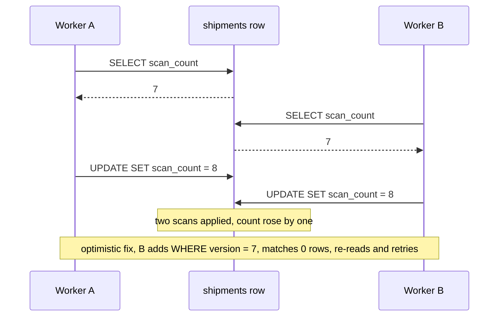

# Lab 05: Reproduce a race condition and fix it with synchronization

!!! abstract "Lab facts"
    **Level:** Beginner · **Time:** 45-60 minutes · **Cost:** Free, local only, Python standard library
    (threading, sqlite3) · **Status:** Draft · **Last verified:** 2026-11-20 (macOS, Python 3.14; CI
    runs the smoke test on Python 3.12)

## Goal and expected result

You will cause the most common concurrency bug, the lost update, twice: once in memory, with threads
incrementing a shared counter, and once in a database, with two workers applying carrier scan events
to the same AtlasMart shipment row. Both follow the same shape: read a value, compute a new one, write
it back, with a gap in between during which another worker's write can land and then be overwritten.
You should see thousands of increments disappear in Part A and half of the scan events disappear in
Part B. Then you will close the gap three ways (a lock, an optimistic version check, and a single
atomic statement) and see every result come out exact.

## Concepts practiced

- Race conditions, critical sections, mutual exclusion with a lock, and why a passing test does not
  prove a race is absent
  ([Programming paradigms and concurrency](../foundations/programming-paradigms-and-concurrency.md)).
- The lost update anomaly, optimistic concurrency control with a version column, and atomic
  read-modify-write in SQL
  ([Relational databases and SQL internals](../databases-and-storage/relational-databases-and-sql-internals.md)).
- Check-then-act versus a single conditional write, which is also how the idempotency key in
  [Lab 04](lab-04-idempotency-and-duplicates.md) stays safe.

## Prerequisites

- Knowledge: how to run a Python script; what a thread is; basic SQL (`SELECT`, `UPDATE ... WHERE`).
- Completed labs: none required.

## Tools and versions

| Tool | Version tested | Install |
|---|---|---|
| Python | 3.14 locally; 3.12 in CI | <https://www.python.org/downloads/> or your package manager |
| sqlite3 module | the one bundled with Python (SQLite 3.53 on the test machine) | nothing to install |

No third-party packages and no database server.

## Cost and account warnings

!!! warning "Before you start"
    This lab runs entirely on your machine. No network, cloud account, or API key is involved. Part B
    creates a small SQLite file inside a new temporary directory and deletes the directory when each
    mode finishes. Nothing else is written unless you pass `--json`.

## Setup

1. Clone or download the repository and open `labs/local/lab-05-race-condition/`.
2. Check Python: `python3 --version` should print 3.10 or newer.
3. Read `counter_race.py` (Part A) and `shipment_race.py` (Part B), about 150 lines each. In Part A
   find `racy_worker()` and `locked_worker()`; in Part B find the three `apply_scan_*` functions.

Both scripts put `time.sleep(0)` between the read and the write. It does no work; it asks the
interpreter to let another thread run. Under CPython's global interpreter lock (GIL) the race exists
without it but shows up rarely, which is exactly what makes real races dangerous. The forced yield
makes the bug visible in every run so you can study it.

## Exercise

### Step 1 — Lose updates with threads

```bash
python3 counter_race.py
```

Four threads each increment the counter 2,000 times, so the right answer is 8,000. Run it three or
four times. Questions to answer in writing:

1. How many updates were lost in the racy mode, and is the number the same every run?
2. What does the locked mode do differently, and what does it cost?

### Step 2 — Remove the yield

```bash
python3 counter_race.py --mode racy --no-yield --increments 200000
```

This is the same racy code without the forced yield, with 100 times more increments. Did you lose any
updates? Is the code now correct? Write down what this means for a unit test that runs the racy code
once and checks the total.

### Step 3 — Replay a race deterministically

```bash
python3 counter_race.py --engine sim
python3 counter_race.py --engine sim --threads 2 --mode racy --seed 1
```

The `sim` engine does not use real threads. A seeded scheduler (`random.Random(--seed)`) picks which
logical thread takes its next step (a read or a write), so the same seed always gives the same
interleaving and the same result. Read the printed trace of the first lost update and identify which
thread's write was overwritten. Try a few seeds.

### Step 4 — Lose updates in a database row

```bash
python3 shipment_race.py
```

Two workers, each with its own SQLite connection, apply 300 scan events each to shipment `SHP-0001`.
Every scan must add one to `scan_count`. Compare the three modes:

- `racy`: `SELECT scan_count`, then `UPDATE ... SET scan_count = ?` with the value computed in Python.
- `optimistic`: the same read, but `UPDATE ... SET scan_count = ?, version = version + 1 WHERE
  shipment_id = ? AND version = ?`. If no row changed, another worker got there first: re-read and
  retry. The `retries` column counts those conflicts.
- `atomic`: `UPDATE ... SET scan_count = scan_count + 1`, one statement with no gap.

### Step 5 — Add workers

```bash
python3 shipment_race.py --workers 4
```

Predict the racy `scan_count` before you run it. Then compare `retries` for the optimistic mode with
two and four workers.

## Expected output

Part B on one laptop (real threads, so your exact numbers can differ; the racy mode should lose
updates and the other two should be exact):

```text
workers=2 scans/worker=300 sqlite=3.53.4 seed=5

      mode |    workers |   expected | scan_count |       lost |    retries | elapsed ms
-----------+------------+------------+------------+------------+------------+-----------
      racy |          2 |        600 |        300 |        300 |          0 |       56.5
optimistic |          2 |        600 |        600 |          0 |          1 |       53.4
    atomic |          2 |        600 |        600 |          0 |          0 |       55.0
```

**Figure 1 — How the database loses an update.** Both workers read the same count before either
writes, so the second write replaces the first instead of adding to it.



How to read it: the bug is not in either statement but in the gap between them. The optimistic fix
detects the overlap at write time; the atomic fix removes the gap by doing the arithmetic inside the
`UPDATE`.

## Validation

- Part A: the racy row shows lost updates greater than zero; the locked row shows exactly
  `threads × increments`.
- Part A `sim` engine: the same seed prints the same table and trace every time.
- Part B: `racy` loses updates; `optimistic` and `atomic` report `scan_count` equal to `expected`.
- No `lab05-` directory is left in your system's temporary folder after the script ends.
- The automated smoke test passes from the repository root:

```bash
python3 -m unittest tests.examples.test_lab05 -v
```

## Cleanup

Nothing to do: each Part B mode deletes its temporary directory when it finishes, including after an
error. Delete `results.json` if you created one with `--json`.

## Troubleshooting

| Symptom | Likely cause | Fix |
|---|---|---|
| The racy counter loses nothing | The forced yield was removed, or the machine is very busy and scheduling changed | Check you did not pass `--no-yield`; raise `--increments`; use `--engine sim` for a guaranteed reproduction |
| `sqlite3.OperationalError: database is locked` | Many workers and a slow disk, so a writer waited longer than the busy timeout | Use fewer `--workers`; the timeout is 30 s and the default run needs well under a second |
| Racy loses exactly half (or three quarters with 4 workers) every run | The workers fell into lockstep: all read, then all write | Expected on many machines; see the solution notes |
| Optimistic mode reports very few retries | Once one conflict knocks the workers out of lockstep, they rarely overlap again | Expected; try `--workers 4` for more conflicts |
| A `lab05-` folder remains in the temp directory | The process was killed with `kill -9` before cleanup ran | Delete the folder by hand; normal exit and Ctrl+C both clean up |

## Stretch challenge

1. **Pessimistic locking.** Add a fourth Part B mode that runs `BEGIN IMMEDIATE`, reads, writes, and
   commits. Compare its elapsed time and retries with the optimistic mode as you add workers.
2. **Bounded retries.** Give the optimistic mode a maximum number of attempts and report how many
   scans fail under contention with 8 workers. What should a real event processor do with them?
3. **Deadlock.** In Part A, give each thread two locks and acquire them in opposite orders in two
   threads. Reproduce the hang with a timeout on `acquire()`, then fix it with a global lock order.
4. **No GIL.** If you have a free-threaded Python build (3.13t or later), run Step 2 again and
   compare.

## Solution and hints

??? question "Hint 1: why the lock fixes Part A"
    The read, the yield, and the write all happen while the thread holds the lock. Another thread can
    still be scheduled during the yield, but it blocks at `with lock:` until the first thread has
    written, so it always reads the latest value.

??? question "Hint 2: why the version check fixes Part B"
    `WHERE version = ?` turns "write the value I computed" into "write it only if nothing changed
    since I read". The database evaluates the condition and the write as one statement, so two workers
    cannot both succeed with the same version.

??? success "Full solution"
    Sample results with commentary are in
    [`labs/solutions/lab-05/expected-results.md`](https://github.com/vinay9354/architecture-atlas/blob/main/labs/solutions/lab-05/expected-results.md)
    in the repository. Summary: the racy modes lose large, varying numbers of updates (in Part B often
    exactly (workers − 1) ÷ workers of them, because the workers move in lockstep); the lock, the
    version check, and the atomic update are exact on every run. Removing the forced yield hid the race
    without fixing it.

## Simplifications

- The forced yield widens the race window far beyond what normal code has. Real races are rarer per
  operation and much harder to reproduce, which makes them worse, not better.
- Part A relies on CPython's GIL for the "no yield, no visible race" observation. Other interpreters
  and free-threaded builds schedule differently.
- Part B uses SQLite in autocommit mode with write-ahead logging and `synchronous = OFF` for speed. A
  client-server database such as PostgreSQL has the same lost-update problem under its default
  isolation level for this read-then-write pattern, and the same two fixes; its locking details differ.
- Real event processors also need idempotency (Lab 04) and per-shipment ordering; this lab isolates the
  concurrency problem.

## References

| Source | Type | Checked |
|---|---|---|
| Remzi and Andrea Arpaci-Dusseau, [Concurrency: An Introduction](https://pages.cs.wisc.edu/~remzi/OSTEP/threads-intro.pdf), *Operating Systems: Three Easy Pieces* | Book chapter (free online) | 2026-11-20 |
| Remzi and Andrea Arpaci-Dusseau, [Locks](https://pages.cs.wisc.edu/~remzi/OSTEP/threads-locks.pdf), *Operating Systems: Three Easy Pieces* | Book chapter (free online) | 2026-11-20 |
| [Python `threading` documentation](https://docs.python.org/3/library/threading.html) | Official documentation | 2026-11-20 |
| [Isolation in SQLite](https://www.sqlite.org/isolation.html) — SQLite | Official documentation | 2026-11-20 |
| [PostgreSQL: Transaction isolation](https://www.postgresql.org/docs/current/transaction-iso.html) | Official documentation | 2026-11-20 |
| Martin Fowler, [Optimistic Offline Lock](https://martinfowler.com/eaaCatalog/optimisticOfflineLock.html) — *Patterns of Enterprise Application Architecture* catalog | Pattern description | 2026-11-20 |
| Martin Kleppmann, *Designing Data-Intensive Applications*, O'Reilly, 2017 (chapter 7, "Transactions", preventing lost updates) | Book | 2026-11-20 |
