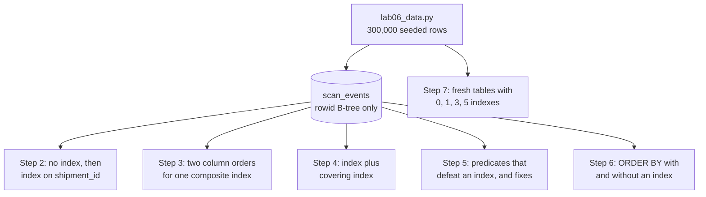

# Lab 06: Database indexing and query plans

!!! abstract "Lab facts"
    **Level:** Intermediate · **Time:** 45-60 minutes · **Cost:** Free, local only, Python standard
    library (`sqlite3`); optional PostgreSQL appendix, not executed · **Status:** Draft ·
    **Last verified:** 2026-11-27 (macOS, Python 3.14, SQLite 3.53; CI runs the smoke test on
    Python 3.12)

## Goal and expected result

You will generate an AtlasMart-like `scan_events` table (37,500 shipments × 8 carrier scans =
300,000 rows, seeded, in memory, in about a second) and ask SQLite how it would run a series of
queries with `EXPLAIN QUERY PLAN`, before and after creating indexes. By the end you should be able
to show from your own output: a full scan turning into an index search; why the equality column goes
first in a composite index; a covering index that never visits the table; two predicates that make
the planner ignore an index, and their fixes; an `ORDER BY` answered by an index instead of a
temporary B-tree; and the write and storage cost of every extra index. You compare times as ratios,
because absolute times depend on the machine.

## Concepts practiced

- B-tree indexes, composite column order, covering indexes, selectivity, and reading plans from
  [Relational databases and SQL internals](../databases-and-storage/relational-databases-and-sql-internals.md).
- Index and partition design for the Tracking Event Store from
  [Advanced database architecture](../databases-and-storage/advanced-database-architecture.md).
- Measuring medians and comparing ratios from
  [Performance fundamentals and Little's Law](../performance-and-scalability/performance-fundamentals-and-littles-law.md).

## Prerequisites

- Knowledge: basic SQL (`SELECT`, `WHERE`, `ORDER BY`, `CREATE INDEX`); reading a short Python
  program.
- Completed labs: none required. [Lab 01](lab-01-latency-and-throughput.md) introduces latency
  measurement.

## Tools and versions

| Tool | Version tested | Install |
|---|---|---|
| Python | 3.14 locally; 3.12 in CI | <https://www.python.org/downloads/> or your package manager |
| SQLite | 3.53 (the library bundled with Python; check with `python3 -c "import sqlite3; print(sqlite3.sqlite_version)"`) | Comes with Python |
| PostgreSQL (optional appendix only) | Not executed | <https://www.postgresql.org/download/> |

## Cost and account warnings

!!! warning "Before you start"
    Everything runs on your machine, in memory. No cloud account, API key, network access, or
    payment is needed, and nothing is written to disk. A full run uses a few hundred megabytes of
    memory for under a minute.

## Setup

1. Clone or download the repository and open `labs/local/lab-06-indexing-and-query-plans/`.
2. Check Python: `python3 --version` should print 3.10 or newer.
3. Skim the two files:

| File | What to read |
|---|---|
| `lab06_data.py` | `SCHEMA` (one table, no addresses or customer data) and `generate()` (8 scans per shipment over a 180-day window) |
| `lab06_plans.py` | `plan()` (runs `EXPLAIN QUERY PLAN`), `bench()` (median time per query), and one `step_*` function per exercise step |

**Figure 1 — What each step changes.** Every step starts from the bare table, creates only the
indexes it needs, prints the plan, and times the query.



How to read it: steps 2-6 reuse one in-memory table and drop their indexes when they finish; step 7
inserts the same rows into new tables to compare write cost.

## Exercise

Run every step at once with `python3 lab06_plans.py`, or one at a time with `--step N` (each run
rebuilds the data first). Before each step, write down the plan you expect.

### Step 1 — Look at the data

```bash
python3 lab06_data.py
python3 lab06_plans.py --step 1
```

Note the row count, the date range, and the table size in pages. `event_id` is an `INTEGER PRIMARY
KEY`, which in SQLite is the rowid: the table itself is a B-tree keyed by it, and it is the only
index at this point.

### Step 2 — Full scan versus index search

```bash
python3 lab06_plans.py --step 2
```

The query is "all events for shipment 1042". Read the two plans: `SCAN scan_events` reads every row;
`SEARCH scan_events USING INDEX idx_ship (shipment_id=?)` descends the index and reads only the
matches. How many times faster is the search on your machine? Why would the ratio grow if the table
were ten times larger?

### Step 3 — Composite index column order

```bash
python3 lab06_plans.py --step 3
```

The query counts carrier 7's scans in the last seven days: an equality on `carrier_id` and a range
on `received_at`. It runs once with only `(received_at, carrier_id)` and once with only
`(carrier_id, received_at)`. Compare the part in brackets: `(received_at>?)` against
`(carrier_id=? AND received_at>?)`. Then compare the "index entries walked" line. Which order lets
the search stop at the first entry that no longer matches?

### Step 4 — Covering index

```bash
python3 lab06_plans.py --step 4
```

The query returns `received_at` and `status` for the same carrier and week. With
`(carrier_id, received_at)` the plan says `USING INDEX`: each match costs a second lookup in the table
to fetch `status`. With `(carrier_id, received_at, status)` it says `USING COVERING INDEX`: the index
alone answers. What does the covering index cost you in exchange?

### Step 5 — Indexes the planner cannot use

```bash
python3 lab06_plans.py --step 5
```

Six queries, with indexes on `received_at` and `carrier_event_id` present throughout:

1. `date(received_at) = ?` — a function wrapped around the indexed column.
2. The same day as a range on the bare column.
3. `LIKE '%00000420'` — a leading wildcard.
4. `LIKE 'C07-0000042%'` — a prefix, which you might expect to use the index.
5. `GLOB 'C07-0000042*'` — the same prefix with a case-sensitive operator.
6. Query 1 again after creating an index on the expression `date(received_at)`.

Explain each `SCAN` in one sentence. Query 4 is SQLite-specific: its `LIKE` ignores case by default,
and the index is in case-sensitive (binary) order, so the planner cannot turn the prefix into a
range (see the SQLite optimizer overview in the references).

### Step 6 — ORDER BY from an index versus a temporary B-tree

```bash
python3 lab06_plans.py --step 6
```

First "the latest 20 events" with and without an index on `received_at`; then one shipment's
timeline ordered by `occurred_at`, with an index on `(shipment_id)` and then on
`(shipment_id, occurred_at)`. Which plans contain `USE TEMP B-TREE FOR ORDER BY`? Why does the index
make the latest-20 query hundreds of times faster but the timeline query only slightly faster?

### Step 7 — The write cost of extra indexes

```bash
python3 lab06_plans.py --step 7
```

The same 300,000 rows are inserted into new tables carrying 0, 1, 3, and 5 secondary indexes (the
best of three runs is reported). Look at both ratios, time and pages. Which index from the list
would you drop first if the write rate became the problem, and what query would you lose?

## Expected output

Times differ on every machine; plans, row counts, and page counts do not (the data is seeded and
SQLite has no statistics until `ANALYZE` runs). From a real run on the author's machine:

```text
== Step 3 - composite index column order ==

  [only index idx_recv_carrier (received_at, carrier_id)]
  SQL: SELECT count(*) FROM scan_events WHERE carrier_id = ? AND received_at >= ?   params (7, '2026-11-17 00:00:00')
    plan: SEARCH scan_events USING COVERING INDEX idx_recv_carrier (received_at>?)
    rows 1   median 491.2 us per query

  [only index idx_carrier_recv (carrier_id, received_at)]
  SQL: SELECT count(*) FROM scan_events WHERE carrier_id = ? AND received_at >= ?   params (7, '2026-11-17 00:00:00')
    plan: SEARCH scan_events USING COVERING INDEX idx_carrier_recv (carrier_id=? AND received_at>?)
    rows 1   median 27.0 us per query

  index entries walked: range column first 8,794, equality column first 863
  equality-first is 18.2x faster on this machine
```

Summary of a correct run (times from the author's machine):

| Step | Plan before | Plan after | Ratio observed |
|---|---|---|---|
| 2 Lookup by shipment | `SCAN scan_events` | `SEARCH ... USING INDEX idx_ship (shipment_id=?)` | Search about 875× faster |
| 3 Column order | `(received_at>?)`, 8,794 entries walked | `(carrier_id=? AND received_at>?)`, 863 walked | About 18× faster |
| 4 Covering | `USING INDEX idx_carrier_recv` | `USING COVERING INDEX idx_carrier_recv_status` | About 1.6× faster for 863 rows |
| 5 Function on column | `SCAN` | Range: `SEARCH ... (received_at>? AND received_at<?)`; expression index: `(<expr>=?)` | Range about 13× faster |
| 5 Leading wildcard, prefix `LIKE` | `SCAN` | Prefix `GLOB`: `SEARCH ... (carrier_event_id>? AND carrier_event_id<?)` | — |
| 6 Latest 20 | `SCAN` + `USE TEMP B-TREE FOR ORDER BY` | `SCAN scan_events USING INDEX idx_recv` | About 670× faster |
| 6 Timeline of 8 rows | `SEARCH` + `USE TEMP B-TREE FOR ORDER BY` | `SEARCH ... USING INDEX idx_ship_time` | 9.6 µs against 7.1 µs |
| 7 Five secondary indexes | 0.35 s, 6,285 pages | 1.77 s, 17,705 pages | About 5× the insert time, 2.8× the pages |

The full output is in the solution file linked below.

## Validation

- Every plan in your output matches the "Plan" columns above (the detail text can differ slightly in
  much older SQLite versions, which printed `SCAN TABLE`).
- You can say, for each `SCAN` in Step 5, why the index was not usable and which fix applies.
- Step 7's time and page ratios rise with the number of indexes.
- The automated smoke test passes from the repository root (it uses 20,000 rows and checks plans and
  relationships, never absolute times):

```bash
python3 -m unittest tests.examples.test_lab06 -v
```

## Cleanup

Nothing to clean up: the database lives in memory and disappears when the script exits.

## Troubleshooting

| Symptom | Likely cause | Fix |
|---|---|---|
| A plan does not change after `CREATE INDEX` or `DROP INDEX` in your own experiments | Python's `sqlite3` caches prepared statements per connection, and a cached `EXPLAIN QUERY PLAN` statement keeps the plan it was prepared with | Use the lab's `plan()` helper (it makes each statement unique), or connect with `cached_statements=0` |
| Times vary a lot between runs | Other work on the machine; very short queries | Compare ratios; raise `--budget` for more repetitions |
| Plans show `SCAN TABLE scan_events` | An SQLite older than 3.36 | Same meaning as `SCAN scan_events` |
| A full run feels slow | The full scans in Steps 2, 5, and 6 repeat for 0.3 s each | Use `--shipments 5000` or a single `--step` |
| `SyntaxError` on start | Python older than 3.10 | Use Python 3.10 or newer |

## Stretch challenge

1. **Statistics.** Run `ANALYZE` after creating both indexes from Step 3 at once, and check which one
   the planner picks with and without statistics.
2. **Partial index.** Create an index on `shipment_id` with `WHERE status = 'out_for_delivery'` and
   find a query whose plan uses it.
3. **Write path.** Change Step 7 to insert rows one per transaction, as a webhook processor would
   without batching, and compare the ratios with the batched insert.
4. **Your own query.** Write the support query "shipments with no scan in 48 hours for carrier 7"
   and design the smallest index set that avoids a full scan.

## Solution and hints

??? question "Hint 1: why does column order matter in Step 3?"
    In `(received_at, carrier_id)` the entries are sorted by time first, so every carrier's scans
    for the week are interleaved; the search must walk all of them and filter. In
    `(carrier_id, received_at)` carrier 7's entries are contiguous and sorted by time, so the search
    starts at carrier 7's first entry in the week and stops at its last.

??? question "Hint 2: why is the timeline sort cheap but the latest-20 sort expensive?"
    The temporary B-tree sorts only the rows that reach it: 8 rows for one shipment, but every row
    in the table for "latest 20" without an index, because the engine cannot know which 20 are
    newest until it has seen them all.

??? success "Full solution"
    Real output of every step with commentary is in
    [`labs/solutions/lab-06/expected-results.md`](https://github.com/vinay9354/architecture-atlas/blob/main/labs/solutions/lab-06/expected-results.md)
    in the repository. Summary: indexes turn scans into searches; put the equality column before the
    range column; covering indexes skip the table at the cost of a wider index; wrap no function
    around an indexed column (rewrite as a range or index the expression); leading wildcards cannot
    use a B-tree; an index in the requested order removes the sort; and each index adds write time
    and pages.

## Appendix: the same ideas in PostgreSQL (optional, not executed)

PostgreSQL's `EXPLAIN` prints a tree of plan nodes with cost estimates, and `EXPLAIN (ANALYZE,
BUFFERS)` runs the query and adds actual rows, times, and pages touched (see its documentation in
the references). The node names differ from SQLite's: `Seq Scan` for a full scan, `Index Scan`,
`Index Only Scan` for a covering read (which also depends on the visibility map, so recently changed
pages still visit the table), `Bitmap Heap Scan` for many matches, and `Sort` where SQLite says
`USE TEMP B-TREE`. Its planner uses statistics that autovacuum keeps current, so plans can change as
data grows, unlike this lab's statistics-free SQLite.

```sql
-- Equivalent statements; not executed by the author.
CREATE INDEX idx_carrier_recv ON scan_events (carrier_id, received_at);
CREATE INDEX idx_carrier_recv_status ON scan_events (carrier_id, received_at) INCLUDE (status);
CREATE INDEX idx_recv_day ON scan_events (((received_at AT TIME ZONE 'UTC')::date));
CREATE INDEX idx_carrier_event_prefix ON scan_events (carrier_event_id text_pattern_ops);
EXPLAIN (ANALYZE, BUFFERS)
SELECT received_at, status FROM scan_events
WHERE carrier_id = 7 AND received_at >= '2026-11-17';
```

!!! note "Not executed"
    The author had no PostgreSQL server in the lab environment. The `INCLUDE` clause adds non-key
    columns to a B-tree index for index-only scans; `text_pattern_ops` lets a B-tree serve
    `LIKE 'prefix%'` when the database collation is not `C`; an expression index must use
    immutable functions, which is why the example casts with an explicit time zone. Expected, not
    observed: `Index Only Scan` for the covering query after a `VACUUM`, and `Index Scan` or
    `Bitmap Heap Scan` for the others.

## Simplifications

- SQLite runs in-process with the whole table in memory, so there is no disk I/O, no network, and no
  concurrency; real databases pay for every page read from disk, which widens the gap between scans
  and searches.
- No `ANALYZE` runs, so the planner chooses from index structure alone; production planners use
  statistics and may prefer a scan when a predicate matches much of the table.
- The data is a scaled-down sample (about 1,700 events a day against AtlasMart's 480,000), with
  uniform carriers and no hot shipments.
- Step 7 inserts in one batched transaction; per-event commits would add a log flush per row.

## References

| Source | Type | Checked |
|---|---|---|
| [The EXPLAIN QUERY PLAN Command](https://www.sqlite.org/eqp.html) — SQLite | Official documentation (plan output, covering index, temp B-tree) | 2026-11-27 |
| [Query Planning](https://www.sqlite.org/queryplanner.html) — SQLite | Official documentation (how indexes, covering indexes, and sorting work) | 2026-11-27 |
| [The SQLite Query Optimizer Overview](https://www.sqlite.org/optoverview.html) — SQLite | Official documentation (LIKE and GLOB optimization rules) | 2026-11-27 |
| [Indexes On Expressions](https://www.sqlite.org/expridx.html) — SQLite | Official documentation | 2026-11-27 |
| [`sqlite3` — DB-API 2.0 interface for SQLite databases](https://docs.python.org/3/library/sqlite3.html) — Python documentation | Official documentation (`cached_statements`) | 2026-11-27 |
| [Using EXPLAIN](https://www.postgresql.org/docs/current/using-explain.html) — PostgreSQL documentation | Official documentation | 2026-11-27 |
| [Index-Only Scans and Covering Indexes](https://www.postgresql.org/docs/current/indexes-index-only-scans.html) — PostgreSQL documentation | Official documentation (`INCLUDE`, visibility map) | 2026-11-27 |
| Markus Winand, [Use The Index, Luke](https://use-the-index-luke.com/) | Free online book (SQL indexing) | 2026-11-27 |

## Review notes

- Executed: `lab06_data.py`, every step of `lab06_plans.py` at 300,000 rows (Python 3.14.7, SQLite
  3.53.4, macOS), and the smoke test. Not executed: the PostgreSQL appendix; its plans are expected,
  not observed.
- The smoke test's plan regex accepts `SCAN TABLE` for SQLite releases before 3.36; CI's Python 3.12
  links the runner's system SQLite, so a reviewer should confirm the first CI run.
- The statement-cache behaviour in Troubleshooting was observed while writing the lab: a cached
  `EXPLAIN QUERY PLAN` statement reported a dropped index; `plan()` works around it and the smoke test
  covers it.
- Lab assumptions: shipment 1042, carrier 7, the week from 2026-11-17, the day 2026-11-20, the five
  indexes in Step 7, and the 37,500-shipment default; no customer data or addresses (NFR-6).
