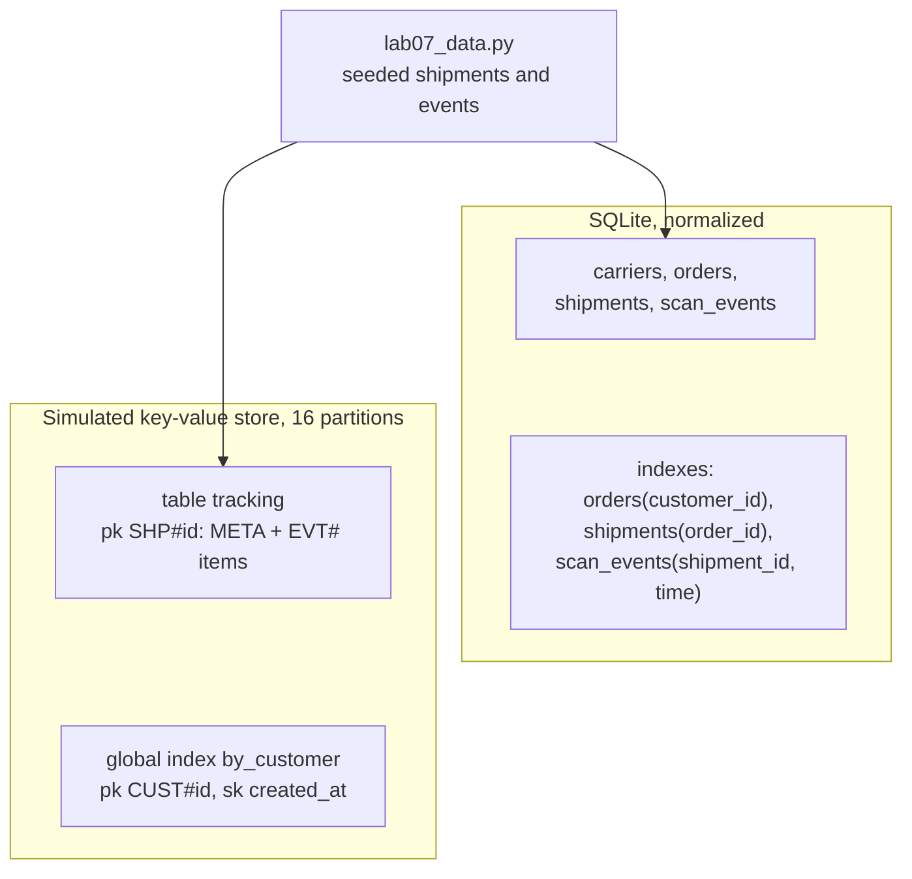

# Lab 07: SQL and NoSQL access patterns on one workload

!!! abstract "Lab facts"
    **Level:** Intermediate · **Time:** 60-75 minutes · **Cost:** Free, local only, Python standard
    library (`sqlite3`, `bisect`, `zlib`) · **Status:** Draft · **Last verified:** 2026-11-27 (macOS,
    Python 3.14.7 with SQLite 3.53.4; CI runs the smoke test on Python 3.12)

## Goal and expected result

You will load one seeded AtlasMart tracking dataset (6,000 shipments, 27,422 scan events, 12
carriers) into two stores: a **normalized relational schema in SQLite** with one index per known
query, and a **small simulated partitioned key-value/document store** designed access-pattern first
(partition key = the shipment, sort keys for events, one global secondary index by customer). You
then run the same questions on both. By the end you should be able to show, from your own output,
that both stores return identical answers to the three designed access patterns; that each designed
pattern touches exactly one key-value partition; that a question the key-value design did not plan
for costs a scan of every item until an index is built, while SQL answers it as written; that a
global index can miss a write that just succeeded; and that a sale-day burst makes a carrier-day
index partition hot, which write sharding fixes at the cost of read fan-out.

The simulation counts **items read, partitions touched, and requests**. It does not measure or claim
the speed of any database product.

## Concepts practiced

- Access-pattern-first design, partition and sort keys, single-table design, local and global
  secondary indexes, and hot-partition management from
  [NoSQL databases](../databases-and-storage/nosql-databases.md).
- Normalization, composite indexes, and reading a query plan from
  [Relational databases and SQL internals](../databases-and-storage/relational-databases-and-sql-internals.md).
- Hash placement and hot partitions from
  [Scaling, partitioning, and replication](../distributed-systems/scaling-partitioning-and-replication.md).
- Eventual consistency and read-your-writes from
  [Consistency models, CAP, and PACELC](../distributed-systems/consistency-models-cap-and-pacelc.md).

## Prerequisites

- Knowledge: basic SQL (`SELECT`, `JOIN`, `ORDER BY`); reading a short Python program.
- Completed labs: none required. [Lab 08](lab-08-sharding-and-consistent-hashing.md) covers hash
  placement in more depth.

## Tools and versions

| Tool | Version tested | Install |
|---|---|---|
| Python | 3.14.7 locally (also run with 3.9.6); 3.12 in CI | <https://www.python.org/downloads/> or your package manager |
| SQLite | 3.53.4, bundled with Python's `sqlite3` module | Nothing to install |

## Cost and account warnings

!!! warning "Before you start"
    Everything runs in memory on your machine. No cloud account, API key, network access, or
    payment is needed. The lab writes no files.

## Setup

1. Clone or download the repository and open `labs/local/lab-07-sql-vs-nosql-access-patterns/`.
2. Check Python: `python3 --version` should print 3.9 or newer.
3. Skim the files:

| File | What to read |
|---|---|
| `lab07_data.py` | The seeded generator and its assumptions (carrier shares, delay rates, the lab's "today") |
| `lab07_sql.py` | `SCHEMA` (four tables, three indexes) and the four SQL statements |
| `lab07_kvstore.py` | `Table.put`, `get`, `query`, `scan`; `GlobalIndex` and its `pending` queue; the per-partition budget |
| `lab07_tracking_kv.py` | The key design in the docstring; the three pattern functions and the ad-hoc ones |
| `lab07_hot.py` | The sale-day burst and its assumptions |
| `lab07_run.py` | The subcommands used in the steps below |

**Figure 1 — One dataset, two layouts.** The relational side stores each fact once and joins at
read time; the key-value side stores copies where each question reads them.



How to read it: the same rows feed both sides. On the right, the carrier and customer id are copied
onto items (denormalization), and the customer index holds a second copy of every shipment summary.

## Exercise

All commands run inside the lab directory.

### Step 1 — Look at the data and both layouts

```bash
python3 lab07_run.py data
```

Note the item collection printed for `SHP#S000042`: why do the `EVT#` items come out in time order
without any sort, and why does `META` sort after them? How many items does the key-value table hold,
and why is that more than the number of scan events?

### Step 2 — Run the three designed access patterns on both stores

```bash
python3 lab07_run.py patterns
```

Each pattern runs for 200 different ids. For each one, compare the SQL plan with the key-value line.
Answer in writing:

1. Why does the SQL "get shipment by id" plan have three lines while the key-value store reads one
   item?
2. In pattern 2, why does SQLite need `USE TEMP B-TREE FOR ORDER BY` while the key-value index does
   not sort?
3. Why are "items read per query" and "rows returned per query" equal for every pattern?

### Step 3 — Ask a question the key-value design did not plan for

```bash
python3 lab07_run.py adhoc
```

The question: which shipments had a `DELAYED` event at carrier-c yesterday (2026-11-26)? Compare four
answers: SQL as designed, SQL after one `CREATE INDEX`, the key-value store by full scan, and the
key-value store after building a global index keyed `CAR#<carrier>#<day>`. What did each cost? What
does the backfill line tell you about the price of adding an index to a large key-value table?

### Step 4 — Watch a global index lag behind the base table

```bash
python3 lab07_run.py index-lag
```

A new shipment is written to both stores. Which reads see it immediately, and which one does not
until `propagate()` runs? How would the Tracking API give a customer read-your-writes on "my
shipments" with this design?

### Step 5 — A sale-day burst: hot partition, then write sharding

```bash
python3 lab07_run.py hot
python3 lab07_run.py hot --shards 1 2 4 8 16
```

The burst is 3,500 scan events per second for 10 simulated seconds (the 50× scenario from the
scaling page), with carrier-a carrying 40% of events. Every table and index has 16 partitions and a
budget of 500 writes per partition per second (a design assumption, not a product limit). Before
running, predict the hot ratio (hottest partition ÷ mean partition) of the unsharded carrier-day
index. Then explain: why is the base table even, why were other carriers throttled too, why are 4
shards not enough, and what does a support query pay for 8 shards?

## Expected output

The data, answers, item counts, partition counts, and the hot-partition table are deterministic (all
randomness is seeded and placement uses CRC-32, not Python's randomized `hash()`). SQLite VM step
counts depend on the SQLite version, and the ad-hoc plan's shape can differ between versions. From a
real run, Step 3:

```text
$ python3 lab07_run.py adhoc
Ad-hoc: shipments with a DELAYED event at carrier-c on 2026-11-26 (yesterday)
  SQL, schema as designed (no index for this question):
         SEARCH c USING COVERING INDEX sqlite_autoindex_carriers_1 (code=?)
         SCAN s
         SEARCH e USING INDEX events_by_shipment (shipment_id=? AND occurred_at>? AND occurred_at<?)
         USE TEMP B-TREE FOR DISTINCT
       23 shipments, SQLite VM steps 30783
  SQL, after CREATE INDEX events_by_status_time ON scan_events(status, occurred_at):
         SEARCH c USING COVERING INDEX sqlite_autoindex_carriers_1 (code=?)
         SEARCH e USING INDEX events_by_status_time (status=? AND occurred_at>? AND occurred_at<?)
         SEARCH s USING INDEX sqlite_autoindex_shipments_1 (shipment_id=?)
         USE TEMP B-TREE FOR DISTINCT
       23 shipments, SQLite VM steps 1064
  KV, no key serves this question: full scan
       23 shipments, items read 33422 of 33422, partitions touched 16 of 16
  KV, add global index CAR#<carrier>#<day> / <status>#<time>#<event> and backfill it:
       backfill read 33422 base items and wrote 27422 index items
       query: 23 shipments, items read 23, partitions touched 1
  same answer from all four: True   shipments: S000007, S000417, S000556, S000603, S000754, S000800 ...
```

Step 5 (columns trimmed for width; the full output is in the solution file):

```text
design                    hottest part/s  mean part/s  hot ratio  throttled  read fan-out
base table (SHP#id)                  228          219       1.04          0             1
index CAR#carrier#day               1996          219       9.13      16356             1
index CAR#carrier#day x8             276          219       1.26          0             8
```

Summary of a correct run:

| Check | Relational (SQLite) | Key-value (simulated) |
|---|---|---|
| Shipment by id, 200 ids | 3-table join by primary keys; same answer 200 of 200 | 1 item, 1 partition |
| Customer's 5 newest, 200 ids | 2 index searches plus a sort | 1 index query, 1 partition, no sort |
| Events in order, 200 ids | 1 index search, no sort | 1 query, 1 partition, items = events |
| Ad-hoc, as designed | Answers with a scan (23 shipments) | Full scan: 33,422 items, 16 partitions |
| Ad-hoc, after an index | Index search | 23 items, 1 partition, after a 33,422-item backfill |
| New shipment, read at once | Visible | Base table yes; global index only after propagation |
| Sale-day carrier-day index | (not modelled) | Hot ratio 9.13, 16,356 throttled; with 8 shards 1.26, 0 |

## Validation

- Step 2: every pattern prints `same answer from both stores: 200 of 200`, and every key-value line
  shows `partitions touched (max) 1`.
- Step 3: `same answer from all four: True`; the key-value scan reads every item in all 16
  partitions; the SQL plan without the new index contains a `SCAN` line and the plan with it does not.
- Step 4: the index list before propagation lacks `S900001`, and after propagation starts with it.
- Step 5: the unsharded index has a hot ratio well above 5 and throttled writes; 8 shards leave zero
  throttled writes and a read fan-out of 8.
- The automated smoke test passes from the repository root:

```bash
python3 -m unittest tests.examples.test_lab07 -v
```

## Cleanup

Nothing to clean up: both stores live in memory and disappear when the command exits. Delete any
`__pycache__` folder in the lab directory if you like.

## Troubleshooting

| Symptom | Likely cause | Fix |
|---|---|---|
| VM step counts or the ad-hoc plan differ from this page | A different SQLite version bundled with your Python | Expected; compare the relationships (scan versus search, before much larger than after) |
| `ModuleNotFoundError: lab07_data` | Command run from another directory | `cd` into the lab directory first |
| `SyntaxError` on start | Python older than 3.9 | Use Python 3.9 or newer |
| Different answers or item counts | A different `--seed` | Use the default seed 7 to compare with this page |

## Stretch challenge

1. **Calculated versus random suffix.** In `lab07_tracking_kv.carrier_day_keys`, replace the hash of
   the shipment id with a random suffix. Writes spread the same way; what can a reader that knows the
   shipment id no longer do?
2. **Adaptive capacity, as a concept.** Add a step to `lab07_hot.simulate` that, after the first
   simulated second, moves the hottest partition key to its own new partition (a split). Rerun
   unsharded: what happens to the other carriers' throttling, and what still limits carrier-a?
3. **A local secondary index.** Add an index that keeps a second sort order inside each `SHP#`
   partition (events by status), maintained in the same `put`. Show that it is never stale and that
   it cannot answer the carrier-day question.
4. **One more pattern.** Add "all shipments of an order" to both stores. Which store needs a schema
   change, and which needs only a new query?

## Solution and hints

??? question "Hint 1: why do the key-value patterns never sort?"
    The sort key is stored in order inside each partition key. `EVT#2026-11-22T07:43:19Z#...` strings
    sort by time because ISO-8601 UTC timestamps sort as text, and `query()` reads a contiguous run
    of them. The customer index's sort key starts with `created_at`, so reading it backwards gives
    newest first.

??? question "Hint 2: why does the hottest partition exceed carrier-a's own rate?"
    Twelve carrier keys hash onto 16 partitions, and collisions are likely: carrier-a's partition
    also holds three other carriers' keys, about 190 writes/s each. A hot key throttles every key
    that shares its partition.

??? success "Full solution"
    Real output of every step with commentary is in
    [`labs/solutions/lab-07/expected-results.md`](https://github.com/vinay9354/architecture-atlas/blob/main/labs/solutions/lab-07/expected-results.md)
    in the repository. Summary: both stores give identical answers to the designed patterns, and each
    key-value pattern reads one partition and exactly the items it returns; the ad-hoc question is
    a normal query in SQL but a full scan, or an index with a full backfill, in the key-value store;
    a global index is eventually consistent; and the carrier-day index runs at 9.13 times the mean
    partition load on sale day until eight write shards bring it to 1.26, at the price of eight
    queries per support read.

## Simplifications

- The key-value store is a teaching model: one process, no replication, no persistence, no
  multi-item transactions. Placement is CRC-32 of the partition key modulo 16; real stores use their
  own hashing and split partitions as they grow.
- Global index propagation is a queue drained by an explicit `propagate()` call; real stores apply
  it continuously, usually quickly, with no guarantee of when.
- The per-partition budget is a fixed count per simulated second. Real services meter capacity in
  their own units, allow bursts, and may redistribute capacity (adaptive capacity); check the
  provider's documentation. Throttled writes are counted and dropped, not retried.
- SQLite "VM steps" count virtual-machine instructions through a progress handler; they show relative
  work for one SQLite version, not time, and not rows read.
- Data volumes are scaled down from AtlasMart (6,000 shipments against 300,000 in transit) so the lab
  runs in about two seconds. Delay rates, carrier shares, and the customer skew are lab assumptions.

## References

| Source | Type | Checked |
|---|---|---|
| [`sqlite3` — DB-API 2.0 interface for SQLite databases](https://docs.python.org/3/library/sqlite3.html) — Python documentation | Official documentation (`set_progress_handler`) | 2026-11-27 |
| [EXPLAIN QUERY PLAN](https://www.sqlite.org/eqp.html) — SQLite | Official documentation (SCAN and SEARCH lines) | 2026-11-27 |
| [Query progress callbacks](https://www.sqlite.org/c3ref/progress_handler.html) — SQLite C interface | Official documentation (what the step counter counts) | 2026-11-27 |
| [Using write sharding to distribute workloads evenly](https://docs.aws.amazon.com/amazondynamodb/latest/developerguide/bp-partition-key-sharding.html) — Amazon DynamoDB Developer Guide | Official documentation (random and calculated suffixes) | 2026-11-27 |
| [Improving data access with secondary indexes](https://docs.aws.amazon.com/amazondynamodb/latest/developerguide/SecondaryIndexes.html) — Amazon DynamoDB Developer Guide | Official documentation (global index reads are eventually consistent) | 2026-11-27 |
| [`bisect` — Array bisection algorithm](https://docs.python.org/3/library/bisect.html) — Python documentation | Official documentation (sorted item collections) | 2026-11-27 |

## Review notes

- Executed: every command on this page with Python 3.14.7 (SQLite 3.53.4) on macOS, including
  `hot --shards 1 2 4 8 16`, and the smoke test; the `patterns` step was also run with Python 3.9.6
  (SQLite 3.54.0), where answers and key-value counts were identical and VM step averages differed
  by a few steps, and the ad-hoc plan scanned `scan_events` instead of `shipments`.
- Lab assumptions: 1,500 customers with Zipf-like skew, 6,000 shipments over 7 days, 12 carriers
  (carrier-a 20% on normal days, 40% on sale day), delay rate 25% for carrier-c and 5% for others,
  16 partitions, a 500 writes/s per-partition budget, and the 3,500 events/s burst from the scaling
  page's 50× scenario. No customer data beyond opaque ids is generated (NFR-6).
