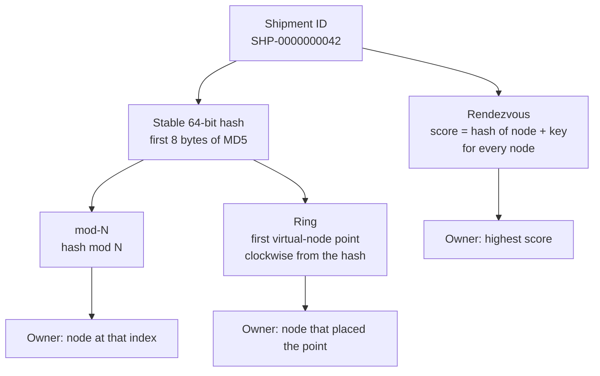
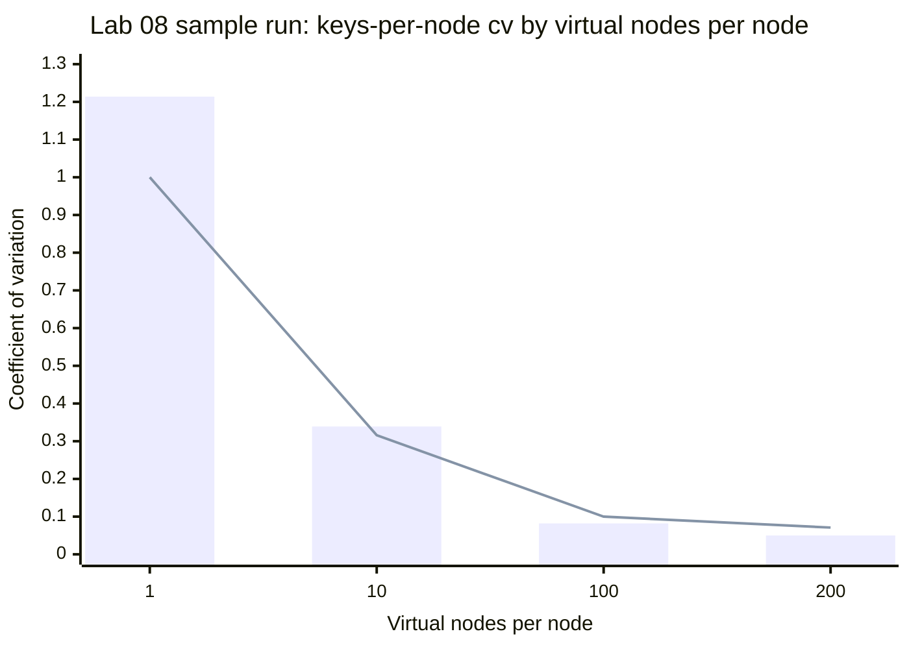

# Lab 08: Sharding and consistent hashing

!!! abstract "Lab facts"
    **Level:** Intermediate · **Time:** 45-60 minutes · **Cost:** Free, local only, Python standard
    library · **Status:** Draft · **Last verified:** 2026-11-20 (macOS, Python 3.14; CI runs the
    smoke test on Python 3.12)

## Goal and expected result

You will implement three ways of deciding which node owns a key (hash-mod-N, a consistent-hash ring
with virtual nodes, and rendezvous hashing) and run them over 100,000 synthetic shipment IDs. You
should see three results. When a node joins or leaves, mod-N moves about nine keys in ten while the
ring and rendezvous hashing move about one in ten, each close to the theory the program prints
beside it. With one point per node the ring is badly uneven, and adding virtual nodes evens it out
at a rate of about 1/√(virtual nodes). And when 1% of keys receive 30% of reads, a placement that
spreads keys evenly still leaves one node with noticeably more reads, because no placement can split
a single hot key.

## Concepts practiced

- Hash partitioning and why `hash mod N` makes resizing expensive
  ([Scaling, partitioning, and replication](../distributed-systems/scaling-partitioning-and-replication.md)).
- Consistent hashing, virtual nodes, and rendezvous (highest random weight) hashing, the placement
  choices behind the [distributed cache exercise](../system-design-exercises/distributed-cache.md).
- Measuring load spread with max/mean and the coefficient of variation.
- Hot keys: why even placement of keys is not even placement of load
  ([Caching architecture](../databases-and-storage/caching-architecture.md) covers the cache-side fixes).

## Prerequisites

- Knowledge: what a hash function and the modulo operator are; how to run a Python script from a
  terminal; reading a results table.
- Completed labs: none required. [Lab 01](lab-01-latency-and-throughput.md) is useful practice in
  reading measured results against a formula.

## Tools and versions

| Tool | Version tested | Install |
|---|---|---|
| Python | 3.14 locally; 3.12 in CI; 3.10 or newer works | <https://www.python.org/downloads/> or your package manager |
| One terminal window | any | no server is involved |

No third-party packages. Both scripts use only the standard library (`hashlib`, `bisect`, `random`,
`statistics`).

## Cost and account warnings

!!! warning "Before you start"
    This lab runs entirely on your machine, opens no network connections, and needs no cloud
    account, API key, or payment. It writes no files unless you pass `--json`.

## Setup

1. Clone or download the repository and open `labs/local/lab-08-sharding-and-consistent-hashing/`.
2. Check Python: `python3 --version` should print 3.10 or newer.
3. Read the two scripts. `placement.py` (about 100 lines) holds the three schemes and a stable hash.
   `measure.py` (about 200 lines) generates the shipment IDs, runs the three experiments, and prints
   one table per experiment.

The AtlasMart framing, as a lab assumption: AtlasMart's Status Cache is one Redis node today with a
working set of about 1.8 GB for 300,000 shipments in transit. Suppose it outgrew one node and was
split across 10 cache nodes. The lab answers what happens to cached entries when an eleventh node is
added, and whether shipments and reads spread evenly across the 10.

**Figure 1 — Three answers to "which node owns this shipment?"** All three schemes start from the
same stable hash; they differ in what else they look at.



How to read it: mod-N depends on N itself, so changing N changes almost every answer. The ring
depends only on the points near the key, and rendezvous only on the scores, so a new node changes
an answer only where the new node's point or score wins.

## Exercise

### Step 1 — Try the three schemes by hand

From the lab folder:

```bash
python3 -c "
from placement import ModN, Ring, Rendezvous, node_names
for p in (ModN(node_names(10)), Ring(node_names(10), vnodes=100), Rendezvous(node_names(10))):
    print(p.name, p.node_for('SHP-0000000042'), p.node_for('SHP-0000000043'))
"
```

Each scheme names an owner for each ID. Run the command twice: the answers do not change, because
`stable_hash` uses MD5 rather than Python's built-in `hash()`. Read `Ring.node_for`: a lookup is one
`bisect` over the sorted list of points, with a wrap-around to the first point at the top of the
circle.

### Step 2 — Measure how many keys move

```bash
python3 measure.py --keys 100000 --nodes 10 --seed 8
```

Look at table A. Questions to answer in writing:

1. How close is each scheme to the theory line printed above the table?
2. What does the `minimal moves` column mean, and why is it `no` for mod-N?
3. Removing node-9 from the ring moved more than 10% of keys. Which node's property explains the
   exact number?

### Step 3 — Shrink the cluster and the virtual nodes

```bash
python3 measure.py --nodes 4 --vnodes 10
```

Predict first: with 4 nodes, what should a join move under each scheme? Then compare the ring row
with the theory. A ring with few points per node is still minimal (only the new node gains keys),
but the new node can land on small arcs and take much less than its fair share, or much more.

### Step 4 — Measure spread against virtual nodes

Return to table B from Step 2. For the ring, compare the measured `cv` with the `~1/sqrt(vnodes)`
column. Then answer: going from 100 to 200 virtual nodes, how much did the spread improve, and what
did it cost? (Hint: the ring now has 2,000 points to search instead of 1,000.)

**Figure 2 — Spread of keys per node on the ring.** Measured coefficient of variation (bars) and
the 1/√v approximation (line) from the sample run, 100,000 keys on 10 nodes.



How to read it: each tenfold increase in virtual nodes cuts the spread by about √10 ≈ 3.2; the
last doubling buys much less than the first steps.

### Step 5 — Add hot keys

Table C uses the 200-vnode ring, the most even one. It compares the busiest node's share of keys
with its share of reads in three scenarios: uniform reads, 1% of keys taking 30% of reads evenly,
and the same 30% spread Zipf-style inside the hot set. Then make the skew stronger:

```bash
python3 measure.py --zipf 1.2
```

Questions: why does the even hot set barely change the busiest node, while the Zipf hot set does?
What fraction of an average node's read load does the single hottest key carry?

### Step 6 — See why the hash must be stable

```bash
python3 -c 'print(hash("SHP-0000000042"))'
python3 -c 'print(hash("SHP-0000000042"))'
```

The two numbers differ, because Python randomizes string hashing per process. If two Tracking API
instances used `hash()` to route, they would send the same shipment to different cache nodes.
Repeat with `PYTHONHASHSEED=0` set and the numbers match, which is a fix for experiments, not for
production routing across languages and versions.

## Expected output

The program is deterministic: with the default seed you should see exactly these numbers (only the
`finished in` time varies).

```text
A. Keys moved when the cluster changes (theory: mod-N moves N/(N+1) = 0.9091 on a join and (N-1)/N = 0.9000 on a leave;
   ring and rendezvous move 1/(N+1) = 0.0909 on a join and 1/N = 0.1000 on a leave)
           scheme |        nodes |        moved |       theory | minimal moves
------------------+--------------+--------------+--------------+--------------
            mod-N |     10 -> 11 |       0.9070 |       0.9091 |            no
            mod-N |      10 -> 9 |       0.9010 |       0.9000 |            no
ring (100 vnodes) |     10 -> 11 |       0.0935 |       0.0909 |           yes
ring (100 vnodes) |      10 -> 9 |       0.1109 |       0.1000 |           yes
       rendezvous |     10 -> 11 |       0.0904 |       0.0909 |           yes
       rendezvous |      10 -> 9 |       0.0991 |       0.1000 |           yes

B. Keys per node (1.0 is perfectly even; cv = standard deviation / mean)
      scheme |       vnodes |     max/mean |     min/mean |           cv | ~1/sqrt(vnodes)
-------------+--------------+--------------+--------------+--------------+----------------
       mod-N |            - |        1.012 |        0.985 |        0.008 |               -
        ring |            1 |        3.589 |        0.072 |        1.214 |           1.000
        ring |           10 |        1.806 |        0.516 |        0.339 |           0.316
        ring |          100 |        1.125 |        0.878 |        0.082 |           0.100
        ring |          200 |        1.079 |        0.930 |        0.050 |           0.071
  rendezvous |            - |        1.015 |        0.990 |        0.009 |               -

C. Keys versus reads per node (ring, 200 vnodes; mean node read share = 10.00%)
                       scenario | keys max/mean | reads max/mean | busiest node % |    top key %
--------------------------------+---------------+----------------+----------------+-------------
                    no hot keys |         1.079 |          1.079 |         10.789 |        0.001
    1% keys get 30% reads, even |         1.079 |          1.103 |         11.027 |        0.030
1% keys get 30% reads, zipf 1.0 |         1.079 |          1.315 |         13.151 |        4.008
```

Translated to the AtlasMart assumption of 300,000 shipments on 10 cache nodes (30,000 per node on
average): adding an eleventh node under mod-N would re-home about 0.907 × 300,000 ≈ 272,000 cached
shipments, so almost every read in the next TTL (30 s) would miss and fall through to the Tracking
Event Store. Under the ring, about 0.0935 × 300,000 ≈ 28,000 would move. With only 10 virtual nodes
the busiest node would hold about 1.806 × 30,000 ≈ 54,000 shipments; with 200, about
1.079 × 30,000 ≈ 32,000.

## Validation

- In table A, mod-N moves are within 0.02 of N/(N+1) and (N-1)/N, rendezvous moves within 0.01 of
  1/(N+1) and 1/N, and ring moves within about 0.03 of them with 100 virtual nodes.
- `minimal moves` is `yes` for the ring and rendezvous and `no` for mod-N.
- In table B the ring's `cv` falls as virtual nodes rise and stays near the 1/√v column.
- In table C the Zipf row's `reads max/mean` is clearly larger than its `keys max/mean`.
- The automated smoke test passes from the repository root:

```bash
python3 -m unittest tests.examples.test_lab08 -v
```

## Cleanup

Nothing to stop. Delete the `--json` output file if you created one; nothing else was written.

## Troubleshooting

| Symptom | Likely cause | Fix |
|---|---|---|
| `ModuleNotFoundError: No module named 'placement'` | Running `measure.py` from another folder | `cd` into the lab folder first, or run `python3 labs/local/lab-08-sharding-and-consistent-hashing/measure.py` (Python adds the script's folder to the path) |
| A run takes much longer than 5 s | Rendezvous scores every node for every key, so cost grows with keys × nodes | Use `--keys 20000` while experimenting; the fractions barely change |
| Your numbers differ from the expected output | A different `--seed`, `--keys`, or `--vnodes`, or an edited hash | Rerun with the defaults; the program is deterministic |
| Ring movement far from theory | Few virtual nodes, so one node's share is far from 1/N | Expected; compare the moved fraction with that node's measured share, or raise `--vnodes` |
| `--nodes must be at least 2` | `--nodes 1` leaves no node for the N-1 case | Use 2 or more |

## Stretch challenge

1. **Replicas on the ring.** Add `nodes_for(key, r)` that walks clockwise and returns the first r
   distinct physical nodes (skipping further points of a node already chosen). Measure how many
   (key, replica) pairs move on a join, and check that no key gets two replicas on one node.
2. **Weighted nodes.** Give one node twice the capacity by giving it twice the virtual nodes, and
   for rendezvous use a weighted score. Check that it receives about twice the keys.
3. **Jump consistent hash.** Implement Lamping and Veach's jump hash (see References), which needs
   no table at all, and add it to table A. Note its restriction: nodes can only be added or removed
   at the end of the numbered list.
4. **Bounded load.** Cap every node at 1.25 × the mean number of keys: when a key's owner is full,
   walk clockwise to the next node with room. Measure the spread and the extra movement on a join.

## Solution and hints

??? question "Hint 1: deriving the mod-N movement"
    A key stays put only if hash mod N equals hash mod (N+1). Count, among N × (N+1) consecutive hash
    values, how many give the same remainder for both.

??? question "Hint 2: why the ring's leave row is not exactly 1/N"
    When a node leaves, exactly the keys it owned move. Count how many keys node-9 owned before the
    change; that share, not the ideal 1/N, is the moved fraction.

??? question "Hint 3: hot keys"
    Virtual nodes spread keys. A single key always lives on one node, so if it carries a large share
    of reads, that node is busier however the other keys are spread. Compare the `top key %` column
    with the 10% that an average node serves.

??? success "Full solution"
    Sample results with commentary are in
    [`labs/solutions/lab-08/expected-results.md`](https://github.com/vinay9354/architecture-atlas/blob/main/labs/solutions/lab-08/expected-results.md)
    in the repository. Summary: mod-N moves N/(N+1) of keys on a join and (N-1)/N on a leave,
    including keys moving between old nodes; the ring and rendezvous move only the joining or leaving
    node's share, about 1/(N+1) and 1/N; the ring's spread falls with about 1/√(virtual nodes), from
    a cv of 1.21 at one point per node to 0.05 at 200; and a Zipf-skewed hot set lifts the busiest
    node to 1.3× the mean read load while its key count stays at 1.08×.

## Simplifications

- Keys are placed but never stored or copied. A real resize also has to stream the moved data,
  keep serving reads during the move, and decide which copy wins if a write lands mid-move.
- Every node is assumed to have the same capacity, and membership changes one node at a time with
  every router agreeing instantly. Real clusters need a membership service or gossip, and routers
  briefly disagree.
- Load is measured as the expected share of reads, not by replaying requests, so there is no queueing
  or latency effect; Lab 01 shows what a hot node's extra load does to latency.
- Many production systems use a fixed number of slots (hash slots or partitions) assigned to nodes
  by a coordinator, instead of a ring. The movement and spread arguments carry over: a slot moves only
  when it is reassigned.

## References

| Source | Type | Checked |
|---|---|---|
| David Karger et al., ["Consistent Hashing and Random Trees"](https://www.cs.princeton.edu/courses/archive/fall09/cos518/papers/chash.pdf), STOC 1997 | Paper (consistent hashing) | 2026-11-20 |
| David G. Thaler and Chinya V. Ravishankar, ["A Name-Based Mapping Scheme for Rendezvous"](https://www.eecs.umich.edu/techreports/cse/96/CSE-TR-316-96.pdf), University of Michigan technical report CSE-TR-316-96, 1996 | Paper (rendezvous hashing) | 2026-11-20 |
| Giuseppe DeCandia et al., ["Dynamo: Amazon's Highly Available Key-value Store"](https://www.allthingsdistributed.com/files/amazon-dynamo-sosp2007.pdf), SOSP 2007 | Paper (virtual nodes in a production store) | 2026-11-20 |
| John Lamping and Eric Veach, ["A Fast, Minimal Memory, Consistent Hash Algorithm"](https://arxiv.org/abs/1406.2294), 2014 | Paper (jump consistent hash, stretch 3) | 2026-11-20 |
| [Python `hashlib` documentation](https://docs.python.org/3/library/hashlib.html) and [`bisect` documentation](https://docs.python.org/3/library/bisect.html) | Official documentation | 2026-11-20 |
| [Python command line and environment: `PYTHONHASHSEED`](https://docs.python.org/3/using/cmdline.html) | Official documentation (hash randomization) | 2026-11-20 |
| Martin Kleppmann, *Designing Data-Intensive Applications*, O'Reilly, 2017, chapter 6 (Partitioning) | Book | 2026-11-20 |
| [Scaling, partitioning, and replication](../distributed-systems/scaling-partitioning-and-replication.md) — this repository | Topic page | 2026-11-20 |
