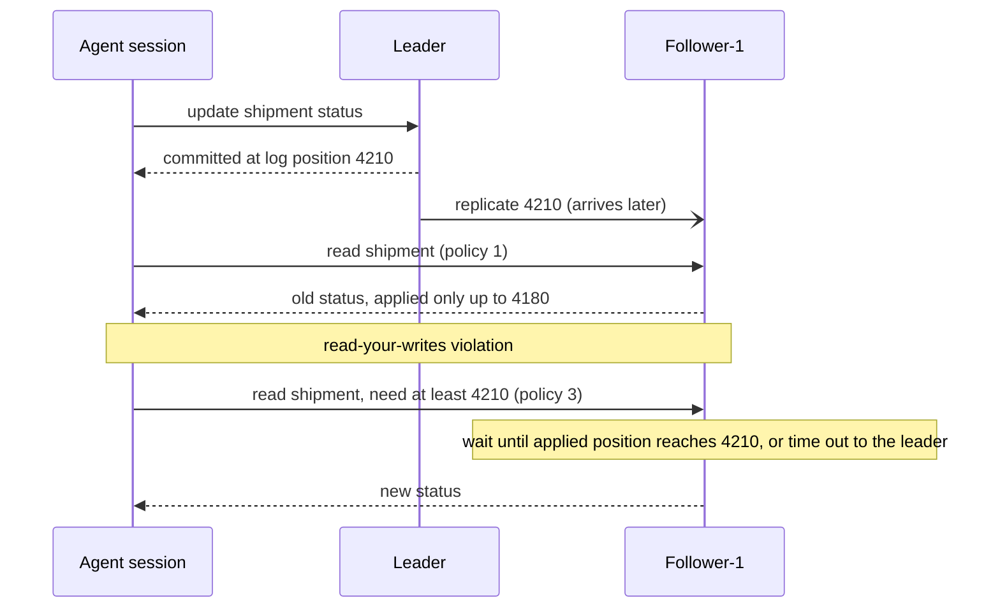
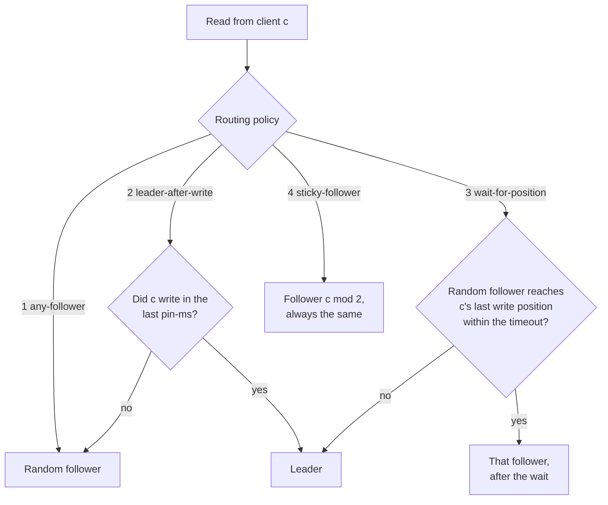

# Lab 09: Eventual consistency and replication lag

!!! abstract "Lab facts"
    **Level:** Intermediate · **Time:** 45-60 minutes · **Cost:** Free, local only, Python standard
    library · **Status:** Draft · **Last verified:** 2026-11-20 (macOS, Python 3.14; CI runs the
    smoke test on Python 3.12)

## Goal and expected result

You will run a discrete-event simulation of a leader database with two asynchronous followers. Writes
(shipment status updates) commit on the leader and reach each follower after a random lag; client
sessions read their shipment through one of four routing policies. The simulation runs on a simulated
clock, so 60 seconds of traffic take a fraction of a second. You should see that reading any follower
returns stale data for a few percent of reads, including the reader's own just-saved change and
statuses that go backwards; that the two read-your-writes policies remove the first problem and a
sticky-follower policy removes the second; and that when one follower falls 5 seconds behind, a
time-based policy breaks while a log-position policy keeps its guarantee by falling back to the
leader.

## Concepts practiced

- Replication lag, eventual consistency, and stale reads
  ([Consistency models, CAP, and PACELC](../distributed-systems/consistency-models-cap-and-pacelc.md)).
- Session guarantees: read-your-writes and monotonic reads, and why they are separate properties.
- Log positions (log sequence numbers) as the token that makes read-your-writes checkable, as in a
  write-ahead log ([Relational databases and SQL internals](../databases-and-storage/relational-databases-and-sql-internals.md)).
- Reading cost columns as well as correctness columns: leader load, added wait, and fallbacks.

## Prerequisites

- Knowledge: leader-follower replication at the level of the
  [relational databases page](../databases-and-storage/relational-databases-and-sql-internals.md);
  percentiles (p50, p99); how to run a Python script.
- Completed labs: none required. [Lab 08](lab-08-sharding-and-consistent-hashing.md) covers the
  partitioning half of "partition and replicate".

## Tools and versions

| Tool | Version tested | Install |
|---|---|---|
| Python | 3.14 locally; 3.12 in CI; 3.10 or newer works | <https://www.python.org/downloads/> or your package manager |
| One terminal window | any | no server or database is involved |

No third-party packages. The script uses only the standard library (`bisect`, `random`, `math`,
`dataclasses`).

## Cost and account warnings

!!! warning "Before you start"
    This lab runs entirely on your machine, opens no network connections, and needs no cloud
    account, API key, or payment. It writes no files unless you pass `--json`.

## Setup

1. Clone or download the repository and open `labs/local/lab-09-replication-lag/`.
2. Check Python: `python3 --version` should print 3.10 or newer.
3. Read `replication_sim.py` (about 290 lines). `Cluster` builds the workload and the followers'
   apply times; `simulate` replays it under one policy and counts the violations.

The AtlasMart framing, with lab assumptions labelled. AtlasMart's Tracking Event Store is a
PostgreSQL primary with one synchronous standby. This lab assumes two **asynchronous** read replicas
are added to take read load, and models only the leader and those two followers. Clients are Agent
Console sessions (the assumption used on the consistency page): each works on one shipment, changes
it now and then, and views it. Defaults, all assumptions except the carrier rate:

| Input | Default | Source |
|---|---|---|
| Carrier writes | 70 per second over 1,000 shipments | AtlasMart scan-event peak (about 70/s) |
| Agent sessions | 50, each following one shipment | Lab assumption |
| Agent writes | 0.1 per second per session (one every 10 s on average) | Lab assumption |
| Page views | 1 per second per session, 2 reads 20 ms apart | Lab assumption (status widget, then timeline) |
| View after a write | one page view 0-200 ms after each agent write | Lab assumption |
| Per-write apply lag | lognormal, median 40 ms, sigma 0.8 | Lab assumption |
| Policy 2 window | 1,000 ms | Lab assumption |
| Policy 3 timeout | 500 ms | Lab assumption |

Expected volume over 60 simulated seconds: 70 × 60 = 4,200 carrier writes; 50 × 0.1 × 60 = 300 agent
writes; 50 × 1 × 60 = 3,000 page views plus about 300 after-write views, at 2 reads each, about
6,600 reads. The sample run below produced 4,258 carrier writes, 298 agent writes, and 6,626 reads.

What the program counts, for every read of shipment k by client c at time t:

- **Stale:** the replica's newest version of k is older than the leader's newest committed version
  at t. **Staleness** is t minus the commit time of the oldest version the read missed.
- **Read-your-writes violation:** c's own last write was to k and the version returned is older.
- **Monotonic-read violation:** the version returned is older than one c has already been shown
  for k.

## Exercise

### Step 1 — Run the baseline

```bash
python3 replication_sim.py --seed 9
```

The first table shows each follower's effective apply lag. The second shows one row per policy.
Questions to answer in writing:

1. Each write's own lag has a 40 ms median. Why is the followers' median lag about 100 ms?
2. With policy 1 (`any-follower`), what fraction of reads is stale, and how many reads hid the
   agent's own change?
3. How can a page view show a status in one widget and an older status in the next, 20 ms later?

**Figure 1 — A read-your-writes violation and the log-position fix.** The agent's write commits at
log position 4210; follower-1 has applied only up to 4180 when the next read arrives.



How to read it: policy 1 trusts whichever follower it picks; policy 3 carries the write's position
with the session and refuses to answer from a follower that has not reached it.

### Step 2 — Compare the guarantees and their costs

Read the four rows of the baseline table together. For each policy, note which violation column is
zero and what it paid in the `leader %`, `wait p99`, and `fallbacks` columns.

**Figure 2 — How each policy routes a read.** Policy numbers match the rows of the results table.



How to read it: policies 2 and 3 only change routing for clients that have written; policy 4
ignores writes entirely and only fixes which follower a client sees.

Questions: why do policies 2 and 3 still show a few monotonic-read violations? Why does policy 4 show
as many read-your-writes violations as policy 1?

### Step 3 — Make one follower fall far behind

```bash
python3 replication_sim.py --seed 9 --lag-spike
```

Writes committed between 20 s and 30 s now reach follower-1 5 seconds late, and because followers
apply in order, everything behind them waits too. Before reading the table, predict which policy
loses its guarantee. Then check: what did policy 3 do instead of serving stale data, and what did that
cost? What did the clients pinned to follower-1 under policy 4 experience?

### Step 4 — Tune the knobs

Try each of these and compare with Step 3:

```bash
python3 replication_sim.py --lag-spike --pin-ms 3000
python3 replication_sim.py --lag-spike --wait-timeout-ms 100
python3 replication_sim.py --lag-dist exponential
python3 replication_sim.py --lag-dist fixed
```

A longer pin window reduces policy 2's violations but cannot remove them without knowing the worst
lag in advance, and it sends more reads to the leader. A shorter timeout turns waits into fallbacks.
A different lag distribution changes how often reads are stale, but not which guarantees hold.

### Step 5 — Relate it to AtlasMart's requirements

NFR-1 asks for 99% of events to be visible within 60 s. Compare the worst stale read in the spike run
with that budget, and with the 30 s at p99 that the consistency page leaves for the ingestion path.
Then decide which policy the Agent Console needs and which one customer tracking pages need.

## Expected output

The simulation is deterministic: with the default seed you should see exactly these numbers.

```text
60 simulated s, 4556 writes (298 from clients), 6626 reads, seed 9

Apply lag per follower (lognormal, 40 ms; includes waiting behind earlier writes)
  follower |     p50 ms |     p99 ms |     max ms
-----------+------------+------------+-----------
follower-0 |       98.4 |      471.8 |      621.4
follower-1 |      101.1 |      648.8 |     1164.1

Read policies (staleness percentiles are over stale reads only)
            policy |    stale % |  stale p50 |  stale p99 |  RYW viol. | mono viol. |   leader % |   wait p99 |  fallbacks
-------------------+------------+------------+------------+------------+------------+------------+------------+-----------
      any-follower |       6.25 |       68.2 |      452.7 |        374 |         35 |        0.0 |        0.0 |          0
leader-after-write |       0.53 |       54.8 |      452.7 |          0 |          2 |      16.31 |        0.0 |          0
 wait-for-position |       0.66 |       54.2 |      452.7 |          0 |          4 |       0.08 |      131.6 |          5
   sticky-follower |       6.32 |       70.7 |      452.7 |        377 |          0 |        0.0 |        0.0 |          0
```

With `--lag-spike`:

```text
Read policies (staleness percentiles are over stale reads only)
            policy |    stale % |  stale p50 |  stale p99 |  RYW viol. | mono viol. |   leader % |   wait p99 |  fallbacks
-------------------+------------+------------+------------+------------+------------+------------+------------+-----------
      any-follower |      11.47 |      189.2 |     5099.1 |        630 |        340 |        0.0 |        0.0 |          0
leader-after-write |       4.92 |     2583.9 |     5150.3 |        189 |        269 |      16.31 |        0.0 |          0
 wait-for-position |       2.11 |     1411.9 |     5178.9 |          0 |         94 |       4.48 |      500.0 |        297
   sticky-follower |      11.68 |      211.6 |     5136.8 |        635 |          0 |        0.0 |        0.0 |          0
```

Under normal lag, both read-your-writes policies have zero violations, but policy 2 sends 16.31% of
reads to the leader while policy 3 sends 0.08% and adds up to 131.6 ms (p99) of waiting instead.
During the spike, policy 2 fails 189 times and policy 3 none, at the price of 297 reads waiting the
full 500 ms before falling back.

## Validation

- Policy 1 shows positive read-your-writes and monotonic-read violation counts.
- Policies 2 and 3 show zero read-your-writes violations in the baseline run.
- Policy 4 shows zero monotonic-read violations in both runs.
- With `--lag-spike`, policy 3 still shows zero read-your-writes violations and a positive
  `fallbacks` count, while policy 2 shows violations.
- The automated smoke test passes from the repository root:

```bash
python3 -m unittest tests.examples.test_lab09 -v
```

## Cleanup

Nothing to stop. Delete the `--json` output file if you created one; nothing else was written.

## Troubleshooting

| Symptom | Likely cause | Fix |
|---|---|---|
| Your numbers differ from the expected output | A different `--seed` or changed defaults | Rerun with no options except `--seed 9`; the simulation is deterministic |
| Policy 2 shows read-your-writes violations without `--lag-spike` | Your settings let a follower's lag exceed `--pin-ms` (a heavier tail or a shorter window) | Expected: that is the weakness of a time window; compare with policy 3 |
| `mono viol.` is 0 for every policy | `--lag-dist fixed` gives both followers identical apply times, so they never disagree | Use a random distribution to see monotonic-read violations |
| `wait p99` equals the timeout | A follower was behind by more than the timeout for at least 1% of reads | Expected during a spike; check `fallbacks` and `leader %` |
| `error: argument --lag-dist: invalid choice` | A distribution name the script does not know | Use `lognormal`, `exponential`, `uniform`, or `fixed` |

## Stretch challenge

1. **Both guarantees at once.** Add a policy that keeps one token per session, the highest log
   position the client has written or been shown, and waits for any follower to reach it. Check that
   it has zero violations in both columns, with and without the spike.
2. **Lag-aware routing.** Take a follower out of rotation while its lag exceeds a threshold (for
   example 1 s) and put it back when it catches up. Measure stale reads and leader load during the
   spike.
3. **Synchronous replication.** Make commits wait for follower-0 to apply each write, as AtlasMart's
   synchronous standby does. Measure how much each write's commit latency grows, and confirm that
   reads from follower-0 are never stale.
4. **Bounded staleness.** Serve a read from a follower only if its lag is under a bound (for example
   2 s), otherwise from the leader, and relate the bound to NFR-1.

## Solution and hints

??? question "Hint 1: why effective lag exceeds per-write lag"
    A follower applies write n only after write n-1. Its lag for write n is the largest of the
    recent writes' own delays, not write n's own delay. Look at the `last = max(last, t + lag)` line.

??? question "Hint 2: why policy 4 does not give read-your-writes"
    Sticking to one follower guarantees that follower's position only moves forward. It says nothing
    about whether the client's own write has reached that follower yet.

??? question "Hint 3: why policy 2 fails during the spike"
    After the pin window ends, reads go back to a random follower. If that follower is 5 s behind and
    the window is 1 s, the client's write is still missing.

??? success "Full solution"
    Sample results with commentary are in
    [`labs/solutions/lab-09/expected-results.md`](https://github.com/vinay9354/architecture-atlas/blob/main/labs/solutions/lab-09/expected-results.md)
    in the repository. Summary: reading any follower gives 6.25% stale reads, 374 read-your-writes
    violations, and 35 monotonic-read violations; leader-after-write and wait-for-position both
    remove read-your-writes violations under normal lag, the first by sending 16% of reads to the
    leader and the second by adding a short wait; sticky routing removes monotonic-read violations
    only; and during a 5 s lag spike the time window fails 189 times while waiting for the log
    position keeps zero violations by falling back to the leader 297 times.

## Simplifications

- Lag is drawn independently per write and per follower. Real lag is correlated over time (a long
  transaction, a vacuum, a network blip), which makes spikes like Step 3 more common than independent
  draws suggest.
- The leader and followers have unlimited capacity, so leader reads cost nothing here; in production
  policy 2's 16% of reads, or policy 3's fallbacks, land on the one node that also takes every write.
- There is no failover, no write conflicts (one leader), and no network partition between client and
  replica. Policy 3 assumes the API can learn each follower's applied position cheaply.
- Each client reads only its own shipment, and a waiting read does not delay the client's next
  operation.

## References

| Source | Type | Checked |
|---|---|---|
| Douglas B. Terry et al., ["Session Guarantees for Weakly Consistent Replicated Data"](https://www.cs.utexas.edu/users/dahlin/Classes/GradOS/papers/SessionGuaranteesPDIS.pdf), PDIS 1994 | Paper (read-your-writes, monotonic reads) | 2026-11-20 |
| Werner Vogels, ["Eventually Consistent — Revisited"](https://www.allthingsdistributed.com/2008/12/eventually_consistent.html), 2008 | Article | 2026-11-20 |
| [Jepsen: Read Your Writes](https://jepsen.io/consistency/models/read-your-writes) | Reference (consistency model) | 2026-11-20 |
| [Jepsen: Monotonic Reads](https://jepsen.io/consistency/models/monotonic-reads) | Reference (consistency model) | 2026-11-20 |
| [PostgreSQL documentation: Hot Standby](https://www.postgresql.org/docs/current/hot-standby.html) | Official documentation (reads on replicas) | 2026-11-20 |
| [PostgreSQL documentation: System Administration Functions](https://www.postgresql.org/docs/current/functions-admin.html) (`pg_last_wal_replay_lsn`) | Official documentation (applied log position) | 2026-11-20 |
| Martin Kleppmann, *Designing Data-Intensive Applications*, O'Reilly, 2017, chapter 5 (Replication) | Book | 2026-11-20 |
| [Consistency models, CAP, and PACELC](../distributed-systems/consistency-models-cap-and-pacelc.md) — this repository | Topic page | 2026-11-20 |
