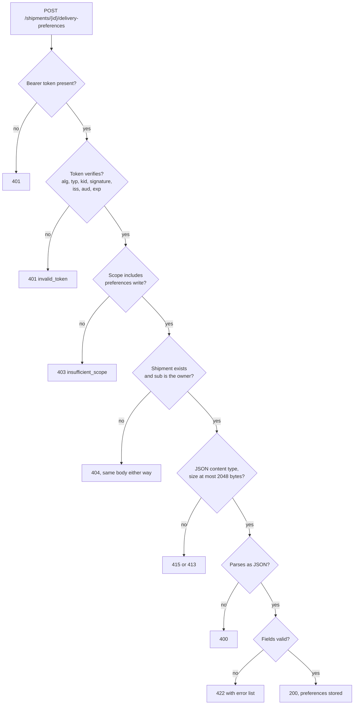

# Lab 10: Build a small REST API with authentication and request validation

!!! abstract "Lab facts"
    **Level:** Intermediate · **Time:** 60-90 minutes · **Cost:** Free, local only, Python standard
    library · **Status:** Draft · **Last verified:** 2026-11-21 (macOS, Python 3.14; CI runs the smoke
    test on Python 3.12)

!!! danger "A teaching toy, not a template"
    The token code in this lab is written by hand so that every check is visible. Production services
    must use a vetted JWT/JOSE library, and must verify tokens with **asymmetric** keys published by the
    identity provider as a JSON Web Key Set (JWKS). The lab uses a shared HMAC key (HS256) only because
    it needs nothing beyond the standard library. Never copy `toy_jwt.py` into a real service.

## Goal and expected result

You will run a small version of AtlasMart's Tracking API on your own machine. A toy token issuer,
standing in for the customer identity provider, mints short-lived access tokens signed with a key
generated at runtime. The API verifies every token, returns a shipment only to the customer who owns
it (NFR-5), and accepts delivery preferences only after a hand-written validator has checked them,
with no field that could carry a delivery address (NFR-6). A client script then sends 15 requests,
from "no token" to forged, expired, and mis-addressed tokens, someone else's shipment, and broken
bodies, and prints the status code and the server-side reason for each. By the end you should be able
to explain each rejection, and why the client sees less than the server log.

## Concepts practiced

- Authentication versus authorization, bearer tokens, scopes, JWT validation rules (algorithm
  allow-list, `iss`, `aud`, `exp`, signature, key id), and why asymmetric keys from a JWKS are the
  production answer ([Identity and access management](../security-architecture/identity-and-access-management.md)).
- Broken object-level authorization (BOLA, also called IDOR), input validation, and safe error
  responses ([Application security](../security-architecture/application-security.md)).
- Resource-oriented HTTP APIs, status codes, and machine-readable errors with RFC 9457 problem
  details ([API design: REST, GraphQL, gRPC, and async APIs](../application-and-api-architecture/api-design-rest-graphql-grpc-and-async-apis.md)).

## Prerequisites

- Knowledge: how to run a Python script; what an HTTP status code and a request header are; the
  "How it works" section of [Identity and access management](../security-architecture/identity-and-access-management.md).
- Completed labs: none required. [Lab 01](lab-01-latency-and-throughput.md) uses the same `http.server`
  approach if you want a gentler start.

## Tools and versions

| Tool | Version tested | Install |
|---|---|---|
| Python | 3.14 locally; 3.12 in CI | <https://www.python.org/downloads/> or your package manager |
| curl (optional, Step 5) | any | preinstalled on macOS and most Linux distributions |

No third-party packages. The code uses `http.server`, `hmac`, `hashlib`, `base64`, `json`, and
`secrets` from the standard library.

## Cost and account warnings

!!! warning "Before you start"
    Everything runs on your machine. The API listens only on 127.0.0.1. No cloud account, identity
    provider, or real credential is involved. The signing key is generated fresh on every run and is
    never written to disk or printed; if you export one for Step 5, it lives only in your shell session.

## Setup

1. Open `labs/local/lab-10-rest-api-auth-and-validation/` in the repository. It holds four files:

    | File | What it does |
    |---|---|
    | `toy_jwt.py` | `ToyIssuer` mints tokens; `Verifier` checks them in a fixed order; a small CLI mints one token |
    | `validation.py` | Parses the JSON body (rejecting duplicate keys) and validates the delivery-preferences fields |
    | `tracking_api.py` | The HTTP server: routes, authentication, scope and owner checks, problem-details errors |
    | `client_demo.py` | Starts the API in-process on an ephemeral port and runs the 15 cases |

2. Check Python: `python3 --version` should print 3.10 or newer.
3. Read the docstring at the top of `toy_jwt.py`: it lists the six verification steps and the reason
   code each one logs. Then read `Handler.do_POST` in `tracking_api.py` to see the order of checks.

The seed data, all fictional: three shipments, `SHP-1001` and `SHP-1003` owned by `customer-a1`,
`SHP-1002` owned by `customer-b2`. Owners are opaque subject ids from the identity provider, not names
or emails. No shipment holds an address.

**Figure 1 — The order of checks on a write request.** Each box either passes the request down or
answers with the status on its side arrow.



How to read it: identity first, then permission for the action, then permission for this object, and
only then the content. Moving any content check above the token check would let an anonymous caller
learn the validation rules.

## Exercise

### Step 1 — Run the client demo

```bash
cd labs/local/lab-10-rest-api-auth-and-validation
python3 client_demo.py
```

Fifteen rows, each with the expected status, the status the API returned, and the reason the server
wrote to its own log. The last line must read `15/15 cases returned the expected status.` Questions:

1. Cases 2 to 6 fail for different reasons. Run `python3 client_demo.py --verbose` and compare their
   response bodies. What differs, and why is that deliberate?
2. Case 2 rewrote the token's `sub` to `customer-b2` and asked for `SHP-1002`, which that customer
   owns. Which check stopped it, and what would have happened if the API decoded tokens without
   verifying them?

### Step 2 — Compare 401, 403, and 404

Look at cases 1, 8, 9, and 10. Case 10 holds a valid token that lacks the
`tracking:preferences:write` scope. Cases 8 and 9 hold a valid read token: one asks for another
customer's shipment, the other for a shipment that does not exist.

1. Why is case 10 a 403 and not a 401?
2. Compare the bodies of cases 8 and 9. What can a caller learn from them? What would a caller learn if
   case 8 returned 403 instead?
3. Find `_owned_shipment` in `tracking_api.py`. What would change if the owner check were done in the
   Tracking Web UI instead of the API?

### Step 3 — Break the verifier on purpose

Make a copy of `toy_jwt.py` first. Then, one at a time, make each change below, rerun
`python3 client_demo.py`, write down which cases now return the wrong status, and restore the file:

1. In `Verifier.verify`, delete the `if header.get("alg") not in ALLOWED_ALGS` check.
2. Delete the audience check (`if self.audience not in aud`).
3. Replace `hmac.compare_digest(...)` with a plain `==` comparison.

For change 1, explain why removing the allow-list alone did not let the `alg: none` token through in
this code, and what a verifier that chose its algorithm from the header would have done. For change 3,
explain why the demo still passes and what the change nonetheless breaks.

### Step 4 — Validation: 400 versus 422

Cases 11 to 15 all carry a valid write token for the caller's own shipment, so they reach the body
checks. Read `validation.py`, then run the verbose demo and look at case 14.

1. Which four rules did the invalid body break, and how does the client know which field each error
   is about?
2. The body included an `"address"` field. Name three ways a validator could treat an unknown field,
   and say which of them could end up storing an address (NFR-6).
3. Why does the API check `Content-Length` before reading the body?

### Step 5 — Talk to the API with curl (optional)

Start the API as its own process with a key you export, mint tokens with the CLI, and call it:

```bash
export LAB10_SIGNING_KEY=$(python3 -c "import secrets; print(secrets.token_hex(32))")
python3 tracking_api.py --port 8710 &
READ=$(python3 toy_jwt.py --sub customer-a1 --scope "tracking:read")
WRITE=$(python3 toy_jwt.py --sub customer-a1 --scope "tracking:read tracking:preferences:write")
curl -s http://127.0.0.1:8710/shipments/SHP-1001 -H "Authorization: Bearer $READ"
curl -s -i http://127.0.0.1:8710/shipments/SHP-1002 -H "Authorization: Bearer $READ"
curl -s -X POST http://127.0.0.1:8710/shipments/SHP-1001/delivery-preferences \
  -H "Authorization: Bearer $WRITE" -H "Content-Type: application/json" \
  -d '{"delivery_window":"evening","safe_place":"porch"}'
```

Decode the token's middle segment (`echo "$READ" | cut -d. -f2`, then base64url-decode it) and check
that `exp - iat` is 300. Then mint a token with `--ttl 5`, wait ten seconds, and call the API again.

### Step 6 — Run the smoke test

From the repository root:

```bash
python3 -m unittest tests.examples.test_lab10 -v
```

## Expected output

Step 1 on any machine (only the timing and the hidden key differ between runs):

```text
Toy tracking API on http://127.0.0.1:<ephemeral>, fresh signing key (not printed), kid=k1

 #  method case                                               expect  got  server-side reason
--  ------ -------------------------------------------------- ------ ----  ------------------------
 1  GET    no token                                              401  401  no_token
 2  GET    tampered payload (sub changed)                        401  401  bad_signature
 3  GET    signed with another key                               401  401  bad_signature
 4  GET    expired (issued 10 min ago, ttl 5 min)                401  401  expired
 5  GET    wrong audience (loyalty-api)                          401  401  wrong_audience
 6  GET    alg "none", no signature                              401  401  alg_not_allowed
 7  GET    own shipment                                          200  200  ok
 8  GET    someone else's shipment                               404  404  not_owner
 9  GET    shipment that does not exist                          404  404  no_such_shipment
10  POST   write without the write scope                         403  403  insufficient_scope
11  POST   wrong content type                                    415  415  wrong_content_type
12  POST   body over 2048 bytes                                  413  413  body_too_large
13  POST   malformed JSON                                        400  400  malformed_json: invalid JSON at line 1 column 31
14  POST   invalid fields (enum, length, duplicate, address)     422  422  validation_failed
15  POST   valid preferences                                     200  200  ok

15/15 cases returned the expected status.
```

The 422 body for case 14, an RFC 9457 problem-details document with one extension member, `errors`:

```json
{"type":"https://atlasmart.example/problems/validation-error","title":"Your request is not valid.",
 "status":422,"detail":"4 field(s) failed validation.","instance":"/shipments/SHP-1001/delivery-preferences",
 "errors":[{"pointer":"/address","detail":"unknown field"},
           {"pointer":"/delivery_window","detail":"must be one of any, morning, afternoon, evening"},
           {"pointer":"/instructions","detail":"must be at most 140 characters"},
           {"pointer":"/notify_by","detail":"items must be unique"}]}
```

(Line breaks added for reading; the API returns it on one line.)

## Validation

- `client_demo.py` prints `15/15` and exits with status 0.
- The 401 bodies for cases 2 to 6 are identical except for `instance`.
- The 404 bodies for cases 8 and 9 are identical except for `instance`; the server log says
  `not_owner` for one and `no_such_shipment` for the other.
- No response or log line contains the signing key.
- The smoke test passes: `python3 -m unittest tests.examples.test_lab10 -v` (7 tests, about 1 s).

## Cleanup

Nothing persists. If you ran Step 5, stop the server (`kill %1` or Ctrl+C in its terminal) and run
`unset LAB10_SIGNING_KEY`.

## Troubleshooting

| Symptom | Likely cause | Fix |
|---|---|---|
| `Set LAB10_SIGNING_KEY first` | `tracking_api.py` or `toy_jwt.py` run directly without the variable | Export it as in Step 5, or use `client_demo.py`, which needs no setup |
| Every curl call returns 401 `invalid_token` | The server and the CLI were started with different keys (two shells) | Export the key once, then start both from the same shell |
| `Address already in use` | Something else is on port 8710 | Pass another `--port` and use it in the curl commands |
| `ModuleNotFoundError: toy_jwt` | Running a script from another directory | `cd` into the lab directory first |
| A token minted with `--ttl 5` is still accepted after 10 s | The verifier allows 30 s of clock-skew leeway | Expected; wait more than 35 s, or read `leeway_s` in `Verifier` |

## Stretch challenge

1. **Key rotation.** Give the verifier two keys, `{"k1": old, "k2": new}`, switch the issuer to `k2`,
   and show that tokens from both are accepted. Then remove `k1` and show that old tokens fail with
   `unknown_kid`. How long must `k1` stay after the switch? (Hint: the longest token lifetime plus the
   leeway.)
2. **Asymmetric signatures.** Using a vetted library outside the standard library (for example the
   `cryptography` package), replace HS256 with ES256: the issuer signs with a private key, the API
   verifies with the public key only. Which file no longer needs the secret?
3. **Revocation.** Add a deny-list of `jti` values checked after signature verification. What does
   it cost per request, and why do short token lifetimes make it less necessary?
4. **Rate limiting failed authentication.** Count 401s per client address and return 429 after a
   threshold. What does this protect, and what can it break behind a shared proxy?

## Solution and hints

??? question "Hint 1: why the alg allow-list matters even though this verifier only does HMAC"
    This toy verifier always computes HMAC-SHA256, so dropping the allow-list makes `alg: none` fail
    at the signature check instead (the empty signature does not match). Real libraries support many
    algorithms and pick one from the header. If such a verifier honours `none`, it skips the signature;
    if it honours `HS256` while holding an RSA public key, it may use that public key as an HMAC secret,
    which anyone can do. The allow-list removes the choice from the attacker.

??? question "Hint 2: why `==` still passes the demo"
    The demo checks results, not timing. A short-circuiting comparison returns as soon as one byte
    differs, so across many attempts the response time reveals how many leading bytes of a guessed
    signature were right. `hmac.compare_digest` takes the same time either way. Over a network the
    signal is noisy, but it is cheap to remove and expensive to argue about.

??? success "Full solution"
    Real output from a full run, every response body, a curl session, and answers to every question
    are in
    [`labs/solutions/lab-10/expected-results.md`](https://github.com/vinay9354/architecture-atlas/blob/main/labs/solutions/lab-10/expected-results.md)
    in the repository. Summary: authenticate before anything else and fail every token check with the
    same 401; check the scope (403) and then the object owner, answering 404 for both "not yours" and
    "not there"; validate content last, with an allow-list of fields, so an address cannot be stored.

## Simplifications

- **HS256 with a shared key.** Production uses asymmetric keys from the identity provider's JWKS
  endpoint, fetched and cached by a vetted library, so the API can verify but never mint tokens.
- **No real identity provider or sign-in.** `ToyIssuer` mints a token for any subject you name. In
  AtlasMart the customer signs in at the identity provider with the authorization code flow and PKCE,
  and the Tracking Web UI receives the token.
- **No TLS.** Bearer tokens must only travel over TLS; the lab binds to 127.0.0.1 instead.
- **In-memory data, one process, HTTP/1.0.** Shipments and preferences vanish on exit; each response
  closes its connection.
- **Problem `type` URIs** point at `atlasmart.example`, which does not resolve. A real API publishes a
  page for each problem type.
- **The free-text `instructions` field** can still carry an address if a customer types one. The lab
  limits it to 140 characters; the topic page discusses whether AtlasMart should keep it at all.

## References

| Source | Type | Checked |
|---|---|---|
| [RFC 7519: JSON Web Token (JWT)](https://www.rfc-editor.org/rfc/rfc7519) — IETF | Standard | 2026-11-21 |
| [RFC 8725: JSON Web Token Best Current Practices](https://www.rfc-editor.org/rfc/rfc8725) — IETF | Standard (algorithm allow-lists, explicit typing, audience checks) | 2026-11-21 |
| [RFC 6750: OAuth 2.0 Bearer Token Usage](https://www.rfc-editor.org/rfc/rfc6750) — IETF | Standard (`WWW-Authenticate` errors `invalid_token`, `insufficient_scope`) | 2026-11-21 |
| [RFC 9457: Problem Details for HTTP APIs](https://www.rfc-editor.org/rfc/rfc9457) — IETF | Standard | 2026-11-21 |
| [API1:2023 Broken Object Level Authorization](https://owasp.org/API-Security/editions/2023/en/0xa1-broken-object-level-authorization/) — OWASP API Security Top 10 | Reference | 2026-11-21 |
| [Input Validation Cheat Sheet](https://cheatsheetseries.owasp.org/cheatsheets/Input_Validation_Cheat_Sheet.html) — OWASP | Guidance | 2026-11-21 |
| [`hmac` — Keyed-Hashing for Message Authentication](https://docs.python.org/3/library/hmac.html) — Python documentation | Official documentation (`compare_digest`) | 2026-11-21 |
| [`http.server` — HTTP servers](https://docs.python.org/3/library/http.server.html) — Python documentation | Official documentation (and its warning that it is not for production) | 2026-11-21 |

## Review notes

- Lab code, solution, and smoke test were run on 2026-11-21 (macOS, Python 3.14.7); every output in
  the solution file is real. Not executed here: the stretch challenges, and the curl steps on Linux.
- The `typ: at+jwt` check follows RFC 9068's JWT access-token profile (explicit typing, RFC 8725
  section 3.11); RFC 9068 is not in the reference table to keep it at eight entries.
- The 404-for-not-owner choice is a design decision, explained in the solution file; a reviewer may
  prefer to offer a 403 variant as a stretch challenge.
- Python's `http.server` documentation warns it is not for production; the lab's danger box and
  Simplifications say the same about the whole lab.
