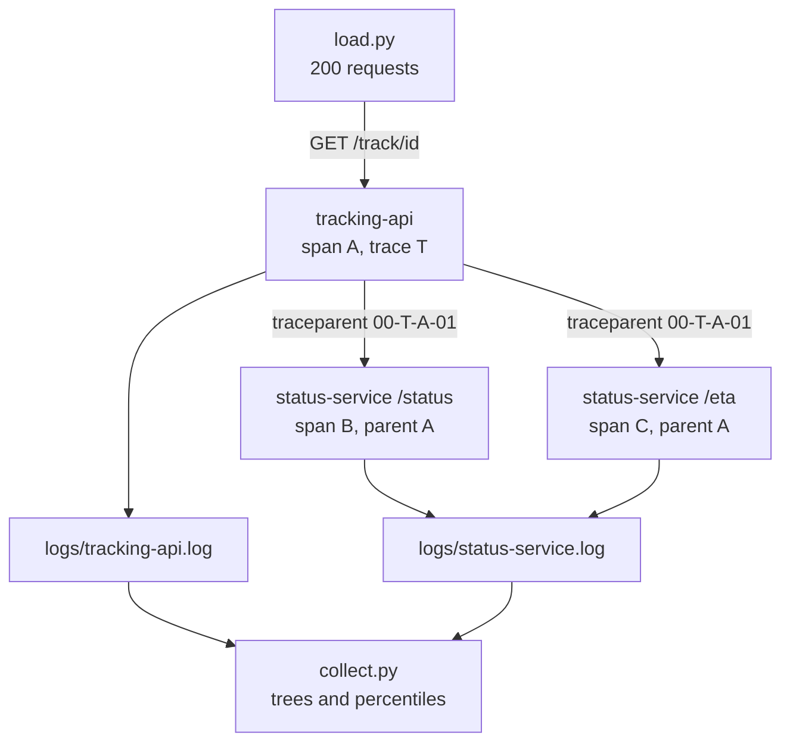

# Lab 11: Distributed tracing and structured logging across two services

!!! abstract "Lab facts"
    **Level:** Intermediate · **Time:** 60-75 minutes · **Cost:** Free, local only, Python standard
    library (optional appendix: OpenTelemetry Python SDK, not executed) · **Status:** Draft ·
    **Last verified:** 2026-11-27 (macOS, Python 3.14; CI runs the smoke test on Python 3.12)

## Goal and expected result

You will run two small HTTP services on `127.0.0.1`: **tracking-api**, which answers
`GET /track/{shipment_id}` by calling **status-service** twice (`/status/{shipment_id}` and
`/eta/{shipment_id}`). Both implement the W3C Trace Context `traceparent` header by hand: they parse
and validate an incoming header, continue the trace or restart it, and tracking-api sends a new
header on each outgoing call. Each service writes one JSON log line per request. A small collector
script reads both log files and prints trace trees, error traces, and per-route latency
percentiles. By the end you should be able to show, from your own output, that one request becomes
one trace across two services with a correct parent-child relationship, that invalid headers are
ignored and the trace restarted, where a planted slow path and a planted error are (found from the
logs alone), and that removing propagation splits every request into disconnected traces.

## Concepts practiced

- Correlation and trace ids, context propagation, the `traceparent` format and its validation
  rules, structured logging, and percentiles per route from
  [Observability fundamentals: logs, metrics, and traces](../observability-and-sre/observability-fundamentals-logs-metrics-and-traces.md).
- Nearest-rank percentiles and tail latency from
  [Performance fundamentals and Little's Law](../performance-and-scalability/performance-fundamentals-and-littles-law.md).
- Synchronous calls between services and partial failure from
  [Microservices architecture](../software-architecture/microservices-architecture.md).

## Prerequisites

- Knowledge: HTTP requests and headers; what JSON is; reading a short Python program.
- Completed labs: none required. [Lab 01](lab-01-latency-and-throughput.md) introduces percentiles.

## Tools and versions

| Tool | Version tested | Install |
|---|---|---|
| Python | 3.14 locally; 3.12 in CI | <https://www.python.org/downloads/> or your package manager |
| OpenTelemetry Python API and SDK (optional appendix only) | 1.45.2 pinned, not executed | <https://pypi.org/project/opentelemetry-sdk/1.45.2/> |

The services use only the standard library (`http.server`, `urllib.request`, `json`, `random`).

## Cost and account warnings

!!! warning "Before you start"
    Everything runs on your machine. The services listen on `127.0.0.1` only (free ports chosen by
    the operating system, or 8011 and 8012 if you start them by hand). No cloud account, API key,
    or payment is needed. The lab writes two log files into the directory you choose (`logs/` by
    default). The optional appendix would install two packages from PyPI; it is not needed.

## Setup

1. Clone or download the repository and open `labs/local/lab-11-tracing-and-structured-logging/`.
2. Check Python: `python3 --version` should print 3.10 or newer.
3. Skim the files. The parts that matter:

| File | What to read |
|---|---|
| `traceparent.py` | `parse()` (the validation rules, in specification order) and `format_traceparent()` |
| `telemetry.py` | The log-line field contract in the docstring; `start_span()` (continue or restart) |
| `tracking_api.py` | `call()`, which adds the outgoing header, and the `--no-propagate` switch |
| `status_service.py` | The routes; two planted faults (do not read `respond()` closely yet) |
| `load.py` | Five probe requests with client-made headers, then plain requests |
| `collect.py` | `traces`, `tree`, and `latency` subcommands |
| `run_lab.py` | Starts both services in one process, runs the load, stops them |

Every log line has these fields first, in this order: `timestamp` (UTC, written at the end of the
request), `level`, `service`, `trace_id`, `span_id`, `parent_span_id` (null for a root), `route`
(the template, never the raw path), `status`, `duration_ms`; then `method`, `shipment_id`,
`carrier` (status-service only), `tp_in` (what happened to the incoming header), and `message`.

**Figure 1 — The lab's services and where each id comes from.** tracking-api's span id becomes the
parent id of both status-service spans.



How to read it: solid arrows are HTTP calls or log writes. The only thing linking the two log
files is the `traceparent` on the two middle arrows; Step 6 removes it.

## Exercise

### Step 1 — Read and validate traceparent headers

```bash
python3 traceparent.py
```

Six headers are parsed. Before reading the output, predict which are valid. Then explain the last
line: why is a version `01` header with an extra field accepted, and why is flags `09` sampled?

### Step 2 — Run both services and the load

```bash
python3 run_lab.py
```

This starts status-service and tracking-api on free ports, sends 5 probe requests and 200 plain
requests, and writes `logs/tracking-api.log` and `logs/status-service.log`. To run them as three
separate processes instead (closer to real life), use three terminals:

```bash
python3 status_service.py --port 8012 --log logs/status-service.log
python3 tracking_api.py --port 8011 --status-url http://127.0.0.1:8012 --log logs/tracking-api.log
python3 load.py --url http://127.0.0.1:8011 --requests 200
```

Create `logs/` first (`mkdir -p logs`) and stop the services with Ctrl+C afterwards. Each service
truncates its log file when it starts.

### Step 3 — Follow one trace through both log files

```bash
head -n 5 logs/tracking-api.log
head -n 2 logs/status-service.log
python3 collect.py tree logs/*.log --trace 7b89296c6dcbac5008577eb1924770d3
```

The trace id `7b89...70d3` is the one the load script put in its valid probe header (the ids are
seeded, so you get the same one). Answer in writing:

1. Which field in status-service's lines proves it is a child of tracking-api's span?
2. Why does the tree say tracking-api's parent `03cc0f2793fdcab8` is not in the logs?
3. Look at `tp_in` on tracking-api's second to fifth lines. Which rule rejected each probe, and what
   did tracking-api do instead?

### Step 4 — Find the slow path from the logs

```bash
python3 collect.py latency logs/*.log
python3 collect.py latency logs/*.log --by carrier
python3 collect.py tree logs/*.log --slowest
```

Which route has a p95 far above its p50? Which attribute explains it? In the slowest trace, how much
of tracking-api's time is spent in one child span, and why is the second call to status-service not
started until the first returns?

### Step 5 — Find the error from the logs

```bash
python3 collect.py traces logs/*.log
python3 collect.py tree logs/*.log --trace 1d849e2ba111f5fbfbe840360c046d96
```

Which service failed first, with which status and message, and what did the client receive? Why
does this trace have two spans instead of three? Use `grep <trace id> logs/*.log` to see both raw
lines.

### Step 6 — Remove propagation

```bash
python3 run_lab.py --no-propagate --out logs-broken
python3 collect.py traces logs-broken/*.log --slowest 3
python3 collect.py tree logs-broken/*.log --slowest
```

Compare the trace counts with Step 5. Open the slowest trace: what can you no longer tell? Then try
to answer Step 5's question ("which service failed first?") using only `logs-broken/`. What would
you have to rely on instead of the trace id, and why is that unreliable under concurrent load?

## Expected output

Your ports, timestamps, and durations differ from run to run; trace and span ids, request counts,
and statuses do not (the generators are seeded). From a real run, Step 4's slowest trace:

```text
$ python3 collect.py tree logs/*.log --slowest
trace 3e06d750369a9ad71f9ca6ceb7b8b1a0: 3 spans, 2 service(s) ['status-service', 'tracking-api'], 138.80 ms
[+   0.00 ms] tracking-api   GET /track/{shipment_id}   200    138.80 ms  span=ec9a5dc8a440f745  shipment_id=SHP-1017
|-- [+   0.90 ms] status-service GET /status/{shipment_id}  200      3.77 ms  span=803a58569b459212  shipment_id=SHP-1017 carrier=carrier-c
`-- [+   5.72 ms] status-service GET /eta/{shipment_id}     200    131.91 ms  span=b4bdc5b1d7c6cee9  shipment_id=SHP-1017 carrier=carrier-c
```

Step 6, the same load without propagation:

```text
$ python3 collect.py traces logs-broken/*.log --slowest 3
spans: 609 {'status-service': 404, 'tracking-api': 205}
traces: 609   spanning more than one service: 0   single-service: 609
root spans (no parent): 608   spans whose parent is not in the logs: 1
```

Summary of a correct run:

| Check | With propagation | Without propagation |
|---|---|---|
| Spans (tracking-api / status-service) | 205 / 404 | 205 / 404 |
| Traces | 205 | 609 |
| Traces spanning both services | 205 | 0 |
| Load result | 194 × 200, 6 × 502 | 194 × 200, 6 × 502 |
| Slow path | `/eta/{shipment_id}` for `carrier-c`: p50 about 127 ms against about 3 ms for other carriers | Visible per route, but not connected to the tracking requests it slowed |
| Error | `/status/{shipment_id}` 503 for `SHP-1013`, "event store read timed out", under a 502 from tracking-api | 12 unconnected error spans |

The full output of every step is in the solution file linked below.

## Validation

- Step 1: only the first and last headers are valid.
- Step 3: every status-service line for the trace has `parent_span_id` equal to tracking-api's
  `span_id`, and `tp_in` is `valid`; the four invalid probes show `tp_in: "invalid: ..."` and a new
  trace id with `parent_span_id: null`.
- Steps 4-5: you named the slow route and attribute and the failing shipment and route from the
  collector output, before reading `status_service.py`.
- Step 6: traces spanning both services drop from 205 to 0.
- The automated smoke test passes from the repository root:

```bash
python3 -m unittest tests.examples.test_lab11 -v
```

## Cleanup

Nothing keeps running after `run_lab.py`. If you started services by hand, stop them with Ctrl+C.
Delete the `logs/` and `logs-broken/` directories.

## Troubleshooting

| Symptom | Likely cause | Fix |
|---|---|---|
| `OSError: [Errno 48] Address already in use` | Port 8011 or 8012 is taken when starting by hand | Pass other ports with `--port` and `--status-url`, or use `run_lab.py` (free ports) |
| Every request returns 502 | tracking-api cannot reach status-service | Start status-service first; check `--status-url` |
| `trace ... not found` | A different `--seed`, or the log files were rewritten | Use `collect.py traces` to list trace ids from your own logs |
| Trees mix runs or ids repeat | Log files appended from an earlier run | The services truncate their logs at start; do not concatenate log files from two runs |
| `SyntaxError` on start | Python older than 3.10 | Use Python 3.10 or newer |

## Stretch challenge

1. **Head sampling.** Add `--sample-rate` to tracking-api: decide per new trace with the seeded
   generator, set the sampled flag accordingly, and have both services skip writing span lines when
   the flag is 0 (keep ERROR lines). With a rate of 0.1, how many of the 6 error traces survive? What
   does that tell you about head sampling?
2. **Tail sampling.** In `collect.py`, add a `sample` subcommand that keeps every trace with an error
   or a root slower than 100 ms plus 5% of the rest, and print how many traces and spans it keeps.
3. **Client spans.** Real tracers add a client span around each outgoing call, so the tree shows
   network time separately from the callee's time. Add one to tracking-api and compare the client
   span's duration with the server span's.
4. **Parallel calls.** Make tracking-api call `/status` and `/eta` concurrently with two threads.
   What changes in the tree and in p95 for carrier-c shipments? What new failure handling is needed?

## Solution and hints

??? question "Hint 1: where is the slow path?"
    Group status-service's `/eta` route by `carrier`. One carrier's p50 is two orders of magnitude
    above the others', so it is a property of that carrier's requests, not random noise.

??? question "Hint 2: why only two spans in the error trace?"
    tracking-api calls `/status` first and only calls `/eta` if `/status` succeeded; after a 503 it
    returns 502 without a second call. A span that never started cannot be in the trace.

??? success "Full solution"
    Real output of every step with commentary is in
    [`labs/solutions/lab-11/expected-results.md`](https://github.com/vinay9354/architecture-atlas/blob/main/labs/solutions/lab-11/expected-results.md)
    in the repository. Summary: propagation turns two log files into one tree per request; validating
    the header and restarting on bad input keeps garbage out of your traces; the slow path is
    `carrier-c` on `/eta` and the error is `SHP-1013` on `/status`, both found from logs; without
    propagation the same 609 spans become 609 single-span traces and the cause of a slow or failed
    request can only be guessed from timestamps.

## Appendix: the same lab with the OpenTelemetry Python SDK (optional, not executed)

In a real service you would not hand-write `traceparent` handling. The OpenTelemetry API creates
spans and the SDK samples, batches, and exports them; the default propagator speaks W3C Trace
Context. A sketch of tracking-api's handler with the SDK (versions pinned to the current release
on PyPI on 2026-11-27):

```bash
python3 -m venv .venv-otel
.venv-otel/bin/pip install opentelemetry-api==1.45.2 opentelemetry-sdk==1.45.2
```

```python
from opentelemetry import trace
from opentelemetry.sdk.trace import TracerProvider
from opentelemetry.sdk.trace.export import BatchSpanProcessor, ConsoleSpanExporter
from opentelemetry.trace.propagation.tracecontext import TraceContextTextMapPropagator

provider = TracerProvider()
provider.add_span_processor(BatchSpanProcessor(ConsoleSpanExporter()))
trace.set_tracer_provider(provider)
tracer = trace.get_tracer("lab11.tracking_api")
propagator = TraceContextTextMapPropagator()

# Inside do_GET: continue the caller's trace if its traceparent is valid.
parent_ctx = propagator.extract(carrier={"traceparent": self.headers.get("traceparent", "")})
with tracer.start_as_current_span("GET /track/{shipment_id}", context=parent_ctx,
                                  kind=trace.SpanKind.SERVER) as span:
    span.set_attribute("http.route", "/track/{shipment_id}")
    headers = {}
    propagator.inject(headers)          # adds traceparent for the outgoing call
    # ... call status-service with these headers, as call() does ...
    ids = span.get_span_context()
    log_fields = {"trace_id": f"{ids.trace_id:032x}", "span_id": f"{ids.span_id:016x}"}
```

!!! note "Not executed"
    The author did not install these packages, so this code was not run; the import paths and
    calls follow the OpenTelemetry Python documentation's propagation and instrumentation pages.
    The versions were confirmed to exist on PyPI on 2026-11-27. Expected, not observed: spans
    printed as JSON by the console exporter, with status-service's spans carrying tracking-api's
    span id as parent once status-service extracts the header the same way. In production you would
    export OTLP to a Collector instead of the console, set the service name as a resource attribute,
    and use instrumentation libraries for the HTTP server and client instead of manual extract and
    inject.

## Simplifications

- Each service records one span per request. Real tracers add client spans for outgoing calls and
  internal spans for work inside a request, and record start times explicitly; the collector here
  derives start time from the end timestamp minus duration, which only works because both services
  share one clock.
- Trace and span ids come from a seeded `random.Random` so runs are reproducible. Real tracers must
  use an unpredictable random source; the specification prefers random trace ids.
- `tracestate` is not implemented, the sampled flag is always set on new traces, and nothing is
  sampled. Logs are written synchronously to a file under a lock; real services write to standard
  output and let an agent ship it.
- The planted faults are deterministic sleeps and a fixed failing shipment, not real contention.

## References

| Source | Type | Checked |
|---|---|---|
| [Trace Context](https://www.w3.org/TR/trace-context/) — W3C Recommendation | Standard (traceparent format, validation, restart) | 2026-11-27 |
| [Context propagation](https://opentelemetry.io/docs/concepts/context-propagation/) — OpenTelemetry | Official documentation | 2026-11-27 |
| [Propagation](https://opentelemetry.io/docs/languages/python/propagation/) and [Instrumentation](https://opentelemetry.io/docs/languages/python/instrumentation/) — OpenTelemetry Python | Official documentation (appendix API calls) | 2026-11-27 |
| [opentelemetry-sdk 1.45.2](https://pypi.org/project/opentelemetry-sdk/1.45.2/) and [opentelemetry-api 1.45.2](https://pypi.org/project/opentelemetry-api/1.45.2/) — PyPI | Package index (pinned versions) | 2026-11-27 |
| [`http.server`](https://docs.python.org/3/library/http.server.html) — Python documentation | Official documentation | 2026-11-27 |
| [JSON Lines](https://jsonlines.org/) | Format description (one JSON value per line) | 2026-11-27 |

## Review notes

- Executed: every command on this page except the appendix (Python 3.14.7, macOS), including the
  three-terminal variant of Step 2 with 20 requests, and the smoke test. Not executed: the
  OpenTelemetry appendix (packages not installed); its expected results are predictions.
- `traceparent.py` implements the version 00 rules and the higher-version parsing rules from
  sections 3.2.2 and 3.2.4 of the W3C Recommendation; the smoke test covers each rejection reason.
- Shipments `SHP-1000` to `SHP-1049`, the three carriers, the slow `carrier-c` ETA path (120 ms), and
  the failing `SHP-1013` are lab assumptions; no customer data is logged (NFR-6).
