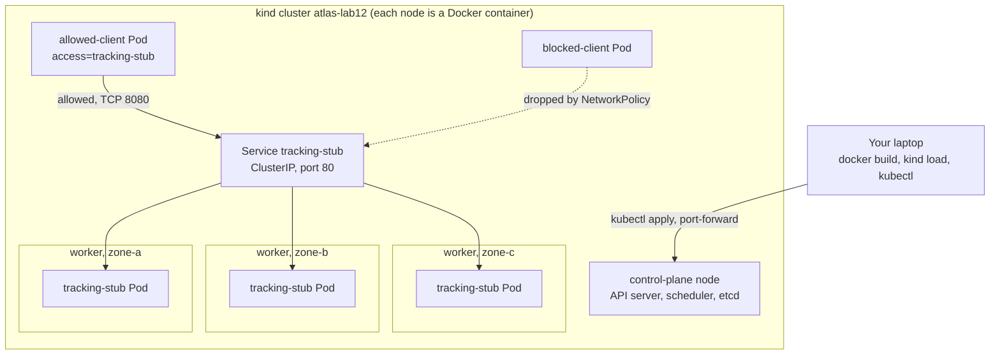

# Lab 12: Deploy a small application to local Kubernetes

!!! abstract "Lab facts"
    **Level:** Intermediate · **Time:** 60-90 minutes · **Cost:** Free, local only (Docker, kind,
    kubectl) · **Status:** Draft · **Last verified:** 2026-11-21 (files and the stub server checked on
    macOS with Python 3.14; the cluster steps were **not** executed by the author, see
    [Review notes](#review-notes))

## Goal and expected result

You will package a tiny HTTP service, the **tracking stub** (a stand-in for AtlasMart's Tracking
API that returns fixed JSON), as a container image with a multi-stage Dockerfile, and run it on a
local Kubernetes cluster created with **kind** (Kubernetes in Docker). The cluster has one
control-plane node and three workers, each worker labelled with a different zone, so it behaves like
the three-zone region AtlasMart runs in. You will apply a Deployment of three replicas that the
scheduler spreads one per zone, a Service, a PodDisruptionBudget (PDB), and a default-deny
NetworkPolicy with explicit allow rules. Then you will break things on purpose: delete a Pod and
watch it return, and drain nodes to watch the PDB throttle evictions. By the end you should be able
to explain, from what you saw, what each of those objects promises and where the promise stops.

## Concepts practiced

- Pods, Deployments, ReplicaSets, Services, probes, requests and limits, PDBs, topology spread
  constraints, node drains
  ([Kubernetes architecture and workloads](../containers-and-kubernetes/kubernetes-architecture-and-workloads.md)).
- Multi-stage image builds, non-root images, read-only root file systems
  ([Containers and images](../containers-and-kubernetes/containers-and-images.md)).
- NetworkPolicy default deny and allow rules, the cluster DNS
  ([Kubernetes networking, storage, and service mesh](../containers-and-kubernetes/kubernetes-networking-storage-and-service-mesh.md)).
- Liveness versus readiness, and graceful shutdown
  ([Resilience mechanics: timeouts, retries, and backpressure](../distributed-systems/resilience-mechanics-timeouts-retries-and-backpressure.md)).
- Zones as failure domains ([High availability design](../reliability-and-disaster-recovery/high-availability-design.md)).

## Prerequisites

- Knowledge: what a container image is; basic `kubectl get`, `apply`, and `logs`.
- A machine that can run Docker with about 4 GB of memory free for four kind nodes (a rough lab
  assumption; kind's own documentation gives its current requirements).
- Completed labs: none required.

## Tools and versions

| Tool | Version | Install |
|---|---|---|
| Docker (Engine or Desktop) | any current release, **running** | <https://docs.docker.com/get-started/get-docker/> |
| kind | v0.33.0 (released 2026-08-26; default node image Kubernetes v1.37.0) | <https://kind.sigs.k8s.io/docs/user/quick-start/#installation> |
| kubectl | v1.36, v1.37, or v1.38 (the version skew policy supports one minor version either side of the cluster) | <https://kubernetes.io/docs/tasks/tools/> |
| Python | 3.12 or newer, only for Step 1 and the smoke test | <https://www.python.org/downloads/> |
| Base image | `python:3.14.10-slim-trixie` (official Python image; tag checked on Docker Hub 2026-11-21) | pulled by `docker build` |

The node image in `kind-cluster.yaml` is pinned by digest
(`kindest/node:v1.37.0@sha256:a1ed56cf...`), as the kind v0.33.0 release notes require for images
built for that release.

## Cost and account warnings

!!! warning "Before you start"
    Everything runs on your machine. No cloud account, API key, or payment is needed. The cluster
    pulls the kind node image and the Python base image from public registries once (a few hundred
    megabytes; check your connection). Four kind nodes use real CPU and memory while they run:
    delete the cluster when you finish (Step 9).

## Setup

1. Open `labs/local/lab-12-local-kubernetes-deployment/` in a terminal. It contains:

    | Path | What it is |
    |---|---|
    | `app/tracking_stub.py` | The service: `GET /healthz`, `/readyz`, `/shipments/{id}`; standard library only |
    | `app/probe.py` | A one-shot HTTP client used inside test Pods |
    | `Dockerfile` | Two stages: a test gate, then a minimal non-root runtime image |
    | `kind-cluster.yaml` | 1 control plane + 3 workers labelled `topology.kubernetes.io/zone` = `zone-a`, `zone-b`, `zone-c` |
    | `manifests/` | Namespace, Deployment, Service, PDB, NetworkPolicies, two test client Pods, and a `kustomization.yaml` listing them |

2. Check the tools: `docker info` must succeed (the daemon is running), `kind version` should print
   v0.33.0, and `kubectl version --client` a supported version.
3. Read `manifests/10-deployment.yaml`. Find the five things this lab tests: `replicas: 3`, the
   `topologySpreadConstraints` on the zone label, the two probes, `resources`, and the two
   `securityContext` blocks.

## Exercise

### Step 1 — Run the stub without Kubernetes

```bash
POD_NAME=local-stub NODE_NAME=laptop python3 app/tracking_stub.py
```

In a second terminal, call `/readyz` at once, then again after two seconds, then the other endpoints:

```bash
curl -s -w " %{http_code}\n" localhost:8080/readyz
curl -s -w " %{http_code}\n" localhost:8080/readyz
curl -s -w " %{http_code}\n" localhost:8080/healthz
curl -s -w " %{http_code}\n" localhost:8080/shipments/AM-1001
curl -s -w " %{http_code}\n" localhost:8080/shipments/not%20valid
```

The first `/readyz` returns 503 while `/healthz` already returns 200: the process is alive but not
ready. Stop the server with `kill -TERM` and call `/readyz` within two seconds: it returns 503 again
before the process exits. Kubernetes uses exactly these two signals, differently: a failed liveness
probe restarts the container; a failed readiness probe only takes the Pod out of the Service.

### Step 2 — Create the cluster

```bash
kind create cluster --config kind-cluster.yaml
kubectl get nodes -L topology.kubernetes.io/zone
```

You should see four Ready nodes, the three workers in zones a, b, and c. kind sets each label through
the kubelet's node labels; `topology.kubernetes.io/zone` is the same well-known label a managed
Kubernetes service puts on nodes in a real availability zone.

### Step 3 — Build the image and load it into the nodes

```bash
docker build -t tracking-stub:0.1.0 .
kind load docker-image tracking-stub:0.1.0 --name atlas-lab12
```

The build stage compiles the code and runs `--self-test`; if the self-test fails, no image is
produced. kind nodes cannot see your local Docker images, so `kind load` copies the image into each
node's container runtime. The manifests use the exact tag `0.1.0` with `imagePullPolicy:
IfNotPresent`, so the kubelet uses the loaded copy instead of trying Docker Hub.

### Step 4 — Apply the manifests

```bash
kubectl apply -k manifests/
kubectl -n atlas-tracking-lab rollout status deployment/tracking-stub
kubectl -n atlas-tracking-lab get pods -o wide
```

`-k` runs Kustomize (built into kubectl) over `manifests/kustomization.yaml`, which also orders the
Namespace first. Check that the three `tracking-stub` Pods are on three different workers. Run
`kubectl -n atlas-tracking-lab describe pod <one of them>` and find the probes, the limits, and the
events showing the readiness probe failing once during the 3-second warm-up.

### Step 5 — Port-forward and curl

```bash
kubectl -n atlas-tracking-lab port-forward svc/tracking-stub 8080:80
# in another terminal
curl -s localhost:8080/shipments/AM-1001
```

The `served_by` field now names a real Pod and node. Port-forward attaches to one Pod behind the
Service when it starts, so repeated requests usually show the same Pod.

### Step 6 — Test the NetworkPolicy from inside the cluster

```bash
kubectl -n atlas-tracking-lab exec allowed-client -- python /app/probe.py http://tracking-stub/shipments/AM-1001
kubectl -n atlas-tracking-lab exec blocked-client -- python /app/probe.py http://tracking-stub/shipments/AM-1001
```

Both clients can resolve `tracking-stub` (DNS egress is allowed for every Pod). Only
`allowed-client` carries the label `access: tracking-stub`, which the allow rules require on both
sides: egress from the client and ingress to the stub on port 8080. The blocked client should time
out. Port-forward (Step 5) does not exercise these rules, which is why the test uses Pods.

Does kind enforce NetworkPolicy at all? Since **kind v0.24.0** its default CNI, kindnetd, includes
NetworkPolicy support through the `sigs.k8s.io/kube-network-policies` project (stated in the
v0.24.0 release notes), and the v0.33.0 kindnetd source still wires it in. The same source sets the
policy dataplane to fail open, so if the blocked client gets a 200, policy is not being enforced:
see Troubleshooting before drawing conclusions.

### Step 7 — Delete a Pod and watch it come back

```bash
kubectl -n atlas-tracking-lab get pods -l app.kubernetes.io/name=tracking-stub -w
# in another terminal
kubectl -n atlas-tracking-lab delete pod <the Pod on atlas-lab12-worker>
```

Watch a new Pod appear at once with a new name, show `0/1` during warm-up, then `1/1`. Note which
node it lands on and explain why (hint below).

### Step 8 — Drain nodes and watch the PDB

```bash
kubectl drain atlas-lab12-worker --ignore-daemonsets --delete-emptydir-data
kubectl -n atlas-tracking-lab get pdb tracking-stub
kubectl -n atlas-tracking-lab get pods -o wide
kubectl drain atlas-lab12-worker2 --ignore-daemonsets --delete-emptydir-data
```

The first drain evicts one replica: 3 ready minus 1 still meets `minAvailable: 2`. Where does its
replacement go? The second drain, with zone-a still cordoned, may have to evict two replicas from one
node; look for the "would violate the pod's disruption budget" retry and for the moment it
succeeds. Then answer: in which zones do the replicas run now, and does `kubectl uncordon` move them
back?

```bash
kubectl uncordon atlas-lab12-worker atlas-lab12-worker2
kubectl -n atlas-tracking-lab get pods -o wide
```

### Step 9 — Clean up

```bash
kind delete cluster --name atlas-lab12
```

## Expected output

The stub's own output from Step 1 was captured by the author:

```text
$ curl -s -w " %{http_code}\n" localhost:8080/readyz
{"status": "not-ready"} 503
$ curl -s -w " %{http_code}\n" localhost:8080/readyz
{"status": "ready"} 200
$ curl -s -w " %{http_code}\n" localhost:8080/shipments/AM-1001
{"carrier": "carrier-a", "estimated_delivery": "2026-11-24", "last_scan_at": "2026-11-21T09:00:00Z", "served_by": {"node": "laptop", "pod": "local-stub"}, "shipment_id": "AM-1001", "status": "IN_TRANSIT"} 200
```

For Steps 2-9 the output below is the **expected shape, not captured by the author**; it is an
**illustrative example** written from the manifests, and names, IPs, and ages will differ:

```text
# ILLUSTRATIVE, not captured
$ kubectl -n atlas-tracking-lab get pods -l app.kubernetes.io/name=tracking-stub -o wide
NAME                             READY   STATUS    RESTARTS   AGE   IP           NODE
tracking-stub-6d9c7b5f4d-2xkqp   1/1     Running   0          40s   10.244.1.2   atlas-lab12-worker
tracking-stub-6d9c7b5f4d-8wz7n   1/1     Running   0          40s   10.244.2.2   atlas-lab12-worker2
tracking-stub-6d9c7b5f4d-qm4tl   1/1     Running   0          40s   10.244.3.2   atlas-lab12-worker3
```

**Figure 1 — What the lab builds.** The kind cluster as Docker containers on your machine, with one
replica per zone, the Service in front, and the allow rules between the clients and the stub.



How to read it: solid arrows are permitted traffic, the dotted arrow is dropped. Where the two client
Pods are scheduled does not matter; the PDB and the spread constraint are about the three
`tracking-stub` Pods only.

The full set, captured parts and illustrative parts clearly separated, is in the solution file.

## Validation

- `kubectl get nodes -L topology.kubernetes.io/zone` shows three workers in three zones.
- After Step 4, the three `tracking-stub` Pods are `1/1 Running` on three different workers.
- In Step 6 the allowed client gets `HTTP 200` and the blocked client fails.
- In Step 7 the replacement Pod appears without you doing anything and becomes ready.
- In Step 8 at least one eviction is refused with a disruption-budget message and then retried.
- The automated smoke test passes from the repository root (it checks the files and runs the stub on
  `127.0.0.1`; it does not need Docker or kind):

```bash
python3 -m unittest tests.examples.test_lab12 -v
```

## Cleanup

```bash
kind delete cluster --name atlas-lab12
docker image rm tracking-stub:0.1.0   # optional
```

`kind get clusters` should no longer list `atlas-lab12`.

## Troubleshooting

| Symptom | Likely cause | Fix |
|---|---|---|
| `Cannot connect to the Docker daemon` | Docker is installed but not running | Start Docker Desktop or the Docker service, then rerun |
| Pods stuck in `ErrImagePull` or `ImagePullBackOff` | The image was not loaded, was loaded into another cluster, or the tag differs | Rerun `kind load docker-image tracking-stub:0.1.0 --name atlas-lab12`; check the tag in the Deployment |
| `kind load` fails with a `ctr ... content digest` error | Docker's containerd image store; listed on kind's known-issues page | `docker save tracking-stub:0.1.0 -o stub.tar` then `kind load image-archive stub.tar --name atlas-lab12` |
| Apply fails with `violates PodSecurity "restricted"` | You edited a Pod spec and removed a security setting | Restore `runAsNonRoot`, `allowPrivilegeEscalation: false`, `capabilities.drop: [ALL]`, and the seccomp profile |
| A Pod stays `Pending` with `didn't match pod topology spread constraints` | No eligible zone keeps the skew within 1, for example a zone label missing on a worker | `kubectl get nodes -L topology.kubernetes.io/zone`; recreate the cluster from the config file |
| The blocked client also gets `HTTP 200` | NetworkPolicy is not enforced (a kind release before v0.24.0, a replaced CNI, or the fail-open dataplane) | `kind version`; `kubectl -n kube-system get pods -l app=kindnet` and their logs; or recreate the cluster with a CNI you know enforces policy |
| `kubectl drain` never finishes | The PDB can never be satisfied (for example `minAvailable: 3` with 3 replicas) | Fix the budget; `kubectl drain --timeout=120s` stops waiting |
| Port 8080 already in use | Another local process | Use `port-forward svc/tracking-stub 18080:80` and curl port 18080 |

## Stretch challenge

1. Change `whenUnsatisfiable` to `ScheduleAnyway`, repeat Step 8, and compare where Pods land. Then
   remove `nodeTaintsPolicy: Honor` instead and predict what happens to the replacement Pod in the
   first drain before you run it.
2. Add a `HorizontalPodAutoscaler` (it needs metrics-server installed in the cluster) and generate
   load against the Service from `allowed-client`. Which limit do you hit first?
3. Change the readiness probe path to one that returns 404, apply, and watch `rollout status`: why
   does the rollout stop without taking the service down? (Look at `maxUnavailable: 0`.)
4. Write a NetworkPolicy that lets only Pods in another namespace, labelled `team: notifications`,
   reach the stub, and test it with a client Pod there.

## Solution and hints

??? question "Hint 1: why the replacement Pod in Step 7 lands where it does"
    Count replicas per zone after the deletion: zone-a 0, zone-b 1, zone-c 1. Placing the new Pod in
    zone-b would make the difference between the fullest and emptiest zone 2, and the constraint
    allows at most 1 (`maxSkew: 1`, `DoNotSchedule`).

??? question "Hint 2: why the second drain is throttled"
    The budget is about ready replicas across the whole Deployment, not per node. Evicting two
    replicas at once from a node that holds two would leave one ready replica, below `minAvailable:
    2`, so the eviction API refuses the second request until the first replacement is ready.

??? success "Full solution"
    Captured stub and smoke-test output, the illustrative cluster output, and answers to every
    question are in
    [`labs/solutions/lab-12/expected-results.md`](https://github.com/vinay9354/architecture-atlas/blob/main/labs/solutions/lab-12/expected-results.md)
    in the repository. Summary: the ReplicaSet restores the replica count after any Pod loss; the
    spread constraint decides where replacements may go and is only checked at scheduling time;
    the PDB slows voluntary disruptions such as drains but cannot stop a node crash; and
    NetworkPolicy is enforced by the CNI, so verify that yours enforces it.

## Simplifications

- kind nodes are containers on one machine. The zone labels are only labels: all "zones" share one
  kernel, one disk, and one network, so this lab shows scheduling behaviour, not real zone
  independence.
- The stub keeps no state and returns fixed JSON; AtlasMart's real Tracking API reads the Status
  Cache and the Tracking Event Store, which are managed services outside the cluster.
- There is no ingress, TLS, autoscaling, or GitOps here. Delivering the same manifests through a Git
  repository and a GitOps controller is Lab 13 (planned for batch 4B).
- Resource requests and limits are lab assumptions sized for a laptop, not measurements.

## References

| Source | Type | Checked |
|---|---|---|
| [kind Quick Start](https://kind.sigs.k8s.io/docs/user/quick-start/) — Kubernetes SIGs | Official documentation (cluster creation, `kind load`) | 2026-11-21 |
| [kind Configuration](https://kind.sigs.k8s.io/docs/user/configuration/) — Kubernetes SIGs | Official documentation (multi-node config, node labels, default CNI) | 2026-11-21 |
| [kind v0.24.0 release notes](https://github.com/kubernetes-sigs/kind/releases/tag/v0.24.0) — GitHub | Release notes (NetworkPolicy support in kindnetd) | 2026-11-21 |
| [kind v0.33.0 release notes](https://github.com/kubernetes-sigs/kind/releases/tag/v0.33.0) — GitHub | Release notes (pinned version and node image digest) | 2026-11-21 |
| [Pod Topology Spread Constraints](https://kubernetes.io/docs/concepts/scheduling-eviction/topology-spread-constraints/) — Kubernetes | Official documentation (`maxSkew`, `nodeTaintsPolicy`) | 2026-11-21 |
| [Specifying a Disruption Budget for your Application](https://kubernetes.io/docs/tasks/run-application/configure-pdb/) — Kubernetes | Official documentation | 2026-11-21 |
| [Network Policies](https://kubernetes.io/docs/concepts/services-networking/network-policies/) — Kubernetes | Official documentation (default deny, node traffic exception) | 2026-11-21 |
| [Configure Liveness, Readiness and Startup Probes](https://kubernetes.io/docs/tasks/configure-pod-container/configure-liveness-readiness-startup-probes/) — Kubernetes | Official documentation | 2026-11-21 |

## Review notes

- **Not executed by the author:** Steps 2-9 (cluster creation, image build, `kind load`, apply,
  port-forward, NetworkPolicy test, Pod deletion, drains, cleanup). Docker was installed but not
  running and kind was not installed on the build machine, and the brief forbade installing
  software. The cluster output on this page and in the solution file is **expected shape, not
  captured by the author**, and every such block is labelled illustrative. A reviewer should run the
  lab end to end on kind v0.33.0 and replace the illustrative blocks with captured output.
- **Executed:** Step 1 (the stub server, curl calls, SIGTERM behaviour, `--self-test`) and the smoke
  test `tests/examples/test_lab12.py` (23 tests: manifest invariants parsed with PyYAML, kind config,
  Dockerfile, and the stub on an ephemeral 127.0.0.1 port).
- Versions verified on 2026-11-21: kind v0.33.0 is the latest release on the GitHub releases page
  (published 2026-08-26) and its notes list `kindest/node:v1.37.0@sha256:a1ed56cf...`; the Python tag
  `3.14.10-slim-trixie` exists on Docker Hub's official `python` repository.
- NetworkPolicy in kind: confirmed from the v0.24.0 release notes and the v0.33.0 kindnetd source
  (it imports kube-network-policies, with the dataplane configured fail-open). Not confirmed by
  running it; the page tells learners how to check.
- Behaviour to confirm in a real run: the replacement Pod placement in Step 7 (terminating Pods are
  not counted by the spread constraint), the drain sequence in Step 8 with `nodeTaintsPolicy: Honor`
  (it relies on the cordon taint excluding the node), and that kubelet probes pass under the
  default-deny policy (the Kubernetes docs say traffic from a Pod's own node is always allowed).
- kind applies the `labels` field as kubelet node labels (checked in the kind v0.33.0 source);
  `topology.kubernetes.io/zone` is on the kubelet's allowed self-label list.
