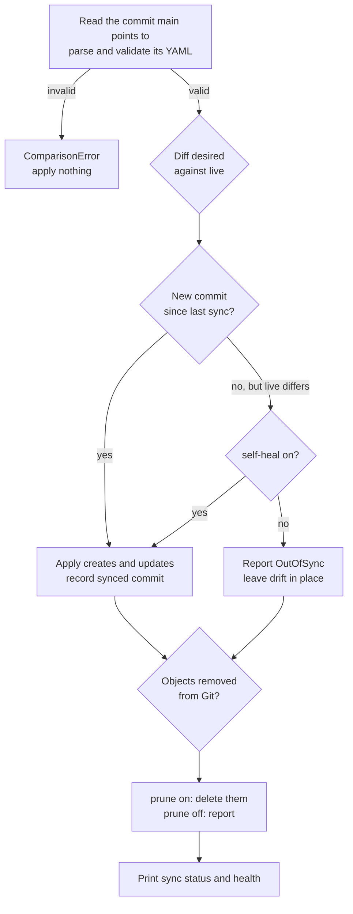

# Lab 13: GitOps reconciliation with a local Git repository

!!! abstract "Lab facts"
    **Level:** Intermediate · **Time:** 60-75 minutes · **Cost:** Free, local only (Git, Python,
    PyYAML; optional appendix: Docker, kind, Argo CD) · **Status:** Draft · **Last verified:**
    2026-11-27 (macOS, Python 3.14.7, Git 2.54.0; CI runs the smoke test on Python 3.12; the
    appendix was **not** executed, see [Review notes](#review-notes))

## Goal and expected result

You will run the loop that Argo CD and Flux run inside a cluster, small enough to read in one
sitting. Your **desired state** is a real Git repository you create with `git init`, holding the
YAML manifests of AtlasMart's Order Tracking app. The **cluster** is a JSON file of live objects.
The **reconciler**, `gitops_reconciler.py`, polls the `main` branch, diffs desired against live
state field by field, applies the difference, records the commit it synced, and prints sync status
lines in the style of a real GitOps tool. Four experiments follow: (a) a new commit converges the
cluster; (b) a hand edit of the live cluster is detected as drift, then reverted when self-heal is
on; (c) a bad commit is rolled back with `git revert`, after a hand fix on the cluster fails to
stick; (d) a manifest deleted from Git is removed from the cluster only when pruning is on. By the
end you should be able to explain, from your own output, why "Git is the source of truth" is a
property of the loop and its settings, not of the repository.

## Concepts practiced

- GitOps reconciliation, drift, pruning, pull versus push
  ([Cloud-native ecosystem tools](../containers-and-kubernetes/cloud-native-ecosystem-tools.md)).
- Controllers and the desired-versus-actual loop
  ([Kubernetes architecture and workloads](../containers-and-kubernetes/kubernetes-architecture-and-workloads.md)).
- The GitOps app as one step of the platform's "new service" golden path
  ([Platform engineering](../devops-and-platform-engineering/platform-engineering.md)).
- Rollback, deployment safety, and change failure
  ([CI/CD pipeline design and deployment strategies](../devops-and-platform-engineering/ci-cd-pipeline-design-and-deployment-strategies.md)).

## Prerequisites

- Knowledge: basic Git (`commit`, `log`, `revert`, `rm`); what a Deployment and a ConfigMap are.
- Completed labs: none required. [Lab 12](lab-12-local-kubernetes-deployment.md) helps with the
  optional appendix.

## Tools and versions

| Tool | Version tested | Install |
|---|---|---|
| Python | 3.14.7 locally; 3.12 in CI | <https://www.python.org/downloads/> |
| PyYAML | 6.0.3 (pinned in the repository's `requirements.txt`) | `pip install -r requirements.txt` in a virtual environment |
| Git | 2.54.0 (needs 2.28 or newer for `git init -b`) | <https://git-scm.com/downloads> |
| `perl` | any (used for a one-line file edit that works on macOS and Linux) | preinstalled on most systems |
| kind, Argo CD (optional appendix only) | v0.33.0 and v3.6.3; not executed | see the appendix |

## Cost and account warnings

!!! warning "Before you start"
    Everything runs on your machine in a temporary directory. No cloud account, cluster, API key, or
    payment is needed, and nothing is pushed anywhere: the Git repository has no remote. The
    reconciler only reads that repository and writes one JSON file. It never touches the Atlas
    repository's own Git history.

## Setup

1. Open `labs/local/lab-13-gitops-reconciliation/` in a terminal. It contains:

    | Path | What it is |
    |---|---|
    | `gitops_reconciler.py` | The reconciler, the simulated cluster, and the `demo` runner (about 520 lines) |
    | `starter-repo/apps/order-tracking/` | Four manifests: the Tracking API Deployment and its ConfigMap, the Webhook Ingestor, and a retired `legacy-poller` |

2. Activate the virtual environment that has PyYAML and check the tools: `python3 --version`,
   `python3 -c "import yaml"`, `git --version`.
3. Skim the docstring of `gitops_reconciler.py`, then `reconcile_once()`: it is the whole loop
   body. Note the three decisions near its end: apply on a new commit, apply on drift only with
   `--self-heal`, delete only with `--prune`.
4. Create the working directory and the desired-state repository. If Git has no identity
   configured, set one for this shell first (any name; the email can stay empty):

    ```bash
    export LAB13="$(mktemp -d)"
    export GIT_AUTHOR_NAME="Lab 13" GIT_COMMITTER_NAME="Lab 13" GIT_AUTHOR_EMAIL="" GIT_COMMITTER_EMAIL=""
    git init -b main "$LAB13/atlas-config"
    cp -R starter-repo/. "$LAB13/atlas-config/"
    git -C "$LAB13/atlas-config" add -A
    git -C "$LAB13/atlas-config" commit -m "Add order-tracking app"
    python3 gitops_reconciler.py init-cluster --cluster "$LAB13/cluster.json"
    ```

The simulated cluster starts empty with a list of images CI has "pushed" to the registry
(tracking-api 1.4.0 and 1.5.0, webhook-ingestor 2.1.0, legacy-poller 0.9.3). A Deployment whose
image is not in that list is **Degraded** with `ImagePullBackOff`, which is how experiment c's bad
release shows up.

**Figure 1 — What one poll of the reconciler does.** The same decisions as Argo CD's automated sync
with its `selfHeal` and `prune` options.



How to read it: a new commit is always applied, because merging to `main` is the deployment
decision. Drift without a new commit is the one case where the settings decide between correcting
and only reporting. Pruning is a separate, deliberate switch.

## Exercise

All commands run from `labs/local/lab-13-gitops-reconciliation/`. Short form used below:
`R="--repo $LAB13/atlas-config --cluster $LAB13/cluster.json"` (in zsh, write `${=R}` instead of
`$R` so the shell splits it).

### Step 1 — First sync

```bash
R="--repo $LAB13/atlas-config --cluster $LAB13/cluster.json"
python3 gitops_reconciler.py diff $R
python3 gitops_reconciler.py sync $R
```

`diff` shows four objects `OutOfSync` and `Missing` and applies nothing. `sync` creates them and
ends with `result: Synced to <commit>, app health Healthy`. Why is the health `Missing` before the
sync and not `Degraded`?

### Step 2 — Experiment a: a new commit converges the cluster

Change the Tracking API image from 1.4.0 to 1.5.0, but do **not** commit yet, and sync:

```bash
perl -pi -e 's/tracking-api:1\.4\.0/tracking-api:1.5.0/' "$LAB13/atlas-config/apps/order-tracking/tracking-api.yaml"
python3 gitops_reconciler.py sync $R
```

Nothing happens. Now commit, and start the loop as a controller would (two polls, one second
apart; use `--iterations 0` and Ctrl-C in a second terminal if you want it to run on):

```bash
git -C "$LAB13/atlas-config" commit -am "Release tracking-api 1.5.0"
python3 gitops_reconciler.py watch --interval 1 --iterations 2 $R
```

Poll 1 shows one field changing (`containers[0].image`) and `deployment.apps/tracking-api
configured`; poll 2 finds nothing to do. Why did the first `sync` ignore your edit?

### Step 3 — Experiment b: drift

Somebody scales the Tracking API down by hand "to save cost" and lengthens the cache TTL:

```bash
python3 gitops_reconciler.py edit-live --cluster "$LAB13/cluster.json" Deployment/order-tracking/tracking-api spec.replicas=1
python3 gitops_reconciler.py edit-live --cluster "$LAB13/cluster.json" ConfigMap/order-tracking/tracking-api-config data.STATUS_CACHE_TTL_SECONDS=300
python3 gitops_reconciler.py sync $R
python3 gitops_reconciler.py sync --self-heal $R
```

Without `--self-heal` the poll lists both drifted fields, says `not applied`, and the app stays
`OutOfSync`. With it, both objects are `configured` back to Git's values. What would on-call see if
self-heal stayed off for a week, and why might a team still choose to keep it off?

### Step 4 — Experiment c: a bad commit and a rollback

Release 1.6.0, whose image CI never pushed, then try to fix it on the cluster, then fix it in Git:

```bash
perl -pi -e 's/tracking-api:1\.5\.0/tracking-api:1.6.0/' "$LAB13/atlas-config/apps/order-tracking/tracking-api.yaml"
git -C "$LAB13/atlas-config" commit -am "Release tracking-api 1.6.0"
python3 gitops_reconciler.py sync --self-heal $R
python3 gitops_reconciler.py edit-live --cluster "$LAB13/cluster.json" "Deployment/order-tracking/tracking-api" "spec.template.spec.containers[0].image=registry.atlasmart.example/order-tracking/tracking-api:1.5.0"
python3 gitops_reconciler.py sync --self-heal $R
git -C "$LAB13/atlas-config" revert --no-edit HEAD
python3 gitops_reconciler.py sync --self-heal $R
git -C "$LAB13/atlas-config" log --oneline
```

Read the three `result:` lines. The first is `Synced` but `Degraded`: the cluster matches Git, and
Git is wrong. The hand fix is undone by the next poll. The revert makes a new commit, which the
reconciler applies like any release. Write down three reasons the revert is the better fix.

### Step 5 — Experiment d: pruning

Retire the legacy poller by deleting its manifest:

```bash
git -C "$LAB13/atlas-config" rm apps/order-tracking/legacy-poller.yaml
git -C "$LAB13/atlas-config" commit -m "Retire legacy poller"
python3 gitops_reconciler.py sync $R
python3 gitops_reconciler.py sync --prune $R
python3 gitops_reconciler.py history --cluster "$LAB13/cluster.json"
```

The first sync leaves the Deployment running and reports `requires pruning`; the second deletes
it. Why do real tools ship with pruning off?

### Step 6 — The whole lab in one command

```bash
python3 gitops_reconciler.py demo
```

`demo` repeats experiments a-d in a fresh temporary directory with a fixed Git identity and clock,
so its commit ids match the solution file exactly.

## Expected output

Experiment c from `demo`, from a real run (deterministic):

```text
--- poll 7  main@84fe51a "Release tracking-api 1.6.0"  self-heal=on prune=off
KIND       NAMESPACE       NAME                  STATUS     HEALTH
ConfigMap  order-tracking  tracking-api-config   Synced     Healthy
Deployment order-tracking  legacy-poller         Synced     Healthy
Deployment order-tracking  tracking-api          OutOfSync  Healthy
    ~ spec.template.spec.containers[0].image: tracking-api:1.5.0 -> tracking-api:1.6.0
Deployment order-tracking  webhook-ingestor      Synced     Healthy
sync: same revision, live state drifted: self-heal sync
  deployment.apps/tracking-api configured
result: Synced to 84fe51a, app health Degraded
```

The hand fix made the Tracking API healthy (`HEALTH Healthy` in the table), and self-heal put the
broken image back, because the repository still said 1.6.0. Summary of the four experiments:

| Experiment | Settings | Outcome | Key line |
|---|---|---|---|
| a new commit | defaults | Converged in one poll; next poll idle | `sync: new revision ... automated sync` |
| a uncommitted edit | defaults | Ignored | `sync: same revision, nothing to apply` |
| b drift | self-heal off | Reported, left in place, `OutOfSync` | `live state drifted: not applied` |
| b drift | self-heal on | Reverted, `Synced` | `live state drifted: self-heal sync` |
| c bad commit | self-heal on | `Synced`, `Degraded` | `ImagePullBackOff` in the live status |
| c hand fix | self-heal on | Undone by the next poll | `Synced to 84fe51a, app health Degraded` |
| c `git revert` | self-heal on | `Synced`, `Healthy`, revert in the log | `new revision 0238f4d ... automated sync` |
| d manifest removed | prune off / on | Kept and `OutOfSync` / deleted and `Synced` | `require pruning` / `legacy-poller pruned` |

The full output of every step is in the solution file linked below.

## Validation

- Experiment a: the sync before the commit applies nothing; after it, exactly one object is
  `configured` and the next poll prints `nothing to apply`.
- Experiment b: without `--self-heal`, `spec.replicas` stays 1 and the app is `OutOfSync`; with it,
  the app is `Synced` and `replicas` is 3 again.
- Experiment c: after the revert, `git log --oneline` shows the revert commit on top and the app is
  `Synced` and `Healthy`.
- Experiment d: `legacy-poller` survives a sync without `--prune` and is gone after one with it.
- The automated smoke test passes from the repository root:

```bash
python3 -m unittest tests.examples.test_lab13 -v
```

## Cleanup

Delete the working directory: `rm -rf "$LAB13"`. The `demo` subcommand and the smoke test clean up
their own temporary directories.

## Troubleshooting

| Symptom | Likely cause | Fix |
|---|---|---|
| `ModuleNotFoundError: No module named 'yaml'` | PyYAML is not installed in this Python | Activate the virtual environment that has `requirements.txt` installed |
| `error: unknown switch 'b'` from `git init` | Git older than 2.28 | Upgrade Git, or `git init` then `git checkout -b main` |
| `Author identity unknown` on commit | No Git identity configured | Run the `export GIT_AUTHOR_NAME=...` line from Setup |
| `ComparisonError: git rev-parse refs/heads/main` | The repository has no commit on `main` yet | Commit the starter manifests first |
| `--repo: expected one argument` or a path split oddly | zsh does not split `$R` | Use `${=R}` in zsh, or type the options in full |
| `ComparisonError: ... invalid YAML` | A manifest in the commit does not parse | Fix or revert the commit; nothing was applied |

## Stretch challenge

1. Commit a file `broken.yaml` whose content does not parse. Sync. What happened to the other
   objects, and why is "all or nothing" the right behavior for a sync? Revert the commit.
2. Add an `ignore_fields` option so the reconciler skips `spec.replicas` (as Argo CD's
   `ignoreDifferences` does). When does the Tracking API need it? (Hint: its autoscaler.)
3. Add a protection annotation that stops pruning of one object even with `--prune`, and use it on
   a namespace-like object that "holds data".
4. Turn self-heal off and repeat experiment c with the hand fix, then commit an unrelated ConfigMap
   change. Predict, then observe, what the new commit does to the hand-fixed image.

## Solution and hints

??? question "Hint 1: why the reconciler ignores the working tree"
    `load_desired()` asks Git for the commit `main` points to and reads each file with
    `git show <commit>:<path>`. An uncommitted edit is not in that commit. A real controller is
    stricter still: it reads a remote, so the change must also be pushed and, in most teams, merged
    through a reviewed pull request.

??? question "Hint 2: why the hand fix in experiment c is undone"
    Self-heal compares the live object with the last commit on `main`, which still says 1.6.0. It has
    no way to know the hand edit was a fix rather than drift; only a new commit changes what
    "correct" means.

??? success "Full solution"
    Real output of every step with commentary is in
    [`labs/solutions/lab-13/expected-results.md`](https://github.com/vinay9354/architecture-atlas/blob/main/labs/solutions/lab-13/expected-results.md)
    in the repository. Summary: commits, not files, are the unit of change; the loop is a diff that
    is safe to repeat; drift is always visible but corrected only with self-heal; Synced and Healthy
    answer different questions; rollback is a new commit; and pruning is opt-in because it turns a
    Git mistake into deleted workloads.

## Appendix: the same flow with kind and Argo CD (optional, not executed)

The real tool does what the script does, inside the cluster. This sketch reuses the
[Lab 12](lab-12-local-kubernetes-deployment.md) cluster. Versions were checked on the releases
pages on 2026-11-27: kind v0.33.0 (Lab 12's pin) and Argo CD v3.6.3. Flux v2.10.1 is the equivalent
alternative; its `Kustomization` has `prune` as a required field.

!!! note "Not executed"
    Docker, kind, and Argo CD were not run for this lab; the commands follow the Argo CD getting
    started and automated sync documentation and are untested here. Argo CD also needs the
    repository on a Git server it can reach (for example a local Git server Pod), which is
    beyond this sketch. Please report the actual results.

```bash
kind create cluster --name atlas-gitops
kubectl create namespace argocd
kubectl apply -n argocd --server-side --force-conflicts -f https://raw.githubusercontent.com/argoproj/argo-cd/v3.6.3/manifests/install.yaml
# Then create an Application whose source is your repository and path apps/order-tracking,
# destination namespace order-tracking, with:
#   syncPolicy:
#     automated:
#       prune: true      # experiment d
#       selfHeal: true   # experiment b
kubectl -n order-tracking scale deployment tracking-api --replicas=1   # drift: expect it to return to 3
kind delete cluster --name atlas-gitops
```

Expected, not observed: the Application reports `Synced` and `Healthy` after the first sync; the
manual scale is reverted shortly after with self-heal on; a commit with an image tag that does not
exist leaves the app `Synced` and `Degraded`; deleting a manifest deletes the Deployment only with
`prune: true`. With the lab's placeholder image names the Deployments will stay Degraded in a real
cluster unless you point them at images that exist, such as the tracking stub from Lab 12.

## Simplifications

- One app, one branch, no remote, no webhooks: the reconciler polls a local repository. Real
  controllers poll a remote (or receive a webhook), cache it, and render Kustomize or Helm first.
- The cluster is a JSON file with no API server, admission control, or rollout: "apply" is a write,
  and health is a registry lookup. Real health checks watch rollouts, probes, and conditions.
- The diff compares whole objects except `status`; real tools compare only fields they manage and
  ignore defaults the API server adds.
- Drift detection runs only when the loop polls. Argo CD's self-heal retries after a configurable
  self-heal timeout; check its documentation for current defaults and triggers.
- No sync waves, hooks, health-based rollback, or multi-cluster targeting.

## References

| Source | Type | Checked |
|---|---|---|
| [OpenGitOps principles](https://opengitops.dev/) — CNCF GitOps Working Group | Principles (declarative, versioned, pulled, continuously reconciled) | 2026-11-27 |
| [Automated sync policy](https://argo-cd.readthedocs.io/en/stable/user-guide/auto_sync/) — Argo CD | Official documentation (no pruning by default, self-heal, sync per commit) | 2026-11-27 |
| [Getting started](https://argo-cd.readthedocs.io/en/stable/getting_started/) — Argo CD | Official documentation (installation) | 2026-11-27 |
| [Argo CD v3.6.3 release](https://github.com/argoproj/argo-cd/releases/tag/v3.6.3) and [Flux v2.10.1 release](https://github.com/fluxcd/flux2/releases/tag/v2.10.1) | Release pages (version pins) | 2026-11-27 |
| [Kustomization](https://fluxcd.io/flux/components/kustomize/kustomizations/) — Flux | Official documentation (`.spec.prune` garbage collection) | 2026-11-27 |
| [`git revert`](https://git-scm.com/docs/git-revert) — Git documentation | Official documentation | 2026-11-27 |
| [kind](https://kind.sigs.k8s.io/) and [kind v0.33.0 release](https://github.com/kubernetes-sigs/kind/releases/tag/v0.33.0) | Official documentation and release page | 2026-11-27 |

## Review notes

- Executed: every reconciler command on this page (Python 3.14.7, PyYAML 6.0.3, Git 2.54.0, macOS)
  and the smoke test (7 tests, about 5 s). Not executed: the kind and Argo CD appendix (no Docker or
  cluster available); its expected results are predictions from the documentation.
- The `demo` commit ids are reproducible because `demo` fixes the author, committer, and dates and
  disables global Git configuration; the learner's own commit ids will differ.
- Lab assumptions: the image registry name and tags, the `legacy-poller` service, the cache-TTL drift
  value 300, and the tracking annotation `gitops.atlasmart.example/tracking-id`. The 3 replicas and
  1 vCPU / 1 GiB request for the Tracking API and the 3 Webhook Ingestor replicas come from existing
  AtlasMart assumptions.
- Argo CD's install URL pattern (`manifests/install.yaml` at the release tag) was checked to return
  HTTP 200 for v3.6.3; the `--server-side --force-conflicts` flags follow the current getting started
  page, which installs from the `stable` path rather than a tag.
