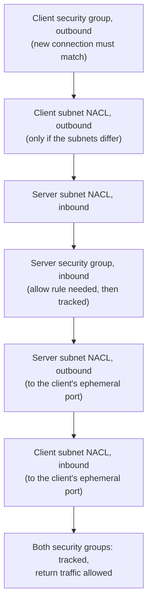

# Lab 14: Network segmentation with security groups and network ACLs

!!! abstract "Lab facts"
    **Level:** Intermediate · **Time:** 45-60 minutes · **Cost:** Free, local only, Python standard
    library (optional appendix: Docker) · **Status:** Draft · **Last verified:** 2026-11-21 (macOS,
    Python 3.14; CI runs the smoke test on Python 3.12)

## Goal and expected result

You will run a small simulator of one availability zone of AtlasMart's production network, using the
zone-a subnets from the [address plan](../networking/networking-fundamentals-ip-cidr-routing-and-dns.md):
public `10.10.0.0/22`, private-app `10.10.16.0/20`, and private-data `10.10.32.0/22`. Hosts in those
subnets try to open TCP connections; the simulator evaluates each packet against **security groups**
(stateful, attached to interfaces) and **network ACLs** (stateless, attached to subnets) and prints a
flow-log-style line saying ACCEPT or REJECT and which rule decided. No packets are sent. By the end you
should be able to show, from your own output, that a flat network lets a compromised web host reach
the database, that security groups stop it while the legitimate flow keeps working, that a network
ACL without an ephemeral-port return rule breaks a flow silently (and how the flow log reveals it),
and why rules that reference security groups survive scaling where rules by CIDR do not.

## Concepts practiced

- Segmentation, security groups, network ACLs, ephemeral ports, and control placement
  ([Network security architecture](../security-architecture/network-security-architecture.md)).
- Trust boundaries, least privilege, and defense in depth, and STRIDE finding T6 (a compromised
  Webhook Ingestor must not reach the database) from
  [Security principles and threat modeling](../security-architecture/security-principles-and-threat-modeling.md).
- CIDR containment and subnet planning from
  [Networking fundamentals](../networking/networking-fundamentals-ip-cidr-routing-and-dns.md).

## Prerequisites

- Knowledge: CIDR notation; what a TCP connection, a port, and a client's source port are
  ([Transport and application protocols](../networking/transport-and-application-protocols.md)).
- Completed labs: none required.

## Tools and versions

| Tool | Version tested | Install |
|---|---|---|
| Python | 3.14 locally; 3.12 in CI | <https://www.python.org/downloads/> or your package manager |
| Docker Engine with Compose v2 (optional appendix only) | Not executed for this lab (see the appendix) | <https://docs.docker.com/get-started/get-docker/> |

The simulator uses only the standard library (`ipaddress`, `random`, `argparse`, `json`).

## Cost and account warnings

!!! warning "Before you start"
    The simulator runs entirely on your machine as one Python process. It opens no network
    connections and needs no cloud account, API key, or payment. It writes a file only if you pass
    `--json`. The optional Docker appendix pulls a public Python image and publishes one port bound to
    `127.0.0.1` only.

## Setup

1. Clone or download the repository and open `labs/local/lab-14-network-segmentation/`.
2. Check Python: `python3 --version` should print 3.10 or newer.
3. Skim `segmentation_sim.py` (about 360 lines). The docstring lists the model's rules. The parts that
   matter: `security_groups()` and `network_acls()` (the rule sets for each experiment),
   `Nacl.evaluate()` (first matching numbered rule wins, else the implicit deny), and
   `Network.connect()` (the request packet, then the response packet).

The simulated zone, all of it lab assumptions built on the AtlasMart address plan:

| Host | Address | Subnet | Security group | Role |
|---|---|---|---|---|
| `web-1` | `10.10.0.10` | public-a `10.10.0.0/22` | `sg-web` | Internet-facing web or proxy host: the one we assume is compromised |
| `app-1` | `10.10.16.10` | app-a `10.10.16.0/20` | `sg-app` | Tracking API instance, legitimately uses the database |
| `ingest-1` | `10.10.16.20` | app-a `10.10.16.0/20` | `sg-ingest` | Webhook Ingestor, never needs the database |
| `app-2` | `10.10.48.10` | app-a2 `10.10.48.0/20` | `sg-app` | Tracking API after scale-out into zone a's reserved space |
| `db-1` | `10.10.32.10` | data-a `10.10.32.0/22` | `sg-db` | PostgreSQL primary, port 5432 |

In AtlasMart's real design the public subnets hold only load balancer nodes and the services run in
Kubernetes; the lab uses virtual-machine-style hosts so each tier has one interface to reason about.

**Figure 1 — The order in which the simulator checks each connection.** The request crosses four
checks; the response crosses two NACL checks and two automatic security-group passes.



How to read it: A to D is the request, E to G the response. Security groups appear once each and
remember the connection; NACLs appear twice each and remember nothing, so E and F need their own rules.

## Exercise

### Step 1 — Experiment a: the flat network

```bash
python3 segmentation_sim.py flat --rules
```

Every security group allows all TCP from `10.10.0.0/16` and every NACL allows everything. Read the two
results. Each flow prints a summary (`CONNECTED` or `TIMEOUT: request|response dropped by ...`) and the
flow-log lines: the interface that logged it, source and destination with ports, protocol, the action,
and `by=` the checks the packet passed or the rule that rejected it. Note that `web-1`, the host an
attacker would compromise first because it faces the internet, reaches the database.

### Step 2 — Experiment b: segmented with security groups

```bash
python3 segmentation_sim.py segmented --rules
```

Now `sg-web` accepts 443 from anywhere, `sg-app` and `sg-ingest` accept 8080 only from `sg-web`, and
`sg-db` accepts 5432 only from `sg-app`. Answer in writing:

1. Which rule stopped `web-1 -> db-1:5432`, and on which interface was it logged?
2. Why is `ingest-1 -> db-1:5432` rejected even though `ingest-1` is in the same subnet as `app-1`?
3. The response lines say `sg-db tracked`. Why does `sg-db` need no outbound rule for the reply?

### Step 3 — Experiment c: a NACL that forgets the ephemeral ports

```bash
python3 segmentation_sim.py nacl --rules
```

A network ACL is added to the data subnet. Inbound: rule 50 denies everything from the public subnet
`10.10.0.0/22` (an explicit deny), rule 100 allows TCP 5432 from the app subnet. Outbound in the
broken version: rule 100 allows TCP **5432** to the app subnet, a mirror image of the inbound rule.
Before running, predict what `app-1` sees. Then read the two flow-log lines for `app-1 -> db-1:5432`
in the `data-broken` phase: both are on `eni-db-1`. What does the pair tell an on-call engineer that
the client's error ("connection timed out") does not? Compare with the `data-fixed` phase, where
outbound rule 100 allows TCP 1024-65535.

### Step 4 — Experiment d: CIDR versus group references when the tier scales

```bash
python3 segmentation_sim.py scale
```

Three phases. First `sg-db` allows 5432 from the CIDR `10.10.16.0/20`; then from the group `sg-app`;
then from `sg-app` but with the data-subnet NACL from Step 3 still in place. In each, `app-1` (old
subnet), `app-2` (new subnet `10.10.48.0/20`), and `ingest-1` try to reach the database. Fill in a
3 × 3 table of outcomes and explain the two different ways the CIDR rule is wrong, and why the third
phase still fails for `app-2`.

### Step 5 — Change the seed

```bash
python3 segmentation_sim.py all --seed 1
```

Only the ephemeral source ports change; every outcome stays the same. Use `--json results.json` if
you want the results in a file.

## Expected output

Step 3, broken phase, from a real run (deterministic for the default seed 14):

```text
-- security groups: group, network ACLs: data-broken
app-1 -> db-1:5432     TIMEOUT: response dropped by nacl-data out * (implicit deny)
    eni-db-1     10.10.16.10:36268 -> 10.10.32.10:5432 tcp ACCEPT by=sg-app out#1 > nacl-app out 100 > nacl-data in 100 > sg-db in#1
    eni-db-1     10.10.32.10:5432 -> 10.10.16.10:36268 tcp REJECT by=nacl-data out * (implicit deny)
web-1 -> db-1:5432     TIMEOUT: request dropped by nacl-data in 50 deny
    eni-db-1     10.10.0.10:52949 -> 10.10.32.10:5432 tcp REJECT by=nacl-data in 50 deny
```

The request was accepted all the way to the database; the reply to port 36268 matched no outbound
rule. Provider flow logs show the same ACCEPT-then-REJECT pair for this mistake (the AWS flow log
examples page documents it for a NACL that permits a request but not its response), although they do
not record which rule decided; the `by=` column is this simulator's teaching aid.

Summary of all four experiments:

| Experiment | Flow | Outcome | Decided by |
|---|---|---|---|
| a flat | `web-1 -> db-1:5432` | CONNECTED | everything allows |
| b segmented | `web-1 -> db-1:5432` | TIMEOUT (request) | `sg-db in` (no allow rule matched) |
| b segmented | `app-1 -> db-1:5432` | CONNECTED | `sg-db in#1` |
| c data-broken | `app-1 -> db-1:5432` | TIMEOUT (response) | `nacl-data out *` (implicit deny) |
| c data-fixed | `app-1 -> db-1:5432` | CONNECTED | `nacl-data out 100` |
| d cidr | `app-2 -> db-1:5432` / `ingest-1 -> db-1:5432` | TIMEOUT / CONNECTED | `sg-db in` / `sg-db in#1` |
| d group | `app-2 -> db-1:5432` / `ingest-1 -> db-1:5432` | CONNECTED / TIMEOUT | `sg-db in#1` / `sg-db in` |
| d group + NACL | `app-2 -> db-1:5432` | TIMEOUT (request) | `nacl-data in *` (implicit deny) |

The full output of every step is in the solution file linked below.

## Validation

- Experiment a: `web-1 -> db-1:5432` is `CONNECTED`.
- Experiment b: `web-1 -> db-1:5432` times out at `sg-db in`, and `app-1 -> db-1:5432` connects.
- Experiment c: the broken phase drops the **response** at `nacl-data out *`, with an ACCEPT line
  followed by a REJECT line on `eni-db-1`; the fixed phase connects.
- Experiment d: the CIDR rule blocks `app-2` and admits `ingest-1`; the group rule does the opposite.
- The automated smoke test passes from the repository root:

```bash
python3 -m unittest tests.examples.test_lab14 -v
```

## Cleanup

Nothing to stop. Delete `results.json` if you created it. If you ran the optional appendix, run
`docker compose down` in the `compose/` directory.

## Troubleshooting

| Symptom | Likely cause | Fix |
|---|---|---|
| `error: argument experiment: invalid choice` | A typo in the experiment name | Use `flat`, `segmented`, `nacl`, `scale`, or `all` |
| Your ports differ from the sample | A different `--seed` | Ports are seeded; outcomes do not depend on them |
| You edited a rule and a flow inside one subnet ignores your NACL | NACLs are evaluated only when traffic crosses a subnet boundary | Expected; use a security group for traffic within a subnet |
| `SyntaxError` on start | Python older than 3.10 | Use Python 3.10 or newer |

## Stretch challenge

1. Renumber the explicit deny from 50 to 150 in `network_acls()` and add a rule 100 that allows all
   traffic from `10.10.0.0/16`. Run Step 3 again: does the deny still fire? Explain with "first match
   wins".
2. Add egress rules to `sg-db` that allow nothing (replace the default allow-all). Do any flows break?
   Why not, and what would an egress rule on the database protect against?
3. Fix the third phase of Step 4 two ways: add a NACL rule for `10.10.48.0/20`, or change the address
   plan so both app subnets fall under one summary. Which is better, given the plan in the networking
   page?
4. Add a `ping` (ICMP) flow type and show the AWS flow-log example's pattern for ICMP.

## Solution and hints

??? question "Hint 1: why the database answers but the client never hears it"
    The client chose source port 36268. The reply leaves the database addressed to port 36268, and
    the data subnet's outbound NACL allows only destination port 5432. Nothing matches, so the
    implicit deny drops it, silently.

??? question "Hint 2: the two faults of the CIDR rule"
    `10.10.16.0/20` describes where hosts are, not what they are. It omits a legitimate host that
    moved (`app-2` in `10.10.48.0/20`) and includes an illegitimate one that happens to live there
    (`ingest-1`).

??? success "Full solution"
    Real output of every step with commentary is in
    [`labs/solutions/lab-14/expected-results.md`](https://github.com/vinay9354/architecture-atlas/blob/main/labs/solutions/lab-14/expected-results.md)
    in the repository. Summary: a flat network gives an attacker on the web tier the database; group
    references let only the app tier through; stateless filters need return rules for ephemeral ports
    and fail as timeouts that only flow logs explain; CIDR rules drift as the address plan changes,
    and NACLs, which only know CIDRs, must be updated whenever a tier gains a subnet.

## Appendix: the same idea with Docker networks (optional, not executed)

`labs/local/lab-14-network-segmentation/compose/docker-compose.yml` defines three stand-in services
from the `python:3.12-alpine` image: `web` on a `frontend` network, `db` on a `data` network marked
`internal: true` (the Compose specification describes this as an externally isolated network), and
`app` on both. Docker networks segment by reachability only: there are no port rules, so anything on
a shared network can reach any port.

!!! note "Not executed"
    Docker Engine was installed but not running when this lab was written, so none of the commands
    below were run by the author. The expected results are predictions from the Compose
    documentation; the smoke test only parses the file. Please report the actual results.

```bash
cd labs/local/lab-14-network-segmentation/compose
docker compose up -d
docker compose exec web python -c "import socket; socket.create_connection(('db', 5432), timeout=3); print('web reached db')"
docker compose exec app python -c "import socket; socket.create_connection(('db', 5432), timeout=3); print('app reached db')"
docker compose down
```

Expected, not observed: the `web` probe fails because `web` and `db` share no network (the name `db`
should not even resolve from `web`), and the `app` probe prints `app reached db`. A further probe of
an internet address from `db` should fail because the data network is internal.

## Simplifications

- One zone, one interface per host, TCP only, no ICMP, no NAT, no routes; every subnet can route to
  every other, as inside one cloud virtual network.
- Security groups are evaluated as a union of allow rules; egress is allow-all unless you change it.
  Real providers add limits, defaults, and details (for example, how existing tracked connections
  behave after a rule change); check your provider's current documentation.
- Flow-log lines are written on the interface where the packet's fate was decided. Real flow logs
  record traffic at each interface it passes, aggregate packets over an interval, and do not say
  which rule decided.
- Hosts are virtual-machine style. In Kubernetes, pods usually share their node's security group,
  so workload-level separation needs NetworkPolicy or per-pod groups (see the network security page).

## References

| Source | Type | Checked |
|---|---|---|
| [Control subnet traffic with network ACLs](https://docs.aws.amazon.com/vpc/latest/userguide/vpc-network-acls.html) — AWS | Official documentation (rule order, statelessness, evaluated only at subnet boundaries) | 2026-11-21 |
| [Custom network ACLs, including ephemeral ports](https://docs.aws.amazon.com/vpc/latest/userguide/custom-network-acl.html) — AWS | Official documentation (1024-65535 recommendation) | 2026-11-21 |
| [Security groups](https://docs.aws.amazon.com/vpc/latest/userguide/vpc-security-groups.html) — AWS | Official documentation | 2026-11-21 |
| [Flow log record examples](https://docs.aws.amazon.com/vpc/latest/userguide/flow-logs-records-examples.html) — AWS | Official documentation (ACCEPT then REJECT for a NACL without a return rule) | 2026-11-21 |
| [IP sysctl: `ip_local_port_range`](https://docs.kernel.org/networking/ip-sysctl.html) — Linux kernel documentation | Official documentation (default 32768-60999) | 2026-11-21 |
| [Compose file reference: networks](https://docs.docker.com/reference/compose-file/networks/) — Docker | Official documentation (`internal`) | 2026-11-21 |
| [`ipaddress` module](https://docs.python.org/3/library/ipaddress.html) — Python documentation | Official documentation | 2026-11-21 |

## Review notes

- Executed: every simulator command on this page (Python 3.14.7, macOS) and the smoke test. Not
  executed: the Docker appendix (Docker Engine not running); its expected results are predictions.
- `app-2`'s subnet `10.10.48.0/20` is taken from zone a's reserved space in the address plan; the
  hosts, ports, security groups, and NACLs are lab assumptions. The image tag `python:3.12-alpine`
  was confirmed to exist on Docker Hub on 2026-11-21.
- The `by=` column is not a real flow-log field; the page says so twice.
