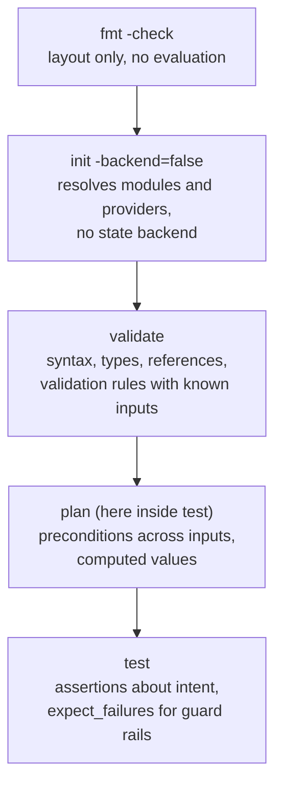

# Lab 15: Create an infrastructure module and run static checks

!!! abstract "Lab facts"
    **Level:** Intermediate · **Time:** 60-75 minutes · **Cost:** Free, local only, no cloud account ·
    **Status:** Draft · **Last verified:** 2026-11-21 (macOS, Terraform v1.15.6; OpenTofu not run)

## Goal and expected result

You will work with a small infrastructure-as-code module, `network-plan`, that turns three inputs (a
supernet CIDR block, a list of availability zones, and a set of subnet tiers with sizes) into a map
of subnets. It declares no providers and creates no resources: it only calculates. That makes it a
safe place to practise the checks every real module should pass before anyone runs `apply`:
formatting (`fmt -check`), initialization without a backend (`init -backend=false`), static
validation (`validate`), and the built-in test framework (`test`) with plan-only assertions and
negative tests. A root example feeds the module AtlasMart's production inputs and must reproduce,
prefix for prefix, the address plan from
[Networking fundamentals](../networking/networking-fundamentals-ip-cidr-routing-and-dns.md#worked-example-atlasmarts-cloud-network).
By the end you should be able to say which check catches which class of mistake, and why a
configuration can be valid and still wrong.

## Concepts practiced

- CIDR arithmetic and zone-first address plans
  ([Networking fundamentals: IP, CIDR, routing, and DNS](../networking/networking-fundamentals-ip-cidr-routing-and-dns.md)).
- Infrastructure as code, reusable modules, and the checks a pipeline runs before a plan reaches a
  human ([Multi-account strategy and infrastructure automation](../cloud-architecture/multi-account-strategy-and-infrastructure-automation.md);
  the deeper IaC topic is planned as D16-T03).
- Input validation at a trust boundary, here the boundary between a module's author and its callers
  ([Software design principles and clean code](../foundations/software-design-principles-and-clean-code.md)).
- Positive and negative tests, and testing the guard rails themselves
  ([Software testing types and strategies](../foundations/software-testing-types-and-strategies.md)).

## Prerequisites

- Knowledge: CIDR notation and splitting a prefix into smaller blocks (the first half of the
  networking fundamentals page); how to run commands in a terminal.
- Completed labs: none required.

## Tools and versions

| Tool | Version tested | Install |
|---|---|---|
| Terraform | v1.15.6 (the module requires 1.6.0 or later) | <https://developer.hashicorp.com/terraform/install> |
| OpenTofu (alternative) | not run for this lab; 1.6.0 or later is required | <https://opentofu.org/docs/intro/install/> |
| Python (optional, for the smoke test) | 3.14 locally; 3.12 in CI | the repository's `.venv` |

You need **one** of Terraform or OpenTofu. Every command below has the same form for both: replace
`terraform` with `tofu`. Why 1.6.0: it is the release in which `terraform test` (and, in OpenTofu,
`tofu test`) became generally available with `.tftest.hcl` files of `run` blocks, according to both
projects' 1.6.0 changelogs. Variable `validation` blocks and output `precondition` blocks are older.

**Licences, stated factually.** The Terraform repository's `LICENSE` file names Terraform 1.6.0 and
later as licensed under the Business Source License 1.1 (BUSL); the file in the 1.5.7 release tag is
the Mozilla Public License 2.0. OpenTofu, a fork maintained under the Linux Foundation, is licensed
under MPL 2.0 according to its repository's `LICENSE` file. Both read the `.tf` and `.tftest.hcl`
files in this lab. This is a description, not legal advice: whether a licence's terms affect a
particular use depends on facts; ask counsel.

**Optional extra scanners.** Linters and policy scanners such as
[TFLint](https://github.com/terraform-linters/tflint), [Checkov](https://www.checkov.io/), and
`trivy config` from [Trivy](https://trivy.dev/) look for provider-specific mistakes and insecure
settings in real modules. This module has no providers or resources, so they have little to inspect;
they were not run for this lab and no output is claimed for them.

## Cost and account warnings

!!! warning "Before you start"
    This lab runs entirely on your machine. The module declares no providers, so `init` downloads no
    plugins and no command talks to a cloud API. No cloud account, credentials, or payment are
    needed, and nothing is created anywhere. Never run `apply` with real credentials on a module you
    are only learning from.

## Setup

1. Copy the lab out of the repository so the files `init` creates never end up in a commit:

    ```bash
    cp -R labs/local/lab-15-infrastructure-module-and-static-checks ~/lab15
    cd ~/lab15
    export CHECKPOINT_DISABLE=1   # optional: stops Terraform's background version check
    terraform version
    ```

2. Look at the layout:

    ```text
    lab15/
    ├── modules/network-plan/          the reusable module
    │   ├── versions.tf                required_version >= 1.6.0, no providers
    │   ├── variables.tf               four inputs, twelve validation rules
    │   ├── main.tf                    locals: cidrsubnet() arithmetic
    │   ├── outputs.tf                 zone_cidrs, subnets, subnets_flat, reserved_zone_cidrs
    │   └── tests/network_plan.tftest.hcl   1 positive run, 8 negative runs
    └── atlasmart-prod/                a root module that calls the module
        ├── main.tf                    AtlasMart's prod inputs and outputs
        └── tests/atlasmart_prod.tftest.hcl  asserts every documented prefix
    ```

3. Read `modules/network-plan/main.tf` first (under 40 lines). The core of the module is two
   `cidrsubnet()` calls: one cuts the supernet into zone blocks, the other cuts each zone block into
   tiers.

The AtlasMart inputs, all of them documented course assumptions for a fictional company:

| Input | Value | Meaning |
|---|---|---|
| `supernet_cidr` | `10.10.0.0/16` | the prod virtual network |
| `zones` | `["a", "b", "c"]` | three availability zones |
| `zone_newbits` | `2` | /16 + 2 bits = four /18 zone blocks; three used, one reserved |
| `tiers.public` | `/22`, index 0 | third octet +0 inside each zone block |
| `tiers.private-app` | `/20`, index 1 | third octet +16 (a /20 is 16 third-octet values wide) |
| `tiers.private-data` | `/22`, index 8 | third octet +32 (8 × 4) |

`index` counts blocks **of the tier's own size** from the start of the zone block, which is exactly
what the third argument of `cidrsubnet(prefix, newbits, netnum)` means.

## Exercise

**Figure 1 — The checks in the order a pipeline runs them, and what each one sees.** Each stage
needs everything to its left to pass.



How to read it: moving down, each check evaluates more of the configuration and catches subtler
mistakes, at the cost of needing more context (initialized modules, then real values). None of them
needs credentials for this module; for a real module, `plan` usually does, which is why the static
checks run first and in every pull request.

### Step 1 — Formatting

```bash
terraform fmt -check -recursive
echo $?
```

It prints nothing and exits 0. Now open `atlasmart-prod/main.tf`, delete one of the two spaces
before `=` in `zone_newbits  = 2`, and run the check again. It lists the file and exits 3. See the
change it wants, then let it fix the file:

```bash
terraform fmt -recursive -diff
terraform fmt -check -recursive && echo clean
```

### Step 2 — Initialize without a backend

```bash
cd modules/network-plan && terraform init -backend=false && ls -A
cd ../../atlasmart-prod && terraform init -backend=false && ls -A
```

Questions to answer in writing:

1. Which directory gained a `.terraform/` directory, and what file is inside it?
2. Why is there no `.terraform.lock.hcl` in either directory? What would make one appear?
3. What does `-backend=false` skip, and why is that the right choice in a pull-request check?

### Step 3 — Validate

Run `terraform validate` in both directories. Both print `Success! The configuration is valid.`
Then read `modules/network-plan/variables.tf` and list the twelve validation rules in your own words.
For each rule, write one bad input that should trigger it.

### Step 4 — Run the tests

```bash
cd ../modules/network-plan && terraform test
cd ../../atlasmart-prod && terraform test
```

You should see `9 passed, 0 failed` and `1 passed, 0 failed`. Open the two `.tftest.hcl` files. Every
`run` block uses `command = plan`, so nothing is applied and no state is kept. Eight of the module's
runs use `expect_failures`: they pass only if the named variable or output **does** report an error.

### Step 5 — Plan the AtlasMart network

```bash
terraform plan
```

Compare every prefix in the output with the zone table in Step 3 of the networking fundamentals
worked example. The plan says "Changes to Outputs" only: there are no resources to create.

### Step 6 — Break it on purpose

Make each change in `atlasmart-prod/main.tf`, run the commands shown, note which check catches it,
then undo the change.

| Change | Run | Question |
|---|---|---|
| `"private-data" = { prefix_length = 22, index = 9 }` | `validate`, then `test` | Why does `validate` accept a subnet that is wrong? |
| `zones = ["a", "b", "a"]` | `validate` | Which file and line does the error point at? |
| `zones = ["a", "b", "c", "d", "e"]` | `validate`, then `plan` | Why can a `validation` block on `zones` not catch this? |
| `"private-app" = { prefix_length = 20, index = 0 }` | `validate` | What do the public and private-app ranges have in common? |

Then, in `modules/network-plan/variables.tf`, delete the validation block that checks
`length(distinct(var.zones)) == length(var.zones)` and run `terraform test` in that directory. Read
both errors. Put the block back.

### Step 7 — The same with OpenTofu, and the smoke test

If you have OpenTofu, repeat Steps 1-4 with `tofu fmt -check -recursive`, `tofu init -backend=false`,
`tofu validate`, and `tofu test` (these were not run when this lab was written). From the repository
root, the automated smoke test runs both layers of checks:

```bash
.venv/bin/python -m unittest tests.examples.test_lab15 -v
```

It copies the lab to a temporary directory before calling `terraform` or `tofu`, so it never leaves
a `.terraform/` directory in the repository, and it skips the tool checks cleanly when neither tool
is installed.

## Expected output

The module's tests (deterministic: the same files give the same output with any supported version):

```text
$ terraform test
tests/network_plan.tftest.hcl... in progress
  run "two_zone_practice_plan"... pass
  run "rejects_a_value_that_is_not_a_cidr"... pass
  run "rejects_host_bits_in_the_supernet"... pass
  run "rejects_a_single_zone"... pass
  run "rejects_seven_zones"... pass
  run "rejects_duplicate_zone_names"... pass
  run "rejects_overlapping_tiers"... pass
  run "rejects_more_zones_than_zone_blocks"... pass
  run "rejects_a_tier_larger_than_its_zone"... pass
tests/network_plan.tftest.hcl... tearing down
tests/network_plan.tftest.hcl... pass

Success! 9 passed, 0 failed.
```

The plan for AtlasMart prod (trimmed):

```text
Changes to Outputs:
  + reserved_zone_cidrs = [
      + "10.10.192.0/18",
    ]
  + subnets             = {
      + a = {
          + private-app  = "10.10.16.0/20"
          + private-data = "10.10.32.0/22"
          + public       = "10.10.0.0/22"
        }
      + b = {
          + private-app  = "10.10.80.0/20"
          + private-data = "10.10.96.0/22"
          + public       = "10.10.64.0/22"
        }
      + c = {
          + private-app  = "10.10.144.0/20"
          + private-data = "10.10.160.0/22"
          + public       = "10.10.128.0/22"
        }
    }
  + zone_cidrs          = {
      + a = "10.10.0.0/18"
      + b = "10.10.64.0/18"
      + c = "10.10.128.0/18"
    }
```

The full recorded output of every step, including the four deliberate breakages, is in the solution
file linked below.

## Validation

- `terraform fmt -check -recursive` exits 0 in the lab root.
- `terraform validate` succeeds in both `modules/network-plan` and `atlasmart-prod`.
- `terraform test` reports `9 passed, 0 failed` in the module and `1 passed, 0 failed` in the example.
- The plan's nine subnets and three zone blocks match the networking page exactly, and
  `10.10.192.0/18` is reported as reserved.
- After `init`, neither directory contains `.terraform.lock.hcl` and neither contains a state file.
- The smoke test passes from the repository root:

```bash
.venv/bin/python -m unittest tests.examples.test_lab15 -v
```

## Cleanup

If you worked in a copy, delete that folder (for example `~/lab15`) when you are done. If you ran
commands inside the repository by mistake, nothing will be committed: the repository's `.gitignore`
excludes `.terraform/` folders and state files. You can still delete the `.terraform` folders under
`labs/local/lab-15-infrastructure-module-and-static-checks/` by hand if you want a clean tree.

Nothing else was created; no cloud resource exists.

## Troubleshooting

| Symptom | Likely cause | Fix |
|---|---|---|
| `Unsupported Terraform Core version` | Terraform older than 1.6.0 | Install a current release; `test` does not exist before 1.6.0 |
| `Module not installed` from `validate` in `atlasmart-prod` | `init` was not run in that directory | Run `terraform init -backend=false` there first |
| An assertion fails with `LHS and RHS values are of different types` | Comparing an object with a map, or a tuple with a list | Wrap the literal in `tomap()` or `tolist()`; the module's outputs are maps and lists on purpose |
| `terraform test` fails with `Missing expected failure` | The input you expected to be rejected was accepted | A validation rule is missing or too loose; that is the test doing its job |
| A prompt says Terraform is out of date | The version check contacted the release service | Harmless; set `CHECKPOINT_DISABLE=1` to turn it off |
| `.terraform/` appears in `git status` | Commands were run inside the repository | Use the cleanup command above; work in a copy next time |

## Stretch challenge

1. Add an optional `reserved_tiers` input: blocks inside each zone that no tier may use (for example
   a future second application subnet at `10.10.48.0/20`). Extend the overlap validation and add a
   negative test.
2. Add an IPv6 mode: given a `/56`, produce one `/64` per zone and tier. Which validation rules
   change, and which `cidrsubnet()` arguments?
3. Add a second root example for staging (`10.20.0.0/16`) and dev (`10.30.0.0/16`). Write one test
   that proves the three environments never overlap.
4. Write the same plan as a small Python script with the `ipaddress` module and compare the
   development experience: where do the two kinds of check (validation versus tests) live in each?

## Solution and hints

??? question "Hint 1: why validate accepts index 9"
    `10.10.36.0/22` is a well-formed, correctly aligned block inside zone a that overlaps no other
    tier. Every rule the module can state about its inputs is satisfied. Only a test that knows the
    intended plan (`10.10.32.0/22`) can tell that it is wrong: validation checks that inputs are
    *acceptable*, tests check that the result is *intended*.

??? question "Hint 2: why five zones passes validate"
    The rule on `zones` allows 2 to 6 entries, and 5 is in range. The problem is the combination of
    5 zones and `zone_newbits = 2`, which leaves only four slots. A validation block that compares
    two variables needs Terraform 1.9.0 or later (its changelog lists the change); this module
    keeps `required_version` at 1.6.0 and uses an output precondition instead, which is evaluated
    during `plan`.

??? success "Full solution"
    Recorded output for every step is in
    [`labs/solutions/lab-15/expected-results.md`](https://github.com/vinay9354/architecture-atlas/blob/main/labs/solutions/lab-15/expected-results.md)
    in the repository. Summary: `fmt -check` catches layout only; `validate` catches syntax, types,
    references, and single-input validation rules; `plan` adds preconditions that relate several
    inputs; `test` catches a configuration that is valid but not what was intended, and its
    `expect_failures` runs fail if someone weakens a validation rule. A provider-free module needs no
    downloads, lock file, credentials, or state, which is why it is a good unit for fast checks.

## Simplifications

- Real network modules create resources (virtual networks, subnets, route tables) through a
  provider. Then `init` downloads plugins and writes a dependency lock file that is committed,
  `plan` needs credentials, and tests often use mocked providers or a disposable account. This lab
  stops before any of that.
- The module handles IPv4 only and assumes every zone gets every tier at the same offset, as the
  AtlasMart plan does. Providers reserve some addresses in each subnet; check your provider's current
  documentation before sizing small subnets.
- One test file per root is enough here. Larger modules split tests by concern and run the slow ones
  (that apply real resources) less often.
- The statement that cross-variable validation needs 1.9 comes from the Terraform 1.9.0 changelog;
  this lab does not use the feature.

## References

| Source | Type | Checked |
|---|---|---|
| [Tests](https://developer.hashicorp.com/terraform/language/tests) — Terraform documentation | Official documentation (`run`, `assert`, `command = plan`, `expect_failures`) | 2026-11-21 |
| [cidrsubnet function](https://developer.hashicorp.com/terraform/language/functions/cidrsubnet) — Terraform documentation | Official documentation | 2026-11-21 |
| [Custom conditions](https://developer.hashicorp.com/terraform/language/expressions/custom-conditions) and [Input variables](https://developer.hashicorp.com/terraform/language/values/variables) — Terraform documentation | Official documentation (validation blocks, preconditions) | 2026-11-21 |
| [Terraform v1.6.0 release](https://github.com/hashicorp/terraform/releases/tag/v1.6.0), [Terraform v1.9.0 release](https://github.com/hashicorp/terraform/releases/tag/v1.9.0), and [OpenTofu v1.6.0 release](https://github.com/opentofu/opentofu/releases/tag/v1.6.0) | Release notes (`test` generally available in 1.6.0; cross-object validation in 1.9.0) | 2026-11-21 |
| [`tofu test` command](https://opentofu.org/docs/cli/commands/test/) — OpenTofu documentation | Official documentation (`.tftest.hcl` and `.tofutest.hcl` files) | 2026-11-21 |
| [Terraform LICENSE (main)](https://github.com/hashicorp/terraform/blob/main/LICENSE), [Terraform LICENSE (v1.5.7)](https://github.com/hashicorp/terraform/blob/v1.5.7/LICENSE), [OpenTofu LICENSE](https://github.com/opentofu/opentofu/blob/main/LICENSE) | Primary licence texts | 2026-11-21 |
| [Basic CLI features](https://developer.hashicorp.com/terraform/cli/commands) — Terraform documentation | Official documentation (`CHECKPOINT_DISABLE`) | 2026-11-21 |
