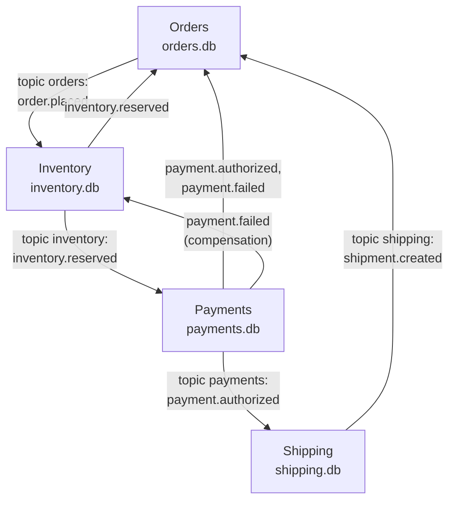
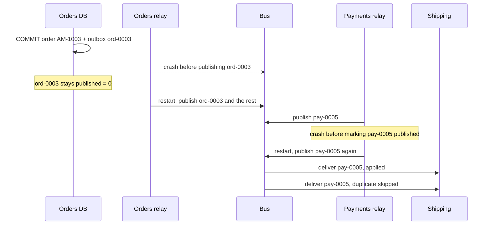

# Lab 16: Build a simple event-driven workflow

!!! abstract "Lab facts"
    **Level:** Intermediate · **Time:** 60-75 minutes · **Cost:** Free, local only, Python standard
    library (`sqlite3`) · **Status:** Draft · **Last verified:** 2026-11-27 (macOS, Python 3.14 and
    3.9; CI runs the smoke test on Python 3.12)

## Goal and expected result

You will run a small order workflow made of four services (Orders, Inventory, Payments, Shipping),
each with its own SQLite database. No service calls another: each reacts to events and publishes its
own, so the order saga is **choreographed**. Every state change and its outgoing event are written in
one local transaction (a **transactional outbox**); a **relay** publishes outbox rows to an in-process
**event bus** with topics, attribute filters, and at-least-once delivery that you can make duplicate
and reorder deliveries on purpose. Consumers are **idempotent**: each records `(source, id)` of every
event it handles in a `processed_events` table in the same transaction as its effect. By the end you
should be able to show, from your own output, that a crash between commit and publish loses nothing,
that duplicates and reordering leave the final state unchanged (and what they do to naive consumers),
that a declined card triggers a compensation that puts the stock back, and that a naive dual write
loses one order and invents another.

## Concepts practiced

- Events vs commands, routing and filtering, CloudEvents-shaped envelopes, ordering rules, replay,
  choreography, CDC, and the transactional outbox from
  [Event-driven architecture](../messaging-and-streaming/event-driven-architecture.md).
- At-least-once delivery, acknowledgments, and idempotent consumers from
  [Message queues and brokers](../messaging-and-streaming/message-queues-and-brokers.md).
- Dual writes, sagas, and compensating transactions from
  [Transactions, sagas, and delivery guarantees](../distributed-systems/transactions-sagas-and-delivery-guarantees.md).

## Prerequisites

- Knowledge: reading a short Python program; basic SQL (`INSERT`, `UPDATE`, primary keys).
- Completed labs: none required. [Lab 04](lab-04-idempotency-and-duplicates.md) introduces the inbox
  table that this lab calls `processed_events`.

## Tools and versions

| Tool | Version tested | Install |
|---|---|---|
| Python | 3.14 and 3.9 locally; 3.12 in CI | <https://www.python.org/downloads/> or your package manager |
| sqlite3 module | the one bundled with Python | nothing to install |
| `sqlite3` command-line shell (optional, Step 2) | the one bundled with macOS | <https://sqlite.org/download.html>, or use Python instead |

## Cost and account warnings

!!! warning "Before you start"
    Everything runs in one Python process on your machine. No network, cloud account, payment
    provider, or API key is involved; "payments" are rows in a SQLite table and the card outcomes
    are the fixed strings `test-card-ok` and `test-card-declined`. Each experiment writes four small
    SQLite files to a temporary directory that is deleted at the end, unless you pass `--keep DIR`.

## Setup

1. Clone or download the repository and open `labs/local/lab-16-event-driven-workflow/`.
2. Check Python: `python3 --version`.
3. Skim the three files. The parts that matter:

| File | What to read |
|---|---|
| `lab16_bus.py` | `make_event()` (the envelope), `publish()` (topics and type filters), `deliver_one()` (the two faults) |
| `lab16_services.py` | `Service.emit()` and `Service.handle()`, then each service's `on_...` handlers; `OrdersService.place_order()` vs `place_order_dual_write()`; `OutboxRelay.run_once()` |
| `lab16_workflow.py` | `SUBSCRIPTIONS` (who listens to what), `drain()`, and `check()` (the business invariants) |

Lab assumptions, chosen for the exercise: 10 orders `AM-1001` to `AM-1010`; 3 SKUs with 50 units
each; 1 to 3 units per order; when switched on, 30% of successful deliveries have their
acknowledgment "lost" and are redelivered later, and 30% of deliveries take a slightly newer event
first.

**Figure 1 — Topics, subscriptions, and events in the lab.** Each service owns one topic and
subscribes to others, filtered to the event types it handles.



How to read it: every arrow is a subscription through the bus, never a direct call. Every service
writes its outgoing events to its own `outbox` table, and a relay per service publishes them.

## Exercise

### Step 1 — The happy path

```bash
python3 lab16_workflow.py --experiment happy --trace AM-1001
```

The summary shows the final state of all four databases and the bus counters; `invariants OK` means
`check()` found every order SHIPPED with exactly one reservation, one authorized payment, and one
shipment, and stock equal to 50 minus what shipped. The trace lists every delivery for AM-1001.

Answer in writing: why 40 events and 60 deliveries? Why does "stale ignored" show 8 when the bus has
no faults switched on?

### Step 2 — Crash between the database commit and the publish

First, stop at the moment of the crash. This snippet places all ten orders, then runs the Orders
relay once with a crash planted before it publishes `ord-0003`:

```bash
python3 - <<'EOF'
import tempfile, lab16_workflow as w, lab16_bus as b
with tempfile.TemporaryDirectory() as d:
    bus = b.EventBus()
    svc, relays = w.build(d, bus, crash_before=["ord-0003"])
    for o in w.make_orders(16):
        svc["orders"].place_order(*o)
    try:
        relays[0].run_once()
    except Exception as exc:
        print("crash:", exc)
    print("orders committed:", svc["orders"].count("SELECT COUNT(*) FROM orders"))
    print("outbox unpublished:", svc["orders"].unpublished(), "| published so far:", bus.stats["published"])
    relays[0].run_once()
    print("after restart: unpublished", svc["orders"].unpublished(), "| published", bus.stats["published"])
EOF
```

Then run the whole experiment, which also crashes the Payments relay *after* it publishes `pay-0005`
but before it marks the row published, and keep the databases:

```bash
python3 lab16_workflow.py --experiment crash --trace AM-1005
python3 lab16_workflow.py --experiment crash --keep data > /dev/null
sqlite3 data/crash/orders.db "SELECT seq, event_id, topic, published FROM outbox ORDER BY seq LIMIT 4;"
sqlite3 data/crash/shipping.db "SELECT * FROM processed_events WHERE event_id = 'pay-0005';"
```

Without the `sqlite3` shell, use
`python3 -c "import sqlite3; print(sqlite3.connect('data/crash/orders.db').execute('SELECT * FROM outbox LIMIT 4').fetchall())"`.

Questions: where was the event for AM-1003 while the relay was down? Why were 41 events published
instead of 40, and which two deliveries in the AM-1005 trace absorbed the extra one?

### Step 3 — Duplicate and out-of-order delivery

```bash
python3 lab16_workflow.py --experiment duplicates
```

The experiment runs twice on the same seeded faults: with idempotent consumers, and with the
`processed_events` check switched off. Compare the two blocks. Why does the naive run publish 74
events instead of 40? Why are there more shipments than payments? Why is Orders still right in the
naive run?

### Step 4 — Replay

The idempotent block's `replay` line comes from `bus.replay("orders", "inventory")`: every
`order.placed` ever published is delivered to Inventory again, as a new consumer or a bug-fix
rebuild would request. Explain why nothing changed, and what a real system would also have to
suppress if Inventory sent emails.

### Step 5 — Payment failure and compensation

```bash
python3 lab16_workflow.py --experiment payment-failure --trace AM-1004
```

AM-1004 and AM-1008 pay with `test-card-declined`, and the bus still duplicates and reorders. Follow
AM-1004's trace: which service compensates, and which event triggers it? Which delivery would have
moved the order from CANCELLED back to RESERVED without Orders' state precedence rule?

### Step 6 — Compare with a naive dual write

```bash
python3 lab16_workflow.py --experiment dual-write --trace AM-1006
```

Here Orders commits and publishes as two separate steps. AM-1003 crashes after the commit; AM-1006
publishes and then its transaction fails. Explain each of the three broken invariants, and why no
retry logic in Orders could repair AM-1003.

### Step 7 — Vary the faults

```bash
python3 lab16_workflow.py --duplicate-rate 0.6 --experiment duplicates
python3 lab16_workflow.py --seed 7
```

Does the idempotent run's final state change? How does the naive run's damage grow?

## Expected output

The default seed gives the same numbers on any machine. From a real run of
`python3 lab16_workflow.py` (all experiments; the naive block's per-order lines are trimmed):

```text
== happy
   orders by status   {'SHIPPED': 10}
   payments           {'AUTHORIZED': 10}   shipments 10
   stock on hand      {'SKU-A': 44, 'SKU-B': 41, 'SKU-C': 44}
   bus                published 40, deliveries 60, duplicates injected 0, reorders injected 0
   consumers          duplicates skipped 0, stale ignored 8, unknown order 0
   invariants         OK

== duplicates (naive consumers, no processed_events check)
   orders by status   {'SHIPPED': 10}
   payments           {'AUTHORIZED': 19}   shipments 31
   stock on hand      {'SKU-A': 44, 'SKU-B': 32, 'SKU-C': 44}
   bus                published 74, deliveries 157, duplicates injected 50, reorders injected 45
   consumers          duplicates skipped 0, stale ignored 64, unknown order 0
   invariants         9 BROKEN

== dual-write
   AM-1003: committed, crashed before publishing
   AM-1006: published, then rolled back
   orders by status   {'PENDING': 1, 'SHIPPED': 8}
   payments           {'AUTHORIZED': 9}   shipments 9
   stock on hand      {'SKU-A': 44, 'SKU-B': 42, 'SKU-C': 44}
   bus                published 36, deliveries 54, duplicates injected 0, reorders injected 0
   consumers          duplicates skipped 0, stale ignored 6, unknown order 3
   invariants         3 BROKEN
     - AM-1003: stuck in PENDING (0 reservation(s), 0 payment(s))
     - AM-1006: not in Orders, yet 1 reservation(s), 1 payment(s), 1 shipment(s) (ghost order)
     - stock {'SKU-A': 44, 'SKU-B': 42, 'SKU-C': 44} != expected {'SKU-A': 46, 'SKU-B': 42, 'SKU-C': 44}
```

Summary of a correct run:

| Experiment | Final orders | Payments / shipments | Duplicates skipped | Invariants |
|---|---|---|---|---|
| happy | 10 SHIPPED | 10 / 10 | 0 | OK |
| crash | 10 SHIPPED | 10 / 10 | 2 (the republished `pay-0005`) | OK |
| duplicates, idempotent | 10 SHIPPED | 10 / 10 | 28 of 28 injected | OK, replay changes nothing |
| duplicates, naive | 10 SHIPPED | 19 / 31 | 0 | 9 broken |
| payment-failure | 8 SHIPPED, 2 CANCELLED | 8 authorized, 2 declined / 8 | 29 of 29 injected | OK, SKU-C back to 50 |
| dual-write | 8 SHIPPED, 1 PENDING | 9 / 9 | 0 | 3 broken: a lost event and a ghost order |

**Figure 2 — The crash experiment's two failures.** The outbox covers the gap after the commit; the
processed-event table covers the duplicate publish.



How to read it: the first crash would lose the event in a dual-write design; here the row simply
waits. The second crash creates a duplicate that the consumer's primary key on `(source, id)` rejects.

## Validation

- `happy`, `crash`, `duplicates` (idempotent), and `payment-failure` print `invariants OK`.
- In `duplicates` and `payment-failure`, "duplicates skipped" equals "duplicates injected".
- `crash` publishes 41 events and skips 2 duplicates; the outbox query shows every row
  `published = 1` at the end.
- The naive `duplicates` run and `dual-write` print `BROKEN`, and you can explain each line.
- `python3 lab16_workflow.py` exits with status 0 (each experiment broke exactly what it should).
- The automated smoke test passes from the repository root:

```bash
python3 -m unittest tests.examples.test_lab16 -v
```

## Cleanup

Nothing keeps running. Delete the `data/` directory if you used `--keep data`.

## Troubleshooting

| Symptom | Likely cause | Fix |
|---|---|---|
| Numbers differ from the sample | A different `--seed` or rate, or edited code | Run with no arguments first and compare |
| `ModuleNotFoundError: No module named 'lab16_bus'` | Running from another directory | `cd` into the lab directory first |
| `sqlite3: command not found` | No SQLite shell installed | Use the Python one-liner in Step 2 |
| An idempotent experiment shows `BROKEN` after your change | The processed-event insert, the state change, and the outbox insert are no longer in one `with self.db:` block | Keep all three inside `Service.handle()`'s transaction |
| `RuntimeError: the workflow did not settle` | A handler that always fails, or a loop of events triggering each other | Check the dead letters on the bus; look for a handler that publishes the event it consumes |

## Stretch challenge

1. **Out of stock.** Make Inventory publish `inventory.rejected` when stock is short and have Orders
   cancel. Set one SKU's stock to 3 and check the invariants (update `check()` too).
2. **Orchestrate it.** Replace the choreography with an orchestrator service that keeps saga state in
   its own table and sends commands (`ReserveStock`, `AuthorizePayment`, `CreateShipment`,
   `ReleaseStock`). Which code moved, and which question ("where is AM-1004?") became easy?
3. **Version the contract.** Add an optional field to `order.placed` as `schema_version` 2, keep a
   consumer that only knows version 1 working, then make a breaking change and see what fails.
4. **Polling vs ordering.** Run two Orders relays at once. What happens to per-order ordering, and
   how would a lease on the relay fix it?

## Solution and hints

??? question "Hint 1: why do clean runs still have stale events?"
    The bus keeps order within one subscription, but Orders has three subscriptions (inventory,
    payments, shipping), and the bus chooses which subscription to serve next at random. Nothing
    orders one topic against another.

??? question "Hint 2: why does the naive run publish extra events?"
    A duplicate `order.placed` is not just a second effect: Inventory emits a second
    `inventory.reserved` with a new event id. Downstream consumers cannot tell it is a repeat, even if
    they are idempotent, because it is a genuinely different event. Deduplicate at the first
    consumer that sees the duplicate.

??? success "Full solution"
    Real output of every step with answers is in
    [`labs/solutions/lab-16/expected-results.md`](https://github.com/vinay9354/architecture-atlas/blob/main/labs/solutions/lab-16/expected-results.md)
    in the repository. Summary: the outbox kept the event that a relay crash would otherwise have
    lost; the processed-event table absorbed every duplicate (28 of 28, 29 of 29, and the republished
    `pay-0005`) and a full replay; Orders' state precedence absorbed reordering; the declined cards
    were compensated by Inventory releasing stock; the naive consumers produced 19 payments and 31
    shipments for 10 orders; the naive dual write lost AM-1003 and created a ghost AM-1006.

## Simplifications

- One process, one thread, and a deterministic scheduler stand in for separate services, a broker,
  and real concurrency. Two relay instances racing, and consumer instances in a group, are not
  modelled (stretch challenge 4).
- The relay polls the outbox; a production relay might tail the database's change log instead. The
  bus keeps all events in memory and never expires them.
- The envelope follows the CloudEvents attribute names (`specversion`, `id`, `source`, `type`,
  `subject`, `datacontenttype`, `data`) but is not validated against the CloudEvents JSON schema, and
  event ids are readable counters rather than UUIDs.
- The processed-event table grows forever. A real one needs retention longer than the longest
  possible redelivery or replay.
- Payments do not call a payment provider; a real one would also pass an idempotency key to the
  provider, because the provider is outside the local transaction.

## References

| Source | Type | Checked |
|---|---|---|
| [CloudEvents specification v1.0.2](https://github.com/cloudevents/spec/tree/v1.0.2/cloudevents) — CNCF CloudEvents project | Specification (envelope attributes) | 2026-11-27 |
| [Pattern: Transactional outbox](https://microservices.io/patterns/data/transactional-outbox.html) — Chris Richardson, microservices.io | Pattern description | 2026-11-27 |
| [Pattern: Saga](https://microservices.io/patterns/data/saga.html) — Chris Richardson, microservices.io | Pattern description (choreography and orchestration) | 2026-11-27 |
| [Pattern: Idempotent Consumer](https://microservices.io/patterns/communication-style/idempotent-consumer.html) — Chris Richardson, microservices.io | Pattern description | 2026-11-27 |
| [`sqlite3` — DB-API 2.0 interface for SQLite databases](https://docs.python.org/3/library/sqlite3.html) — Python documentation | Official documentation (transactions with the connection context manager) | 2026-11-27 |

## Review notes

- Executed: every command on this page (Python 3.14.7 and 3.9.6, macOS), including the Step 2
  snippet, the `sqlite3` queries, and the smoke test. Nothing on this page is unexecuted.
- Module names carry the `lab16_` prefix so the whole suite can import them in one process.
- The 10 orders, 3 SKUs, 50-unit stock, card outcomes, and fault rates are lab assumptions; no
  personal data is stored.
