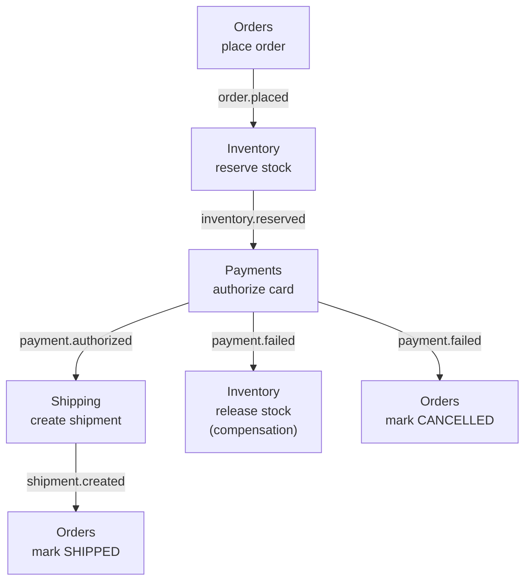
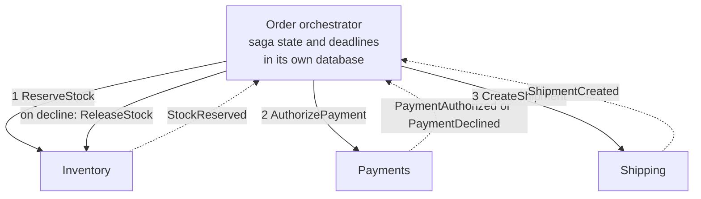
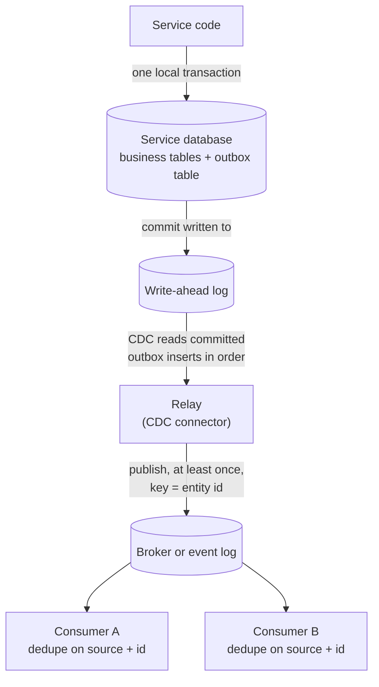
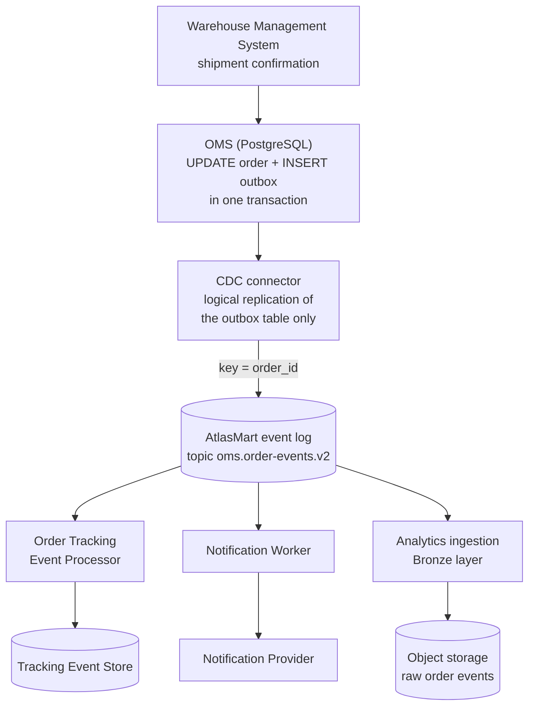

# Event-driven architecture

> In an event-driven architecture a service records a fact, publishes it, and moves on; whoever
> cares reacts in its own time. The decoupling is real, and so is the bill: contracts that must
> evolve without breaking strangers, duplicates and reordering that every consumer must absorb, and
> a workflow that no single place shows.

!!! abstract "Page facts"
    **Level:** Intermediate (events, commands, producers, and consumers are Level 1; contracts,
    ordering rules, and the outbox are Level 2; choosing choreography or orchestration, and event
    sourcing or not, is Level 3) · **Status:** Draft · **Time:** 60-75 minutes ·
    **Last verified:** 2026-11-27

## Learning objectives

After this page you should be able to:

- Tell an event from a command and a query, and choose which one an interaction needs.
- Design an event contract: envelope, payload schema, compatibility rules, and a versioning plan,
  using CloudEvents and AsyncAPI where they help.
- State the ordering and duplicate-handling rule each consumer needs, and design for replay.
- Choose between choreography and orchestration, and between event sourcing and a current-state
  model with published events.
- Publish events reliably from a database with the transactional outbox, using polling or change data
  capture (CDC) as the relay.

## Prerequisites

- [Message queues and brokers](message-queues-and-brokers.md) — brokers, acknowledgments,
  at-least-once delivery, and idempotent consumers. This page assumes all of it.
- [Transactions, sagas, and delivery guarantees](../distributed-systems/transactions-sagas-and-delivery-guarantees.md)
  — the dual-write problem, sagas, compensation, and the inbox. This page builds on them rather
  than repeating them.

## The problem this solves

When an AtlasMart parcel leaves the distribution centre, three systems need to know: Order Tracking
(to expect carrier scans), the Notification Worker (to tell the customer), and the analytics
platform (to measure dispatch times). If the Order Management System (OMS) calls each of them, the
OMS team, which owns a 12-year-old monolith, must change its code for every new consumer, wait on
each call, and decide what to do when one is down. The dependency points the wrong way: the system
that knows the fact is forced to know every system that cares.

Event-driven architecture reverses that dependency. The OMS publishes "order dispatched" once to a
broker; consumers subscribe. A fourth consumer next year needs no OMS change. A consumer that is down
catches up later. The price is everything this page is about: the event becomes a public contract,
delivery is at least once and not globally ordered, and the business flow is spread across services.

## What it is

An **event-driven architecture** is a style in which components announce facts as events and other
components react, without the sender knowing who listens. Three kinds of message are easy to confuse:

| | Event | Command | Query |
|---|---|---|---|
| Intent | "This happened" | "Please do this" | "Tell me this" |
| Naming | Past tense: `order.dispatched` | Imperative: `ReserveStock` | Question: `GetOrderStatus` |
| Receivers | Zero, one, or many; unknown to the sender | Exactly one handler, known to the sender | One responder |
| Can it be refused? | No; it already happened | Yes; the handler may reject it | It may fail, never changes state |
| Who owns the schema | The producer | The receiver (it defines what it accepts) | The responder |
| Typical transport | Topic or event log, publish-subscribe | Queue, or a direct call | Synchronous call (HTTP, gRPC) |

The other participants: a **producer** publishes events; a **consumer** subscribes and reacts; a
**broker** stores and delivers them (a queue broker or a partitioned event log, compared on the
[message queues page](message-queues-and-brokers.md)); an **event bus** (or event router) is a broker
whose main job is routing events to targets by rules on their attributes. A **channel** or **topic**
is the named stream a producer writes to.

"Event-driven" covers four different patterns (see [architecture styles](../software-architecture/architecture-styles.md)):
**event notification** (a thin event; consumers call back for details), **event-carried state
transfer** (the event carries the data consumers need), **event sourcing** (the event log is the
system of record), and **CQRS** (separate write and read models, often fed by events). Most systems
need the first two; the last two are deliberate, local choices.

## Mental model

Picture a town noticeboard. The town clerk pins up facts ("the bridge on Mill Lane reopened on
Tuesday"), not instructions to particular people. Anyone may read the board; the clerk does not know
who does. Notices stay up for a while, so a newcomer can read the recent ones (replay). A letter
addressed to the baker asking for twelve loaves is a command, and it is not pinned to the board.

**Where the analogy breaks:** every reader of a noticeboard sees the same notices in the same order.
Real brokers deliver some notices twice, deliver notices about different streets in different
orders, and can show a notice that the clerk pinned up before the council's decision was actually
recorded (the dual write). And a real notice has a format: if the clerk changes the wording style,
some readers misunderstand it. That is the contract problem.

## Key terms

| Term | Meaning on this page |
|---|---|
| Event | An immutable record that something happened, named in the past tense, owned by its producer |
| Command | A request for a specific receiver to do something, which it may reject |
| Producer / consumer | The service that publishes an event / a service that subscribes and reacts |
| Event bus (event router) | A broker that routes events to subscribers by rules on their attributes |
| Domain event | An event meaningful inside one bounded context, part of its internal model |
| Integration event | An event published across service or team boundaries as a versioned contract |
| Event contract | The envelope, payload schema, semantics, and compatibility promises of an event type |
| CloudEvents | A specification for common event metadata (id, source, type, and others) across systems |
| AsyncAPI | A specification for describing event-driven APIs: channels, operations, and messages |
| Schema registry | A service that stores event schemas by version and checks new versions for compatibility |
| Event sourcing | Storing every state change as an event in an append-only log and deriving current state by replaying it |
| Choreography / orchestration | Coordinating a flow by services reacting to each other's events / by a central coordinator sending commands |
| Change data capture (CDC) | Reading a database's change log to replicate inserts, updates, and deletes to another store |
| Transactional outbox | Writing an outgoing event to a table in the same transaction as the state change, with a relay publishing it afterwards |
| Dual write | Updating a database and a broker as two separate operations, so one can succeed without the other |
| Replay | Re-delivering past events from a retained log or archive to a consumer |

## How it works

### Step 1 — Choose the message kind, then the event's weight

Use an **event** when the producer should not care who reacts: dispatch, payment captured, account
closed. Use a **command** when one specific service must act and the sender needs to know whether it
did: "reserve 2 units of SKU-B for checkout 77". Use a **query** when the caller needs an answer to
continue. A common design smell is a command disguised as an event (`SendDispatchEmailRequested`):
the producer is really telling one consumer what to do, so the coupling is still there, only harder
to see.

Then decide how much the event carries. A **thin event** (`order 123 dispatched, version 7`) keeps the
contract small, but every consumer calls the producer back, which recreates runtime coupling and load.
A **fat event** (event-carried state transfer) includes what consumers need, so they work when the
producer is down, but every field becomes part of the contract and copies of the data spread (a
privacy concern; see Security). The usual answer is in between: the identifiers, the new state, and
the few fields most consumers need, and nothing sensitive that only one consumer wants.

### Step 2 — Producers, consumers, brokers, and routing

Each consuming *service* gets its own subscription (a consumer group on a log, a queue bound to a
topic on a queue broker), so services read at their own pace and one slow consumer never delays
another. Within a service, instances share that subscription to scale out.

**Routing** decides which events reach which subscription:

| Approach | How it works | Favor when |
|---|---|---|
| Topic per event type | `order.dispatched` has its own topic | Consumers want one type; types have very different volumes |
| Topic per entity stream | All order events on `oms.order-events`, keyed by order id | Consumers need the order's events in sequence |
| Attribute filtering | Subscriptions filter on `type`, `source`, or other attributes | Many consumers each want a slice of a shared topic |
| Rule-based event bus | Rules match attributes or content and forward to targets | Many heterogeneous targets, often across accounts or SaaS integrations |

**Filtering** at the broker saves consumer work and network; filtering in the consumer is easier to
change and test. Per-entity topics with attribute filters are a common compromise, because ordering
(Step 5) only exists within a partition of one topic.

### Step 3 — Event contracts, schemas, and versioning

An event that crosses a team boundary is an API, with the added difficulty that the producer does not
know its consumers. A contract has four parts:

1. **Envelope** — metadata every event carries. **CloudEvents** (specification version 1.0.2, whose
   events carry `"specversion": "1.0"`) defines four required attributes: `id`, `source`, `specversion`,
   and `type`, with `source` plus `id` unique per distinct event, which is exactly the key consumers
   deduplicate on. Optional attributes include `subject`, `time`, `datacontenttype`, and
   `dataschema`; documented extensions add, among others, `partitionkey` and `sequence`.
2. **Payload schema** — the `data` structure, in JSON Schema, Avro, or Protocol Buffers, stored in a
   **schema registry** that rejects incompatible versions at publish or build time.
3. **Semantics** — what the event means and when it is emitted ("emitted once the carrier has taken
   the parcel, never before"), units, and which fields may be null.
4. **Channel description** — which channel, which key, which operations. **AsyncAPI** (current
   specification version 3.1.0) describes this the way OpenAPI describes HTTP APIs: `channels` with
   an `address` and their `messages`, and `operations` whose `action` is `send` or `receive`.

**Compatibility rules.** A change is **backward compatible** when consumers on the new schema can read
old events (needed for replay), and **forward compatible** when consumers still on the old schema can
read new events (needed because consumers upgrade later than producers). For integration events, aim
for both ("full"):

| Change | Safe? | Why |
|---|---|---|
| Add an optional field | Yes, if consumers ignore unknown fields | Old consumers skip it; new consumers treat it as absent in old events |
| Remove an optional field | Only after every consumer stops reading it | Find out with consumer-driven contracts or registry usage data |
| Rename a field, change its type or unit | No | Old consumers silently misread; publish a new major version |
| Make an optional field required | No | Old events in the retained log fail validation on replay |
| Change the meaning (emit `dispatched` at label printing instead of hand-over) | No, and no tool will notice | Semantic changes need a new type or an explicit version and announcement |

**Versioning plan.** Minor versions are additive and published on the same channel. A major version
is a new contract: the producer publishes old and new versions side by side (two channels, or one
channel with a version attribute consumers filter on) for a migration window, tracks which consumers
still read the old one, and retires it only when none do. Record the version in the event, not only
in the registry, so a consumer can tell what it is reading during replay.

### Step 4 — Domain events and integration events

A **domain event** is part of one service's internal model: `ParcelHandedToCarrier` inside the OMS,
with internal identifiers and fields that change whenever the OMS model changes. An **integration
event** is a deliberate, stable projection of it for other teams: `order.dispatched` with public
identifiers and a versioned schema. Publishing domain events directly couples every consumer to the
producer's internals; translating at the boundary (often in the same transaction that writes the
outbox row) keeps the internal model free to change. The rule of thumb: domain events may be many,
fine-grained, and short-lived; integration events should be few, coarse, and long-lived.

### Step 5 — Ordering

There is no useful global order in an event-driven system. A partitioned log keeps order **per
partition**, so events with the same key (an order id) arrive in the order they were written, provided
the producer publishes them in commit order and retries do not reorder them. Across keys, across
topics, and across producers there is no order at all: in [Lab 16](../labs/lab-16-event-driven-workflow.md),
even a bus that never misbehaves delivers `payment.authorized` to Orders before `inventory.reserved`
for some orders, because the two arrive on different topics.

Every consumer therefore needs an explicit **ordering rule**, chosen from:

- **Version guard.** The producer stamps a per-entity sequence (`order_version`); the consumer
  applies an event only if its version is higher than the stored one. Wall-clock `time` is not a safe
  order: clocks on different hosts disagree.
- **State precedence.** The consumer's state machine only moves forwards (`SHIPPED` never returns to
  `PAID`), so a late, older event is ignored.
- **Park and retry.** An event that depends on one not yet seen (a carrier scan for a shipment that
  has not been announced) is stored and re-examined when the missing event arrives, with a timeout
  and an alert.
- **Order does not matter.** Append-only consumers (an analytics landing zone) store everything and
  let later processing sort by version.

### Step 6 — Replay

**Replay** re-delivers past events: to build a new consumer's state from history, to rebuild a
projection after a bug, or to recover after an outage longer than the broker's redelivery. Log-based
brokers keep events for a retention period and let a consumer reset its position; queue brokers
delete acknowledged messages, so replay there needs an archive. Replay is only safe if consumers are
idempotent, if side effects are suppressed (a rebuilt projection must not resend six months of
emails), and if today's code can still read the oldest retained schema version. Beyond the log's
retention, an archive in object storage (often the analytics Bronze layer) is the replay source. The
mechanics of offsets and retention are on the [event streaming page](event-streaming-and-log-based-architecture.md).

### Step 7 — Event sourcing, and when not to use it

**Event sourcing** stores the events as the source of truth and derives current state by replaying
them (the [distributed system patterns page](../software-architecture/distributed-system-patterns.md)
covers the mechanics, snapshots, and its relation to CQRS). It earns its cost where the history of
your own decisions is the product: a ledger, an audit-heavy approval workflow, a pricing engine whose
past decisions must be explained.

Do not use it for ordinary create-read-update-delete data, as an integration mechanism, or because a
log-based broker is available. Its costs are permanent: every event version ever written must stay
readable, queries need projections, deleting a person's data from an immutable log needs a technique
such as encrypting per-person data with a key that is later destroyed, and fixing a bad event means
appending a correcting one. Above all, an event-sourced service's internal events are domain events;
publish integration events from it as you would from any other service.

### Step 8 — Choreography and orchestration

A multi-step business flow can be coordinated two ways. In **choreography**, each service reacts to
the previous step's event and publishes its own; no one is in charge.

**Figure 1 — A choreographed order saga (as built in Lab 16).** Each box is a service reacting to an
event; the broker between them is not drawn.



How to read it: follow the arrows to see the flow, then notice that no service holds this picture.
The compensation on the failure branch exists only because Inventory happens to subscribe to
`payment.failed`; nothing checks that every reservation is eventually released or shipped.

In **orchestration**, an orchestrator holds the saga's state and sends commands; services reply.

**Figure 2 — The same flow, orchestrated.** Solid arrows are commands; dashed arrows are replies
(events or reply messages) back to the orchestrator.



How to read it: the whole flow, including the compensation, is visible in one component, which can
also enforce a deadline per step and answer "where is order 123?".

| Aspect | Choreography | Orchestration |
|---|---|---|
| Coupling | Each service knows the events it reacts to | Services know only their commands; the orchestrator knows the flow |
| Visibility | Spread across services; needs tracing to reconstruct | One state machine, queryable |
| Changing the flow | Touch several services, often several teams | Change the orchestrator |
| Failure handling | Each service must react to failure events; gaps are easy to miss | Central deadlines, retries, and compensations |
| Favor when | Two or three steps, independent teams, mostly fan-out | Four or more steps, branches, deadlines, compensations |

Real systems mix them: an orchestrated core flow inside one team, choreographed fan-out of its
integration events to everyone else. The [transactions page](../distributed-systems/transactions-sagas-and-delivery-guarantees.md)
covers saga step design (pivot, compensations, isolation countermeasures) for either style.

### Step 9 — Publishing reliably: CDC and the transactional outbox

A service that writes to its database and then publishes to a broker has a **dual write**: a crash
between the two loses the event, and publishing first risks announcing a change that then rolls back
(the [transactions page](../distributed-systems/transactions-sagas-and-delivery-guarantees.md)
explains both cases). Two mechanisms avoid it.

**Change data capture as an event source.** CDC reads the database's own change log (in PostgreSQL,
logical decoding behind logical replication) and turns committed row changes into events. Because it
reads only committed changes in commit order, it cannot publish a rolled-back change or lose a
committed one. But raw table CDC publishes the table's *shape*: column renames become breaking
changes for strangers, and an `UPDATE orders SET status = 'D'` does not say *why*. Raw CDC suits data
replication into an analytics platform owned by people who accept that coupling; it is a poor
integration contract.

**The transactional outbox** combines the two ideas. The service writes the integration event, in its
public schema, into an `outbox` table in the same transaction as the business change. A relay then
publishes outbox rows, either by polling (`SELECT ... WHERE published = false ORDER BY id`) or by
tailing the change log for inserts into the outbox table only.

**Figure 3 — Transactional outbox with a log-tailing relay.** The only atomic step is the local
transaction; everything after it is at-least-once.



How to read it: the relay may crash after publishing and before recording its position, so it
republishes; consumers absorb that. What cannot happen is an event without its state change or a
state change without its event.

| Relay | Latency | Ordering | Operational cost |
|---|---|---|---|
| Polling | Up to one poll interval | Commit order if one relay reads in id order, with care for ids committed out of sequence | A query load on the database; simple |
| Log tailing (CDC) | Low (sub-second to seconds, depending on setup) | Commit order from the log | A replication slot and a connector to run and monitor; a stalled slot retains log files on the primary |

Clean up published outbox rows on a schedule. Ordering per entity survives only if one relay instance
publishes each entity's rows in order with the entity id as the partition key.

## Worked example: AtlasMart's "order dispatched" event

**Context.** Today the OMS team ships nothing to other systems in real time. With the new AtlasMart
event log (a managed, Kafka-compatible log with partitioned topics and 7-day retention; a Phase 5
assumption, as is the OMS's logical replication into it), the OMS team agrees to publish integration
events for order state changes. The first is `order.dispatched`, emitted when the Warehouse Management
System confirms that the parcel has left with the carrier ([case study 09](../end-to-end-case-studies/cs-09-hybrid-migration-with-private-connectivity.md),
FR-3). This is the step after the [CDC pipeline exercise](../system-design-exercises/cdc-pipeline.md):
that design captured OMS table changes without touching OMS code and published a curated
`order-events` v1; here the OMS team owns an outbox and publishes `oms.order-events.v2` itself.

**Volume.** One parcel per order, so 60,000 dispatch events per day, or 60,000 ÷ 86,400 ≈ 0.7 per
second on average. Assume (an assumption) the busiest hour carries 30% of the day's dispatches:
18,000 ÷ 3,600 = 5 per second. Assume 1 KB per event including the envelope: 60,000 × 1 KB ≈ 60 MB per
day, and 7 × 60 MB ≈ 420 MB retained on the log. These volumes are small; the design questions are
correctness and ownership, not throughput.

**Figure 4 — From the OMS transaction to three consumers.** One outbox write fans out to three
independent consumer groups.



How to read it: the OMS knows only its own database. The three consumers do not know each other; each
has its own consumer group and position in the log, so a stalled Bronze ingestion never delays a
customer notification.

### The contract

The OMS writes this event into its outbox in the same transaction that marks the order dispatched.
The envelope is CloudEvents structured JSON; the `partitionkey` extension carries the key; the
payload's `schema_version` records the contract version (major 2, minor 1):

```json
{
  "specversion": "1.0",
  "id": "7c1e9b52-3f0d-4d8e-a7a4-0b6e2f91c3d5",
  "source": "/oms/orders",
  "type": "com.atlasmart.order.dispatched",
  "subject": "AM-7310042",
  "time": "2026-11-27T09:14:03Z",
  "datacontenttype": "application/json",
  "dataschema": "https://schemas.atlasmart.example/oms/order-dispatched/2.json",
  "partitionkey": "AM-7310042",
  "data": {
    "schema_version": "2.1",
    "order_id": "AM-7310042",
    "order_version": 7,
    "shipment_id": "SHP-55120931",
    "carrier_id": "carrier-07",
    "carrier_tracking_ref": "CR07-88213409",
    "dispatched_at": "2026-11-27T09:13:58Z",
    "parcel_count": 1,
    "line_count": 3,
    "customer_ref": "c-5f2a91"
  }
}
```

Version 2.1 added `line_count` to 2.0; consumers written for 2.0 ignore it. No delivery address,
name, or contact detail is included (NFR-6): the Notification Worker looks up contact preferences by
the pseudonymous `customer_ref` in its own store. The channel is described in AsyncAPI, kept in the
OMS repository and checked in its pipeline:

```yaml
asyncapi: 3.1.0
info:
  title: OMS order events
  version: 2.1.0
channels:
  orderEvents:
    address: oms.order-events.v2
    messages:
      orderDispatched:
        $ref: '#/components/messages/orderDispatched'
operations:
  publishOrderDispatched:
    action: send
    channel:
      $ref: '#/channels/orderEvents'
    messages:
      - $ref: '#/channels/orderEvents/messages/orderDispatched'
components:
  messages:
    orderDispatched:
      contentType: application/cloudevents+json
      payload:
        type: object
        required: [specversion, id, source, type, data]
        properties:
          type:
            const: com.atlasmart.order.dispatched
```

### What each consumer does with duplicates and order

| Consumer | Duplicates | Ordering rule | Late or missing events |
|---|---|---|---|
| Order Tracking (Event Processor) | Inbox row on `(source, id)` in the Tracking Event Store, same transaction as the update | Version guard: apply only if `order_version` is higher than the stored one | A carrier scan can arrive before `order.dispatched`; it is parked against `carrier_tracking_ref` and linked when the event arrives, with an alert if unlinked after 1 hour (an assumption) |
| Notification Worker | Deterministic notification key `order_id + "dispatched"`, recorded before sending and passed to the Notification Provider as its idempotency key | State precedence: if an `order.cancelled` with a higher version was seen, suppress | Events older than 24 hours (an assumption: a backlog or a replay) are recorded but not sent; a "your parcel is on its way" message a day late is noise |
| Analytics Bronze ingestion | None: Bronze appends every delivery as received, with the log position and ingestion time | None: order does not matter in Bronze | Silver deduplicates on `(source, id)` and orders by `(order_id, order_version)` before customer identifiers are pseudonymized for wider use |

The three rules differ because the consumers' side effects differ: a database row, a message to a
person, an append-only file. "Make the consumer idempotent" is not one design but one per side effect.

### Decisions, with reasons

| Decision | Choice | Reason |
|---|---|---|
| Event source | Outbox table in the OMS, relayed by CDC | Raw table CDC would publish a 12-year-old schema to strangers; the outbox is a public contract the OMS team controls |
| Relay | Logical replication of the outbox table only | The platform already uses logical replication from the OMS; no polling load on the monolith |
| Topic and key | One per-entity topic `oms.order-events.v2`, key = `order_id` | All of one order's events are in one partition, in commit order; consumers filter on `type` |
| Event weight | Identifiers, new state, and the fields all three consumers need | Consumers work while the OMS is down; no personal data beyond a pseudonymous reference |
| Versioning | Minor versions additive in place; a major version gets a new topic (`.v3`) published in parallel for 90 days (an assumption) | Consumers upgrade on their own schedules; the 7-day log plus Bronze lets any consumer replay the old version |
| Schema checks | Registry with full compatibility on the topic; the AsyncAPI document validated in the OMS pipeline | Breaking changes fail the producer's build, not a consumer's night |
| Outbox cleanup | Delete rows 24 hours after publication (an assumption) | At most about 60,000 rows (about 60 MB) in the OMS database |

### A failure, end to end

The OMS primary fails over to its synchronous standby mid-afternoon. Committed outbox rows are on the
standby; the CDC connector reconnects to the new primary and resumes from its replication slot,
republishing a few events it had sent but not confirmed. Order Tracking's inbox and the Notification
Worker's notification key absorb the duplicates; Bronze stores them and Silver removes them. The one
thing to check in advance is that the replication slot survives failover (a property of the
database's high-availability setup; check the provider's current documentation), because a lost slot
means the connector must resynchronize, and events between the slot's last position and the new one
must be recovered from the outbox table itself, which is why rows are kept for 24 hours.

## Real-world architecture example

A typical large retailer's integration estate is built from the same parts. Each product team's
service writes integration events through an outbox; a CDC connector per database relays them to a
partitioned event log; a schema registry enforces compatibility per topic; every topic has an owner,
an AsyncAPI document, and a catalog entry. Cross-organization events (to partners, SaaS tools, or
other cloud accounts) go through a rule-based event bus using a common envelope such as CloudEvents.
Long-running flows inside a team use an orchestrator (often a workflow engine with durable
execution); flows across teams are choreographed through integration events. Raw table CDC feeds
the analytics platform only. Product equivalents are on [messaging technologies compared](messaging-technologies-compared.md).

## Design choices and trade-offs

| Choice | Favor when | Avoid when |
|---|---|---|
| Event (publish-subscribe) | Many or unknown consumers; the producer must not wait or care | One specific service must act and the sender needs the outcome |
| Command over a queue | One handler must do the work, asynchronously, with retries | Several services need the fact; that is an event |
| Thin event (notification) | Data is large, sensitive, or changes often; consumers need different slices | Consumers would all call back, recreating coupling and load |
| Fat event (state transfer) | Consumers must work when the producer is down | Personal data would spread to every consumer |
| Choreography | Two or three steps, independent teams, mostly fan-out | Long flows with deadlines and compensations |
| Orchestration | Four or more steps, branches, deadlines, compensations, "where is it?" queries | A simple fan-out, where an orchestrator is a needless hub |
| Event sourcing | History of your own decisions is the product; rebuilding views is routine | CRUD data, integration between teams, data subject to erasure |
| Raw table CDC | Replicating data to analytics or a search index owned by the same organization | Publishing a contract to other teams |
| Outbox with CDC relay | High volume, low latency, a team able to run a connector | A small service where a polling relay is simpler |
| Per-entity topic | Consumers need an entity's events in order | Types differ enormously in volume or retention needs |

**Assumption behind all of this:** consumers are idempotent and have an explicit ordering rule. Every
choice above fails without that.

## Failure modes and anti-patterns

- **Dual write.** Commit, then publish, in request code. Detect: reconciliation finds orders with no
  events, or events for orders that do not exist (Lab 16's `dual-write` experiment produces both).
  Prevent: outbox.
- **Leaking the database schema.** Raw CDC of internal tables used as an integration contract.
  Detect: consumers break on column changes. Prevent: integration events through an outbox; raw CDC
  only to the analytics platform.
- **Breaking change without a version.** A renamed field or a changed unit. Detect: consumers'
  validation errors or, worse, silent misreads. Prevent: registry compatibility checks in the
  producer's pipeline; semantic changes as new versions.
- **Command in disguise.** Events named for the one consumer that handles them. Detect: an event type
  with exactly one subscriber that the producer waits on. Prevent: send a command, honestly.
- **Ordering by timestamp.** Consumers compare `time` across hosts. Prevent: per-entity versions.
- **Invisible workflow.** A long choreographed chain that nobody can trace; orders stuck "somewhere".
  Detect: entities stuck in intermediate states; no owner for the flow. Prevent: correlation ids and
  tracing, a per-flow stuck-entity report, or orchestration.
- **Event storms and loops.** A consumer publishes an event that triggers itself, directly or via
  others. Detect: event rate rising without input. Prevent: causation ids, and review new
  subscriptions for cycles.
- **Replay with side effects.** Rebuilding a projection resends emails. Prevent: a replay mode that
  suppresses external effects, plus the notification key.
- **Stalled CDC slot.** The connector stops; the database keeps log files for the slot until its disk
  fills. Detect: slot lag alert. Prevent: monitor slot lag and size; a runbook to drop and resync.

## Security considerations

- **Authorization per topic.** Producers may write only their own topics (the OMS alone writes
  `oms.order-events.*`); consumers read only what they are approved for. A spoofed `order.dispatched`
  would notify customers falsely.
- **Validate on consume.** Consumers check the envelope and schema and reject or dead-letter
  malformed events instead of trusting the producer.
- **Events are copies of data.** Every topic, consumer store, Bronze file, and dead-letter queue is a
  copy with its own retention. Keep personal data out of integration events where an identifier will
  do (NFR-6), classify the rest, and make sure the log's retention and Bronze's deletion process
  honour erasure requests.
- **Immutability versus erasure.** Event-sourced and archived logs cannot simply delete a record;
  plan the technique (per-subject encryption keys, or tokenization) before the first event is
  written.
- **Encryption** in transit to and from the broker and at rest in the log and the archive.

## Performance, reliability, and cost

- **Performance:** end-to-end latency is the relay delay plus broker delivery plus consumer
  processing, and under backlog the backlog divided by consumer throughput. Measure the age of the
  oldest unprocessed event per consumer group, not only throughput.
- **Reliability:** the outbox makes publishing as durable as the database commit; at-least-once
  delivery plus idempotent consumers makes processing effectively once. Each consumer fails alone.
  The broker and the CDC connector become shared dependencies to run highly available.
- **Cost:** storage for retention and archives, a connector per database, and the extra writes of
  outbox and inbox rows. AtlasMart's dispatch events are about 60 MB per day; clickstream
  (assumption: about 16 GB per day) dominates the event log's cost, not integration events.

## Hands-on lab: build a simple event-driven workflow

[Lab 16](../labs/lab-16-event-driven-workflow.md) builds the choreographed saga of Figure 1 in
standard-library Python: four services with their own SQLite databases, an outbox written in the same
transaction as each business change, a relay, an in-process bus that duplicates and reorders
deliveries, and idempotent consumers. A short version:

1. Run `python3 lab16_workflow.py --experiment happy` and confirm all ten orders end `SHIPPED`.
2. Run the `crash` experiment: the relay dies after the commit and before publishing. Check that
   the outbox still holds the event and every order still ships.
3. Run the `duplicates` experiment and compare the idempotent and naive consumer rows.
4. Run `payment-failure` with `--trace AM-1004` and follow the compensation.
5. Run `dual-write` and explain each broken invariant.

??? question "Hint: why do stale events appear even on a clean bus?"
    Orders subscribes to three topics. Each topic is delivered in order, but nothing orders one
    topic against another, so `payment.authorized` can reach Orders before `inventory.reserved`.
    Orders' state precedence rule ignores the older event.

## Knowledge check

1. Give one sign that an "event" is really a command, and what you would change.
2. Which CloudEvents attributes are required, and which two together identify a distinct event?
3. A producer renames `carrier_id` to `carrier_code`. Is that backward compatible, forward compatible,
   neither? What should it do instead?
4. Why is raw table CDC a poor integration contract, and when is it the right tool?
5. In the worked example, why does the Notification Worker not send events older than 24 hours, while
   Bronze stores everything?

??? success "Answers"
    1. It has exactly one consumer, is named for what that consumer should do, and the producer waits
       for or depends on the outcome. Make it a command to that service (a queue or a call), or
       rename it to the fact that happened and let consumers decide.
    2. `id`, `source`, `specversion`, and `type`. `source` plus `id` identify a distinct event, so
       consumers deduplicate on that pair.
    3. Neither: old consumers miss the field, and new consumers cannot read retained old events. Add
       `carrier_code` as an optional field, keep `carrier_id` until no consumer reads it, or publish a
       new major version in parallel.
    4. It exposes the table's internal schema and row-level changes without business meaning, so any
       refactoring breaks strangers. It is right for replicating data into the organization's own
       analytics platform or a search index, where the consumer accepts that coupling.
    5. The notification is a side effect on a person; a day-late "on its way" message is noise and a
       replay must not resend history. Bronze is a raw, append-only record whose value is
       completeness; deduplication and ordering happen in Silver.

## Architecture discussion questions

1. The OMS team proposes publishing every row change of its `orders` table through CDC "so
   consumers can have everything". Argue for the outbox instead, and say what you would offer the
   analytics team, which really does want everything.
2. A choreographed flow across five teams leaves about 0.1% of orders stuck. Nobody owns the whole
   flow. What would you introduce first: tracing, a stuck-order report, or an orchestrator? Why?
3. Finance asks for the ledger to be event-sourced, and also for customers' payment history to be
   erasable on request. Design the event store so both are true, and say what it costs.

## Summary

Events announce facts in the past tense, with unknown and changing consumers; commands ask one
receiver to act; queries ask for an answer. Producers publish to topics on a broker or event bus,
routed by topic and filtered by attributes. An integration event is a versioned contract: a
CloudEvents envelope, a payload schema in a registry with compatibility checks, documented semantics,
and an AsyncAPI description, with domain events kept internal. Ordering exists only per key, so every
consumer needs an ordering rule, and replay needs idempotent consumers and suppressed side effects.
Event sourcing is a local choice for decision histories, not an integration style. Choreography suits
short fan-out; orchestration suits long flows with compensation. Events are published reliably by an
outbox written in the business transaction and relayed by polling or CDC.

## Related topics

- **Before:** [Message queues and brokers](message-queues-and-brokers.md);
  [Transactions, sagas, and delivery guarantees](../distributed-systems/transactions-sagas-and-delivery-guarantees.md)
- **Alongside:** [Event streaming and log-based architecture](event-streaming-and-log-based-architecture.md)
  — partitions, offsets, retention, and consumer lag; [Messaging technologies compared](messaging-technologies-compared.md);
  [Distributed system patterns](../software-architecture/distributed-system-patterns.md) — CQRS and
  event sourcing in depth; [Architecture styles](../software-architecture/architecture-styles.md);
  [Integration architecture](../application-and-api-architecture/integration-architecture.md);
  [API design](../application-and-api-architecture/api-design-rest-graphql-grpc-and-async-apis.md)
  — asynchronous APIs and webhooks; [Batch and streaming pipelines](../data-engineering-and-analytics/batch-streaming-etl-elt-and-pipelines.md)
  — CDC into the lakehouse; [Lab 16](../labs/lab-16-event-driven-workflow.md);
  [Lab 04](../labs/lab-04-idempotency-and-duplicates.md).
- **Planned:** none beyond the pages above.

## References

| Source | Type | Checked |
|---|---|---|
| Martin Fowler, ["What do you mean by 'Event-Driven'?"](https://martinfowler.com/articles/201701-event-driven.html), 2017 | Article (notification, state transfer, event sourcing, CQRS) | 2026-11-27 |
| [CloudEvents specification v1.0.2](https://github.com/cloudevents/spec/tree/v1.0.2/cloudevents) and [documented extensions](https://github.com/cloudevents/spec/tree/main/cloudevents/extensions) — CNCF CloudEvents project | Specification (required and optional attributes, partitioning, sequence) | 2026-11-27 |
| [AsyncAPI Specification 3.1.0](https://www.asyncapi.com/docs/reference/specification/v3.1.0) — AsyncAPI Initiative | Specification (channels, operations, messages) | 2026-11-27 |
| Gregor Hohpe and Bobby Woolf, [Event Message](https://www.enterpriseintegrationpatterns.com/patterns/messaging/EventMessage.html) and [Command Message](https://www.enterpriseintegrationpatterns.com/patterns/messaging/CommandMessage.html) | Pattern catalogue (companion site to *Enterprise Integration Patterns*, 2003) | 2026-11-27 |
| Chris Richardson, [Pattern: Transactional outbox](https://microservices.io/patterns/data/transactional-outbox.html) and [Pattern: Transaction log tailing](https://microservices.io/patterns/data/transaction-log-tailing.html) | Pattern descriptions | 2026-11-27 |
| Chris Richardson, [Pattern: Event sourcing](https://microservices.io/patterns/data/event-sourcing.html) | Pattern description | 2026-11-27 |
| [Logical replication](https://www.postgresql.org/docs/current/logical-replication.html) — PostgreSQL documentation | Official documentation (the CDC mechanism in the worked example) | 2026-11-27 |
| Martin Kleppmann, *Designing Data-Intensive Applications* (O'Reilly, 2017), chapter 11 "Stream Processing" | Book (CDC, event sourcing, logs as the integration backbone) | 2026-11-27 |

## Review notes

- Canonical page for D08-T02. In depth: events vs commands vs queries, contracts and versioning
  (CloudEvents, AsyncAPI, compatibility), ordering rules, choreography vs orchestration, CDC, and
  the transactional outbox. Producers, consumers, brokers, buses, routing and filtering, replay,
  domain vs integration events, and event sourcing are covered more briefly, with offsets and
  retention deferred to D08-T03 and event sourcing mechanics to the distributed system patterns page.
- Specification versions checked on 2026-11-27: CloudEvents core 1.0.2 (the GitHub release `ce@v1.0.2`
  is the latest core release; events carry `specversion` "1.0"); AsyncAPI 3.1.0 (released
  2026-01-31 per the `asyncapi/spec` GitHub releases). The `partitionkey` and `sequence` extensions
  are documented in the spec repository's extensions folder. GitHub `blob/` URLs for the spec files
  returned 503 to scripted checks, so the References link the `tree/` folders (200) instead.
- New AtlasMart assumptions introduced here: `order.dispatched` integration events from the OMS
  through an outbox relayed by logical replication; topic `oms.order-events.v2` keyed by order id;
  30% of dispatches in the busiest hour (5 events/s); 1 KB per event (about 60 MB/day, 420 MB on the
  7-day log); outbox rows deleted 24 hours after publication; a 1-hour alert for parked carrier
  scans; notifications suppressed for events older than 24 hours; a 90-day parallel-publication
  window for major versions. The event's `customer_ref` is a pseudonymous identifier and still
  personal data; a reviewer should confirm it matches the data security page's classification.
- The AsyncAPI fragment and the JSON contract are illustrative and were not validated with AsyncAPI
  tooling; the field names follow the 3.1.0 specification text (`asyncapi`, `info`, `channels`,
  `address`, `messages`, `operations`, `action`).
- Glossary candidates not yet in the glossary: domain event, integration event, event bus, event
  contract, CloudEvents, AsyncAPI, schema registry, dual write.
