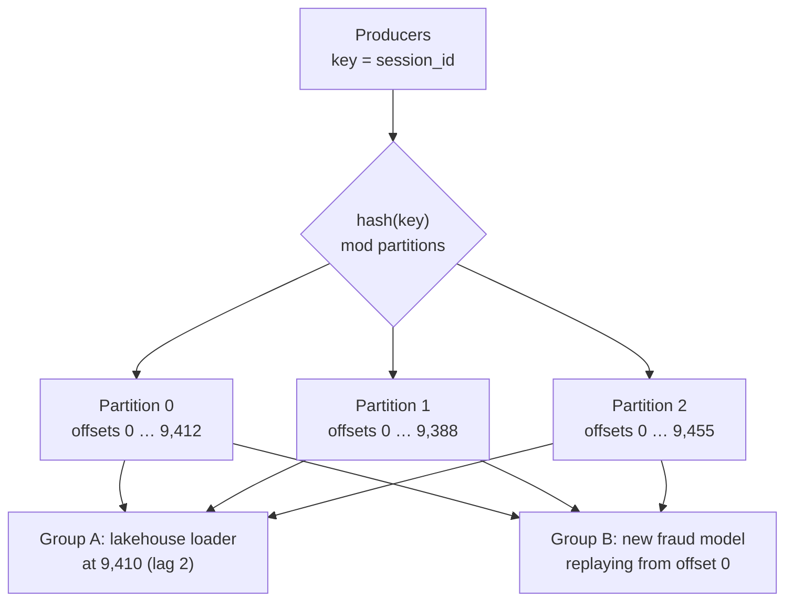
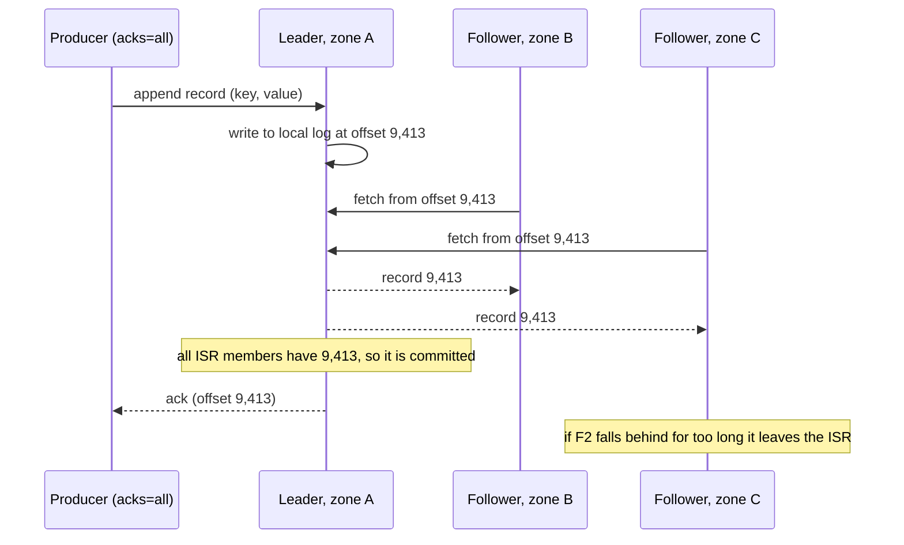
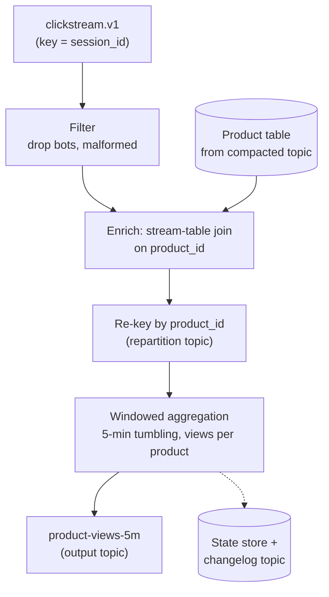
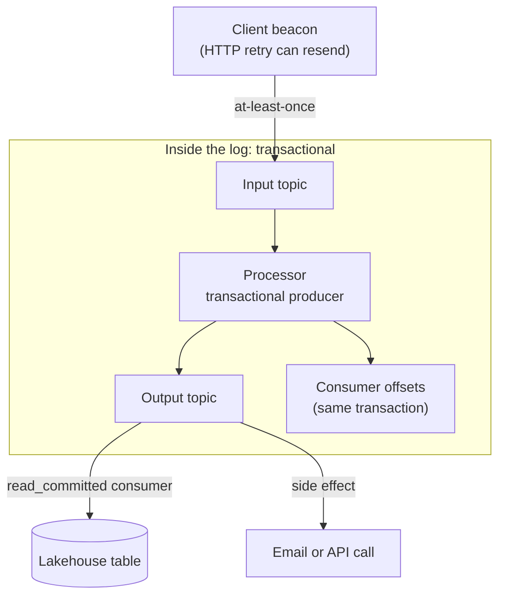
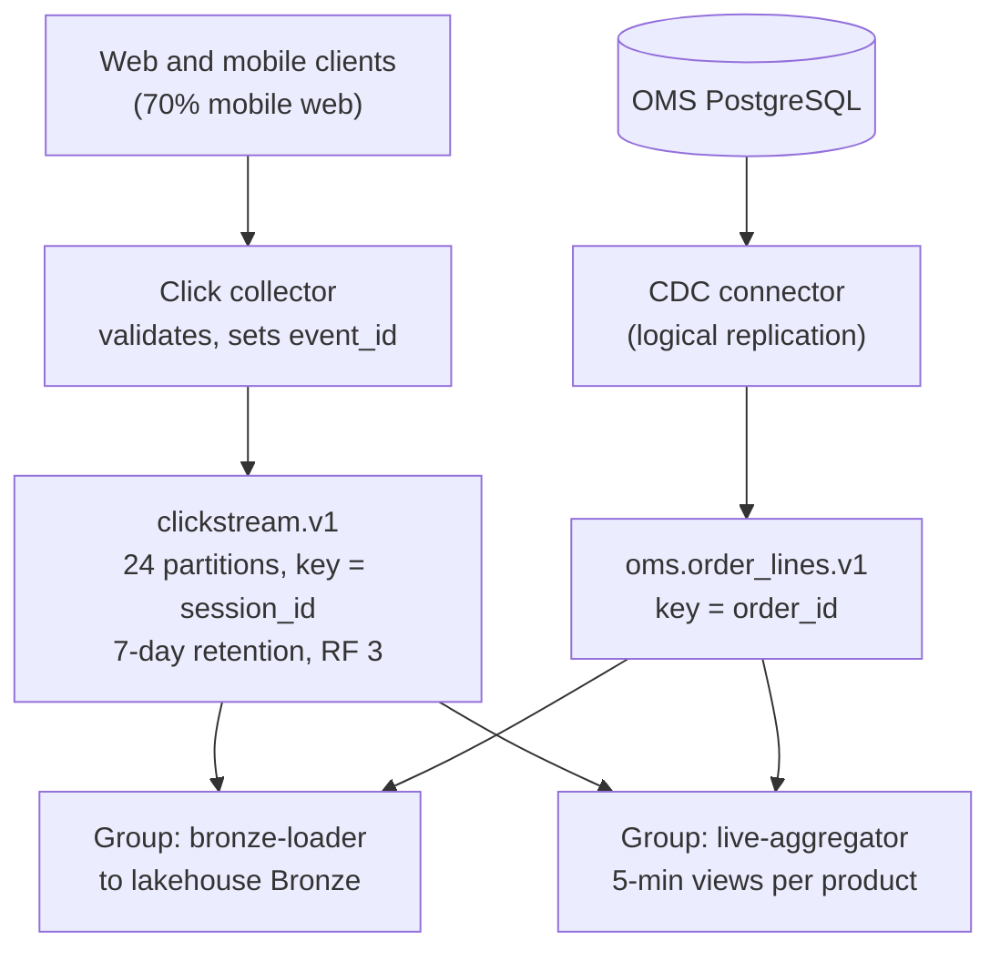

# Event streaming and log-based architecture

> A queue forgets a message once it is processed; a log remembers it for as long as you tell it to.
> That one difference lets many independent readers consume the same history at their own pace,
> rebuild state by replaying it, and treat the log, not any single database, as the record of what
> happened.

!!! abstract "Page facts"
    **Level:** Mixed (the log, partitions, offsets, and retention are Level 1-2; partition sizing,
    lag alerting, replication settings, windowing, and exactly-once boundaries are Level 3) ·
    **Status:** Draft · **Time:** 60-75 minutes · **Last verified:** 2026-11-27

## Learning objectives

After this page you should be able to:

- Explain why an append-only, partitioned log can act as the source of truth for several
  downstream systems, and what that costs.
- Choose a partition key and partition count from ordering needs, consumer throughput, and skew,
  then set retention or compaction and size storage including replication.
- Measure consumer lag in records and in time, and write an alert that means the same thing at
  peak and at night.
- Describe leader-follower replication with in-sync replicas and the producer acknowledgment
  setting that makes a write durable.
- Pick a window type (tumbling, hopping, sliding, session), explain watermarks and late data, and
  design an enrichment join.
- State precisely what Kafka transactions guarantee and where an end-to-end pipeline still needs
  idempotent sinks.

## Prerequisites

- [Message queues and brokers](message-queues-and-brokers.md) — producers, consumers, acks,
  delivery guarantees, and the queue-versus-log distinction this page builds on. It is not repeated
  here.
- [Scaling, partitioning, and replication](../distributed-systems/scaling-partitioning-and-replication.md)
  — partition keys, hot keys, and leader-follower replication in general.
- [Capacity estimation](../performance-and-scalability/capacity-estimation.md) — the arithmetic
  style used in the worked example.

## The problem this solves

Every system that reacts to data eventually needs the same events more than once: the analytics
loader wants all clicks, the recommendation job wants them again with a different grouping, and a
new fraud model wants last week's clicks to train on. With a queue, each new reader means a new
queue, a new fan-out, and no way to read anything that was already consumed. With point-to-point
integrations, each pair of systems has its own feed, its own format, and its own failure mode; N
sources and M consumers produce up to N × M pipelines.

A durable, ordered, replayable log replaces that mesh with one shared record. Producers append once;
each consumer reads at its own position; a new consumer starts from the oldest retained event; a
consumer with a bug is fixed and rewound. Jay Kreps's 2013 essay "The Log", later expanded into the
book *I Heart Logs*, made this argument for treating the log as the integration backbone between
data systems, generalizing what databases already do internally with their write-ahead log.

## What it is

**Event streaming** is the continuous capture of events (clicks, orders, sensor readings, database
changes) into durable streams that consumers process as the events arrive, rather than in periodic
batches. A **log-based architecture** puts an append-only, partitioned, replicated **log** at the
centre: systems publish facts to it, and other systems derive their state (search indexes, caches,
warehouse tables, aggregates) by reading it.

| Element | What it is | Consequence for design |
|---|---|---|
| Topic | A named stream of records of one kind (`clickstream.v1`) | The unit of retention, access control, and schema |
| Partition | One ordered, append-only sequence within a topic | The unit of ordering and of consumer parallelism |
| Key | A field the producer sets; records with the same key go to the same partition | Decides what is ordered relative to what, and where load lands |
| Offset | A record's position in its partition, assigned on append and never reused | Consumers remember "how far I got" as one number per partition |
| Retention | The rule that deletes old records by time, size, or (with compaction) by superseded key | Bounds storage and bounds how far back replay can go |
| Consumer group | A set of consumer instances that share the work of reading a topic | Each partition is read by one member at a time; groups are independent of each other |

**Stream processing** is computation over these streams: stateless steps (filter, transform,
route) and stateful ones (aggregations, joins, windows) whose state is itself kept durable,
usually in changelog topics on the same log.

## Mental model

A log is a ship's logbook kept in several volumes. Entries are only ever added at the end of a
volume, each with a line number (the offset). Each volume covers a set of ships chosen by name (the
key decides the volume), so all of one ship's entries are in one volume and in order. Any number of
readers can borrow photocopies: the harbour master reads today's entries, the insurer reads the
whole month, and a historian starts from the first page still in the archive. Each reader keeps a
bookmark per volume. Old volumes are shredded after a week (retention), or condensed so that only
each ship's latest entry remains (compaction).

**Where the analogy breaks:** a logbook has one writer and readers who never miss a page. A
streaming log has writers whose retries can write an entry twice, readers who crash between the work
and the bookmark, and copies on several machines that must agree which entries count as written:
the subjects of the replication and exactly-once sections.

## Key terms

| Term | Meaning on this page |
|---|---|
| Event streaming | Capturing events continuously into durable streams and processing them as they arrive |
| Partition / partition key | One ordered sequence within a topic / the field that chooses it (glossary: partition, partition key) |
| Offset | The position of a record within its partition |
| Consumer group | Consumer instances sharing one subscription; each partition goes to one member at a time |
| Consumer lag | How far a consumer group is behind the end of the log, in records or in time |
| Retention / log compaction | Deleting records by age or size / keeping at least the latest record per key |
| Replication factor | The number of copies of each partition kept on different brokers |
| In-sync replica (ISR) | A replica that is caught up with the partition leader within a configured bound |
| Event time / processing time | When the event happened at the source / when the processor sees it |
| Watermark | The processor's running estimate that no events older than time t are still to come |
| Window | A bounded group of events over which a stateful computation runs |

## How it works

### Partitions, keys, and ordering

**Figure 1 — Anatomy of a partitioned log.** Producers hash the key to pick a partition; each
partition is an ordered sequence of offsets; two consumer groups read the same partitions at
different positions.

How to read it: the key, not the producer, decides the partition, so one session's events stay in
order no matter which web server sent them. Group A and Group B do not affect each other; reading
does not remove anything.

Rules that follow from the structure:

- **Ordering exists only within a partition.** Two records with different keys may land in
  different partitions and be processed in either order. Choose the key so that everything that
  must stay in order shares it: a session, a shipment, an account.
- **Parallelism is capped by the partition count.** In a consumer group, each partition has one
  reader at a time, so a group with more members than partitions leaves members idle. (Recent Kafka
  releases also document *share groups*, which let several consumers take records from one
  partition with per-record acknowledgment, queue-style; that trades away per-partition order.)
- **Adding partitions later remaps keys.** With hash-mod-N placement, changing N moves most keys to
  a new partition, so for a while a key's old records are in one partition and its new ones in
  another. Size the partition count for growth up front, as the worked example does.
- **Keys with skew produce hot partitions.** The mitigations (salting, isolating a key, filtering
  bots) are on the [scaling page](../distributed-systems/scaling-partitioning-and-replication.md);
  here the symptom is lag on one partition while the others are idle.
- **A null key spreads records** across partitions for balance, at the cost of any ordering, so it
  suits only consumers with no per-entity order or per-key state.

### Retention and compaction

**Time- or size-based retention** deletes whole log segments once they are older than the retention
period or the partition exceeds a size; consumers that have not read them by then lose them. It
suits event streams (clicks, scans) where each record is a fact about a moment.

**Log compaction** instead guarantees that at least the latest record for each key survives, while
older records for the same key are removed in the background. A record with a key and an empty
value (a *tombstone*) marks the key as deleted and is itself removed later. Offsets never change, so
consumers keep their positions. A compacted topic behaves like a durable table: a consumer that
reads it from the start ends up with the current value of every key, which is how stream processors
rebuild lookup tables and how CDC topics can carry "current state of every order".

Retention is a contract with consumers: the longest outage they can have without loss, and the
furthest back a replay can go. Longer history belongs in the lakehouse (Bronze); some platforms
also offer **tiered storage** that moves old segments to object storage behind the same topic.

### Offsets and consumer groups

A consumer reads a batch, processes it, and **commits** its offset (the next record to read) per
partition, stored by the broker. On restart, or when the group **rebalances** partitions after a
member joins or leaves, a member resumes from the last committed offset. The commit point decides
the delivery guarantee exactly as the ack did on the [queues page](message-queues-and-brokers.md):

- Commit **after** processing: at-least-once. A crash between processing and commit reprocesses
  the batch, so the sink must be idempotent.
- Commit **before** processing: at-most-once. A crash loses the batch.
- Commit **in the same transaction** as the output: exactly-once, but only when the output is the
  same log (see below) or a store that can hold the offsets atomically with the data.

Because reading is non-destructive, a consumer can **reset** its offsets to an earlier position or a
timestamp to reprocess, which is the log's answer to the queue's "re-publish from a source".

### Consumer lag: measure it, then alert on time

**Consumer lag** per partition is the log end offset (the next offset to be written) minus the
group's committed offset. The topic's lag is the sum, but the alert needs the **maximum** across
partitions, because a single hot partition can be hours behind while the sum looks small. Kafka's
consumer client exposes per-partition `records-lag` and a `records-lag-max` metric (based on the
fetch position rather than the committed offset), and the broker exposes each partition's log end
offset; most teams also run an exporter that compares committed offsets with log end offsets from
outside the consumer, so that a dead consumer still produces a lag signal.

Records-lag alone is a poor alert, because the same number means different delays at different
arrival rates. **Time lag** (now minus the timestamp of the next unconsumed record, or records-lag
divided by the partition's recent arrival rate) is what users feel and what a freshness objective
is written in. The worked example shows the difference.

### Replication: leaders, followers, and in-sync replicas

**Figure 2 — A durable write with three replicas.** The producer asks for acknowledgment from all
in-sync replicas; the leader answers only when the followers in the ISR have the record.

How to read it: the ack means the record exists in every in-sync replica, in three zones here. If
the leader's zone fails, a follower from the ISR becomes leader without losing acknowledged records.

The concepts, using Kafka's documented terms:

- Each partition has one **leader** that takes writes and zero or more **followers** that copy it.
  The **replication factor** is the total number of copies.
- The **in-sync replica set (ISR)** contains the replicas that are alive and caught up within a
  configured time bound. A record is **committed** once every ISR member has it, and consumers see
  only committed records.
- The producer setting **`acks=all`** waits for the ISR; `acks=1` waits for the leader only (a
  leader crash before replication loses the record); `acks=0` does not wait.
- **`min.insync.replicas`** makes the broker refuse `acks=all` writes when the ISR is smaller than
  the minimum. With replication factor 3 and a minimum of 2, one broker can be lost while writes
  continue durably; losing two stops writes rather than accepting records held by one copy.
- **Unclean leader election** (off by default) would let an out-of-sync replica become leader when
  no ISR member is available: availability is restored, but acknowledged records can be lost. Leave
  it off for any topic that is a source of truth.

Alert on under-replicated partitions and on partitions below their minimum ISR; both should be zero
in steady state.

### Stream processing: stateless, stateful, and time

**Figure 3 — A stream-processing topology.** Clicks are filtered, enriched from a table built from a
compacted topic, re-keyed, and aggregated in windows; the results go back to the log.

How to read it: everything up to the join is per record; the aggregation needs state, which lives in
a local store backed by a changelog topic so that a restarted instance can rebuild it. The re-key
step is a shuffle: records move to the partition that owns their new key.

**Event time versus processing time.** Mobile clients buffer clicks while offline and send them
minutes later, so arrival order is not event order. Computations that answer "what happened between
10:00 and 10:05" must use the timestamp in the event (event time); processing time is simpler and
faster but gives different answers when the same data is reprocessed.

**Windows** bound a stateful computation in time. The names below follow the Kafka Streams
documentation; Apache Flink calls the overlapping fixed-size kind "sliding", so check each engine's
definition.

| Window | Shape | Typical use |
|---|---|---|
| Tumbling | Fixed size, no overlap, no gaps; each event in exactly one window | Views per product per 5 minutes; per-hour billing counts |
| Hopping | Fixed size with an advance smaller than the size; windows overlap, an event can be in several | "Last 10 minutes, updated every minute" dashboards |
| Sliding | Fixed size, aligned to event timestamps rather than the clock; used for "within N minutes of each other" | Stream-stream joins; aggregations over every distinct interval |
| Session | Variable size per key, closed after an inactivity gap | User sessions: events grouped until 30 minutes of silence |

**Watermarks and late data.** A **watermark** is the processor's declaration that event time has
reached t, so no events older than t are still expected; a window ending at t can then emit its
result. In parallel pipelines, an operator's watermark is the minimum across its inputs, so one slow
or idle partition holds back every window. Events that arrive after the watermark are **late**.
Engines offer a **grace period** or **allowed lateness** during which a closed window still accepts
and updates its result; after it, late events are dropped or sent to a side output. The trade-off is
explicit: a longer grace period gives more complete results and later, or more often revised,
answers.

**Joins** come in three shapes:

- **Stream-stream joins** are windowed (match an `add_to_cart` with a `purchase` of the same item
  within 30 minutes), because without a window the state would grow forever.
- **Stream-table joins** enrich each event with the current value from a table, typically materialized
  locally from a compacted topic (product catalogue, customer segment). This is **enrichment**
  without a network call per event.
- **Table-table joins** combine two changelogs into a continuously updated view.

**Enrichment by remote lookup** (a call per event) is simpler but ties the stream's throughput to
that dependency; batch and cache the calls, or prefer a local table built from its change stream.

**Aggregation** (count, sum, top-N per key and window) requires the events of a key to be in one
place, which is why a re-key or repartition step precedes it when the grouping key differs from the
topic's key.

### Delivery semantics: at-least-once and what exactly-once really covers

The default in a log-based pipeline is **at-least-once**: producers retry after timeouts, consumers
commit after processing, and a crash anywhere produces duplicates downstream. The general argument
for why exactly-once *delivery* is impossible between independent systems is on the
[transactions and delivery guarantees page](../distributed-systems/transactions-sagas-and-delivery-guarantees.md);
here is what Kafka adds and where it stops.

**Figure 4 — Where Kafka's exactly-once boundary sits.** Inside the box, a read-process-write cycle
commits its outputs and its input offsets atomically; arrows that leave the box need idempotency.

How to read it: the duplicate created by a client retry enters as two distinct records, and the
transaction faithfully processes both. Leaving the box (to a table or an API) is again at-least-once
unless the sink deduplicates.

What Kafka documents that it provides:

- An **idempotent producer**: the broker deduplicates the producer's own retries using a producer
  ID and per-partition sequence numbers, so a retried send does not create a second record.
- **Transactions**: a producer can write to several partitions and commit the consumer's input
  offsets in one atomic unit, so a read-process-write step either fully happens or not at all.
- **`isolation.level=read_committed`** consumers see only records from committed transactions; the
  default `read_uncommitted` also returns records from aborted ones.

What it does not provide:

- **Deduplication of events that were duplicated before reaching the log.** A browser that resends a
  click after a timeout produces two records with different offsets. Only an event ID set at the
  source, and checked downstream, removes them.
- **Atomicity with external systems.** A database write, an email, or an object-storage file
  written from inside the processor is outside the transaction. Kafka's design notes that
  exactly-once into another system needs that system's cooperation, typically storing the consumed
  offsets in the same atomic write as the data, or an idempotent upsert keyed by event ID.
- **Protection for consumers that do not opt in.** A consumer left at `read_uncommitted` sees
  aborted records.
- **Free latency.** Downstream `read_committed` consumers see records only after commit, so the
  commit interval adds directly to end-to-end delay.

The practical rule: use transactions where a pipeline reads from and writes to the log (stream
processors, Kafka Streams applications); everywhere else, carry an event ID from the source and make
each sink idempotent.

## Worked example: AtlasMart's clickstream event log

AtlasMart is adding a managed, Kafka-compatible event log ("AtlasMart event log", an assumption of
the data-platform phase) for clickstream and change-data-capture streams, alongside the existing
Event Queue that keeps distributing tracking work. Clickstream assumptions: 400,000 DAU × 40
events/day = **16,000,000 events/day** ≈ 185/s on average, with a **4× peak ≈ 740/s**, and **1 KB
per event**, so about **16 GB/day** raw.

**Figure 5 — The clickstream and CDC topics and their consumer groups.**

How to read it: one write per click, three independent readers today, and room for more without
touching producers. The CDC topic carries order lines (60,000 orders × 3 = 180,000 order lines per
day) from the OMS through PostgreSQL logical replication, as in
[case study 09](../end-to-end-case-studies/cs-09-hybrid-migration-with-private-connectivity.md).

### Partition count from consumer throughput

Assumptions for this example (labelled; replace them with measurements before production):

- **A1:** one consumer instance processing one partition sustains **100 events/s** (about 10 ms per
  event for parsing, enrichment from a local table, and a batched write).
- **A2:** at today's peak, consumers should run at no more than **50% utilization**, leaving room to
  catch up after an outage.
- **A3:** clickstream volume **doubles within two years**, and at that point a **75%** peak
  utilization is acceptable.

Arithmetic:

1. Today: 740 events/s ÷ (100 × 0.50) = **14.8 → 15 partitions**.
2. In two years: 1,480 events/s ÷ (100 × 0.75) = **19.7 → 20 partitions**.
3. Choose **24**: it covers both, avoids adding partitions later (which would remap session keys
   mid-stream), divides evenly by 3 zones and by 1, 2, 3, 4, 6, 8, 12, and 24 consumers, so any of
   those group sizes gets an even share.
4. Catch-up check: a 30-minute consumer outage at peak leaves 740 × 1,800 = **1,332,000** events.
   With 24 consumers × 100/s = 2,400/s while 740/s keep arriving, the backlog drains at 1,660/s, in
   about 1,332,000 ÷ 1,660 ≈ **800 s ≈ 13 minutes**.
5. Broker side: 740 ÷ 24 ≈ **31 events/s ≈ 31 KB/s per partition** at peak. The partition count is
   driven by consumer parallelism, not by broker throughput; the provider's per-partition and
   per-cluster limits must still be checked in its current documentation.

### Key choice and skew

| Candidate key | Ordering it gives | Skew risk | Verdict |
|---|---|---|---|
| `customer_id` | Per customer | Logged-out visitors have none; a customer identifier in every record widens the personal-data footprint | No |
| `product_id` | Per product | Severe: on a sale day one product can draw a large share of all views | No (but used after re-keying for the per-product aggregate) |
| `session_id` (pseudonymous, set by the client) | Per session, which is what sessionization and funnels need | Low on average; a bot session can be hot | **Chosen** |
| None (round robin) | None | None | No: funnels need per-session order |

Skew arithmetic with labelled assumptions: about 1.5 sessions per daily user (**assumption**) gives
600,000 sessions/day, about 25,000 per partition, so one ordinary session is negligible. A scraping
bot producing **50 events/s** (**assumption**) in one session adds that to one partition: 31 + 50 =
81 events/s at peak, 81% of A1's capacity, so that partition's lag starts to grow under any further
burst. The collector therefore rate-limits per session and tags known bots, and the lag alert uses
the maximum partition. By contrast, keying by `product_id` with one product taking **20%** of peak
views (**assumption**) would put 148 events/s on one partition, above A1's 100/s: that partition's
lag would grow by about 48 events every second for as long as the sale lasted, with no consumer
change able to help.

### Retention and storage with replication

Seven-day retention on the log (the platform assumption) gives:

| Step | Arithmetic | Result |
|---|---|---|
| Raw per day | 16,000,000 × 1 KB | 16 GB |
| Seven days | 16 GB × 7 | 112 GB |
| Replication factor 3 | 112 GB × 3 | 336 GB |
| Headroom for sale days and segment overhead (**assumption: 30%**) | 336 GB × 1.3 | about 437 GB |

Producer-side batch compression would reduce this by a factor that depends on the payload; measure
it rather than assume it. Seven days covers a long weekend's consumer outage plus time to fix and
replay a consumer bug; anything older is read from Bronze, where raw clickstream is kept 90 days.

The CDC topic for order lines is small by comparison and is a candidate for **compaction** in
addition to time retention, so a new consumer can bootstrap the current state of recent order lines
without reading the OMS.

### The lag alert

Clickstream freshness objective (**assumption**): the live product-views dashboard reflects 99% of
clicks within **5 minutes**. The tempting alert is a records-lag threshold derived at peak: 5
minutes × 31 events/s per partition ≈ 9,300 records. At the average rate of 185 ÷ 24 ≈ 7.7 events/s
per partition, the same 9,300 records means about 1,200 s, **20 minutes** of delay, so the alert
would stay silent at night through a four-times-worse breach.

The alert AtlasMart writes instead:

- **Page** when the **maximum time lag across partitions** of `live-aggregator` exceeds **5
  minutes for 10 minutes** (time lag = now minus the event time of the next unconsumed record, or
  records-lag ÷ that partition's arrival rate over the last 5 minutes).
- **Ticket** when the lag of any partition has **increased continuously for 15 minutes**, which
  catches a slow leak (a hot key, a slowed dependency) before the page.
- **Page** when the lag exporter sees **no committed offset movement** while records arrive, which
  catches a dead consumer whose own metrics have stopped.
- The `bronze-loader` group gets a looser threshold (60 minutes), because its consumers are batch
  writers and its objective is the next morning's reports.

## Real-world architecture example

The shape above is the standard event-streaming backbone: services publish to a partitioned,
replicated log; CDC streams database changes into it; consumer groups load a lakehouse, feed live
aggregates, and update search and cache stores; retention is days while history lives in object
storage. It is how
[event sourcing](../software-architecture/distributed-system-patterns.md) and CQRS read models are
fed in practice, and how the planned data-engineering pages (D07) ingest streams. The product
choices (self-run Apache Kafka, a managed Kafka service, or a Kafka-compatible cloud log) are
compared on the [messaging technologies page](messaging-technologies-compared.md); the design
decisions here (keys, partitions, retention, lag alerts, sink idempotency) are the same on all of
them.

## Design choices and trade-offs

| Choice | Favor when | Avoid when |
|---|---|---|
| Log instead of a queue | Several independent readers, replay, history, very high throughput | Per-message work distribution with retries and DLQs is the main need; a queue is simpler |
| Key by entity (session, order) | Per-entity order matters; the entity population is large | A few keys dominate traffic; salt or isolate them |
| More partitions up front | Growth is expected; keys must not be remapped later | Many tiny topics; each partition costs broker memory, files, and rebalance time |
| Time retention | Event facts; replay window bounded by days | Consumers need the latest value per key indefinitely |
| Compaction | Changelogs, CDC current state, lookup tables | The full history of a key is the point (audit); use time retention plus an archive |
| `acks=all` with min ISR 2 of 3 | Source-of-truth topics | Telemetry where an occasional loss is cheaper than write latency |
| Transactions (exactly-once in the log) | Read-process-write stream processors | Sinks outside the log; use idempotent writes keyed by event ID |
| Event-time windows with grace | Correct per-interval answers with late mobile data | Results must be final immediately and approximate is fine; use processing time |
| Local table for enrichment | High-rate joins with slowly changing reference data | Reference data changes faster than the change stream can deliver; call the source |

**Assumption behind all of this:** the log is replicated across zones and its retention is longer
than the longest consumer outage you plan to survive.

## Failure modes and anti-patterns

- **Hot partition from a skewed key.** One partition lags while others idle. Detect: lag and
  arrival rate per partition, not per topic. Prevent: key on high-cardinality entities, rate-limit
  or isolate known hot keys, re-key only where the aggregate needs it.
- **Retention shorter than recovery.** A consumer is down over a long weekend and returns to find
  its offsets deleted; it silently resets to the latest offset and loses data. Detect: offset-reset
  events and gaps in sinks. Prevent: retention longer than the planned outage, an alert on lag
  approaching retention, and an explicit reset policy that fails loudly.
- **Records-lag alerts.** Thresholds that mean minutes at peak and hours at night. Prevent: alert on
  time lag, maximum per partition.
- **Rebalance storms.** Consumers slower than the poll interval are evicted, rebalance, reprocess,
  and are evicted again. Detect: frequent rebalances. Prevent: smaller batches, static membership.
- **Exactly-once as a checkbox.** Transactions enabled, sink still non-idempotent; duplicates in the
  warehouse after a restart. Prevent: event IDs from the source and idempotent sinks.
- **Unclean leader election on a source-of-truth topic.** Availability restored at the cost of
  acknowledged records. Prevent: keep it disabled; size replicas so the ISR survives one zone loss.
- **Idle partition stalls watermarks.** Every window waits for a partition that receives nothing.
  Prevent: the engine's idleness setting, or fewer partitions.
- **Remote enrichment in the hot path, and schema drift.** A per-event call to a slow service sets
  the stream's throughput; an unannounced field change breaks consumers at night. Prevent: a local
  table from a compacted topic; a schema registry with compatibility rules
  ([event-driven architecture](event-driven-architecture.md)).

## Security considerations

- **Authentication and authorization per topic and group.** The collector can write
  `clickstream.v1` only; each consumer group can read only its topics; nobody but the platform team
  can change retention or reset another team's offsets.
- **Encryption** in transit (TLS between clients and brokers, and between brokers) and at rest,
  including tiered-storage buckets and the Bronze copies loaded from the log.
- **Personal data in an immutable log.** Records cannot be edited in place; deleting one customer's
  data means waiting for retention to expire, tombstoning keys on compacted topics, or not putting
  the identifier in the record at all. AtlasMart keys clickstream by a pseudonymous session ID and
  pseudonymizes customer identifiers before Silver; retention of 7 days on the log is part of that
  design (constraint C-4 keeps the log in the EU region).
- **Replay and appends are privileged.** Offset resets re-send history to sinks, and anything
  appended reaches every consumer: restrict and log resets, and validate schema and origin at the
  collector, as the Webhook Ingestor does for carriers.

## Performance, reliability, and cost

- **Performance:** throughput scales with partitions and batching; latency comes from producer
  batching, ISR replication, the poll interval, and the transaction commit interval. Measure
  end-to-end time lag, not broker latency.
- **Reliability:** durability from replication factor 3, `acks=all`, and minimum ISR 2 across zones;
  availability from ISR leader election; recoverability from retention longer than any outage.
- **Cost:** storage is volume × retention days × replication factor, plus cross-zone traffic some
  providers bill; tiered storage, compression, and history in the lakehouse are the levers. Prices
  are in the provider's current documentation; this page quotes none.

## Hands-on lab: a partitioned log with lag and skew

A Python simulation with the standard library is enough; no broker is needed.

1. Write a `Log` class with N partitions, each a list; `append(key, value)` picks the partition with
   a stable hash of the key (for example `zlib.crc32`, not Python's randomized `hash()`) and returns
   `(partition, offset)`.
2. Write a `ConsumerGroup` that keeps a committed offset per partition and assigns partitions to M
   members round robin; each member processes a fixed number of records per tick.
3. Produce 100,000 events with 5,000 session keys (seeded randomness) and one "bot" key that sends
   20% of all events. Consume with 4 members over 4 partitions and print the per-partition lag each
   tick.
4. Compute time lag per partition as records-lag ÷ recent arrival rate and compare the maximum
   partition with the topic-wide sum.
5. Change the partition count from 4 to 5 halfway through and count how many keys now map to a
   different partition.
6. Add tumbling 60-tick windows that count events per key using an event timestamp, deliver 2% of
   events 90 ticks late, and compare results with and without a 120-tick grace period.

??? question "Hint: what the numbers should show"
    In step 3 the partition holding the bot key accumulates lag while the others stay near zero, so
    the topic-wide sum hides the problem and the per-partition maximum reveals it. In step 5 about
    four keys in five move partitions (hash-mod-N remaps most keys when N changes). In step 6 the
    windows without grace undercount by roughly the late fraction; with a grace period longer than
    the delay they match the true counts, but each result is emitted later.

## Knowledge check

1. Why does a consumer group with 30 members reading a 24-partition topic not process faster than
   one with 24 members?
2. A topic holds CDC records for orders keyed by order ID. Which retention setting lets a new
   consumer build the current state of every order, and what does a tombstone do?
3. Records-lag on a partition is 9,300 and that partition receives 7.7 events/s. What is the time
   lag, and why is it the better alert input?
4. With replication factor 3, `acks=all`, and `min.insync.replicas=2`, what happens to writes when
   one broker fails, and when two fail?
5. A stream processor reads clicks, aggregates them in a Kafka transaction, and writes results to a
   relational table. Name the two places where duplicates can still appear.

??? success "Answers"
    1. Each partition is read by one member of the group at a time, so six members have no partition
       and sit idle; parallelism is capped by the partition count.
    2. Log compaction keeps at least the latest record per key, so reading from the start yields the
       current state of every order. A tombstone (key with an empty value) marks the key deleted and
       is itself removed after a delay.
    3. About 9,300 ÷ 7.7 ≈ 1,200 s, roughly 20 minutes. The same record count would be 5 minutes at a
       busier partition, so only time lag maps to a freshness objective consistently.
    4. One failure: the ISR shrinks to two, which still meets the minimum, so writes continue and are
       acknowledged by two copies. Two failures: the ISR has one member, below the minimum, so
       `acks=all` writes are refused until a replica returns; durability is chosen over availability.
    5. Upstream, where a client retry created two records before the log; and at the relational
       sink, outside the transaction, where a crash after the insert replays the batch unless the
       insert is an upsert keyed by event ID or stores offsets atomically with the rows.

## Architecture discussion questions

1. The product team wants clickstream keyed by customer ID so that cross-device behaviour is
   ordered. What do you gain and lose versus session keys, and what gives them the journey without
   changing the key?
2. Finance asks for 13 months of clickstream on the log "so we can replay anything". Compare that
   with 7 days on the log plus Bronze, in cost, recovery behaviour, and data-protection terms.
3. A real-time pricing service must react to inventory changes within a second and be correct after
   a restart. What does it get from the log, and what must it build itself?

## Summary

A log-based architecture puts an append-only, partitioned, replicated log at the centre, so that
producers write once and any number of consumer groups read at their own offsets, replay from
retained history, and derive their own state. Keys decide ordering and load; partition counts are
sized from consumer throughput with growth headroom because adding partitions later remaps keys.
Time retention bounds replay and storage, compaction turns a topic into a durable table, and storage
is raw volume × days × replication factor. Lag must be measured per partition and alerted on in
time, not records. Durability comes from replication with in-sync replicas and `acks=all`. Stream
processing adds windows (tumbling, hopping, sliding, session), watermarks with grace periods for
late events, stream-table joins for enrichment, and keyed aggregations. Kafka transactions give
exactly-once inside the log; anything outside it still needs event IDs and idempotent sinks.

## Related topics

- **Before:** [Message queues and brokers](message-queues-and-brokers.md);
  [Scaling, partitioning, and replication](../distributed-systems/scaling-partitioning-and-replication.md);
  [Capacity estimation](../performance-and-scalability/capacity-estimation.md)
- **Alongside:** [Messaging technologies compared](messaging-technologies-compared.md) — products
  that implement logs, queues, and buses; [Event-driven architecture](event-driven-architecture.md)
  — event design, schemas, and the outbox; [Transactions, sagas, and delivery guarantees](../distributed-systems/transactions-sagas-and-delivery-guarantees.md)
  — why exactly-once ends at the system edge; [Batch, streaming, ETL/ELT, and pipelines](../data-engineering-and-analytics/batch-streaming-etl-elt-and-pipelines.md)
  — the pipelines that consume these topics; [Advanced database architecture](../databases-and-storage/advanced-database-architecture.md)
  — CDC from the database side; [Monitoring, alerting, and on-call](../observability-and-sre/monitoring-alerting-and-on-call.md)
  — turning the lag alert into a page.
- **Planned:** case studies 12 (lakehouse ingestion) and 13 (real-time fraud detection), and the
  CDC and real-time analytics exercises, in this phase's second wave.

## References

| Source | Type | Checked |
|---|---|---|
| [Apache Kafka documentation: Design](https://kafka.apache.org/44/design/design/) (replication and ISR, delivery semantics, transactions, log compaction, share groups) | Official documentation | 2026-11-27 |
| [Apache Kafka documentation: Monitoring](https://kafka.apache.org/44/operations/monitoring/) (consumer lag and replication metrics) | Official documentation | 2026-11-27 |
| [Kafka Streams: Streams DSL](https://kafka.apache.org/44/streams/developer-guide/dsl-api/) (window types, grace periods, join types) | Official documentation | 2026-11-27 |
| [Apache Flink: Timely Stream Processing](https://nightlies.apache.org/flink/flink-docs-stable/docs/concepts/time/) (event time, watermarks, lateness) | Official documentation | 2026-11-27 |
| T. Akidau et al., ["The Dataflow Model"](https://www.vldb.org/pvldb/vol8/p1792-Akidau.pdf), PVLDB 8(12), 2015 | Paper (windowing, watermarks, triggers) | 2026-11-27 |
| Tyler Akidau, ["Streaming 101: The world beyond batch"](https://www.oreilly.com/radar/the-world-beyond-batch-streaming-101/), O'Reilly Radar | Article (event time versus processing time) | 2026-11-27 |
| Jay Kreps, *I Heart Logs* (O'Reilly, 2014), the book version of his 2013 essay "The Log: What every software engineer should know about real-time data's unifying abstraction" | Book | 2026-11-27 |
| Martin Kleppmann, *Designing Data-Intensive Applications* (O'Reilly, 2017), chapter 11 "Stream Processing" | Book | 2026-11-27 |

## Review notes

- Canonical page for D08-T03. Covered in depth: log as source of truth, partitions and keys,
  retention and compaction, offsets and consumer groups, consumer lag measurement and alerting,
  replication with ISR, windows and watermarks, joins and enrichment, and the exactly-once boundary.
  Aggregation is covered through the topology and windows rather than as its own section; share
  groups are mentioned only by definition.
- Kreps's essay is cited by title only (its LinkedIn URL returned 404 on 2026-11-27). Kafka links use
  the versioned "44" docs that kafka.apache.org/documentation/ redirects to; update when it changes.
- Worked-example assumptions introduced here (all labelled in the text): A1 100 events/s per
  consumer per partition, A2 50% target utilization, A3 2× growth in two years, 1.5 sessions per
  daily user, a 50 events/s bot session, a 20% single-product share, 30% storage headroom, and a
  5-minute clickstream freshness objective. Derived: 24 partitions, 437 GB provisioned log storage.
- Window names follow Kafka Streams; Flink's "sliding" is Kafka's "hopping". Keep that warning.
