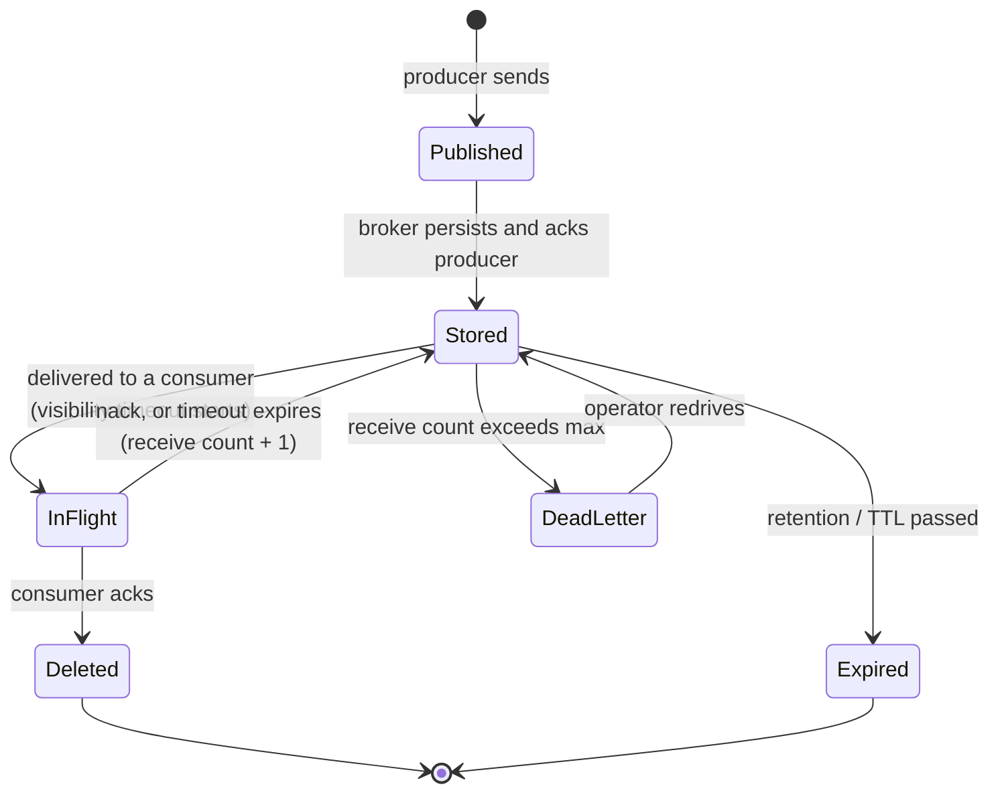
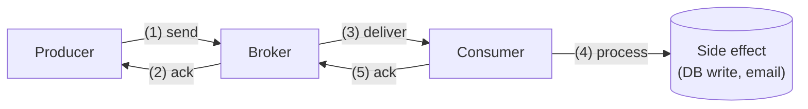
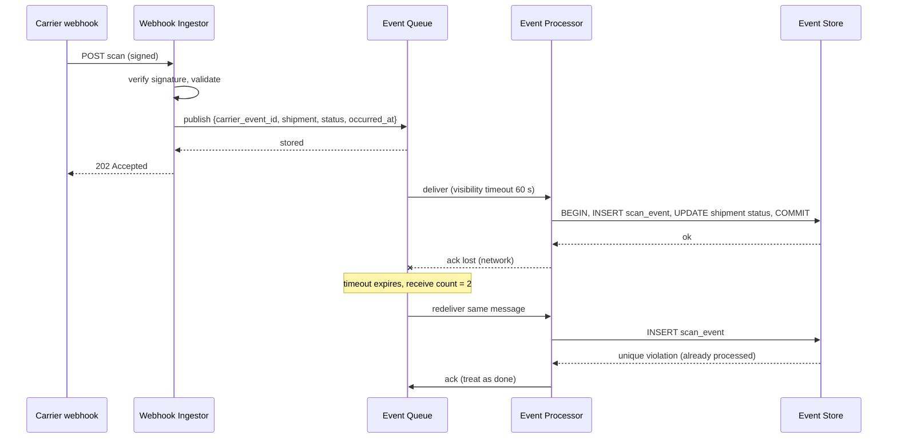

# Message queues and brokers

> A message broker lets a producer hand off work without waiting for the consumer to be available,
> fast, or even alive. Everything hard about messaging follows from one fact: the broker cannot know
> whether a consumer finished, so it delivers again, and the consumer must cope.

!!! abstract "Page facts"
    **Level:** Mixed (concepts and patterns are Level 1-2; delivery semantics, ordering, and
    backpressure design are Level 3) · **Status:** Draft · **Time:** 60-75 minutes ·
    **Last verified:** 2026-11-15

## Learning objectives

After this page you should be able to:

- Explain what a broker adds over a direct call, and the three messaging styles (point-to-point,
  publish-subscribe, request-response over messaging).
- Describe the message lifecycle: publish, persist, deliver, visibility timeout, acknowledge, retry,
  dead-letter.
- State what at-most-once, at-least-once, and "exactly-once" guarantee, and design an idempotent
  consumer.
- Choose per-key ordering over global ordering, and size consumer concurrency from processing time
  and arrival rate.
- Design retry, dead-letter, and backpressure behavior so that a burst or a poison message degrades
  the system instead of breaking it.

## Prerequisites

- [Capacity estimation](../performance-and-scalability/capacity-estimation.md) — the event rates and
  the backlog scenario used below.
- [Relational databases and SQL internals](../databases-and-storage/relational-databases-and-sql-internals.md)
  — the unique constraint that makes the consumer idempotent.

## The problem this solves

A direct call couples two systems in time: the caller waits, and if the callee is down, slow, or
overloaded, the caller fails or slows with it. Many interactions do not need that coupling. A
carrier reporting a scan does not need to wait for AtlasMart to update a status page; it needs a
reliable "received". An order confirmation does not need the email to be sent before the checkout
responds. Without a broker, every such producer must implement its own retry, buffering, and
overload handling, and a slow consumer becomes everyone's outage. A broker takes the message, makes
it durable, and lets the consumer process it at its own pace, in its own failure domain.

## What it is

A **message broker** is a service that accepts messages from **producers**, stores them, and
delivers them to **consumers** according to a model:

| Model | Shape | Delivery | Use |
|---|---|---|---|
| Point-to-point (queue) | One queue, competing consumers | Each message goes to exactly one consumer | Work distribution: process this event, send this email |
| Publish-subscribe (topic) | One topic, many subscriptions | Each subscriber gets every message | Fan-out: several systems react to the same event |
| Request-response over messaging | A request queue and a reply queue with a correlation ID | The reply is a message too | Asynchronous RPC when the caller can wait but the callee should not be called directly |

**Asynchronous messaging** means the producer continues as soon as the broker has accepted the
message. The broker's **persistence** (writing the message to disk or replicating it) is what makes
that acceptance meaningful; an in-memory-only broker trades durability for speed.

Brokers come in two broad families with different internals: **queue brokers** that track each
message's delivery state and delete it once acknowledged, and **log-based streaming platforms** that
append messages to partitioned logs and let consumers track their own position. This page covers the
queue model and the concepts shared by both; the log model's specifics (partitions, offsets, consumer
lag, replay windows) are on the planned streaming page (D08-T03).

## Mental model

A broker is a post office with a rule: every letter is kept until the recipient signs for it.
Producers drop letters in the box and leave; the post office stores them (persistence), sorts them by
address (routing), and holds them until someone with the right key opens the box (delivery). If the
recipient takes a letter but never signs (no acknowledgment), the post office assumes it was lost and
puts a copy back in the box after a while (visibility timeout, redelivery). Letters nobody can
process after several tries go to a shelf for a human (dead-letter queue). Several clerks can serve
one box (competing consumers), but then letters are not handed out in the order they arrived.

**Where the analogy breaks:** a real post office knows whether a letter was delivered. A broker only
knows whether it received an acknowledgment, and an acknowledgment can be lost after the work was
done. That gap is why every consumer must tolerate seeing the same message twice.

## Key terms

| Term | Meaning on this page |
|---|---|
| Producer / consumer | The sender of a message / the receiver that processes it |
| Queue / topic | A named destination for point-to-point / publish-subscribe delivery |
| Acknowledgment (ack) | The consumer's signal that a message is fully processed and can be deleted |
| Visibility timeout | How long a delivered message stays hidden from other consumers before the broker redelivers it |
| At-least-once | Every message is delivered one or more times; duplicates are possible |
| At-most-once | Every message is delivered zero or one times; loss is possible |
| Idempotent consumer | A consumer for which processing the same message twice has the same effect as once |
| Dead-letter queue (DLQ) | A destination for messages that failed processing too many times |
| Poison message | A message that fails every attempt (malformed, triggers a bug) |
| Backpressure | A mechanism by which a slow consumer slows the producer or sheds load, instead of being buried |
| Consumer group | A set of consumer instances sharing one subscription, each message going to one of them |

## How it works

### The message lifecycle

**Figure 1 — Lifecycle of one message in a queue broker.** States are the broker's view; the
consumer's work happens in the "in flight" state.

How to read it: the loop between Stored and InFlight is the retry mechanism; nothing leaves the loop
without an ack, a dead-letter decision, or expiry. The producer's ack (Published → Stored) and the
consumer's ack (InFlight → Deleted) are different events with different guarantees.

1. **Publish.** The producer sends the message with headers (ID, timestamp, routing key, attributes)
   and a body. The broker writes it durably and returns an acknowledgment to the producer. Until that
   ack arrives, the producer must assume the message may not exist and retry; the retry can itself
   create a duplicate.
2. **Store.** The message waits, in order of arrival within its queue or partition, subject to
   **priority** (if the broker supports it), **delay** (deliver no sooner than), and **expiry**
   (discard if not consumed within a time).
3. **Deliver.** A consumer receives the message. The broker starts the **visibility timeout** (or
   holds the message as unacknowledged for that consumer's session). Other consumers do not see it.
4. **Acknowledge.** The consumer finishes its work and acks; the broker deletes the message. A
   negative ack (nack) or a timeout returns the message to the queue with its receive count
   incremented.
5. **Retry and dead-letter.** After a configured number of receives, the broker moves the message to
   the DLQ instead of redelivering.

### Routing and filtering

Brokers route by **destination name** (the simplest), by **routing key patterns** (a message tagged
`shipment.delivered.eu` reaches subscriptions matching `shipment.delivered.*`), by **header or
attribute filters** evaluated per subscription, or by **content** in some integration brokers.
Filtering at the broker reduces consumer work and network; filtering at the consumer is more
flexible and easier to change. Topics with many subscriptions each filtering a slice is the usual
compromise.

### Delivery guarantees

**Figure 2 — Where messages are lost or duplicated.** Each arrow is a place a crash or a lost
network packet changes the outcome. Guarantees are statements about which of these cases the system
tolerates.

How to read it: a failure after (1) but before (2) makes the producer resend, which duplicates if
the broker had stored the message. A failure after (4) but before (5) makes the broker redeliver, so
the side effect happens twice unless the consumer is idempotent. A consumer that acks before (4) and
then crashes loses the message.

| Guarantee | Consumer acks | Loss | Duplicates | Cost |
|---|---|---|---|---|
| At-most-once | Before processing (or no ack) | Possible | None | Cheapest; for metrics, logs, data that is superseded quickly |
| At-least-once | After processing | None (given durable broker) | Possible | The default for anything that matters; the consumer must be idempotent |
| Effectively-once | After processing, with deduplication by message ID at the consumer and often producer-side deduplication at the broker | None | None visible in the side effect | Idempotency keys, a deduplication store, and sometimes transactional coordination between the broker and the store |

"Exactly-once delivery" in the strict sense (the consumer receives the message exactly once across
all failures) is not achievable between independent systems, because the ack can always be lost
after the work. What is achievable is **exactly-once processing effect**: the side effect happens
once because repeats are detected and ignored. Brokers that advertise exactly-once provide it within
their own boundary (for example, when the consumer writes its result back to the same broker in a
transaction); the moment the side effect is in a different system, the consumer's idempotency does the
work.

### Idempotent consumers and deduplication

An **idempotency key** is a value that identifies the operation (not the message): the carrier's
event ID, the order ID plus the action, a UUID generated by the producer and reused on retries. The
consumer records keys it has processed and skips repeats. The record must be written **in the same
transaction as the side effect** (a unique constraint on the key in the same database is the
simplest form) or the gap between them reintroduces the problem. Where the side effect is in a
system without transactions (sending an email), the best available is "record first, then send,
then accept that a crash in between may send twice" and choose the order that fails in the safer
direction.

Broker-side **deduplication** (dropping a message with the same deduplication ID within a window)
removes producer-retry duplicates but not consumer-redelivery duplicates; it is a complement, not a
replacement, for consumer idempotency.

### Ordering

A single queue with a single consumer delivers in order. The moment there are several consumers,
messages are processed concurrently and complete out of order; a retried message is processed after
later ones. **Global ordering** therefore costs concurrency: one consumer at a time. **Per-key
ordering** is the practical alternative: messages with the same key (shipment ID) go to the same
partition or message group, which is consumed by one consumer at a time, while different keys proceed
in parallel. The consumer still handles out-of-order arrival defensively (a timestamp guard on the
status update, as on the databases page), because a redelivered older message can follow a newer one
within the same key after a failure.

### Consumer concurrency and groups

A **consumer group** is several consumer instances sharing one subscription; the broker spreads
messages (or partitions) across them. Concurrency is sized with Little's Law: consumers needed =
arrival rate × processing time ÷ utilization target. With 70 events/s and 20 ms each, that is
1.4 consumer-slots worth of work; two workers in different zones carry it with margin, and more are
added only when the lag metric says so. Each worker can also process several messages concurrently
(threads or asynchronous tasks), bounded by a **prefetch** or **max in-flight** setting that limits
how many unacknowledged messages one consumer holds; too high a prefetch makes a slow worker hoard
messages that other workers could have processed.

### Retries, backoff, and dead-letter queues

Transient failures (a database timeout, a dependency returning an error) are retried; permanent ones
(a malformed body) are not worth retrying. The broker cannot tell the difference, so the pattern is:

- Retry with **exponential backoff and jitter** (either by delaying the nack, by re-publishing to a
  delay queue, or by letting the visibility timeout expire), so that a struggling dependency is not
  hammered by every retry at once.
- A **maximum receive count** (typically a handful) after which the message is moved to the **DLQ**.
- **Alerting** on DLQ depth, because every message there is a failed business event.
- A **redrive** tool that moves DLQ messages back to the source queue after the bug is fixed.

A **poison message** that is never dead-lettered blocks a FIFO group or burns consumer time forever;
the maximum receive count is the protection, and it must be set.

### Backpressure and flow control

A queue absorbs bursts; that is its purpose. But a queue that grows without bound is a delayed outage:
latency for every message rises with the backlog (Little's Law again: wait = backlog ÷ throughput),
and the broker eventually hits its storage limit. **Backpressure** means the system reacts before
that:

| Mechanism | Where | Effect |
|---|---|---|
| Consumer-side prefetch limit | Consumer | A slow consumer takes fewer messages; others take more |
| Autoscaling on backlog or lag | Consumer group | More consumers while the backlog exceeds a threshold |
| Producer rate limiting or rejection | Producer or broker | The broker refuses or delays publishes above a rate; the producer sees an error and backs off |
| Load shedding by priority or age | Consumer | Old or low-value messages are dropped or short-circuited when the backlog is large |
| Bounded queue length with expiry | Broker | Messages older than a TTL are discarded; suits data that is superseded by newer messages |

The architect decides which of these applies per queue, based on what a delayed or dropped message
costs.

### Replay

Queue brokers delete acknowledged messages, so replay means re-publishing from a source of truth
(the producer's own records, an archive written by a tap consumer, or the DLQ). Log-based brokers
keep messages for a retention period and let a consumer rewind, which is one of the main reasons to
choose them. If replay is a requirement (rebuilding a projection, recovering from a consumer bug),
decide the mechanism at design time; it is not available by default on a queue.

### Request-response over messaging

The caller publishes a request with a **correlation ID** and a **reply-to** destination, then waits
for a message with that correlation ID on the reply destination, with a timeout. It gets the
decoupling benefits (the callee can be scaled, restarted, or queued) at the price of two hops of
latency and the need to handle a reply that never arrives. It suits long-running operations where
the caller can wait minutes; for interactive request paths a direct call with a timeout is simpler.

## Worked example: the AtlasMart Event Queue

The Webhook Ingestor receives carrier scan events, verifies the signature (NFR-5), validates the
payload, and publishes a message to the Event Queue. The Event Processor consumes it, stores the
event, updates the shipment status, and triggers notifications. Numbers are the assumptions from
the [capacity page](../performance-and-scalability/capacity-estimation.md).

**Figure 3 — Normal path and a duplicate.** The first delivery's ack is lost; the redelivered
message is detected by the unique constraint on the carrier event ID.

How to read it: the carrier gets its 202 as soon as the broker has stored the message, not when the
status is updated. The second delivery costs one failed insert and no incorrect state.

### Decisions, with reasons

| Decision | Choice | Reason |
|---|---|---|
| Model | Point-to-point queue with a consumer group | One processor must handle each event; fan-out to notifications happens from the processor, not the queue |
| Delivery guarantee | At-least-once with an idempotent consumer | NFR-7 forbids losing acknowledged events; duplicates are cheap to detect |
| Idempotency key | `(carrier_id, carrier_event_id)` unique constraint in the Event Store | Written in the same transaction as the side effect; no separate deduplication store |
| Ordering | Per shipment (message group or partition key = shipment ID), not global | Scans for one parcel must apply in order; parcels are independent; global order would mean one consumer |
| Visibility timeout | 60 s | Measured processing is about 20 ms; p99 with a slow database retry is well under 10 s; the timeout is several times the worst expected processing time so that a healthy consumer is never pre-empted, but a dead one is retried within a minute, inside NFR-1's budget when combined with the queue lag alert |
| Retry | Backoff via visibility timeout, max 5 receives | Transient database failures recover within that window; beyond it, a human should look |
| DLQ | Yes, with an alert at depth greater than 0 for more than 5 minutes | Every dead-lettered event is a parcel whose status is wrong (NFR-1 and NFR-8) |
| Expiry | None on the main queue | An old scan is still a fact to record; the timestamp guard prevents it from overwriting a newer status |
| Prefetch | 10 per worker | 20 ms processing × 10 in flight keeps the worker busy without hoarding |

### The backlog burst

A carrier delivers a backlog of 50,000 events in one minute (833/s) while the processors handle
100/s. The queue absorbs the difference: depth peaks at roughly 44,000 and drains in about 8 minutes
(50,000 ÷ 100). The design accepts this (one such backlog a month pushes about 0.35% of events past
NFR-1's 60 seconds, within the 1% allowance), so backpressure here is **autoscaling on backlog age**
(add processors when the oldest message is older than 30 seconds, up to a ceiling the database can
absorb) plus the **lag alert** from NFR-8. The ingestor is never slowed, because slowing it would make
the carrier retry and amplify the burst. If backlogs became daily, the processor ceiling and the
database write capacity would be the next numbers to revisit.

### Poison message

A carrier ships a payload with a status code the processor has never seen. Validation at the ingestor
rejects unknown codes with a 400 so the carrier's integration team sees it; anything that slips past
(a code valid at the ingestor but unhandled by the processor) fails five times and lands in the DLQ,
where the alert turns it into a ticket. Nothing else in the shipment's group is blocked for more than
the five retries' worth of backoff, and the fix is a processor deploy plus a redrive.

## Real-world architecture example

The shape above (an edge service that validates and acknowledges quickly, a durable queue, a
horizontally scaled consumer group with per-key ordering, a database unique constraint as the
idempotency record, a DLQ with an alert, and autoscaling on backlog age) is the standard webhook or
event-ingestion pipeline in any cloud, built on a managed queue (with message groups for ordering) or
on a partitioned log. The same pattern appears in order processing (checkout publishes, fulfilment
consumes), in notification fan-out (a topic with one subscription per channel), and in background
jobs (a queue per job type with priority queues for urgent work). The differences between brokers
matter for ordering guarantees, replay, and throughput ceilings; the consumer-side design is the same.

### Broker families compared (conceptually)

| Family | Examples | Ordering | Replay | Fits |
|---|---|---|---|---|
| Managed queue | Amazon SQS, Azure Storage Queues | Per message group in FIFO variants; otherwise best-effort | No (acked messages are deleted) | Work queues, webhook buffers, decoupling services |
| Protocol broker (AMQP, MQTT, JMS) | RabbitMQ, ActiveMQ, Azure Service Bus | Per queue; competing consumers reorder | Limited (dead-letter and requeue) | Routing-rich enterprise messaging, request-reply, device messaging |
| Managed pub-sub | Google Pub/Sub, Amazon SNS (with SQS) | Per ordering key where offered | Seek to a timestamp or snapshot in some services | Fan-out to many subscribers |
| Partitioned log | Apache Kafka, Apache Pulsar, Amazon Kinesis | Per partition, strict | Yes, within retention | Event streams, event sourcing, analytics feeds, high-throughput pipelines |

The table lists no numeric limits or prices on purpose; they change, and the provider's current
documentation is the only source to trust for them.

## Design choices and trade-offs

| Choice | Favor when | Avoid when |
|---|---|---|
| Queue instead of a direct call | The caller does not need the result now; the callee may be slow or down; bursts must be absorbed | The caller needs the answer to respond; latency budget cannot afford the hops |
| Pub-sub topic | Several independent consumers need every event | Only one consumer exists and ever will; a queue is simpler |
| At-least-once + idempotent consumer | Default for business events | The side effect cannot be made idempotent and the event is low-value; consider at-most-once and accept loss |
| Per-key ordering | Events for one entity must apply in order | No ordering need; plain competing consumers give more concurrency |
| Global ordering | A single consumer can keep up and the order of unrelated events matters | Almost always; it serializes the whole system |
| DLQ with alerts | Always for business events | Never skip it; set a receive limit on every queue |
| Autoscale consumers on backlog age | The downstream (database) can absorb the extra throughput | The downstream is the bottleneck; scaling consumers moves the pile-up |
| Queue broker vs partitioned log | Work distribution, per-message state, simple ops | Replay, multiple independent readers of history, very high throughput |

**Assumption behind all of this:** the broker itself is durable and highly available (replicated
across zones). A single-node broker is a single point of failure that no consumer design fixes.

## Failure modes and anti-patterns

- **Ack before work.** The consumer acks on receipt, then crashes. Detect: events missing with no
  DLQ entry. Prevent: ack after the side effect commits.
- **Non-idempotent consumer.** Duplicate emails, double inventory decrements. Detect: duplicates
  correlated with broker redeliveries. Prevent: idempotency key stored with the side effect.
- **Visibility timeout shorter than processing.** A slow message is redelivered while still being
  processed, so two consumers process it concurrently. Detect: receive count greater than 1 on
  successful messages. Prevent: timeout several times the p99 processing time, or extend it while
  working.
- **No receive limit.** A poison message loops forever, blocking its group. Prevent: a maximum
  receive count and a DLQ on every queue.
- **Unbounded backlog with no alert.** Everything "works" with hours of lag. Prevent: alert on the
  age of the oldest message, not only on depth.
- **Global ordering by accident.** One consumer, because "ordering was needed". Prevent: per-key
  ordering.
- **Fat messages.** Multi-megabyte payloads in the queue; throughput collapses and limits are hit.
  Prevent: store the payload in object storage and queue a reference (the claim-check pattern).
- **Transactional gap on publish.** The database commits but the publish fails (or the reverse), so
  the event and the state disagree. Prevent: the transactional outbox pattern (on the planned
  event-driven architecture page, D08-T02).
- **Retry storms.** Every consumer retries immediately against a failing dependency. Prevent: backoff
  with jitter and a circuit breaker in the consumer.

## Security considerations

- **Authentication and authorization per queue.** Producers can publish to their queue only;
  consumers can receive from theirs only; nobody but operators can purge or redrive.
- **Encryption** in transit (TLS to the broker) and at rest (the broker's storage and the DLQ, which
  holds the same data for longer).
- **Validate at the edge, not in the consumer.** The ingestor verifies the carrier signature and the
  schema before publishing, so the queue holds only trusted, well-formed messages and the consumer's
  attack surface is small.
- **Messages are data at rest.** Personal data in a message is subject to retention rules; the DLQ
  and any archive need the same deletion policy as the database. Prefer references (order ID) to
  copies of sensitive data (NFR-6).
- **Denial of service through the queue.** A flood of valid-looking messages fills the queue and
  starves real traffic; rate limit producers and prioritize queues by source.

## Performance, reliability, and cost

- **Performance:** queue latency under light load is milliseconds; under backlog it is the backlog
  divided by throughput. The consumer's processing time and concurrency set throughput; the
  broker's own limits matter only at scales far above the example.
- **Reliability:** durability comes from the broker's replication and from acking after the side
  effect; availability comes from a replicated broker and from consumers in several zones; the DLQ
  turns permanent failures into visible work instead of silent loss.
- **Cost:** managed queues charge per request and for payload size; logs charge for provisioned
  throughput and retention. Fat messages and chatty polling are the usual cost surprises; batching
  receives and acks, and queueing references instead of payloads, address both.

## Hands-on lab: at-least-once with a flaky consumer

With a local broker in a container (any queue broker) or a Python simulation using a thread-safe
queue:

1. Write a producer that publishes 1,000 messages, each with a unique ID and a `key` (one of 50
   values).
2. Write a consumer that "processes" by appending the message ID to a results file, then
   acknowledges. Make it crash (exit) randomly after processing but before acking, about 1% of the
   time, and restart it.
3. Count the IDs in the results file. Explain the duplicates.
4. Add a set of processed IDs (persisted to disk) checked before processing. Re-run and count again.
5. Run three consumer instances. Record the order in which messages with the same `key` were
   processed. Then route by key (one queue or group per key hash) and compare.
6. Inject a message whose body cannot be parsed. Observe what happens without a receive limit, then
   add one and a dead-letter destination.

??? question "Hint: what the counts should show"
    Step 3 produces a few more than 1,000 lines: exactly the messages that were processed but not
    acked before a crash. Step 4 produces 1,000 lines. Step 5 shows interleaving within a key across
    instances until keys are routed; with routing, each key's messages are in order even though keys
    interleave.

## Knowledge check

1. Why can a broker not guarantee that a consumer receives a message exactly once, and what can the
   consumer guarantee instead?
2. Processing takes 50 ms at p50 and 2 s at p99. What visibility timeout would you set, and what
   goes wrong if it is 1 s?
3. A queue has three competing consumers. In what sense is delivery "unordered", and how do you get
   ordering for events about the same customer without serializing everything?
4. What is the difference between a DLQ and expiry, and which would you use for a scan event that is
   a day old?
5. Backlog is 44,000 messages and consumers process 100/s. How long until a message published now
   is processed, and which single metric should the alert use?

??? success "Answers"
    1. The ack can be lost after the work is done, so the broker must redeliver to avoid loss. The
       consumer can guarantee that the *effect* happens once by detecting repeats with an idempotency
       key stored with the side effect.
    2. Several times the p99, for example 10-30 s, or extend the timeout while processing. At 1 s,
       slow messages are redelivered mid-processing and handled by two consumers at once, producing
       duplicates and wasted work.
    3. Messages are handed to different consumers that finish at different times, and a retried
       message is processed after later ones. Use a partition or message group keyed by customer ID,
       so one consumer handles one customer's messages sequentially while other customers proceed in
       parallel.
    4. A DLQ holds messages that failed processing repeatedly, for a human to inspect and redrive.
       Expiry discards messages that waited too long, for data superseded by newer data. A day-old
       scan is still a fact; it should be processed (with a timestamp guard), not expired.
    5. About 440 s (just over 7 minutes) plus its own processing. Alert on the age of the oldest
       unprocessed message, because depth alone does not say whether consumers are keeping up.

## Architecture discussion questions

1. The notification team wants the Event Processor to call their service synchronously so that
   "notifications are never missed". Argue for and against a second queue, and say what guarantee
   each design actually gives.
2. Your carrier integration must process 200 times the current event rate for a new marketplace
   partner, and that partner cannot tolerate rejected webhooks. Which parts of the design change
   first (ingestor, queue, consumers, database), and in what order would you find out?
3. A product manager asks for "exactly-once" on an invoice-sending consumer because duplicate
   invoices are a legal problem. Design the consumer and name the one case your design still cannot
   prevent.

## Summary

A broker decouples producers from consumers in time and in failure: it stores messages durably,
delivers them, and redelivers anything not acknowledged. That redelivery is why at-least-once is the
realistic guarantee and why consumers must be idempotent, with the idempotency key stored in the
same transaction as the side effect. Ordering is per key, not global; concurrency is sized with
Little's Law and bounded by prefetch; retries use backoff and end in a dead-letter queue that is
alerted on; backpressure is designed per queue from the cost of delay or loss. Replay is a design
decision, available by default only on log-based brokers. Broker products differ in ordering, replay,
and throughput; the consumer-side design does not.

## Related topics

- **Before:** [Capacity estimation](../performance-and-scalability/capacity-estimation.md);
  [Relational databases and SQL internals](../databases-and-storage/relational-databases-and-sql-internals.md)
- **Alongside:** [Integration architecture](../application-and-api-architecture/integration-architecture.md)
  — brokers as integration middleware; [Distributed systems fundamentals](../distributed-systems/distributed-systems-fundamentals-time-and-coordination.md)
  — partial failure, which is the root of redelivery; [API design](../application-and-api-architecture/api-design-rest-graphql-grpc-and-async-apis.md)
  — webhooks and idempotency keys on the producer side; [High availability design](../reliability-and-disaster-recovery/high-availability-design.md)
  — the broker as a replicated dependency.
- **Planned:** event-driven architecture, transactional outbox, event schemas (D08-T02);
  streaming platforms, partitions, offsets, and lag (D08-T03); Lab 03 (queue with retries and a
  DLQ) and Lab 04 (idempotency and duplicate handling).

## References

| Source | Type | Checked |
|---|---|---|
| Gregor Hohpe and Bobby Woolf, [Enterprise Integration Patterns: Messaging Patterns](https://www.enterpriseintegrationpatterns.com/patterns/messaging/) | Pattern catalogue (companion site to the 2003 book) | 2026-11-15 |
| [RabbitMQ: AMQP 0-9-1 Model Explained](https://www.rabbitmq.com/tutorials/amqp-concepts) | Official documentation (exchanges, queues, acknowledgments) | 2026-11-15 |
| [Amazon SQS Developer Guide: Visibility timeout](https://docs.aws.amazon.com/AWSSimpleQueueService/latest/SQSDeveloperGuide/sqs-visibility-timeout.html) — Amazon Web Services | Official documentation | 2026-11-15 |
| [Apache Kafka documentation](https://kafka.apache.org/documentation/), section 4 "Design" | Official documentation (log-based delivery semantics) | 2026-11-15 |
| Tyler Treat, ["You Cannot Have Exactly-Once Delivery"](https://bravenewgeek.com/you-cannot-have-exactly-once-delivery/), 2015 | Essay | 2026-11-15 |
| [Stripe API reference: Idempotent requests](https://docs.stripe.com/api/idempotent_requests) | Official documentation (idempotency keys in practice) | 2026-11-15 |
| Google, [Site Reliability Engineering: Addressing Cascading Failures](https://sre.google/sre-book/addressing-cascading-failures/) | Book chapter (retries, backoff, load shedding) | 2026-11-15 |
| Martin Kleppmann, *Designing Data-Intensive Applications* (O'Reilly, 2017), chapter 11 "Stream Processing" | Book (message brokers vs logs, delivery semantics) | 2026-11-15 |

## Review notes

- Canonical page for D08-T01. All inventory items are defined. Priority queues, message expiry, and
  broker-side filtering are covered at definition level; replay is covered as a design decision with
  mechanics deferred to the streaming page (D08-T03).
- The broker-family table names products without limits or prices by design; a reviewer should keep
  it that way and verify that the product names and families are still current.
- The visibility timeout of 60 s, the receive limit of 5, and the prefetch of 10 are illustrative
  choices for the fictional system, derived from the capacity page's 20 ms processing assumption.
- Pat Helland's "Life Beyond Distributed Transactions" (ACM Queue) is relevant to idempotency and was
  not listed because the publisher page returned 403 to automated checks; a reviewer may add it with a
  verified link.
