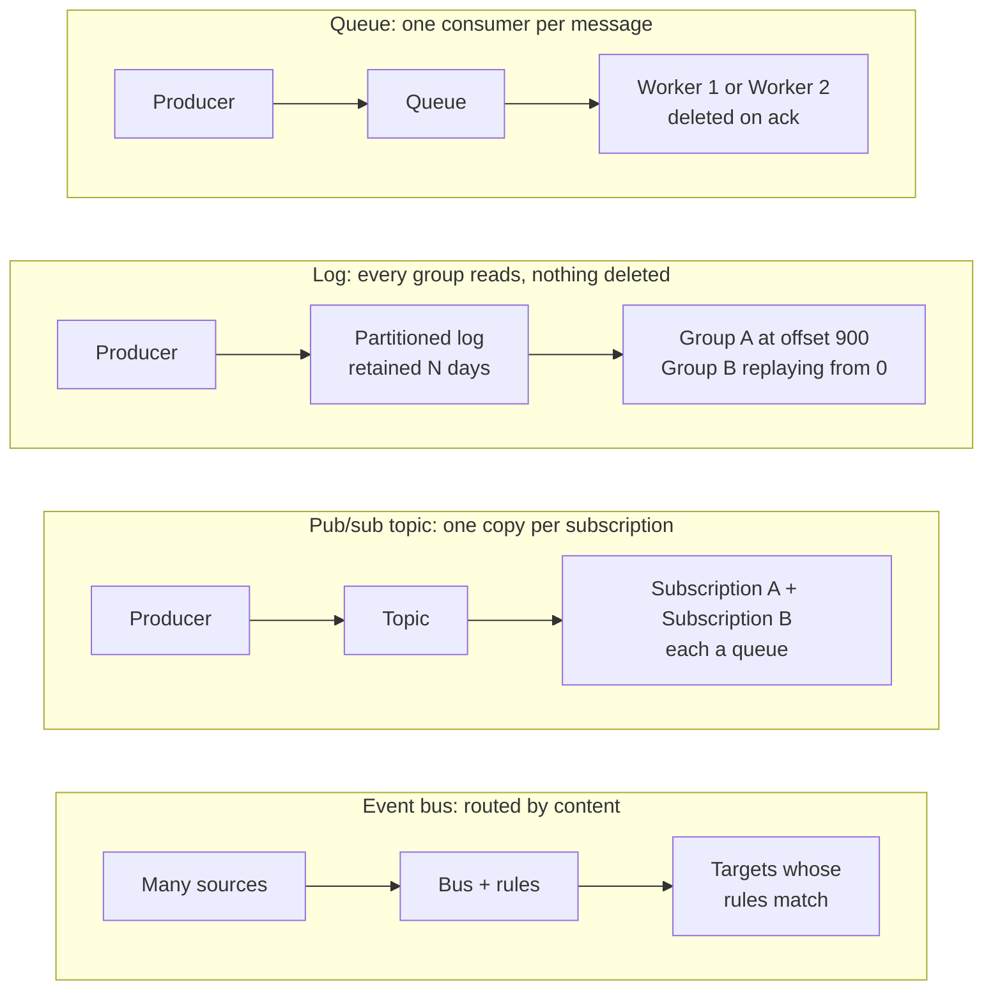
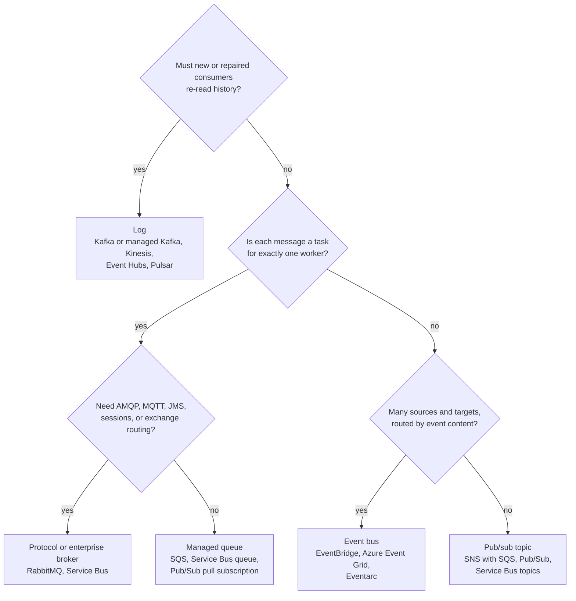
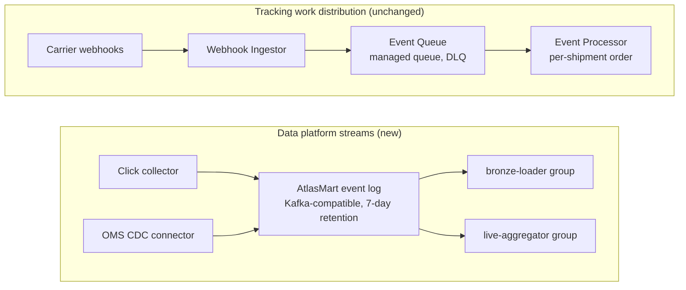

# Messaging technologies compared

> Messaging products are easier to choose once you stop comparing brand names and start comparing
> models: a queue hands each message to one worker and forgets it, a log keeps an ordered history
> for many readers, a pub/sub topic copies each message to every subscription, and an event bus
> routes events by their content. Most products are one of these at heart, with features borrowed
> from the others.

!!! abstract "Page facts"
    **Level:** Mixed (the four models and the product map are Level 1-2; the decision guide and the
    ADR are Level 3) · **Status:** Draft · **Time:** 45-60 minutes · **Last verified:** 2026-11-27

## Learning objectives

After this page you should be able to:

- Classify a messaging product as a queue, a log, a pub/sub service, an event bus, or a protocol
  broker, and say what that implies before reading its feature list.
- Compare Apache Kafka, Amazon Kinesis Data Streams, Amazon SQS, Amazon SNS, Amazon EventBridge,
  RabbitMQ, Apache Pulsar, Google Cloud Pub/Sub, Azure Service Bus, and Azure Event Hubs on
  ordering, delivery semantics, retention and replay, routing and filtering, protocol, and
  operational model.
- Use a decision guide to shortlist a model, then a product, from requirements rather than habit.
- Write an ADR that keeps one messaging technology and adds another, with consequences, and map the
  decision onto each major cloud.

## Prerequisites

- [Message queues and brokers](message-queues-and-brokers.md) — acknowledgments, visibility
  timeouts, dead-letter queues, and delivery guarantees, which this page assumes.
- [Event streaming and log-based architecture](event-streaming-and-log-based-architecture.md) —
  partitions, offsets, retention, consumer lag, and the exactly-once boundary.
- [Cloud providers: principles before catalogs](../cloud-architecture/cloud-providers-principles-before-catalogs.md)
  — why the page maps concepts first and services second.

## The problem this solves

Teams often pick a messaging product because it is already in the estate or because a vendor
demo was convincing, and then fight it: replaying history on a queue that deletes on
acknowledgment, building per-message retries on a log that only tracks one offset per partition, or
filtering in every consumer because the product has no server-side routing. The cost is not the
product but the mismatch. A conceptual comparison lets an architect state the required model first,
shortlist the products that implement it natively, and treat the remaining differences (protocol,
operations, cloud fit) as the tie-breakers they are.

## What it is

Four delivery models, plus one family defined by protocol, cover the products on this page:

| Model | Core behaviour | What a consumer tracks | Natural fit |
|---|---|---|---|
| Queue | Each message goes to one of several competing consumers and is deleted once acknowledged | Nothing; the broker tracks each message's state | Work distribution, task buffers |
| Log (event stream) | Records are appended to ordered partitions and kept for a retention period; reading does not remove | An offset per partition | Many readers of the same history, replay, high-volume streams, CDC |
| Pub/sub topic | Each message is copied to every subscription; each subscription then behaves like a queue | Per-subscription message state | Fan-out to several independent consumers |
| Event bus | Events from many sources are matched against rules and routed to targets | Usually nothing; the bus pushes to targets | Integration across teams, accounts, cloud services, and third-party software |
| Protocol broker | A general broker speaking open protocols (AMQP, MQTT, STOMP, JMS) with flexible routing | Depends on the queue or stream type used | Enterprise integration, request-reply, devices, migration from existing brokers |

The products, each verified against its owner's documentation on 2026-11-27:

| Product | Owner | Primary model | Owner documentation |
|---|---|---|---|
| Apache Kafka | Apache Software Foundation | Log | [Design](https://kafka.apache.org/44/design/design/) |
| Amazon Kinesis Data Streams | AWS | Log | [Terminology and concepts](https://docs.aws.amazon.com/streams/latest/dev/key-concepts.html) |
| Amazon Simple Queue Service (SQS) | AWS | Queue | [What is Amazon SQS?](https://docs.aws.amazon.com/AWSSimpleQueueService/latest/SQSDeveloperGuide/welcome.html) |
| Amazon Simple Notification Service (SNS) | AWS | Pub/sub (push) | [What is Amazon SNS?](https://docs.aws.amazon.com/sns/latest/dg/welcome.html) |
| Amazon EventBridge | AWS | Event bus | [What is Amazon EventBridge?](https://docs.aws.amazon.com/eventbridge/latest/userguide/eb-what-is.html) |
| RabbitMQ | RabbitMQ project | Protocol broker (queues and streams) | [Protocols](https://www.rabbitmq.com/docs/protocols), [Streams](https://www.rabbitmq.com/docs/streams) |
| Apache Pulsar | Apache Software Foundation | Log with queue-style subscriptions | [Messaging concepts](https://pulsar.apache.org/docs/concepts-messaging/) |
| Google Cloud Pub/Sub | Google Cloud | Pub/sub (pull, push, export) | [Subscription overview](https://docs.cloud.google.com/pubsub/docs/subscription-overview) |
| Azure Service Bus | Microsoft | Enterprise broker (queues and topics) | [Service Bus overview](https://learn.microsoft.com/en-us/azure/service-bus-messaging/service-bus-messaging-overview) |
| Azure Event Hubs | Microsoft | Log (Kafka-compatible endpoint) | [Kafka protocol support](https://learn.microsoft.com/en-us/azure/event-hubs/azure-event-hubs-apache-kafka-overview) |

## Mental model

Think of how a city moves parcels. A **queue** is a depot counter: each parcel is handed to the next
free courier, signed for, and gone from the counter. A **log** is a CCTV recording of the loading
bay: anyone with access can watch from any timestamp, as often as they like, until the tape is
overwritten. A **pub/sub topic** is a photocopier at the door that makes one copy for each
department on the distribution list. An **event bus** is the sorting office: it reads the label on
every item and sends it to whichever departments asked for that kind of item.

**Where the analogy breaks:** real products blur the categories on purpose. Kafka now documents
*share groups* that let several consumers take records from one partition with per-record
acknowledgment; Kinesis Data Streams documents *queue consumers* that receive records from a stream
with per-record delivery state; RabbitMQ adds append-only *streams* next to its queues; Pulsar's
subscription types give queue or stream behaviour on the same topic; and EventBridge's newer Custom
Event Bus retains events and supports ordered, replayable subscribers. Classify a product by its
primary model, then check which borrowed features are mature enough for your use.

## Key terms

| Term | Meaning on this page |
|---|---|
| Queue | A destination where each message is delivered to one consumer and removed after acknowledgment |
| Log / event stream | An append-only, partitioned sequence of records read by offset (see the streaming page) |
| Pub/sub topic | A destination that copies each message to every subscription |
| Event bus | A router that matches events against rules or filters and delivers them to targets |
| Subscription | A named consumer attachment to a topic or bus, with its own delivery state |
| Message group / session / ordering key | A producer-set key within which a service preserves order |
| Replay | Re-delivering messages that were already consumed, from retained data or an archive |
| Server-side filtering | The broker evaluates a rule and delivers only matching messages to a subscription |
| Kafka-compatible | A service that accepts the Kafka wire protocol, so Kafka clients connect without code changes |
| Managed / self-run | The provider operates the brokers / your team installs, patches, scales, and recovers them |

## How it works

### Figure: the four models side by side

**Figure 1 — Queue, log, pub/sub topic, and event bus.** Each panel shows one producer and two
consumers; what differs is who gets each message and whether it is kept.

How to read it: only the log keeps consumed messages; only the bus decides destinations from the
event's content. Pub/sub is a queue per subscriber with a copy step in front.

### The comparison dimensions

- **Model.** The primary model decides the defaults: whether consumed messages vanish, whether new
  consumers can read the past, and whether the service or the consumer tracks progress.
- **Ordering.** Every product that offers ordering does so *within a key* (partition, shard, message
  group, session, ordering key, event group), never globally at scale. Without a key, assume no order.
- **Delivery semantics.** At-least-once is the common default. Products that advertise exactly-once
  mean something narrower: deduplication of producer retries within a window, or transactions within
  the product's own boundary. Consumers still need idempotency for side effects elsewhere (see the
  [streaming page](event-streaming-and-log-based-architecture.md)).
- **Retention and replay.** Queues delete on acknowledgment and offer redrive from a dead-letter
  queue, not replay. Logs keep records for a retention period and let consumers rewind. Some
  pub/sub and bus services add replay through retention, snapshots, or archives.
- **Routing and filtering.** From none (one queue, one destination), through topic plus key (logs),
  to per-subscription filters on attributes or body, to rule-based routing across accounts and
  services (buses) and exchange-based routing (AMQP brokers).
- **Protocol.** A proprietary HTTPS API ties clients to one provider's SDK; an open protocol (Kafka,
  AMQP 1.0, MQTT) lets clients move between implementations.
- **Operational model.** Self-run software gives full control and full toil; managed clusters remove
  hardware and patching but still expose capacity decisions; serverless services remove capacity
  planning but impose the provider's quotas, which this page deliberately does not quote.

### Product notes

**Apache Kafka.** An open-source distributed log: topics of partitions, replicated with in-sync
replicas, consumers in groups tracking offsets, time or size retention and log compaction. Default
delivery is at-least-once; the idempotent producer and transactions give exactly-once for
read-process-write within Kafka. Routing is by topic and key; content filtering happens in consumers
or stream processors (Kafka Streams, or engines such as Flink). Clients use the Kafka wire protocol;
Kafka Connect moves data in and out. Run it yourself, or use a managed service such as
[Amazon MSK](https://docs.aws.amazon.com/msk/latest/developerguide/what-is-msk.html) (Amazon Managed
Streaming for Apache Kafka) or Google Cloud's
[Managed Service for Apache Kafka](https://docs.cloud.google.com/managed-service-for-apache-kafka/docs/overview),
both of which run open-source Kafka.

**Amazon Kinesis Data Streams.** A managed log of **shards**; the producer's partition key is hashed
to a shard, records carry a sequence number, and order holds within a shard. Capacity is on-demand
or provisioned; retention is configurable; several stream consumers read independently, either
sharing a shard's read throughput or with enhanced fan-out. AWS documents that producer and consumer
retries both cause [duplicate records](https://docs.aws.amazon.com/streams/latest/dev/kinesis-record-processor-duplicates.html),
so processing must be idempotent. The documentation also describes queue consumers for on-demand
streams, which receive records with per-record acknowledgment and dead-letter handling. Access is
through the AWS API and SDKs (the Kinesis Client Library manages shard leases and checkpoints); it
does not speak the Kafka protocol.

**Amazon SQS.** A fully managed queue. **Standard** queues deliver at least once with best-effort
ordering, so duplicates and reordering are possible
([standard queues](https://docs.aws.amazon.com/AWSSimpleQueueService/latest/SQSDeveloperGuide/standard-queues.html)).
**FIFO** queues preserve order within a **message group** and deduplicate sends, which AWS calls
exactly-once processing ([FIFO queues](https://docs.aws.amazon.com/AWSSimpleQueueService/latest/SQSDeveloperGuide/sqs-fifo-queues.html)).
Messages are hidden during a visibility timeout and deleted by the consumer; a dead-letter queue and
redrive handle failures; retention is configurable but there is no replay of deleted messages.
Fan-out is done by subscribing queues to an SNS topic.

**Amazon SNS.** A managed pub/sub service that pushes each message published to a topic to every
subscription: SQS queues, Lambda functions, HTTP(S) endpoints, Amazon Data Firehose, and
person-facing channels (email, SMS, mobile push). Subscriptions can carry
[filter policies](https://docs.aws.amazon.com/sns/latest/dg/sns-message-filtering.html) on message
attributes or on the JSON body. **FIFO topics** add ordering by message group, deduplication, and
archiving with replay ([FIFO topics](https://docs.aws.amazon.com/sns/latest/dg/sns-fifo-topics.html)).
AWS recommends pairing SNS with SQS so that subscribers that are offline do not lose messages.

**Amazon EventBridge.** A serverless event router. The **Custom Event Bus - Classic** matches events
against rules (event patterns) and delivers to targets, with optional transformation, retries, and an
SQS dead-letter queue for failed deliveries; **archives** keep events for replay to the same bus, and
AWS notes that replay order is not guaranteed
([archive and replay](https://docs.aws.amazon.com/eventbridge/latest/userguide/eb-archive.html)). The
newer **Custom Event Bus** retains events, lets subscribers start from the past, pause, and resume,
and offers FIFO subscribers ordered within an **event group** plus publish-time deduplication
([ordering and deduplication](https://docs.aws.amazon.com/eventbridge/latest/userguide/eb-custom-bus-ordering.html)).
**EventBridge Pipes** connect one source to one target with enrichment; **EventBridge Scheduler**
runs scheduled invocations. Sources include AWS services, custom applications, and third-party
software.

**RabbitMQ.** An open-source broker. In the AMQP 0-9-1 model producers publish to **exchanges**
(direct, topic, fanout, headers) that route to queues by routing key or headers
([AMQP concepts](https://www.rabbitmq.com/tutorials/amqp-concepts)). **Quorum queues** are replicated
with the Raft consensus algorithm and support a delivery limit with dead-lettering
([quorum queues](https://www.rabbitmq.com/docs/quorum-queues)); **streams** are replicated,
append-only logs that consumers read non-destructively from an offset or timestamp, and **super
streams** partition them. Protocols: AMQP 1.0 (recommended for new applications), AMQP 0-9-1, MQTT,
STOMP, and the RabbitMQ Stream protocol. Run it yourself or use a managed broker such as
[Amazon MQ](https://docs.aws.amazon.com/amazon-mq/latest/developer-guide/welcome.html), which manages
RabbitMQ and ActiveMQ Classic brokers.

**Apache Pulsar.** An open-source, multi-tenant messaging and streaming platform whose brokers are
stateless and whose data lives in Apache BookKeeper storage nodes
([architecture](https://pulsar.apache.org/docs/concepts-architecture-overview/)). One topic serves
stream or queue behaviour through **subscription types**: Exclusive and Failover (in order per
partition), Shared (round robin, no order), and Key_Shared (in order per key). It supports
individual and cumulative acknowledgment, negative acknowledgment, dead-letter topics on Shared and
Key_Shared subscriptions, broker-side deduplication, delayed delivery, retention of acknowledged
messages, tiered storage, geo-replication, and transactions. Mostly self-run; hosted offerings exist.

**Google Cloud Pub/Sub.** A managed pub/sub service with **pull**, **push**, and **export**
subscriptions (export writes directly to BigQuery or Cloud Storage). It leases individual messages
rather than partitions, so consumer concurrency is not bounded by a partition count. Delivery is
at-least-once with no ordering by default; **ordering keys** give per-key order when ordering is
enabled on the subscription at creation
([ordering](https://docs.cloud.google.com/pubsub/docs/ordering)); **exactly-once delivery** is
available for pull subscriptions when subscribers connect in the same region
([exactly-once](https://docs.cloud.google.com/pubsub/docs/exactly-once-delivery)). Subscriptions can
**seek** to a timestamp or snapshot to replay retained messages; filtering and dead-letter topics are
supported.

**Azure Service Bus.** A managed enterprise broker with **queues** and **topics with subscriptions**;
each subscription has rules made of a filter and an optional action. **Sessions** give FIFO order per
session and support request-response; other features include a dead-letter subqueue, scheduled
delivery, deferral, duplicate detection, autoforwarding, geo-replication, and transactions that let
a receive and the resulting sends commit together. The primary protocol is AMQP 1.0, with HTTP/REST,
and JMS 2.0 on the Premium tier.

**Azure Event Hubs.** A managed partitioned log: event hubs (equivalent to Kafka topics) in a
namespace (equivalent to a cluster), partitions, consumer groups, and offsets, with time-based
retention by tier and **Capture** to Azure Blob Storage or Azure Data Lake Storage. It speaks the
Kafka protocol, AMQP 1.0, and HTTPS, so Kafka clients connect by configuration change. Microsoft
documents Kafka transactions and Kafka Streams support as public preview in some tiers at the time
of checking, and describes delivery as at-least-once
([Kafka support](https://learn.microsoft.com/en-us/azure/event-hubs/azure-event-hubs-apache-kafka-overview)).
That page also notes that Kafka itself lacks competing-consumer queues, rule-based subscription
filtering, and dead-lettering, and points to Service Bus or Event Grid for those patterns.

### The comparison matrix

| Product | Model | Ordering | Delivery | Retention and replay | Routing and filtering | Protocol | Operations |
|---|---|---|---|---|---|---|---|
| Apache Kafka | Log (share groups add queue-style reads) | Per partition | At-least-once; exactly-once inside Kafka with transactions | Time or size retention, compaction; rewind offsets | Topic and key; filter in consumers | Kafka protocol | Self-run, or managed (Amazon MSK, Google Cloud Managed Service for Apache Kafka) |
| Kinesis Data Streams | Log (shards); queue consumers on on-demand streams | Per shard | Duplicates from producer and consumer retries | Configurable retention; read by sequence number | Partition key; shared or enhanced fan-out | AWS API and SDK | Managed, on-demand or provisioned |
| Amazon SQS | Queue | Standard: best effort; FIFO: per message group | Standard: at-least-once; FIFO: deduplicated ("exactly-once processing") | Deleted on consume; DLQ redrive, no replay | None at the queue | AWS API (HTTPS) | Serverless |
| Amazon SNS | Pub/sub, push | FIFO topics: per message group | Push to each subscription; pair with SQS for durability | FIFO topics: archive and replay | Filter policies on attributes or body | AWS API; pushes to SQS, Lambda, HTTP(S), and more | Serverless |
| Amazon EventBridge | Event bus | Classic: not ordered; Custom Event Bus: FIFO subscribers per event group | Retries with SQS DLQ; Custom bus deduplicates on publish | Classic: archive and replay; Custom bus: retained, start from the past | Event-pattern rules or filtered subscribers; Pipes | AWS API; AWS and third-party sources | Serverless |
| RabbitMQ | Protocol broker: exchanges, queues, streams | Per queue; per partition in super streams | At-least-once with acks and publisher confirms | Queues: deleted on ack; streams: retention, replay from offset or time | Exchanges by routing key or headers | AMQP 1.0, AMQP 0-9-1, MQTT, STOMP, Stream | Self-run, or managed (Amazon MQ) |
| Apache Pulsar | Log with queue-style subscriptions | Exclusive, Failover: per partition; Key_Shared: per key; Shared: none | At-least-once; deduplication; transactions | Retention policies, backlog, tiered storage | Topics, partitioned topics, subscription types | Pulsar client protocol | Mostly self-run (brokers plus BookKeeper) |
| Google Cloud Pub/Sub | Pub/sub: pull, push, export | Per ordering key when enabled | At-least-once; exactly-once for pull in one region | Topic retention; seek to time or snapshot | Subscription filters; dead-letter topics | Google Cloud API and client libraries | Serverless |
| Azure Service Bus | Enterprise broker: queues, topics | Per session | Duplicate detection; transactions within Service Bus | Deleted on settlement; DLQ, scheduled, deferred | Subscription rules (filter plus action); autoforwarding | AMQP 1.0, HTTP/REST, JMS 2.0 (Premium) | Managed PaaS |
| Azure Event Hubs | Log, Kafka-compatible | Per partition | At-least-once | Time retention by tier; Capture to storage | Partition key or round robin; consumer groups | Kafka, AMQP 1.0, HTTPS | Managed PaaS |

No limits, quotas, or prices appear in this table by design. Message size, retention ceilings,
throughput per partition or shard, and pricing differ by product and tier and change over time;
read them in the provider's current documentation during design.

### A decision guide

**Figure 2 — Choosing a model, then a product.** Start from the requirement, not the product. The
leaves name candidates; quotas, protocol needs, and the existing estate break ties.

How to read it: answer the history question first, because it is the one that cannot be retrofitted
cheaply; a queue cannot be made to replay what it deleted. Products in a leaf are not equivalent:
check ordering keys, delivery semantics, and quotas against the requirement.

Two further questions refine the leaf:

- **Is an open protocol a requirement?** Choose Kafka-protocol services for logs (self-run Kafka,
  Amazon MSK, Google Cloud Managed Service for Apache Kafka, Azure Event Hubs) or AMQP/MQTT brokers
  for queues, if portability across clouds or on-premises is a stated goal.
- **Who will operate it?** A small team should prefer serverless or managed services and accept
  their quotas; self-run clusters pay off only with platform staff, special requirements, or very
  large steady volumes, and then the cost case must be made in the team's own numbers.

[Azure Event Grid](https://learn.microsoft.com/en-us/azure/event-grid/overview) and Google Cloud's
[Eventarc](https://docs.cloud.google.com/eventarc/docs/overview) appear in the figure only as each
cloud's event-routing counterpart to EventBridge; they are outside this page's inventory.

## Worked example: AtlasMart keeps its queue and adds a log

AtlasMart's Order Tracking System uses a managed queue (the Event Queue) between the Webhook
Ingestor and the Event Processor: about 480,000 scan events/day, peak about 70/s, 500 B each,
at-least-once with a database idempotency check, ordering per shipment, a 60 s visibility timeout,
and a dead-letter queue with an alert (the [queues page](message-queues-and-brokers.md) has the
details). The data-platform phase adds two new streams (assumptions from that phase): clickstream at
16,000,000 events/day, peak about 740/s, 1 KB each; and change-data-capture from the OMS
PostgreSQL through logical replication, including about 180,000 order lines/day. Both must feed the
lakehouse Bronze layer and at least one real-time consumer, and new consumers (a fraud model, a
recommendation job) are expected.

**Figure 3 — AtlasMart messaging after the decision.** Tracking work stays on the queue; clickstream
and CDC go to a Kafka-compatible log with independent consumer groups.

How to read it: the two halves share no broker. The queue keeps the per-message retry, timeout, and
dead-letter behaviour that tracking relies on; the log gives history and independent readers to
the data platform.

### ADR-P5-01: keep the managed queue for tracking, add a Kafka-compatible log

| Field | Content |
|---|---|
| Status | Proposed (illustrative ADR for the fictional AtlasMart) |
| Context | Tracking needs per-message work distribution with retries, a DLQ, per-shipment order, and at-least-once delivery at modest volume; it works and has runbooks. The new streams need many independent readers, replay after consumer bugs, 7 days of retained history, per-key order (session, order), and CDC connectors. Constraint C-4 keeps data in the EU region; the data platform team is 4 engineers. |
| Decision | Keep the managed Event Queue for tracking. Add a managed, Kafka-compatible event log in the EU region for clickstream and CDC topics. Do not self-run Kafka. |
| Option A: move tracking onto the log too | One technology. Rejected: tracking would rebuild per-message retries, receive limits, and a DLQ on top of offsets, and a poison scan would block its partition behind it; a working system would be rewritten for no requirement. |
| Option B: queues and pub/sub for the new streams | No new technology. Rejected: no replay once consumed, a new subscription per future reader that starts empty, and no CDC connector ecosystem. |
| Option C (chosen): queue plus managed Kafka-compatible log | Each workload gets its native model; Kafka protocol keeps clients and connectors portable across providers. |
| Option D: self-run Kafka on the platform's managed Kubernetes | Full control. Rejected for now: broker patching, rebalancing, storage, and upgrades would consume a large share of a 4-person team. Revisit only if managed quotas or features block a requirement. |
| Consequences | Two messaging technologies to monitor and secure; lag alerts in time on the log (streaming page) and age-of-oldest-message alerts on the queue; schema governance for log topics; a written rule that work distribution goes to queues and shared event history goes to the log. |

### What AtlasMart would choose on each major cloud

The same decision mapped onto each provider's services. AtlasMart runs in one EU region of one
provider; this table is for comparison and for an exit plan, not a multi-cloud design.

| Need | AWS | Azure | Google Cloud |
|---|---|---|---|
| Tracking work queue with per-shipment order and DLQ | SQS FIFO queue, message group = shipment ID (or a standard queue plus the timestamp guard) | Service Bus queue with sessions keyed by shipment ID | Pub/Sub pull subscription with ordering key = shipment ID and a dead-letter topic |
| Kafka-compatible log for clickstream and CDC | Amazon MSK (provisioned or serverless) | Event Hubs with the Kafka endpoint, after checking the features AtlasMart uses (transactions and Kafka Streams were preview in some tiers when checked) | Managed Service for Apache Kafka |
| CDC connector runtime | MSK Connect | Kafka Connect workers on the platform's managed Kubernetes, against the Kafka endpoint | Connect clusters in Managed Service for Apache Kafka |
| Fan-out of "shipment status changed" to several teams | SNS topic with SQS subscriptions, or EventBridge | Service Bus topic with filtered subscriptions | Pub/Sub topic with filtered subscriptions |
| Native log alternative if Kafka protocol is not required | Kinesis Data Streams | Event Hubs native AMQP clients | Pub/Sub (not a log, but seek-based replay covers some needs) |

Arithmetic that does not depend on the product: the log stores about 16 GB/day × 7 days × 3
replicas ≈ 336 GB for clickstream before headroom (derived on the streaming page), and the tracking
queue's peak depth during a carrier backlog is the 44,000 messages derived on the queues page. Both
must be checked against the chosen service's current quotas before the ADR is accepted.

## Real-world architecture example

Most organizations past a certain size run more than one messaging technology, and the healthy
pattern is a small, documented set with one job each: a managed queue for work distribution, a log
for shared event history and data-platform feeds, a pub/sub or bus service for cross-team
notifications and cloud-service events, and occasionally a protocol broker kept for integration with
packaged software or devices. The unhealthy pattern is the same set chosen per team without rules,
so that each new integration reinvents retries, schemas, and monitoring. A platform team usually
publishes the selection rule, provides templates with security and alerting built in, and owns the
quotas conversation with the provider; see [platform engineering](../devops-and-platform-engineering/platform-engineering.md).

## Design choices and trade-offs

| Choice | Favor when | Avoid when |
|---|---|---|
| Managed queue (SQS, Service Bus queue) | Per-message tasks, retries, DLQ, variable load | Several readers need the same history, or replay is required |
| Log (Kafka, Kinesis, Event Hubs, Pulsar) | Many readers, replay, CDC, high-volume streams | Per-message retry and DLQ semantics are the main need |
| Pub/sub topic (SNS, Pub/Sub, Service Bus topics) | Fan-out to a known set of subscribers, with filters | New subscribers must see past messages (check retention and seek support first) |
| Event bus (EventBridge and counterparts) | Routing across teams, accounts, and cloud or third-party sources by content | High-volume streams where per-key order and throughput dominate |
| Protocol broker (RabbitMQ, Service Bus) | AMQP, MQTT, or JMS clients; exchange routing; request-reply | A cloud-native queue would do and nobody needs the protocol |
| Kafka-protocol compatibility | Portability of clients and connectors across clouds and on-premises | The team will only ever use one provider's native SDK and features |
| Serverless service | Small team, spiky load, many small queues or topics | Quotas or features block a requirement; measure first |
| Self-run cluster | Platform staff, special requirements, large steady volumes with a cost case | The team cannot staff upgrades, rebalancing, and recovery drills |

**Assumption behind all of this:** consumers are idempotent and alert on age or lag, whichever
product is chosen. No product removes that work.

## Failure modes and anti-patterns

- **Choosing by brand, not model.** A log chosen for task distribution, or a queue chosen where
  replay was needed. Detect: custom retry tables beside Kafka, or "replay" scripts that re-publish
  from a database. Prevent: write the model requirement first (Figure 2).
- **Trusting "exactly-once" in a product name.** Deduplication windows and in-product transactions
  do not cover the consumer's database or email. Prevent: event IDs and idempotent sinks everywhere.
- **Assuming order without a key.** Standard queues, default Pub/Sub subscriptions, and Shared
  Pulsar subscriptions do not preserve order. Prevent: name the ordering key in the design.
- **Quota surprise in production.** A message size, partition, or throughput limit discovered at
  launch. Prevent: read the current quota pages during design and load test at peak.
- **Kafka-compatible is not Kafka.** A feature (transactions, compaction, a client version, a
  management API) behaves differently or is in preview. Prevent: list the features you use and test
  each against the service.
- **Technology sprawl.** Five brokers, five monitoring setups, five security models. Prevent: a
  short approved list with a rule for which job goes where, owned by the platform team.
- **Losing messages in push fan-out.** A push subscriber is down and the service gives up after its
  retries. Prevent: deliver to a queue subscription and let the consumer pull, with a DLQ.

## Security considerations

- **Identity and least privilege per destination.** Use each provider's identity integration (IAM
  policies, Microsoft Entra ID roles, Google Cloud IAM) or broker ACLs so that a producer can send to
  its destination only and a consumer can read its own subscription or group only.
- **Encryption** in transit (TLS for every protocol, including Kafka and AMQP) and at rest with
  provider-managed or customer-managed keys where the data is sensitive.
- **Private connectivity.** Keep broker endpoints off the public internet with private endpoints in
  the platform's hub-and-spoke network.
- **Data residency.** Constraint C-4 means every topic, queue, archive, and replica stays in the EU
  region; check where a service stores archives, dead-letter queues, and geo-replicas.
- **Cross-account routing on buses** is powerful and easy to over-grant; review resource policies as
  carefully as network rules.

## Performance, reliability, and cost

- **Performance:** queues and pub/sub services scale per message and per subscription; logs scale
  per partition or shard, so key choice and partition count decide throughput. End-to-end latency is
  dominated by batching, polling, and consumer work, not by the broker.
- **Reliability:** managed services replicate across zones within a region; self-run clusters need
  the same placement, replication factor, and failover drills to match. Multi-region needs explicit
  geo-replication or a second deployment, and an RPO that accounts for it.
- **Cost:** pricing dimensions differ: per request, per payload size, per shard or partition hour,
  per throughput or processing unit, per stored gigabyte, per archive and replay. Model the workload
  in each provider's current pricing pages using the workload's own numbers; this page states no
  prices. Self-run cost includes staff time, which is usually the largest term.

## Hands-on lab: one workload, four models

A Python simulation with the standard library; no broker or cloud account is needed.

1. Implement four tiny classes: `Queue` (deliver to one of N workers, delete on ack), `Log`
   (append to partitions by a stable key hash, consumers keep offsets), `Topic` (copy each message
   into one queue per subscription), and `Bus` (route by rules that match fields of the event).
2. Publish the same 1,000 seeded events (`type`, `shipment_id`, `occurred_at`) to each.
3. Add a second consumer after 500 events have been processed. Record what it can see in each model.
4. Simulate a consumer bug fixed after 300 events and try to reprocess the first 300 in each model.
5. Require "all events for one shipment in order" and run two workers. Record which models keep
   order with a key and which lose it.
6. Classify these requirements into the four models and name one product per model on one cloud:
   carrier scans to process once each; clicks for three analytics consumers; order-placed events to
   five teams with filters; S3-style object-created events routed to two functions.

??? question "Hint: what the simulation should show"
    Only the log lets the late consumer read the first 500 events and lets the fixed consumer
    reprocess the first 300 without help from the producer; the queue and topic subscriptions have
    deleted them, and the bus has delivered and forgotten them unless an archive exists. With a key
    and one consumer per partition or group, the log and a keyed queue keep per-shipment order;
    plain competing workers do not. Step 6: queue, log, pub/sub topic, event bus.

## Knowledge check

1. A team wants a new analytics consumer to process the last three days of order events. Which
   model supports that natively, and what would a queue-based design need instead?
2. What does SQS FIFO's "exactly-once processing" protect against, and what does it not?
3. Why can a Google Cloud Pub/Sub subscription scale consumers beyond a partition count while a
   Kafka consumer group cannot (without share groups)?
4. Name two features to verify before moving a Kafka workload to a Kafka-compatible service.
5. Which product on this page offers exchange-based routing by routing key, and which offers
   sessions for FIFO per key in a managed enterprise broker?

??? success "Answers"
    1. A log, by resetting the new group's offsets to a timestamp within retention. A queue design
       would need an archive (or the source database) and a re-publish job, because consumed messages
       were deleted.
    2. It deduplicates sends within a deduplication window and orders within a message group, so a
       producer retry does not create a second message. It does not stop a consumer from repeating a
       side effect if it crashes after the effect and before deleting the message.
    3. Pub/Sub leases individual messages to subscribers, so any number of subscriber clients can
       share one subscription. A Kafka consumer group assigns whole partitions, one member per
       partition at a time, so members beyond the partition count are idle.
    4. Any two of: transactions, compaction, Kafka Streams, the client and protocol versions in use,
       admin APIs, and quotas per partition or connection. Microsoft lists some of these as preview
       in some Event Hubs tiers.
    5. RabbitMQ (direct and topic exchanges in the AMQP 0-9-1 model); Azure Service Bus (sessions).

## Architecture discussion questions

1. A colleague proposes replacing AtlasMart's Event Queue with the new event log "to have one
   technology". Argue both sides with the tracking requirements (NFR-1, NFR-7) and the team sizes,
   and state what evidence would change the ADR.
2. AtlasMart's exit plan requires that the data platform could move providers within a year. Which
   choices on this page make that easier (protocols, connectors, schemas), and which make it harder?
3. A partner wants to receive AtlasMart's shipment events in near real time across organizations.
   Compare an event bus with cross-account rules, a pub/sub topic with a push subscription, and a
   webhook from a queue consumer, on security, failure handling, and coupling.

## Summary

Messaging products are best compared by model first: queues distribute tasks and forget them, logs
keep ordered history for many readers, pub/sub topics copy messages to subscriptions, event buses
route by content, and protocol brokers serve open protocols with rich routing. Kafka, Kinesis Data
Streams, Event Hubs, and Pulsar are logs; SQS is a queue; SNS and Google Cloud Pub/Sub are pub/sub;
EventBridge is a bus; RabbitMQ and Azure Service Bus are brokers with queues and topics. Ordering is
always per key, exactly-once is always narrower than it sounds, replay is native only where data is
retained, and quotas and prices must come from current provider documentation. AtlasMart keeps its
managed queue for tracking and adds a managed Kafka-compatible log for clickstream and CDC, because
each workload gets its native model and the Kafka protocol keeps the data platform portable.

## Related topics

- **Before:** [Message queues and brokers](message-queues-and-brokers.md);
  [Event streaming and log-based architecture](event-streaming-and-log-based-architecture.md);
  [Cloud providers: principles before catalogs](../cloud-architecture/cloud-providers-principles-before-catalogs.md)
- **Alongside:** [Event-driven architecture](event-driven-architecture.md) — event design and
  schemas on top of these products; [Integration architecture](../application-and-api-architecture/integration-architecture.md)
  — brokers as integration middleware; [Trade-offs, principles, ADRs, and governance](../architecture-fundamentals/trade-offs-principles-adrs-and-architecture-governance.md)
  — the ADR format; [Hybrid and multi-cloud architecture](../enterprise-architecture/hybrid-and-multi-cloud-architecture.md)
  — portability and exit plans.
- **Planned:** case studies 12 (lakehouse ingestion) and 13 (real-time fraud detection) in this
  phase's second wave apply these choices.

## References

| Source | Type | Checked |
|---|---|---|
| [Apache Kafka documentation: Design](https://kafka.apache.org/44/design/design/) | Official documentation | 2026-11-27 |
| [Amazon Kinesis Data Streams terminology and concepts](https://docs.aws.amazon.com/streams/latest/dev/key-concepts.html) — AWS | Official documentation | 2026-11-27 |
| [Amazon SQS FIFO queues](https://docs.aws.amazon.com/AWSSimpleQueueService/latest/SQSDeveloperGuide/sqs-fifo-queues.html) — AWS | Official documentation | 2026-11-27 |
| [Amazon EventBridge event bus (Custom)](https://docs.aws.amazon.com/eventbridge/latest/userguide/eb-custom-bus.html) — AWS | Official documentation | 2026-11-27 |
| [RabbitMQ: Streams and Superstreams](https://www.rabbitmq.com/docs/streams) | Official documentation | 2026-11-27 |
| [Apache Pulsar: Messaging](https://pulsar.apache.org/docs/concepts-messaging/) | Official documentation | 2026-11-27 |
| [Google Cloud Pub/Sub: Exactly-once delivery](https://docs.cloud.google.com/pubsub/docs/exactly-once-delivery) | Official documentation | 2026-11-27 |
| [Apache Kafka Protocol Support in Azure Event Hubs](https://learn.microsoft.com/en-us/azure/event-hubs/azure-event-hubs-apache-kafka-overview) — Microsoft Learn | Official documentation | 2026-11-27 |

## Review notes

- Canonical page for D08-T04. All inventory products are covered conceptually; Azure Event Hubs,
  Amazon MSK, Google Cloud Managed Service for Apache Kafka, and Amazon MQ were added as managed or
  Kafka-compatible counterparts. Azure Event Grid and Eventarc are named only as routing
  counterparts in the decision guide.
- Every product claim links to the owner's page in the body (product table and product notes); the
  References table holds the eight most load-bearing pages. All were HTTP 200 on 2026-11-27, and AWS
  pages were checked for a real "Page title - Service name" `<title>`.
- Fast-moving features, worth re-checking first: Kafka share groups, Kinesis queue consumers, the
  EventBridge Custom Event Bus (distinct from Custom Event Bus - Classic), and the preview status of
  Kafka transactions and Kafka Streams on Event Hubs.
- No limits, quotas, prices, or performance comparisons are stated by design. The ADR and per-cloud
  table are illustrative for the fictional AtlasMart.
