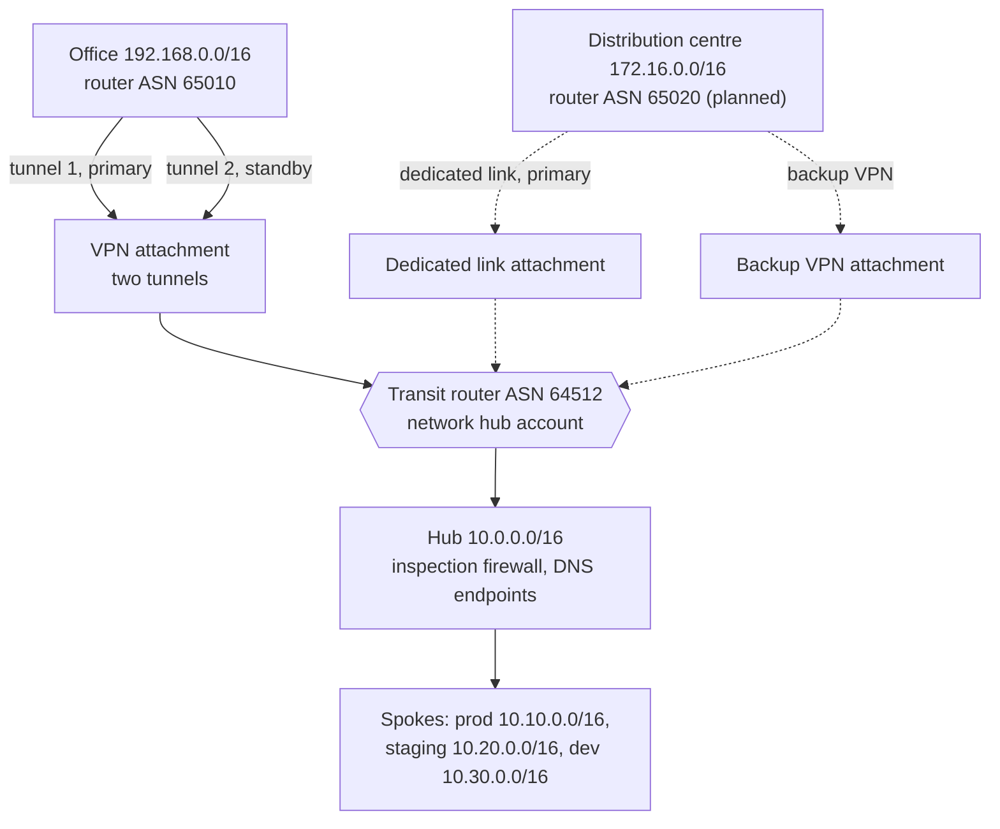
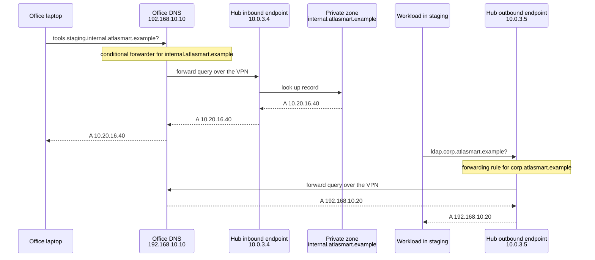
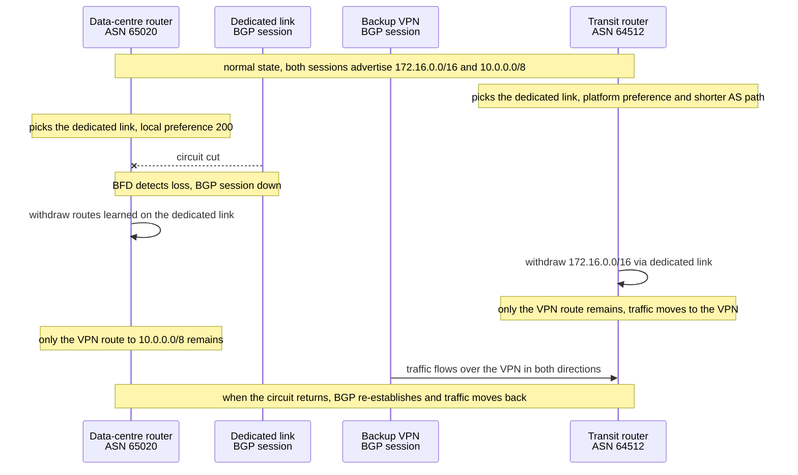

# Hybrid connectivity and VPNs

> A hybrid link is a routing agreement between two networks run by different teams. The tunnel is
> the easy part; deciding which prefixes cross it, which path wins, how names resolve on each side,
> and how you will prove where a packet died is the architecture.

!!! abstract "Page facts"
    **Level:** Mixed (VPN and dedicated-link concepts are Level 1-2; advertisement design, path
    preference, and failover are Level 3) · **Status:** Draft · **Time:** 60-75 minutes ·
    **Last verified:** 2026-11-21

## Learning objectives

After this page you should be able to:

- Explain how a site-to-site IPsec VPN works, why providers give two tunnels, and when to run BGP
  over them instead of static routes.
- Distinguish site-to-site VPN, client VPN, and dedicated private connectivity, and name each
  provider's equivalent.
- Design the BGP advertisements for a hybrid link in both directions: what to summarize, what to
  filter, and how to prefer a dedicated link while failing over to a VPN.
- Design hybrid DNS with conditional forwarding in both directions.
- Predict and fix MTU and TCP MSS problems across tunnels.
- Troubleshoot a hybrid path with route tables, flow logs, and packet capture, in a fixed order.
- Extend the design across accounts and regions without creating accidental transit paths.

## Prerequisites

- [Networking fundamentals: IP, CIDR, routing, and DNS](networking-fundamentals-ip-cidr-routing-and-dns.md)
  — CIDR summaries, longest-prefix match, MTU, and the AtlasMart address plan.
- [Network security, load balancing, and traffic flow](network-security-load-balancing-and-traffic-flow.md)
  — the hub, the transit router, and its route tables, which this page connects to on-premises sites.

## The problem this solves

Offices, warehouses, and data centres keep systems that cloud workloads must call, and people there
need cloud tools. Exposing internal databases and admin tools on the internet is not acceptable, and
public paths give no control over latency.

Hybrid connectivity extends private address space across sites over an encrypted internet tunnel
(a VPN) or a private circuit (a dedicated connection), with dynamic routing so a failure moves traffic
without a human. The risks are routing risks: overlapping ranges, advertisements that attract traffic
to the wrong path, a cloud hub that silently becomes transit between sites, and DNS that differs by
side.

## What it is

**Hybrid connectivity** is the set of private network paths between cloud networks and networks
outside the cloud (offices, data centres, other clouds), together with the routing, naming, and
monitoring that make them usable.

Its pieces: site-to-site and client VPNs over the internet; dedicated private connections over a
provider or partner circuit; a transit gateway where all of them meet the workload networks; BGP
to exchange prefixes and fail over; hybrid DNS so names resolve the same from both sides; and flow
logs and packet capture as evidence.

## Mental model

Think of two islands joined by a **ferry service** (the VPN: runs over the open sea, the internet,
and anyone can see the boats but not what is inside the locked containers) and a **private bridge**
being built (the dedicated link: your own lane, steady travel time). The harbour masters on each
island publish a **list of destinations** reachable through their harbour (BGP advertisements). If
the bridge closes, the masters strike its entries from the list and traffic takes the ferry. The
**directory desk** on each island knows its own residents and forwards questions about the other
island's residents to the other island's desk (conditional DNS forwarding).

**Where the analogy breaks:** routers apply rules mechanically, and the most specific entry wins
even if it points at the slow ferry. Tunnels shrink the largest packet that fits, so oversized
packets are dropped, not delayed. And each island decides only how its *outbound* traffic leaves;
the other island decides how traffic comes back.

## Key terms

| Term | Meaning on this page |
|---|---|
| Site-to-site VPN | An IPsec tunnel between a customer gateway device and a provider VPN endpoint, joining two networks |
| Client VPN | A remote-access VPN from an individual device into a network |
| IPsec, IKE | The IP-layer encryption suite (RFC 4301) and the key-exchange protocol that sets up its security associations (IKEv2, RFC 7296) |
| Customer gateway | The on-premises router or firewall that terminates the VPN |
| Dedicated private connection | A physical or partner-provided circuit into the provider's network, carrying BGP sessions |
| BGP, ASN | Border Gateway Protocol (RFC 4271); each side has an autonomous system number, private ones from RFC 6996 |
| Advertisement | A prefix one BGP speaker tells its peer it can reach |
| Route propagation | Copying routes learned on an attachment (VPN, link, network) into a route table automatically |
| Summarization | Advertising one shorter prefix that covers several longer ones |
| AS path prepending | Repeating your own ASN in an advertisement to make that path look longer and less preferred |
| Conditional forwarding | A resolver rule: queries for one domain go to named servers instead of normal resolution |
| MSS clamping | Rewriting the TCP maximum segment size in handshakes so segments fit a smaller path MTU |

## How it works

### Site-to-site VPN: IPsec and two tunnels

A site-to-site VPN joins a network to a network. The customer gateway and the provider's VPN
endpoint first run **IKE** to authenticate each other (with a pre-shared key or certificates) and
agree keys; then **ESP** (IPsec's encapsulating security payload) encrypts each packet. In tunnel
mode the whole original packet, inner addresses included, is wrapped in a new outer IP header
between the two public endpoints. When either side is behind NAT, ESP is wrapped in UDP 4500 (NAT
traversal).

Providers terminate each VPN connection on **two tunnels** to two separate endpoints, so one endpoint
can be patched or fail without dropping the connection (AWS documents two tunnels per Site-to-Site
VPN connection; the others offer equivalent redundant designs). Two tunnels from one customer device
over one internet line protect only against provider-side failures: the device and the line remain
single points of failure. Full redundancy needs two customer devices, ideally on two internet
providers.

### Static routes or BGP over the tunnels

| Aspect | Static routes | BGP |
|---|---|---|
| Configuration | Type the remote prefixes on each side | Each side advertises its prefixes; the peer learns them |
| Tunnel failure | Route may stay installed while the tunnel is down, black-holing traffic, unless the platform ties routes to tunnel state | Session drops, routes are withdrawn, the other tunnel's routes take over |
| New prefixes | Change both sides by hand | Advertise on one side |
| Path preference | Limited | AS path, local preference, MED, prefix length |
| Complexity | Low | Needs an ASN per side, BGP skills, and prefix filters |

Rule of thumb: use BGP whenever there are two tunnels or two paths, which is almost always. BGP
detects a dead peer only when its hold timer expires; **BFD** (Bidirectional Forwarding Detection,
RFC 5880) detects link loss much faster and is commonly offered on dedicated connections (check your
provider). Inside each tunnel the BGP session runs between two addresses from a small link-local
`/30`.

### Client VPN

A **client VPN** (remote access, point-to-site) connects one device into a network. Users
authenticate with the corporate identity provider and certificates; the device receives an address
from a **client pool** that must not overlap anything it needs to reach. **Split tunnelling** sends
only corporate prefixes through the tunnel; **full tunnelling** sends everything, which gives the
company inspection at the cost of latency and capacity. A common trap: home routers frequently use
addresses inside `192.168.0.0/16`, so a laptop on such a network cannot reach an office range that
overlaps its own LAN. Identity-aware access proxies (Zero Trust access, D12-T03) are replacing
broad client VPN access for web and SSH tools; client VPN remains useful for protocols those proxies
do not handle.

### Dedicated private connectivity

A **dedicated connection** is a circuit from your router to the provider's edge, either a physical
port at a colocation facility where both are present or a partner (network service provider) circuit.
Over it you create one or more virtual interfaces, each a VLAN carrying a BGP session for private
networks (and on some providers for public provider services). Compared with a VPN:

- **Predictable latency and capacity**, because the traffic does not cross the public internet.
  Capacity options, port speeds, and prices vary; check the provider's current documentation.
- **Not encrypted by default.** The circuit is private, not secret. Encrypt with TLS end to end, run
  IPsec over the link, or use MACsec (link-layer encryption) where the provider supports it on the
  port type you buy.
- **Physical lead time and redundancy planning.** Circuits take weeks to order. Providers publish
  resiliency recommendations: at least two connections, ideally at two locations, plus a VPN as a
  backup path for lower-criticality designs.

### Transit gateways and route propagation

On the cloud side, VPNs and dedicated links attach to the same **transit gateway** (transit router)
as the workload networks. Each attachment is *associated* with one route table, which decides where
its packets go, and *propagates* its learned prefixes into chosen route tables, which decides who can
reach it. Route propagation is what makes BGP useful in the cloud: when the office withdraws a prefix,
it disappears from every table it was propagated into.

Two rules keep this safe:

- **Propagate on-premises routes only into tables that should reach on-premises.** In AtlasMart's
  design they go into the post-inspection hub table, never directly into spoke tables, so office
  traffic always passes the hub firewall.
- **Do not become accidental transit.** If the office and the data centre both learn each other's
  prefixes through the cloud, the cloud becomes the corporate WAN, with its cost, inspection gaps,
  and an unplanned dependency. Advertise to each site only the cloud's own prefixes.

### BGP advertisements: summarization, AS path, and preferring the dedicated link

Route selection for one destination happens in a fixed order, and two parts of it matter most:

1. **Longest prefix match wins first.** Before any BGP attribute is consulted, a `/17` beats a `/16`
   no matter which path it arrives on.
2. **Among identical prefixes, BGP attributes and the platform's rules decide.** On your own routers
   you control *local preference* (higher wins, for traffic you send) and *AS path* length (shorter
   wins). Cloud platforms add their own documented tie-breaks; for example, AWS and Azure both prefer
   a dedicated-link route over a VPN route for the same prefix (see their route-priority pages).

From these two facts follow the design rules for a dedicated link with a VPN backup:

- Advertise the **same prefixes** over both paths. If the VPN advertises more specific prefixes than
  the dedicated link, the VPN wins for everything, permanently.
- For traffic *from* on-premises, set a higher local preference on the dedicated-link session.
- For traffic *to* on-premises, rely on the platform's preference and prepend your ASN on the VPN
  advertisement so any AS-path comparison agrees.
- **Summarize**: advertise few, stable prefixes. Summaries keep you far below the provider's limit on
  prefixes per session (check the documented value) and stop route churn when a spoke is added.
- **Filter both ways**: accept only the prefixes you expect from each peer, and advertise only what
  you intend (RFC 7454 describes BGP filtering practice). A leaked default route or a peer's mistake
  can otherwise pull traffic to the wrong place.

### Hybrid DNS: conditional forwarding both ways

Each side runs its own resolvers: the cloud's private zones (`internal.atlasmart.example`) and the
on-premises directory DNS (`corp.atlasmart.example`, assumption). Hybrid DNS connects them with two
forwarding paths:

- **Cloud to on-premises:** an *outbound endpoint* (resolver interfaces in the hub) plus a
  *forwarding rule*: queries for `corp.atlasmart.example` go to the on-premises DNS servers. The rule
  is shared to every spoke account so all networks use it.
- **On-premises to cloud:** an *inbound endpoint* (resolver interfaces in the hub with fixed private
  addresses) and a *conditional forwarder* on the on-premises DNS servers: queries for
  `internal.atlasmart.example` go to the inbound endpoint addresses.

Put endpoints in at least two zones, allow TCP and UDP 53 through every firewall on the path, and
never configure the same domain to forward in both directions (a loop).

### MTU and MSS across tunnels

IPsec tunnel mode adds a new outer IP header, ESP header, initialization vector, padding, trailer,
and integrity check, plus a UDP header when NAT traversal is used. The exact overhead depends on the
cipher, so the usable inner MTU is somewhat below 1,500 bytes. If a host sends a full 1,500-byte
packet with "do not fragment" set and the ICMP "packet too big" reply is filtered somewhere, the
packet disappears: small requests work and large responses hang (RFC 4459 discusses tunnel MTU
problems).

Two fixes, used together: set the **tunnel interface MTU** explicitly, and **clamp TCP MSS** on the
customer gateway so both ends negotiate segments that fit. MSS = MTU − IP header − TCP header, which
for IPv4 is MTU − 20 − 20. Providers publish recommended values for their VPN; use those.

### Flow logs and packet capture

**Flow logs** record one summary line per flow per interval: source and destination addresses and
ports, protocol, packets, bytes, and whether the filter accepted or rejected it. They contain no
payload. They answer "did the packet reach this interface, and did a filter drop it?". A flow that
appears at the transit attachment but never at the target subnet points to a route; an ACCEPT
followed by a REJECT for the reply points to a stateless filter; no record anywhere points to DNS
or the sending side.

**Packet capture** records actual packets: on a host (`tcpdump`), on the customer gateway (both the
inside interface and the tunnel), or through the provider's mirroring service to a capture appliance.
It shows handshakes, retransmissions, and MTU problems that flow logs cannot. Because captures can
contain personal data, time-box them, restrict access, and delete them after the investigation.

### Multi-region and cross-account connectivity

- **Cross-account:** the transit router lives in the network hub account and is shared to workload
  accounts with the provider's resource-sharing service. Workload accounts create attachments;
  only the network team controls associations, propagation, and hybrid links. DNS forwarding rules
  are shared the same way, and flow logs go to the log archive account.
- **Multi-region:** transit routers are regional and are joined by peering (or a provider's global
  WAN service); a dedicated link reaches several regions through the provider's gateway constructs
  (check which geographies each allows). A separate `/16` per region keeps summaries working.
  Residency constraints (AtlasMart's C-4: EU customer data stays in the EU) limit which regions and
  paths may carry data; the network enforces paths, not data classification.

### Provider equivalents

Names verified against each provider's documentation on 2026-11-21; products change, so recheck.

| Concept | AWS | Azure | Google Cloud |
|---|---|---|---|
| Site-to-site IPsec VPN | AWS Site-to-Site VPN | Azure VPN Gateway (site-to-site) | Cloud VPN (HA VPN) |
| Client VPN | AWS Client VPN | Azure VPN Gateway point-to-site | Not offered by Cloud VPN (documented as site-to-site only) |
| Dedicated private connection | AWS Direct Connect | Azure ExpressRoute | Cloud Interconnect (Dedicated or Partner Interconnect) |
| Cloud-side BGP speaker | Virtual private gateway or transit gateway | VPN or ExpressRoute virtual network gateway | Cloud Router |
| Transit router | AWS Transit Gateway (with Direct Connect gateway) | Azure Virtual WAN | Network Connectivity Center |
| Hybrid DNS endpoints | Route 53 VPC Resolver (formerly Route 53 Resolver) endpoints and rules | Azure DNS Private Resolver | Cloud DNS forwarding zones and inbound server policies |
| Flow logs | VPC Flow Logs | Virtual network flow logs (Network Watcher) | VPC Flow Logs |
| Packet capture | Traffic Mirroring | Network Watcher packet capture | Packet Mirroring |

## Worked example: AtlasMart's office VPN and the planned data-centre link

AtlasMart's corporate office (`192.168.0.0/16`) connects to the network hub (`10.0.0.0/16`) today
with a site-to-site VPN of two tunnels that lands on the transit router. A dedicated private
connection to the distribution-centre data centre (`172.16.0.0/16`, assumption) is planned and is
the subject of case study 09 (Phase 4B); this example designs only its routing.

### Step 1 — Inputs and assumptions

| Item | Value | Basis |
|---|---|---|
| Cloud workload prefixes | hub `10.0.0.0/16`, prod `10.10.0.0/16`, staging `10.20.0.0/16`, dev `10.30.0.0/16`, other workloads in `10.0`-`10.9` | Existing address plan |
| On-premises prefixes | office `192.168.0.0/16`; data centre `172.16.0.0/16` (planned) | Address plan; data centre is an assumption |
| `10.0.0.0/8` usage | Cloud only; no on-premises network uses it | Assumption, confirmed against the registry |
| ASNs | transit router 64512, office router 65010, data-centre router 65020 | Assumption, private range of RFC 6996 |
| Office router | one device, one internet line, public address `198.51.100.10` | Assumption; documentation range (RFC 5737) |
| Provider tunnel endpoints | `203.0.113.11` and `203.0.113.12` | Assumption; documentation range |
| Tunnel inside addresses | tunnel 1 `169.254.10.0/30`, tunnel 2 `169.254.10.4/30` | Assumption; providers reserve some link-local blocks, check yours |
| Office DNS servers | `192.168.10.10`, `192.168.10.11`, domain `corp.atlasmart.example` | Assumption |
| Hub DNS endpoints | inbound `10.0.3.4`, `10.0.19.4`; outbound `10.0.3.5`, `10.0.19.5` | Hub DNS subnets from the network security page |
| Tunnel MTU | 1,400 bytes | Assumption with headroom; check the provider's recommended value |
| Office traffic allowed | office → staging and dev on TCP 443; office → prod denied (prod operations use SSO-based session access) | Assumption; enforced by the hub firewall |

### Step 2 — What is advertised each way

The first question is how many prefixes the cloud should advertise. The four Order Tracking
networks cannot be collapsed: `10.0.0.0/16`, `10.10.0.0/16`, `10.20.0.0/16`, `10.30.0.0/16` are not
adjacent. The smallest single prefix covering all four is `10.0.0.0/11` (2,097,152 addresses, from
`10.0.0.0` to `10.31.255.255`), which already includes other teams' networks and gaps. Since the
whole of `10.0.0.0/8` is reserved for cloud networks by the plan, the stable choice is to advertise
`10.0.0.0/8`: one route that never changes when a spoke is added. Packets for unused addresses reach
the cloud and are dropped there, which is harmless because no other path exists. What the office may
actually reach is decided by the hub firewall, not by the advertisement.

| BGP session | Cloud advertises to site | Site advertises to cloud | Role |
|---|---|---|---|
| Office tunnel 1 | `10.0.0.0/8` | `192.168.0.0/16` | Primary (office sets local preference 200) |
| Office tunnel 2 | `10.0.0.0/8` | `192.168.0.0/16`, AS path `65010 65010 65010` | Standby (prepended twice) |
| Data centre dedicated link (planned) | `10.0.0.0/8` | `172.16.0.0/16` | Primary (data centre sets local preference 200) |
| Data centre backup VPN (planned) | `10.0.0.0/8`, prepended | `172.16.0.0/16`, prepended | Backup |

Deliberately **not** advertised: `172.16.0.0/16` to the office and `192.168.0.0/16` to the data
centre. The two sites already connect over the corporate WAN (assumption), and the cloud must not
become a second, uninspected path between them. **Inbound filters** on the cloud side accept only
`192.168.0.0/16` from the office sessions and only `172.16.0.0/16` from the data-centre sessions;
anything else, including an accidental `0.0.0.0/0`, is rejected.

Active/standby rather than load sharing: both tunnels end on one office router, traffic is modest,
and one active tunnel keeps captures simple. Equal-cost multipath is an option when one tunnel's
capacity is not enough (check per-tunnel capacity and ECMP support).

**The longest-prefix trap.** Suppose the data-centre team later advertises `172.16.0.0/17` and
`172.16.128.0/17` over the backup VPN "to spread load", while the dedicated link still advertises
`172.16.0.0/16`. Every cloud-to-data-centre packet now matches a `/17` and takes the VPN, and no
preference setting can change that. The prevention is a rule in the BGP policy: both paths advertise
identical prefixes, enforced by the cloud-side inbound filter (accept exactly `172.16.0.0/16`).

**Figure 1 — AtlasMart hybrid topology.** Solid lines exist today; dashed lines are planned in case
study 09.



How to read it: every on-premises path ends on the transit router, and every packet from it to a
spoke passes the hub firewall. The two sites do not reach each other through the cloud. The
corporate WAN between office and data centre is outside this picture.

### Step 3 — Route tables on the transit router

The network security page defined `tr-prod`, `tr-nonprod`, and `tr-hub`. Hybrid links add one table
and propagate into one.

| Table | Associated with | Entries |
|---|---|---|
| `tr-onprem` | Office VPN attachment (and later the data-centre attachments) | `10.0.0.0/8 → hub attachment` (static): all on-premises traffic is inspected |
| `tr-hub` | Hub attachment, after inspection | Existing spoke routes; plus `192.168.0.0/16 → office VPN` (propagated by BGP); later `172.16.0.0/16 → dedicated link`, with the backup VPN route present but less preferred |
| `tr-prod`, `tr-nonprod` | Spokes | Unchanged: default route to the hub, so replies to the office go through the firewall too |

How a packet from an engineer's laptop `192.168.20.15` reaches a staging tool at `10.20.16.40`:
office router (best route `10.0.0.0/8` via tunnel 1) → tunnel 1 → transit router, table `tr-onprem`
→ hub attachment → hub firewall (rule: office to staging on 443, allowed) → back to the transit
router, table `tr-hub` → staging attachment → staging network. The reply follows `tr-nonprod`'s
default route to the hub, passes the same zone's firewall, and `tr-hub` sends it to `192.168.0.0/16`
via the office VPN.

### Step 4 — Hybrid DNS

| Direction | Mechanism | Configuration |
|---|---|---|
| Cloud → office | Outbound endpoint `10.0.3.5`, `10.0.19.5` + forwarding rule | `corp.atlasmart.example` → `192.168.10.10`, `192.168.10.11`; rule shared to all spoke accounts |
| Office → cloud | Conditional forwarder on office DNS servers | `internal.atlasmart.example` → inbound endpoint `10.0.3.4`, `10.0.19.4` |
| Zone visibility | Private zone associated with the hub and every spoke | So the inbound endpoint can answer for all environments |
| Firewall | Hub firewall and office firewall | TCP and UDP 53 between the four endpoint addresses and the two office DNS servers |

**Figure 2 — Name resolution in both directions.** Each side's resolver forwards only the other
side's domain.



How to read it: the top half is the office asking about a cloud name; the bottom half is a cloud
workload asking about an office name. Neither resolver ever forwards its own domain, which is what
prevents loops. If the VPN is down, both halves fail, so the DNS design inherits the VPN's
availability.

### Step 5 — MTU and MSS

| Quantity | Value | Arithmetic |
|---|---|---|
| Office LAN MTU | 1,500 bytes | Ethernet default |
| Tunnel interface MTU | 1,400 bytes | Assumption, leaves 100 bytes for IPsec and NAT-T overhead |
| TCP MSS clamp, IPv4 | 1,360 bytes | 1,400 − 20 (IPv4 header) − 20 (TCP header) |
| TCP MSS clamp, IPv6 | 1,340 bytes | 1,400 − 40 (IPv6 header) − 20 (TCP header) |

The clamp is configured on **both** tunnel interfaces. When the dedicated link arrives, the data
centre will have two paths with different MTUs; clamping both to the smaller path's value means a
failover to the VPN does not suddenly start dropping large packets.

### Step 6 — Failover on the planned data-centre link

**Figure 3 — Dedicated link fails, traffic moves to the backup VPN.** BGP withdrawal, not a human,
moves the traffic.



How to read it: both sides make their own choice and both must fail over. Because both paths
advertise identical prefixes and the MSS clamp already fits the VPN, nothing else changes. Measure
the failover time in a planned test, since it depends on BFD and hold-timer settings.

### Step 7 — A troubleshooting walk-through

Invented incident for practice: after provider maintenance on tunnel 1, the staging dashboard opens
but CSV exports hang. Checklist in order: DNS is correct; tunnel 2 is up and BGP moved the routes;
flow logs accept the connections at every hop; only large responses hang. A capture on the office
router shows full-size segments entering tunnel 2 and never acknowledged. Cause: the MSS clamp was
only on tunnel 1. Fix: clamp both, and add "tunnels configured identically" to the change checklist.

The checklist, in order; stop at the first "no". Each step is cheaper than the next, and most
incidents stop at step 4 or 5, usually on the return path.

| Step | Question | Tools and evidence |
|---|---|---|
| 1 | Does the client resolve the intended private address? | `dig` or `nslookup` against the client's own resolver; resolver query logs |
| 2 | Are the tunnels or the link up? | Provider tunnel status and metrics; customer gateway IKE and IPsec state |
| 3 | Are BGP sessions up and exchanging the expected prefixes? | Advertised and received routes on both sides; filter counters |
| 4 | Is there a route at every hop, in both directions? | Subnet tables, transit tables (association and propagation), hub tables, on-premises router |
| 5 | Do filters allow the flow and its reply? | Firewall logs; security groups; ACL return rules for ports 1024-65535; on-premises firewall |
| 6 | Is it size-dependent? | Ping with do-not-fragment at increasing sizes; MSS in captured SYNs |
| 7 | Where exactly do packets stop? | Flow logs at each interface; packet capture on both sides of the last working hop |
| 8 | Does any network on the path overlap? | Address registry; client VPN users' home networks |

### What the design decided

| Decision | Driven by |
|---|---|
| BGP over two tunnels, active/standby by local preference and AS-path prepending | Automatic failover; symmetric paths keep troubleshooting simple |
| Advertise `10.0.0.0/8` to sites, accept only each site's own prefix | One stable route; filtering prevents leaks and accidental transit |
| On-premises traffic associated with `tr-onprem`, which sends everything to the hub firewall | All hybrid traffic inspected and logged once |
| Identical prefixes on the dedicated link and the backup VPN | Longest-prefix match must not override the preference |
| Inbound and outbound DNS endpoints in two hub zones | Names resolve both ways; no single-zone dependency |
| Tunnel MTU 1,400 and MSS clamp on every tunnel interface | Large transfers survive tunnel and path failover |

## Real-world architecture example

A typical enterprise has a few data centres and many branches. Branches join an SD-WAN that reaches
the cloud through hub appliances or provider integration points; each data centre has two dedicated
connections at two locations with BGP and BFD, plus VPNs as a last resort; all attach to one transit
router per region in a network hub account. Advertisements are summarized per region and site,
prefix filters are code, hybrid DNS endpoints sit in the hub with rules shared to every account, and
flow logs land in a central archive (see the provider reference architectures below).

## Design choices and trade-offs

| Choice | Favor when | Avoid when |
|---|---|---|
| Site-to-site VPN only | Small sites, moderate traffic, fast setup, a backup path | Latency-sensitive or high-volume flows that need predictable performance |
| Dedicated connection | Steady high-volume traffic, predictable latency, data-centre integration | Short-lived needs; sites without access to a colocation facility or partner |
| Dedicated link plus VPN backup | Important but not critical links; cost-aware resilience | Critical links, where a second dedicated link at another location is the expected backup |
| BGP | Two or more paths; prefixes that change | A single tunnel to a lab, where static routes are enough |
| Static routes | Tiny, unchanging topologies | Anything with redundant paths |
| Summarized advertisements | Stable address plans with reserved space | When specific prefixes must take different paths |
| Active/active tunnels (ECMP) | One tunnel's capacity is not enough | Stateful devices that need symmetric flows across tunnels |
| Client VPN | Non-web protocols, legacy tools | Web and SSH access that an identity-aware proxy can serve with finer control |
| Central hybrid DNS in the hub | Many accounts and networks | A single network, where the provider's resolver settings suffice |

## Failure modes and anti-patterns

- **Overlapping ranges.** An acquired site or a remote worker's home network uses the same prefix.
  Detect: compare against the registry before connecting. Prevent: one registry; for unavoidable
  overlaps, NAT at the edge or private endpoints instead of routing.
- **Static routes over redundant tunnels.** The route stays while the tunnel is down. Prevent: BGP.
- **More specific prefixes on the backup path.** The backup carries everything. Detect: compare
  received routes per session. Prevent: identical-prefix policy enforced by filters.
- **Accidental transit.** Sites learn each other through the cloud. Detect: review what each session
  advertises. Prevent: advertise only cloud prefixes to sites.
- **Leaked default route.** A site advertises `0.0.0.0/0` and attracts internet-bound traffic. Prevent:
  inbound prefix filters with an exact allow list.
- **Asymmetric failover.** One direction moves to the VPN, the other stays, and a stateful firewall
  drops replies. Prevent: set both local preference and AS-path prepending; test failover in both
  directions.
- **MTU black hole after failover.** Prevent: MSS clamp on every path to the smallest MTU; allow the
  ICMP messages path MTU discovery needs.
- **DNS that only works one way, or loops.** Prevent: forward only the other side's domain; endpoints
  in two zones; test both directions after every change.
- **Single customer gateway.** Two tunnels, one device. Prevent: a second device and line, or accept
  and document the risk.
- **No evidence.** Flow logs off on hybrid attachments, so every incident starts blind. Prevent: flow
  logs on by default, retained in the log archive account.

## Security considerations

- VPN authentication material (pre-shared keys, certificates) lives in the provider's secrets
  manager or a certificate service, is rotated, and never appears in code or tickets. Prefer
  certificate authentication and IKEv2 with current cipher suites from the provider's supported list.
- A dedicated link is private but not encrypted; decide per data class whether TLS end to end is
  enough or whether link encryption (MACsec or IPsec) is required. Compliance obligations depend on
  facts; ask counsel and your compliance team, this is not legal advice.
- On-premises networks are a different trust zone: all hybrid traffic passes the hub firewall, and
  office access to prod is denied by default.
- BGP is a trust relationship: filter what you accept and what you send, protect sessions with
  authentication where the provider supports it, and alert on unexpected prefix changes.
- Client VPN users authenticate with workforce SSO and device checks; client pools are registered so
  logs can map addresses to people.
- Packet captures may contain personal data: time-box, restrict, delete.

## Performance, reliability, and cost

- **Performance:** VPN latency depends on the internet path and varies; dedicated links give stable
  latency. Each tunnel has a provider-documented capacity; check it rather than assuming. Encryption
  costs CPU on the customer gateway, which is often the real bottleneck.
- **Reliability:** count the single points of failure on both sides: customer gateway, internet line,
  colocation facility, circuit. Test failover on a schedule, in both directions, and measure it. DNS
  forwarding inherits the availability of the path it crosses.
- **Cost:** drivers are VPN connection hours, dedicated port hours and data transfer out, transit
  router attachment hours and gigabytes processed, partner circuit charges, and the people time to
  run BGP. Check each provider's current pricing; this page quotes none.

## Hands-on lab: plan advertisements and tunnel sizes

1. Locally, with Python 3.12 or later, save and run this script, which checks the advertisement choice from Step 2 and the MSS values
   from Step 5:

    ```python
    import ipaddress

    cloud = [ipaddress.ip_network(p) for p in
             ("10.0.0.0/16", "10.10.0.0/16", "10.20.0.0/16", "10.30.0.0/16")]
    print("collapsed:", [str(n) for n in ipaddress.collapse_addresses(cloud)])

    summary = cloud[0]
    while not all(n.subnet_of(summary) for n in cloud):
        summary = summary.supernet()
    print("smallest single summary:", summary, "=", summary.num_addresses, "addresses")

    for name, prefix in (("office", "192.168.0.0/16"), ("distribution centre", "172.16.0.0/16")):
        print(name, "overlaps 10.0.0.0/8:", ipaddress.ip_network(prefix).overlaps(ipaddress.ip_network("10.0.0.0/8")))

    tunnel_mtu = 1400  # AtlasMart assumption
    print("TCP MSS over IPv4:", tunnel_mtu - 20 - 20, "| over IPv6:", tunnel_mtu - 40 - 20)
    ```

2. Change the script to test the longest-prefix trap: given the routes `172.16.0.0/16 via dedicated`
   and `172.16.0.0/17 via vpn`, write a function that picks the route for `172.16.5.9` by longest
   prefix, then by a preference you define. Confirm the VPN wins.
3. Find your own path MTU to your default gateway or another host you are allowed to test: on Linux
   `ping -M do -s 1472 -c 3 <host>`, on macOS `ping -D -s 1472 -c 3 <host>`. Increase the size by one
   and observe the failure. Explain why 1,472 plus 28 equals 1,500.
4. Inspect your machine's DNS configuration (`scutil --dns` on macOS, `resolvectl status` on Linux)
   and look for domain-specific resolvers; a corporate VPN client usually adds them. That is
   conditional forwarding on your own laptop.
5. Write the failover table for three failures: office tunnel 1 down, office router down, data-centre
   dedicated link down. For each, give the path in both directions and the route that wins.

??? question "Hint: the office router failure"
    With one office router, both tunnels go down together. BGP withdraws `192.168.0.0/16` from the
    transit router and the office loses cloud access until the router returns; nothing in the cloud
    can fix that. The answer belongs in the RAID log as an accepted risk or a funded second device.

## Knowledge check

1. Why should a site with two VPN tunnels use BGP rather than static routes?
2. The dedicated link advertises `172.16.0.0/16` and the backup VPN advertises `172.16.0.0/16` with
   AS-path prepending. Which path does cloud-to-data-centre traffic take, and which single change by
   the data-centre team would silently reverse it?
3. Name the two DNS forwarding components AtlasMart needs, and say which side configures each.
4. A tunnel has an MTU of 1,400 bytes. What MSS should be clamped for IPv4 TCP, and why does it help?
5. Flow logs show a connection's packets at the transit attachment but not at the target subnet.
   Which checklist step comes next?

??? success "Answers"
    1. With static routes a route can stay installed while its tunnel is down, black-holing traffic;
       BGP withdraws routes when a session drops, so the other tunnel takes over automatically, and
       new prefixes need no manual change on the cloud side.
    2. The dedicated link: identical prefixes, platform preference for the dedicated link, and a
       shorter AS path. Advertising more specific prefixes (for example two `/17`s) over the VPN
       would win by longest-prefix match regardless of preference.
    3. An outbound endpoint with a forwarding rule for `corp.atlasmart.example` (cloud side, shared to
       all accounts), and a conditional forwarder for `internal.atlasmart.example` pointing at the
       inbound endpoint addresses (office DNS side).
    4. 1,400 − 20 − 20 = 1,360 bytes. Both ends then send segments that fit the tunnel, so large
       packets are not dropped even if ICMP "packet too big" messages are filtered.
    5. Step 4: check the route tables between those two points (the transit table the attachment is
       associated with, the hub tables, and the spoke tables) for a missing or wrong route.

## Architecture discussion questions

1. The distribution centre's systems will send stock updates that feed order promises. Should
   AtlasMart fund a second dedicated link at another location instead of the backup VPN? What
   availability target, traffic volume, and failure cost would you need to decide?
2. AtlasMart acquires a company whose office uses `10.10.0.0/16`. List the options (renumbering, NAT
   at the edge, private endpoints for a few services) and choose one for a two-year integration.
3. Remote engineers ask for a client VPN into the cloud. Compare it with an identity-aware access
   proxy for their actual needs (web dashboards, SSH to staging, a database console), and propose a
   design.

## Summary

Hybrid connectivity extends private address space to other sites with IPsec VPNs over the internet
or dedicated private connections, attached to a transit router alongside the workload networks. Run
BGP over every redundant path, advertise few summarized prefixes, filter what each peer may send,
advertise identical prefixes on primary and backup paths, and steer with local preference and AS-path
prepending, remembering that longest-prefix match beats every preference. Make names resolve both
ways with inbound and outbound resolver endpoints and conditional forwarding, clamp TCP MSS for
tunnels, keep flow logs on, and troubleshoot in a fixed order from DNS to packet capture.

## Related topics

- **Before:** [Networking fundamentals: IP, CIDR, routing, and DNS](networking-fundamentals-ip-cidr-routing-and-dns.md);
  [Network security, load balancing, and traffic flow](network-security-load-balancing-and-traffic-flow.md).
- **Alongside:** [Transport and application protocols](transport-and-application-protocols.md)
  (IPsec and BGP in the protocol table); [Network security architecture](../security-architecture/network-security-architecture.md)
  (D12-T03, Zero Trust access instead of client VPN); [Multi-account strategy and infrastructure automation](../cloud-architecture/multi-account-strategy-and-infrastructure-automation.md);
  [Case study 08: multi-account landing zone and hub-and-spoke network](../end-to-end-case-studies/cs-08-multi-account-landing-zone-and-hub-and-spoke-network.md).
- **Planned:** case study 09 (the distribution-centre dedicated link); disaster recovery (D13-T03) for
  a second EU region; observability and SRE (D15) for network telemetry.

## References

| Source | Type | Checked |
|---|---|---|
| [RFC 4301: Security Architecture for the Internet Protocol](https://www.rfc-editor.org/rfc/rfc4301) and [RFC 7296: IKEv2](https://www.rfc-editor.org/rfc/rfc7296) | Standards | 2026-11-21 |
| [RFC 4271: BGP-4](https://www.rfc-editor.org/rfc/rfc4271), [RFC 7454: BGP Operations and Security](https://www.rfc-editor.org/rfc/rfc7454), [RFC 6996: Private-use ASNs](https://www.rfc-editor.org/rfc/rfc6996), [RFC 5880: BFD](https://www.rfc-editor.org/rfc/rfc5880) | Standards | 2026-11-21 |
| [RFC 4459: MTU and Fragmentation Issues with In-the-Network Tunneling](https://www.rfc-editor.org/rfc/rfc4459) | Informational RFC | 2026-11-21 |
| [What is AWS Site-to-Site VPN?](https://docs.aws.amazon.com/vpn/latest/s2svpn/VPC_VPN.html), [Site-to-Site VPN route priority](https://docs.aws.amazon.com/vpn/latest/s2svpn/vpn-route-priority.html), [AWS Direct Connect](https://docs.aws.amazon.com/directconnect/latest/UserGuide/Welcome.html), [AWS Client VPN](https://docs.aws.amazon.com/vpn/latest/clientvpn-admin/what-is.html), [AWS Transit Gateway](https://docs.aws.amazon.com/vpc/latest/tgw/what-is-transit-gateway.html) — Amazon Web Services | Official documentation | 2026-11-21 |
| [Azure ExpressRoute overview](https://learn.microsoft.com/azure/expressroute/expressroute-introduction), [S2S VPN as a backup for ExpressRoute private peering](https://learn.microsoft.com/azure/expressroute/use-s2s-vpn-as-backup-for-expressroute-privatepeering), [About Azure VPN Gateway](https://learn.microsoft.com/azure/vpn-gateway/vpn-gateway-about-vpngateways), [Point-to-site VPN](https://learn.microsoft.com/azure/vpn-gateway/point-to-site-about), [Connect an on-premises network to Azure](https://learn.microsoft.com/azure/architecture/reference-architectures/hybrid-networking/) — Microsoft | Official documentation and reference architecture | 2026-11-21 |
| [Cloud VPN overview](https://cloud.google.com/network-connectivity/docs/vpn/concepts/overview), [Cloud Interconnect overview](https://cloud.google.com/network-connectivity/docs/interconnect/concepts/overview), [Cloud Router overview](https://cloud.google.com/network-connectivity/docs/router/concepts/overview), [Hybrid and multicloud secure networking patterns](https://cloud.google.com/architecture/hybrid-multicloud-secure-networking-patterns) — Google Cloud | Official documentation and architecture guide | 2026-11-21 |
| Hybrid DNS: [Route 53 VPC Resolver](https://docs.aws.amazon.com/Route53/latest/DeveloperGuide/resolver.html), [Azure DNS Private Resolver](https://learn.microsoft.com/azure/dns/dns-private-resolver-overview), [Cloud DNS forwarding zones](https://cloud.google.com/dns/docs/zones/forwarding-zones), [Cloud DNS server policies](https://cloud.google.com/dns/docs/server-policies-overview) | Official documentation | 2026-11-21 |
| Flow logs and capture: [AWS VPC Flow Logs](https://docs.aws.amazon.com/vpc/latest/userguide/flow-logs.html), [AWS Traffic Mirroring](https://docs.aws.amazon.com/vpc/latest/mirroring/what-is-traffic-mirroring.html), [Azure virtual network flow logs](https://learn.microsoft.com/azure/network-watcher/vnet-flow-logs-overview), [Azure packet capture](https://learn.microsoft.com/azure/network-watcher/packet-capture-overview), [Google Cloud VPC Flow Logs](https://cloud.google.com/vpc/docs/flow-logs), [Google Cloud Packet Mirroring](https://cloud.google.com/vpc/docs/packet-mirroring) | Official documentation | 2026-11-21 |

## Review notes

- Canonical page for D09-T04. In depth: site-to-site VPN, static versus BGP routing, advertisements
  (summarization, filtering, AS path, the longest-prefix trap), dedicated-link preference and
  failover, transit route propagation, hybrid DNS, MTU and MSS, and troubleshooting. Definition level
  only: client VPN, multi-region and cross-account connectivity, packet capture tooling, MACsec, BFD,
  and ECMP.
- New AtlasMart assumptions: ASNs 64512, 65010, 65020; office address `198.51.100.10` and tunnel
  endpoints `203.0.113.11`, `203.0.113.12` (RFC 5737); tunnel inside `/30`s in `169.254.10.0/29`;
  office DNS servers and `corp.atlasmart.example`; hub DNS endpoint addresses; tunnel MTU 1,400;
  office-to-prod denied; a corporate WAN between office and data centre; the `tr-onprem` table. Case
  study 09 must reuse these or change both pages.
- Provider claims come from the linked pages (two tunnels per AWS VPN connection; AWS and Azure
  prefer dedicated-link routes for identical prefixes; Cloud VPN is site-to-site only; Route 53
  Resolver is now Route 53 VPC Resolver; MACsec on some dedicated port types). No bandwidth tiers,
  prices, quotas, or timer defaults are quoted.
- The lab script was run with Python 3.12 and its output matches the page. Step 7's incident is
  invented and labelled. Reviewer: check that Figure 3's notes stay readable on a phone.
