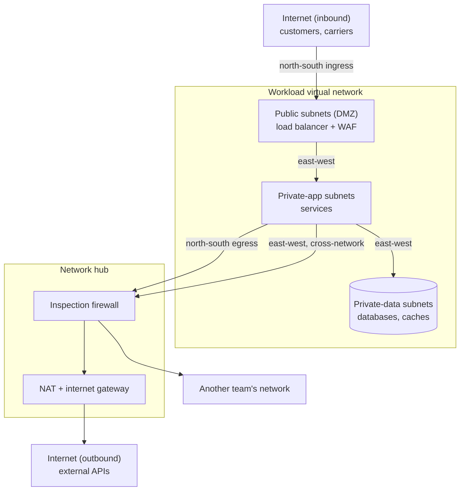
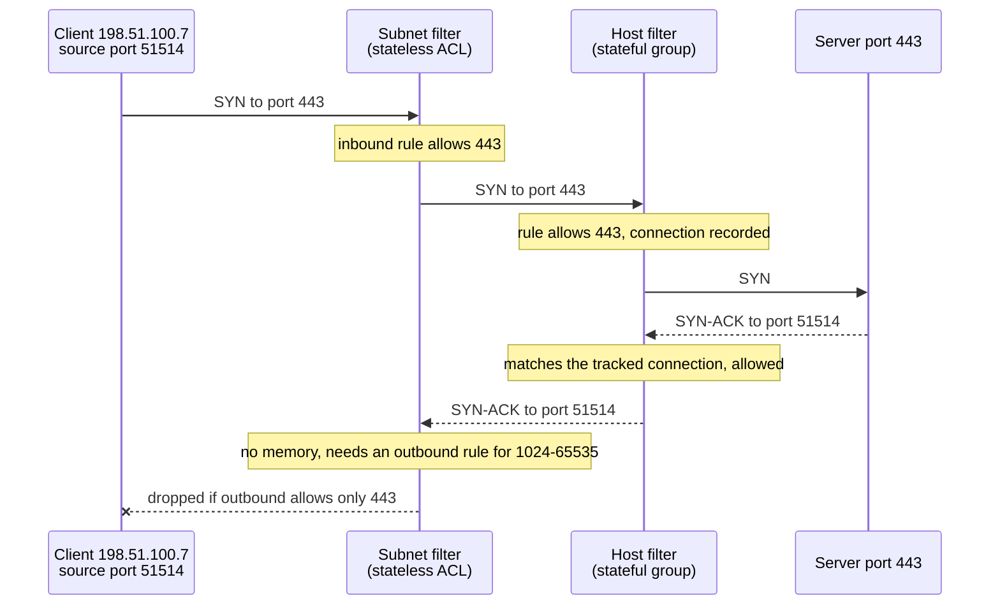
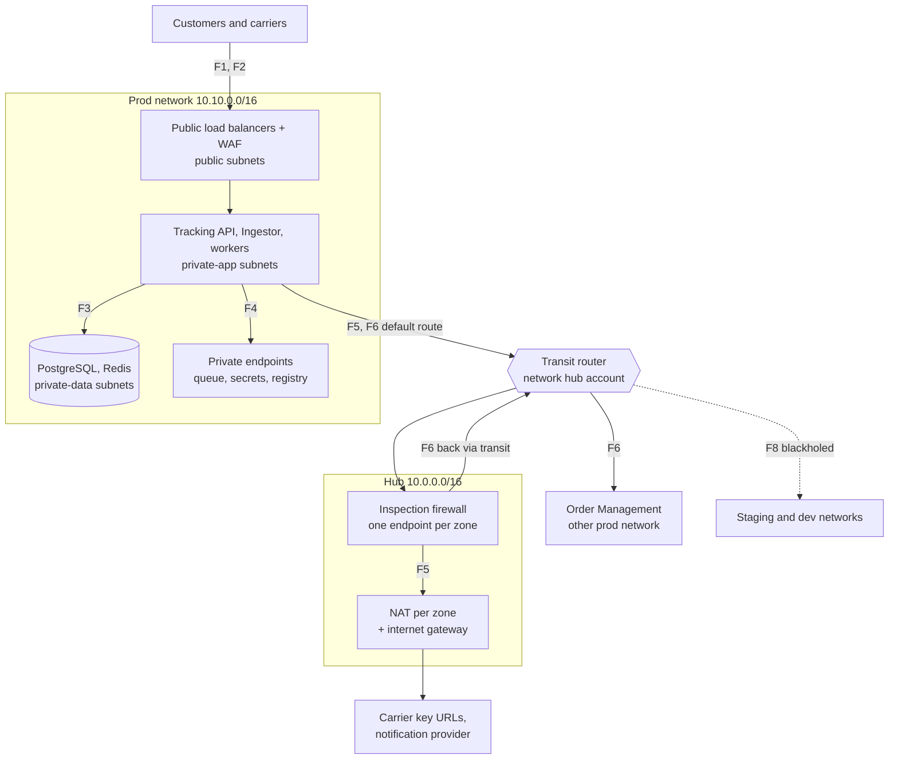

# Network security, load balancing, and traffic flow

> A network design is a set of decisions about which packets may travel, along which path, through
> which checkpoints. Draw every flow, name its direction, and put one control on each boundary it
> crosses; most network incidents are a flow nobody drew.

!!! abstract "Page facts"
    **Level:** Mixed (filters, load balancers, and proxies are Level 1-2; hub-and-spoke transit,
    inspection paths, and edge design are Level 3) · **Status:** Draft · **Time:** 60-75 minutes ·
    **Last verified:** 2026-11-21

## Learning objectives

After this page you should be able to:

- Classify a traffic flow as north-south or east-west, ingress or egress, and say which control
  belongs on each boundary it crosses.
- Explain the difference between stateful and stateless packet filters, and write stateless rules
  that do not drop return traffic on ephemeral ports.
- Place a WAF, a DMZ, an L4 or L7 load balancer, a reverse proxy, and a forward proxy in a design
  and justify each one.
- Compare DNS-based global load balancing with Anycast, and say what a CDN and DDoS protection add;
  define Zero Trust networking and say why it does not replace segmentation.
- Choose between peering, hub-and-spoke, and a transit router for connecting many virtual networks,
  and trace a packet through a centralized inspection path.

## Prerequisites

- [Networking fundamentals: IP, CIDR, routing, and DNS](networking-fundamentals-ip-cidr-routing-and-dns.md)
  — this page builds on AtlasMart's address plan and route tables.
- [Transport and application protocols](transport-and-application-protocols.md) — TCP connections,
  TLS termination, and why L4 and L7 devices see different things.
- [High availability design](../reliability-and-disaster-recovery/high-availability-design.md) —
  health checks, zones, and DNS failover.

## The problem this solves

Routing answers "can this packet get there?". Security and traffic engineering answer different
questions: *should* it get there, *which path* should it take, *what inspects it on the way*, and
*which of many identical servers* should receive it. A flat network where every host can reach every
other host on every port is easy to build and impossible to defend: one compromised web server can
probe the database, the build server, and the office printers.

Cloud makes filters and route tables API objects that can be reviewed as code, but organizations end
up with dozens of virtual networks across many accounts and must connect them without recreating the
flat network at a larger scale.

## What it is

**Network security and traffic flow design** is the practice of dividing a network into segments,
deciding which flows between segments are allowed, putting enforcement points (filters, firewalls,
proxies, load balancers) where flows cross segment boundaries, and choosing the topology that
connects segments to each other, to the internet, and to on-premises sites.

The pieces, in the order this page covers them: segmentation; stateful and stateless filters;
firewalls and the DMZ; WAFs; L4 and L7 load balancers and proxies; global load balancing, Anycast,
CDN, and DDoS protection; private endpoints; peering, hub-and-spoke, and transit routers; SDN and
SD-WAN; and Zero Trust networking.

## Mental model

Think of an office building. The **street door with a receptionist** is the internet-facing load
balancer and WAF: everyone enters there, and the receptionist turns away obvious trouble. The
**floors** are segments; a badge reader on each floor door is a filter. A **visitor badge that is
remembered** (once let in, you may walk back out the same way) is a stateful filter; a turnstile that
checks every crossing in both directions against a list, remembering nothing, is a stateless one.
The **loading dock with a security desk** is centralized egress: everything leaving goes past one
desk that writes it down. The **corridor junction** that every floor connects to, instead of a
staircase between every pair of floors, is the transit router.

**Where the analogy breaks:** networks have many entry points (VPNs, partner links, provider
services, management interfaces), and a forgotten one is the usual breach path. A badge identifies a
person, but a source address only identifies a location, the weakness Zero Trust addresses. And one
pipeline run can copy an over-permissive network into fifty accounts.

## Key terms

| Term | Meaning on this page |
|---|---|
| Segmentation | Dividing a network into zones with controlled flows between them; isolation is the extreme case with no flows |
| Micro-segmentation | Segmentation down to individual workloads or services, usually enforced by identity-aware or host-level policy |
| North-south traffic | Traffic that crosses the boundary between a network and the outside (internet, on-premises) |
| East-west traffic | Traffic between workloads inside the same network or between internal networks |
| Ingress / egress | Traffic entering / leaving a network, named from the network's point of view |
| Stateful filter | Tracks connections and automatically allows the return traffic of an allowed connection |
| Stateless filter | Evaluates each packet against its rules in each direction, with no memory of connections |
| Ephemeral port | The temporary source port a client picks for an outgoing connection; replies are addressed to it |
| DMZ | A perimeter network holding internet-facing components, separated from both the internet and the internal network |
| WAF | Web application firewall: inspects HTTP requests and blocks those that match attack or abuse rules |
| Reverse proxy | Accepts connections on behalf of servers and forwards them; clients see only the proxy |
| Forward proxy | Makes outbound connections on behalf of clients; destinations see only the proxy |
| Anycast | Announcing the same IP prefix from many locations so routing delivers each user to a nearby one |
| Private endpoint | An interface with a private address in your network that reaches a provider or partner service |
| Transit router | A managed router that many virtual networks and hybrid links attach to, with its own route tables |

## How it works

### Segmentation and the four directions of traffic

Segmentation starts from the trust boundaries in the C4 deployment view. Each boundary becomes a
network boundary (an account, a virtual network, or a subnet) and every flow that crosses one is
named in two ways:

- **North-south** flows cross the edge of the organization's network: customers arriving from the
  internet (ingress), workloads calling external APIs (egress), and traffic to and from on-premises.
- **East-west** flows stay inside: a service calling its database, one team's service calling
  another's, a build agent pushing to a registry.

Breaches spread east-west from one compromised host to everything it can reach, so modern designs
filter east-west traffic too and measure **blast radius** as "what can this host reach".

**Figure 1 — Traffic directions in one workload network.** Solid arrows are allowed flows; each
crosses a boundary with its own control.



How to read it: ingress enters through the DMZ only; only the application subnets reach the data
subnets; every flow leaving the workload network passes the hub firewall. Replies to customers are
not drawn: they follow the inbound connection back out.

**Isolation** is segmentation with zero allowed flows, used between environments (prod never talks to
dev), between tenants, and for forensic quarantine. **Micro-segmentation** pushes the boundary down
to each workload: Kubernetes network policies, per-service security groups, or a service mesh that
admits only authenticated peers (D11-T03, D12-T03).

### Stateful and stateless filtering

Every TCP connection has two directions. The client picks an **ephemeral source port** (a temporary
port above 1023, chosen by its operating system) and connects to the server's fixed port, for
example 443. The server's replies travel back *to* that ephemeral port.

- A **stateful** filter (cloud security groups, most host firewalls, network firewalls) records the
  connection when it allows the first packet. Replies that match a tracked connection are allowed
  without any rule. Rules are written per connection: "allow inbound 443 from the load balancer".
- A **stateless** filter (cloud network ACLs, router access lists) checks every packet in each
  direction against an ordered rule list, first match wins, with an implicit deny at the end. It has
  no idea a packet is a reply. Rules must be written per packet direction, including the return path.

**Figure 2 — One connection through a stateless subnet filter and a stateful host filter.** The
stateless filter needs an explicit rule for the reply; the stateful one does not.



How to read it: the two filters agree on the request and disagree on the reply. The classic mistake
is writing a stateless rule set that looks symmetric ("allow 443 in, allow 443 out"); the reply goes
to port 51514, matches nothing, and the connection times out. The symptom is a hang, not a refusal,
and flow logs show the inbound packet accepted and the outbound reply rejected.

The **ephemeral-port return-traffic trap** has a mirror image: a host in the subnet that *starts*
connections outward (to a database in another subnet, or to the internet through NAT) gets replies
*inbound* on its own ephemeral ports, so the stateless inbound rules need the high range too. The
client chooses the range, it differs by operating system and by intermediary, and AWS documents that
its own load balancers and NAT gateways use 1024-65535; the safe return rule therefore allows TCP
1024-65535 from the peer's prefix, never from everywhere when a narrower prefix will do.

| Property | Stateful (security group style) | Stateless (network ACL style) |
|---|---|---|
| Attached to | Interface or instance | Subnet |
| Return traffic | Allowed automatically | Needs its own rule |
| Rule style | Allow rules only (typically) | Ordered allow and deny, first match wins |
| Can reference | Other groups ("from the load balancer's group") | Address prefixes only |
| Best use | Primary, fine-grained control for every workload | Coarse guardrail: deny a known-bad prefix, fence a data tier |
| Cost of mistakes | Too open is common | Too closed is common (the ephemeral-port trap) |

Providers differ: AWS offers both security groups and network ACLs; Azure network security groups
and Google Cloud VPC firewall rules are both stateful and there is no separate stateless subnet filter
in either. Treat stateless filters as optional guardrails, not the main control.

### Firewalls, DMZ, and perimeter security

A **network firewall** is a stateful filter that also inspects: protocol validation, domain-name
(FQDN) rules for egress, intrusion detection signatures, and logging. In cloud designs it usually
sits in a hub that many networks route through, so one policy and one log covers all north-south and
cross-network traffic. NIST SP 800-41 describes the classic firewall placements and policy process.

A **DMZ** (demilitarized zone) is the perimeter network where internet-facing components live, with
filters on both sides: the internet may reach only the DMZ, and the DMZ may reach only specific
internal services. In a cloud virtual network the public subnets that hold load balancers play this
role; nothing else gets a public address.

**Perimeter security** is the older model where the DMZ and the corporate firewall are *the*
defence and everything inside is trusted. Stolen credentials, compromised internal hosts, and remote
work defeat it, so the perimeter becomes one layer of defence in depth rather than the only one.

### WAF and application gateways

A **web application firewall** inspects HTTP requests after TLS is terminated and blocks those that
match rules: managed rule sets for common injection and protocol-abuse patterns (such as those
inspired by the OWASP Top 10), rate-based rules per client, size limits, geographic or reputation
lists, and custom rules for the application's own paths. It is a filter for known-bad patterns, not
a substitute for input validation in the application (D12-T04); tuning false positives is real work.

**Application gateway** means an L7 load balancer that routes by path or host and often embeds a
WAF (it is also the name of Azure's L7 load balancer); an **API gateway** adds authentication, quotas,
and request transformation for APIs. The usual order in front of a public application is DDoS
protection, an optional CDN, the WAF, then the L7 load balancer.

### L4 and L7 load balancing, reverse and forward proxies

| Aspect | L4 load balancer | L7 load balancer (reverse proxy) |
|---|---|---|
| Sees | IP addresses, ports, TCP/UDP | Full HTTP requests after TLS termination |
| Balances | Connections or flows | Individual requests |
| Routing | By port | By host, path, header, cookie |
| TLS | Passes through (or terminates as TCP) | Terminates; may re-encrypt to targets |
| Protocols | Any TCP/UDP (databases, MQTT, custom) | HTTP/1.1, HTTP/2, gRPC, WebSocket |
| Adds | Very high connection rates, static addresses, client IP preserved | WAF, redirects, header rewriting, per-request retries |
| Watch out for | Long-lived connections pin to one backend (gRPC, HTTP/2) | Extra hop and TLS work; idle timeouts |

A **reverse proxy** stands in front of servers and chooses one per connection or request; every L7
load balancer, ingress controller, and CDN edge is one. A **forward proxy** stands in front of
clients: it allows or denies outbound destinations, logs them, and presents one source address (RFC
9110 describes both as HTTP intermediaries). Egress through a forward proxy or FQDN-aware firewall is
the main defence against a compromised workload sending data to an arbitrary internet host.

### Global load balancing, Anycast, CDN, and DDoS

**DNS-based global load balancing** answers one name with different addresses by health, latency,
geography, or weight. It works with any protocol, but failover waits for caches to expire (one TTL,
longer for clients that ignore TTLs). **Anycast** announces one prefix from many locations over BGP,
so routing delivers each user to a nearby location and a failed location is withdrawn in the routing
layer, with no DNS caching delay; public DNS, CDNs, and global load balancers rely on it (RFC 4786).

A **CDN** (content delivery network) is a fleet of Anycast or DNS-steered reverse proxies that cache
near users and terminate TLS close to them, cutting round trips and absorbing load. Only cacheable,
non-personal content belongs in the cache; personal API responses pass uncached or bypass it.

**DDoS** (distributed denial of service) floods come in three broad classes: volumetric floods that
fill links, protocol floods that exhaust connection tables, and application-layer floods of valid
looking HTTP requests. Defences are layered: the provider's always-on network protection and Anycast
spread absorb the first two; WAF rate rules, CDN caching, and autoscaling with sensible caps handle
the third; and origin cloaking (the origin accepts traffic only from the CDN or load balancer) stops
attackers from going around the edge.

Put together, the edge is a stack: DNS steers the user to an address, the Anycast edge absorbs
floods and serves cached content, and only cache misses and API calls reach the WAF and the
regional load balancer. Each layer drops something the next should never see.

### Private networking and private endpoints

Provider services (object storage, queues, secrets managers, registries) have public endpoints by
default. A **private endpoint** puts an interface with a private address from your subnet in front of
a service: traffic stays on the provider's network, needs no NAT, and is filtered by security groups
and endpoint policies. The same mechanism publishes your own service to other networks, even ones
with overlapping ranges, without peering. The cost is one endpoint per service per network (or a
shared endpoint network) plus private DNS records so the normal name resolves privately.

### Connecting many networks: peering, hub-and-spoke, transit router

| Topology | How it works | Scales to | Main limits |
|---|---|---|---|
| Peering | Direct link between two virtual networks; routes added on both sides | A handful of networks | Non-transitive: A-B and B-C do not give A-C; a full mesh of n networks needs n(n−1)/2 peerings; no central inspection |
| Hub-and-spoke (peered hub) | Each spoke peers with a hub that holds shared services, firewalls, and hybrid links | Tens of spokes | Spoke-to-spoke needs a routing appliance in the hub; peering limits per hub |
| Transit router | Each network attaches to a managed router with its own route tables; segments are route tables | Hundreds of attachments | Per-attachment and per-gigabyte charges; another component to operate; route-table design matters |

A transit router turns topology into configuration: each attachment is *associated* with one route
table (which decides where its packets go) and *propagates* its prefixes into some route tables
(which decides who can reach it). Separate route tables for prod and non-prod give segmentation at
the routing layer; a default route pointing at the hub's firewall gives central inspection.

**SDN** (software-defined networking) separates the control plane (where routing and policy are
decided) from the data plane (where packets are forwarded), so the network is programmed through an
API. Every cloud virtual network is SDN, which is why route tables and filters can be managed as
code. **SD-WAN** applies the same idea to branch connectivity: an overlay across several internet and
private links per site, with central policy that picks the path per application; providers offer
integration points for SD-WAN appliances in a hub (check each provider's documentation).

### Zero Trust networking (definition)

**Zero Trust** removes implicit trust based on network location: every request is authenticated and
authorized using identity, device posture, and context, per session and with least privilege (NIST
SP 800-207). Segmentation still limits blast radius when identity controls fail, and identity-aware
proxies replace broad VPN access for users. Architecture and migration are covered in D12-T03.

### Provider equivalents

Names verified against each provider's documentation on 2026-11-21; products change, so recheck.

| Concept | AWS | Azure | Google Cloud |
|---|---|---|---|
| Stateful interface filter | Security groups | Network security groups | VPC firewall rules (Cloud NGFW) |
| Stateless subnet filter | Network ACLs | None separate (NSGs are stateful) | None separate (rules are stateful) |
| L7 load balancer | Application Load Balancer | Azure Application Gateway | Application Load Balancer |
| L4 load balancer | Network Load Balancer | Azure Load Balancer | Network Load Balancer (proxy or passthrough) |
| Network firewall | AWS Network Firewall | Azure Firewall | Cloud NGFW |
| WAF | AWS WAF | Azure Web Application Firewall | Google Cloud Armor |
| DDoS protection | AWS Shield | Azure DDoS Protection | Google Cloud Armor |
| CDN / global entry | Amazon CloudFront | Azure Front Door | Cloud CDN |
| Private endpoint | AWS PrivateLink | Azure Private Link (private endpoints) | Private Service Connect |
| Peering | VPC peering | Virtual network peering | VPC Network Peering |
| Transit router | AWS Transit Gateway | Azure Virtual WAN (or a hub virtual network) | Network Connectivity Center |

## Worked example: AtlasMart's traffic flows through the hub

The Order Tracking System runs in the prod network `10.10.0.0/16`. The Phase 4 platform
(assumptions shared across these pages) adds a **network hub account** with hub network
`10.0.0.0/16` and a **transit router**, **centralized egress** through the hub (inspection firewall
plus NAT), and **ingress in each workload network** behind its own load balancer and WAF. The office
VPN on the transit router is covered in [Hybrid connectivity and VPNs](hybrid-connectivity-and-vpns.md).

### Step 1 — List the flows before drawing anything

| # | Flow | Direction | Path | Main controls |
|---|---|---|---|---|
| F1 | Customer phone → Tracking Web UI and API | North-south ingress | Public DNS → public load balancer with WAF in prod public subnets → Tracking API pods | WAF managed and rate rules; TLS; access token checked by the API (NFR-5) |
| F2 | Carrier platform → Webhook Ingestor | North-south ingress | Separate public load balancer with WAF → Ingestor | WAF body-size and rate rules; HMAC signature (NFR-5) |
| F3 | Tracking API → Status Cache and Event Store | East-west, same network | Local route | Security groups that reference each other; network ACL guardrail on data subnets |
| F4 | Workers → Event Queue, secrets manager, registry | East-west to provider services | Private endpoints in prod | Endpoint policy; security group on the endpoint |
| F5 | Ingestor → carrier signing-key URLs; Notification Worker → Notification Provider | North-south egress | Default route → transit router → hub firewall → hub NAT → internet | FQDN allowlist on the firewall; DNS and flow logs |
| F6 | Order Tracking → Order Management System (another team's prod network) | East-west, cross-network | Transit router → hub firewall → transit router → that network | Firewall rule: 443 to its internal load balancer only; service token |
| F7 | Engineer in the office → staging tools | Hybrid | VPN → transit router → hub firewall → staging network | Firewall; workforce SSO |
| F8 | Prod ↔ staging or dev | Not allowed | Blackholed at the transit router | Route table segmentation |

### Step 2 — The hub's address plan (new assumption)

The hub follows the same zone-first rule: a `/20` per zone, then small subnets by role.

| Zone | Zone summary | Transit attachment (`/28`) | Firewall (`/24`) | Egress public, NAT (`/24`) | DNS endpoints (`/28`) |
|---|---|---|---|---|---|
| a | `10.0.0.0/20` | `10.0.0.0/28` | `10.0.1.0/24` | `10.0.2.0/24` | `10.0.3.0/28` |
| b | `10.0.16.0/20` | `10.0.16.0/28` | `10.0.17.0/24` | `10.0.18.0/24` | `10.0.19.0/28` |
| c | `10.0.32.0/20` | `10.0.32.0/28` | `10.0.33.0/24` | `10.0.34.0/24` | `10.0.35.0/28` |

Arithmetic: a `/20` is 4,096 addresses, so zones start at third-octet 0, 16, 32; `10.0.48.0/20` and
above stay reserved. The DNS endpoint subnets hold the hybrid resolver endpoints (D09-T04).

### Step 3 — Route tables: what changed from the first design

The first plan had a NAT gateway per zone in prod. Now prod sends all non-local traffic to the transit
router, and the per-zone rule moves to the hub: one firewall endpoint and one NAT gateway per zone.

| Table | Attached to | Entries |
|---|---|---|
| `rt-public` (prod) | Prod public subnets | `10.10.0.0/16 → local`; `0.0.0.0/0 → internet gateway` (load balancers answer customers) |
| `rt-app` (prod) | Prod private-app subnets, all zones | `10.10.0.0/16 → local`; `0.0.0.0/0 → transit router`; private endpoint entries added by the provider |
| `rt-data` (prod) | Prod private-data subnets | `10.10.0.0/16 → local` only |
| `tr-prod` (transit) | Prod network attachments | `0.0.0.0/0 → hub attachment`; `10.20.0.0/16` and `10.30.0.0/16 → blackhole` |
| `tr-nonprod` (transit) | Staging and dev attachments | `0.0.0.0/0 → hub attachment`; `10.10.0.0/16 → blackhole` |
| `tr-hub` (transit) | Hub attachment (after inspection) | Propagated: `10.10.0.0/16`, `10.20.0.0/16`, `10.30.0.0/16`, other spokes, `192.168.0.0/16 → VPN` |
| `rt-hub-attach` (hub) | Transit attachment subnets | `10.0.0.0/16 → local`; `0.0.0.0/0 → firewall endpoint, same zone` |
| `rt-hub-fw` (hub) | Firewall subnets | `10.0.0.0/16 → local`; `10.0.0.0/8` and `192.168.0.0/16 → transit router`; `0.0.0.0/0 → NAT gateway, same zone` |
| `rt-hub-egress` (hub) | Egress public subnets | `10.0.0.0/16 → local`; `10.0.0.0/8 → firewall endpoint, same zone`; `0.0.0.0/0 → internet gateway` |

- The blackhole entries are longer prefixes than the default route, so longest-prefix match drops
  prod-to-non-prod packets at the transit router before they reach the firewall. The firewall policy
  denies the same flows as a second layer.
- `rt-hub-egress` sends replies for `10.0.0.0/8` back through the firewall, so both directions of a
  flow meet the same stateful inspection point; the transit router must also keep each flow on one
  zone's firewall (providers expose a symmetric-routing setting for appliances; check yours).

### Step 4 — Filters for each boundary

Security groups (stateful) carry the main rules; each references a group, not an address, so
autoscaling does not change the rules. Ports are assumptions (the API listens on 8080 in its pods).

| Group | Inbound allowed | From |
|---|---|---|
| `sg-public-lb` | TCP 443 | `0.0.0.0/0` (behind WAF and DDoS protection) |
| `sg-webhook-lb` | TCP 443 | `0.0.0.0/0` (carriers' addresses change; HMAC is the real control) |
| `sg-tracking-api` | TCP 8080 | `sg-public-lb` |
| `sg-event-store` | TCP 5432 | `sg-tracking-api`, `sg-event-processor` |
| `sg-status-cache` | TCP 6379 | `sg-tracking-api`, `sg-event-processor` |
| `sg-endpoints` | TCP 443 | Prod private-app subnets |

On Kubernetes, pods often share their node's security group, so pod-to-pod rules move into network
policies (D11-T03); the groups above then apply at node or load-balancer level.

**The network ACL guardrail and its trap.** AtlasMart adds one stateless ACL on the three
private-data subnets as a coarse fence (assumption). The three private-app subnets
`10.10.16.0/20`, `10.10.80.0/20`, and `10.10.144.0/20` are not contiguous, so they need separate
rules:

| Rule | Direction | Protocol, ports | Peer | Action |
|---|---|---|---|---|
| 100, 110, 120 | Inbound | TCP 5432 | each private-app `/20` | Allow |
| 130, 140, 150 | Inbound | TCP 6379 | each private-app `/20` | Allow |
| 200, 210, 220 | Outbound | TCP 1024-65535 | each private-app `/20` | Allow (replies to client ephemeral ports) |
| `*` | Both | All | `0.0.0.0/0` | Deny |

Count: 3 subnets × 2 ports = 6 inbound rules, plus 3 return rules, plus the default deny. Writing
"symmetric" outbound rules (TCP 5432 and 6379) instead of 200-220 drops every database reply: API
connections time out while the database logs nothing wrong, the signature shown in Figure 2.

### Step 5 — The picture

**Figure 3 — AtlasMart flows through the hub-and-spoke network.** Labels match the flow table.



How to read it: ingress (F1, F2) stays inside the prod network; everything leaving it (F5, F6)
follows the default route to the transit router and through the hub firewall; staging and dev are
unreachable by route. Provider services (F4) never leave the prod network.

### What the design decided

| Decision | Driven by |
|---|---|
| Ingress per workload network behind its own load balancer and WAF | Customer traffic stays out of the hub; each team owns its edge; NFR-3 latency |
| Centralized egress through the hub firewall with an FQDN allowlist | One place to control and log outbound traffic; exfiltration defence |
| Prod and non-prod in separate transit route tables with blackholes | Environment isolation enforced by routing, not only by firewall rules |
| Security groups referencing groups as the main filter; one ACL guardrail on data | Fine-grained, autoscaling-proof rules; a coarse fence for the most sensitive tier |
| Private endpoints for queue, secrets, registry | No NAT or hub dependency for the hottest internal paths (NFR-2, NFR-4) |
| Firewall and NAT per zone in the hub | The per-zone rule from the first design, moved to where egress now happens |

**Arithmetic check on hub load.** Customer reads are 1.2M/day × 4 KB = 4.8 GB/day (about 144 GB per
30-day month), all on F1; scan events are 480,000/day × 500 B = 240 MB/day on F2. Neither crosses
the hub. Only F5 and F6 do, a small fraction of either, so centralized egress is cheap for this
workload; a data-heavy workload pulling large objects from the internet needs its own analysis.

## Real-world architecture example

Most organizations with more than a handful of cloud networks converge on this shape: a network
hub account owned by the platform team; a transit router with separate route tables for production,
non-production, shared services, and on-premises; a central firewall for egress and cross-network
traffic; and public ingress either per workload (as here) or in an ingress hub when one WAF policy
must cover everything. The provider hub-and-spoke reference architectures (linked below) show the
same pattern; landing-zone tooling (D10-T02, D10-T04) creates attachments when an account is vended.

## Design choices and trade-offs

| Choice | Favor when | Avoid when |
|---|---|---|
| Per-workload ingress (load balancer + WAF in each network) | Teams own their edge; customer traffic is large; latency matters | A central security team must enforce one WAF policy and certificate set for all apps |
| Centralized ingress hub | Uniform WAF policy, one public IP range for partners to allowlist | High-volume traffic would make the hub a bottleneck and a shared failure domain |
| Centralized egress with inspection | Many workloads; exfiltration and audit concerns; FQDN allowlists | One small workload where per-network NAT is simpler and the extra hop costs more than it protects |
| Stateless ACLs | A coarse guardrail on a sensitive tier, or fast deny of a known-bad prefix | As the main control; the return-traffic rules are easy to get wrong |
| L7 load balancer | HTTP, gRPC, WebSocket; path routing; WAF integration | Non-HTTP protocols; extreme connection rates; need for client IP at L4 |
| L4 load balancer | TCP/UDP services, static addresses, very high connection counts | Long-lived multiplexed connections that need per-request balancing |
| DNS-based global load balancing | Multi-region active-passive; any protocol | Fast failover needed regardless of resolver caching |
| Anycast global entry | Global users, DDoS absorption, fast regional failover | Single-region systems with a local audience (cost without benefit) |
| Peering | Two or three networks with a stable relationship | More than a handful of networks, or when inspection between them is required |
| Transit router | Many networks and hybrid links, segmentation by route table | Two networks; per-gigabyte transit charges for very chatty pairs (peer those directly) |

## Failure modes and anti-patterns

- **Ephemeral-port trap in stateless rules.** Detect: flow logs with ACCEPT inbound and REJECT for
  the reply. Prevent: return rules for 1024-65535 to the peer's prefix; a real connection test after
  every ACL change.
- **Asymmetric routing through a stateful firewall.** Request through zone a's firewall, reply
  through zone b's, which drops it. Detect: zone-dependent intermittent timeouts, half-open flows in
  firewall logs. Prevent: symmetric-routing settings on the transit router; per-zone route tables.
- **"Any to any" east-west.** Detect: groups allowing all traffic from the whole network prefix.
  Prevent: group references and rule review in CI.
- **Forgotten entry points.** A test load balancer, a management port, a partner link without the
  WAF. Detect: inventory every public address and every route to `0.0.0.0/0`. Prevent: public
  addresses only in public subnets, enforced by policy as code.
- **Origin reachable around the CDN or WAF.** Detect: requests from sources outside the edge's
  ranges. Prevent: the origin accepts only the edge (managed prefix lists, an origin authentication
  header, or private connectivity).
- **Transitive-routing surprise.** A spoke reaches another environment through the hub because
  propagation was left on everywhere. Detect: reachability analysis per route table. Prevent:
  separate route tables and explicit blackholes.
- **Hub as a single point of failure.** Prevent: per-zone firewall endpoints and NAT, tested at peak.
- **WAF blocking without tuning.** Prevent: count mode first, staged rollout of managed rule
  changes, alerts on block-rate spikes.

## Security considerations

- Default deny on every boundary; each allow rule names a source group or prefix, a port, and an
  owner, and is reviewed as code.
- Egress control matters as much as ingress: a workload that cannot reach arbitrary internet hosts
  cannot easily exfiltrate data or fetch tools. Log DNS queries as well as flows.
- Re-encrypt from the load balancer to targets where policy requires encryption in transit inside
  the network (D12-T05); keep certificates in the provider's certificate service.
- Flow, firewall, WAF, and DNS logs go to the central log archive account (platform assumption), out
  of reach of a compromised workload account.
- Segmentation limits blast radius; it authenticates no one. Pair it with workload identity
  (D12-T02) and identity-aware access for users (D12-T03).
- DDoS and WAF content here is defensive: test only your own systems, within the provider's
  published testing policy.

## Performance, reliability, and cost

- **Performance:** each inspection hop adds latency (usually small against NFR-3's 300 ms p95, but
  measure). Keep the hot path (F1, F3, F4) off the hub; CDNs remove round trips for cacheable content.
- **Reliability:** load balancers, firewall endpoints, and NAT exist in every zone used. A hub outage
  breaks F5 and F6 for every team but leaves F1 to F4 running, one reason ingress stays local. Load
  balancer health checks should test readiness, not just an open port.
- **Cost:** providers meter load balancer hours and capacity units, transit attachments and gigabytes
  processed, firewall and NAT hours and gigabytes, WAF rules and requests, and cross-zone traffic.
  The hub-load arithmetic shows why bulk customer traffic stays out of the hub. Check each provider's
  current pricing; this page quotes none.

## Hands-on lab: the ephemeral-port trap

The full exercise is [Lab 14: network segmentation](../labs/lab-14-network-segmentation.md) (a simulated
zone a with security groups, network ACLs, and flow-log lines; optional Docker appendix). This
mini-lab isolates one idea.

1. Save this as `nacl.py` and run it with Python 3.12 or later:

    ```python
    import ipaddress

    # Stateless rules, evaluated in order, first match wins: (direction, peer CIDR, ports, action)
    NACL = [
        ("in", "0.0.0.0/0", range(443, 444), "allow"),
        ("out", "0.0.0.0/0", range(443, 444), "allow"),  # looks symmetric
    ]

    def stateless(direction, peer, port):
        for d, cidr, ports, action in NACL:
            if d == direction and ipaddress.ip_address(peer) in ipaddress.ip_network(cidr) and port in ports:
                return action
        return "deny"  # implicit final rule

    client, client_port = "198.51.100.7", 51514  # documentation address, ephemeral source port
    print("request  in  to 443:", stateless("in", client, 443))
    print(f"response out to {client_port}:", stateless("out", client, client_port))
    ```

2. Observe that the request is allowed and the response is denied. Explain in one sentence why.
3. Fix the rule list so the response is allowed, without allowing all ports outbound to everyone.
4. Add a `stateful(...)` function that records allowed inbound connections as
   `(peer, peer_port, local_port)` and allows matching outbound packets without consulting rules.
5. Rewrite AtlasMart's data-tier ACL from Step 4 as a rule list and test one connection from
   `10.10.16.25` (an API pod) to port 5432 and its reply.

??? question "Hint: the fix in step 3"
    Add `("out", "0.0.0.0/0", range(1024, 65536), "allow")` after the 443 rules. For the data tier in
    step 5, use the app subnet prefix (for example `10.10.16.0/20`) instead of `0.0.0.0/0`, so the
    return rule is as narrow as the inbound one.

## Knowledge check

1. A packet from a customer reaches the prod load balancer; the reply to the customer is dropped.
   The load balancer's subnet has a stateless ACL that allows inbound 443 and outbound 443. What is
   wrong, and what rule fixes it?
2. Classify each flow as north-south or east-west: (a) the Event Processor writing to PostgreSQL;
   (b) the Notification Worker calling the Notification Provider; (c) Order Tracking calling the
   Order Management System in another team's network.
3. Why does a gRPC service behind an L4 load balancer often show one hot backend, and what fixes it?
4. A region fails. Users of a DNS-steered global service take several minutes to move; users of an
   Anycast service move within seconds. Explain the difference.
5. Five networks are fully meshed with peering. How many peerings exist, and how many attachments
   would a transit router need for the same five?

??? success "Answers"
    1. The reply goes to the customer's ephemeral port, not 443, and the stateless ACL has no rule
       for it. Add an outbound rule allowing TCP 1024-65535 to the client range (here `0.0.0.0/0`,
       since customers are on the internet), or drop the ACL and rely on the stateful group.
    2. (a) East-west within one network. (b) North-south egress, through the hub firewall and NAT.
       (c) East-west across networks, through the transit router and the hub firewall.
    3. HTTP/2 multiplexes all requests over one long-lived connection, and an L4 balancer balances
       connections, so every request from that client lands on one backend. Use an L7 balancer that
       balances per request, or client-side load balancing.
    4. DNS answers are cached for at least the TTL (and longer by some clients), so users keep the
       failed region's address until caches expire. Anycast withdraws the failed location's route
       in BGP, and packets follow the next-best route without any client-side cache.
    5. 5 × 4 / 2 = 10 peerings; a transit router needs 5 attachments, one per network.

## Architecture discussion questions

1. AtlasMart's security team wants all ingress centralized in the hub so one WAF policy covers every
   application. Using the flow table and the hub-load arithmetic, argue for or against, and describe
   a compromise that gives the security team what it actually needs.
2. A product team asks to peer its prod network directly with the Order Management System's network
   to avoid the hub firewall's latency. What would you need to know, and what conditions would make
   you agree?
3. Private endpoints in every workload network or one shared endpoint network: compare them for 24
   workload networks on cost drivers, DNS complexity, blast radius, and team autonomy.

## Summary

Segment along trust boundaries, name every flow by direction, and control each boundary it
crosses. Security groups are the main filter; stateless ACLs are guardrails whose return rules must
cover client ephemeral ports. At the edge, DDoS protection, an optional CDN, a WAF, and an L7 load
balancer form layers, while DNS-based global load balancing and Anycast steer users between
locations. Private endpoints keep provider traffic private, and a transit router with per-environment
route tables connects many networks through one inspection point. Zero Trust removes trust from
location but not the need for segmentation.

## Related topics

- **Before:** [Networking fundamentals: IP, CIDR, routing, and DNS](networking-fundamentals-ip-cidr-routing-and-dns.md);
  [Transport and application protocols](transport-and-application-protocols.md).
- **Alongside:** [Hybrid connectivity and VPNs](hybrid-connectivity-and-vpns.md) (the VPN on the
  transit router); [Lab 14: network segmentation](../labs/lab-14-network-segmentation.md);
  [Network security architecture](../security-architecture/network-security-architecture.md) (D12-T03,
  Zero Trust in depth); [Cloud building blocks and landing zones](../cloud-architecture/cloud-building-blocks-and-landing-zones.md);
  [Kubernetes networking, storage, and service mesh](../containers-and-kubernetes/kubernetes-networking-storage-and-service-mesh.md);
  [High availability design](../reliability-and-disaster-recovery/high-availability-design.md).
- **Planned:** reliability engineering (D13-T02) and disaster recovery (D13-T03) for multi-region
  traffic steering; observability and SRE (D15) for flow-log analysis.

## References

| Source | Type | Checked |
|---|---|---|
| [NIST SP 800-207: Zero Trust Architecture](https://csrc.nist.gov/pubs/sp/800/207/final) | Standard (US government guidance) | 2026-11-21 |
| [NIST SP 800-41 Rev. 1: Guidelines on Firewalls and Firewall Policy](https://csrc.nist.gov/pubs/sp/800/41/r1/final) | Standard (US government guidance) | 2026-11-21 |
| [Web Application Firewall](https://owasp.org/www-community/Web_Application_Firewall) — OWASP Foundation | Community reference | 2026-11-21 |
| [RFC 4786: Operation of Anycast Services](https://www.rfc-editor.org/rfc/rfc4786) and [RFC 9110: HTTP Semantics](https://www.rfc-editor.org/rfc/rfc9110) (intermediaries: proxies and gateways) | Standards | 2026-11-21 |
| [Infrastructure security in Amazon VPC](https://docs.aws.amazon.com/vpc/latest/userguide/infrastructure-security.html) and [Custom network ACLs (ephemeral ports)](https://docs.aws.amazon.com/vpc/latest/userguide/custom-network-acl.html) — Amazon Web Services | Official documentation | 2026-11-21 |
| [Hub-spoke network topology in Azure](https://learn.microsoft.com/azure/architecture/networking/architecture/hub-spoke) — Microsoft Azure Architecture Center | Reference architecture | 2026-11-21 |
| [Cloud Load Balancing overview](https://cloud.google.com/load-balancing/docs/load-balancing-overview) — Google Cloud; [Load balancing options](https://learn.microsoft.com/azure/architecture/guide/technology-choices/load-balancing-overview) — Microsoft; [AWS Best Practices for DDoS Resiliency](https://docs.aws.amazon.com/whitepapers/latest/aws-best-practices-ddos-resiliency/welcome.html) | Official documentation and whitepaper | 2026-11-21 |
| Provider pages for the equivalence table: [Azure NSGs](https://learn.microsoft.com/azure/virtual-network/network-security-groups-overview), [Google Cloud VPC firewall rules](https://cloud.google.com/firewall/docs/firewalls), [AWS WAF](https://docs.aws.amazon.com/waf/latest/developerguide/waf-chapter.html), [AWS Shield](https://docs.aws.amazon.com/waf/latest/developerguide/shield-chapter.html), [Azure DDoS Protection](https://learn.microsoft.com/azure/ddos-protection/ddos-protection-overview), [Google Cloud Armor](https://cloud.google.com/armor/docs/cloud-armor-overview), [AWS Transit Gateway](https://docs.aws.amazon.com/vpc/latest/tgw/what-is-transit-gateway.html), [Azure Virtual WAN](https://learn.microsoft.com/azure/virtual-wan/virtual-wan-about), [Network Connectivity Center](https://cloud.google.com/network-connectivity/docs/network-connectivity-center/concepts/overview), [AWS PrivateLink](https://docs.aws.amazon.com/vpc/latest/privatelink/what-is-privatelink.html), [Azure private endpoints](https://learn.microsoft.com/azure/private-link/private-endpoint-overview), [Private Service Connect](https://cloud.google.com/vpc/docs/private-service-connect) | Official documentation | 2026-11-21 |

## Review notes

- Canonical page for D09-T03. In depth: segmentation and traffic directions, stateful versus
  stateless filtering with the ephemeral-port trap, WAF placement, L4 versus L7 load balancing,
  proxies, private endpoints, peering versus hub-and-spoke versus transit router, and the inspection
  path. Definition level only: perimeter security, DMZ, application gateways, DNS-based global load
  balancing, Anycast, CDN, DDoS, SDN, SD-WAN, and Zero Trust networking (depth belongs to D12-T03).
- New AtlasMart assumptions: the hub subnet plan, the transit route tables `tr-prod`, `tr-nonprod`,
  `tr-hub`, the security group names, the API pod port 8080, and the data-tier network ACL. The
  hub-load arithmetic is derived from existing load figures.
- Provider claims (ephemeral ports 1024-65535 for AWS load balancers and NAT gateways; Azure NSGs and
  Google Cloud firewall rules are stateful) and every product name come from the linked pages,
  checked 2026-11-21. No prices, quotas, or limits are quoted.
- The lab-section summary was checked against Lab 14's draft on 2026-11-21. The
  mini-lab script was run with Python 3.12 (request `allow`, reply `deny`). Reviewer: check that
  Figure 3 renders legibly on a phone.
