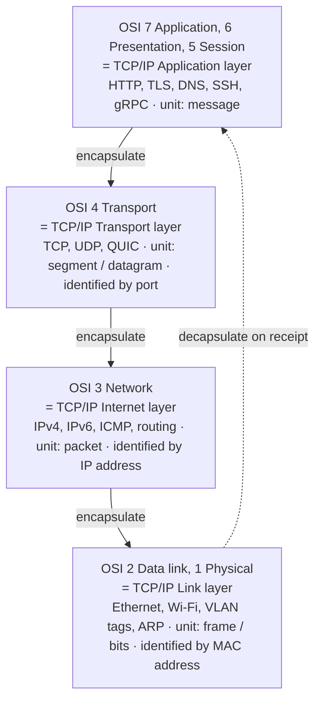
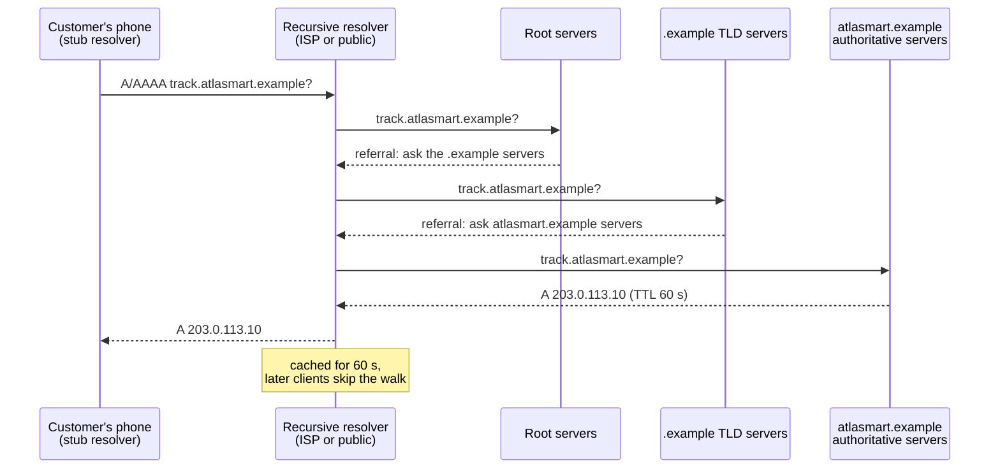
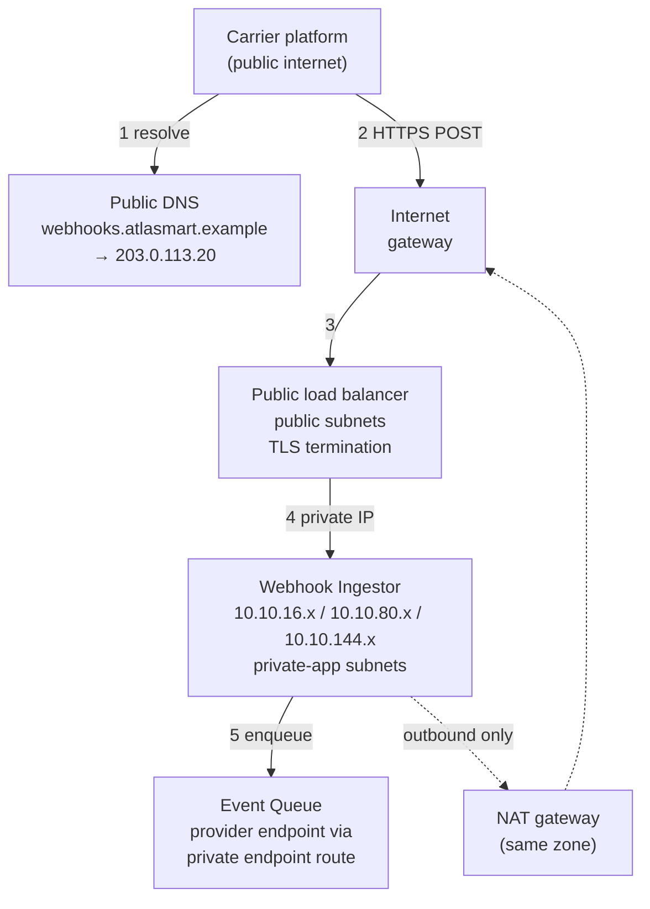

# Networking fundamentals: IP, CIDR, routing, and DNS

> Every distributed system is a network application. Addresses say *where* a thing is, routes say
> *how* to reach it, and names say *what* to call it. An architect who can do the CIDR arithmetic and
> read a route table can predict most "it works on my machine but not in the cloud" failures.

!!! abstract "Page facts"
    **Level:** Mixed (layer models and addressing are Level 1-2; the address plan and routing design
    are Level 3) · **Status:** Draft · **Time:** 60-75 minutes · **Last verified:** 2026-11-15

## Learning objectives

After this page you should be able to:

- Place a protocol or a failure on the right layer of the OSI and TCP/IP models, and say which layers
  an application architect actually controls.
- Read and write CIDR notation, compute network size, usable hosts, and the next free block, and
  split or summarize address ranges.
- Explain how a packet leaves a host: ARP, the default route, the route table, and the gateway.
- Design a cloud address plan with public, private-application, and private-data subnets across
  availability zones that will not collide with other environments or the corporate network.
- Explain NAT, when private addresses are enough, and why outbound NAT is a per-zone resource.
- Describe DNS resolution end to end, choose record types, and set TTLs with failover in mind.
- Recognize the networking mistakes that cause outages: overlapping ranges, cross-zone dependencies,
  MTU mismatches, and stale DNS.

## Prerequisites

- [The C4 model](../architecture-fundamentals/c4-model.md) — the deployment diagram is where subnets
  and zones appear.
- [How to estimate load, throughput, storage, and capacity](../performance-and-scalability/capacity-estimation.md)
  — address plans are sized from instance counts.
- Basic Linux familiarity: you have seen `ip addr`, `ping`, and `dig` or `nslookup`.

## The problem this solves

Two computers that want to talk need three things: a way to identify each other, a way for packets to
travel across networks that nobody owns end to end, and a way for humans to use names rather than
numbers. The Internet Protocol (IP) solves identification and forwarding with addresses and routes; the
Domain Name System (DNS) solves naming.

In the cloud these mechanisms are not hidden behind a corporate network team. The architect who draws
a virtual network, picks address ranges, and creates subnets and route tables *is* the network team.
Mistakes are expensive: an address range that overlaps the corporate network cannot be connected over
a VPN later without renumbering; a single NAT gateway shared by three zones turns a zone outage into a
full outage; a DNS time-to-live of one day makes a "five-minute failover" take a day.

## What it is

**IP networking** is the set of conventions by which hosts are given numeric addresses, addresses are
grouped into networks, and routers forward packets hop by hop toward a destination network using
route tables. **CIDR** (Classless Inter-Domain Routing) is the notation and arithmetic for those
groupings. **DNS** is the distributed, cached database that maps names to addresses and other records.

The pieces an architect must hold in their head:

| Piece | What it answers | Where it lives |
|---|---|---|
| Layer model (OSI, TCP/IP) | Which component is responsible for what | Vocabulary, troubleshooting |
| Ethernet frame, MAC address | How two hosts on the same link exchange bits | Layer 2 (link) |
| IP address, IPv4 and IPv6 | How a host is identified across networks | Layer 3 (network) |
| CIDR, mask, subnet, supernet | How addresses are grouped and summarized | Address plan |
| Route table, gateway | Which next hop a packet takes for a destination | Every host and router |
| ARP, DHCP | How a host learns neighbours' MACs and its own address | Link-local plumbing |
| NAT and PAT | How private addresses reach public networks | Edge of a private network |
| VLAN | How one physical network carries several isolated ones | Data centres; the ancestor of cloud subnets |
| MTU | The largest packet a link carries without fragmentation | Every interface and tunnel |
| DNS | How names become addresses, with caching and TTLs | Resolvers and authoritative servers |

## Mental model

Think of postal addressing. A **country** is a large network prefix, a **city** a smaller one, a
**street** a subnet, and a **house number** the host part of an address. A letter does not carry the
whole route; each sorting office (router) looks only at enough of the address to pick the next office.
Sorting offices keep tables of "for this prefix, hand to that office" (route tables). The phone book
that turns "Atlas Hardware, Main Street" into a street address is DNS. The courier who walks the last
street and needs to know which door is which uses ARP.

**Where the analogy breaks:** a postal address is tied to a place, but an IP address is tied to an
*interface* and can be reassigned in seconds (which is exactly what makes failover possible). Letters
are not duplicated, reordered, or silently dropped in normal operation; packets are, routinely, and
the transport layer above IP exists to cope with that. And a street cannot be made private, while
whole IP networks can be unreachable from the internet by design.

## Key terms

| Term | Meaning on this page |
|---|---|
| Interface | A network attachment point on a host or router; it holds the IP and MAC addresses |
| MAC address | The link-layer hardware identifier of an interface; meaningful only on the local link |
| IP address | A network-layer address that identifies an interface across networks |
| Prefix / network | The leading bits shared by all addresses in a group, written `address/length` |
| Mask | The prefix length written as a bit mask (`/24` = `255.255.255.0`) |
| Subnet | A prefix carved out of a larger one, usually mapped to one broadcast domain or cloud zone |
| Supernet / summary | A shorter prefix that covers several subnets in one route or rule |
| Route table | An ordered set of (destination prefix → next hop) entries; the longest matching prefix wins |
| Default route | The entry `0.0.0.0/0` (or `::/0`) used when nothing more specific matches |
| Gateway | The router a host sends to for destinations outside its own subnet |
| NAT / PAT | Rewriting addresses (and ports) so many private hosts share one or a few public addresses |
| MTU | Maximum transmission unit: the largest payload one link-layer frame carries |
| TTL (DNS) | How long a resolver may cache a record, in seconds |
| Authoritative server | The DNS server that holds the real records for a zone |
| Recursive resolver | The DNS server that walks the hierarchy on a client's behalf and caches answers |

## How it works

### Layer models

The **OSI model** (seven layers) is a vocabulary; the **TCP/IP model** (four layers, from RFC 1122) is
what is actually implemented. Architects use the layer number as shorthand: "an L4 load balancer"
forwards TCP connections without reading HTTP; "an L7 firewall" inspects HTTP requests.

**Figure 1 — OSI layers mapped to the TCP/IP model, with what travels at each layer.** Read top to
bottom to follow data being sent; bottom to top for data being received.



How to read it: each layer wraps the layer above with its own header. A tracking API response is an
HTTP message inside TCP segments inside IP packets inside Ethernet frames. The layers an application
team controls are the top and, through cloud configuration, the network layer; the link layer is the
provider's.

Why it matters: a failure's layer tells you who can fix it and what tool shows it. "Connection refused"
is transport (nothing listening on the port); "no route to host" is network; "name not found" is DNS
at the application layer; a mysterious hang on large responses is often MTU, at the link layer.

### Link layer: Ethernet, MAC, ARP, VLAN, MTU

On a single link (one Ethernet segment, one Wi-Fi network, one cloud subnet) hosts exchange **frames**
addressed by **MAC address**, a 48-bit identifier burned into or assigned to the interface. MAC
addresses are never routed; they are rewritten at every router hop.

**ARP** (Address Resolution Protocol, RFC 826) answers "which MAC address has IP 10.10.16.7?" by
broadcasting on the link; IPv6 uses Neighbor Discovery (RFC 4861) for the same job. Cloud providers
usually answer ARP themselves from their own mapping tables, which is why you cannot "sniff the
subnet" in a cloud and why some on-premises tricks (gratuitous ARP for failover) do not work there.

A **VLAN** (virtual LAN, IEEE 802.1Q) tags frames so one physical switch fabric carries several
isolated layer-2 networks. In the cloud the equivalent isolation is the virtual network and subnet;
you will meet VLANs again on the on-premises side of hybrid connectivity.

The **MTU** is the largest frame payload a link accepts; classic Ethernet carries 1,500 bytes.
Tunnels (VPN, overlay networks, some cloud interconnects) add headers and therefore reduce the usable
MTU. If a sender emits 1,500-byte packets into a path whose MTU is smaller and the packets are marked
"do not fragment", they are dropped. Path MTU discovery (RFC 1191 for IPv4, RFC 8201 for IPv6) relies
on ICMP messages coming back; firewalls that block all ICMP break it, producing the classic symptom:
small requests work, large downloads hang.

**DHCP** (RFC 2131) hands a host its address, mask, gateway, and DNS servers at boot. Cloud subnets
provide the same service built in; the architect sets the options (which DNS servers, which domain
suffix) at the virtual-network level.

### Network layer: IP addresses and CIDR

An **IPv4** address (RFC 791) is 32 bits, written as four decimal octets: `10.10.16.7`. An **IPv6**
address (RFC 8200) is 128 bits, written in hexadecimal groups: `2001:db8:10:16::7`. IPv6 is not "IPv4
with longer numbers": there is no broadcast, no NAT by default, address autoconfiguration is built in,
and every interface has several addresses. Most cloud networks today are dual-stack or IPv4-only
internally with IPv6 at the edge; this page does the arithmetic in IPv4 because that is where address
exhaustion forces careful planning, and notes the IPv6 equivalent where it differs.

**CIDR notation** (RFC 4632) writes a network as `address/prefix-length`. The prefix length says how
many leading bits are the network part; the rest is the host part.

| Prefix | Mask | Total addresses | Host bits | Typical use |
|---|---|---|---|---|
| /32 | 255.255.255.255 | 1 | 0 | A single host route |
| /28 | 255.255.255.240 | 16 | 4 | Tiny subnet (load balancer interfaces, endpoints) |
| /24 | 255.255.255.0 | 256 | 8 | Classic "one office LAN" |
| /22 | 255.255.252.0 | 1,024 | 10 | Public subnet per zone |
| /20 | 255.255.240.0 | 4,096 | 12 | Application subnet per zone |
| /18 | 255.255.192.0 | 16,384 | 14 | All subnets of one zone |
| /16 | 255.255.0.0 | 65,536 | 16 | One environment's virtual network |
| /8 | 255.0.0.0 | 16,777,216 | 24 | Whole organization (`10.0.0.0/8`) |

The arithmetic: total addresses = 2^(32 − prefix). Classically two addresses per subnet are unusable
(the network address and the broadcast address); cloud providers reserve a few more for their own
router and DNS (AWS documents five per subnet; check your provider). A `/20` therefore holds a little
under 4,090 usable hosts, which for planning purposes is "about 4,000".

**Splitting** a prefix adds one bit: a `/16` splits into two `/17`s, four `/18`s, sixteen `/20`s. The
sixteen `/20`s inside `10.10.0.0/16` start at `10.10.0.0`, `10.10.16.0`, `10.10.32.0` ... `10.10.240.0`:
the third octet steps by 16 because a `/20` leaves four bits of the third octet to the host part
(2^4 = 16).

**Supernetting (summarizing)** removes bits: `10.10.0.0/20`, `10.10.16.0/20`, `10.10.32.0/20`, and
`10.10.48.0/20` are exactly `10.10.0.0/18`. A route, firewall rule, or VPN advertisement for the
summary covers all four. Summaries only work when the blocks are aligned and contiguous, which is why
the address plan below allocates per zone first and per tier second.

**Public and private addresses.** RFC 1918 reserves `10.0.0.0/8`, `172.16.0.0/12`, and
`192.168.0.0/16` for private use: anyone may use them internally, and internet routers drop them.
Everything else is public and globally unique. IPv6 has unique local addresses (`fc00::/7`, RFC 4193)
for the same purpose, but the normal IPv6 practice is to give hosts globally routable addresses and
control reachability with firewalls rather than with NAT.

### Routing: route tables, gateways, static and dynamic routes

Every host and every router holds a **route table**. For each outgoing packet the table is searched
for the **longest prefix** that matches the destination; that entry's next hop is used. A host's table
is usually tiny: "my own subnet is directly attached; everything else (`0.0.0.0/0`) goes to the
gateway". The gateway's table is bigger, and internet backbone routers hold the full table of public
prefixes.

| Entry | Meaning |
|---|---|
| `10.10.16.0/20 → local` | Deliver directly on the attached link (ARP for the MAC) |
| `10.10.0.0/16 → local` | In cloud virtual networks, the whole network is typically "local" |
| `192.168.0.0/16 → vpn-gateway` | Corporate network reached over a VPN or dedicated link |
| `0.0.0.0/0 → internet-gateway` | Default route: anything not matched above |

**Static routes** are entered by hand (or by infrastructure code): predictable, and fine when the
topology is simple and rarely changes. **Dynamic routing** lets routers exchange reachability with a
protocol (OSPF inside an organization, BGP between organizations and in hybrid links) so that when a
link fails the alternative is used automatically. Cloud virtual networks use static route tables that
the provider manages; dynamic routing appears at the edges: VPNs and dedicated connections advertise
prefixes with BGP (covered in the hybrid connectivity page, D09-T04).

A packet leaving a host, step by step:

1. The application hands data to the transport layer with a destination IP and port.
2. The host consults its route table: is the destination in a directly attached subnet? If yes, ARP
   for the destination's MAC; if not, ARP for the gateway's MAC.
3. The frame goes to the gateway, which strips the Ethernet header, decrements the IP time-to-live,
   looks up its own route table, and forwards to the next hop with a new frame.
4. Repeat until the destination's subnet; the last router ARPs for the destination host.
5. Any router that cannot forward (no route, TTL exhausted, packet too big) returns an ICMP message,
   which is what `traceroute` and path MTU discovery depend on.

### NAT and PAT

**Network Address Translation** (RFC 3022; terminology in RFC 2663) rewrites the source address of
outbound packets from a private address to a public one and remembers the mapping so replies can be
translated back. **PAT** (port address translation, the common form) also rewrites the source port
so thousands of private hosts share one public address, distinguished by port.

Consequences for architecture:

- Hosts behind NAT can start connections outward but cannot be reached inbound unless a mapping is
  configured. This is a feature for application servers (not reachable from the internet by default).
- NAT is stateful: the device holding the mappings is a single point of failure and a capacity limit
  (ports per public address, connections per second). Cloud NAT gateways are therefore deployed one
  per zone, so a zone's loss takes only that zone's outbound path.
- Anything that embeds IP addresses inside the payload (some legacy protocols, naive peer-to-peer
  designs) breaks across NAT.
- Outbound traffic through a NAT gateway is metered by cloud providers; a chatty service pulling
  large images through NAT can be a surprising cost line. Private endpoints to provider services
  avoid both the cost and the dependency.

### DNS

DNS (RFC 1034, RFC 1035) is a hierarchical, delegated, cached database. A name such as
`track.atlasmart.example` is read right to left: the root, then the `example` top-level domain, then
the `atlasmart.example` zone, then the `track` record inside it. Each level delegates to the
authoritative servers of the next.

**Figure 2 — Recursive resolution of a name that is not cached.** Once resolved, the recursive
resolver caches the answer for the record's TTL and later clients get it without the walk.



How to read it: the phone asks one question and gets one answer; the resolver does the work. The
three referrals cost a round trip each only on a cold cache. The TTL set by the authoritative server
bounds how stale a cached answer can be, which is why TTL is a failover parameter, not a performance
knob only.

Record types an architect uses:

| Record | Purpose | Note |
|---|---|---|
| A / AAAA | Name → IPv4 / IPv6 address | The basic mapping |
| CNAME | Name → another name | Cannot coexist with other records at the same name; not allowed at a zone apex |
| ALIAS-style records | Apex name → provider load balancer | Provider-specific extension that behaves like a CNAME at the apex |
| NS | Delegation to a child zone's servers | How `atlasmart.example` is delegated to its own servers |
| MX | Mail exchangers for a domain | Email routing |
| TXT | Free text, used for ownership proof and email policies | Certificate issuance checks, SPF |
| SRV | Service location with port and priority | Some internal service discovery |
| PTR | Address → name (reverse DNS) | Mail reputation, logging |

**Private DNS zones.** Cloud providers let a virtual network resolve a private zone such as
`internal.atlasmart.example` that is invisible from the internet. Internal service names
(`tracking-api.prod.internal.atlasmart.example`) point at private addresses or internal load
balancers. Hybrid setups forward queries for the corporate domain to on-premises resolvers and vice
versa (D09-T04).

**DNS and failover.** Because clients and resolvers cache, DNS-based failover takes at least one TTL
to propagate, and some clients ignore TTLs. Short TTLs (30-60 s) on records that may need to move,
longer TTLs on stable ones, and health-checked routing at the authoritative server are the usual
pattern. DNS is also a dependency: if the authoritative servers for your zone are unreachable, nothing
new can connect to you, which is why registrars and managed DNS services run them anycast across many
locations.

## Worked example: AtlasMart's cloud network

AtlasMart is moving the Order Tracking System to its cloud platform. The platform team asks the
architect for an address plan, route tables, and DNS design for three environments across the
region's three availability zones. Assumptions are listed as such.

### Step 1 — Inputs and assumptions

| Assumption | Value | Basis |
|---|---|---|
| Environments | prod, staging, dev | Platform standard |
| Zones per region | 3 | Platform standard (used for the three Tracking API instances) |
| Tiers per zone | public (load balancers, NAT), private-app, private-data | Trust boundaries from the C4 deployment view |
| Largest tier | private-app; must hold every service's instances with room for autoscaling and blue/green doubling | Capacity estimate: a few dozen instances today; plan for thousands of addresses per zone because Kubernetes-style networking assigns one address per pod |
| Corporate office network | `192.168.0.0/16` (assumption) | Must never overlap: a VPN is planned (D09-T04) |
| Other cloud workloads | already use `10.0.0.0/16` to `10.9.0.0/16` (assumption) | Platform address registry |

### Step 2 — Allocate one /16 per environment, from an organization-wide supernet

The platform registry hands out `/16`s from `10.0.0.0/8`. AtlasMart takes:

| Environment | Virtual network | Addresses |
|---|---|---|
| prod | `10.10.0.0/16` | 65,536 |
| staging | `10.20.0.0/16` | 65,536 |
| dev | `10.30.0.0/16` | 65,536 |

Why a `/16` each: it is far more than today's need, but address space inside `10.0.0.0/8` is cheap
and renumbering later is not. The gaps (`10.11` to `10.19`) are left for future environments or
regions of the same workload: a second prod region could take `10.11.0.0/16`, and then the single
prefix `10.10.0.0/15` would summarize "all of AtlasMart prod". (A summary must start on its own
boundary: a `/15` starts on an even second octet, so `10.10` works; `10.10.0.0/12` would not,
because a `/12` must start on a multiple of 16 and would really be `10.0.0.0/12`.)
None of these overlap the office `192.168.0.0/16` or the existing `10.0` to `10.9` blocks.

### Step 3 — Split each /16 by zone, then by tier

Allocating by zone first means every zone's subnets fall inside one summary prefix.

| Zone | Zone summary | Public (`/22`) | Private-app (`/20`) | Private-data (`/22`) | Reserved in zone |
|---|---|---|---|---|---|
| a | `10.10.0.0/18` | `10.10.0.0/22` | `10.10.16.0/20` | `10.10.32.0/22` | `10.10.4.0/22`, `10.10.8.0/21`, `10.10.36.0/22`, `10.10.40.0/21`, `10.10.48.0/20` |
| b | `10.10.64.0/18` | `10.10.64.0/22` | `10.10.80.0/20` | `10.10.96.0/22` | same pattern offset by 64 |
| c | `10.10.128.0/18` | `10.10.128.0/22` | `10.10.144.0/20` | `10.10.160.0/22` | same pattern offset by 128 |
| future | `10.10.192.0/18` | | | | a fourth zone or a new tier |

The arithmetic for zone a:

- `/18` = 16,384 addresses, so the zone blocks start at third-octet values 0, 64, 128, 192.
- Public `/22` = 1,024 addresses at `10.10.0.0`; the next `/22` boundary is `10.10.4.0`.
- Private-app `/20` = 4,096 addresses; it must start on a multiple of 16 in the third octet, so the
  first aligned block after the public subnet is `10.10.16.0/20` (ending at `10.10.31.255`).
- Private-data `/22` = 1,024 addresses at `10.10.32.0` (ending at `10.10.35.255`).
- Everything else in `10.10.0.0/18` stays reserved; it can later become a second application subnet
  without touching any existing route.

Sizing check against the capacity estimate: the Tracking API needs 1 instance per zone today and
autoscaling above that; the whole system is a few dozen instances per zone. A `/20` leaves room for a
container platform that assigns one address per pod and for doubling during a blue/green deployment.
A `/22` for data holds every database, cache, and queue endpoint with large margin. Over-allocating
inside a private `/16` costs nothing; under-allocating costs a migration.

**Figure 3 — The production address plan.** Each zone holds three subnets inside its own `/18`
summary. Public subnets hold the load balancers and one NAT gateway each; application and data subnets
have no public addresses.

```mermaid
flowchart TB
    IGW["Internet gateway<br/>(regional, provider-managed)"]
    subgraph ZA["Zone a — 10.10.0.0/18"]
        PA["Public 10.10.0.0/22<br/>load balancer nodes, NAT gateway a"]
        AA["Private-app 10.10.16.0/20<br/>Tracking API, Ingestor, workers"]
        DA[("Private-data 10.10.32.0/22<br/>PostgreSQL primary, Redis")]
    end
    subgraph ZB["Zone b — 10.10.64.0/18"]
        PB["Public 10.10.64.0/22<br/>load balancer nodes, NAT gateway b"]
        AB["Private-app 10.10.80.0/20"]
        DB[("Private-data 10.10.96.0/22<br/>PostgreSQL standby, Redis replica")]
    end
    subgraph ZC["Zone c — 10.10.128.0/18"]
        PC["Public 10.10.128.0/22<br/>load balancer nodes, NAT gateway c"]
        AC["Private-app 10.10.144.0/20"]
        DC[("Private-data 10.10.160.0/22<br/>Redis replica")]
    end
    IGW --- PA
    IGW --- PB
    IGW --- PC
    PA --- AA --- DA
    PB --- AB --- DB
    PC --- AC --- DC
```



How to read it: traffic from the internet can only enter through the internet gateway into public
subnets; the lines downward are allowed flows, enforced by route tables (below) and by firewall rules
(D09-T03). Nothing in the application or data subnets has a public address.

### Step 4 — Route tables

One route table per tier, attached to that tier's subnet in every zone, except that the private-app
table must differ per zone because each points at its own zone's NAT gateway.

| Table | Attached to | Entries |
|---|---|---|
| `rt-public` | all three public subnets | `10.10.0.0/16 → local`; `0.0.0.0/0 → internet gateway` |
| `rt-app-a` (likewise `-b`, `-c`) | private-app subnet of zone a | `10.10.0.0/16 → local`; `0.0.0.0/0 → NAT gateway a`; `192.168.0.0/16 → VPN gateway` (added when the VPN lands) |
| `rt-data` | all three private-data subnets | `10.10.0.0/16 → local` only: no default route, so a database host cannot reach the internet even if misconfigured |

Design points:

- **Per-zone NAT** keeps zone a's outbound traffic inside zone a. One shared NAT gateway would be
  cheaper and would make every zone depend on the zone that hosts it, contradicting NFR-2's "survive a
  zone failure".
- **No default route in the data tier** is a control, not an omission: the database never needs the
  internet, and a compromised database host that cannot reach the internet cannot exfiltrate directly.
- Provider services (object storage, the managed queue, the secrets store) are reached through
  **private endpoints** that add specific routes, so this traffic neither crosses NAT nor leaves the
  provider's network.
- Staging and dev have no route to prod. Peering between environments is deliberately absent; shared
  tooling lives in its own network with explicit, narrow routes.

### Step 5 — DNS

| Name | Type | Target | TTL | Why |
|---|---|---|---|---|
| `track.atlasmart.example` | ALIAS-style (apex-safe) | Public load balancer for the Tracking Web UI and API | provider-managed | Customer-facing entry; the load balancer's addresses are the provider's and may change |
| `webhooks.atlasmart.example` | A (alias) | Separate public load balancer for the Webhook Ingestor | 60 s | NFR-5 puts carrier webhooks on their own ingress; a short TTL lets it be moved during an incident |
| `tracking-api.prod.internal.atlasmart.example` | A (private zone) | Internal load balancer in the private-app subnets | 60 s | Service-to-service calls never leave the virtual network |
| `events-db.prod.internal.atlasmart.example` | CNAME (private zone) | Managed PostgreSQL writer endpoint | 30 s | Failover to the standby in zone b is a DNS change made by the managed service; a short TTL keeps RTO (NFR-7: 1 h) achievable in minutes |
| `status-cache.prod.internal.atlasmart.example` | CNAME (private zone) | Managed Redis primary endpoint | 30 s | Same reasoning |

The `.example` top-level domain is reserved for documentation (RFC 2606); a real deployment uses the
company's registered domain. The private zone is attached to the prod virtual network only; staging
has its own private zone with the same names, so configuration files do not change between
environments.

### Step 6 — How a carrier webhook reaches the Ingestor

**Figure 4 — Path of one carrier webhook into the Event Queue.** Solid arrows are the inbound request;
the dashed arrow is the Ingestor's own outbound call (for example, fetching a carrier's current
signing key), which must go out through the zone's NAT gateway.



How to read it: the carrier only ever learns the load balancer's public address (`203.0.113.20` is
from the documentation range of RFC 5737). The Ingestor has a private address in each zone, is
reached only as a load balancer target, and reaches the queue over a private endpoint. Its outbound
internet access exists only through NAT, which can be restricted to the carriers' addresses.

### What the design decided

| Decision | Driven by |
|---|---|
| `/16` per environment inside `10.0.0.0/8`, registered centrally | Future VPN to `192.168.0.0/16` and peering with other `/16`s must not overlap |
| Zone-first allocation with `/18` summaries | One prefix per zone for routes, firewall rules, and VPN advertisements |
| `/20` application subnets | Per-pod addressing and blue/green doubling; cheap inside private space |
| Per-zone NAT gateways | NFR-2: no cross-zone dependency |
| No default route in the data tier | NFR-5: databases unreachable from and to the internet |
| Short TTLs on records that fail over | NFR-7: RTO of one hour requires failover faster than caches expire |

## Real-world architecture example

The same structure appears in nearly every production cloud account, whatever the provider calls the
pieces: a virtual network per environment; subnets per zone and tier; an internet gateway for inbound
traffic to load balancers only; NAT per zone for outbound; private endpoints for provider services; a
public DNS zone for customer-facing names and a private zone for internal ones. Large organizations
add a **landing zone**: a central registry of address blocks (an IP address management tool), a hub
network holding the VPN and dedicated connections, and spokes per workload connected through a transit
gateway, with routes propagated so each spoke sees only what it should (D09-T04 and D10). What
changes with scale is not the concepts but the number of `/16`s and the discipline of keeping the
registry accurate.

## Design choices and trade-offs

| Choice | Favor when | Avoid when |
|---|---|---|
| Large private blocks (`/16` per environment) | Private space is plentiful and future peering is likely | The organization already has many networks and `10.0.0.0/8` is fragmented; then use IPAM tooling and smaller, registered blocks |
| Zone-first subnet allocation | Multi-zone resilience and summarized routes matter | Single-zone dev sandboxes; keep them simple |
| Per-zone NAT gateways | Production with zone-failure tolerance (NFR-2) | Dev environments where cost matters more than resilience; document the dependency |
| Private endpoints for provider services | Any production workload: no NAT cost, no internet dependency, tighter policy | Prototypes, where the extra configuration slows learning |
| Short DNS TTLs (30-60 s) | Records that take part in failover | High-volume stable names, where short TTLs multiply resolver load for no benefit |
| IPv6 dual-stack at the edge | Mobile clients and regulatory pushes toward IPv6 | Internal networks where tooling is IPv4-only; adopt internally when the platform supports it end to end |
| Static route tables managed as code | Cloud virtual networks (the norm) | Topologies with many redundant paths that must converge automatically; use BGP at those edges |

**Assumption behind all of this:** the provider's virtual network is reliable and its route tables
are enforced. Multi-provider and on-premises networks relax that assumption and bring back dynamic
routing, VLANs, and hardware MTU limits.

## Failure modes and anti-patterns

- **Overlapping address ranges.** Two networks both using `10.0.0.0/16` cannot be connected without
  NAT tricks or renumbering. Detect: compare every planned block against the registry and the
  corporate ranges before creating it. Prevent: a central registry and non-default blocks (never
  leave a provider's default range in production).
- **Shared NAT gateway across zones.** A single outbound path makes a zone outage a full outage.
  Detect: route tables in zones b and c pointing at a gateway in zone a. Prevent: one per zone.
- **Public addresses on application or data hosts.** "Just for debugging" becomes permanent and
  bypasses the load balancer's controls. Detect: inventory public IPs. Prevent: subnets configured to
  never assign public addresses; bastion or session-manager style access instead.
- **Default routes everywhere.** Databases that can reach the internet. Prevent: no default route in
  the data tier.
- **MTU mismatch across a tunnel.** Small packets pass, large ones hang; ICMP blocked so path MTU
  discovery fails. Detect: `ping` with the do-not-fragment flag at increasing sizes. Prevent: allow
  the ICMP types needed for path MTU discovery; set MTU explicitly on tunnel interfaces.
- **Long TTLs on failover records.** A "five-minute" failover takes hours. Detect: review TTLs on
  every record a runbook may change. Prevent: TTL policy per record class.
- **Hard-coded IP addresses in configuration.** The database moves and every service breaks. Prevent:
  names in a private zone; addresses only in the DNS records.
- **Subnets too small to autoscale or deploy.** A `/24` application subnet fills during a blue/green
  rollout. Prevent: size from the capacity estimate, then round up generously inside private space.
- **No reserved space.** Every bit allocated on day one; the fourth zone or a new tier cannot be added
  cleanly. Prevent: leave aligned gaps as in the worked example.

## Security considerations

Addressing and routing are the first security control, before any firewall rule:

- A host without a public address and without a default route is unreachable from the internet and
  cannot reach it, whatever its software does. Put the data tier there.
- Trust boundaries from the C4 deployment view become subnet boundaries; firewall rules (security
  groups, network ACLs) then reference subnet prefixes or, better, summaries such as `10.10.0.0/18`
  for "zone a".
- DNS is a target: hijacked records redirect customers, and DNS queries leak which services talk to
  which. Use registrar locks and DNSSEC where supported, keep private zones private, and log resolver
  queries.
- NAT hides internal addresses but is not a security boundary by itself; the firewall rules on the
  NAT gateway and on each host are.
- ICMP should be filtered, not blocked wholesale: path MTU discovery and diagnostics need it.
- Segmentation, firewalls, and zero-trust networking are the subject of D09-T03.

## Performance, reliability, and cost

- **Performance:** routing inside a region adds negligible latency; what costs are cross-zone and
  cross-region hops, NAT translation at high connection rates, and DNS lookups on a cold cache. Keep
  chatty services in the same zone where consistency allows, and reuse connections so DNS and
  handshakes are amortized (D09-T02).
- **Reliability:** per-zone everything (subnets, NAT, load balancer nodes) is what lets the Tracking
  API's three instances actually survive a zone loss. Verify by removing one zone's routes in a game
  day and watching traffic shift.
- **Cost:** NAT gateways are billed per hour and per gigabyte processed by most providers, cross-zone
  traffic is often metered, and public DNS queries are billed per million. These are small for
  AtlasMart's scale (hundreds of gigabytes per month) but become significant for data-heavy
  workloads; private endpoints and zone-local traffic are the levers. Check your provider's current
  pricing; this page quotes none.

## Hands-on lab: plan and verify an address scheme

1. Take `10.42.0.0/16` and produce the zone-first plan from the worked example for two zones with a
   `/23` public, `/21` application, and `/23` data subnet per zone. Write the start and end address of
   every subnet and the zone summary prefix.
2. Check your arithmetic with a tool: on Linux or macOS, `ipcalc` (install from your package manager)
   or Python's standard library:

    ```python
    import ipaddress
    env = ipaddress.ip_network("10.42.0.0/16")
    for zone in env.subnets(new_prefix=18):
        print("zone summary", zone)
        print("  public  ", list(zone.subnets(new_prefix=23))[0])
    ```

3. Write the three route tables (public, application, data) as text, with the next hop for each
   entry.
4. On your own machine run `ip route` (Linux), `netstat -rn` (macOS), or `route print` (Windows) and
   identify the default route, the gateway, and the directly attached subnets. Then run
   `dig +trace track.example.com` (or `nslookup -debug`) and identify the referrals and the TTL of the
   final answer.
5. Write five sentences: the summary prefix that would cover zone a in a firewall rule; which table
   lacks a default route and why; what breaks if the two zones share a NAT gateway; the record whose
   TTL you would shorten before a planned database failover; and one assumption you made that a real
   platform team would ask you to verify.

??? question "Hint: the first zone"
    `10.42.0.0/18` is zone a (`10.42.0.0` to `10.42.63.255`). Public `10.42.0.0/23` ends at
    `10.42.1.255`; the application `/21` must start on a multiple of 8 in the third octet, so
    `10.42.8.0/21` (to `10.42.15.255`); data `10.42.16.0/23` (to `10.42.17.255`). Zone b starts at
    `10.42.64.0/18`.

## Knowledge check

1. How many addresses are in a `/21`, and what is the next `/21` after `10.10.8.0/21`?
2. A route table contains `10.10.0.0/16 → local` and `10.10.32.0/22 → firewall-appliance`. Where does a
   packet to `10.10.33.9` go, and why?
3. Why does the worked example put one NAT gateway in each zone rather than one for the region?
4. A service's database endpoint has a DNS TTL of 3,600 s. The managed database fails over in two
   minutes. How long might clients keep connecting to the old primary, and what two changes fix it?
5. Large file downloads through a new VPN tunnel hang while small requests work. Name the likely
   cause and the one-line test that confirms it.

??? success "Answers"
    1. 2^(32 − 21) = 2,048 addresses. The third octet steps by 8, so the next block is `10.10.16.0/21`.
    2. To the firewall appliance. Longest prefix match: `/22` is more specific than `/16`, so it wins
       even though both match.
    3. So that a zone failure removes only that zone's outbound path. A shared gateway in zone a would
       make zones b and c lose outbound connectivity when zone a fails, contradicting NFR-2.
    4. Up to an hour, since resolvers and clients may cache the old address for the full TTL. Shorten
       the TTL (30-60 s) ahead of time, and make clients re-resolve on connection failure rather than
       caching the address for the process lifetime.
    5. MTU mismatch with path MTU discovery broken by filtered ICMP. Test with a ping that sets the
       do-not-fragment flag at increasing sizes (for example `ping -M do -s 1472 host` on Linux) and
       find the size at which it fails.

## Architecture discussion questions

1. AtlasMart acquires a company whose cloud network already uses `10.10.0.0/16`. List the options for
   connecting the two, their costs, and which you would recommend if the acquired system must be
   integrated within three months and retired within two years.
2. A product team asks for public IP addresses on their application servers "so partners can
   allowlist us". Propose a design that gives partners a stable address to allowlist without exposing
   the servers, and explain its failure modes.
3. The platform team proposes IPv6-only internal networking for new workloads. Which of this page's
   mechanisms disappear, which change, and what would you want to verify before agreeing?

## Summary

IP addresses identify interfaces, CIDR groups them into prefixes, route tables pick the next hop by
longest prefix match, and DNS turns names into records with a cache bounded by TTL. Link-layer details
(MAC, ARP, VLAN, MTU) matter mostly as failure modes, and NAT lets private networks reach out without
being reachable. A good cloud address plan allocates generously from registered private space, zone
first and tier second, keeps public addresses on load balancers only, gives every zone its own NAT,
denies the data tier a default route, and sets DNS TTLs according to what must fail over.

## Related topics

- **Before:** [The C4 model](../architecture-fundamentals/c4-model.md) (deployment view);
  [Capacity estimation](../performance-and-scalability/capacity-estimation.md) (instance counts drive
  subnet sizes).
- **Alongside:** [Transport and application protocols](transport-and-application-protocols.md) (what
  runs on top of IP); [High availability design](../reliability-and-disaster-recovery/high-availability-design.md)
  (zones, failover, DNS routing).
- **Planned:** network security, load balancing, and traffic flow (D09-T03); hybrid connectivity and
  VPNs (D09-T04); cloud landing zones (D10).

## References

| Source | Type | Checked |
|---|---|---|
| [RFC 1122: Requirements for Internet Hosts — Communication Layers](https://www.rfc-editor.org/rfc/rfc1122) | Standard (the TCP/IP layer model) | 2026-11-15 |
| [RFC 791: Internet Protocol](https://www.rfc-editor.org/rfc/rfc791) and [RFC 8200: Internet Protocol, Version 6](https://www.rfc-editor.org/rfc/rfc8200) | Standards | 2026-11-15 |
| [RFC 4632: Classless Inter-domain Routing (CIDR)](https://www.rfc-editor.org/rfc/rfc4632) | Standard (best current practice) | 2026-11-15 |
| [RFC 1918: Address Allocation for Private Internets](https://www.rfc-editor.org/rfc/rfc1918) and [RFC 4193: Unique Local IPv6 Unicast Addresses](https://www.rfc-editor.org/rfc/rfc4193) | Standards | 2026-11-15 |
| [RFC 1034: Domain Names — Concepts and Facilities](https://www.rfc-editor.org/rfc/rfc1034) and [RFC 1035: Implementation and Specification](https://www.rfc-editor.org/rfc/rfc1035) | Standards | 2026-11-15 |
| [RFC 826: Address Resolution Protocol](https://www.rfc-editor.org/rfc/rfc826), [RFC 4861: Neighbor Discovery for IPv6](https://www.rfc-editor.org/rfc/rfc4861), [RFC 2131: DHCP](https://www.rfc-editor.org/rfc/rfc2131) | Standards | 2026-11-15 |
| [RFC 3022: Traditional IP Network Address Translator](https://www.rfc-editor.org/rfc/rfc3022) and [RFC 2663: NAT Terminology](https://www.rfc-editor.org/rfc/rfc2663) | Standards | 2026-11-15 |
| [RFC 1191: Path MTU Discovery](https://www.rfc-editor.org/rfc/rfc1191) and [RFC 8201: Path MTU Discovery for IPv6](https://www.rfc-editor.org/rfc/rfc8201) | Standards | 2026-11-15 |
| [RFC 2606: Reserved Top Level DNS Names](https://www.rfc-editor.org/rfc/rfc2606) and [RFC 5737: IPv4 Address Blocks Reserved for Documentation](https://www.rfc-editor.org/rfc/rfc5737) | Standards (names and addresses used in examples) | 2026-11-15 |
| [How Amazon VPC works](https://docs.aws.amazon.com/vpc/latest/userguide/how-it-works.html) — Amazon Web Services | Official documentation (one provider's virtual network model, including reserved subnet addresses) | 2026-11-15 |

## Review notes

- Canonical page for D09-T01. Ethernet, MAC, VLAN, DHCP, supernetting, static versus dynamic
  routing, and interfaces are defined and placed but not treated in depth; BGP and OSPF mechanics are
  deferred to D09-T02 (table) and D09-T04 (hybrid routing).
- The AtlasMart address plan, the office range `192.168.0.0/16`, the existing `10.0` to `10.9`
  allocations, and all DNS names are assumptions for a fictional company. Public addresses in
  examples come from the documentation ranges of RFC 5737; names use the reserved `.example` domain.
- The statement that AWS reserves five addresses per subnet comes from the linked AWS documentation;
  other providers differ. No prices or quotas are quoted.
- Reviewer: check that the subnet boundaries in the zone table and the lab hint are correct (they were
  computed by hand and with Python's `ipaddress` module), and that the Mermaid figures render legibly
  on a phone; Figure 3 is the widest.
