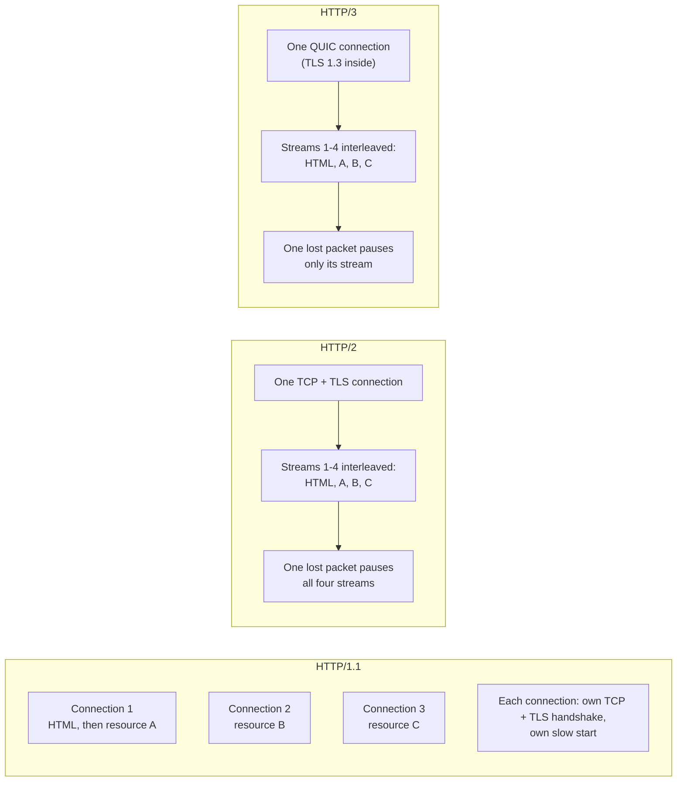
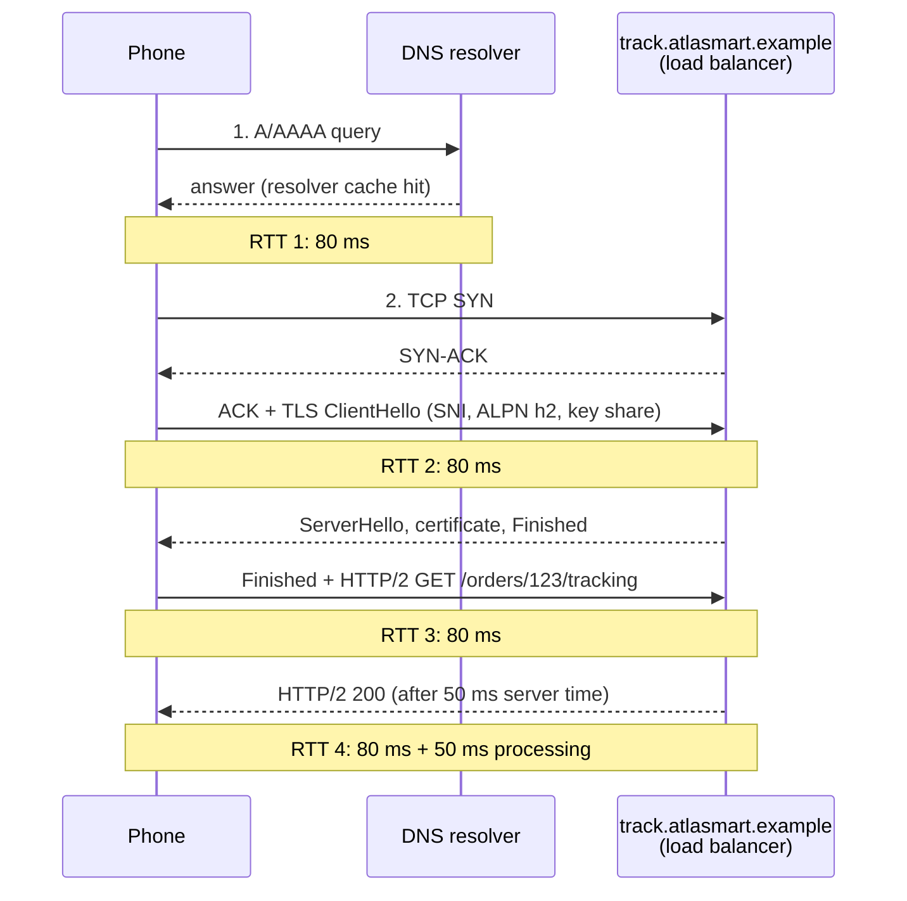
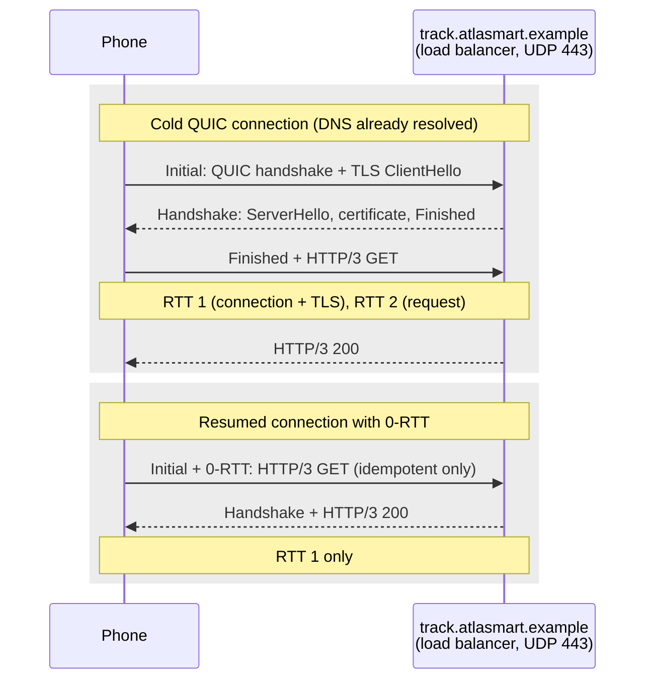
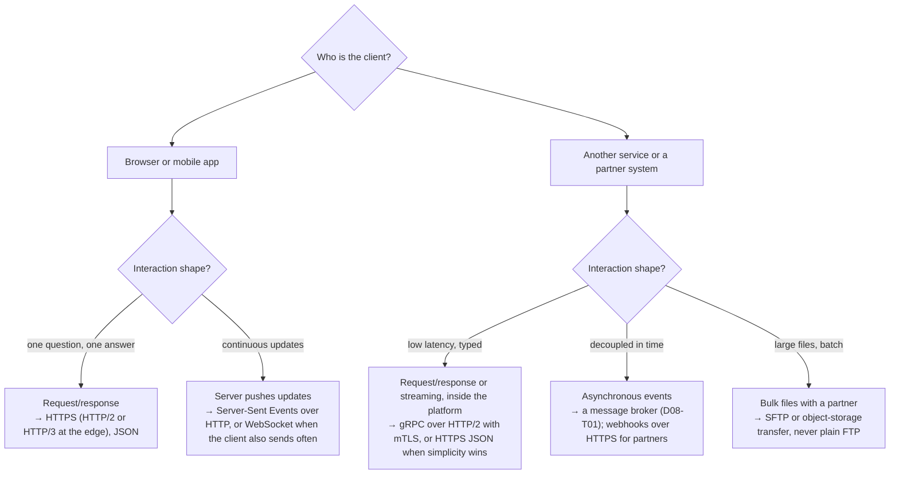

# Transport and application protocols

> IP delivers packets to a host. Everything a user experiences as "the site is slow" or "the
> connection dropped" happens in the layers above: the transport that makes packets into reliable
> streams, the encryption that protects them, and the application protocol that gives them meaning.
> Each one costs round trips, and round trips are the currency of latency.

!!! abstract "Page facts"
    **Level:** Mixed (protocol roles are Level 1-2; the latency budget and protocol selection are
    Level 3) · **Status:** Draft · **Time:** 60-75 minutes · **Last verified:** 2026-11-15

## Learning objectives

After this page you should be able to:

- Explain what TCP, UDP, and QUIC each guarantee, what they cost, and which to use for a given
  interaction.
- Walk through a TLS 1.3 handshake, say what certificates, SNI, and ALPN are for, and state the
  current rule for legacy SSL and TLS versions.
- Compare HTTP/1.1, HTTP/2, and HTTP/3 and predict how each behaves on a lossy mobile network.
- Compute a round-trip latency budget for a cold and a warm connection and use it to argue for
  connection reuse, edge termination, or a protocol change.
- Place WebSocket, gRPC, SSH, SFTP, SMTP, IMAP, ICMP, SNMP, NTP, IPsec, BGP, and OSPF in an
  architecture and know the one design consequence of each.
- Recognize the protocol-level causes of common production incidents: idle timeouts, head-of-line
  blocking, certificate expiry, clock drift, and load balancers that cannot see the protocol.

## Prerequisites

- [Networking fundamentals: IP, CIDR, routing, and DNS](networking-fundamentals-ip-cidr-routing-and-dns.md)
  — the layer model and DNS resolution this page builds on.
- [Functional vs non-functional requirements](../architecture-fundamentals/functional-vs-non-functional-requirements.md)
  — the latency and security NFRs that protocol choices must meet.

## The problem this solves

IP is unreliable by design: packets may be lost, duplicated, reordered, or delayed, and nothing in
IP knows which application on a host should receive them. Transport protocols add **ports** to
address applications, and (for TCP and QUIC) **reliability**: retransmission, ordering, and flow and
congestion control so that a sender does not drown the network. Transport Layer Security (TLS) adds
**confidentiality, integrity, and authentication** so that a tracking page cannot be read or altered
on the way to the customer. HTTP gives requests and responses a shared grammar that every browser,
proxy, load balancer, and API client understands.

Every one of those additions costs **round trips** before the first useful byte arrives. On a
desktop on fibre a round trip is a few milliseconds and nobody notices. On a phone on a mobile
network a round trip is often tens of milliseconds and the handshakes alone can exceed the entire
latency budget. The architect's job is to know where the round trips go and to design them away.

## What it is

| Protocol | Layer | One-line role | Costs to remember |
|---|---|---|---|
| TCP (RFC 9293) | Transport | Reliable, ordered byte stream over a connection | 1 RTT handshake; head-of-line blocking; connection state on both ends |
| UDP (RFC 768) | Transport | Unreliable datagrams with ports and nothing else | No handshake; the application must handle loss |
| QUIC (RFC 9000) | Transport, over UDP | Reliable, multiplexed streams with TLS 1.3 built in | 1 RTT handshake combined with TLS (0 on resumption); needs UDP open end to end |
| TLS 1.3 (RFC 8446) | Between transport and application | Encryption, integrity, server (and optionally client) authentication | 1 RTT on top of TCP; certificates to manage |
| HTTP/1.1 (RFC 9112) | Application | Text request/response, one at a time per connection | Browsers open several connections to parallelize |
| HTTP/2 (RFC 9113) | Application | Binary framing, many streams multiplexed on one TCP connection | One lost packet stalls every stream (TCP head-of-line) |
| HTTP/3 (RFC 9114) | Application | HTTP over QUIC | Loss stalls only the affected stream |
| HTTPS | Application | HTTP over TLS (over TCP) or over QUIC | Mandatory for anything public |

## Mental model

A **phone call** versus **postcards**. TCP is the phone call: you dial (handshake), both sides
confirm they can hear each other, and then you talk in order; if a word is lost you say "sorry?" and
it is repeated. UDP is postcards: cheap, no setup, any one may be lost or arrive out of order, and
nobody tells you. TLS is talking in a language only the two of you know, after first checking each
other's identity documents. HTTP/1.1 is a phone call where you may ask only one question at a time
and must wait for the full answer; HTTP/2 lets you ask several questions at once on the same call,
but if the line crackles everyone waits; HTTP/3 gives each question its own line.

**Where the analogy breaks:** a phone call keeps a circuit open; a TCP connection is only state in
two computers and the packets in between share the network with everyone else. Nothing is reserved,
which is why congestion control exists. And a postcard analogy undersells UDP: real-time media,
DNS, and now most of the web (over QUIC) run on it precisely because the application can do a better
job of handling loss than a one-size-fits-all transport.

## Key terms

| Term | Meaning on this page |
|---|---|
| Port | A 16-bit number that identifies an application endpoint on a host; well-known ports are conventions, not requirements |
| Round-trip time (RTT) | Time for a packet to reach the peer and a reply to return |
| Handshake | The exchange that establishes a connection or a cryptographic session before data flows |
| Head-of-line (HOL) blocking | A lost or delayed item holding back later items that did not depend on it |
| Congestion control | The sender's algorithm for finding how fast the network can accept data without collapse |
| Flow control | The receiver telling the sender how much it can buffer |
| Keep-alive / connection reuse | Keeping a connection open for later requests to avoid repeating handshakes |
| Certificate | A signed statement binding a name to a public key, issued by a certificate authority (CA) |
| SNI | Server Name Indication: the client names the host it wants during the handshake, so one address can serve many certificates |
| ALPN | Application-Layer Protocol Negotiation: client and server agree on HTTP/2 vs HTTP/1.1 inside the TLS handshake |
| Mutual TLS (mTLS) | Both sides present certificates; used for service-to-service authentication |
| Stream (HTTP/2, QUIC) | An independent, ordered sequence of frames multiplexed with others on one connection |

## How it works

### TCP: reliable streams and what they cost

A TCP connection starts with a **three-way handshake**: the client sends SYN, the server replies
SYN-ACK, the client sends ACK (and may attach data). That is one round trip before the application's
first byte can be sent. TCP then numbers every byte, acknowledges receipt, retransmits what is
missing, and delivers bytes to the application strictly in order. **Flow control** limits the sender
to what the receiver can buffer; **congestion control** (RFC 5681 and successors) starts slowly and
probes for available bandwidth, which is why a new connection cannot use a fast link fully for the
first several round trips ("slow start"). Connections end with a FIN exchange and leave state behind
(TIME_WAIT) for a while.

Design consequences:

- **In-order delivery means head-of-line blocking.** If packet 7 is lost, packets 8 through 20 wait in
  the receiver's buffer until 7 is retransmitted, even if they belong to an unrelated request
  multiplexed on the same connection.
- **Connection setup and slow start make short connections expensive.** Reusing connections
  (keep-alive, pools) is the single cheapest performance improvement in most services.
- **State per connection** limits how many a load balancer, proxy, or server can hold; idle
  connections are not free, which is why intermediaries impose idle timeouts (often tens of seconds
  to a few minutes; check each device). A client that keeps a connection in a pool longer than the
  intermediary's timeout gets a reset on its next request.
- **Middleboxes understand TCP**, so firewalls, NAT, and load balancers can inspect, time out, and
  reset it. That is useful for operations and the reason QUIC encrypts almost everything.

### UDP: datagrams for when the application knows better

UDP adds only ports and a checksum. No handshake, no ordering, no retransmission. It suits traffic
where a late packet is useless (voice, video, game state), where a single small exchange does not
justify a connection (DNS, NTP, SNMP), and as the substrate for protocols that implement their own
reliability (QUIC). Because there is no handshake, UDP services are easy targets for spoofed
amplification attacks, and NAT devices must guess when a UDP "session" has ended. Some corporate
networks block UDP except for DNS, which is why every HTTP/3 client must be able to fall back to
HTTP/2 over TCP.

### QUIC: streams, built-in TLS, and connection migration

QUIC (RFC 9000, with TLS integration in RFC 9001 and loss recovery in RFC 9002) runs over UDP and
provides what TCP provides, with three changes that matter to architects:

1. **Independent streams.** A lost packet stalls only the stream whose data it carried. Other
   streams on the same connection continue, which removes the HTTP/2 weakness on lossy links.
2. **Handshake merged with TLS 1.3.** Connection and encryption are negotiated together in one round
   trip; with a previous session, a client can send application data in its very first packet
   (0-RTT), at the cost that 0-RTT data can be replayed and therefore must be idempotent.
3. **Connection IDs instead of the address four-tuple.** A phone that moves from Wi-Fi to mobile
   data keeps the same QUIC connection; a TCP connection would break.

QUIC encrypts its headers too, so middleboxes see almost nothing, and load balancers must route by
connection ID rather than by address and port. Operationally, QUIC terminates at CDN edges and
load balancers far more often than at application servers.

### TLS: identity and secrecy, and the versions you may use

TLS 1.3 (RFC 8446) handshake, in one round trip: the client sends its supported cipher suites, a key
share, the server name it wants (SNI, RFC 6066), and the application protocols it speaks (ALPN,
RFC 7301); the server replies with its chosen parameters, its certificate chain, and a signature
proving it holds the private key; both derive the session keys and the client's next flight carries
encrypted application data. Resumption uses a ticket from a previous session and allows 0-RTT data
with the same replay caveat as QUIC.

**Certificates** (X.509, RFC 5280) bind a name to a public key and are issued by a CA the client
trusts. The architect's concerns are issuance automation, expiry monitoring (expired certificates
are a classic outage), the private key's storage (hardware or a managed service, never a repository),
and which names a certificate covers (wildcards versus explicit names).

**Legacy SSL and old TLS.** SSL 2.0 is prohibited (RFC 6176) and SSL 3.0 is deprecated as insecure
(RFC 7568); TLS 1.0 and 1.1 are deprecated (RFC 8996). The current rule is TLS 1.2 as the floor and
TLS 1.3 preferred. "Compatibility" with a partner that can only speak an older version is handled by
isolating that partner on a dedicated endpoint with its own termination, a documented risk
acceptance, and a sunset date, never by lowering the minimum version for everyone.

**mTLS** makes the client present a certificate too. It is the standard way service meshes
authenticate service-to-service calls and one option for partner integrations (the alternative used
for AtlasMart's carrier webhooks in NFR-5 is a signature over the request body, which works through
any intermediary and needs no client certificate management on the carrier's side).

### HTTP/1.1, HTTP/2, and HTTP/3

HTTP semantics (methods, status codes, headers, caching; RFC 9110) are the same in all three
versions. What differs is the wire format and how requests share connections.

| Property | HTTP/1.1 | HTTP/2 | HTTP/3 |
|---|---|---|---|
| Transport | TCP (+ TLS) | TCP + TLS (in practice always) | QUIC (TLS 1.3 built in) |
| Framing | Text | Binary frames | Binary frames |
| Requests per connection | One at a time (pipelining exists but is unused in practice) | Many, multiplexed as streams | Many, multiplexed as QUIC streams |
| Header handling | Repeated in full each request | Compressed (HPACK) | Compressed (QPACK) |
| Effect of one lost packet | Stalls that connection's single request | Stalls every stream on the connection (TCP HOL) | Stalls only the affected stream |
| Browser strategy | Several parallel connections per host | One connection per host | One connection per host; falls back to HTTP/2 if UDP is blocked |
| Where typically terminated | Anywhere | Load balancer, CDN, or server | CDN edge or load balancer; rarely at application servers |
| Server-to-client push | No | Specified; disabled by most browsers | Specified; rarely used |

**Figure 1 — How three HTTP versions use connections for one page with several resources.** Each
column shows the same work: an HTML document plus three resources.



How to read it: left to right is the historical progression. HTTP/1.1 parallelizes by paying for
more connections; HTTP/2 pays for one connection and shares it, which is better on clean networks
and worse on lossy ones; HTTP/3 keeps the sharing and removes the shared stall.

### Round trips: where the time goes

**Figure 2 — Cold connection from a phone with HTTP/2 over TCP and TLS 1.3.** Each numbered arrow
pair is one round trip; the RTT is an assumption of 80 ms for a mobile network (stated, not measured).



How to read it: four round trips plus server time pass before the first byte of the tracking page
arrives. The ACK of the TCP handshake and the TLS ClientHello travel together, and the TLS Finished
travels with the first HTTP request, so TLS 1.3 adds exactly one round trip (TLS 1.2 added two).

**Figure 3 — The same request over HTTP/3, cold and resumed.**



How to read it: QUIC folds the transport and TLS handshakes into one round trip; a resumed session
can carry the request in the first packet. Only safe, idempotent requests (such as this GET) may be
sent as 0-RTT data because the network could replay them.

### The other protocols an architect meets

| Protocol | Transport and port (by convention) | Role | The one design consequence |
|---|---|---|---|
| WebSocket (RFC 6455) | TCP 443 (upgraded from HTTP/1.1) | Full-duplex messages between browser and server | Long-lived connections: load balancers need long idle timeouts, and horizontal scale needs a pub/sub layer so any server can push to any client |
| gRPC | HTTP/2 (TCP 443 or internal ports) | Typed RPC with Protocol Buffers; unary and streaming calls | Requires HTTP/2 end to end; connections are long-lived, so L7 load balancers must balance per request, not per connection; browsers need a gRPC-Web proxy |
| SSH (RFC 4253) | TCP 22 | Encrypted remote shell, tunnels, and file transfer | Keys are credentials; prefer short-lived certificates or a session broker over long-lived keys on servers |
| FTP (RFC 959) / SFTP | TCP 21 (+ data ports) / TCP 22 | File transfer; SFTP is file transfer over SSH | Plain FTP is unencrypted and firewall-hostile; SFTP is the baseline for partner file exchange (D05-T03) |
| SMTP (RFC 5321) | TCP 25 (server to server), 587 (submission) | Sending email | Outbound mail from cloud networks is often blocked or rate-limited by default; use a mail service with SPF, DKIM, and DMARC records in DNS |
| IMAP (RFC 9051) | TCP 143, 993 (TLS) | Reading mailboxes | Rarely part of an architecture except for inbound-email integrations (parsing orders from mailboxes) |
| ICMP (RFC 792) | IP protocol, no port | Errors and diagnostics: unreachable, time exceeded, packet too big | Filter selectively; blocking all ICMP breaks path MTU discovery and traceroute |
| SNMP (RFC 3411) | UDP 161 (queries), 162 (traps) | Monitoring network devices | Still how hardware is monitored; use version 3 (authenticated and encrypted) |
| NTP (RFC 5905) | UDP 123 | Clock synchronization | Certificates, tokens, TLS, logs, and distributed-systems reasoning assume synchronized clocks; every host must sync, and clock skew is a distributed-systems topic in its own right (D04-T01) |
| IPsec (RFC 4301) | IP protocols ESP/AH, UDP 500/4500 | Encrypted and authenticated IP tunnels | The basis of site-to-site VPNs (D09-T04); adds header overhead that lowers the usable MTU |
| BGP (RFC 4271) | TCP 179 | Routing between autonomous systems; route advertisement over VPNs and dedicated links | What you configure when connecting a data centre to the cloud; a mis-advertised prefix can black-hole traffic (D09-T04) |
| OSPF (RFC 2328) | IP protocol 89 | Routing inside an organization's network | Appears on the on-premises side; cloud virtual networks do not run it |

**Figure 4 — Choosing a protocol for an interaction.** A decision path for the common cases an
application architect faces.



How to read it: start at the top. The answers are defaults, not rules; the API design page
(D05-T02) covers the REST, GraphQL, gRPC, and async API choice in depth.

## Worked example: one tracking page request from a phone

AtlasMart's NFR-3 says the Tracking API responds within 300 ms at p95, measured at the API gateway.
A product manager reports that the tracking page "feels slow on the train". The architect traces
one request. Assumptions:

| Assumption | Value | Basis |
|---|---|---|
| Round-trip time, phone to AtlasMart's load balancer | 80 ms | Assumption for a congested mobile network; real values must be measured per market |
| Round-trip time, phone to the CDN edge in the same city | 25 ms | Assumption |
| Server processing time (gateway to response) | 50 ms average | The capacity estimate's average latency |
| Resources on the page | HTML plus 30 small assets plus 1 API call | Prototype measurement |
| DNS | answered from the resolver's cache | Typical for a popular name |

### Cold start, HTTP/2 over TCP + TLS 1.3, direct to origin

| Step | Round trips | Time |
|---|---|---|
| DNS query to resolver | 1 | 80 ms |
| TCP handshake | 1 | 80 ms |
| TLS 1.3 handshake | 1 | 80 ms |
| HTTP request and first byte of response | 1 + processing | 80 + 50 = 130 ms |
| **Time to first byte** | **4 RTT + processing** | **370 ms** |

The API itself met NFR-3 (50 ms average at the gateway), and the customer waited 370 ms for the
first byte, then more for the 30 assets. Nothing in the API's metrics shows the problem, because
NFR-3 is measured at the gateway. The handshakes are the problem.

### The same request over HTTP/3 (cold) and with a resumed session

| Scenario | Round trips | Time to first byte |
|---|---|---|
| HTTP/3 cold (DNS cached locally this time) | 1 (QUIC + TLS) + 1 (request) + processing | 80 + 80 + 50 = 210 ms |
| HTTP/3 resumed, 0-RTT GET | 1 + processing | 80 + 50 = 130 ms |
| HTTP/2 on an already-open, warm connection | 1 + processing | 80 + 50 = 130 ms |

The warm-connection row is the key insight: once a connection exists, HTTP/2 and HTTP/3 cost the
same single round trip per request. The expensive part is the first request of a session, and
anything that reopens connections (short idle timeouts, one connection per request in a client
library, a load balancer that closes after N requests) pays it again.

### Moving the handshakes closer: edge termination

If TLS terminates at a CDN edge 25 ms away that keeps warm HTTP/2 connections to AtlasMart's origin:

| Step | Time |
|---|---|
| DNS (resolver cache) | 25 ms |
| TCP + TLS 1.3 to the edge, or one QUIC round trip | 50 ms (TCP) or 25 ms (QUIC) |
| Request: phone to edge 25 ms, edge to origin on a warm connection 80 ms, processing 50 ms, back 80 + 25 ms | 260 ms (TCP) |
| **Time to first byte, cold** | **about 335 ms (TCP) or 310 ms (QUIC)** |

The handshake round trips shrank from 80 ms to 25 ms each because they now happen with the nearby
edge; the long hop to origin is paid once per request on a reused connection. If the 30 static assets
are cached at the edge, they never cross the long hop at all, which is where most of the perceived
improvement comes from.

### What the trace decided

| Decision | Driven by |
|---|---|
| Serve the tracking page and its assets through a CDN with edge TLS termination and HTTP/3 enabled | Cold-start round trips on mobile |
| Keep HTTP/2 between edge and origin with long idle timeouts and connection reuse | One round trip per request after warm-up |
| Add a client-side metric for time to first byte on the phone, alongside NFR-3 | NFR-3 at the gateway cannot see handshake cost |
| Mark the tracking GET as safe for 0-RTT; never allow 0-RTT for the delivery-date change (FR-4) | 0-RTT replay risk |
| Keep the carrier webhook endpoint on TLS 1.2 minimum, TLS 1.3 preferred; one legacy carrier that cannot meet this gets a separate endpoint with a sunset date | NFR-5 and the deprecation RFCs |

## Real-world architecture example

A typical production edge looks like this, whatever the vendor: a CDN or global load balancer
terminates TLS (and QUIC) close to users, speaks HTTP/2 to a regional load balancer over warm
connections, which terminates TLS again or passes it through to the service. Inside the platform,
services talk gRPC or HTTP/2 over mTLS issued by a service mesh or an internal CA with short-lived
certificates. Browsers receiving live updates (a dashboard, a chat) hold WebSocket or SSE connections
to a dedicated tier whose load balancer has long idle timeouts and whose servers share a pub/sub
channel so any instance can deliver to any client. Partner file exchange runs on SFTP or
object-storage transfers; partner events arrive as HTTPS webhooks with signatures. NTP runs on every
host, and certificate expiry is monitored like any other SLO.

## Design choices and trade-offs

| Choice | Favor when | Avoid when |
|---|---|---|
| HTTP/3 at the edge | Mobile and global users; lossy networks | Corporate networks that block UDP (keep HTTP/2 fallback) ; internal hops where TCP is fine |
| Terminate TLS at the edge and re-encrypt to origin | Latency to users dominates; you want edge caching and a WAF | Regulations or threat models require end-to-end encryption with no intermediary; then pass TLS through and accept the round trips |
| gRPC between services | Typed contracts, streaming, low overhead, polyglot teams | Browser clients without a proxy; teams for whom HTTP JSON debuggability matters more than efficiency |
| WebSocket | Frequent bidirectional messages | Server-to-client only (use SSE); infrequent updates (poll) |
| mTLS for partners | Partners can manage client certificates; strong identity needed | Many small partners; use signed requests or OAuth-style tokens instead |
| Long connection idle timeouts | Clients reuse connections and pools are sized | Load balancers with limited connection capacity; set client pool timeouts below the balancer's |
| Allow 0-RTT | Idempotent, cacheable reads on latency-sensitive paths | Any request with side effects |

**Assumption behind all of this:** the client controls its own protocol stack (modern browsers and
mobile SDKs do). Embedded devices, legacy partner systems, and some corporate proxies do not, and
they are the reason fallbacks and compatibility endpoints exist.

## Failure modes and anti-patterns

- **New connection per request.** A client library without a pool pays DNS, TCP, and TLS on every
  call; at 210 requests/s that is 210 handshakes a second. Detect: connection rate on the load
  balancer close to request rate. Prevent: pooled, keep-alive clients with a pool timeout shorter
  than every intermediary's idle timeout.
- **Idle timeout mismatch.** The client pool keeps connections for 5 minutes; the load balancer
  closes them after 60 s; the next request gets a reset and a spurious error. Detect: errors on the
  first request after idle periods. Prevent: document every intermediary's timeout and set clients
  below the minimum.
- **gRPC behind an L4 load balancer.** All requests from one client land on one backend because the
  connection is long-lived. Detect: uneven backend load. Prevent: L7 balancing per request or
  client-side load balancing.
- **Expired or wrong-name certificate.** The most common self-inflicted outage. Detect: expiry
  monitoring with alerts at 30 and 7 days; SNI mismatches in client errors. Prevent: automated
  issuance and renewal.
- **Lowering the TLS floor for one partner.** Weakens every client. Prevent: a dedicated endpoint
  with its own policy and a sunset date.
- **Blocking all ICMP.** Breaks path MTU discovery; large responses hang over tunnels. Prevent:
  allow the ICMP types needed.
- **Clock drift.** TLS handshakes fail ("certificate not yet valid"), tokens are rejected, logs
  cannot be correlated. Prevent: NTP on every host, monitored.
- **WebSocket tier that cannot scale out.** A client's connection is on server A; the event for that
  client arrives at server B. Prevent: a pub/sub channel across the tier from day one.
- **Measuring latency only at the gateway.** As in the worked example: the user's experience includes
  handshakes and the last mile. Prevent: client-side timing alongside the server-side SLI.

## Security considerations

- **Encrypt everything in transit**, including inside the platform; "the network is private" is not
  a boundary a reviewer accepts. TLS 1.2 minimum, 1.3 preferred, with legacy exceptions isolated and
  time-limited.
- **Authenticate the server always and the client where it matters:** mTLS or signed requests for
  partners, mTLS or tokens between services. The carrier webhook design (NFR-5) verifies a signature
  on every request before any work is done.
- **Certificates are credentials.** Private keys live in hardware or a managed secret store; issuance
  is automated; expiry is monitored; revocation is planned.
- **0-RTT data can be replayed.** Only safe methods may use it.
- **Transport protocols are attack surfaces:** SYN floods against TCP, amplification against UDP
  services, slow-request attacks against HTTP/1.1 servers. Edge providers absorb most of this
  (D09-T03); the application's job is to fail fast and cheaply on bad input.
- **Protocol downgrade.** Clients and servers must refuse to negotiate below their configured floor;
  TLS 1.3 includes protection against downgrade to earlier versions.

## Performance, reliability, and cost

- **Performance:** round trips, not bandwidth, dominate small-request latency. Reduce the count
  (TLS 1.3, QUIC, resumption, connection reuse) and the length (edge termination, regional
  deployment). Bandwidth matters for large payloads: compression and HTTP/2 header compression help,
  but the biggest lever is sending less.
- **Reliability:** connection-level failures (resets, timeouts) must be retried safely, which ties
  back to idempotency (D05-T02). QUIC's connection migration improves reliability for mobile users;
  HTTP/3's fallback to HTTP/2 must be tested, not assumed.
- **Cost:** TLS termination is CPU; terminating at the edge moves that cost to the CDN's bill. CDN
  egress is usually priced differently from origin egress; check your provider. Long-lived
  connections (WebSocket, gRPC streams) are billed by some load balancers per connection-hour; size
  the tier from the capacity estimate's concurrency, not its request rate.

## Hands-on lab: measure the round trips yourself

1. Measure RTT to a public site from your machine: `ping -c 10 example.com` (note the average), then
   from a phone on mobile data using any network-tools app. Write both numbers down.
2. Measure the handshake cost with curl's timing variables:

    ```bash
    curl -o /dev/null -s -w "dns %{time_namelookup}s  tcp %{time_connect}s  tls %{time_appconnect}s  first-byte %{time_starttransfer}s  total %{time_total}s  proto %{http_version}\n" https://example.com/
    ```

    Compare the gaps between `tcp`, `tls`, and `first-byte` with your RTT: each should be roughly one
    round trip (TLS may show more if the server still negotiates TLS 1.2).

3. Run the same command with `--http3` if your curl build supports it (`curl --version` lists `HTTP3`)
   and compare `tls` with the TCP run; otherwise run it twice in one process with
   `curl ... https://example.com/ https://example.com/` and compare the second request's timings to
   see the effect of connection reuse.
4. Inspect a handshake: `openssl s_client -connect example.com:443 -servername example.com </dev/null`
   and find the negotiated protocol version, the cipher, and the certificate's subject and expiry.
5. Build your own latency budget table for a page you own: RTT, DNS, TCP, TLS, request, processing,
   and the number of resources. Then write three sentences: the single largest avoidable cost, what
   edge termination would save, and which request on the page could never be sent as 0-RTT and why.

??? question "Hint: reading the curl numbers"
    `time_connect` minus `time_namelookup` is the TCP handshake (about one RTT).
    `time_appconnect` minus `time_connect` is the TLS handshake (one RTT for TLS 1.3, two for 1.2).
    `time_starttransfer` minus `time_appconnect` is the request round trip plus server processing.
    On a second request in the same process, `tcp` and `tls` repeat the first request's values
    because curl reports cumulative times, but the second transfer's total is far smaller.

## Knowledge check

1. On an 80 ms RTT link, how long do the TCP and TLS 1.3 handshakes take together before the first
   HTTP request can be sent? How does TLS 1.2 differ?
2. Why can a single lost packet on an HTTP/2 connection delay a response that was not affected by the
   loss, and how does HTTP/3 avoid it?
3. A client sends "change delivery date" as 0-RTT data over a resumed QUIC session. What is the risk?
4. A gRPC service behind a connection-level (L4) load balancer shows one backend at 90% CPU and two
   idle. Explain.
5. A partner's legacy system can only negotiate TLS 1.0. List the compliant options and the one you
   must not choose.

??? success "Answers"
    1. Two round trips: 160 ms (TCP one, TLS 1.3 one), after which the request travels with the TLS
       Finished message. TLS 1.2 needs two round trips of its own, so three in total: 240 ms.
    2. TCP delivers bytes in order, so every stream multiplexed on the connection waits for the
       retransmission of the lost packet even if its own data arrived. QUIC tracks loss per stream,
       so only the stream whose data was lost waits.
    3. Replay. 0-RTT data is not protected against an attacker (or a retransmitting network)
       delivering it twice, so a non-idempotent request could be applied twice. Only safe, idempotent
       requests may be sent as 0-RTT.
    4. gRPC keeps one long-lived HTTP/2 connection per client and multiplexes all requests on it; an
       L4 balancer assigns the whole connection to one backend. Fix with an L7 balancer that balances
       per request, or client-side load balancing across backends.
    5. Give the partner a dedicated endpoint that terminates TLS 1.0 separately, with a documented
       risk acceptance, extra monitoring, and a sunset date; or move the integration to SFTP or a
       managed file exchange with modern TLS; or require the partner to upgrade. Never lower the
       minimum TLS version on the shared endpoint.

## Architecture discussion questions

1. AtlasMart wants live courier positions on the tracking page, updated every 10 seconds while the
   app is open, for 300,000 in-transit orders. Compare polling over HTTP/2, Server-Sent Events, and
   WebSocket for this feature: connection counts, load balancer implications, and what the
   capacity estimate's concurrency figure becomes.
2. A regulator requires end-to-end encryption between the customer and AtlasMart's own servers, with
   no third party able to read traffic. What does this do to the CDN-based latency design in the
   worked example, and how would you recover the lost performance?
3. The platform team proposes gRPC for every internal call. For which of the Order Tracking System's
   interactions is that clearly right, where is it neutral, and where would you push back?

## Summary

TCP turns packets into a reliable ordered stream at the cost of a handshake, slow start, and
head-of-line blocking; UDP offers only ports; QUIC rebuilds reliability over UDP with independent
streams, a merged TLS 1.3 handshake, and connection migration. TLS 1.3 adds one round trip and
requires certificate operations; TLS 1.2 is the floor and SSL and TLS 1.0/1.1 are retired. HTTP/2
multiplexes one connection and HTTP/3 removes its shared stall. Latency for small requests is round
trips times RTT, so connection reuse, resumption, and edge termination are the levers. The rest of
the protocol zoo (WebSocket, gRPC, SSH, SFTP, SMTP, IMAP, ICMP, SNMP, NTP, IPsec, BGP, OSPF) each
carry one design consequence an architect must know.

## Related topics

- **Before:** [Networking fundamentals: IP, CIDR, routing, and DNS](networking-fundamentals-ip-cidr-routing-and-dns.md).
- **Alongside:** [API design: REST, GraphQL, gRPC, and async APIs](../application-and-api-architecture/api-design-rest-graphql-grpc-and-async-apis.md)
  (what to put on top of these protocols); [Performance fundamentals and Little's Law](../performance-and-scalability/performance-fundamentals-and-littles-law.md)
  (latency budgets and percentiles); [Lab 01: latency and throughput](../labs/lab-01-latency-and-throughput.md)
  (measure a local HTTP service).
- **Planned:** network security, load balancing, and traffic flow (D09-T03); hybrid connectivity and
  VPNs (D09-T04); security architecture for encryption in transit and PKI (D12).

## References

| Source | Type | Checked |
|---|---|---|
| [RFC 9293: Transmission Control Protocol (TCP)](https://www.rfc-editor.org/rfc/rfc9293) and [RFC 768: User Datagram Protocol](https://www.rfc-editor.org/rfc/rfc768) | Standards | 2026-11-15 |
| [RFC 9000: QUIC: A UDP-Based Multiplexed and Secure Transport](https://www.rfc-editor.org/rfc/rfc9000), [RFC 9001: Using TLS to Secure QUIC](https://www.rfc-editor.org/rfc/rfc9001), [RFC 9002: QUIC Loss Detection and Congestion Control](https://www.rfc-editor.org/rfc/rfc9002) | Standards | 2026-11-15 |
| [RFC 8446: The Transport Layer Security (TLS) Protocol Version 1.3](https://www.rfc-editor.org/rfc/rfc8446) | Standard | 2026-11-15 |
| [RFC 8996: Deprecating TLS 1.0 and TLS 1.1](https://www.rfc-editor.org/rfc/rfc8996), [RFC 7568: Deprecating Secure Sockets Layer Version 3.0](https://www.rfc-editor.org/rfc/rfc7568), [RFC 6176: Prohibiting SSL Version 2.0](https://www.rfc-editor.org/rfc/rfc6176) | Standards (best current practice) | 2026-11-15 |
| [RFC 9110: HTTP Semantics](https://www.rfc-editor.org/rfc/rfc9110), [RFC 9112: HTTP/1.1](https://www.rfc-editor.org/rfc/rfc9112), [RFC 9113: HTTP/2](https://www.rfc-editor.org/rfc/rfc9113), [RFC 9114: HTTP/3](https://www.rfc-editor.org/rfc/rfc9114) | Standards | 2026-11-15 |
| [RFC 6066: TLS Extensions (SNI)](https://www.rfc-editor.org/rfc/rfc6066), [RFC 7301: TLS Application-Layer Protocol Negotiation](https://www.rfc-editor.org/rfc/rfc7301), [RFC 5280: X.509 Certificate Profile](https://www.rfc-editor.org/rfc/rfc5280) | Standards | 2026-11-15 |
| [RFC 6455: The WebSocket Protocol](https://www.rfc-editor.org/rfc/rfc6455) and [gRPC: Introduction](https://grpc.io/docs/what-is-grpc/introduction/) | Standard; official documentation | 2026-11-15 |
| [RFC 4253: SSH Transport Layer](https://www.rfc-editor.org/rfc/rfc4253), [RFC 959: FTP](https://www.rfc-editor.org/rfc/rfc959), [RFC 5321: SMTP](https://www.rfc-editor.org/rfc/rfc5321), [RFC 9051: IMAP4rev2](https://www.rfc-editor.org/rfc/rfc9051) | Standards | 2026-11-15 |
| [RFC 792: ICMP](https://www.rfc-editor.org/rfc/rfc792), [RFC 3411: SNMP architecture](https://www.rfc-editor.org/rfc/rfc3411), [RFC 5905: NTP version 4](https://www.rfc-editor.org/rfc/rfc5905), [RFC 4301: IPsec architecture](https://www.rfc-editor.org/rfc/rfc4301) | Standards | 2026-11-15 |
| [RFC 4271: BGP-4](https://www.rfc-editor.org/rfc/rfc4271) and [RFC 2328: OSPF Version 2](https://www.rfc-editor.org/rfc/rfc2328) | Standards | 2026-11-15 |

## Review notes

- Canonical page for D09-T02. SSH, FTP/SFTP, SMTP, IMAP, ICMP, SNMP, NTP, IPsec, BGP, and OSPF are
  covered as table rows with one design consequence each; BGP and IPsec get depth in D09-T04.
- All latency figures are arithmetic from stated assumptions (80 ms and 25 ms RTT, 50 ms processing)
  for a fictional company; they illustrate the method and must not be read as measurements. TLS 1.2
  is described as two round trips (full handshake without resumption).
- Port numbers are the conventional well-known assignments; the table says "by convention" because
  deployments may differ.
- Reviewer: check the RTT arithmetic in the worked example tables and that Figures 2 and 3
  (sequence diagrams) render legibly on a phone; the `rect` shading in Figure 3 uses a neutral
  translucent grey so it works in both themes.
