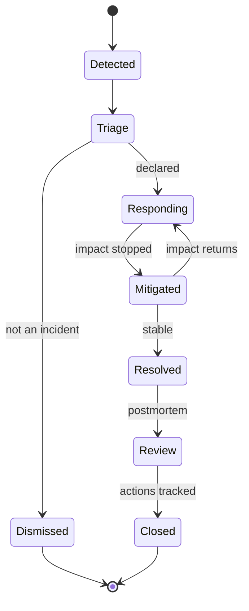
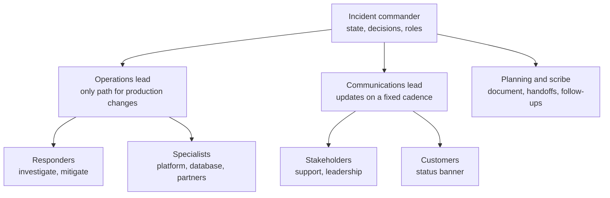
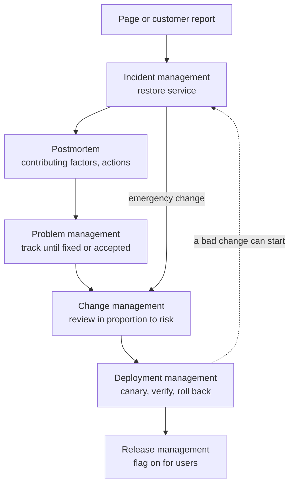

# Incident management and SRE practices

> An incident is handled by a small, explicit command structure whose first job is to stop the harm,
> not to find the cause. Afterwards a blameless postmortem looks for the several conditions that
> combined, and the practices around it (problem, change, readiness, ownership, toil budgets) make the
> next incident rarer, smaller, and shorter.

!!! abstract "Page facts"
    **Level:** Intermediate (lifecycle, roles, and severity are Level 1-2; postmortem analysis,
    readiness reviews, and ownership design are Level 3) · **Status:** Draft · **Time:** 60-75
    minutes · **Last verified:** 2026-11-27

## Learning objectives

After this page you should be able to:

- Walk an incident through its lifecycle and assign the incident commander, operations, and
  communications roles, with a communication cadence tied to severity.
- Distinguish incident, problem, change, release, and deployment management and show how work flows
  between them.
- Write a runbook and a blameless postmortem, and explain why a single "root cause" misleads.
- Run a production readiness review with a checklist, and describe service ownership and the service
  catalog entry that records it.
- Define toil, apply an error budget policy after an incident, and place a team on an operational
  maturity scale.

## Prerequisites

- [Monitoring, alerting, and on-call](monitoring-alerting-and-on-call.md) — the pages, dashboards, and
  escalation policy that start an incident.
- [SLAs, SLOs, SLIs, error budgets, and recovery objectives](../architecture-fundamentals/slas-slos-slis-error-budgets-and-recovery-objectives.md)
  — the SLOs and the error budget policy that decide what happens after one.
- Security incidents follow the process on [security operations](../security-architecture/security-operations.md),
  because an adversary changes the priorities (evidence, containment, confidentiality). This page
  covers reliability incidents and does not repeat that material.

## The problem this solves

Without a process, an outage collects a dozen engineers changing production at once, nobody tells
support what is happening, the most senior person both debugs and decides, and a later meeting finds
"the root cause", usually a person, while the failure returns in another shape. Incident management
structures the response; SRE practices turn each incident into a more reliable design.

## What it is

**Incident management** is the practice of restoring normal service as quickly as possible after an
unplanned interruption or degradation. It sits among related practices whose vocabulary comes from IT
service management (ITSM) frameworks such as ITIL; SRE teams use the same words with lighter process.

| Practice | Question it answers | Unit of work | AtlasMart example |
|---|---|---|---|
| Incident management | How do we restore service now? | Incident | Freshness SLO fast burn on sale day |
| Problem management | Why do incidents recur, and how do we stop them? | Problem record linking incidents or a known risk | The Event Processor cannot scale on backlog |
| Change management | Is this change safe, and who agreed? | Change | Raising the Event Processor's autoscaling minimum |
| Release management | Which capabilities reach users, and when? | Release | Turning on the sale-day banner feature |
| Deployment management | How does a new version get into an environment safely? | Deployment | Canary 5% → 25% → 100% gated on SLO metrics |

**Site Reliability Engineering (SRE)** is an approach, popularized by Google's SRE book, that treats
operations as a software problem: reliability targets are SLOs, the error budget arbitrates between
features and stability, repetitive manual work (toil) is capped and automated away, and incidents are
learned from without blame.

## Mental model

Think of a fire service. One officer takes command and holds no hose; crews work under a sector lead;
one person talks to the public. Nobody investigates while the building burns. Afterwards,
investigators reconstruct the wiring, the blocked exit, the missing detector without seeking someone
to punish, the findings change building codes, and new buildings are inspected before use.

**Where the analogy breaks:** in software, the responders usually built the system and often caused
the triggering change, which makes blame tempting and blamelessness harder. Degradation can be partial
and ambiguous (some carriers, some users), so deciding that an incident exists at all is a real
decision. And the "building code" is the team's own: nobody else will update it.

## Key terms

| Term | Meaning on this page |
|---|---|
| Incident | An unplanned interruption or degradation of a service, or an event that threatens one, that needs a coordinated response |
| Severity | A level (SEV1 to SEV4 here) set by customer and business impact, deciding who is engaged and how often updates go out |
| Incident commander (IC) | The person who holds the overall state of the incident, assigns roles, and makes decisions; does not do hands-on fixing |
| Operations lead | The person who directs responders and is the single path for changes to production during the incident |
| Communications lead | The person who sends updates to stakeholders and customers on a fixed cadence |
| Runbook | Step-by-step instructions for one operational task or alert on a specific system |
| Playbook | A documented, often partly automated, sequence of response steps for one alert or incident type (as in the [glossary](../start-here/glossary.md)) |
| Postmortem | A written review after an incident: impact, timeline, contributing factors, and tracked actions |
| Contributing factor | One of the conditions that together allowed an incident; none is sufficient alone |
| Problem | The underlying condition behind one or more incidents, tracked until fixed or accepted |
| Toil | Manual, repetitive, automatable operational work with no enduring value that grows with the service |
| Production readiness review (PRR) | A structured check that a service meets operational standards before launch or handover |
| Service catalog | The registry of services with their owners, on-call, tier, SLOs, runbooks, and dependencies |

## How it works

### Step 1 — The incident lifecycle

**Figure 1 — Incident lifecycle.** Most incidents move straight down; the back edge shows impact
returning after a mitigation.



How to read it: "declared" sets a severity and assigns roles; "stable" means the SLIs stayed healthy
for an agreed period; "actions tracked" means every action item has an owner and a due date.

Three habits make it work. **Declare early**: downgrading later costs little, a slow declaration
costs the minutes when coordination matters most. **Mitigate before you diagnose**: roll back, fail
over, add capacity, or shed load as soon as a safe option exists. **Keep one record**: one channel and
one live incident document with current state, actions in flight, and a timeline kept by the scribe.

### Step 2 — Roles and the command structure

The SRE book's "Managing Incidents" chapter bases incident response on the Incident Command System
from emergency services, with recursive separation of responsibilities: **incident command**,
**operational work**, **communication**, and **planning**. One person may hold several roles in a
small incident, but should know which one they are acting in at each moment.

**Figure 2 — Incident roles.** Command sits at the top; operations and communications each have one
lead so that changes and messages each have a single path.



How to read it: arrows are lines of direction; everyone feeds the incident document. An IC handover
is explicit and announced in the channel. The rules that matter most: the IC does not debug (a
commander absorbed in a terminal stops seeing the whole), responders make no changes outside the
operations lead, and stakeholders ask the communications lead, not the responders.

### Step 3 — Severity levels

Severity is set by impact, never by suspected cause, and can be raised or lowered at any time.
AtlasMart's scale (assumption):

| Severity | Criteria | Who is engaged | Stakeholder updates | Postmortem |
|---|---|---|---|---|
| SEV1 | A tier-1 service unavailable or wrong for most users; acknowledged data lost; an SLA or regulatory duty at risk | On-call, IC, communications lead, leadership | Every 15 min | Required |
| SEV2 | A tier-1 SLO fast burn with visible degradation; or a tier-2 service down | On-call, IC, communications lead | Every 30 min | Required |
| SEV3 | Slow burn, or partial degradation with a workaround | On-call, working hours | At start and end | Team decides |
| SEV4 | No customer impact; a near miss | Ticket | None | Discussed at the weekly operations review |

If unsure between two levels, declare the higher. A SEV1 that might involve an attacker becomes a joint
incident with security operations.

### Step 4 — Incident, problem, change, release, and deployment

**Figure 3 — How the practices hand work to each other.** Incidents feed problems, problems produce
changes, changes become deployments and releases, and a bad deployment can start the next incident.



How to read it: the solid path is improvement; the dashed edge is why "what changed recently?" is the
first question in triage.

**Problem management** keeps follow-up alive after the incident closes; one problem can link several
incidents or none (a risk found in a review).

**Change management** in a delivery pipeline is risk-proportional rather than a weekly approval board.
At AtlasMart, **standard changes** are pre-approved: a merged pull request deployed by the pipeline's
progressive canary (5% → 25% → 100%) gated on SLO metrics. **Normal changes** with wider blast radius
(a database engine upgrade) get a written plan and a second reviewer. **Emergency changes** during an
incident are still made through Git with an expedited review, so the audit trail exists.

**Release versus deployment**: a deployment puts a version into an environment; a release exposes a
capability to users. Feature flags separate them, so code can be deployed dark and released later, or
a release rolled back without a deployment. Strategies are on the
[CI/CD and deployment strategies](../devops-and-platform-engineering/ci-cd-pipeline-design-and-deployment-strategies.md)
page.

### Step 5 — Runbooks and playbooks

A **runbook** is specific: one alert or task, one system, exact steps. A **playbook** is broader: the
response sequence for an incident type, such as "carrier outage" or "sale-day surge", with the
decisions and roles involved, calling several runbooks. A good runbook for an alert contains:

1. What the alert means for users, and the dashboard to open first.
2. Quick checks with exact queries or commands (copyable, read-only).
3. Safe mitigations in order, each with how to verify it worked and how to undo it.
4. When and to whom to escalate.
5. The date it was last exercised, and by whom (role).

Runbooks decay as systems change: link each from its alert, exercise it in game days, and check
automatically that the resources it names exist. A step executed the same way every time is a
candidate for automation: runbook, then script, then automatic remediation.

### Step 6 — Blameless postmortems, and why "root cause" misleads

A **postmortem** is written for incidents that meet agreed triggers: in the SRE book, examples include
user-visible impact beyond a threshold, any data loss, on-call intervention such as a rollback, and
long resolution time; anyone may also request one. **Blameless** means the review assumes people acted
reasonably given what they knew at the time, and asks how the system (tools, defaults, documents,
incentives) made the harmful action possible or the right action hard. People who expect blame hide
information, and the review then learns nothing.

The phrase **root cause** suggests one cause that, removed, prevents the incident. Richard Cook's "How
Complex Systems Fail" argues that serious failures need several contributors, each necessary and none
sufficient, so singling one out is a social choice, not a technical finding. John Allspaw makes the
same point about linear "five whys" chains: they read neatly but stop at whatever the investigator
chose to stop at. Three practical consequences:

- **Record the trigger and the contributing factors separately.** A trigger (a carrier replay, a
  deploy) is often outside your control; the factors that made it an incident are not.
- **Fix several factors,** not just the most visible; each is a separate defence.
- **Watch for hindsight bias.** The timeline should show what responders could see then.

Action items are typed (**prevent**, **detect**, **mitigate**, **process**), each with an owner (a team
or role) and a due date, and tracked to completion in problem management. A postmortem with no
completed actions after a quarter is a warning sign.

### Step 7 — Capacity and configuration management

**Capacity management** forecasts demand (growth plus known events), keeps headroom, and proves it with
load tests (method on the [capacity estimation](../performance-and-scalability/capacity-estimation.md)
page); operationally it adds a capacity review before planned peaks, including burst scenarios.

**Configuration management** keeps every system's desired configuration known, versioned, and
reproducible: at AtlasMart, infrastructure as code and GitOps (Git holds desired state, Argo CD
reconciles it and reports drift). A configuration management database (CMDB) still helps for assets
not in code; generate one view from the other rather than keeping two truths. Configuration changes
are changes, with the same review and canary as code.

### Step 8 — Operational and production readiness reviews

A **production readiness review** (PRR) checks a service against operational standards before launch
or handover; the SRE book calls it the usual first step of SRE engagement. AWS's **operational
readiness reviews** (ORRs) are checklists built from an organization's own incident learnings and used
across a service's life. Combined: a standard checklist plus questions added by each postmortem.

| Area | Question | Evidence for Order Tracking |
|---|---|---|
| Ownership | Is there an owning team, a rotation of at least 6, and a catalog entry? | Catalog entry below |
| SLOs | Are SLIs defined with working queries, and is the error budget policy agreed? | SLO-A, SLO-L, SLO-F, SLO-D |
| Alerts | Do burn-rate and hard safety alerts exist, each with a runbook link, tested in staging? | P1-P3, H1-H4 on the monitoring page |
| Dashboards | Do L0 and L1 dashboards answer their stated questions? | Overview, Tracking API, ingestion |
| Runbooks | Is there one per page, exercised in the last quarter? | Game-day record |
| Capacity | Was the design peak (NFR-4) load-tested, and bursts? | Load-test report |
| Dependencies | Are critical dependencies and their SLOs listed, with degradation behavior? | Dependency table on the SLO page |
| Deploy and rollback | Is the canary gated on SLO metrics, and was rollback tested? | Pipeline run |
| Data and recovery | Were backups and point-in-time recovery restored against the RTO (NFR-7)? | Restore drill result |
| Disaster recovery | Are the DR tier and strategy documented and rehearsed? | Tier 1, warm standby ([DR strategies](../reliability-and-disaster-recovery/disaster-recovery-strategies.md)) |
| Security | Threat model current, images signed, secrets from the secrets operator, no static keys? | Security review |
| Cost | Are the tags owner-team, environment, cost-centre, data-classification, backup-tier set? | Tag report |
| Incident readiness | Severity scale, communication contacts, and a customer banner mechanism? | Incident playbook |

### Step 9 — Service ownership and the service catalog

**Service ownership** means one team is accountable for a service in production: it carries the
pager, owns the SLOs and spends the error budget, and plans reliability work. "You build it, you run
it" puts that team close to the code, so fixes come from the people who understand the system; the
platform team owns shared components and is reached by functional escalation.

The **service catalog** records ownership so tooling can use it (alert routing, incident tooling,
readiness reviews). An entry in the
[Backstage](https://backstage.io/docs/features/software-catalog/descriptor-format/) descriptor format
(one common open-source catalog; URLs are fictional):

```yaml
apiVersion: backstage.io/v1alpha1
kind: Component
metadata:
  name: tracking-event-processor
  tags:
    - tier-1
  links:
    - url: https://runbooks.atlasmart.example/order-tracking/event-processor
      title: Runbooks
    - url: https://grafana.atlasmart.example/d/order-tracking-overview
      title: L0 service overview
    - url: https://oncall.atlasmart.example/schedules/order-tracking
      title: On-call rotation
spec:
  type: service
  lifecycle: production
  owner: team-order-tracking
  system: order-tracking
  dependsOn:
    - resource:tracking-event-store
    - resource:event-queue
```

The descriptor lives in the service's repository, so ownership changes are reviewed like code.

### Step 10 — SRE practices: toil, error budget policy, and maturity

**Toil**, in the SRE book's definition, is operational work that is manual, repetitive, automatable,
tactical, without enduring value, and growing linearly with the service. Google's SRE organization
aims to keep it below half of each engineer's time, because left alone it expands to fill all of it.
Measure it (tag tickets and on-call work as toil), and fund its removal from the error budget
conversation: a team spending its weeks on toil cannot do the reliability work its budget demands.

The **error budget policy** (written on the
[SLO page](../architecture-fundamentals/slas-slos-slis-error-budgets-and-recovery-objectives.md#step-4-write-the-error-budget-policy))
is what connects incidents to priorities: when an incident exhausts a budget, postmortem actions move
ahead of features until the window recovers.

**Operational maturity** can be described on a simple scale. The table below is an illustrative model
for this page, not a published standard:

| Level | Detection | Response | Learning | Ownership |
|---|---|---|---|---|
| 1 Reactive | Customers report outages | Whoever is around; heroics | None, or blame | Unclear |
| 2 Repeatable | Cause-based alerts | On-call rotation, some runbooks | Ad hoc reviews | Named team |
| 3 Defined | SLO burn-rate pages | Severity scale, IC role, comms cadence | Blameless postmortems, tracked actions | Catalog, PRR before launch |
| 4 Measured | Pages per shift tracked | Runbooks tested in game days | Action completion and toil measured; budget policy enforced | Ownership in tooling |
| 5 Improving | Detection gaps found in reviews | Automated remediation for known failure classes | Cross-team incident learning | Reliability goals in planning |

AtlasMart's Order Tracking team is at level 3, moving to 4; the sale-day incident below shows where.

## Worked example: AtlasMart sale-day freshness incident

### Starting facts

- From the capacity and compute pages: the Event Processor runs **2 replicas**, each event takes
  **20 ms** (8 ms CPU, the rest waiting on the database), so each replica handles 1 ÷ 0.02 = 50
  events/s and the pair handles **100 events/s**, against NFR-4's design peak of 70 events/s.
- Assumptions for this example: after the compute page, the team added a CPU-based autoscaler (HPA,
  target 70% CPU, minimum 2, maximum 6); the event store was load-tested to 400 writes/s; inflow is at
  the design peak, 70 events/s, before 11:00; a sale-day incident commander is pre-assigned.
- Trigger (assumption): the largest carrier had an overnight outage and, from 11:00, replays its held
  scans, raising total inflow to **210 events/s for 40 minutes**: three times NFR-4's 70 events/s.

### What the numbers did

- **Backlog:** inflow 210 against 100 events/s grows the backlog by 110 per second. Events become
  later than NFR-1's 60 s once the backlog exceeds 60 s of work (6,000 events), about 55 s in; the
  first late event becomes visible at about 11:02.
- **Why the autoscaler did nothing:** a saturated replica uses 50 × 8 ms = 0.4 vCPU, 50% of its
  0.8 vCPU request, below the 70% target. The bottleneck was waiting on the database, which CPU does
  not show.
- **Detection:** P3, the freshness fast-burn page (more than 14.4% of events late over 1 hour and
  5 minutes), crosses at about 11:08: late events processed at 100/s against an hour that held 70/s
  before 11:00. NFR-8's per-carrier alert (p95 lag above 120 s for 5 minutes) fires at about the same
  time and is grouped into the same notification.
- **Mitigation:** at 11:27 the processor runs 6 replicas, 300 events/s. The backlog was then about
  1,620 s × 110 ≈ 178,000 events; it shrinks by 90/s until the replay ends at 11:40 (to about
  108,000), then by 230/s, clearing in about 470 s. The last late event is visible at about 11:47.
- **Impact:** the longest delay was about 14 minutes; about 520,000 events were visible later than
  60 s. SLO-F's monthly budget is 144,000 late events (1% of 14,400,000), so this one incident used
  about 3.6 times the month's budget. No event was lost: the queue is at-least-once, the processor
  deduplicates, and the monthly reconciliation for SLO-D matched.

These figures come from a per-second queue simulation of the stated assumptions (the hands-on lab
below reproduces it). The same simulation without any mitigation gives about 708,000 late events and a
44-minute delay; with autoscaling on backlog reaching 6 replicas by 11:04, about 58,000 late events
(40% of the budget) and a delay of about 2 minutes.

### Timeline

**Figure 4 — Sale-day incident timeline (fictional, local time).** Bars show durations; the impact
bar is the period in which newly visible events were later than 60 s.

```mermaid
gantt
    title Sale-day freshness incident
    dateFormat HH:mm
    axisFormat %H:%M
    section Cause
    Carrier replay at 210 events per s :c1, 11:00, 40m
    section Impact
    Events visible later than 60 s :i1, 11:02, 45m
    section Response
    Page sent and acknowledged :r1, 11:09, 2m
    SEV2 declared and roles assigned :r2, 11:14, 3m
    Stale runbook step fails :r3, 11:18, 5m
    Git change raises minimum to 6 :r4, 11:23, 4m
    Backlog drains :r5, 11:27, 20m
    Stable then resolved :r6, 11:47, 30m
```



How to read it: the gap between the cause bar's start and the first response bar is detection time
(9 minutes); the response bars up to 11:27 are time to mitigate; resolution waited 30 minutes of
stable SLIs (assumption).

### Roles and communication

The on-call engineer acknowledged at 11:11, declared **SEV2** at 11:14 (tier-1 SLO fast burn, visible
degradation, no data loss) and acted as IC until the pre-assigned sale-day IC took command at 11:16;
the on-call engineer then became operations lead. A customer support lead became communications lead.

| Audience | Channel | Cadence | Owner |
|---|---|---|---|
| Responders | Incident channel and live incident document | Continuous; IC states current status every 15 min | IC, with a scribe |
| Support and the sale-day room | Stakeholder channel | Every 30 min for SEV2: 11:22, 11:52, 12:17 (final) | Communications lead |
| Customers | Banner on the tracking page ("updates may be delayed"), via feature flag | On at 11:22, off at 12:17 | Communications lead with product |
| The carrier | Partner contact | Once, 11:30: confirmed the replay would end around 11:40 | Communications lead |
| Leadership | Summary message | At declaration and resolution | IC |

The carrier's answer told the IC that 6 replicas were enough, so no riskier change (scaling past the
tested limit) was needed.

### Postmortem excerpt

> **Summary.** For about 45 minutes on sale day, shipment status updates were visible up to about
> 14 minutes late, against a 60-second objective. About 520,000 events were late; none were lost.
>
> **Trigger.** A carrier replayed held scans at three times our design event rate for 40 minutes.
>
> **Contributing factors.**
>
> 1. Event Processor capacity was effectively fixed at 100 events/s: its autoscaler watched CPU, and a
>    processor waiting on the database never exceeds 50% CPU.
> 2. NFR-4 and our load tests describe a sustained 70 events/s, not replay bursts.
> 3. The scaling runbook named the deployment as it was before the move to team namespaces, so its
>    command failed and five minutes went to finding the current name and making a Git change.
> 4. The capacity-headroom alert (inflow above 80% of capacity) is a ticket, which nobody reads during
>    a sale.
>
> **What went well.** The page fired before any customer complaint; the pre-assigned IC meant roles
> were clear within two minutes of declaration; at-least-once delivery and deduplication meant no
> data loss.
>
> **Where we were lucky.** The replay lasted 40 minutes. Without the scale-up, delays would have
> reached about 44 minutes.

| # | Action | Type | Owner | Due |
|---|---|---|---|---|
| 1 | Autoscale the Event Processor on queue oldest-message age, not CPU | Prevent | Order Tracking team | Before the next planned sale |
| 2 | Add a replay burst (210 events/s for 45 min) to the pre-sale load test; record processor and event-store limits | Detect | Order Tracking with platform team | Before the next planned sale |
| 3 | Fix the runbook; add a check that every resource a runbook names exists | Mitigate | Order Tracking on-call | 2 weeks |
| 4 | During declared sale days, route the capacity-headroom alert to the pager | Detect | Order Tracking team | 2 weeks |
| 5 | Process live events ahead of replays (separate queue or priority); agree replay rates with carriers | Prevent | Integration owner, partner management | Next quarter |
| 6 | Amend NFR-4 with a burst requirement and add "consumers scale on lag" to the readiness checklist | Process | Architect | Next architecture review |

No single factor explains the incident: the replay alone would have been absorbed by lag-based
autoscaling; CPU-based autoscaling alone is harmless at 70 events/s; the stale runbook only cost
minutes. Writing "root cause: carrier replay" would have pointed every action at the one factor
AtlasMart does not control.

### Error budget policy in action

SLO-F's calendar-month budget is exhausted, so the policy on the SLO page applies: changes to the
ingestion path are frozen for the rest of the month except reliability fixes, actions 1 to 4 take
priority over features, and leadership is informed. AtlasMart's policy has no exception for external
triggers, because customers felt the delay regardless of who started it; the Tracking API, whose
budgets are intact, keeps shipping.

## Real-world architecture example

Organizations with many services usually standardize the process and keep ownership in teams: one
severity scale, an incident tool that opens the channel and document and pages the IC rotation, a
shared postmortem template, a weekly cross-team incident review, and a readiness gate whose checklist
grows from postmortems, all backed by the service catalog. A central SRE group, where one exists,
coaches, owns tooling, and runs only the most critical services.

## Design choices and trade-offs

| Choice | Favor when | Avoid when |
|---|---|---|
| Dedicated IC rotation | Many teams, frequent SEV1/SEV2, or planned high-risk events | Small organization; train every on-call engineer to act as IC instead |
| On-call engineer acts as IC first | Most incidents are small and single-team | The engineer is also the only person who can fix it; hand off command early |
| Risk-proportional change management | Automated pipelines with canaries and fast rollback | Regulated changes that require recorded approval; keep the pipeline record as evidence |
| "You build it, you run it" | Teams large enough for a healthy rotation; service-specific knowledge | Teams under about five; merge rotations or use a shared operations team |
| Central SRE team owning critical services | A few services with extreme reliability needs | As a substitute for ownership by product teams |

## Failure modes and anti-patterns

- **Too many cooks.** Several engineers change production at once. Detect: conflicting changes in
  the timeline. Prevent: the operations lead is the single path for changes.
- **The IC debugging.** Nobody notices the incident has grown. Prevent: IC hands off command before
  going hands-on.
- **Blame in disguise.** "Human error" as a finding. Detect: action items like "be more careful".
  Prevent: ask what made the action reasonable at the time, and change the system.
- **Action items that never close.** Detect: postmortem actions older than a quarter. Prevent: track
  them in problem management and review completion monthly.
- **Stale runbooks.** Detect: runbook steps failing in game days or incidents. Prevent: exercise
  dates and automated checks of named resources.
- **Readiness as paperwork.** A checklist ticked without evidence. Prevent: every row names an artifact
  (a query, a report, a drill result).

## Security considerations

- **Hand over when an adversary may be involved.** If signs point to compromise (unexpected access,
  signature failures with impact), bring in security operations and follow its process; preserving
  evidence can outrank fast restoration.
- **Emergency access is logged and temporary:** just-in-time elevation or break-glass access, never
  shared accounts, every use reviewed in the postmortem.
- **Incident records are sensitive:** restrict channels and documents, and redact topology and
  customer identifiers before sharing postmortems widely.
- **Emergency changes still go through Git,** keeping the audit trail compliance needs.

## Performance, reliability, and cost

- **Performance:** incident speed is measured as time to detect, mitigate, and resolve. In the worked
  example, 9, 27, and 77 minutes from the trigger; the detection-to-mitigation gap (18 minutes) is
  where runbooks and pre-assigned roles pay off.
- **Reliability:** availability ≈ MTBF ÷ (MTBF + MTTR); postmortem actions attack both terms.
- **Cost:** a SEV2 like this occupies several people for an hour plus the postmortem; toil and
  repeat incidents are the hidden recurring cost that automation and load tests are justified against.

## Hands-on lab: replay the sale-day incident

Local and free: Python 3.12 standard library only, about 40 lines.

1. Simulate one queue second by second from 11:00 to 13:00: inflow 210 events/s for 40 minutes, then
   70 events/s; the processor takes events first-in, first-out at up to 100 events/s.
2. For each processed event, record its wait; count events that waited more than 60 s, and the
   longest wait.
3. Run three scenarios: no mitigation; 300 events/s from 11:27 (what happened); 300 events/s from
   11:04 (lag-based autoscaling).
4. Express each scenario's late events as a share of the 144,000-event monthly budget.
5. Write the postmortem's impact paragraph from your numbers and compare it with the worked example.

??? question "Hint: checking your simulation by hand"
    At 11:27 the backlog is 1,620 s × (210 − 100) = 178,200 events. Until 11:40 it falls by
    300 − 210 = 90/s for 780 s, to about 108,000. After that it falls by 300 − 70 = 230/s, so it
    clears in about 470 s, near 11:48. If your simulation disagrees by more than a minute, check
    whether you count lateness when an event arrives or when it is processed: SLO-F counts it when
    the event becomes visible.

## Knowledge check

1. What is the difference between incident management and problem management? Use the sale-day
   incident as the example.
2. Why should the incident commander not also be the person running commands?
3. Why does "root cause" in the singular mislead, and what should a postmortem record instead?
4. An engineer restarts the Event Processor by hand before every sale "to be safe". Is that toil?
   Apply the definition.
5. Explain the difference between a deployment and a release, and how a feature flag separates them.

??? success "Answers"
    1. Incident management restored freshness on the day (scale-up, banner). Problem management
       tracks the underlying conditions (CPU-based autoscaling, no burst requirement) until the
       actions are done or the risk is accepted, possibly across several incidents.
    2. The IC must keep the overall picture, decide, and coordinate roles and communication; hands-on
       work narrows attention to one terminal, so nobody notices when the incident grows or needs
       more help.
    3. Serious failures need several contributing conditions, none sufficient alone; picking one is a
       choice, often of the easiest to blame. Record the trigger and all contributing factors, with
       actions against several of them.
    4. Yes: it is manual, repetitive, automatable, tactical, has no lasting value, and grows with the
       number of sales. The fix is lag-based autoscaling, which removes the need for it.
    5. A deployment installs a version in an environment; a release makes a capability available to
       users. With a flag, code is deployed turned off and released later by changing the flag, and a
       release can be withdrawn without redeploying.

## Architecture discussion questions

1. AtlasMart's policy froze the ingestion path after an externally triggered incident. Argue for and
   against an exception for external triggers, and what each choice teaches the team.
2. Failover to the recovery region is a human decision by the incident commander, rehearsed
   quarterly. When would you automate it instead, and what would you require first?
3. Eight product teams each own their on-call. Should AtlasMart create a central SRE team? Describe
   what it should own, and what it must not take away from the product teams.

## Summary

Incidents move from detection through triage, response, and mitigation to resolution and a
postmortem, run by a small command structure and a severity scale with a fixed update cadence.
Incident, problem, change, release, and deployment management hand work to each other; change
management is proportional to risk. Runbooks give exact steps; playbooks coordinate an incident type.
Blameless postmortems record a trigger and several contributing factors, because a single root cause
is a story, not a finding. Readiness reviews, catalog-recorded ownership, toil limits, and an enforced
error budget policy make the next incident rarer and shorter. AtlasMart's sale-day incident used 3.6
months of freshness budget; lag-based autoscaling alone would have cut that by about 90%.

## Related topics

- **Before:** [Monitoring, alerting, and on-call](monitoring-alerting-and-on-call.md);
  [SLAs, SLOs, SLIs, error budgets, and recovery objectives](../architecture-fundamentals/slas-slos-slis-error-budgets-and-recovery-objectives.md)
- **Alongside:** [Security operations](../security-architecture/security-operations.md) — security
  incidents; [Disaster recovery strategies](../reliability-and-disaster-recovery/disaster-recovery-strategies.md)
  — failover decisions and game days; [Reliability engineering](../reliability-and-disaster-recovery/reliability-engineering.md);
  [Platform engineering](../devops-and-platform-engineering/platform-engineering.md) — catalogs and
  golden paths; [Message queues and brokers](../messaging-and-streaming/message-queues-and-brokers.md)
  — the Event Queue behind this incident.
- **Planned:** event-driven architecture (D08-T02); logistics and supply chain architecture (D26-T06).

## References

| Source | Type | Checked |
|---|---|---|
| [Site Reliability Engineering: Managing Incidents](https://sre.google/sre-book/managing-incidents/) — Google | Book chapter (free online; Incident Command System roles) | 2026-11-27 |
| [Site Reliability Engineering: Postmortem Culture: Learning from Failure](https://sre.google/sre-book/postmortem-culture/) — Google | Book chapter (free online; triggers, blamelessness) | 2026-11-27 |
| [Site Reliability Engineering: Eliminating Toil](https://sre.google/sre-book/eliminating-toil/) — Google | Book chapter (free online; toil definition, 50% goal) | 2026-11-27 |
| [Site Reliability Engineering: The Evolving SRE Engagement Model](https://sre.google/sre-book/evolving-sre-engagement-model/) — Google | Book chapter (free online; production readiness reviews) | 2026-11-27 |
| [Operational Readiness Reviews (ORR)](https://docs.aws.amazon.com/wellarchitected/latest/operational-readiness-reviews/wa-operational-readiness-reviews.html) — Amazon Web Services | Whitepaper (checklists from incident learnings) | 2026-11-27 |
| Richard I. Cook, [How Complex Systems Fail](https://how.complexsystems.fail/) | Essay (no single root cause) | 2026-11-27 |
| John Allspaw, [Each necessary, but only jointly sufficient](https://www.kitchensoap.com/2012/02/10/each-necessary-but-only-jointly-sufficient/) | Article (limits of root cause and five whys) | 2026-11-27 |
| [Descriptor Format of Catalog Entities](https://backstage.io/docs/features/software-catalog/descriptor-format/) — Backstage | Official documentation (service catalog entries) | 2026-11-27 |

## Review notes

- Canonical page for D15-T03. In depth: incident lifecycle and roles, severity, the five management
  practices, runbooks, blameless postmortems and the root-cause critique, readiness reviews, service
  ownership and catalogs, toil. Only defined or treated briefly: capacity management (points to the
  capacity page), configuration management and CMDB, release management, operational maturity (an
  original illustrative scale, labelled as such, not a published model).
- Checked on 2026-11-27 against the cited pages: SRE book roles and the Incident Command System
  basis, postmortem triggers, toil definition and 50% goal, PRR as first SRE engagement step, the AWS
  ORR description (title checked), and the Backstage `Component` fields used.
- ITIL is named only as a source of ITSM vocabulary; no ITIL version or practice list is claimed.
- Worked-example numbers come from a per-second FIFO queue simulation run while writing (late
  events 519,820 actual, 708,450 without mitigation, 58,110 with scaling at 11:04; longest delay
  849 s; last late event at 11:47:31; fast-burn crossing at 11:08:19). Reviewer: re-run the lab to
  confirm.
- New AtlasMart assumptions: CPU-based HPA on the Event Processor (70%, 2-6 replicas); event store
  tested to 400 writes/s; 70 events/s before 11:00; the replay (210 events/s, 40 min); a pre-assigned
  sale-day IC; the SEV scale and cadences; 30 min of stability before resolution; communication times;
  relative action due dates. Reused: 2 replicas and 20 ms per event (capacity and compute pages),
  SLO-F's 144,000-event budget (SLO page), canary stages and tags (shared facts).
- Figure 4 uses a `gantt` chart with `dateFormat HH:mm`; verify it renders and that task names show.
