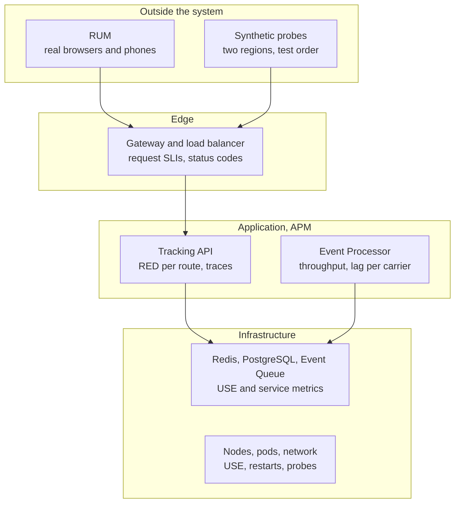
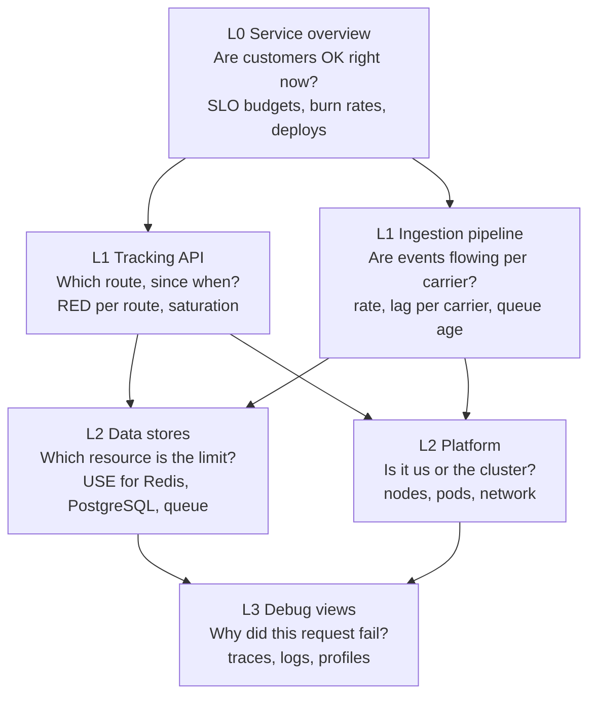
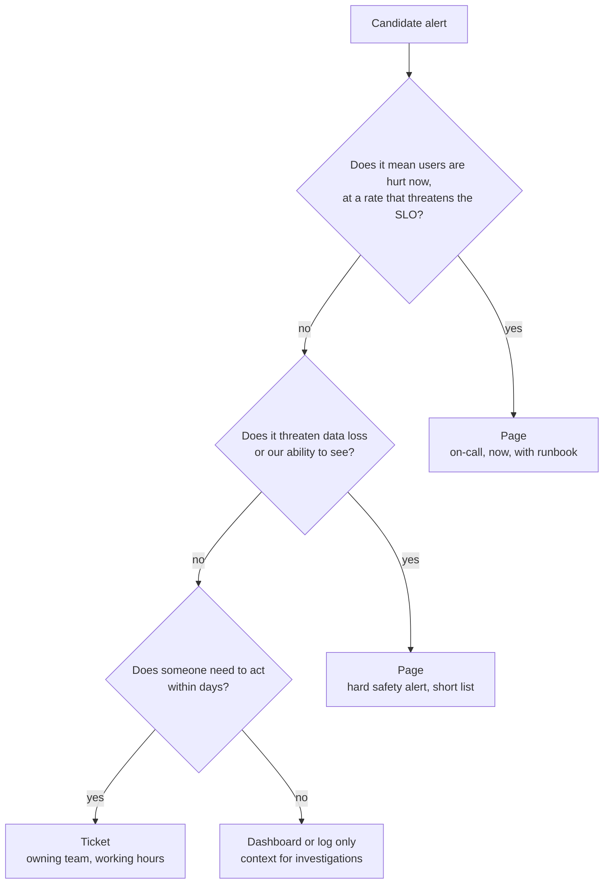
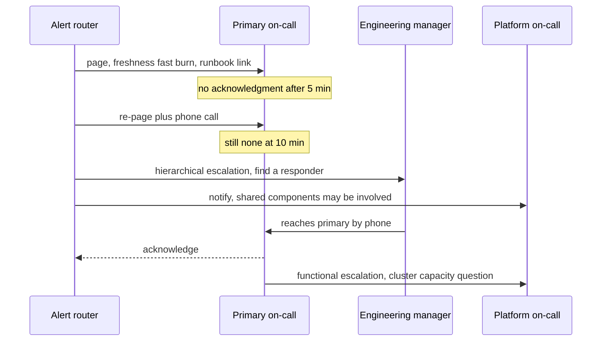

# Monitoring, alerting, and on-call

> Monitoring decides what is watched, alerting decides which observations reach a person, and on-call
> decides which person and how often. Page on symptoms that threaten an SLO or on conditions that
> threaten data; send everything else to a ticket, a dashboard, or nowhere.

!!! abstract "Page facts"
    **Level:** Intermediate (vantage points, signals, and dashboards are Level 1-2; designing an alert
    set and an on-call rotation against an interruption budget is Level 3) · **Status:** Draft ·
    **Time:** 60-75 minutes · **Last verified:** 2026-11-27

## Learning objectives

After this page you should be able to:

- Distinguish infrastructure monitoring, APM, real user monitoring, synthetic monitoring, and health
  checks, and say what each can see and what it misses.
- Apply the golden signals, the RED method, and the USE method to the right kind of component.
- Design a dashboard hierarchy in which each dashboard answers one question, and choose between
  static thresholds, dynamic thresholds, and anomaly detection for a given signal.
- Turn an SLO into paging and ticketing rules, route cause-level alerts away from the pager, and
  reduce noise with grouping, inhibition, and silences.
- Size an on-call rotation, write an escalation policy, and check an alert set against an
  interruption budget with arithmetic.

## Prerequisites

- [SLAs, SLOs, SLIs, error budgets, and recovery objectives](../architecture-fundamentals/slas-slos-slis-error-budgets-and-recovery-objectives.md)
  — the SLIs, error budgets, and burn-rate idea this page turns into alerts. Burn-rate basics are not
  repeated here.
- [Observability fundamentals: logs, metrics, and traces](observability-fundamentals-logs-metrics-and-traces.md)
  — the telemetry that monitoring evaluates, and how it is collected with OpenTelemetry.

## The problem this solves

A team that has instrumented everything still has to decide which numbers someone looks at, which
interrupt a person, and who that person is. Get the first wrong and dashboards become walls of charts
nobody can read in an incident. Get the second wrong and either customers notice outages first, or
engineers get dozens of pages a week, learn to ignore them, and miss the one that mattered. Get the
third wrong and a small team burns out. This page gives the rules and the arithmetic for all three.

## What it is

**Monitoring** is the continuous collection and evaluation of a chosen set of signals against
expectations. It answers questions you knew to ask in advance; observability, covered on the
[fundamentals page](observability-fundamentals-logs-metrics-and-traces.md), is the wider property of
being able to answer new ones. **Alerting** turns an evaluation into a notification routed to a person
or queue. **On-call** is the human system that receives those notifications: a rotation, an escalation
policy, and the expectations attached to them.

Monitoring comes from several vantage points, each blind in a different place:

| Kind | What it observes | What it misses | AtlasMart example |
|---|---|---|---|
| Infrastructure monitoring | Hosts, nodes, containers, disks, network links, managed-service metrics | Whether users are succeeding | Node CPU, pod restarts, PostgreSQL disk, queue depth |
| Application performance monitoring (APM) | Each request inside the application: latency per route, errors, traces across services, slow database calls | Failures before the request reaches the app (DNS, CDN, load balancer) | Tracking API latency per endpoint, a trace through the Status Cache and event store |
| Real user monitoring (RUM) | Timings and errors measured in real users' browsers and phones | Users who never load the page; anything with no traffic | Tracking page load time on mobile web (70% of traffic) |
| Synthetic monitoring | Scripted requests or journeys run on a schedule from outside | Paths and data the script does not exercise | A probe per minute from two regions fetching a known test order (SLO-A) |
| Uptime and health checks | Whether an endpoint or instance answers, and whether it should get traffic | Wrong answers given quickly | Liveness and readiness probes on every pod; an uptime check on the public URL |

## Mental model

Think of a hospital ward. Bedside monitors track each patient's vital signs: those are the golden
signals. The nurses' station has a screen that summarizes the ward and lets a nurse drill into one
patient: that is the dashboard hierarchy. An alarm sounds only when a reading means the patient is in
danger, and the duty doctor is called only for alarms that need a doctor: that is symptom-based
paging and escalation. Wards that let every monitor beep for every small deviation discover that
staff stop hearing the beeps, which is alert fatigue.

**Where the analogy breaks:** a patient's vital signs are well understood, while a software service
changes every week through deploys, so its "normal" drifts. Software can also fail silently, returning
a fast, healthy-looking response with the wrong content, which no vital sign shows. And one shared
dependency can make every "patient" collapse at once, so alarms arrive in floods, not one at a time.

## Key terms

| Term | Meaning on this page |
|---|---|
| Golden signals | Latency, traffic, errors, and saturation, tracked for every user-facing tier (as in the [glossary](../start-here/glossary.md)) |
| RED method | For each request-driven service: Rate, Errors, Duration |
| USE method | For each resource: Utilization, Saturation, Errors |
| Health check | A periodic probe that decides whether an instance should receive traffic; liveness and readiness are its two common kinds |
| Static threshold | A fixed limit, such as "queue oldest message older than 10 minutes" |
| Dynamic threshold | A limit learned from the signal's own history, usually per hour of day and day of week |
| Anomaly detection | A model that flags values unlikely under the learned behavior of a signal, without a hand-set limit |
| Symptom-based alert | An alert on what users experience (errors, slowness, staleness) rather than on a suspected cause |
| Page / ticket | A page interrupts a person now; a ticket waits in a queue for working hours |
| Alert grouping, inhibition, silence | Combining related alerts into one notification; suppressing alerts explained by another firing alert; muting matching alerts for a set time |
| Escalation policy | The ordered rule for who is notified next, and after how long, when a page is not acknowledged or needs more help |
| Interruption budget | The page and ticket load an on-call shift is designed to absorb, used as a target to tune alerts against |
| Alert fatigue | The state in which responders receive more alerts than they can handle and start ignoring them |

## How it works

### Step 1 — Watch from several vantage points

No single vantage point is enough: infrastructure monitoring sees a disk filling but not a broken
checkout, APM misses a DNS failure in front of the service, RUM needs real traffic, and probes only
exercise what they script. Health checks are monitoring consumed by machines: the load balancer or
orchestrator acts on them directly.

**Figure 1 — Monitoring vantage points on the Order Tracking request path.** Each box names what is
measured there; the further left (toward the user) a measurement sits, the closer it is to what a
customer experiences.

How to read it: arrows follow requests. Probes and RUM sit outside, so they catch failures that every
inner vantage point misses (an expired certificate, a DNS error); inner vantage points explain *why*.

**Health checks and uptime.** A **liveness** check asks whether a process should be restarted; a
**readiness** check asks whether it should receive traffic now (see the
[glossary](../start-here/glossary.md) and the
[Kubernetes probe documentation](https://kubernetes.io/docs/tasks/configure-pod-container/configure-liveness-readiness-startup-probes/)).
A **deep** health check also tests dependencies; it is useful for a dashboard and dangerous for
traffic decisions, because a slow shared database then marks every instance unready at once and turns
a slowdown into an outage (the [resilience mechanics page](../distributed-systems/resilience-mechanics-timeouts-retries-and-backpressure.md)
discusses this cascade). **Uptime** is the share of checks that passed over a period; an uptime number
is only as meaningful as the check behind it, which is why SLO-A's probe validates the payload, not
just the status code.

Provider names differ more than the ideas:

| Capability | AWS | Microsoft Azure | Google Cloud |
|---|---|---|---|
| Synthetic checks | [CloudWatch Synthetics canaries](https://docs.aws.amazon.com/AmazonCloudWatch/latest/monitoring/CloudWatch_Synthetics_Canaries.html) | [Application Insights availability tests](https://learn.microsoft.com/en-us/azure/azure-monitor/app/availability) | [Cloud Monitoring uptime checks and synthetic monitors](https://cloud.google.com/monitoring/uptime-checks/introduction) |
| APM | [CloudWatch Application Signals](https://docs.aws.amazon.com/AmazonCloudWatch/latest/monitoring/CloudWatch-Application-Monitoring-Sections.html) | [Application Insights](https://learn.microsoft.com/en-us/azure/azure-monitor/app/app-insights-overview) | [Cloud Trace](https://cloud.google.com/trace/docs/overview) with Cloud Monitoring |
| RUM | [CloudWatch RUM](https://docs.aws.amazon.com/AmazonCloudWatch/latest/monitoring/CloudWatch-RUM.html) | Application Insights JavaScript SDK (browser telemetry) | No first-party equivalent named here; check current documentation |
| Learned thresholds | [CloudWatch anomaly detection](https://docs.aws.amazon.com/AmazonCloudWatch/latest/monitoring/CloudWatch_Anomaly_Detection.html) | [Azure Monitor dynamic thresholds](https://learn.microsoft.com/en-us/azure/azure-monitor/alerts/alerts-dynamic-thresholds) | Check current documentation |

AtlasMart's platform uses the OpenTelemetry Collector with managed backends and Grafana, so its alert
rules are written once in the platform's rule format rather than per provider.

### Step 2 — Choose signals with golden signals, RED, and USE

Three short checklists cover most components; they overlap on purpose.

| Method | Origin | Applies to | Signals |
|---|---|---|---|
| Golden signals | Google SRE book, "Monitoring Distributed Systems" | Any user-facing service | Latency (separately for successes and failures), traffic, errors, saturation |
| RED | Tom Wilkie, as summarized by Grafana Labs | Request-driven services and endpoints | Rate, Errors, Duration |
| USE | Brendan Gregg | Every resource: CPU, memory, disk, network, connection pools, queues | Utilization, Saturation, Errors |

RED is the golden signals without saturation, which is why it is easy to apply to every service in a
microservice estate. USE comes from performance investigation: for each resource, check how busy it
is, how much work is waiting for it, and whether it reports errors. In practice, **RED tells you a
service is unhealthy and USE tells you which resource is the limit.**

Two adaptations matter for asynchronous pipelines. The "duration" of a queue consumer is not its
per-message processing time but **end-to-end lag**: how long ago the oldest unprocessed message
arrived, or how long an event took from receipt to visibility. And "saturation" for a queue is
backlog relative to drain rate: 6,000 messages is nothing for a consumer doing 1,000 a second and a
minute of delay for one doing 100. [Little's Law](../performance-and-scalability/performance-fundamentals-and-littles-law.md)
converts between the two.

### Step 3 — Build dashboards that answer questions

A useful dashboard answers one question for one audience; one built from every available metric
answers none. AtlasMart's rule: state the question at the top, put the answer top left, share one time
range, overlay deploy and configuration-change markers, and link to the next level down.

**Figure 2 — A dashboard hierarchy for Order Tracking.** Each level answers a narrower question;
responders move down only as far as they need to.

How to read it: an on-call engineer starts at L0, which a page links to directly. L1 dashboards
belong to the owning team; L2 platform views belong to the platform team and are shared by every
product team; L3 views are queries, not fixed charts.

Dashboards are not alerts. Nobody watches a dashboard at 03:00, so anything that needs action must
also exist as an alert or a ticket rule; and anything that pages must have a dashboard that shows why.

### Step 4 — Static thresholds, dynamic thresholds, and anomaly detection

| Approach | How it decides | Good for | Weak at |
|---|---|---|---|
| Static threshold | Fixed limit plus a "for" duration (must hold for N minutes) | Hard limits: disk nearly full, certificate expiry, data-loss risks, SLO burn rates | Signals with strong daily or weekly cycles |
| Dynamic threshold | Band learned from history, usually per hour of day and day of week | Traffic and throughput with regular cycles; spotting a drop to zero at an odd hour | Planned events (a sale is "abnormal" by design); slow drifts the baseline learns |
| Anomaly detection | Statistical or learned model of normal behavior; flags improbable values | Exploration and tickets across thousands of series; finding silent changes | Paging: hard to explain why it fired, and a past incident can become "normal" |

Two techniques make any threshold quieter. A **"for" duration** requires the condition to hold for
several evaluations, which removes one-sample spikes at the cost of detection delay. **Hysteresis**
uses a lower clear threshold than fire threshold (fire at 85%, clear at 75%), which stops an alert
flapping around one value. **Forecast thresholds** fire on predicted values ("disk full within
4 hours at the current growth rate"), which gives time to act before the limit.

An architect's default: page only on static thresholds whose meaning is obvious (burn rates and hard
safety limits); use dynamic thresholds and anomaly detection for tickets and dashboard annotations.

### Step 5 — Alert on symptoms, using the SLO

The SRE book separates **symptoms** (what is broken for users) from **causes** (why). Users feel
symptoms; causes are many, change with every release, and often do not hurt anyone (a replica at 90%
CPU while the service meets its SLO). So the pager is driven by SLO burn: the
[SLO page](../architecture-fundamentals/slas-slos-slis-error-budgets-and-recovery-objectives.md#step-5-alert-on-burn-rate-not-on-single-failures)
explains burn rate, and the SRE Workbook's multiwindow, multi-burn-rate rule is what AtlasMart uses:
page when the burn rate exceeds 14.4 over 1 hour *and* over the last 5 minutes (2% of a 30-day budget
spent in an hour), or exceeds 6 over 6 hours *and* over the last 30 minutes (5% in six hours); open a
ticket at burn rate 1 over 3 days. The short window, one twelfth of the long one, makes the alert stop
soon after the problem stops.

Three design consequences are easy to miss:

1. **Loose SLOs cannot fire a fast-burn page.** A burn rate of 14.4 against a 5% budget means 72% of
   events are bad. For a loose objective, page on a tighter companion SLI instead and keep the loose
   one for tickets.
2. **Low traffic makes ratios jumpy.** A probe-based SLI with 60 samples an hour cannot express a
   1.44% error rate; one failed minute is 1.7%. Page on request-based SLIs with enough volume, or add
   a minimum event count to the rule.
3. **Some conditions have no budget.** A risk of losing acknowledged data, or of being blind, cannot
   wait for an SLO to burn. These **hard safety alerts** page on a static threshold, and the list is
   kept short on purpose.

**Figure 3 — Where an alert goes.** Every candidate alert is sorted by two questions; only two
outcomes interrupt a person.

How to read it: start at the top. A cause-level signal such as "pod CPU above 80%" falls through to a
ticket or a dashboard; it reaches the pager only through the symptom it produces.

Every page carries a link to a runbook, the L0 dashboard, and the owning team in the service catalog
(see [incident management and SRE practices](incident-management-and-sre-practices.md)).

### Step 6 — Correlation and noise reduction

When a shared dependency fails, dozens of rules fire at once. The routing layer (Prometheus
Alertmanager is a common open-source example) turns that flood into a few actionable notifications:

- **Grouping** combines alerts with the same labels (service, incident, SLO) into one notification,
  so a fast-burn and a slow-burn alert for the same SLO arrive as one page.
- **Deduplication** drops repeats of an alert that is already firing and notified.
- **Inhibition** suppresses alerts explained by another one: while "cluster nodes not ready" fires,
  per-service pod alerts in that cluster are held back.
- **Silences** mute matching alerts for a stated period, such as a planned database maintenance
  window. Every silence has an owner and an expiry.
- **Routing by ownership** uses a team label from the service catalog, so alerts reach the team that
  can act, not a central queue.
- **Change correlation** annotates alerts with recent deploys and configuration changes, because the
  most useful first question is "what changed?".

Noise reduction is also a habit: review every page at the weekly handover and demote any rule that
paged without needing action.

### Step 7 — On-call design and escalation

An on-call rotation is a capacity plan for people. Three numbers define it: how many people share it,
how long a shift lasts, and how much interruption a shift should carry.

**Rotation size.** With N engineers and week-long shifts, each is on call one week in N. The Google
SRE book suggests keeping on-call to at most 25% of an engineer's time and, for a single-site team
with a primary and a secondary on call, a minimum of eight engineers. The arithmetic: primary plus
secondary means two of N people on call each week, and 2 ÷ 8 = 25%.

**Interruption budget.** The same chapter bounds the load: if handling one incident, including its
follow-up, takes about six hours, a 12-hour shift can absorb at most two, and the median should be
zero. Most product teams set a much lower target because their on-call engineer also does project
work. Write the target down; an alert set is "too noisy" only relative to it.

**Escalation.** There are two kinds. **Hierarchical escalation** finds a responder when a page goes
unacknowledged (re-page, then a manager or a backup). **Functional escalation** brings in another team
with the right skills or access (the platform team for the cluster, a database specialist). Both are
written down as a policy with timeouts, so nobody decides them at 03:00.

**Figure 4 — An escalation policy in action.** The primary does not acknowledge in time; the policy
finds a responder, who then escalates functionally.

How to read it: time runs downward. The timeouts are AtlasMart assumptions; the point is that they
are written into the router, not remembered.

**Alert fatigue** is the failure of the whole system. It shows up as slow acknowledgment, pages
closed without notes, and "it always does that" in handovers. It is fixed by deleting alerts, not by
asking people to try harder.

## Worked example: AtlasMart Order Tracking alert set

The Order Tracking team owns the service and its on-call: a rotation of **6 engineers, one week
each**, paging **only on SLO burn and hard safety alerts** (assumption, from this phase's shared
facts). The SLOs are those on the SLO page: SLO-A availability 99.9% (probes, monthly), SLO-L latency
(95% under 300 ms and 99% under 800 ms, rolling 30 days), SLO-F freshness (99% of events visible
within 60 s, NFR-1), and SLO-D durability (no acknowledged event lost, NFR-7).

### Pages

| ID | Rule | Threshold arithmetic | Why it pages |
|---|---|---|---|
| P1 | Availability, request-based SLI at the gateway (kept alongside SLO-A), multiwindow burn | Fast: error ratio > 14.4 × 0.1% = 1.44% over 1 h and 5 min. Slow: > 6 × 0.1% = 0.6% over 6 h and 30 min | Customers get errors; the probe SLI has too few samples to page on (Step 5) |
| P2 | Latency, the 800 ms SLI (99%), multiwindow burn | Fast: > 14.4 × 1% = 14.4% of requests slower than 800 ms. Slow: > 6% | The 300 ms SLI (95%) would need 72% slow requests for a fast burn, so it only tickets |
| P3 | Freshness SLO-F, multiwindow burn | Fast: > 14.4% of events visible later than 60 s over 1 h and 5 min. Slow: > 6% over 6 h and 30 min | Customers see stale status (NFR-1) |
| H1 | Event Queue oldest message older than 50% of the queue's configured retention | Static; retention is the provider's setting, check current documentation | Messages past retention are deleted: acknowledged events lost (NFR-7) |
| H2 | Event store transaction-log archive: last successful archive older than 10 min | Static: RPO is 5 min, archiving runs at least every 5 min, so two missed cycles | RPO 5 min (NFR-7) no longer protected |
| H3 | Event store disk forecast to fill within 4 h | Linear forecast over the last 6 h | A full disk stops writes |
| H4 | Watchdog: an always-firing test alert stops arriving | Dead-man's switch, checked from outside the cluster | The team is blind |

At night traffic falls (assume about 1 read/s at 03:00): an hour still holds about 3,600 requests, so
P1's fast burn needs about 52 failures in the hour (1.44% × 3,600), plus the 5-minute condition. P1
also requires at least 100 requests in the short window, so a handful of failures in a quiet five
minutes cannot page on its own.

### Tickets and notifications

| ID | Rule | Route |
|---|---|---|
| T1 | Any SLO (including the 300 ms latency SLI) burning at rate 1 over 3 days and 6 h | Team ticket |
| T2 | NFR-8: p95 lag for one carrier above 120 s for 5 min | Team chat channel plus ticket, linked to the per-carrier lag dashboard; grouped with P3 if that fires |
| T3 | Event Processor dead-letter queue received messages in the last 15 min | Team ticket (events are kept, not lost, but are not visible) |
| T4 | Event inflow above 80% of current Event Processor capacity for 10 min | Team ticket; capacity is 2 replicas × 50 events/s = 100 events/s from the capacity page's 20 ms per event |
| T5 | Tracking API at its HPA maximum (9 replicas) for 30 min | Team and platform ticket (NFR-4 headroom) |
| T6 | Status Cache hit ratio below its learned band for 1 h (dynamic threshold) | Team ticket |
| T7 | Webhook signature (HMAC) failures above their learned band | Security operations queue, not the team pager (see [security operations](../security-architecture/security-operations.md)) |
| T8 | TLS certificate expiring within 14 days (assumption) | Platform ticket |

NFR-8 says "alert", not "page". A single carrier's lag is often the carrier's batching, and the
freshness SLO covers all carriers, so AtlasMart routes NFR-8 to the team channel and a ticket, and
lets P3 page when lag across carriers threatens NFR-1. This is a documented decision, not an
omission.

### Dashboards

| Level | Dashboard | Question it answers | Key panels |
|---|---|---|---|
| L0 | Order Tracking overview | Are customers OK right now? | Budget remaining and burn rate for SLO-A, SLO-L, SLO-F; deploy markers; open pages |
| L1 | Tracking API | Which route is failing, since when? | RED per route; CPU against the 70% target (NFR-4); replicas against the HPA maximum |
| L1 | Ingestion pipeline | Are events flowing for each carrier? | Webhooks per carrier; queue depth and oldest message age; processor throughput; p95 lag per carrier (NFR-8) |
| L2 | Data stores | Which resource is the limit? | USE for Redis (memory, evictions, hit ratio), PostgreSQL (connections, standby state, archive age, disk), Event Queue |
| L3 | Debug | Why did this request fail? | Trace search by route and status; logs by trace ID |

The per-carrier panels use a carrier label with 12 values (assumption, matching the job-scheduler
exercise). A shipment-ID label instead would create one series per shipment in transit: 300,000 ×
about 12 histogram buckets ≈ 3.6 million series for one metric, which is why identifiers belong in
traces and logs, not metric labels.

### Expected pages per week

Before this design, the team's first alert set used static cause thresholds. With the assumed firing
rates below, it produced about 49 pages a week:

| Static rule (before) | Assumed firing rate | Pages per week |
|---|---|---|
| p99 latency above 800 ms in any 5-min window | 2,016 windows a week, about 1% exceed during deploys and garbage-collection pauses | 20 |
| Queue depth above 1,000 messages | Fires most evenings; at 70 events/s, 1,000 messages is 14 s of work | 14 |
| Any pod CPU above 80% for 5 min | Once a day before the HPA adds a pod | 7 |
| Per-carrier lag above 120 s, paging, 12 carriers | Each carrier about once in two weeks | 6 |
| Redis memory above 75% | Working-set growth | 2 |
| **Total** | | **49** |

At about 15 minutes of triage each, that is 49 × 15 = 735 minutes, over 12 hours a week, and seven
interruptions a day for alerts that, in the history, matched user-visible budget burn about once a
month. The new set pages only on P1-P3 and H1-H4. From the first six months of SLI history
(assumption), incidents that cross a page threshold occur at these rates, with the fast and slow
alert for one SLO grouped into one page:

| Page source | Per month (assumption) | Per week (× 12 ÷ 52) |
|---|---|---|
| Availability burn, P1 (one incident per 60 days, as on the SLO page) | 0.5 | 0.12 |
| Latency burn, P2 | 1.0 | 0.23 |
| Freshness burn, P3 | 1.5 | 0.35 |
| Hard safety, H1-H4 | 0.5 | 0.12 |
| **Total** | **3.5** | **0.81** |

From 49 pages a week to about 0.8. Each engineer is on call 52 ÷ 6 ≈ 8.7 weeks a year and can expect
about 8.7 × 0.81 ≈ 7 pages a year. If 60% arrive outside working hours (assumption; incidents
cluster at the evening traffic peak), that is about 0.5 night or weekend pages per on-call week.

### Rotation and interruption budget

| Check | Arithmetic | Result |
|---|---|---|
| Share of weeks on call, primary only | 1 ÷ 6 | 16.7%, under the 25% guideline |
| If a secondary were drawn from the same six | 2 ÷ 6 | 33%, over 25%; a primary-plus-secondary rotation needs 8 (2 ÷ 8 = 25%) |
| Smallest primary-only rotation at 25% | 1 ÷ 4 | 4 people, with no slack for leave; with 5 weeks of leave each (assumption), 6 is the practical floor |
| Time cost of pages per on-call week | 0.81 pages × about 6 h each, including follow-up | ≈ 4.9 h |
| Time cost of tickets per on-call week | 5 tickets (assumption) × 30 min | 2.5 h |
| Interrupt load | (4.9 + 2.5) ÷ 40 h | ≈ 18% of the on-call week |

AtlasMart's interruption budget (assumptions): at most 2 pages per on-call week averaged over a
quarter, at most 1 per night, interrupt work under 25% of the week; two weeks over budget in a row put
an alert review first in the next sprint. One site and time zone means no follow-the-sun handover, and
there is no in-team secondary: escalation follows Figure 4, and SEV1 and SEV2 incidents add an
incident commander ([incident management and SRE practices](incident-management-and-sre-practices.md)).

## Real-world architecture example

A typical platform runs one telemetry pipeline (OpenTelemetry collectors) into managed backends, with
one alert router in front of a paging product. SLO definitions in each service's repository generate
burn-rate rules automatically; probes run from outside the production region; a watchdog proves the
paging path end to end; the router reads owning teams from the service catalog; and weekly handovers
review every page, tracking pages per shift as a reliability metric in its own right.

## Design choices and trade-offs

| Choice | Favor when | Avoid when |
|---|---|---|
| Page on SLO burn rates | An SLO exists with enough traffic; you want pages that mean user impact | No SLO yet, or traffic too low for stable ratios (use probes and hard checks first) |
| Page on cause thresholds (CPU, queue depth) | A cause reliably precedes user impact with no other warning (disk full) | The cause often occurs without user impact |
| Synthetic probes | Low or no traffic periods; external dependencies (DNS, certificates); SLA evidence | You expect them to cover every path; they test only what they script |
| RUM | Mobile-heavy or global audiences where network conditions vary | Privacy review is not done; tracking pages can expose identifiers in URLs |
| Dynamic thresholds and anomaly detection | Tickets and annotations across many series with regular cycles | Paging, planned events such as sales, slowly drifting signals |
| Primary plus secondary on call | Large teams, or services where a second responder is often needed | Teams under eight people on a single site (exceeds 25% on call) |

## Failure modes and anti-patterns

- **Paging on causes.** CPU, memory, and queue-depth alerts page without user impact. Detect: pages
  closed as "no action". Prevent: route causes to tickets and dashboards, page on symptoms.
- **Dashboard sprawl.** Hundreds of dashboards and none answers "are customers OK?". Detect: on-call
  engineers cannot find the starting view. Prevent: one L0 per service, linked from every page.
- **Silent failure behind green checks.** Health checks pass while responses are wrong. Detect:
  customer reports with green dashboards. Prevent: probes that validate content, correctness SLIs.
- **Blind monitoring.** The alerting pipeline is down and nothing says so. Prevent: a watchdog alert
  checked from outside, and monitoring in a different failure domain from what it watches.
- **Alert storms and forgotten silences.** One upstream failure pages five teams; a maintenance
  silence hides a real outage weeks later. Prevent: grouping, inhibition, ownership routing, and an
  owner and expiry on every silence.
- **Undersized rotation.** Three engineers on call one week in three. Detect: on-call share above
  25%, attrition. Prevent: merge rotations or reduce paging scope.

## Security considerations

- **Telemetry carries personal data.** RUM and logs can capture order IDs, tokens in URLs, or
  addresses; NFR-6 forbids storing delivery addresses. Scrub at the collector and review RUM
  configuration as a data flow.
- **Alerts route security signals to the right responders.** Webhook signature failures and unusual
  access patterns go to [security operations](../security-architecture/security-operations.md), whose
  incident process differs because there may be an adversary.
- **Synthetic probes are identities.** The probe's test account gets read access to one test order
  only, uses workload identity rather than a stored credential, and is excluded from business metrics.
- **The paging path is critical infrastructure.** Restrict who can edit routing and create silences:
  a silence is an easy way to hide an attack.

## Performance, reliability, and cost

- **Performance:** collection must not hurt the service: sample traces, aggregate histograms in the
  process, and keep probe frequency modest (one per minute per region is enough for SLO-A).
- **Reliability:** monitoring shares fate with what it watches unless placed elsewhere; AtlasMart's
  probes run from two regions, and the watchdog is checked outside the cluster. Detection time (MTTD)
  is the part of MTTR monitoring controls; burn-rate windows trade detection speed for precision.
- **Cost:** metric cost grows with label combinations (the shipment-ID label above multiplies series
  by 300,000); log and trace volume are covered on the
  [fundamentals page](observability-fundamentals-logs-metrics-and-traces.md). People are the largest
  cost: every unnecessary page spends engineer time and goodwill.

## Hands-on lab: compare static alerts with burn-rate alerts

Local and free: Python 3.12 standard library only.

1. Generate one week of per-minute data with a fixed seed: requests per minute following a daily
   cycle between 60 and 4,200 (1 to 70 per second), a background error ratio of 0.05%, twenty random
   2-minute blips at 5% errors, and one 40-minute incident at 3% errors on day 4.
2. Implement a static rule: page when the error ratio over any 5-minute window exceeds 1%. Count
   distinct firing episodes (an episode ends after 10 quiet minutes).
3. Implement the multiwindow rule for a 99.9% SLO: page when the error ratio exceeds 1.44% over both
   60 and 5 minutes, or 0.6% over both 360 and 30 minutes. Count episodes and record when the day-4
   incident is first detected.
4. Compare: pages per week, how many pages matched the real incident, and detection delay.
5. Add grouping: merge pages within 30 minutes of each other into one notification, and recount.
6. Stretch: change the incident to 1% errors for 6 hours and see which rule catches it.

??? question "Hint: when should the day-4 incident fire the fast-burn rule?"
    With constant traffic, the 1-hour ratio after t minutes of a 3% incident is about
    (3t + 0.05 × (60 − t)) ÷ 60 percent. Setting this to 1.44 gives 2.95t ≈ 83.4, so t ≈ 28 minutes;
    the 5-minute window is already above 1.44% by then. Most 2-minute blips at 5% never move the 1-hour
    ratio past 1.44% (5% × 2 ÷ 60 ≈ 0.17%), which is exactly why the static rule pages on them and the
    burn-rate rule does not.

## Knowledge check

1. Which monitoring vantage point would detect an expired TLS certificate on the public tracking URL,
   and which would not? Name one of each.
2. When do you apply RED, and when USE? Give one AtlasMart component for each.
3. Why does AtlasMart not page on its 300 ms latency SLI (95% target), and what does it do instead?
4. A team of six wants a primary and a secondary on call every week. What share of their time is on
   call, and what would you recommend?
5. Name three noise-reduction mechanisms and the problem each solves.

??? success "Answers"
    1. A synthetic probe (or RUM) from outside sees the TLS failure; infrastructure monitoring and APM
       inside the service do not, because the failing requests never reach them.
    2. RED for request-driven services (the Tracking API's routes); USE for resources (PostgreSQL
       connections and disk, the Status Cache's memory, the Event Queue backlog).
    3. Its budget is 5%, so a 14.4 fast burn would mean 72% of requests slower than 300 ms; it pages
       on the 800 ms SLI (99%) instead and opens tickets on the 300 ms SLI's slow burn.
    4. Two of six each week: 33%, above the 25% guideline. Either primary-only (16.7%) with
       hierarchical escalation to a manager or a platform on-call, or grow to eight.
    5. Grouping (many alerts from one incident become one notification); inhibition (alerts explained
       by an upstream failure are held back); silences (planned maintenance does not page). Routing by
       ownership and deduplication are also acceptable answers.

## Architecture discussion questions

1. Product management wants a page whenever any carrier's lag exceeds 120 s (NFR-8) because carriers
   escalate to them. Using the expected-pages arithmetic, argue for or against, and propose a design
   that satisfies the business without breaking the interruption budget.
2. The platform team proposes anomaly-detection pages on every service's request rate to catch silent
   drops. How would the sale day affect it, and what would you page on instead?
3. AtlasMart's 8 product teams each run a rotation of 6. The platform team suggests one shared
   rotation of 12 engineers for all teams' pages. What do you gain and lose in knowledge, load, and
   ownership?

## Summary

Monitoring watches from several vantage points: infrastructure, APM, RUM, synthetic probes, and health
checks, each blind somewhere. The golden signals and RED describe a service's health, USE finds the
limiting resource, and queues need lag and backlog rather than processing time. Dashboards form a
hierarchy where each answers one question. Static thresholds suit hard limits and burn rates, while
dynamic thresholds and anomaly detection suit tickets. Pages go to symptoms that threaten an SLO and to
a short list of hard safety conditions; everything else is a ticket or context, and grouping,
inhibition, and silences control floods. On-call is a capacity plan for people: rotation size, an
interruption budget, and a written escalation policy. AtlasMart's alert set cuts about 49 pages a week
to about 0.8 for a rotation of six.

## Related topics

- **Before:** [SLAs, SLOs, SLIs, error budgets, and recovery objectives](../architecture-fundamentals/slas-slos-slis-error-budgets-and-recovery-objectives.md);
  [Observability fundamentals: logs, metrics, and traces](observability-fundamentals-logs-metrics-and-traces.md)
- **Alongside:** [Incident management and SRE practices](incident-management-and-sre-practices.md)
  — what happens after the page; [Reliability engineering](../reliability-and-disaster-recovery/reliability-engineering.md)
  — SLO management in practice; [Security operations](../security-architecture/security-operations.md)
  — alerting for security incidents; [Lab 11: tracing and structured logging](../labs/lab-11-tracing-and-structured-logging.md).
- **Planned:** AI observability (D25-T02); application architecture for web, mobile, and SaaS,
  where RUM findings feed front-end design (D05-T01).

## References

| Source | Type | Checked |
|---|---|---|
| [Site Reliability Engineering: Monitoring Distributed Systems](https://sre.google/sre-book/monitoring-distributed-systems/) — Google | Book chapter (free online; golden signals, symptoms versus causes) | 2026-11-27 |
| [Site Reliability Engineering: Being On-Call](https://sre.google/sre-book/being-on-call/) — Google | Book chapter (free online; 25% rule, team size, incidents per shift) | 2026-11-27 |
| [The Site Reliability Workbook: Alerting on SLOs](https://sre.google/workbook/alerting-on-slos/) — Google | Book chapter (free online; multiwindow, multi-burn-rate alerts) | 2026-11-27 |
| [The USE Method](https://www.brendangregg.com/usemethod.html) — Brendan Gregg | Originator's article | 2026-11-27 |
| [The RED Method: How to Instrument Your Services](https://grafana.com/blog/2018/08/02/the-red-method-how-to-instrument-your-services/) — Grafana Labs | Article (Tom Wilkie's RED method) | 2026-11-27 |
| [Alerting](https://prometheus.io/docs/practices/alerting/) — Prometheus documentation | Official documentation (alert on symptoms, keep alerting simple) | 2026-11-27 |
| [Alertmanager](https://prometheus.io/docs/alerting/latest/alertmanager/) — Prometheus documentation | Official documentation (grouping, inhibition, silences) | 2026-11-27 |
| [Synthetic monitoring overview](https://cloud.google.com/monitoring/uptime-checks/introduction) — Google Cloud | Official documentation (uptime checks and synthetic monitors) | 2026-11-27 |

## Review notes

- Canonical page for D15-T02. In depth: vantage points, golden signals, RED, USE, dashboard hierarchy,
  static and dynamic thresholds, symptom-based SLO alerting, noise reduction, on-call sizing,
  interruption budget, escalation, alert fatigue. Only defined or treated briefly: infrastructure
  monitoring, APM, and RUM (one table row and a few sentences each), uptime, anomaly detection (no
  algorithms), forecast thresholds.
- Burn-rate basics are not repeated; they link to the SLO page. The 14.4/6 multiwindow parameters and
  the 1/12 short-window guideline were checked against the SRE Workbook chapter.
- On-call figures (25% rule, eight-person single-site minimum with primary and secondary, about six
  hours per incident, two incidents per 12-hour shift) were checked against the SRE book's "Being
  On-Call" chapter on 2026-11-27.
- Provider names in the equivalence table link to the provider page that names them (all returned 200;
  AWS page titles checked). Google Cloud RUM and learned thresholds were not verified and say "check
  current documentation".
- New AtlasMart assumptions: about 1 read/s at 03:00; minimum 100 requests in P1's short window; H1-H4
  hard safety alerts and their thresholds; T1-T8 routing, including NFR-8 routed to channel and ticket
  rather than the pager; 14-day certificate warning; the "before" static alert set and its firing
  rates (49 pages a week, 15 minutes each); page rates per month (0.5, 1.0, 1.5, 0.5); 60% of pages
  off-hours; 5 tickets per on-call week at 30 minutes; 5 weeks of leave; the interruption budget
  values; escalation timeouts of 5 and 10 minutes. The 12-carrier count reuses the job-scheduler
  exercise's assumption; Event Processor capacity (2 × 50 events/s) is arithmetic from the capacity
  and compute pages.
- Figure 1 stacks the infrastructure nodes with `~~~`; verify the subgraphs render top to bottom.
