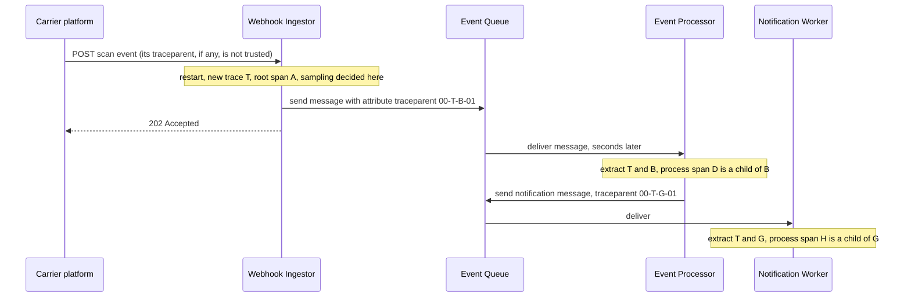
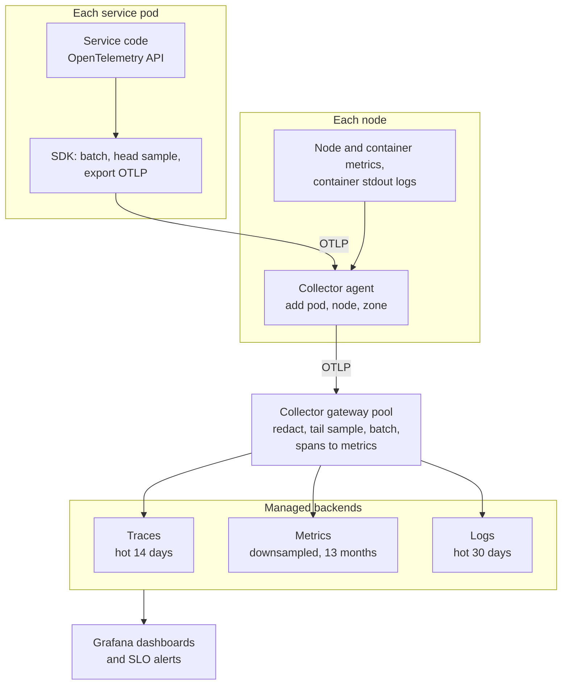
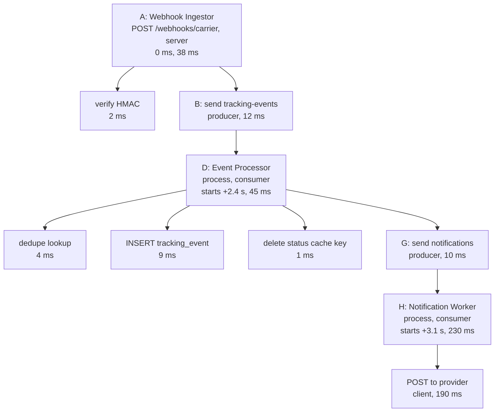

# Observability fundamentals: logs, metrics, and traces

> Observability is how well you can work out what a running system is doing, and why, from what it
> emits. It rests on three habits: every unit of work carries the same trace id across every hop,
> every record is structured so it can be queried, and the volume is decided on purpose (sampling,
> retention, cardinality) instead of by accident.

!!! abstract "Page facts"
    **Level:** Intermediate (the signals and trace context are Level 1-2; sampling policy, pipeline
    design, and telemetry budgets are Level 3) · **Status:** Draft · **Time:** 60-90 minutes ·
    **Last verified:** 2026-11-27

## Learning objectives

After this page you should be able to:

- Distinguish monitoring from observability and say what each of logs, metrics, traces, events, and
  profiles is good and bad at.
- Read and write a W3C `traceparent` header, and explain how trace context crosses an HTTP call and a
  message queue.
- Design a structured log line that can be correlated with traces, and say what must never be in it.
- Compute what head sampling and tail sampling each keep for a given traffic mix, and what tail
  sampling costs in buffering.
- Name the OpenTelemetry API, SDK, Collector, and OTLP, and lay out a telemetry pipeline from
  service to storage with retention and aggregation decided per signal.

## Prerequisites

- [Microservices architecture](../software-architecture/microservices-architecture.md) — why one
  user request becomes many calls between services.
- [Message queues and brokers](../messaging-and-streaming/message-queues-and-brokers.md) — message
  attributes (headers) and at-least-once delivery, both of which tracing depends on.
- [SLAs, SLOs, SLIs, error budgets, and recovery objectives](../architecture-fundamentals/slas-slos-slis-error-budgets-and-recovery-objectives.md)
  — telemetry exists largely to measure SLIs.

## The problem this solves

A customer reports that a parcel showed "delivered" an hour after the driver scanned it. In a
monolith you would grep one log file. In AtlasMart's Order Tracking System that scan passed through
a Webhook Ingestor, a managed queue, an Event Processor, a database, a cache, a Notification Worker,
and an external provider, on different pods in three zones. Each wrote logs in its own format with
its own clock and no shared identifier. Dashboards show averages that look healthy. Nobody can say
where the hour went. Observability is the set of design decisions that make that question
answerable in minutes: a shared trace id, structured records, metrics for trends, and a pipeline
that keeps the right data for long enough at a cost someone has agreed to.

## What it is

**Telemetry** is the data a system emits about its own behavior. **Monitoring** is collecting
predefined telemetry and checking it against expectations: dashboards and alerts for the failure
modes you already know about. **Observability**, as the [glossary](../start-here/glossary.md)
defines it, is how well the internal state of a system can be inferred from its external outputs;
in practice, whether you can answer a question you did not think of in advance without shipping new
code. Monitoring is something you do; observability is a property the system and its telemetry have.
You need both: monitoring tells you that tracking reads breached their latency SLO, observability
lets you find that only one carrier's shipments are slow and why.

The **signals** (OpenTelemetry's term for kinds of telemetry):

| Signal | What it is | Good at | Weak at |
|---|---|---|---|
| Log | A timestamped record of something that happened, ideally structured as key-value fields | Detail and context for one occurrence; errors with their cause | Trends and rates (expensive to aggregate); volume grows with traffic |
| Metric | A numeric measurement aggregated over time (counter, gauge, histogram), identified by a name and labels | Cheap trends, rates, percentiles, alerting; fixed cost per series | Explaining one request; high-cardinality labels explode its cost |
| Trace | The tree of spans for one request or message across every service it touched | Where time went and which hop failed, across process boundaries | Volume (one record per unit of work per hop); usually sampled |
| Event | A record of a discrete occurrence with a name and attributes, such as a deployment, a feature-flag change, or a span event like "retry 2" | Explaining changes in the other signals ("latency rose after this deploy") | Not a separate pillar in most tools; OpenTelemetry treats events as a kind of log, still under development |
| Profile | Samples of where code spends CPU, memory, or locks, aggregated by stack trace | The function inside a service that is slow | Newest signal; OpenTelemetry marks it Alpha |

**Baggage** is not a signal: it is key-value context propagated alongside the trace context so that
downstream services can read it (for example, a tenant tier). It travels in every request header,
so it must never carry personal or secret data.

## Mental model

Think of a parcel network. The **trace id** is the tracking number on the label. Every depot that
handles the parcel scans it, and each scan is a **span**: who handled it, when it arrived and left,
and what happened. The depot's own logbook is its **logs**; the counters on the depot wall (parcels
per hour, average dwell time) are its **metrics**; a time-and-motion study of one sorting machine is
a **profile**. A depot that peels off the label and prints a new one breaks the chain: the parcel
continues, but nobody can connect its history. That is exactly what a service that does not
propagate trace context does.

**Where the analogy breaks:** a parcel's scans are all kept, while software telemetry is deliberately
thrown away (sampling, short retention) because keeping all of it costs more than it is worth. Spans
also nest (a span has child spans inside it), clocks on different machines disagree, and telemetry
itself can fail or be dropped under load, so missing data does not prove nothing happened.

## Key terms

| Term | Meaning on this page |
|---|---|
| Monitoring | Collecting predefined signals and alerting on known conditions |
| Observability | How well a system's internal state can be inferred from its outputs; the ability to ask new questions of telemetry |
| Structured log | A log record written as fields (usually JSON) instead of free text, so it can be filtered and aggregated |
| Trace | All spans that share one trace id: one request or message's journey |
| Span | One timed operation in a trace, with a span id, a parent span id (empty for a root), start, duration, attributes, status, and optional links |
| Trace context | The identifiers that must cross every hop: trace id, parent span id, and flags (W3C `traceparent`), plus vendor data (`tracestate`) |
| Context propagation | Injecting trace context into an outgoing request or message and extracting it on the receiving side |
| Correlation id | Any identifier copied into every record about one unit of work; the trace id is the standard one |
| Cardinality | The number of distinct values a label or field takes; for metrics, each distinct label combination is a separate time series |
| Head sampling | Deciding whether to keep a trace when it starts, before its outcome is known |
| Tail sampling | Deciding after all (or most) spans of a trace have arrived, using its outcome |
| OTLP | The OpenTelemetry Protocol, used to send traces, metrics, and logs between SDKs, Collectors, and backends |

## How it works

### Step 1 — Correlation: one id in every record

A trace id is a random 16-byte identifier created where a unit of work enters the system and copied
into every span and every log line written while handling it. With it, "show me everything that
happened for this request" is one query across all services. Without it, engineers join records by
timestamp and guesswork. Two further correlations matter:

- **Logs to traces:** each log line carries `trace_id` and `span_id`, so a log line opens the trace
  and a span shows its log lines.
- **Metrics to traces:** a metric data point can carry an **exemplar**, the trace id of one request
  that contributed to it, so a latency spike on a dashboard links to a real slow trace.

Business identifiers (order id, shipment id) are useful attributes too, but they are not a
substitute: one order produces many requests, and a request may touch many orders.

### Step 2 — Context propagation and the W3C `traceparent` header

The W3C Trace Context Recommendation standardizes the header that carries trace context over HTTP,
so services built with different libraries and vendors still join one trace. A version 00
`traceparent` value has four dash-separated lowercase hex fields:

```text
00-4bf92f3577b34da6a3ce929d0e0e4736-00f067aa0ba902b7-01
version  trace-id (16 bytes)            parent-id (8 bytes)  trace-flags (bit 0 = sampled)
```

The rules a receiver applies, paraphrased from the specification:

| Field | Valid | Invalid (ignore the header and start a new trace) |
|---|---|---|
| version | 2 lowercase hex characters followed by a dash | `ff`, or not hex |
| whole value (version 00) | exactly 55 characters | anything longer or shorter |
| trace-id | 32 lowercase hex characters | all zeros, uppercase, wrong length |
| parent-id | 16 lowercase hex characters, the caller's span id | all zeros, uppercase, wrong length |
| trace-flags | 2 hex characters; only the sampled bit is defined | non-hex; unknown bits are sent onward as zero |

A receiver that sees a higher version parses the version 00 fields and ignores anything after them.
On each outgoing call, a service keeps the trace id, replaces parent-id with the id of its own
current span, and sets the sampled flag to reflect its recording decision. A second header,
`tracestate`, carries vendor-specific key-value pairs and is passed along. The specification
also allows a **restart**: a service at a trust boundary may regenerate all ids instead of
continuing an incoming trace, which protects internal tracing from headers forged by outsiders.

**Propagation over queues.** The specification defines the HTTP header; for messaging, the context
travels as a **message attribute** (header) named `traceparent`, set by the producer and read by
the consumer. OpenTelemetry's messaging conventions describe a "creation context" attached to each
message. They make a **span link** from the consumer's process span to that context the default,
because it works for batches and fan-out; for single-message processing they also allow making the
consumer's span a **child** of the producer's, so producer and consumer share one trace.

**Figure 1 — Trace context crossing an HTTP hop and a queue.** The trace id T is created at the
Webhook Ingestor and travels as a message attribute through both queue hops.



How to read it: B and G are the producers' send spans. Every arrow into a service carries the
current parent; the trace id never changes after A. Drop the attribute at either send and the
consumer starts a new, disconnected trace.

### Step 3 — Structured and centralized logging

A structured log line is a set of named fields rather than a sentence. Compare:

```text
2026-11-27 10:15:02 INFO processed event for SHP-1007 in 45ms
{"timestamp":"2026-11-27T10:15:02.412Z","level":"INFO","service":"event-processor",
 "trace_id":"4bf9...4736","span_id":"b7ad...4a1c","event":"tracking_event.stored",
 "carrier":"carrier-c","dedupe":"new","duration_ms":45.2}
```

The second can be filtered (`carrier = "carrier-c" and duration_ms > 1000`), counted, and joined to
its trace. Rules that keep structured logs useful:

- **A fixed core schema** shared by every service: timestamp in UTC with sub-second precision, level,
  service, version, environment, trace id, span id, and an event name. Agree it once; a platform
  logging library or the OpenTelemetry log bridge enforces it.
- **Stable event names and templated routes** (`/track/{shipment_id}`, not the raw path), so records
  group cleanly.
- **Write to standard output and let the platform ship it.** A node agent collects container output
  and forwards it to a **centralized** store, so logs survive the pod and can be searched across
  services. Services should not write directly to the backend.
- **Never log secrets or personal data.** Request bodies, tokens, and addresses do not belong in logs
  (AtlasMart's NFR-6 forbids storing delivery addresses at all). Redact at the source, and again in
  the pipeline as a safety net.
- **Levels mean something.** ERROR means someone may need to act; DEBUG is off in production unless
  switched on for a short, named investigation.

### Step 4 — Metrics, aggregation, and cardinality

A metric is aggregated where it is produced: a counter of requests by route and status, a histogram
of durations. Its storage cost depends on the number of **time series**, not on traffic: every
distinct combination of label values is one series. Labels with a small, bounded set of values
(route template, status class, carrier, zone) are fine; labels with unbounded values (user id,
shipment id, trace id, raw URL) multiply the series count until the metric store slows or the bill
jumps. Put unbounded identifiers in logs and spans, which are per-event records, never in metric
labels. Use exemplars to connect the two.

**Aggregation** also happens over time and across signals. Metric stores downsample old data (for
example, from 30-second to 5-minute resolution after a month) to keep trends cheaply. Logs and spans
can be turned into metrics in the pipeline (count of ERROR lines per service, latency histogram
from spans), so the trend survives after the raw records expire.

### Step 5 — Sampling: what head and tail each keep

Keeping every span of every request is rarely worth it. **Sampling** keeps a subset of traces, and
always whole traces: a trace with half its spans missing is worse than none.

- **Head sampling** decides at the root, before anything has happened, usually with a probability
  r, and records the decision in the sampled flag so every downstream service follows it. It is
  cheap and stateless. Its arithmetic is simple: it keeps a fraction r of *every* category. With
  r = 10% and 1,000 failed traces a day, you keep about 100 of them, chosen without regard to the
  failure.
- **Tail sampling** collects all spans, waits until a trace is complete, then applies rules (keep
  every error, every trace slower than a threshold, and a small percentage of the rest). It keeps
  what matters, but it is stateful: every span must be buffered for the decision wait, and all spans
  of one trace must reach the same sampler instance. The buffer is span rate × decision wait × span
  size.
- **Combined:** a high-volume system may head-sample first to protect the pipeline, then tail-sample
  what remains. Because trace ids are random, samplers can make consistent decisions from the trace
  id itself, so independent services agree without coordination.

Metrics are not sampled: they are computed from every request, which is why SLIs and alerts come
from metrics, never from sampled traces.

### Step 6 — OpenTelemetry

**OpenTelemetry** is a CNCF project that standardizes how telemetry is produced and moved, leaving
storage and analysis to backends. Its parts, as its documentation names them:

| Part | Role |
|---|---|
| API | The interfaces code calls to create spans, record metrics, emit logs, and read or set context; safe to call even when no SDK is installed (it then does nothing) |
| SDK | The language implementation behind the API: sampling, batching, resource attributes (service name, version), and exporters |
| Instrumentation libraries and zero-code instrumentation | Ready-made spans and metrics for common frameworks and clients, added with little or no code change |
| Propagators | Inject and extract context in a wire format; W3C Trace Context is the default |
| Collector | A vendor-agnostic process that receives, processes, and exports telemetry: receivers, processors (batch, redact, sample), and exporters |
| OTLP | The protocol for sending all three signals between SDKs, Collectors, and backends |
| Semantic conventions | Agreed attribute names (HTTP route, database system, messaging destination) so tools can interpret spans from any service |

The design choice that matters to an architect: application code depends only on the API, and the
backend is chosen in configuration. AtlasMart's platform already runs the OpenTelemetry Collector
with managed backends and Grafana (see
[Cloud-native ecosystem tools](../containers-and-kubernetes/cloud-native-ecosystem-tools.md)).

### Step 7 — The telemetry pipeline, retention, and aggregation

**Figure 2 — A telemetry pipeline on a Kubernetes platform.** Services export over OTLP to a
Collector agent on their node; a gateway pool does the expensive processing once.



How to read it: data flows top to bottom. The agent is close to the workload and cheap; the gateway
holds state (tail sampling) and secrets (backend credentials), so it is a small, separately scaled
pool. Retention figures are AtlasMart assumptions for this page. Audit, flow, and DNS logs take a
separate path to the log archive account.

Pipeline rules that keep telemetry from hurting the system it observes:

- **Export asynchronously, in batches, with bounded queues.** When the pipeline is slow, drop
  telemetry and count the drops; never block a request on telemetry.
- **Retention per signal and per tier:** recent data hot and indexed, older data archived or
  aggregated. Each tier is a cost line; set it from how far back investigations actually look.
- **One place for redaction and routing:** the gateway, so a new rule applies to every service.

### Step 8 — Observability by layer

| Layer | What to observe | Typical signals | AtlasMart example |
|---|---|---|---|
| Application | Requests and messages: rate, errors, duration; business events | Spans, structured logs, RED metrics, profiles | Tracking API p95 per route; events stored per carrier |
| Infrastructure | Nodes, pods, containers, managed services: saturation and health | Node and container metrics, Kubernetes events, provider metrics | Pod CPU against the 70% target of NFR-4; node autoscaling events |
| Network | Reachability, latency, drops between components | Flow logs, DNS query logs, load balancer metrics, connection errors on client spans | Flow-log REJECT lines in the log archive; cross-zone latency |
| Database | Query latency, locks, replication lag, connection pool use | Database client spans, slow-query logs, engine metrics | Tracking Event Store insert latency; standby replication lag |

## Worked example: AtlasMart traces one carrier event

### The trace across four components

A carrier posts a scan event for shipment SHP-1007. The Webhook Ingestor verifies the HMAC signature
and publishes to the Event Queue; the Event Processor deduplicates on the carrier event id, stores
the event, and invalidates the Status Cache key; because the status changed to "out for delivery",
it sends a message for the Notification Worker, which calls the Notification Provider. For this page,
assume the hand-off from Event Processor to Notification Worker is a second queue on the same managed
queue service (an assumption).

AtlasMart's propagation decisions (assumptions for this page):

1. **Restart at the edge.** The Webhook Ingestor ignores any `traceparent` from the carrier, starts a
   new trace, and records the carrier's own request id as a span attribute. Outside parties must not
   choose AtlasMart's trace ids or sampling decisions.
2. **Context as message attributes.** The producer's send span injects `traceparent` (and
   `tracestate`) into the message attributes. The Event Processor and Notification Worker extract it.
3. **Parent, not just link, for single messages.** Each message is processed alone, so AtlasMart
   makes the process span a child of the send span (the option the messaging conventions allow for
   single messages) and records the conventions' default link as well. One carrier event is then one
   trace, and the gap between send and process is the queue wait, the number NFR-8's lag dashboard
   is about.
4. **No context to the Notification Provider.** The worker sends no trace header to the external
   provider and records the provider's message id on its client span instead.

**Figure 3 — The span tree for one carrier event.** Durations and start offsets are illustrative,
not measurements.



How to read it: each arrow is parent to child. The 2.4 s between B ending and D starting is time in
the queue, which no single service's logs show. If the scan took an hour to reach customers, this
tree answers whether the hour was queue wait (Event Processor lag), a slow insert, or the provider.
At-least-once redelivery shows up as a second D under the same B, with a dedupe attribute of
"duplicate".

### Telemetry volume estimate

All inputs are AtlasMart facts or labelled assumptions; the arithmetic is shown so you can replace
any of them with measurements.

**Spans per day.** Spans per carrier event (assumption): Webhook Ingestor 3 (server, HMAC, send),
Event Processor 4 (process, dedupe, insert, cache delete), and for the 1 in 4 events that notify a
customer (assumption) 3 more (send, process, provider call): 3 + 4 + 0.25 × 3 = 7.75 spans. Spans
per tracking read (assumption): server span and cache get = 2, plus a database query on the 20% of
reads that miss the cache (assumption): 2 + 0.2 × 1 = 2.2 spans.

| Source | Volume per day | Spans per unit | Spans per day |
|---|---|---|---|
| Carrier events | 480,000 | 7.75 | 3,720,000 |
| Tracking reads | 1,200,000 | 2.2 | 2,640,000 |
| Total | | | 6,360,000 |

At about 1 KB per stored span including attributes (assumption; measure it from your backend's
ingest metrics), unsampled tracing is 6,360,000 × 1 KB ≈ 6.4 GB/day, or about 191 GB held at 30 days.

**Logs per day.** One structured line per unit of work per service (assumption), about 700 bytes
each (assumption; the lab's lines are 330-420 bytes, production lines add version, pod, zone, and
environment): events 480,000 × (1 + 1 + 0.25) lines × 700 B ≈ 756 MB; reads 1,200,000 × 700 B ≈
840 MB; total ≈ 1.6 GB/day for the whole Order Tracking System.

**How this relates to the 300 GB/day figure.** The centralized-logging brief's 300 GB/day counts
audit, network flow, and DNS query logs across all 29 accounts; application logs are not in it.
Adding Order Tracking's 1.6 GB/day would raise it by about 0.5% (1.6 ÷ 300). Infrastructure logs,
not one well-behaved application, dominate log cost. A badly behaved one changes that quickly:
logging each 4 KB tracking response body would add 1,200,000 × 4 KB = 4.8 GB/day, three times the
service's whole structured-log volume, and would put customer data in logs.

**What sampling keeps.** Assume 0.2% of event traces contain an error (960 per day) and up to 1% are
slower than the 60 s freshness target (NFR-1 allows at most 1%: 4,800 per day), with no overlap
(a simplification).

| Policy | Traces kept per day | Errors kept | Slow kept | Spans kept (× 7.75) |
|---|---|---|---|---|
| None | 480,000 | 960 | 4,800 | 3,720,000 |
| Head, 10% | 48,000 | about 96 | about 480 | 372,000 |
| Tail: all errors, all slow, 2% of the rest | 960 + 4,800 + 2% × 474,240 ≈ 15,245 | 960 | 4,800 | about 118,000 |

Tail sampling keeps about a third as many traces as 10% head sampling, yet keeps every error and
every slow trace. Its cost is the buffer. The decision wait must exceed the longest trace, and an
event trace may legitimately last up to 60 s (NFR-1), so assume a 90 s wait. Peak span rate:
70 events/s × 7.75 + 210 reads/s × 2.2 ≈ 543 + 462 ≈ 1,005 spans/s; buffer ≈ 1,005 × 90 s × 1 KB
≈ 90 MB across the gateway pool, plus routing by trace id so each trace's spans reach one gateway.
A 30 s wait would be cheaper and would silently cut the slowest event traces in half, the very
traces the policy exists to keep.

**Metrics stay unsampled.** NFR-8's per-carrier lag comes from a histogram computed on every event:
assume 12 carriers, 3 Event Processor replicas, and 12 series per histogram (10 buckets, sum, count);
12 × 3 × 12 = 432 series. Adding a `shipment_id` label would multiply that by up to 300,000 in-transit
shipments, about 130 million series, against a platform total of 750,000. Shipment ids belong in
spans and logs.

## Real-world architecture example

A common shape for a containerized platform: services use the OpenTelemetry API with
instrumentation libraries for their web framework, HTTP client, database driver, and queue client;
the SDK head-samples and exports OTLP to a Collector agent on each node, which also scrapes node
and container metrics and tails container logs; a gateway pool of Collectors redacts, tail-samples,
derives metrics from spans, and exports to managed or self-hosted stores for traces, metrics, and
logs; dashboards and alerts sit on top. Each major cloud provider offers managed stores for the
three signals; check the provider's current documentation for OTLP ingestion and pricing. The
architecture decision is less which backend than which boundaries are fixed: OTLP and W3C Trace
Context at every service, so the backend can change without touching code.

## Design choices and trade-offs

| Choice | Favor when | Avoid when |
|---|---|---|
| Head sampling at a fixed rate | High, steady volume; the pipeline must be cheap and stateless | Rare errors or slow requests are what you need to see |
| Tail sampling in a gateway | Errors and slow traces matter more than volume; you can run a stateful tier | Traces last longer than any wait you can afford to buffer |
| 100% tracing, short retention | Low traffic, or a new service during launch | Volume makes the ingest bill larger than the value |
| Consumer span as child of the producer | Single-message processing; you want one trace per business event | Batch consumers or fan-out; use links |
| Span links only across queues | Batches, many consumers, long-lived workflows | Engineers need one view of an event end to end |
| Logs as the primary signal | Few services, low volume, simple debugging | Rates and percentiles are needed; derive metrics instead |
| OpenTelemetry API and Collector | Several languages and teams; backend may change | A single-vendor shop with no plan to change and an adequate agent |
| Centralized gateway pool | Shared redaction, sampling, and credentials | A single small service, where an agent alone is enough |

## Failure modes and anti-patterns

- **Broken propagation.** One hop (often a queue, a thread pool, or a hand-written HTTP client) drops
  the context, and every trace splits in two. Detect: traces that start at internal services, a
  rising count of root spans downstream. Prevent: instrumentation libraries, a propagation test per
  service (Lab 11), and context in message attributes.
- **Trusting external trace headers.** A caller forces sampling on (cost) or reuses ids (confusion).
  Detect: sampled-rate spikes from the edge. Prevent: restart traces at trust boundaries.
- **High-cardinality labels.** A user or shipment id in a metric label. Detect: series count per
  metric over time. Prevent: label review, limits in the Collector, ids in spans and logs only.
- **Sensitive data in telemetry.** Tokens, addresses, or request bodies in logs or span attributes.
  Detect: scheduled scans of log samples. Prevent: allow-listed fields, redaction at source and in
  the gateway.
- **Telemetry that takes the service down.** Synchronous export or unbounded buffers block requests
  when the backend is slow. Prevent: async batching with bounded queues that drop and count.
- **Sampling that cuts traces.** Each service decides independently, or the tail wait is shorter than
  the trace. Detect: traces with missing parents. Prevent: honor the sampled flag; size the wait.
- **Averages on dashboards.** Mean latency hides the slow tail. Prevent: histograms and percentiles.

## Security considerations

- **Telemetry is data with the same classification as what leaks into it.** Apply access control per
  team and environment, encrypt in transit (OTLP over TLS) and at rest, and keep the
  data-classification tag on log destinations.
- **Logs are an injection target.** Structured encoding escapes newlines and quotes; free-text logs
  let an attacker forge lines. Never build log lines by string concatenation of input.
- **Trace context is input.** Validate `traceparent` strictly, restart at the edge, cap `tracestate`
  and baggage sizes, and never put personal or secret data in baggage, which every downstream hop
  receives.
- **Keep security audit logs apart.** Application telemetry is sampled and short-lived; audit logs go
  to the immutable log archive account (see [Security operations](../security-architecture/security-operations.md)).

## Performance, reliability, and cost

- **Performance:** instrumentation adds small per-span costs (id generation, attribute recording,
  batching); export happens off the request path. Profile before and after enabling it on hot paths.
- **Reliability:** the pipeline is a production system with its own SLO; when it degrades, the
  system must keep serving and lose telemetry, not the reverse. Monitor drops at SDK, agent, and
  gateway.
- **Cost:** the drivers are ingest volume (sampling, log levels, fields), indexing, retention per tier,
  and metric series count. Express them as a telemetry budget per service, for example "1.6 GB/day
  of logs, 120,000 spans/day after sampling", and review it like any other capacity number.

## Hands-on lab: tracing and structured logging

The full lab is [Lab 11: distributed tracing and structured logging](../labs/lab-11-tracing-and-structured-logging.md).
Two small standard-library HTTP services, `tracking-api` and `status-service`, implement W3C
`traceparent` parsing and propagation by hand and write one JSON log line per request; a small
collector script rebuilds trace trees and per-route percentiles from the two log files. A shorter
version:

1. Run `python3 run_lab.py` in `labs/local/lab-11-tracing-and-structured-logging/` and read the first
   lines of both log files: the same `trace_id`, and `status-service`'s `parent_span_id` equals
   `tracking-api`'s `span_id`.
2. Run `python3 collect.py latency logs/*.log` and find the route whose p95 is far above its p50.
3. Run `python3 collect.py tree logs/*.log --slowest` and name the span and attribute responsible.
4. Find the failing requests with `python3 collect.py traces logs/*.log` and open one error trace.
5. Run `python3 run_lab.py --no-propagate --out logs-broken` and compare the trace counts.

??? question "Hint: what changes in the trace count when propagation is off?"
    Each tracking request makes two downstream calls. With propagation, all three spans share one
    trace id; without it, `status-service` starts a new trace for each call, so the number of traces
    roughly triples and none of them spans both services.

## Knowledge check

1. What is the difference between monitoring and observability, and why does a system need both?
2. Which of these `traceparent` values does a receiver accept, and why are the others rejected?
   (a) `00-4bf92f3577b34da6a3ce929d0e0e4736-00f067aa0ba902b7-01`
   (b) `00-00000000000000000000000000000000-00f067aa0ba902b7-01`
   (c) `ff-4bf92f3577b34da6a3ce929d0e0e4736-00f067aa0ba902b7-01`
3. How does trace context cross a message queue, and what is the difference between making the
   consumer span a child and linking it?
4. With 2,000,000 traces a day of which 0.5% are errors, how many error traces does 5% head sampling
   keep, and how many does a tail policy "all errors plus 1% of the rest" keep in total?
5. Why must SLIs come from metrics rather than sampled traces, and where should a shipment id go?

??? success "Answers"
    1. Monitoring checks predefined signals against known failure conditions; observability is the
       ability to answer new questions from telemetry without new code. Monitoring tells you
       something is wrong; observability lets you find out why.
    2. Only (a). (b) has an all-zero trace-id and (c) uses version `ff`, both invalid; the receiver
       ignores them and starts a new trace.
    3. The producer injects `traceparent` into the message attributes and the consumer extracts it.
       As a child, the consumer's span joins the producer's trace (one trace per message); as a
       link, it starts or continues another trace and points to the producer's context, which also
       works for batches and fan-out.
    4. Errors: 2,000,000 × 0.5% = 10,000; head sampling keeps 5% of them, 500. Tail: 10,000 errors +
       1% × 1,990,000 = 19,900, so 29,900 traces in total, including all 10,000 errors.
    5. Sampled traces are an incomplete subset (and head sampling ignores outcome), so rates and
       percentiles from them are estimates at best; metrics count every request. A shipment id is
       unbounded, so it goes in span attributes and log fields, never in a metric label.

## Architecture discussion questions

1. The Event Processor later moves to batch consumption (up to 10 messages per receive). How should
   its spans relate to the producers' traces, and what happens to the "one trace per carrier event"
   view the support team relies on?
2. The telemetry bill doubles after a new service launches. Which numbers would you ask for first
   (spans per request, log bytes per request, series count), and which controls would you apply in
   what order?
3. Security asks for 1-year retention of all application logs "for investigations". What would you
   propose instead, using retention tiers, aggregation, and the existing log archive account?

## Summary

Monitoring checks known conditions; observability is the ability to explain new ones from
telemetry. Logs give detail per occurrence, metrics give cheap trends and alerts, traces show where
time went across services, events mark changes, and profiles show hot code. A random trace id,
carried in the W3C `traceparent` header over HTTP and in message attributes over queues, ties them
together; services validate it, continue it, and restart it at trust boundaries. Structured,
centralized logs with a shared schema make records queryable; bounded labels keep metrics
affordable. Head sampling keeps a fixed fraction of everything; tail sampling keeps the traces that
matter at the price of a stateful buffer sized by span rate and wait. OpenTelemetry's API, SDK,
Collector, and OTLP separate instrumentation from backends, and a telemetry pipeline with retention
per tier turns all of this into a budget. For AtlasMart, one carrier event is one trace of about
eight spans, application logs are about 1.6 GB/day, and tail sampling keeps every error and slow
event in about 15,000 traces a day.

## Related topics

- **Before:** [Microservices architecture](../software-architecture/microservices-architecture.md);
  [Message queues and brokers](../messaging-and-streaming/message-queues-and-brokers.md);
  [SLAs, SLOs, SLIs, error budgets, and recovery objectives](../architecture-fundamentals/slas-slos-slis-error-budgets-and-recovery-objectives.md)
- **Alongside:** [Monitoring, alerting, and on-call](monitoring-alerting-and-on-call.md) — turning
  these signals into SLO alerts; [Incident management and SRE practices](incident-management-and-sre-practices.md);
  [Security operations](../security-architecture/security-operations.md) — audit logs and the log
  archive; [Cloud-native ecosystem tools](../containers-and-kubernetes/cloud-native-ecosystem-tools.md);
  [Performance fundamentals and Little's Law](../performance-and-scalability/performance-fundamentals-and-littles-law.md)
  — percentiles; [Lab 11](../labs/lab-11-tracing-and-structured-logging.md).
- **Planned:** event-driven architecture (D08-T02); AI evaluation and observability, including
  agent and model traces (D25).

## References

| Source | Type | Checked |
|---|---|---|
| [Trace Context](https://www.w3.org/TR/trace-context/) — W3C Recommendation (Level 1, 23 November 2021) | Standard (`traceparent` format, validation, restart, `tracestate`) | 2026-11-27 |
| [Components](https://opentelemetry.io/docs/concepts/components/) and [Instrumenting libraries](https://opentelemetry.io/docs/concepts/instrumentation/libraries/) — OpenTelemetry | Official documentation (API, SDK, Collector, OTLP, propagators; API does nothing without an SDK) | 2026-11-27 |
| [Signals](https://opentelemetry.io/docs/concepts/signals/) and [Profiles](https://opentelemetry.io/docs/concepts/signals/profiles/) — OpenTelemetry | Official documentation (signals; events under development; profiles Alpha) | 2026-11-27 |
| [Context propagation](https://opentelemetry.io/docs/concepts/context-propagation/) — OpenTelemetry | Official documentation (inject and extract; W3C default propagator; baggage cautions) | 2026-11-27 |
| [Sampling](https://opentelemetry.io/docs/concepts/sampling/) — OpenTelemetry | Official documentation (head and tail sampling, trade-offs) | 2026-11-27 |
| [Semantic conventions for messaging spans](https://opentelemetry.io/docs/specs/semconv/messaging/messaging-spans/) — OpenTelemetry | Specification (creation context, links by default, parent for single messages; status Development) | 2026-11-27 |
| [Monitoring Distributed Systems](https://sre.google/sre-book/monitoring-distributed-systems/) — *Site Reliability Engineering*, Google | Book chapter (black-box and white-box monitoring, golden signals) | 2026-11-27 |
| [Metric and label naming](https://prometheus.io/docs/practices/naming/) — Prometheus | Official documentation (each label combination is a series; avoid high cardinality) | 2026-11-27 |

## Review notes

- Canonical page for D15-T01. In depth: monitoring versus observability, logs, metrics, traces,
  correlation and trace ids, context propagation (W3C Trace Context and message attributes),
  structured and centralized logging, sampling, OpenTelemetry, telemetry pipelines. Only defined or
  briefly treated: events, profiles, retention (as tiers and AtlasMart assumptions), aggregation
  (downsampling and logs or spans to metrics), and application, infrastructure, network, and
  database observability (one table row each).
- The `traceparent` rules table paraphrases sections 3.2 and 4 of the W3C Recommendation; the lab's
  `traceparent.py` implements and tests the same rules. Re-check if Trace Context Level 2 becomes a
  Recommendation.
- Exemplars were checked against the OpenTelemetry metrics data model specification
  (<https://opentelemetry.io/docs/specs/otel/metrics/data-model/>, HTTP 200), not listed in References
  to stay within eight sources.
- OpenTelemetry statuses (profiles Alpha, events under development, messaging conventions in
  Development) were read on opentelemetry.io on 2026-11-27 and change often.
- New AtlasMart assumptions introduced here: trace restart at the Webhook Ingestor; context in
  message attributes; process span as child of the send span plus a link; a second queue between
  Event Processor and Notification Worker; no trace header to the Notification Provider; 7.75 spans
  per event (3 + 4 + 0.25 × 3, 1 in 4 events notifies); 2.2 spans per read (20% cache misses); 1 KB
  per stored span; 700 B per log line; 0.2% error traces; 90 s tail-sampling wait; 12 carriers;
  3 Event Processor replicas; retention 14 days traces, 30 days logs hot, 13 months downsampled
  metrics. Derived: 6.36 million spans/day (about 6.4 GB), 1.6 GB/day logs (about 0.5% of the
  300 GB/day infrastructure log figure, which excludes application logs), about 15,245 traces/day
  kept by tail sampling, about 90 MB tail buffer, 432 lag-metric series.
- Figure 3's durations are illustrative. Figure 2 has a subgraph-to-node edge (`STORE --> DASH`);
  check it renders in both themes.
