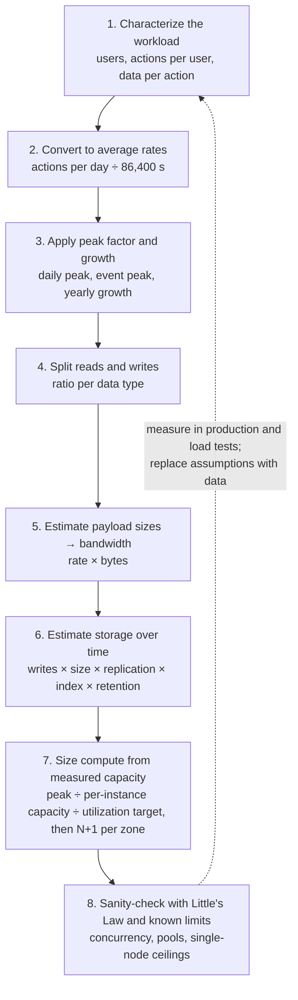
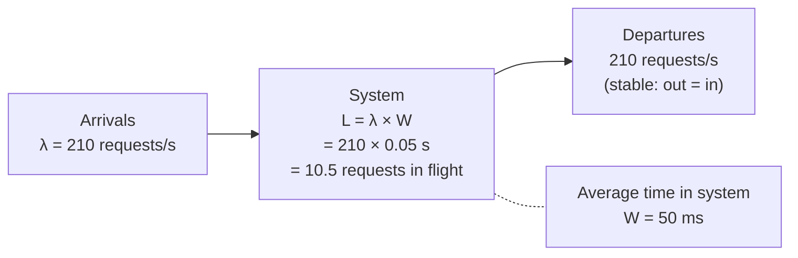
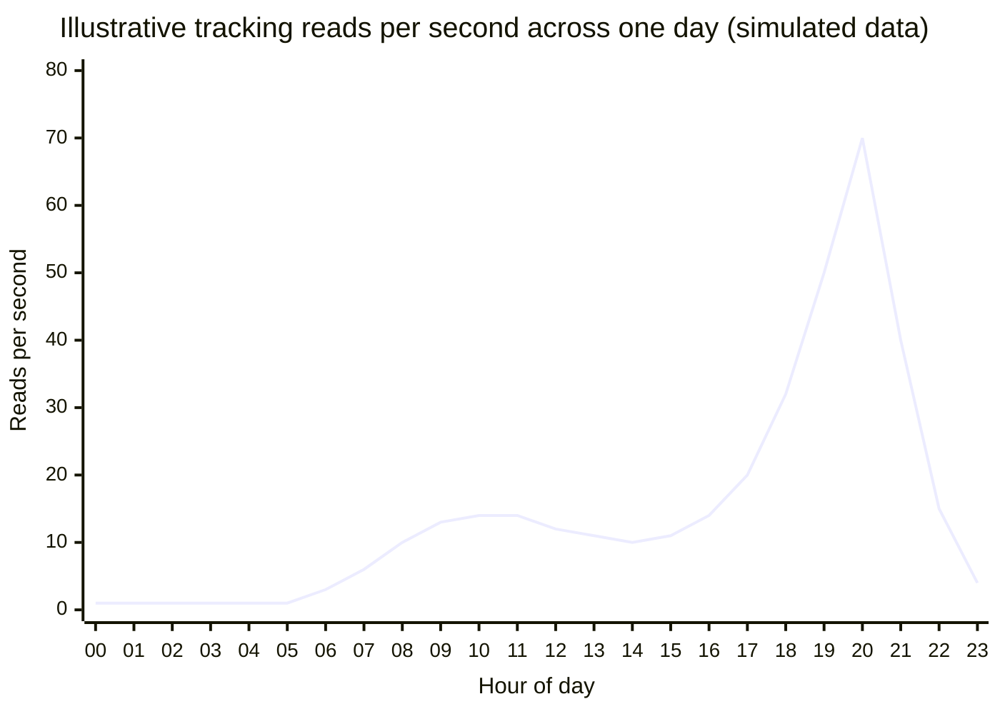

# How to estimate load, throughput, storage, and capacity

> Capacity estimation turns "400,000 daily users" into requests per second, gigabytes per year,
> megabits per second, and a number of instances, with every assumption written down so it can be
> challenged.

!!! abstract "Page facts"
    **Level:** Mixed (method is Level 1-2; sizing and headroom are Level 3) · **Status:** Draft ·
    **Time:** 45-60 minutes · **Last verified:** 2026-11-15

## Learning objectives

After this page you should be able to:

- Convert user counts and behavior into average and peak request rates.
- Estimate storage growth including replication, indexes, and retention.
- Estimate bandwidth from request rates and payload sizes.
- Size compute from a measured per-instance capacity and a utilization target, and explain why the
  minimum footprint is often set by availability rather than load.
- Use Little's Law to convert between throughput, latency, and concurrency, and to sanity-check a
  design.
- Recognize the estimation mistakes that lead to under- or over-provisioned systems.

## Prerequisites

- [Functional vs non-functional requirements](../architecture-fundamentals/functional-vs-non-functional-requirements.md)
  — the scale targets come from NFRs.
- [Quality attributes and trade-offs](../architecture-fundamentals/quality-attributes-and-trade-offs.md)
  — headroom and redundancy are trade-offs against cost.

## The problem this solves

Without numbers, architecture arguments are arguments about taste. "We need Kafka" and "PostgreSQL is
fine" are both unanswerable until someone says how many events per second, how large, for how long.
Capacity estimation gives you those numbers early, at order-of-magnitude precision, which is enough to
choose between designs, to spot impossibilities ("that is 4 TB a day on one disk"), and to set
autoscaling, budgets, and load tests. It is also the fastest way to find out that a requirement is
smaller than everyone feared, which happens more often than the reverse.

## What it is

**Capacity estimation** (also called back-of-the-envelope estimation or capacity planning when done
for the future) is the practice of deriving a system's resource needs from a small set of stated
assumptions about its workload. The outputs are:

| Output | Unit | Decides |
|---|---|---|
| Request rate (average, peak) | requests/second (RPS), events/second | Compute sizing, autoscaling, rate limits |
| Read/write mix | ratio | Database choice, replicas, caching |
| Storage (initial, growth) | GB, TB over time | Database and storage sizing, retention, cost |
| Bandwidth | Mbit/s, GB/month | Network, CDN, egress cost |
| Concurrency | requests in flight | Thread pools, connection pools, queue depth |
| Instance count | count per tier and zone | Cost, availability |

Precision is deliberately low. An estimate within a factor of two or three is useful; an estimate to
three significant figures is false confidence. The value is in the assumptions, which are the things
to verify with measurement later.

## Mental model

Think of water flowing through a building's plumbing. Demand is how many taps are open and for how
long (users and behavior). Flow rate is litres per second (throughput). Pipe diameter is capacity.
The water tower is storage, and it fills at the rate of inflow minus outflow (data retention). The
peak at 7 a.m., when everyone showers, sets the pipe size, not the daily average. And every joint
has a maximum flow; the narrowest one sets the whole building's limit (the bottleneck).

**Where the analogy breaks:** water does not get slower when the pipe is nearly full; software does.
As utilization approaches 100%, queuing makes latency climb steeply (this is why headroom exists).
And software demand is far spikier than water demand: a marketing email can produce a tenfold burst in
a minute.

## Key terms

| Term | Meaning on this page |
|---|---|
| Daily Active Users (DAU) | Distinct users per day; the starting point of most estimates |
| Peak factor | Peak rate ÷ average rate over the period |
| Headroom | Spare capacity above expected peak, expressed as a utilization target |
| Little's Law | L = λ × W: items in system = arrival rate × time in system |
| Utilization | Fraction of a resource's capacity in use |
| Bottleneck | The component with the least capacity relative to its load |
| N+1 | Redundancy with one more instance than load requires, so one can fail |

## How it works: the method

**Figure 1 — The estimation method.** Eight steps, each producing numbers the next consumes. The
loop at the end feeds measured values back into the assumptions.

Read it top to bottom. Each box's output is written down with its assumption. A reviewer should be
able to change any assumption and recompute.

### Useful constants and conversions

| Quantity | Value | Note |
|---|---|---|
| Seconds per day | 86,400 | Round to ~100,000 for mental arithmetic (within 15%) |
| Seconds per 30-day month | 2,592,000 (~2.6 million) | |
| Seconds per year | ~31.5 million | |
| 1 KB / MB / GB / TB | 10³ / 10⁶ / 10⁹ / 10¹² bytes | This page uses decimal units; storage vendors do too; operating systems often use binary (1 KiB = 1,024 B) |
| 1 byte | 8 bits | Bandwidth is quoted in bits per second |
| Typical peak factor (daily, consumer web) | 2-5× average | Measure your own; assumptions are stated per example |

### Step 1 — Characterize the workload

Who uses the system, how often, doing what, producing how much data. Write it as a table of actions
with a frequency per user per day and a payload size. Be explicit about which users are active (DAU),
not registered.

### Step 2 — Convert to average rates

Average rate per second = total actions per day ÷ 86,400. Do this per action type.

### Step 3 — Apply peak factor and growth

Daily peak = average × daily peak factor. Event peaks (sales, launches, incidents) multiply again.
Growth: multiply by the expected growth over the planning horizon (one or two years is typical).

### Step 4 — Split reads and writes

Different resources serve them. Reads can be cached and replicated; writes must reach durable storage
and usually a single primary. State the ratio per data type.

### Step 5 — Bandwidth

Bandwidth = rate × bytes per request (request and response separately if they differ). Convert to
bits per second for network sizing and to GB per month for egress cost.

### Step 6 — Storage

Storage per day = writes per day × bytes per record. Multiply by replication factor (copies kept for
durability), index overhead (often 30-100% for relational tables with several indexes), and keep for
the retention period. Add growth. Include logs and backups if they live on the same budget.

### Step 7 — Compute

Instances = peak rate ÷ (per-instance capacity × utilization target). Per-instance capacity must
come from a measurement (a load test) or a conservative assumption that is clearly labelled.
Utilization targets of 60-70% leave room for bursts and for queuing effects. Then apply redundancy:
at least N+1, and at least one instance per availability zone you rely on.

### Step 8 — Sanity-check with Little's Law and known limits

**Little's Law** (J. D. C. Little, 1961) says that for any stable system,

> L = λ × W

where L is the average number of items in the system, λ (lambda) is the average arrival rate, and W is
the average time each item spends in the system. It needs no assumptions about the arrival
distribution, which is why it is the universal sanity check.

**Figure 2 — Little's Law.** Requests arrive at rate λ, spend an average W inside the system, and on
average L of them are inside at any moment.

Three uses:

1. **Concurrency from throughput and latency.** 210 RPS × 0.05 s = 10.5 requests in flight on
   average. Thread pools, connection pools, and queue depths should comfortably exceed this (with
   headroom for the tail).
2. **Maximum throughput from a pool.** A service with 50 worker threads each taking 200 ms can
   complete at most 50 ÷ 0.2 = 250 requests/s. If the estimate needs 400 RPS, something must change.
3. **Latency from queue depth.** If 300 jobs are waiting and the worker pool completes 20 per second,
   the average wait is 300 ÷ 20 = 15 s before processing starts.

Known limits are the other check: a single database primary's write ceiling, a single node's network
interface, a provider's per-account quota. If the estimate approaches any of them, the design needs
partitioning or a different component; the estimate found that for you before production did.

## Worked example: AtlasMart order tracking

This is the same scenario used on the [requirements](../architecture-fundamentals/functional-vs-non-functional-requirements.md)
and [C4](../architecture-fundamentals/c4-model.md) pages; the numbers below are the source of the
NFR-4 scale targets there.

### Step 1 — Workload

| Assumption | Value | Basis |
|---|---|---|
| Registered customers | 2,000,000 | Business data |
| Daily active users (DAU) | 400,000 | Analytics |
| Orders per day | 60,000 | 15% of DAU place an order (assumption from last quarter) |
| Average transit time | 5 days | Carrier data |
| Orders in transit at any time | 60,000 × 5 = 300,000 | Derived |
| Tracking views per in-transit order per day | 4 | Assumption: customers check about four times a day while waiting |
| Scan events per order | 8 | Carrier data (label created, picked up, hub scans, out for delivery, delivered) |
| Tracking view response size | 4 KB | Measured on the prototype |
| Scan event record size | 500 B | Schema estimate (IDs, status, location text, timestamps) |

### Step 2 — Average rates

- Reads: 300,000 orders × 4 views = 1,200,000 views/day ÷ 86,400 ≈ **13.9 reads/s**.
- Writes: 60,000 orders × 8 events = 480,000 events/day ÷ 86,400 ≈ **5.6 events/s**.

### Step 3 — Peaks and growth

- Reads: daily peak factor 5 (evening checking) → 13.9 × 5 ≈ **70 reads/s**. Sale-day burst ×3 →
  **210 reads/s** (this is the design peak, NFR-4).
- Writes: carriers scan in waves; daily peak factor 4 → 5.6 × 4 ≈ 22 events/s. Sale-day volumes ×3
  → **67 events/s, rounded to 70** (NFR-4).
- Growth: plan for 30% per year; year-two design peak ≈ 270 reads/s and 90 events/s.

**Figure 3 — Average versus peak.** An illustrative (simulated) daily pattern for tracking reads.
The average over the day is about 14 reads/s; the evening peak reaches 70, a peak factor of 5. Sizing
to the average would fail every evening.

How to read it: the line is request rate by hour; the shape is invented to illustrate a typical
consumer pattern with an evening peak. Your system's shape must be measured.

### Step 4 — Read/write mix

Reads : writes ≈ 1,200,000 : 480,000 = 2.5 : 1 by count. Reads dominate and are cacheable (status
changes at most a few times a day per order); writes are small and must be durable.

### Step 5 — Bandwidth

- Read responses at design peak: 210 req/s × 4 KB = 840 KB/s ≈ **6.7 Mbit/s**. Trivial for any cloud
  load balancer.
- Monthly egress at average: 13.9 req/s × 4 KB × 2,592,000 s ≈ **144 GB/month**. Small, but it is a
  line on the invoice; note it.
- Webhook inbound: 70 events/s × ~2 KB (carrier JSON) = 140 KB/s. Negligible.

### Step 6 — Storage

- Raw events: 480,000/day × 500 B = **240 MB/day**.
- With replication factor 3 (primary, synchronous standby, backups) and index overhead 1.5: 240 MB ×
  3 × 1.5 = **1.08 GB/day**.
- Per year: 1.08 GB × 365 ≈ **394 GB**. Retention 13 months (audit NFR) ≈ 430 GB steady state.
- With 30% growth, plan for roughly **600 GB** of event storage by the end of year two.
- Cache working set: 300,000 in-transit orders × 4 KB = 1.2 GB; with overhead ×1.5 ≈ **1.8 GB**. The
  whole hot set fits in one small cache node, which means cache hit rates can be very high.

### Step 7 — Compute

- Per-instance capacity: a load test of the prototype Tracking API showed one small container task
  sustaining 300 req/s at 70% CPU with p95 under 200 ms (assumption for this example; your number
  must be measured).
- Instances for load: 210 ÷ (300 × 0.7) = 1.0. One instance handles the design peak at the target
  utilization.
- Redundancy: NFR-2 (99.9%) requires surviving a zone failure, so at least one instance in each of
  two zones, and N+1 means two instances in total is the floor; AtlasMart's platform standard is
  three zones, giving **3 Tracking API instances** at minimum. The footprint is set by availability,
  not by load. Autoscaling above three handles the year-two growth and unexpected bursts.
- Event Processor: 70 events/s with a measured 20 ms processing time each needs 70 × 0.02 = 1.4
  workers' worth of capacity (Little's Law); **2 workers in different zones** suffice, with the queue
  absorbing bursts.

### Step 8 — Sanity checks

- Concurrency at the API: 210 req/s × 0.05 s average latency = **10.5 requests in flight**, or about
  4 per instance across three instances. A thread pool of 32 and a database connection pool of 10 per
  instance are generous; the database sees at most ~30 connections. No pool is a bottleneck.
- Database writes: 70 inserts/s of 500-byte rows is far below the write ceiling of any managed
  relational database on modest hardware; a single primary with a synchronous standby is appropriate.
  (No numeric ceiling is quoted here because it depends on hardware and configuration; the point is
  the order of magnitude: tens, not tens of thousands.)
- Cache: 1.8 GB working set, ~200 reads/s. Any small managed cache node handles this with large
  margin.
- Queue: burst scenario, a carrier delivers a backlog of 50,000 events in one minute (833/s) while
  processors handle 100/s. Queue depth peaks at about 44,000 and drains in 50,000 ÷ 100 = 500 s ≈
  8 minutes. Against NFR-1 (visible within 60 s for 99% of events, measured monthly), one such
  backlog per month would push roughly 50,000 ÷ 14,400,000 monthly events ≈ 0.35% of events past
  the 60-second target, which is within the 1% allowance. The estimate tells you the design tolerates
  occasional backlogs but not daily ones; that is a monitoring requirement (NFR-8).

### What the estimate decided

| Decision | Driven by |
|---|---|
| Single relational primary with synchronous standby | Low write rate (tens/s); durability NFR |
| Cache-aside with a 30 s TTL for status | 2.5 : 1 read ratio; small working set; 60 s freshness allowance |
| Queue between ingestor and processor | Burst tolerance for carrier backlogs |
| Three small API instances, autoscaling above | Availability floor, not load |
| No sharding, no NoSQL, no CDN for the API | Nothing in the estimate approaches a single-node limit |

The most important finding is the last line: the system is small. The estimate prevented a design
sized for a problem AtlasMart does not have.

## Real-world architecture example

Estimates feed four operational artifacts:

1. **Autoscaling policies.** Target utilization (70% CPU) and the minimum (3) and maximum (year-two
   peak ÷ per-instance capacity, plus margin) instance counts come straight from steps 3 and 7.
2. **Load tests.** The design peak (210 reads/s, 70 events/s) with the sale-day burst profile is the
   load-test script; the NFR latencies are its pass criteria.
3. **Database and storage sizing with retention policies.** Step 6 sets disk, backup, and the
   13-month deletion job.
4. **Cost forecast.** Instance counts × hours, storage GB-months, egress GB, cache node: each is a
   line with its assumption, so finance can see what changes if DAU doubles.

When the system goes live, measured values replace the assumptions, and the estimate becomes the
capacity plan that is revisited each quarter.

## Design choices and trade-offs

| Choice | Favor when | Avoid when |
|---|---|---|
| Estimate from first principles (this method) | Before the system exists; before a major change | You have production metrics; measure instead and estimate only the delta |
| Utilization target 60-70% | Latency-sensitive services with bursty traffic | Batch workloads, where 90%+ utilization is fine because queuing is acceptable |
| Size to the sale-day burst permanently | Scaling is slow (minutes) or the burst is frequent | Autoscaling reacts fast enough and the burst is rare; size to the daily peak and let autoscaling cover events |
| Keep order-of-magnitude precision | Always for design decisions | Never add decimals an assumption cannot justify |
| Plan one to two years ahead | Growth is predictable | Growth is unknown; plan for a shorter horizon and build in elasticity |

**Assumption behind all of this:** the workload is roughly steady-state with predictable peaks. For
viral or one-off events (a product launch with unknown demand), estimate a range, design for
elasticity and graceful degradation, and plan to shed load rather than to size for the worst case.

## Failure modes and anti-patterns

- **Average-only thinking.** Sizing for 14 RPS when the evening peak is 70. Detect: no peak factor in
  the estimate. Prevent: step 3, always.
- **Forgetting the multipliers.** Raw data × 1, ignoring replication, indexes, backups, logs. Storage
  is often 3-5× raw. Prevent: step 6's multipliers, written explicitly.
- **Registered users instead of active users.** 2,000,000 instead of 400,000 inflates everything
  fivefold. Prevent: define DAU in step 1.
- **Averages for latency.** Little's Law with average W is fine for concurrency, but pool sizes must
  handle the tail (p99 latency ties up a connection much longer). Prevent: size pools with margin
  above the average-based concurrency.
- **No headroom.** Running at 95% utilization means any blip queues. Prevent: a utilization target.
- **Treating the estimate as a commitment.** The estimate is a hypothesis; the load test and
  production metrics are the evidence. Prevent: a feedback step and a dated revision history.
- **Ignoring hot keys.** The average is 210 reads/s, but one viral order gets 150 of them. Prevent:
  ask "is load evenly distributed?" per data store; caches and partitions behave badly under skew.
- **Ignoring growth or over-weighting it.** Sizing for today only, or for ten years out. Prevent: a
  stated horizon with a stated growth rate.

## Security considerations

Capacity estimates assume legitimate traffic. Two security points follow:

- **Abusive load.** A scraper enumerating order IDs or a denial-of-service attempt can exceed the
  design peak by orders of magnitude. Rate limiting per client and authentication before expensive
  work protect the capacity model; the estimate's design peak is the number the rate limiter should
  defend.
- **Unauthenticated endpoints are the first to overload.** In the example, the webhook ingestor must
  verify the carrier signature *before* doing any work, and must respond quickly and enqueue, so that
  a flood of forged webhooks cannot exhaust the processors.

## Performance, reliability, and cost

- **Performance:** utilization and latency are linked by queuing. Keeping utilization below roughly
  70% keeps queueing delay small; above that, tail latency rises quickly. The headroom in step 7 is a
  latency decision as much as a safety margin.
- **Reliability:** the minimum instance count comes from availability (one per zone, N+1), not from
  load. When a zone fails, the remaining instances must still be under the utilization target at
  peak; check that N−1 instances can carry the peak.
- **Cost:** the estimate is the first cost model. Every multiplier (replication, retention, headroom,
  growth) is a cost lever with a business reason; the biggest savings usually come from retention
  and over-provisioned minimums, not from compute tuning.

## Hands-on lab: size a system in a spreadsheet

1. Pick a system you know or an exercise (a URL shortener, a chat service, an IoT telemetry
   collector).
2. Build a spreadsheet with the eight steps as sections. Every number is either an **assumption**
   (highlighted) or a **formula** referencing assumptions. No typed-in derived numbers.
3. Produce: average and peak RPS for reads and writes; storage per day, per year, and at the
   retention limit; bandwidth peak and monthly egress; instance count with N+1 per zone; concurrency
   via Little's Law; pool sizes.
4. Add a "shock" row: double DAU, then double the peak factor. Watch which outputs change most; those
   are the sensitive assumptions to measure first.
5. Write five sentences: the single biggest number, the component closest to a known limit, the
   decision the estimate changed, the assumption you trust least, and how you would measure it.

??? question "Hint: a URL shortener at 10 million new links a month"
    Writes: 10,000,000 ÷ 2,592,000 ≈ 3.9/s average. Reads at 100 : 1 ≈ 390/s average; peak factor 3
    ≈ 1,200/s. Storage per link ~500 B (short code, long URL, metadata) → 5 GB/month raw; ×3
    replication ≈ 15 GB/month; five-year retention ≈ 900 GB. Concurrency at 1,200/s × 20 ms ≈ 24 in
    flight. The read path is the whole design; the write path is tiny.

## Knowledge check

1. A service sees 2,000,000 requests per day. What is the average RPS, and with a peak factor of 4,
   the peak RPS?
2. Events of 1 KB arrive at 200/s and are kept 90 days with replication factor 3 and index overhead
   1.3. How much storage is that?
3. Using Little's Law, how many requests are in flight at 500 RPS with 80 ms average latency? What
   pool size would you configure, and why not exactly that number?
4. In the worked example, why does the API tier have three instances when one handles the peak?
5. A colleague sizes a database for 2,000,000 registered users. What question do you ask first?

??? success "Answers"
    1. 2,000,000 ÷ 86,400 ≈ 23 RPS average; × 4 ≈ 93 RPS peak.
    2. 200/s × 86,400 = 17.28 million events/day × 1 KB = 17.3 GB/day raw; × 3 × 1.3 = 67.4 GB/day;
       × 90 days ≈ 6.1 TB.
    3. L = 500 × 0.08 = 40 in flight. Configure well above 40 (say 80-100) because the average hides
       tail latency: p99 requests hold a slot several times longer than the average.
    4. Availability. NFR-2 requires surviving a zone failure, the platform uses three zones, and N+1
       means the remaining instances must carry the peak. The floor is set by redundancy, not load.
    5. "How many are active per day?" Registered users overstate load, often by 5-10×.

## Architecture discussion questions

1. The estimate shows the system needs a single small database. The team wants to use a distributed
   NoSQL store "for future scale". How do you use the estimate in that conversation, and when would
   the team be right?
2. Your peak factor is uncertain between 3 and 15 (a new product with marketing pushes). Describe an
   architecture and an operating plan that is robust to that uncertainty without paying for 15×
   permanently.
3. How would the estimate change if tracking views had to show live map positions updated every
   10 seconds while the app is open?

## Summary

Capacity estimation converts workload assumptions into rates, storage, bandwidth, concurrency, and
instance counts in eight steps, at order-of-magnitude precision, with every assumption written down.
Peak factors and multipliers (replication, indexes, retention, headroom, growth) are where estimates
go wrong. Little's Law links throughput, latency, and concurrency and is the universal sanity check.
The minimum footprint is usually set by availability, not load, and the most common outcome of a
careful estimate is discovering the system is smaller than feared.

## Related topics

- **Before:** [Functional vs non-functional requirements](../architecture-fundamentals/functional-vs-non-functional-requirements.md);
  [Quality attributes and trade-offs](../architecture-fundamentals/quality-attributes-and-trade-offs.md)
- **Alongside:** [The C4 model](../architecture-fundamentals/c4-model.md) — annotate the arrows with
  these numbers.
- **Planned:** performance fundamentals and Little's Law in depth (D14-T01); scaling and optimization
  techniques (D14-T02); caching architecture (D06-T05); message queues and brokers (D08-T01); high
  availability design (D13-T01); cloud cost models and FinOps (D17-T01).

## References

| Source | Type | Checked |
|---|---|---|
| J. D. C. Little, ["A Proof for the Queuing Formula: L = λW"](https://doi.org/10.1287/opre.9.3.383), Operations Research 9(3), 1961 | Paper (DOI link; publisher page may be paywalled) | 2026-11-15 |
| [The Site Reliability Workbook: Managing Load](https://sre.google/workbook/managing-load/) — Google | Book chapter (free online) | 2026-11-15 |
| [Site Reliability Engineering: Software Engineering in SRE (capacity planning)](https://sre.google/sre-book/software-engineering-in-sre/) — Google | Book chapter (free online) | 2026-11-15 |
| [AWS Well-Architected Framework, Performance Efficiency Pillar](https://docs.aws.amazon.com/wellarchitected/latest/performance-efficiency-pillar/welcome.html) — Amazon Web Services | Official documentation | 2026-11-15 |
| Jeffrey Dean and Luiz André Barroso, ["The Tail at Scale"](https://cacm.acm.org/research/the-tail-at-scale/), Communications of the ACM 56(2), 2013 | Paper (tail latency) | 2026-11-15 |
| Martin Kleppmann, *Designing Data-Intensive Applications* (O'Reilly, 2017), chapter 1 "Reliable, Scalable, and Maintainable Applications" | Book (describing load and performance, percentiles) | 2026-11-15 |

## Review notes

- Canonical page for D14-T03. Load, stress, spike, and soak testing from the inventory are
  mentioned as consumers of the estimate; their methodology belongs in a dedicated page.
- All AtlasMart numbers are assumptions for a fictional company, labelled as such; the per-instance
  capacity figure (300 req/s at 70% CPU) is illustrative and must be replaced by a measurement in any
  real use.
- Figure 3 uses Mermaid's `xychart-beta`; if a renderer does not support it, replace it with the
  table of hourly values given in the diagram source.
- Reviewer: check the DOI and CACM links resolve; publisher URLs change.
