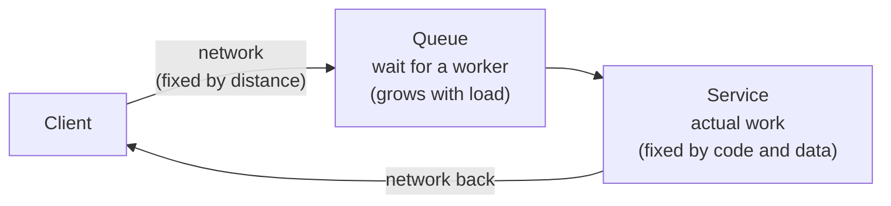
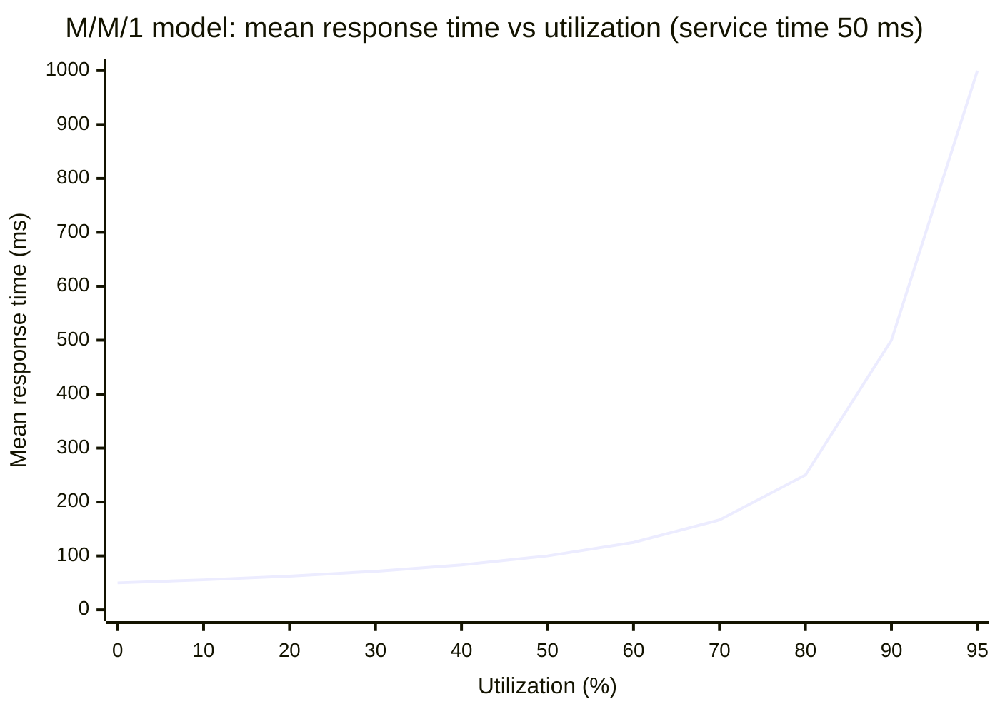
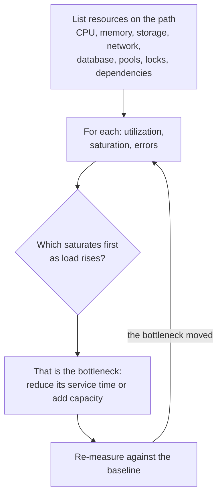
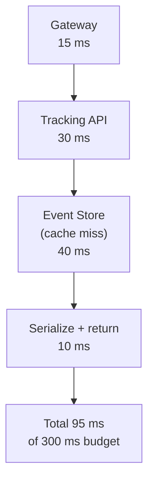

# Performance fundamentals and Little's Law

> Performance is three numbers (latency, throughput, concurrency) linked by one law, plus one curve
> (utilization against queueing delay) that explains why systems fall over long before they are
> "full". Learn the vocabulary, the law, and the curve, and most performance incidents stop being
> mysterious.

!!! abstract "Page facts"
    **Level:** Mixed (vocabulary is Level 1; budgets and bottleneck analysis are Level 2-3) ·
    **Status:** Draft · **Time:** 45-60 minutes · **Last verified:** 2026-11-15

## Learning objectives

After this page you should be able to:

- Define latency, response time, throughput, concurrency, utilization, and saturation, and say which
  of them a given requirement is really about.
- Break a response time into its components (network, queueing, service) and explain which one grows
  as load rises, and why.
- Read percentiles correctly, explain why averages mislead for latency, and work out the effect of
  fan-out on tail latency.
- Apply Little's Law to size thread pools, connection pools, and queues, and to check whether a
  measured system is consistent with itself.
- Build a latency budget for a request path and find the bottleneck resource with a repeatable
  method.

## Prerequisites

- [Functional vs non-functional requirements](../architecture-fundamentals/functional-vs-non-functional-requirements.md)
  — performance targets are NFRs with percentiles and conditions.
- [Capacity estimation](capacity-estimation.md) — the eight-step method that turns workload into
  numbers; this page explains the concepts that method relies on and does not repeat the method.

## The problem this solves

"The API is slow" is not a diagnosis. Is it slow for every request or the slowest 1%? Slow because
the service does too much work, or because requests wait in a queue for a resource that is busy? Does
adding instances help, or is the bottleneck in a database that every instance shares? Teams without
the vocabulary tune the wrong thing: they optimize code when the problem is queueing, add servers
when the problem is a lock, or report an average that hides the users who are suffering. The
concepts on this page let you ask the right question in the first five minutes of an incident and
write performance requirements that can be tested.

## What it is

Performance engineering is the discipline of measuring, predicting, and improving how a system
behaves under load. Its core quantities:

| Quantity | Definition | Unit | Typical requirement |
|---|---|---|---|
| Latency | Time for one request from issue to completion, from a stated vantage point | ms | "p95 under 300 ms at the API gateway" |
| Response time | Latency as the end user experiences it, including every hop and render | ms | "page interactive within 2 s" |
| Throughput | Completed work per unit time | requests/s (RPS), transactions/s (TPS), MB/s | "sustain 210 reads/s" |
| Concurrency | Requests (or users) in the system at one moment | count | Rarely a requirement; a derived quantity |
| Utilization | Fraction of a resource's capacity in use | % | "CPU under 70% at peak" |
| Saturation | How much work is waiting for a resource | queue length, wait time | "run queue below cores" |
| Queue depth | Items waiting for service in a specific queue | count | "backlog drains within 60 s" |

Three vantage points produce three different "latencies" for the same request: the client (includes
the internet and the browser), the gateway (what NFR-3 specifies), and the service (excludes the
gateway's own work). Every performance number must say where it was measured.

## Mental model

A supermarket checkout. **Service time** is how long the cashier takes for one customer; **arrival
rate** is how many customers join the line per minute; **utilization** is the fraction of the time
the cashier is busy. Everyone can see what happens as the shop gets busier: the cashier is no slower,
but the **queue** grows and the time each customer spends from joining the line to leaving (the
**response time**) climbs, gently at first and then steeply. At 50% utilization the line is short;
at 90% it stretches down the aisle; at 100% it grows without bound. Opening a second checkout
(adding a server) helps if the cashier is the bottleneck; it does nothing if the bottleneck is the
single card terminal all checkouts share.

**Where the analogy breaks:** customers arrive in clumps far more than shoppers do (bursts), and
software requests have very different sizes (one request may take 1,000 times longer than another),
which makes the tail of the distribution far worse than the average suggests. And a software queue
can be invisible: a thread pool, a connection pool, a socket buffer, or a lock is a line nobody drew
on the diagram.

## Key terms

| Term | Meaning on this page |
|---|---|
| Service time (S) | Time a resource spends actually doing one unit of work |
| Queueing delay | Time a request waits for a busy resource before service starts |
| Arrival rate (λ) | Requests arriving per unit time |
| Utilization (ρ) | λ × S for a single server: fraction of the time it is busy |
| Percentile (p50, p90, p95, p99) | The value below which that share of observations fall |
| Tail latency | The latency of the slowest requests; p99 and beyond |
| Fan-out | One request causing many parallel downstream requests |
| IOPS | Input/output operations per second: the throughput unit for storage |
| Bottleneck | The resource with the highest utilization relative to its capacity; it caps throughput |
| Baseline | A recorded measurement of normal behavior against which changes are compared |
| Little's Law | L = λ × W: average items in a system equals arrival rate times average time in the system |

## How it works

### Latency, throughput, and concurrency are one relationship

The three core quantities are not independent. For any stable system (arrivals equal departures on
average), **Little's Law** holds:

> L = λ × W

L is the average number of requests in the system (concurrency), λ is the throughput (arrival rate,
equal to completion rate when stable), and W is the average time each request spends in the system
(latency including queueing). It holds for any arrival pattern and any service discipline, for the
whole system or any part of it, which is why it is the universal consistency check. If a dashboard
shows 210 requests/s, 50 ms average latency, and 40 requests in flight, one of those numbers is
wrong: 210 × 0.05 = 10.5, not 40.

The law also shows why latency and throughput are not interchangeable goals. A batch system
maximizes λ and tolerates large W; an interactive API minimizes W and must keep L small enough to
fit its pools. Optimizing one often costs the other: batching raises throughput and latency
together.

### Response time has three parts

**Figure 1 — Where the time goes.** A request's response time is network transit plus queueing delay
plus service time, at each hop. Only one of the three grows with load.

How to read it: network time is set by physics and topology; service time is set by what the code
does; queueing delay is set by how busy the resource is. When latency rises under load and the code
has not changed, the extra time is queueing.

- **Network transit** inside a region is small and stable (single-digit milliseconds within a
  zone, somewhat more across zones); across continents it is tens to hundreds of milliseconds, set by
  distance and the number of round trips a protocol needs. It changes only when the topology or the
  protocol changes.
- **Service time** depends on the work: CPU for computation and serialization, memory for working
  sets, storage IOPS for reads and writes, network throughput for payloads. It is what profiling and
  query optimization reduce.
- **Queueing delay** depends on utilization. It is the part that surprises people, so it gets its own
  section.

### Utilization drives queueing delay, non-linearly

For the simplest queueing model, a single server with random (memoryless) arrivals and service
times (M/M/1 in queueing notation), the mean time a request spends in the system is

> W = S ÷ (1 − ρ)

where S is the mean service time and ρ is utilization. Real systems are not M/M/1 (arrivals burst
more, service times vary more, there are several servers), but the shape of the curve is the same
and the lesson transfers: delay is small until roughly 60-70% utilization and then climbs steeply.

**Figure 2 — Mean response time against utilization.** Computed from the M/M/1 formula above with a
service time of 50 ms; the curve is a model, not a measurement, and real systems usually bend earlier
and harder.

How to read it: at 50% utilization the response time has already doubled from the 50 ms service
time; at 90% it is ten times; at 95% twenty times. The last 10% of capacity costs more latency than
the first 80% put together. This is why the capacity page uses a utilization target of 60-70% for
latency-sensitive services, and why "the servers are only at 85%" is not reassurance.

Two consequences worth memorizing:

1. **Headroom is a latency decision.** Running at 70% instead of 90% is not waste; it is the
   difference between a 3× and a 10× queueing multiplier on every request.
2. **Variance makes it worse.** The more variable the service times (one slow query among many
   fast ones), the earlier and steeper the climb. Reducing variance (timeouts on slow paths, separate
   pools for slow work) can improve latency more than reducing the average.

### Percentiles, not averages

Latency distributions are skewed: most requests are fast, a few are very slow, and the slow ones
are the ones users remember. The average is pulled by the tail yet describes nobody; the median
(p50) describes the typical request but hides the tail. Requirements therefore name percentiles:
p95 is the value that 95% of requests beat; p99 the value 99% beat. The AtlasMart NFR-3 says
"p95 300 ms, p99 800 ms at the gateway at peak" for exactly this reason.

Rules for using percentiles correctly:

- **Do not average percentiles.** The p99 of a day is not the average of per-minute p99s, and the
  p99 across instances is not the average of each instance's p99. Aggregate the raw measurements (or
  mergeable histograms), then take the percentile.
- **State the window and the vantage point.** "p95 300 ms" over one minute at the gateway at peak is
  a different claim from p95 over a month at the client.
- **Watch the sample size.** p99 over 100 requests is one request; over 10 requests it is meaningless.
- **Beware coordinated omission.** A load generator that waits for each response before sending the
  next one sends fewer requests exactly when the system is slow, and under-reports the tail. Send at
  a fixed rate and account for every intended request.

### Tail latency and fan-out

If a page needs responses from N services called in parallel, the page is as slow as the slowest
call. Assume each service independently has a 1% chance of exceeding its own p99:

| Parallel calls (N) | Probability all N are under their p99 (0.99ᴺ) | Share of pages hitting at least one p99 outlier |
|---|---|---|
| 1 | 99% | 1% |
| 10 | 0.99¹⁰ ≈ 90.4% | ≈ 9.6% |
| 100 | 0.99¹⁰⁰ ≈ 36.6% | ≈ 63.4% |

With ten parallel calls, one page in ten waits for a p99-or-worse response: the service's p99 has
become the page's p90. With a hundred calls (a search page scattering to a hundred shards), the
service's p99 is the page's *median*. This is why large systems invest heavily in tail latency:
hedged requests (send a second copy of a slow request to another replica and take the first
answer), tied requests, per-request deadlines, and avoiding fan-out where it is not needed.

### Resources and their units

Every service time is spent on a resource, and every resource has a capacity, a utilization, and a
saturation signal:

| Resource | Throughput unit | Utilization signal | Saturation signal | Common cause of trouble |
|---|---|---|---|---|
| CPU | instructions, requests/s | % busy per core | run-queue length | serialization, compression, regex, garbage collection pauses |
| Memory | bytes | % used | swapping, OOM kills, GC frequency | working set larger than RAM, leaks, caches without bounds |
| Storage | IOPS, MB/s | % busy | I/O queue depth, await time | random reads on spinning disks, fsync-heavy writes, undersized volumes |
| Network | Mbit/s, packets/s | % of link | drops, retransmits, socket backlog | large payloads, chatty protocols, cross-region calls |
| Database | queries/s, transactions/s | connections busy, CPU, I/O | lock waits, connection-pool waits | missing indexes, long transactions, hot rows |
| Application pools | requests/s | threads or connections busy | pool wait time, rejected requests | pool smaller than λ × W, slow dependencies holding slots |

A resource becomes the **bottleneck** when its utilization approaches 100% first; throughput then
plateaus and latency climbs regardless of what happens elsewhere. Adding capacity anywhere else
changes nothing until the bottleneck moves.

### Bottleneck analysis and baselines

**Figure 3 — Bottleneck analysis loop.** For each resource on the request path, check utilization,
saturation, and errors; the resource that saturates first is the bottleneck; fix it, re-measure, and
expect the bottleneck to move.

How to read it: the loop never ends; removing one bottleneck exposes the next. The exit condition is
"throughput and latency targets met with the required headroom", not "no bottleneck".

A **baseline** is a recorded measurement of latency percentiles, throughput, and resource
utilization under a known load, taken when the system behaves acceptably. Without one, "it got
slower" cannot be distinguished from "it was always this slow at this load". Record baselines after
each significant change and keep the load profile that produced them.

### Little's Law in practice

Three everyday applications, all AtlasMart numbers from the capacity page:

1. **Thread pool size.** Design peak 210 requests/s, average time in the API 50 ms:
   L = 210 × 0.05 = 10.5 requests in flight across the fleet, about 4 per instance. A pool must exceed
   the *tail*, not the average, because a p99 request holds its slot sixteen times longer than a
   p50 request (800 ms against 50 ms); a pool of 32 per instance is comfortable.
2. **Database connection pool.** Assume an 80% cache hit rate, so 20% of 210 reads/s reach the
   database: 42 reads/s × 40 ms = 1.7 connections busy on average, plus 70 writes/s × 20 ms = 1.4,
   about 3 busy connections across all instances. Ten per instance (30 total) is generous; a thousand
   would merely cost the database memory.
3. **Queue drain time.** A carrier delivers a backlog of 50,000 events in a burst while processors
   handle 100/s. Time to drain = 50,000 ÷ 100 = 500 s. Equivalently, the average event's wait during
   the drain is given by the law: W = L ÷ λ. Whether 500 s is acceptable is a question for NFR-1
   (60 s for 99% of events, monthly), which the capacity page works through.

The law is also the fastest way to spot a lie in a dashboard, a vendor claim, or a load test report:
pick any two of the three numbers and check the third.

## Worked example: a latency budget for the Tracking API

NFR-3 requires p95 of 300 ms and p99 of 800 ms at the API gateway at peak load (210 reads/s). A
**latency budget** allocates that target across the hops so each team knows its share and so the
effect of load can be reasoned about.

### Assumptions (fictional, labelled)

| Hop | Service time at light load (p95) | Basis |
|---|---|---|
| Gateway: TLS termination, routing, token check | 15 ms | Measured on the prototype gateway |
| Tracking API: deserialize, ownership check, assemble response | 30 ms | Prototype profile |
| Status Cache read (hit, about 80% of requests) | 3 ms | In-zone round trip plus lookup |
| Tracking Event Store read (miss, about 20% of requests) | 40 ms | Indexed query on the prototype |
| Serialization and in-region network back to the gateway | 10 ms | Measured |

**Figure 4 — The budget on the cache-miss path.** Each box carries its light-load share; the total
is what remains for queueing before the p95 target is breached.

How to read it: the miss path spends 95 ms doing work at light load, leaving about 205 ms of budget
for queueing delay across the hops at peak. The hit path spends 58 ms.

### The budget at 70% and 90% utilization

Apply the M/M/1 multiplier 1 ÷ (1 − ρ) to the two hops that queue under load (the API and the
database); treat the gateway and network as unaffected for simplicity.

| Utilization of API and database | API (30 ms × multiplier) | Database (40 ms × multiplier) | Miss-path total | Against p95 300 ms |
|---|---|---|---|---|
| Light load (ρ ≈ 0) | 30 ms | 40 ms | 95 ms | Met, 205 ms spare |
| 70% | 100 ms | 133 ms | 258 ms | Met, 42 ms spare |
| 90% | 300 ms | 400 ms | 725 ms | Breached by 425 ms |

The model is crude (it uses means where the requirement names a percentile, and real queues are
worse), but the conclusion survives any refinement: NFR-3 and NFR-4's "CPU under 70%" are the same
requirement seen from two sides. At 70% the budget holds with a little margin; at 90% the API alone
consumes the entire budget. An autoscaling policy targeting 70% CPU is therefore a latency control,
and the load test that proves NFR-3 must run at the design peak with the fleet at that utilization.

### What the budget decided

- The cache hit rate is the most sensitive assumption: moving from 80% to 50% hits puts more
  requests on the slower miss path and raises database utilization. It must be measured and alerted.
- The database has the largest share and the steepest growth under load; read replicas or a larger
  cache are the first levers if the budget tightens, not API tuning.
- The p99 target (800 ms) is where tail effects live: a single slow query, a garbage-collection
  pause, or a cache node failover shows up there first. Timeouts on the database call (for example,
  at 400 ms) convert unbounded tail latency into a fast error or a stale-cache fallback, which the
  [high availability](../reliability-and-disaster-recovery/high-availability-design.md) page uses.

## Real-world architecture example

Production services expose these concepts as four standard signals per service: latency (as
percentiles from histograms), traffic (throughput), errors, and saturation (pool and queue
utilization). Gateways and service meshes record latency at every hop so budgets can be checked
hop by hop. Load tests run at the design peak with a fixed-rate generator and report percentiles
against the NFR. Autoscaling targets a utilization well below saturation. Pools are sized from
Little's Law with tail margin and expose wait-time metrics so that pool exhaustion is visible before
it becomes an outage. And systems with heavy fan-out add per-request deadlines and hedging to keep
the tail from dominating the page. The products differ; the quantities and relationships do not.

## Design choices and trade-offs

| Choice | Favor when | Avoid when |
|---|---|---|
| Target 60-70% utilization | Latency-sensitive, bursty traffic | Batch or background work, where high utilization is efficiency, not risk |
| Larger pools | Dependencies are slow but healthy; tail holds slots | Dependency is failing: large pools let a slow dependency absorb every worker (use timeouts and bulkheads) |
| Batching | Throughput matters more than per-item latency | Interactive paths with tight p95 targets |
| Hedged or tied requests | Heavy fan-out; replicas available; idempotent reads | Writes, or when the extra load would push replicas toward saturation |
| Optimize service time (profiling, indexes) | Utilization is low and latency is still high | Latency is queueing: reduce load or add capacity instead |
| Fixed-rate load generation | Always for latency measurement | Never use closed-loop "wait then send" generators for tail measurement |

## Failure modes and anti-patterns

- **Reporting averages.** p50 looks fine while p99 is in seconds. Detect: no percentiles on the
  dashboard. Prevent: histograms and percentiles per hop, with the window and vantage point stated.
- **Tuning code when the problem is queueing.** Weeks of optimization that moves p95 by 5 ms while
  utilization sits at 90%. Detect: latency tracks load, not releases. Prevent: check utilization first
  (Figure 3).
- **Pool exhaustion cascade.** A slow dependency holds every thread; the service stops answering even
  the requests that do not need the dependency. Detect: pool wait time rising with dependency
  latency. Prevent: timeouts, separate pools (bulkheads) per dependency, circuit breakers.
- **Coordinated omission in load tests.** The test reports a great p99 that production never sees.
  Detect: closed-loop generator with no intended-rate accounting. Prevent: open-loop, fixed-rate
  generation; compare generator rate with achieved rate.
- **Measuring at the wrong place.** Service-side p95 of 80 ms while users see 900 ms at the client.
  Detect: no client or gateway measurements. Prevent: measure where the NFR says.
- **Fan-out blindness.** Each service meets its p99; the page misses its own by a wide margin.
  Detect: page latency far above any single service's. Prevent: compute the fan-out arithmetic; cap
  parallel calls; use deadlines and hedging.
- **No baseline.** Every regression is debated. Prevent: record percentiles and utilization at a known
  load after each significant change.
- **Little's Law violations unnoticed.** Concurrency, throughput, and latency metrics that do not
  reconcile mean an instrumentation bug. Prevent: a periodic sanity check of L against λ × W.

## Security considerations

- **Load is an attack vector.** Everything on this page about utilization applies to abusive traffic:
  a scraper at 10× the design peak pushes the system up the Figure 2 curve for everyone. Rate limits
  per client and authentication before expensive work keep utilization in the planned range.
- **Expensive requests are asymmetric.** A request that costs the attacker one packet and the server
  200 ms of database time is a denial-of-service lever. Budget service time per endpoint and give
  costly operations stricter limits.
- **Timing side channels.** Latency differences can reveal information (whether an order ID exists,
  whether a user exists). Where it matters, make the response time independent of the secret.
- **Pools as blast radius.** A single slow, attacker-triggerable endpoint sharing a pool with
  everything else can take the service down; bulkheads limit the damage.

## Performance, reliability, and cost

- **Performance:** the utilization curve and the fan-out arithmetic are the two relationships that
  explain most tail behavior. Reducing variance often beats reducing the average.
- **Reliability:** saturation is the usual path from "slow" to "down": queues fill, timeouts fire,
  retries add load, and the system collapses. Headroom, timeouts, and load shedding are reliability
  controls as much as performance ones.
- **Cost:** the headroom target is the biggest single cost lever in compute. The arithmetic on this
  page lets you argue for a specific number (say 70%) with the latency it buys, instead of either
  "as low as possible" or "as high as possible".

## Hands-on lab: measure latency against concurrency

The full exercise is [Lab 01: measure latency and throughput of a local HTTP service](../labs/lab-01-latency-and-throughput.md),
which runs entirely on your machine with the Python standard library. In summary:

1. Start the lab's small HTTP service, which has a configurable service time (default 20 ms) and a
   fixed number of workers (default 8, the "cashiers").
2. Run the lab's closed-loop load generator with 1, 2, 4, 8, 16, and 32 clients and record throughput,
   p50, p95, and p99 at each level.
3. Find the knee: the client count at which throughput stops growing. Compare the plateau with
   workers ÷ measured service time, and compare the latency shape with Figure 2.
4. Check Little's Law on your own data: the generator prints throughput × mean latency, which must
   equal the client count for a closed loop; then change the number of workers and repeat.

??? question "Hint: what to expect"
    With 8 workers and a 20 ms service time the service can complete at most 8 ÷ 0.020 = 400 requests/s
    before overhead; a sample run measured about 25 ms per request and a plateau near 330 requests/s.
    Latency stays near the service time up to 8 clients, then doubles with every doubling of clients
    while throughput stays flat. Because the generator is closed-loop, the queue is bounded by the
    client count; the open-loop stretch exercise in the lab shows the unbounded case.

## Knowledge check

1. A service reports 400 requests/s and 120 ms average latency. How many requests are in flight on
   average? If the thread pool has 32 threads, is that enough, and what else would you want to know?
2. Latency rose from 60 ms to 300 ms after a traffic increase; no code changed. Which component of
   response time grew, and what single metric confirms it?
3. Why is "average of the per-instance p99 values" not the fleet's p99?
4. A page calls 20 services in parallel, each with a 1% chance of exceeding its p99. What share of
   pages see at least one such slow call?
5. In the worked example, why is "CPU under 70%" effectively part of the latency requirement?

??? success "Answers"
    1. L = 400 × 0.12 = 48 in flight; 32 threads is too few on average, before even considering the
       tail. You would want the latency percentiles (p99 holds slots much longer), the pool's wait-time
       metric, and whether the 120 ms already includes pool waiting.
    2. Queueing delay. Utilization of the resource on the path (CPU, database connections, I/O) rising
       toward saturation confirms it; service time measured inside the handler would be unchanged.
    3. Percentiles are not additive or averageable; a few instances with terrible tails and many with
       good ones produce a fleet p99 that depends on request counts per instance. Merge the raw
       distributions or histograms, then take the percentile.
    4. 1 − 0.99²⁰ ≈ 1 − 0.818 = about 18% of pages.
    5. Because queueing delay depends on utilization: at 70% the model keeps the miss path within the
       300 ms p95 budget; at 90% the API and database multipliers alone exceed it. The utilization
       target is how the latency target is kept.

## Architecture discussion questions

1. A vendor's benchmark shows 50,000 requests/s with 2 ms average latency on their database. What
   questions do you ask before using those numbers in your capacity plan?
2. Your p99 is dominated by one endpoint that performs a large report query. Discuss three designs
   (separate pool, separate service, asynchronous job) and the trade-offs for users and operators.
3. The team proposes raising the autoscaling target from 70% to 85% to cut cost by about a fifth.
   Using the latency budget, what would you need to measure to agree or disagree?

## Summary

Latency, throughput, and concurrency are linked by Little's Law (L = λ × W), which sizes pools and
queues and exposes inconsistent measurements. Response time is network plus queueing plus service
time, and only queueing grows with load, steeply once utilization passes roughly 70%. Percentiles,
not averages, describe latency; fan-out turns a service's p99 into a page's p90 or worse. Bottleneck
analysis checks utilization and saturation per resource and expects the bottleneck to move. A latency
budget allocates the NFR across hops and shows that a utilization target is a latency control.

## Related topics

- **Before:** [Functional vs non-functional requirements](../architecture-fundamentals/functional-vs-non-functional-requirements.md);
  [Capacity estimation](capacity-estimation.md)
- **Alongside:** [High availability design](../reliability-and-disaster-recovery/high-availability-design.md)
  — timeouts and fallbacks that bound the tail; [Caching architecture](../databases-and-storage/caching-architecture.md)
  — the hit rate that drives the budget; [Lab 01](../labs/lab-01-latency-and-throughput.md).
- **Planned:** scaling and optimization techniques (D14-T02); load, stress, spike, and soak testing
  within D14-T03; observability and SRE practices (D15); distributed systems resilience mechanics (D04).

## References

| Source | Type | Checked |
|---|---|---|
| J. D. C. Little, ["A Proof for the Queuing Formula: L = λW"](https://doi.org/10.1287/opre.9.3.383), Operations Research 9(3), 1961 | Paper (DOI link; publisher blocks automated clients and may paywall) | 2026-11-15 |
| Jeffrey Dean and Luiz André Barroso, ["The Tail at Scale"](https://cacm.acm.org/research/the-tail-at-scale/), Communications of the ACM 56(2), 2013 | Paper (fan-out, hedged and tied requests) | 2026-11-15 |
| [Site Reliability Engineering, chapter 6: Monitoring Distributed Systems](https://sre.google/sre-book/monitoring-distributed-systems/) — Google | Book chapter (four golden signals, percentiles) | 2026-11-15 |
| [The USE Method](https://www.brendangregg.com/usemethod.html) — Brendan Gregg | Article (utilization, saturation, errors per resource) | 2026-11-15 |
| [HdrHistogram](http://hdrhistogram.org/) — Gil Tene | Project site (latency histograms, coordinated omission) | 2026-11-15 |
| Raj Jain, *The Art of Computer Systems Performance Analysis* (Wiley, 1991), part on queueing models | Book (M/M/1 and related models) | 2026-11-15 |
| Martin Kleppmann, *Designing Data-Intensive Applications* (O'Reilly, 2017), chapter 1 "Reliable, Scalable, and Maintainable Applications" | Book (describing performance, percentiles) | 2026-11-15 |

## Review notes

- Canonical page for D14-T01. Inventory items "capacity modeling" and "performance baselines" are
  covered at overview depth; capacity modeling in full is on the capacity estimation page.
- The M/M/1 formula is stated with its model name and assumptions; Figure 2 and the budget table are
  computed from it with a stated service time, not measured. A reviewer should confirm the page
  never presents them as measurements.
- Latency-budget hop figures are assumptions for the fictional AtlasMart prototype, labelled as such.
- The reference to Jain's book is to the queueing part generally, not to a specific page; a reviewer
  with the book may add the chapter number.
- The DOI link returns 403 to automated clients (publisher bot-blocking); keep it.
