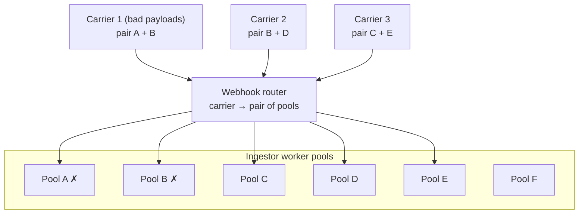
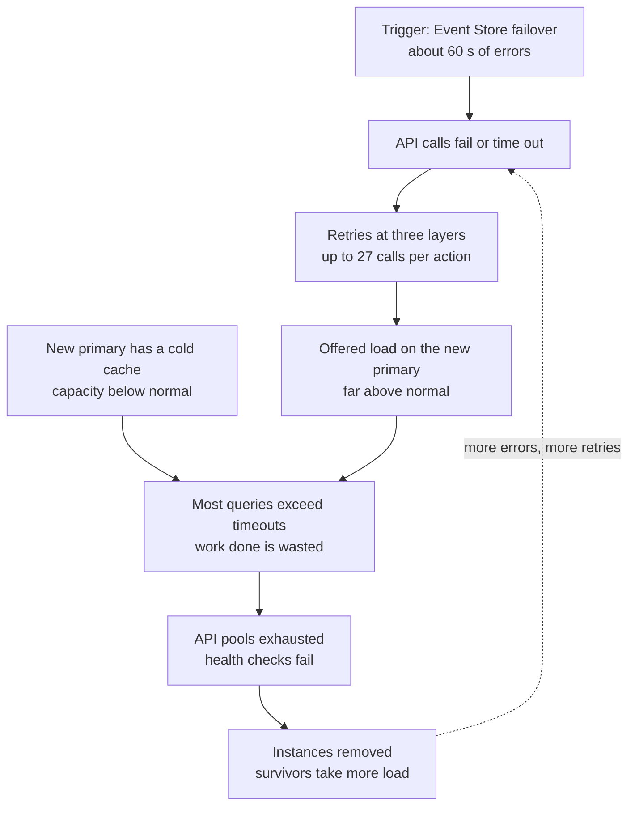
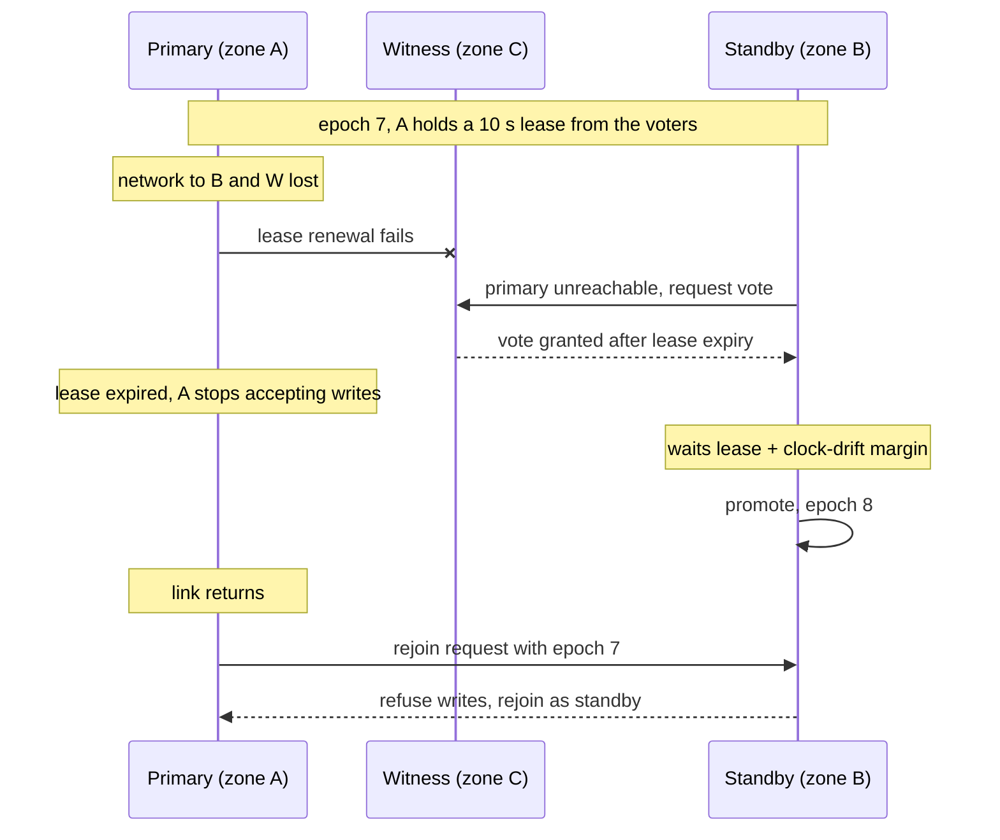
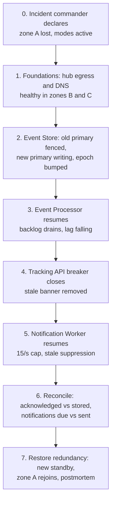

# Advanced resilience and failure containment

> Single failures are the easy case. The outages that make the news are a shared dependency failing
> under everyone, a small fault growing into a cascade, two halves of a cluster both in charge, or a
> recovery that knocks the system over a second time. Each needs a decision made before the incident:
> what may break together, which side wins, what runs in reduced form, and what restarts first.

!!! abstract "Page facts"
    **Level:** Advanced (dependency shapes and blast radius are Level 1-2; split-brain prevention,
    quorum recovery, recovery sequencing, and degraded-mode design are Level 3) · **Status:** Draft ·
    **Time:** 60-75 minutes · **Last verified:** 2026-11-27

## Learning objectives

After this page you should be able to:

- Classify a dependency's failure by shape (down, slow, wrong, flapping, partial, throttled, control
  plane) and pick a containment response for each.
- Bound blast radius with zones, cells, and shuffle sharding, and calculate what shuffle sharding
  buys.
- Explain how retries and cold capacity turn a short fault into a self-sustaining (metastable)
  cascade, and what it takes to exit one.
- Prevent split brain with fencing, quorums, and witnesses, and state the timing rule between lease
  expiry and promotion.
- Choose a quorum-recovery procedure after a majority is lost, knowing what each option can lose.
- Write a dependency-ordered recovery sequence and a set of degraded operating modes with triggers,
  labels, and exit criteria, using static stability to remove recovery-time dependencies.

## Prerequisites

- [High availability design](high-availability-design.md) — failover, fencing, cells, and static
  stability at overview depth; this page goes deeper.
- [Reliability engineering](reliability-engineering.md) — FMEA, fault trees, containment boundaries,
  and self-healing; this page designs the modes that FMEA asked for.
- [Resilience mechanics: timeouts, retries, and backpressure](../distributed-systems/resilience-mechanics-timeouts-retries-and-backpressure.md)
  — per-call mechanisms, retry amplification, and AtlasMart's last-known-good fallback.
- [Distributed systems fundamentals, time, and coordination](../distributed-systems/distributed-systems-fundamentals-time-and-coordination.md)
  — leases, fencing tokens, quorums, and the zone-partition example.

## The problem this solves

Redundancy and per-call resilience handle one component failing in isolation. Incidents are rarely
that tidy: a platform-wide egress firewall fails under every team; a one-minute failover becomes an
hour because retries triple the load on a cold primary; two nodes each believe they are primary; a
returning zone's reconnection storm knocks the database over again. None of these can be improvised
at 03:00. They need designed answers: limits on reach, rules for which side may act, a recovery
order, and reduced modes built as deliberately as the normal one.

## What it is

**Failure containment** is the set of design decisions that limit how far, how long, and how badly a
failure spreads, and that bring the system back without a second failure. Its concerns:

| Concern | Question it answers | Main tools |
|---|---|---|
| Dependency failures | What exactly can a dependency do to me? | Failure-shape inventory, hard/soft classification |
| Blast radius | How many users or functions can one failure reach? | Zones, cells, shuffle sharding, deploy waves |
| Cascading failure | How does one failure create others? | Retry budgets, load shedding, admission control |
| Partitions and failover consistency | What does each side see, and what data survives a switch? | Replication mode, epochs, idempotency, reconciliation |
| Split-brain prevention | How do we guarantee one authority? | Fencing, quorum, witness, leases |
| Quorum recovery | What if the majority itself is gone? | Wait, restore, or forced reconfiguration |
| Recovery sequencing and priorities | What comes back first, and how fast? | Dependency order, business tiers, controlled ramp |
| Degraded operating modes | What do we serve while broken? | Designed modes with triggers, labels, and exits |
| Static stability | Can we survive without a dependency recovering first? | Pre-provisioning, cached state, data-plane independence |

## Mental model

Think of a city's water network during a burst main. Valves isolate the damaged section so the
rest of the city keeps pressure (blast radius). If the valves are left open, pressure drops
everywhere, pumps run harder, and more weak pipes burst (cascade). Two control rooms must never both
command the same pumping station (split brain). Water towers keep supplying for hours while pumps are
down (static stability). Restoration follows an order: trunk mains before districts, hospitals before
car washes, and slowly, because opening every valve at once causes a pressure surge that bursts the
repaired pipe (recovery sequencing and the thundering herd). Meanwhile some districts run on reduced
pressure with a boil-water notice (a labelled degraded mode).

**Where the analogy breaks:** water does not lie. Software dependencies can fail by returning wrong
answers confidently, and a node cut off from the network cannot tell whether it or everyone else is
isolated, so "which side is in charge" needs an explicit voting rule rather than a look at the gauges.

## Key terms

| Term | Meaning on this page |
|---|---|
| Dependency failure shape | How a dependency fails: down, slow, wrong, flapping, partial, throttled, or control plane only |
| Blast radius | The share of users or functions affected by a single failure (glossary) |
| Cascading failure | A failure that spreads because each overloaded component pushes extra load or latency onto the next (glossary) |
| Metastable failure | A degraded state that persists after its trigger is gone, because a feedback loop (retries, cold caches) keeps load above capacity |
| Network partition | A failure that splits nodes into groups that can talk within but not across groups |
| Split brain | Two parts of a partitioned system each believing they are the leader and both accepting writes (glossary) |
| Fencing | Making a deposed leader unable to act: resources reject its stale token, or its power, storage, or network access is cut |
| Witness | A voting member with no data, placed in a third fault domain, that breaks ties between two data nodes |
| Quorum loss | Losing enough members that no majority can form; the cluster stops accepting writes |
| Epoch (term) | A number that increases with every leadership change, stamped on writes so stale leaders and stale data can be recognized |
| Recovery sequencing | The order, gates, and pace in which components are restored |
| Thundering herd | Many clients or consumers acting at the same instant, such as reconnecting after an outage |
| Degraded operating mode | A designed, labelled reduced service with a trigger, a scope, and an exit criterion |
| Cell | A self-contained copy of the stack serving a slice of customers (see cell-based architecture in the glossary) |
| Shuffle sharding | Giving each customer a small, nearly unique combination of shared resources, so a failure caused by one customer rarely takes out another's whole combination |
| Static stability | Continuing to operate through a dependency's failure without needing that dependency to recover first (glossary) |

## How it works

### Step 1 — Know the shapes of dependency failure

"The dependency is down" is the least dangerous case, because it is fast and obvious. Write down,
per dependency, which shapes it can take:

| Shape | Example | What a naive caller does | Containment response |
|---|---|---|---|
| Down (fast errors) | Connection refused | Retries immediately | Breaker, fallback, fail fast |
| Slow | Queries take 2 s instead of 40 ms | Holds workers until the pool is exhausted | Timeouts, bulkheads, shedding |
| Wrong | A configuration service returns an empty allow-list | Applies it everywhere | Validate inputs, keep last-known-good, refuse implausible changes |
| Flapping | Healthy, failing, healthy every few seconds | Breaker opens and closes; caches churn | Hysteresis: longer open intervals, several successes to close |
| Partial | One zone or some keys fail | Treats the whole dependency as down, or as fine | Per-zone or per-shard health, route around the bad part |
| Throttled | Quota or rate limit reached | Retries into the limit | Honour retry-after, budget retries, smooth demand |
| Control plane only | Cannot create, scale, or reconfigure; existing resources still serve | Fails when it tries to scale or deploy | Static stability: pre-provision, avoid control-plane calls on the request path |

Inventory transitive dependencies too. The [landing zone page](../cloud-architecture/cloud-building-blocks-and-landing-zones.md)
found that AtlasMart's centralized egress makes the network hub a hard dependency of every
notification, and that pod scale-out depends on the shared image registry. The
[SLO page](../architecture-fundamentals/slas-slos-slis-error-budgets-and-recovery-objectives.md) gives the
hard/soft/none classification; this table adds how each hard dependency fails.

### Step 2 — Bound the blast radius: zones, cells, and shuffle sharding

Blast radius has several dimensions: which customers, which functions, which regions, and for how
long. Every containment boundary from the [reliability engineering page](reliability-engineering.md)
limits one of them. Two boundaries limit the customer dimension specifically.

**Cells** split customers across complete, independent copies of the stack behind a thin router
(introduced on the [HA page](high-availability-design.md)). Three design rules decide whether cells
actually contain failures: no synchronous calls between cells; the router stays simpler and more
reliable than anything it routes to, ideally reading a mapping it caches; and deployments go one cell
at a time, so a bad release reaches one cell's customers first. Cell size is a trade: smaller cells
mean smaller blast radius and more cells to operate.

**Shuffle sharding** applies the idea to shared resources without full copies. With plain sharding,
each customer lives on one shard, so a customer that breaks its shard (a malformed payload that crashes
the parser, a traffic flood) takes every neighbour on that shard down with it. With shuffle sharding,
each customer gets a combination of resources, and the system keeps working for a customer while any
one resource in its combination works.

**Figure 1 — Shuffle-sharded carrier ingestion.** Six ingestor worker pools (an assumption for this
page); each carrier is mapped to its own pair. A carrier whose payloads crash pools A and B takes
out its own pair; carrier 2 shares pool B but still has pool D.

How to read it: the ✗ marks the pools crashed by carrier 1. Carrier 2 loses half its capacity, not
all of it, because the router sends its traffic to pool D when pool B fails health checks; carrier 3
is untouched.

The arithmetic for AtlasMart's 12 carriers (the job scheduler exercise's assumption):

- **Plain sharding**, 12 carriers on 6 pools: 2 carriers per pool. A bad carrier takes its pool down,
  and its one neighbour loses **all** capacity: 1 of the other 11 carriers fully down.
- **Shuffle sharding**, pairs of pools: there are C(6, 2) = 15 distinct pairs, enough to give each of
  12 carriers a unique pair. Each pool appears in 5 pairs, so the bad carrier's pair overlaps 4 + 4 = 8
  other pairs by one pool and shares both pools with none. At most 8 carriers run on half capacity;
  **no other carrier loses everything**.

Two conditions make it work: the router must retry on the healthy pool of the pair (otherwise the
combination is decorative), and each pool needs headroom to carry a carrier's whole rate alone. With
more pools or larger combinations the number of distinct combinations grows quickly, which is why
large services use the technique for multi-tenant isolation.

### Step 3 — Cascading failure and the metastable trap

The [resilience mechanics page](../distributed-systems/resilience-mechanics-timeouts-retries-and-backpressure.md)
shows a cascade inside one service. At system level the same loop has a worse property: it can keep
running after its cause is gone.

**Figure 2 — A retry-amplified cascade after a one-minute database failover.** The dashed edge is the
feedback loop that sustains the outage.

How to read it: follow the solid arrows from the trigger; the dashed arrow closes the loop. Once the
loop is running, the trigger no longer matters: the failover finished long ago, yet offered load stays
above what the cold primary can complete in time.

This is a **metastable failure**: the system has a healthy stable state and a broken stable state,
and a short trigger pushes it from one to the other. In symbols: say the primary normally runs at 70%
of its capacity C. During the failover every request fails, and with two retries per request the
offered load approaches 3 × 0.7C = 2.1C. A cold primary might manage only half its capacity (an
illustrative figure), 0.5C. Even if every retry stopped, 0.7C offered against 0.5C available still
overloads it until its cache warms. So exiting the state needs more than fixing retries:

1. **Cut the amplifier:** retry budgets and one retrying layer (the resilience page's design), and
   breakers that stop calls while the dependency is failing.
2. **Admit only what can finish:** shed load at the edge to what the recovering component can serve
   within the deadline, lowest priority first; drop queued work whose caller has gone.
3. **Raise capacity back gradually:** warm caches, ramp traffic, and only then lift the limits.

The SRE book's chapter on cascading failures and the metastable-failures paper in the references
describe the same loop from production experience.

### Step 4 — Partitions and consistency during failover

During a **partition**, each side must decide whether to keep accepting writes. The rule from the
[fundamentals page](../distributed-systems/distributed-systems-fundamentals-time-and-coordination.md)
holds: only the side that can prove a majority may write; the minority serves reads it can label as
possibly stale, or refuses. The harder question is what data the **new** authority has after a
failover, and what everyone else still believes:

| Replication at failover | What the new primary has | Risk | Mitigation |
|---|---|---|---|
| Synchronous standby | Every acknowledged commit | In-doubt commits: the client never got the reply and does not know whether it committed | Idempotency keys or natural deduplication, then retry |
| Asynchronous replica | Everything except the unshipped tail | Acknowledged writes lost (RPO > 0); readers and caches hold values the new primary never saw | Reconcile from source logs or upstream replay; invalidate caches; bump the epoch |
| Consensus (majority) | Every majority-acknowledged write | Unavailability while a new leader is elected | Keep elections fast; clients retry with backoff |

The asynchronous row has a subtle trap. If the old primary had assigned sequence numbers 1,040 to
1,042 that never shipped, the new primary assigns 1,040 again to a different event. A client using the
monotonic-read rule from the [consistency page](../distributed-systems/consistency-models-cap-and-pacelc.md)
then rejects real updates as "older". Stamping writes with an **epoch** that increases at every
failover (sequence numbers compared as epoch first) removes the ambiguity.

### Step 5 — Prevent split brain: fencing, quorum, witness

Split brain needs two things at once: two nodes that each believe they lead, and a resource that
accepts writes from both. Prevention removes one or the other:

- **Fencing** makes the deposed leader unable to act. The resource rejects requests carrying an old
  fencing token or epoch, or an external mechanism cuts the old node off: power it down, revoke its
  storage or network access. PostgreSQL's failover documentation calls the requirement STONITH ("shoot
  the other node in the head"): the old primary must be told, or forced, to stop being primary.
- **Quorum** makes only one side able to elect a leader. With three voters in three zones, a majority
  of two can exist on one side only. An even number of voters across two sites cannot break a clean
  split.
- **A witness** provides the third vote cheaply. Two data nodes (primary and standby in zones A and B)
  plus a witness in zone C, holding no data, let the side that can reach the witness win.

**Figure 3 — Failover with a witness and leases.** The primary in zone A is isolated from both the
standby and the witness. The lease length and the wait are assumptions for this page.

How to read it: time runs downward. A stops writing because its own lease expired, not because it
heard from anyone; B promotes only after that lease must have expired everywhere. When A returns, its
older epoch marks it as stale.

The **timing rule** is the heart of it: the standby must wait at least the lease length plus a margin
for clock drift before promoting, and the old primary must stop writing when its lease expires even
if it feels healthy. Get the inequality backwards and both nodes write during the overlap. Managed
databases implement this internally; architects meet it in self-managed clusters, in application-level
leaders (a scheduler, a single consumer), and in two-site designs where a third site for the witness
is the cheapest fix.

### Step 6 — Quorum recovery when the majority is gone

If two of three voters are lost permanently, no majority can form, and a correct cluster stops
accepting writes. Recovery options, safest first:

| Option | How | What can be lost | Use when |
|---|---|---|---|
| Wait | Bring the lost members back with their data | Nothing | Members will return within the RTO |
| Restore | Build a new cluster from the latest snapshot or backup | Writes after the snapshot | Members are gone for good, data can be rebuilt or reconciled |
| Forced reconfiguration | Declare the surviving member a cluster of one, then add new members | Writes acknowledged only by the lost majority | RTO forbids waiting and the loss is acceptable |

Forced reconfiguration is dangerous for a second reason: if a "lost" member returns, it may still
believe in the old membership. Before forcing, make sure the lost members are destroyed or fenced;
pick the survivor with the highest epoch and log position; record what may have been lost. etcd's
disaster-recovery guide, for example, rebuilds a cluster that has lost quorum from a snapshot. For
AtlasMart, the Kubernetes control plane is provider-managed, and its desired state lives in Git, so a
cluster that cannot recover quorum is rebuilt and resynchronized by Argo CD rather than repaired.

### Step 7 — Recovery sequencing and priorities

Recovery is a change made under stress, often to many components at once. Four rules:

1. **Dependency order.** Foundations (network, DNS, identity for operators, key management), then data
   stores, then the services that read them, then asynchronous consumers, then batch work. Bringing a
   consumer back before its database just generates errors.
2. **Business priority.** Within a layer, tier 1 first (checkout, payments, tracking for AtlasMart),
   then tier 2, then tier 3; within a service, customer-facing reads before background work.
3. **Controlled pace.** Every restored component faces a backlog and a crowd. Ramp traffic, warm
   caches, drain queues at a capped rate, and make clients reconnect with jitter, or recovery becomes
   the next trigger (the thundering herd).
4. **Gates.** Each step has a check that must pass before the next (replication healthy, error rate
   normal, lag falling), and a named decision owner.

Write the sequence in advance and find its cycles: the monitoring stack that runs on the cluster it
monitors, the deploy pipeline that needs the registry that needs the network, break-glass credentials
stored in the identity system that is down. Each cycle is broken before the incident, by moving
something outside the loop or by keeping a cached copy.

### Step 8 — Degraded operating modes and static stability

A **degraded operating mode** is a product decision, not an error path. Each mode has: a trigger
(automatic or by the incident commander), what is served and how it is labelled, what is switched
off, how data stays safe, an exit criterion, and who decides. The modes most worth designing are the
ones FMEA ranked high and the hard dependencies from Step 1.

**Static stability** removes the need to recover a dependency before you can serve. Practical forms:

- **Pre-provision** capacity for the loss you plan to survive (the HA page sizes three zones so two
  carry the peak), instead of scaling out during the failure, which needs the control plane.
- **Cache what you need from elsewhere** for longer than its expected outage: signing keys,
  verification secrets, DNS answers, configuration, each with a last-known-good copy.
- **Keep the data plane independent** of control-plane and cross-region calls on the request path.

Fallbacks deserve suspicion. The Amazon Builders' Library article on avoiding fallback argues that
rarely-exercised fallback paths fail when finally used, and prefers making the primary path more
reliable, pushing data in advance, or converting fallback into a failover that is exercised
regularly. The best degraded modes are those whose mechanism runs every day: a queue that always
buffers notifications is exercised on every message; a last-known-good copy written on every read is
exercised for writing, so the serving path needs regular tests.

## Worked example: AtlasMart degraded modes and recovery

Three failures, each designed in advance: the Event Store primary is lost; the Notification Provider
is down; the hub egress fails.

### Failure A — Event Store primary lost

The synchronous standby is promoted automatically within about a minute (the HA page's assumption).

- **Tracking reads:** the breaker opens; the API serves last-known-good copies with their "last
  updated" time to roughly 95% of reads and a fast 503 to the rest (resilience page).
- **Delivery-date changes (FR-4):** fail fast with "please try again in a few minutes". They are not
  queued, because a queued change could apply after the shipment has left the hub.
- **Event Processor:** stops acknowledging messages; the Event Queue holds them. In-doubt commits are
  safe because a redelivered event is deduplicated on its carrier event id.
- **Consistency:** synchronous replication means no acknowledged event is lost and no sequence numbers
  are reused; the managed service fences the old primary. Missed cache invalidations are bounded by
  the 30 s TTL.
- **Freshness cost:** at the 70 events/s peak, 70 × 60 s = 4,200 events are delayed beyond 60 s. The
  monthly allowance is 1% of 14,400,000 = 144,000 late events (SLO-F), so one peak-time failover
  spends about 2.9% of it. Assuming the processor fleet can run at twice the peak (140 events/s, an
  assumption), the backlog drains at a net 70 events/s in about a minute.
- **Redundancy debt:** after promotion the database runs without a synchronous standby until a new
  one is built. That window is recorded and the rebuild is the first follow-up action.

### Failure B — Notification Provider down for 30 minutes

The mode is **notifications delayed**; tracking is unaffected and SLO-A is untouched.

- The Notification Worker's breaker opens and it stops taking work; undelivered notification requests
  wait in its queue (assumption: the processor hands work to the worker through a queue, as the
  integration page's retry-then-dead-letter policy implies). The queue's retention must exceed the
  longest outage tolerated; check the provider's current documentation for its maximum retention.
- **Backlog:** 120,000 notifications a day average 120,000 ÷ 86,400 ≈ 1.39/s. Assume an evening peak
  of four times that, about 5.6/s. A 30-minute outage at peak leaves 1,800 s × 5.6/s ≈ **10,000**
  waiting.
- **Drain:** a capped send rate of 15/s (an assumption that must sit inside the provider's documented
  rate limit) clears the backlog at a net 15 − 5.6 = 9.4/s: 10,000 ÷ 9.4 ≈ 1,060 s, about
  **18 minutes**. Without the cap, the worker would hit the provider's rate limit and retry into it.
- **Stale suppression:** before sending, the worker checks current status. An out-for-delivery
  notification for a shipment already delivered is dropped and only "delivered" is sent, so FR-3's
  one-notification-per-transition still holds and customers are not confused. The idempotency key per
  transition prevents duplicates after crashes.

### Failure C — Hub egress fails

The [landing zone page](../cloud-architecture/cloud-building-blocks-and-landing-zones.md) made the hub's
egress path a hard dependency of notifications. Its blast radius is the widest of the three, because
every workload account behind the hub loses outbound traffic, so it is a platform incident first.

| Affected flow | Effect on tracking | Static-stability response |
|---|---|---|
| Notification Worker to provider | Same as failure B | The queue buffers; drain and suppression rules as in B |
| Ingestor's outbound calls to carriers | Cannot refresh carrier verification material | Cached secrets valid well beyond an egress outage; inbound webhooks still verify, since ingress does not cross the hub |
| Private DNS through the hub | Lookups fail once cached answers expire | Resolver caching; internal names' TTLs chosen with this outage in mind |
| Image pulls from the shared registry | No scale-out, no node replacement | Before planned peaks, raise the minimum replica count so the sale-day peak needs no scale-out |

Two design responses follow. **Do not fail the egress firewall open** to restore notifications: it
would bypass the inspection that justified central egress. Instead, make the hub **zonal**: per-zone
firewall instances and per-zone routes, so a single zone's egress failure affects only that zone's
workloads, and Notification Worker replicas in other zones keep sending.

### Degraded modes summary

| Mode | Trigger | Customer sees | Switched off | Data safety | Exit | Decided by |
|---|---|---|---|---|---|---|
| Stale tracking | Event Store breaker open | Last status with "updated at" and a delay banner | Delivery-date changes | Events held in queue, deduplicated on replay | Breaker closed for 5 min | Automatic |
| Notifications delayed | Provider breaker open, or egress synthetic check failing | Tracking normal; notifications late | Sending | Requests held; idempotency keys; stale suppression | Backlog drained | Automatic, IC informed |
| No scale-out | Registry or control plane unreachable | Nothing, unless load exceeds pre-provisioned capacity | Deploys, autoscaling beyond current nodes | Unaffected | Registry reachable | Platform on-call |

### Recovery sequence after a zone failure

Suppose zone A fails, taking the Event Store primary and zone A's egress path with it.

**Figure 4 — Dependency-ordered recovery for the Order Tracking System.** Each arrow is a gate: the
next step starts only when the check on the previous one passes.

How to read it: top to bottom is both dependency order and business priority. Customer-facing reads
(step 4) return before notifications (step 5); notifications resume last and slowly so their backlog
does not compete with the freshly promoted database; reconciliation (step 6) checks NFR-7 before the
modes are formally closed.

## Real-world architecture example

Large multi-tenant services combine all of these. Customers go to cells, and inside shared fleets
to shuffle-sharded combinations, so a poison request or noisy tenant reaches a small slice. Data
planes keep serving on cached configuration and pre-provisioned capacity while control planes are
impaired. Consensus stores run odd quorums across three zones, two-site databases use a witness, and
failover tooling fences before it promotes. Runbooks open with the degraded modes to declare, end
with ordered recovery and reconciliation, and status pages name modes in user terms.

## Design choices and trade-offs

| Choice | Favor when | Avoid when |
|---|---|---|
| Cells | Many tenants; deploy and failure blast radius must be bounded; data partitions cleanly by customer | Few tenants or heavy cross-customer queries; the team cannot operate many copies |
| Shuffle sharding | Shared fleets where one tenant can poison or flood resources | Clients cannot retry on another member of their combination; resources lack headroom |
| Witness in a third site | Two data sites must fail over automatically without split brain | A third fault domain is unavailable; then use manual, fenced failover |
| Automatic failover | RTO is minutes, fencing is reliable, false positives are rare | The signal is unreliable or failover is costly to undo (region moves) |
| Forced quorum recovery | RTO forbids waiting and the data loss is understood | Lost members might return unfenced, or the data cannot be reconciled |
| Centralized egress | Inspection and allow-listing of outbound traffic are required | The hub cannot be made zonal and as available as the workloads |
| Fallback path | It is exercised continuously or tested regularly | It runs only during rare incidents; prefer making the primary path more reliable |
| Fail fast for writes in degraded mode | A delayed write could apply in the wrong state | The write is idempotent and order-independent; then queue it |

## Failure modes and anti-patterns

- **Recovery stampede.** Every consumer and client returns at once and knocks the new primary over.
  Detect: a second error spike minutes after recovery. Prevent: capped drain rates, jittered
  reconnection, admission control during recovery.
- **Manual promotion without fencing.** An operator promotes the standby while the old primary still
  takes writes. Prevent: promotion tooling that fences first and refuses otherwise.
- **Even-numbered quorums across two sites.** A clean split leaves no majority, or both sides think
  they have one if misconfigured. Prevent: odd voters in three fault domains, or a witness.
- **Circular recovery dependencies.** Monitoring, credentials, or deploy tooling depend on what is
  down. Detect: a game day that tries to recover with the platform impaired. Prevent: break cycles in
  advance; keep break-glass access outside the failing system.
- **Unlabelled degraded answers.** Stale data shown as current. Prevent: every mode labels its output.
- **Shuffle sharding without retry to the other member.** The combination exists on paper only.
  Prevent: client or router retries on the healthy member; test it.
- **Running on redundancy debt.** After failover, the system lacks a standby for days. Detect: a
  "redundancy restored" gate that is still open. Prevent: rebuild as part of the recovery sequence.
- **Sequence numbers reused after an asynchronous failover.** Clients reject real updates. Prevent:
  epochs on writes.

## Security considerations

- **Fail closed on security controls.** Egress inspection, webhook signature checks, and ownership
  checks (NFR-5) stay on in every degraded mode; restore availability by other means.
- **Fencing and promotion are privileged.** Whoever can fence or promote can take the database down;
  restrict, require two-person approval for manual use, and log every action.
- **Break-glass access must survive the incident.** Emergency credentials cannot live only in the
  identity provider or secret store that may be down; test them in game days and revoke afterwards.
- **Shuffle sharding is also a denial-of-service control.** An attacker who floods through one
  tenant's identity reaches only that tenant's combination.
- **Reconciliation touches real data.** Replay and reconciliation jobs need the same access controls
  and audit as the services they repair.

## Performance, reliability, and cost

- **Performance:** degraded modes trade freshness and features for latency and availability; the
  last-known-good path is faster than normal. Recovery is the performance risk: plan drain rates from
  arithmetic, not hope.
- **Reliability:** blast-radius limits make incidents smaller rather than rarer; static stability
  removes whole classes of recovery-time dependency; correct fencing turns split brain from a data
  disaster into a short unavailability.
- **Cost:** cells and shuffle sharding cost headroom and operational effort; a witness costs a small
  node in a third site; static stability costs pre-provisioned capacity that sits idle most days; zonal
  egress costs three sets of firewall capacity. Price each against the budget minutes and blast radius
  it removes, in cost units on the [FinOps page](../finops-and-sustainability/cloud-cost-models-and-finops.md).

## Hands-on lab: simulate a metastable retry storm

A local Python exercise (standard library only, about 30 minutes):

1. Model a server that completes C = 100 requests per second in FIFO order, with 70 new requests
   arriving each second and a client deadline of 2 s. A request served after its deadline counts as
   wasted work; the client has already given up.
2. From second 20 to 30, drop capacity to 40/s (the trigger). Run 180 seconds with no retries and
   record good completions per second.
3. Add client retries: a request that times out is retried up to twice, at the moment it times out.
   Run again and compare offered load and goodput after second 30.
4. Add a retry budget: at most 10% of the base arrival rate may be retries in any second. Run again.
5. Add load shedding instead of the budget: reject at once any new request when the queue holds more
   than 2 s of work. Compare recovery.
6. Write three sentences: which run stayed broken after the trigger ended, why, and which control
   restored it.

??? question "Hint: what should the naive retry run look like?"
    In this model, once capacity drops, most requests miss the deadline, each produces retries, and
    offered load climbs towards three times the base rate, about 210/s, against 100/s of capacity.
    Because the server spends its capacity on requests whose clients have already left, goodput stays
    near zero after second 30 even though capacity is back: a metastable state. The budgeted run
    returns to 70 good completions a second shortly after the trigger ends.

## Knowledge check

1. A configuration service starts returning an empty allow-list. Which failure shape is this, and
   what containment response fits?
2. With 8 pools and combinations of 2, how many distinct combinations exist, and why does a
   combination help only if the client can retry?
3. Why can a system stay overloaded after the trigger of a cascade has gone away?
4. In a lease-based failover, what must be true about the standby's promotion delay, and what
   happens if it is not?
5. Two of three members of a consensus cluster are destroyed. Compare restore-from-snapshot and
   forced reconfiguration.

??? success "Answers"
    1. "Wrong": the dependency answers confidently with bad data. Validate the input (reject an
       implausible change such as an empty list), keep and use the last-known-good version, and alert.
    2. C(8, 2) = 28. The combination limits how many customers share both members, but a customer
       keeps working only if requests go to the healthy member when the other fails; without retry or
       routing to it, losing either member is enough to fail.
    3. Because a feedback loop sustains it: retries multiply offered load, wasted work on timed-out
       requests consumes capacity, and cold caches lower capacity. Load stays above what can be
       completed in time until retries are cut, load is shed, and capacity recovers.
    4. It must be at least the old primary's lease length plus a clock-drift margin, so the old
       primary has certainly stopped writing. Otherwise both accept writes during the overlap: split
       brain.
    5. Restore rebuilds from the snapshot and loses writes after it, but cannot be confused by old
       members. Forced reconfiguration keeps the survivor's data, which may lack writes acknowledged
       only by the lost majority, and is unsafe unless the lost members are destroyed or fenced first.

## Architecture discussion questions

1. AtlasMart's platform team proposes per-account egress for tier-1 workloads to remove the hub from
   the notification path. Argue the security, cost, and blast-radius trade-offs against the zonal-hub
   design on this page.
2. The Order Tracking System could be split into cells by customer. Which components would be
   per-cell, which shared, and how would carriers' webhooks (which are not per-customer) be routed?
3. During a regional failover to the warm standby in the recovery region, up to five minutes of
   acknowledged events may be missing. Design the reconciliation, and say which degraded mode runs
   until it completes.

## Summary

Containment starts from the shapes of dependency failure, of which "down" is the mildest. Blast
radius is bounded by zones, cells, and shuffle sharding, which gives each customer a near-unique
combination of shared resources. Cascades become metastable when retries and cold capacity keep load
above what can be completed; exiting needs retry budgets, shedding, and a gradual ramp. Failover
consistency depends on the replication mode, and epochs keep stale data recognizable. Split brain is
prevented by fencing, odd quorums, or a witness, with promotion waiting out the old lease. Losing a
quorum leaves a choice between waiting, restoring, and a fenced forced reconfiguration. Recovery runs
in dependency and business order at a controlled pace, and degraded modes are designed, labelled, and
made statically stable. For AtlasMart: stale tracking, delayed notifications, and no scale-out, with
a seven-step recovery that ends in reconciliation.

## Related topics

- **Before:** [High availability design](high-availability-design.md);
  [Reliability engineering](reliability-engineering.md);
  [Resilience mechanics: timeouts, retries, and backpressure](../distributed-systems/resilience-mechanics-timeouts-retries-and-backpressure.md);
  [Distributed systems fundamentals, time, and coordination](../distributed-systems/distributed-systems-fundamentals-time-and-coordination.md)
- **Alongside:** [Disaster recovery strategies](disaster-recovery-strategies.md) — regional failover
  and reconciliation; [Consistency models, CAP, and PACELC](../distributed-systems/consistency-models-cap-and-pacelc.md);
  [Cloud building blocks and landing zones](../cloud-architecture/cloud-building-blocks-and-landing-zones.md)
  — the hub dependency; [Incident management and SRE practices](../observability-and-sre/incident-management-and-sre-practices.md);
  [Case study 10: multi-region disaster recovery](../end-to-end-case-studies/cs-10-multi-region-disaster-recovery.md).
- **Planned:** advanced database architecture and replication strategies (D06-T03).

## References

| Source | Type | Checked |
|---|---|---|
| [Site Reliability Engineering: Addressing Cascading Failures](https://sre.google/sre-book/addressing-cascading-failures/) — Google | Book chapter (free online) | 2026-11-27 |
| Nathan Bronson et al., ["Metastable Failures in Distributed Systems"](https://sigops.org/s/conferences/hotos/2021/papers/hotos21-s11-bronson.pdf), HotOS 2021 | Paper (sustaining feedback loops) | 2026-11-27 |
| Colm MacCárthaigh, ["Workload isolation using shuffle-sharding"](https://aws.amazon.com/builders-library/workload-isolation-using-shuffle-sharding/) — Amazon Builders' Library | Vendor engineering article | 2026-11-27 |
| [Reducing the Scope of Impact with Cell-Based Architecture](https://docs.aws.amazon.com/wellarchitected/latest/reducing-scope-of-impact-with-cell-based-architecture/reducing-scope-of-impact-with-cell-based-architecture.html) — AWS Well-Architected whitepaper | Official guidance (cells, routers, cell sizing) | 2026-11-27 |
| Mike Furr, ["Static stability using Availability Zones"](https://aws.amazon.com/builders-library/static-stability-using-availability-zones/) — Amazon Builders' Library | Vendor engineering article | 2026-11-27 |
| Jacob Gabrielson, ["Avoiding fallback in distributed systems"](https://aws.amazon.com/builders-library/avoiding-fallback-in-distributed-systems/) — Amazon Builders' Library | Vendor engineering article | 2026-11-27 |
| [Failover](https://www.postgresql.org/docs/current/warm-standby-failover.html) — PostgreSQL documentation | Official documentation (STONITH requirement) | 2026-11-27 |
| [Disaster recovery](https://etcd.io/docs/v3.6/op-guide/recovery/) — etcd documentation | Official documentation (recovering a cluster after quorum loss) | 2026-11-27 |

## Review notes

- Canonical page for D13-T04. In depth: dependency failure shapes, blast radius with cells and shuffle
  sharding (with arithmetic), cascading and metastable failure, consistency during failover (epochs),
  split-brain prevention (fencing, quorum, witness, lease timing), quorum recovery options, recovery
  sequencing, degraded modes, static stability. Only briefly treated: partitions themselves (rule
  restated, detail on D04-T01); cell design (three rules; sizing and routing detail in the AWS
  whitepaper).
- AWS URLs checked for real titles: the cell-based whitepaper page reads "Reducing the Scope of Impact
  with Cell-Based Architecture - Reducing the Scope of Impact with Cell-Based Architecture"; its
  `shuffle-sharding.html` subpage showed only the service name (a soft 404), so the Builders' Library
  article is cited instead. The Builders' Library pages now title themselves "... | AWS Builder
  Center". Builders' Library author names were checked against the fetched bylines (MacCárthaigh,
  Gabrielson, Furr).
- New AtlasMart assumptions: six ingestor worker pools with pairs per carrier (12 carriers from the job
  scheduler exercise); witness in zone C and a 10 s lease (illustrative, Figure 3 only); a cold primary
  at half capacity (illustrative symbols only); Event Processor fleet capacity 140 events/s; a queue
  between Event Processor and Notification Worker; evening notification peak of four times the
  average (≈ 5.6/s); a 30-minute provider outage; a 15/s capped send rate; zonal hub egress as the
  proposed change.
- Arithmetic: 70 × 60 = 4,200; 4,200 ÷ 144,000 ≈ 2.9%; 120,000 ÷ 86,400 ≈ 1.39; × 4 ≈ 5.6; 1,800 × 5.6
  ≈ 10,000; 10,000 ÷ 9.4 ≈ 1,060 s; C(6, 2) = 15, C(8, 2) = 28. The lab hint's behavior was checked
  by running the described model in a scratch script (not stored in the repository): with two
  retries goodput stays at zero after second 30; with a 10% budget it returns to 70/s.
- Figure 1 contains ✗ characters in node labels and a subgraph of six unlinked nodes; check it renders
  as a readable block rather than a strip, and switch the subgraph to stacked rows if not. Figure 3 has
  no semicolons; check the self-message renders.
