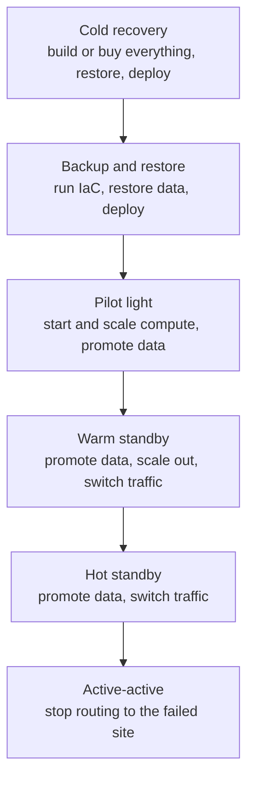
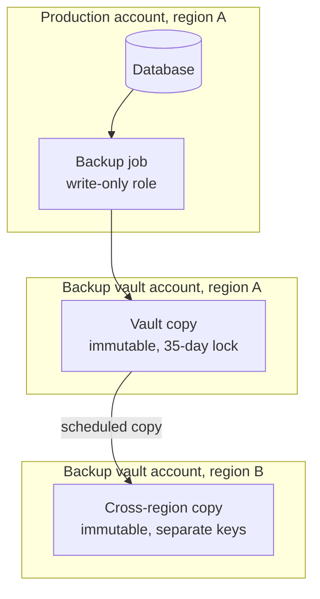
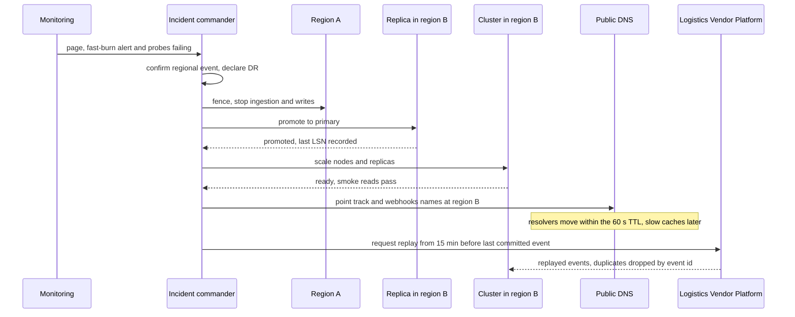

# Disaster recovery strategies

> Disaster recovery is the plan, the copies, and the rehearsed procedure that bring a service back
> after an event that high availability was never designed to absorb: a lost region, corrupted data,
> or an attacker with administrator rights. The strategy is chosen per tier from the RPO and RTO,
> and it exists only if a recent drill proved it.

!!! abstract "Page facts"
    **Level:** Intermediate (the strategies and backup types are Level 1-2; tiering, ransomware-proof
    backups, and proving RPO and RTO with arithmetic and drills are Level 3) · **Status:** Draft ·
    **Time:** 60-75 minutes · **Last verified:** 2026-11-27

## Learning objectives

After this page you should be able to:

- Place backup and restore, cold recovery, pilot light, warm standby, hot standby, and active-active
  on one spectrum, and say what each keeps running, its RPO and RTO shape, and what drives its cost.
- Compute storage and restore-chain length for full, incremental, and differential backup schedules.
- Design backups that survive ransomware: immutable, logically air-gapped, and cross-region copies
  under separate credentials.
- Explain point-in-time recovery, the order in which infrastructure, data, and applications recover,
  and why DNS failover is bounded by TTLs and misbehaving caches.
- Write a failover runbook with timed steps, check it against the RTO, and plan restore tests and
  failover drills that produce evidence.
- Distinguish a business continuity plan from a disaster recovery plan.

## Prerequisites

- [High availability design](high-availability-design.md) — fault domains, database failover,
  active-active and active-passive, DNS failover basics.
- [SLAs, SLOs, SLIs, error budgets, and recovery objectives](../architecture-fundamentals/slas-slos-slis-error-budgets-and-recovery-objectives.md)
  — RPO, RTO, and AtlasMart's NFR-7.
- [Data security and privacy](../security-architecture/data-security-and-privacy.md) — encryption
  keys, residency (C-4), and deletion from backups.

## The problem this solves

High availability keeps a service up through the failures it was designed for: an instance, a node,
a zone. It does nothing for an accidental `DELETE` that replicates to every standby in milliseconds,
for ransomware that encrypts the primary and then deletes the backups with the same administrator
role, or for a regional outage that takes every zone at once. Teams discover this during the event:
the backups were never restored, the second region was never deployed, the runbook names a person
who left, and the DNS change takes longer than anyone expected. Disaster recovery (DR) turns
"we have backups" into a chosen strategy per service, copies that an attacker cannot reach, a
procedure with timed steps, and drills that measure what is actually achieved.

## What it is

**Disaster recovery** is the set of policies, copies, infrastructure, and procedures that restore a
technology service after a disruptive event, within an agreed recovery point objective (RPO, how
much recent data may be lost) and recovery time objective (RTO, how long the service may be down).
A **DR strategy** says what is prepared in a recovery location before the event; the cheaper the
preparation, the more work remains to do during the event, and the longer the RTO.

DR sits inside a wider plan. A **business continuity plan (BCP)** keeps essential business functions
going during a disruption, including people, premises, suppliers, and manual workarounds ("take
orders by phone"). A **disaster recovery plan (DRP)** is the technology part: which systems come
back, in what order, where, and how. NIST's contingency planning guide (SP 800-34) treats the two as
related but distinct plans in one family; the practical point is that the DRP's RTOs must fit the
BCP's tolerance for each business function, not the other way round.

| Strategy | Prepared in the recovery location before the event | RPO shape | RTO shape | Main cost drivers |
|---|---|---|---|---|
| Cold recovery | Nothing but off-site backups; infrastructure is acquired or built at recovery time | Age of the last off-site backup (often a day) | Days (hardware) or many hours (manual build) | Backup storage only; very high people effort during the event |
| Backup and restore | Backups copied to the recovery region, tested infrastructure as code (IaC) | Backup interval (hours to a day; minutes with log archiving) | Hours: provision everything, restore data, deploy, test | Backup storage, cross-region copy transfer, restore tests |
| Pilot light | Data replicated continuously; core network and identity deployed; compute off or minimal | Replication lag (seconds to minutes) | Tens of minutes to a few hours: provision and scale compute | Replica database, replication transfer, idle network resources |
| Warm standby | A complete, smaller copy of the stack running and able to serve | Replication lag | Minutes to about an hour: promote, scale out, switch traffic | Replica database, a reduced always-on compute footprint |
| Hot standby | A complete copy at full scale, not serving (active-passive) | Replication lag | Minutes: promote and switch | Doubled compute and data, mostly idle |
| Active-active | Two or more full sites all serving traffic | Replication lag for async data, conflicts to resolve; near zero for sync data | Near zero for routing; the data tier decides | Doubled footprint plus multi-writer data design and testing |

The AWS DR whitepaper names four of these (backup and restore, pilot light, warm standby, and
multi-site active/active, which it says can also run as hot standby active/passive); Azure's
reliability guidance speaks of active-passive cold and warm standby; Google Cloud's planning guide
calls its patterns cold, warm, and hot. The names differ; the spectrum is the same.

## Mental model

Think of a restaurant planning for a kitchen fire. **Cold recovery** is a recipe book in a safe at
home: you can reopen somewhere, after finding premises and buying ovens. **Backup and restore** adds
a signed lease on a spare kitchen and a written fit-out plan. **Pilot light** is the spare kitchen
with gas connected, the pilot flame lit, and ingredients delivered daily; staff and full burners
come on when needed. **Warm standby** is a second kitchen already cooking a few dishes for takeaway,
ready to take more orders as cooks arrive. **Hot standby** is a fully staffed second kitchen waiting
for orders. **Active-active** is two kitchens both serving customers every night. The **BCP** is the
manager's plan for seating guests elsewhere and phoning reservations; the **DRP** is the kitchen
part.

**Where the analogy breaks:** in the cloud, the "ovens" are bought by an API call in minutes, so the
time-consuming steps are data (restoring or catching up terabytes) and decisions (who declares the
disaster), not hardware. And the fire can be inside the recipe book: corruption or ransomware
damages the copies too, which kitchens rarely have to plan for.

## Key terms

| Term | Meaning on this page |
|---|---|
| Disaster recovery (DR) | Restoring technology services after a disruptive event, within an agreed RPO and RTO |
| Recovery Point Objective (RPO) | The maximum acceptable amount of data loss measured in time |
| Recovery Time Objective (RTO) | The maximum acceptable time between a failure and restoration of service |
| Recovery time / point achieved | What a real recovery or drill actually measured, compared with the objectives |
| Pilot light | A DR strategy where data is replicated and core infrastructure exists, but compute is off until needed |
| Warm standby | A DR strategy where a scaled-down, fully working copy runs in the recovery location |
| Hot standby | A full-scale copy that is running but not serving traffic until failover |
| Full / incremental / differential backup | A complete copy / changes since the last backup of any type / changes since the last full backup |
| Immutable backup | A backup that cannot be changed or deleted before its retention ends, even by an administrator |
| Air-gapped backup | A copy unreachable from the production environment's networks and identities; "logical" when separation is by account, credentials, and policy rather than physical disconnection |
| Point-in-time recovery (PITR) | Restoring a database to a chosen moment by replaying archived transaction logs on top of a base backup |
| Runbook | A written, step-by-step procedure with owners, commands, checks, and expected durations |
| Game day | A planned exercise in which a team injects a failure or runs a recovery and measures the result |
| BCP / DRP | Business continuity plan (keep business functions going) / disaster recovery plan (restore the technology) |

## How it works

### Step 1 — Tier services from the business impact

A **business impact analysis** asks, per business function, how long it can be unavailable and how
much data it can lose before the harm becomes unacceptable. Those answers become RTO and RPO per
service, and services with similar objectives are grouped into **DR tiers**, because a strategy per
tier is manageable and a strategy per service is not. Dependencies decide tier membership as much as
importance: if checkout calls payments synchronously, payments cannot be in a slower tier than
checkout. Tiers also set the order of recovery when everything is down at once.

### Step 2 — Choose a strategy per tier

**Figure 1 — The DR strategy spectrum.** Moving down, more is running before the disaster: RTO
shrinks and steady-state cost grows. Each box lists what still has to happen during recovery.

How to read it: the arrows point toward faster recovery and higher standing cost. Pick the cheapest
box whose remaining steps fit inside the tier's RTO, and whose data path fits its RPO.

Two cautions. First, the strategy limits the RTO only from below: a warm standby with an untested
runbook and a two-hour approval chain is slower than a well-drilled backup restore. Second,
replication protects against losing a site, not against bad writes. Every strategy from pilot light
down replicates corruption and deletions faithfully, so every tier still needs backups or PITR.

### Step 3 — Backups: full, incremental, and differential

A **full** backup copies everything; an **incremental** copies what changed since the previous
backup of any kind; a **differential** copies what changed since the last full. The trade-off is
storage and backup time against restore complexity.

Worked arithmetic for a 200 GB database that changes 10 GB per day (5%), backed up nightly, with a
weekly full on Sunday. For an upper bound, assume each day changes different data:

| Schedule | Stored per week | Restore on Saturday needs | Pieces in the restore chain |
|---|---|---|---|
| Daily full | 7 × 200 = 1,400 GB | Saturday's full | 1 |
| Weekly full + daily incremental | 200 + 6 × 10 = 260 GB | Sunday full + Monday..Saturday incrementals | 7 |
| Weekly full + daily differential | 200 + (10 + 20 + 30 + 40 + 50 + 60) = 410 GB | Sunday full + Saturday differential | 2 |

Incrementals are smallest but every link in the chain must be present and readable: one damaged
Wednesday incremental makes Thursday to Saturday unrecoverable. Differentials grow during the week
but restore in two steps. Many backup services now use "incremental forever" with periodic
**synthetic fulls** (assembled from earlier pieces without re-reading the source), and block-storage
snapshots typically store only changed blocks after the first; check how your provider stores,
bills, and restores them. Whatever the scheme, the restore chain length is a property to test, not
to assume.

### Step 4 — Protect the copies: immutable, air-gapped, cross-region

A backup that the production administrator can delete is not a recovery mechanism against an
attacker who holds that administrator role. Ransomware operators routinely look for and destroy
backups first (CISA's guide stresses offline, encrypted backups that are tested). Three properties,
used together:

- **Immutable:** write-once retention locks on the backup vault or object store, in a mode where not
  even an administrator can shorten them before expiry (the glossary's WORM compliance mode).
- **Logically air-gapped:** the copy lives in a separate account with separate credentials, ideally
  administered by a different team, with no network path or role trust from production. A true
  physical air gap (offline media) is still used for the most critical data.
- **Cross-region:** a copy in the recovery region, so a regional event does not take both the data
  and its backups. Under a residency constraint, the region must still satisfy it.

**Figure 2 — Backup copies out of the blast radius.** Production can write new backups but cannot
read back, change, or delete anything in the vault accounts.

How to read it: the arrows are the only allowed flows. The vault accounts are owned by a separate
team; their encryption keys are not usable from production; a restore goes into an isolated
recovery account first. The 35-day lock is an example value, set per data classification.

The latest backup is not always clean. If an attacker was present for days, recovery must go back to
the last known-clean point, which investigation finds, not the schedule (see
[Security operations](../security-architecture/security-operations.md)). Retention must therefore be
longer than the likely time to detect an intrusion, and deletion requests still have to be honoured
after a restore (the deletion ledger in
[Data security and privacy](../security-architecture/data-security-and-privacy.md)).

### Step 5 — Point-in-time recovery

**Point-in-time recovery (PITR)** combines a periodic **base backup** with a continuous **archive of
the transaction log** (the write-ahead log, WAL, in PostgreSQL). To recover, the database restores the
base backup and replays the log up to a chosen moment, for example one second before a bad
migration ran. Its RPO is the gap between the last archived log segment and the failure; PostgreSQL's
`archive_timeout` setting forces a segment switch at a fixed interval so that gap is bounded even
when write traffic is low. Managed databases expose PITR as a retention window and a restore target
time; the restore creates a new instance, which the application must then be pointed at.

PITR's RTO is restore time plus replay time: a larger base backup and a longer stretch of log to
replay both make it slower. Taking base backups more often shortens replay; restoring only the
damaged table into a side instance and copying rows back is often faster than replacing the whole
database.

### Step 6 — Recover in layers: infrastructure, data, application, traffic

A recovery restores three things, in dependency order:

1. **Infrastructure recovery:** accounts, networks, identity, keys, secrets, clusters, built from IaC
   in the recovery region. Anything created by hand during the year is the usual gap.
2. **Storage and data recovery:** promote replicas or restore backups, check integrity (row counts,
   checksums, the last committed transaction), and re-apply deletions that the copies predate.
3. **Application recovery:** deploy the known-good versions from the replicated registry (GitOps
   makes the desired state a repository, which helps), warm caches, start consumers in the right
   order so queues do not flood a cold database.

Traffic moves last, after smoke tests pass. Doing it earlier turns a recovery into a second outage.

### Step 7 — DNS failover and its TTL caveats

Most active-passive designs switch traffic by changing DNS. The change is quick at the authoritative
server, but clients see it only when their cached answer expires:

- **TTL bounds well-behaved caches.** With a 60 s TTL, resolvers that honour it move within about a
  minute of the change.
- **Some caches do not behave.** Long-lived connections keep using the old address until they are
  closed; some clients and runtimes cache longer than the TTL; partner systems (carriers posting
  webhooks, for example) may pin addresses. Plan for a tail of minutes, and keep the failed region's
  endpoints returning fast errors rather than hanging, so clients retry and re-resolve.
- **Health-checked automatic failover** must check what matters (can the region serve a real read?)
  and should usually be disabled for regional DR, where a human decides, to avoid flapping between
  regions on a partial failure.
- **DNS is a dependency.** The DNS provider, its control plane, and the account that holds the zone
  must be reachable from outside the failed region.

Global load balancers with anycast addresses avoid client DNS caching altogether, at the cost of a
different global dependency.

### Step 8 — Orchestration and runbooks

A **runbook** turns the strategy into steps: trigger conditions, who decides (the incident
commander), each step's owner, command or automation, verification, expected duration, and the
rollback or fail-back path. **Recovery orchestration** automates the mechanical steps (promote,
scale, deploy, switch) as one tested workflow, while keeping the decision to start it with a human
for regional events. Two rules: the runbook and its tooling must not depend on the failed region
(store copies outside it, and test break-glass access), and every step has a measured duration, so
the sum can be checked against the RTO.

### Step 9 — Test recovery, or it does not exist

| Test | What it proves | Typical cadence |
|---|---|---|
| Automated restore test | A recent backup restores, passes integrity checks, and how long it took (evidence for the RTO) | Daily to weekly per tier |
| Tabletop walk-through | The runbook is current; people know their roles | Quarterly |
| Component failover drill | Promotion, scaling, and DNS steps work and how long each takes | Quarterly |
| Full regional game day | The whole runbook works end to end; the recovery time and point achieved | Once or twice a year per tier 1 service |
| Fail-back | Returning to the primary region works without a second data loss | With each full game day |

Each test records the recovery time and point achieved and feeds a runbook fix list. The SRE book's
data-integrity chapter makes the same point: what matters is the restore, not the backup.

## Worked example: AtlasMart's three DR tiers

The exercise brief already fixes three tiers for AtlasMart's 40 services. Phase 4B adds the
strategies (assumptions, used across the batch): the **recovery region is a second EU region**
(keeps C-4); **tier 1 uses warm standby, tier 2 pilot light, tier 3 backup and restore**; regional
failover is **a human decision by the incident commander**, following a runbook rehearsed quarterly
in a game day. This extends NFR-7 (RPO 5 min, RTO 1 h) to a region loss, which the
[SLA page](../architecture-fundamentals/slas-slos-slis-error-budgets-and-recovery-objectives.md#recovery-design-from-rto-and-rpo)
had recorded as out of scope; that decision is now superseded for tier 1.

| Tier | Services (examples) | RPO / RTO | Strategy | Running in region B before the event |
|---|---|---|---|---|
| 1 | Checkout, payments, order tracking | 5 min / 1 h | Warm standby | Database replicas, a 3-node cluster with every tier 1 service at minimum replicas, replicated registry and secrets |
| 2 | Services needed within hours, for example order history and returns (assumption) | 1 h / 4 h | Pilot light | Database replicas or hourly log shipping; network and identity; no compute |
| 3 | Internal tools and reporting (assumption) | 24 h (assumption) / 24 h | Backup and restore | Daily immutable backups copied cross-region; tested IaC |

The rest of the example checks tier 1 for Order Tracking.

### Tier 1 standby design for Order Tracking

| Component | Region A (primary, as today) | Region B (warm standby; assumptions) |
|---|---|---|
| Network | prod `10.10.0.0/16` | prod `10.11.0.0/16`, the block the address plan reserved for a second region |
| Cluster | 6 nodes of 4 vCPU / 16 GiB, autoscaling to 18 | 3 nodes of the same size (one per zone), autoscaling to 18 |
| Tracking API | 3-9 replicas | 3 replicas (the same minimum), HPA to 9 |
| Tracking Event Store | Primary + synchronous standby | Asynchronous cross-region replica; WAL archive copied to region B |
| Status Cache | Redis, 30 s TTL | Small empty instance; cache-aside refills it |
| Event Queue, Ingestor, Processor | Running | Deployed at minimum scale, idle until DNS moves |
| Images, secrets, Argo CD | Shared-services registry; External Secrets Operator | Registry replica and secret copies in region B; Argo CD in region B syncing the same repository |

Capacity check: the HPA maximum of 9 replicas serves the 210 reads/s design peak, so if load is linear
one replica carries 210 / 9 ≈ 23 reads/s and the 3 standby replicas carry about 70 reads/s, the normal
evening peak. A disaster on a sale day needs the scale-out step in the runbook.

### RPO check: is 5 minutes met?

RPO budget: 300 s. Two independent paths hold region A's data in region B:

| Path | Worst-case data loss | Basis |
|---|---|---|
| Cross-region replica | Replication lag at the moment of failure: normally ≤ 5 s; a hard safety alert pages when lag > 60 s for 2 minutes | Lag figures are assumptions to measure in the game day |
| WAL archive in region B | Archive interval 60 s (`archive_timeout` or the managed equivalent) + about 10 s to upload ≈ 70 s | Assumption; check the managed service's log backup interval |

Both paths stay inside 300 s, and the archive covers a replica that broke silently. In events, the
worst case that the full budget allows is 70 events/s × 300 s = 21,000 events at design peak; at the
average 5.6 events/s with 5 s of lag, about 28 events.

One more gap: the Event Queue is regional, so events that the Webhook Ingestor acknowledged in
region A but the Event Processor had not committed are lost with the region. NFR-1 lets processing
take up to 60 s, so at peak up to 70 × 60 = 4,200 events can be in flight. NFR-7 says no
acknowledged event may be lost, so replication alone does not satisfy it. The runbook therefore
ends with a **reconciliation step**: request a replay from the Logistics Vendor Platform for the
window from 15 minutes before the last committed event (an assumption that the platform supports
replay by time window; confirm in the vendor contract). The Event Processor already deduplicates on
the carrier event id, so replaying events that did arrive is harmless.

### RTO check: is 1 hour met?

The RTO clock starts at the failure, not at the page. Detection first: a full outage has an error
ratio of 100%, so the fast-burn alert (burn rate 14.4 over 1 h, against a 0.1% budget) trips once the
1-hour window's error ratio passes 14.4 × 0.1% = 1.44%, which takes 1.44% × 60 min ≈ 0.9 min. The
alert's short confirmation window and paging delays are covered by a 5-minute allowance.

| # | Runbook step | Owner | Minutes (assumption) | Depends on |
|---|---|---|---|---|
| 1 | Detect and page | Monitoring | 5 | Failure |
| 2 | Assess, confirm a regional event, declare DR | Incident commander | 15 | 1 |
| 3 | Fence region A: stop ingestion and writes there | Platform on-call | 3 | 2 |
| 4 | Promote the region B replica, check the last LSN | Database on-call | 5 | 3 |
| 5 | Scale region B: cluster to 6 nodes, replicas to the observed load | Platform on-call | 10 | 2 |
| 6 | Switch `track.atlasmart.example` and `webhooks.atlasmart.example` (TTL 60 s) and allow for slow caches | Platform on-call | 5 | 4 and 5 |
| 7 | Smoke tests, declare service restored | Product team on-call | 5 | 6 |
| 8 | Reconcile from the Logistics Vendor Platform | Product team | After restore | 7 |

Done one after another, steps 1-7 take 5 + 15 + 3 + 5 + 10 + 5 + 5 = 48 minutes. Step 5 needs only
the decision, so it runs alongside steps 3 and 4: the critical path is 5 + 15 + max(3 + 5, 10) + 5 +
5 = 40 minutes, leaving 20 minutes of margin. The largest item is the human decision, which is why
the runbook gives the incident commander explicit criteria and a time box.

**Figure 3 — The tier 1 runbook's critical path.** Bars are runbook steps on a clock that starts
at the failure; the compute scale-out overlaps the data steps.

```mermaid
gantt
    title Tier 1 regional failover, minutes after the failure
    dateFormat HH:mm
    axisFormat %H:%M
    section Decide
    Detect and page           :s1, 00:00, 5m
    Assess and declare DR     :s2, after s1, 15m
    section Data
    Fence region A            :s3, after s2, 3m
    Promote replica in B      :s4, after s3, 5m
    section Compute
    Scale out region B        :s5, after s2, 10m
    section Traffic
    Switch DNS, wait for TTL  :s6, after s4 s5, 5m
    Smoke test and declare    :s7, after s6, 5m
```

How to read it: the axis is hours and minutes since the failure; service is restored at about
00:40, inside the 01:00 RTO. Every bar is an assumption until a game day measures it.

**Figure 4 — The failover sequence.** Who does what, in order, during a tier 1 regional failover.

How to read it: time runs downward. Fencing comes before promotion so region A cannot accept writes
if it partly recovers (split brain). Reconciliation runs after the service is back and closes the
queue gap that replication could not.

### Tier 2, tier 3, and the harder case

- **Tier 2 (pilot light, RTO 4 h):** the network, identity, and database replicas exist; the runbook
  builds a cluster from IaC and lets Argo CD deploy. Assumed durations: cluster 45 min, deploy and
  sync 30 min, data promotion and checks 30 min, traffic and tests 30 min, decision 15 min: 2.5 hours,
  1.5 hours of margin.
- **Tier 3 (backup and restore, 24 h):** daily backups, immutable, copied to region B. A tier 3
  database of 200 GB uses the weekly full plus daily differential schedule from Step 3 (two-piece
  restores).
- **Corruption in tier 1 is harder than a region loss.** A bad migration replicates to the region B
  replica too, so recovery is PITR. Restoring the 430 GB event store at an assumed 200 MB/s takes
  430,000 MB ÷ 200 MB/s = 2,150 s ≈ 36 minutes before log replay, validation, and repointing:
  inside 1 hour only with daily base backups (short replay) and a rehearsed procedure. Restoring only
  the affected table into a side instance is the faster plan for most logical errors.

### What the design decided

| Decision | Driven by |
|---|---|
| Second EU region for all tiers | C-4 residency |
| Warm standby for tier 1, sized for the evening peak, scale-out in the runbook | RTO 1 h with a 40-minute critical path; cost of a hot standby not justified |
| Replica plus a 60 s WAL archive in region B | RPO 5 min with two independent paths |
| Reconciliation replay after failover | NFR-7's "no acknowledged event lost" across a regional queue |
| Human-declared failover, quarterly game day, automated restore tests | Avoid flapping; measured evidence for RPO and RTO |
| Immutable backups in separate vault accounts in both regions | Ransomware and operator error |

## Real-world architecture example

A typical regulated online business runs its customer-facing core (sign-in, ordering, payments) as
warm or hot standby in a second region with asynchronous database replication and a scripted,
human-triggered failover; back-office systems as pilot light; and internal tools and analytics as
backup and restore. Backups go to a vault account owned by a separate security or platform team with
compliance-mode locks; restore tests run nightly into an isolated account and publish their
durations to a dashboard. A yearly full regional game day, often in a quiet season, fails the
customer-facing tier over for real and fails it back; the findings list is long the first time and
short by the third. The detailed products differ per provider; each provider's DR guidance (see
References) maps the strategies to its services.

## Design choices and trade-offs

| Choice | Favor when | Avoid when |
|---|---|---|
| Backup and restore | RTO of many hours to a day; low budget; data changes slowly | Revenue or safety depends on the service within hours |
| Pilot light | RTO of a few hours; data must be current; compute is easy to rebuild from IaC | Startup or scale-out of compute alone would exceed the RTO |
| Warm standby | RTO around an hour; traffic must move with minimal rebuilding | The team cannot keep the standby deployed and in sync with every release |
| Hot standby | RTO of minutes; capacity must be available instantly, for example on sale days | Budget cannot carry an idle full copy; active-active is feasible instead |
| Active-active | RTO near zero; users in several geographies; data model tolerates async or partitioned writes | Writes need strong consistency across sites; the team lacks conflict-handling experience |
| Automatic regional failover | Very low RTO and well-proven health signals | Partial failures are common; flapping between regions would cause data divergence |
| Incremental-forever with synthetic fulls | Large data, small daily change | Backup tooling cannot verify chains; restore tests are rare |

## Failure modes and anti-patterns

- **Backups that were never restored.** Detect: no recorded restore duration per tier. Prevent:
  automated restore tests with integrity checks, alerting when one fails or has not run.
- **Backups the attacker can delete.** Detect: a production admin role can delete or shorten vault
  retention. Prevent: immutable vaults in separate accounts and an audit of that permission.
- **Replication mistaken for backup.** Detect: the only copy of data is a replica. Prevent: PITR or
  backups for every tier, because deletes and corruption replicate.
- **Standby drift.** The standby region misses a new service, secret, or quota. Detect: a weekly
  diff of deployed versions and quotas between regions. Prevent: deploy both regions from the same
  pipeline and repository; include region B in every release.
- **Runbook depends on the failed region.** The runbook wiki, CI system, or identity provider is in
  region A. Detect: tabletop asks "where does this step run?". Prevent: copies and break-glass
  access outside the primary region.
- **DNS that cannot move fast enough.** TTLs of hours, or partner systems pinning addresses. Detect:
  measure in a drill how long traffic takes to drain. Prevent: short TTLs on failover names, fast
  errors from the old region, partner communication in the runbook.
- **Recovery order ignored.** Consumers start before the database is promoted and flood it with
  retries. Prevent: the runbook orders infrastructure, data, application, traffic, and scales
  consumers last.
- **No fail-back plan.** The team fails over, then cannot return without another outage. Prevent:
  rehearse fail-back with re-replication from region B to A.

## Security considerations

- **Separate the recovery control plane.** Vault accounts, keys, and DR automation need identities
  that production cannot assume, plus break-glass access tested in every game day.
- **Keys must survive too.** Encrypted backups are useless without their keys; key material, key
  policies, and the KMS in the recovery region are part of the DR design, and keys used for
  crypto-shredding must be deleted deliberately, never by a DR failure.
- **Restore into isolation first.** After a security incident, restore to an isolated account, scan,
  and verify before reconnecting, so the recovery does not reinstate the attacker.
- **Residency applies to every copy.** Backup copies, log archives, and replicas must stay in
  permitted regions (C-4 for AtlasMart); a DR region outside the boundary is a compliance incident.
- **Failover is a privileged action.** Promotion, DNS changes, and fencing are logged and limited to
  the on-call roles named in the runbook.

## Performance, reliability, and cost

- **Performance:** asynchronous cross-region replication costs nothing on the commit path, which is
  why it is the default for DR; synchronous cross-region replication adds a round trip of tens of
  milliseconds to each commit. A freshly promoted region starts with cold caches, so the database
  sees more load in the first minutes (cache-aside refills it).
- **Reliability:** DR adds a second set of components that can fail and drift; only drills keep the
  recovery time achieved close to the objective. Correlated dependencies (DNS provider, identity
  provider, CI) shared by both regions limit what a second region buys.
- **Cost:** the strategy sets the standing cost. With an illustrative rate of 1 vCPU-hour = 1 CU,
  AtlasMart's prod cluster minimum costs 6 nodes × 4 vCPU × 730 h = 17,520 CU per month; the tier 1
  warm standby's 3 nodes cost 8,760 CU; a hot standby would cost another 17,520 CU; pilot light and
  backup and restore cost no compute. Replica databases, cross-region transfer, backup storage
  (Step 3's arithmetic), and the people time for drills complete the bill.

## Hands-on lab: backup chains and a runbook critical path

No full lab page covers DR in this phase. This mini-lab runs locally with Python 3 and the standard
library.

1. Write a function that, given a database size, a daily change in GB, and a schedule (daily full,
   weekly full plus incrementals, or weekly full plus differentials), returns the GB stored per week
   and the pieces needed to restore each day. Check it against the Step 3 table.
2. Add a retention parameter (four weeks) and compute total stored GB for each schedule.
3. Mark one incremental as damaged and list which days become unrecoverable under each schedule.
4. Encode the tier 1 runbook as steps with durations and dependencies, and compute the sequential sum
   and the critical path (a longest path through the dependency graph). Confirm 48 and 40 minutes.
5. Change the decision step from 15 to 30 minutes and the scale-out from 10 to 25 minutes; report
   whether the RTO is still met and which step to attack first.

??? question "Hint: how do you compute the critical path?"
    Process steps in dependency order (a topological sort). Each step's finish time is its duration
    plus the latest finish time among the steps it depends on; the last step's finish time is the
    critical path. With 30 and 25 minutes, the path becomes 5 + 30 + max(8, 25) + 5 + 5 = 70 minutes,
    so the RTO fails; the decision step is the cheapest to shorten, with clear criteria and pre-approval.

## Knowledge check

1. Why does every DR strategy, including active-active, still need backups or PITR?
2. A 500 GB database changes 25 GB a day. Compare storage per week and restore pieces for Saturday
   under weekly full plus daily incrementals and weekly full plus daily differentials.
3. Name the three properties that make backups survive ransomware, and what each defends against.
4. Your DNS failover record has a 60 s TTL, yet a drill shows 8% of traffic reaching the dead region
   after 10 minutes. Give two likely causes and one mitigation.
5. What is the difference between a BCP and a DRP, and which one sets the other's targets?

??? success "Answers"
    1. Replication copies every write, including deletes, bad migrations, and encrypted data, to every
       site within seconds. Only an older, independent copy (a backup or a log archive you can stop
       replaying before the bad write) recovers from logical damage.
    2. Incrementals: 500 + 6 × 25 = 650 GB, seven pieces (full plus six incrementals). Differentials
       (upper bound): 500 + (25 + 50 + 75 + 100 + 125 + 150) = 1,025 GB, two pieces.
    3. Immutability (the copy cannot be deleted or shortened, even by an admin), logical air gap
       (separate account, credentials, and admins, so stolen production rights do not reach it), and
       a cross-region copy (a regional event or regional compromise does not take every copy).
    4. Long-lived connections still open to the old endpoints, and clients or partner systems caching
       beyond the TTL. Make the old region return fast errors or close connections so clients
       reconnect and re-resolve, or use a global load balancer.
    5. The BCP keeps business functions running (people, process, workarounds); the DRP restores the
       technology. The BCP's tolerance for each function sets the DRP's RTO and RPO.

## Architecture discussion questions

1. Payments is in tier 1 but depends on an external payment provider with its own regional setup.
   How should the DR runbook and the BIA treat a dependency you cannot fail over?
2. The finance team asks why tier 1 is not simply hot standby "to be safe". Using this page's cost
   and critical-path arithmetic, argue for or against.
3. When would you allow automatic regional failover for tracking reads only, while keeping writes
   behind the incident commander's decision? What could go wrong?

## Summary

DR restores technology after events that high availability does not absorb: regional loss,
corruption, and attack. The strategies form a spectrum from cold recovery and backup and restore,
through pilot light and warm standby, to hot standby and active-active; more running in advance means
a shorter RTO and a higher standing cost, and replication sets the RPO. Every tier still needs
backups that are immutable, logically air-gapped, and cross-region, and PITR for logical errors.
Recovery runs in order (infrastructure, data, application, traffic), traffic moves by DNS within the
limits of TTLs and caches, and a timed runbook proves the RTO on paper while drills prove it in
practice. AtlasMart's tier 1 warm standby meets RPO 5 min with two data paths and RTO 1 h with a
40-minute critical path, plus a replay that closes the regional queue gap.

## Related topics

- **Before:** [High availability design](high-availability-design.md);
  [SLAs, SLOs, SLIs, error budgets, and recovery objectives](../architecture-fundamentals/slas-slos-slis-error-budgets-and-recovery-objectives.md);
  [Multi-account strategy and infrastructure automation](../cloud-architecture/multi-account-strategy-and-infrastructure-automation.md)
  (automated backup policies by `backup-tier`).
- **Alongside:** [Reliability engineering](reliability-engineering.md);
  [Advanced resilience and failure containment](advanced-resilience-and-failure-containment.md)
  (split brain, recovery sequencing); [Incident management and SRE practices](../observability-and-sre/incident-management-and-sre-practices.md);
  [Security operations](../security-architecture/security-operations.md) (ransomware-aware recovery);
  [Hybrid and multi-cloud architecture](../enterprise-architecture/hybrid-and-multi-cloud-architecture.md);
  [Case study 10: multi-region disaster recovery](../end-to-end-case-studies/cs-10-multi-region-disaster-recovery.md);
  [Exercise: multi-region disaster recovery](../system-design-exercises/multi-region-disaster-recovery.md).
- **Planned:** NoSQL and multi-region data stores (D06-T02); event-driven architecture and replay
  (D08-T02).

## References

| Source | Type | Checked |
|---|---|---|
| [Disaster Recovery of Workloads on AWS: Recovery in the Cloud](https://docs.aws.amazon.com/whitepapers/latest/disaster-recovery-workloads-on-aws/disaster-recovery-workloads-on-aws.html) and its [Disaster recovery options in the cloud](https://docs.aws.amazon.com/whitepapers/latest/disaster-recovery-workloads-on-aws/disaster-recovery-options-in-the-cloud.html) section — AWS | Whitepaper (four strategies, hot standby as a variant) | 2026-11-27 |
| [Architecture strategies for disaster recovery](https://learn.microsoft.com/en-us/azure/well-architected/reliability/disaster-recovery) — Microsoft Azure Well-Architected Framework | Official guidance (cold and warm standby, DR plans, drills) | 2026-11-27 |
| [Disaster recovery planning guide](https://docs.cloud.google.com/architecture/dr-scenarios-planning-guide) — Google Cloud Architecture Center | Official guidance (cold, warm, hot patterns) | 2026-11-27 |
| [SP 800-34 Rev. 1, Contingency Planning Guide for Federal Information Systems](https://csrc.nist.gov/pubs/sp/800/34/r1/upd1/final) — NIST | Standard guidance (BCP, DRP, BIA, testing) | 2026-11-27 |
| [Data Integrity: Principles and Best Practices](https://sre.google/sre-book/data-integrity/) — Google SRE book | Book chapter (restores over backups, defence in depth for data) | 2026-11-27 |
| [Continuous Archiving and Point-in-Time Recovery (PITR)](https://www.postgresql.org/docs/current/continuous-archiving.html) — PostgreSQL documentation | Official documentation (base backups, WAL archiving, `archive_timeout`) | 2026-11-27 |
| [#StopRansomware Guide](https://www.cisa.gov/stopransomware/ransomware-guide) — CISA | Government guidance (offline, encrypted, tested backups) | 2026-11-27 |

## Review notes

- Canonical page for D13-T03. In depth: the strategy spectrum and comparison table, full,
  incremental, and differential backups (arithmetic), immutable, air-gapped, and cross-region backups,
  PITR, DNS failover, runbooks, recovery testing, and the AtlasMart tier 1 RPO and RTO arithmetic.
  Only defined or covered briefly: cold recovery (one table row and the analogy), hot standby and
  active-active (table rows; active-active depth is in High availability design and case study 10),
  infrastructure, storage, and application recovery (one ordered list), recovery orchestration (one
  paragraph), and BCP versus DRP (definitions and one sentence on precedence).
- AWS whitepaper titles were checked against the page `<title>`: "Disaster Recovery of Workloads on
  AWS: Recovery in the Cloud" and "Disaster recovery options in the cloud". The provider naming
  sentences (AWS four strategies with hot standby as a variant; Azure active-passive cold and warm
  standby; Google cold, warm, hot) were read from those pages on 2026-11-27.
- New AtlasMart assumptions introduced: region B uses prod `10.11.0.0/16` (the reserved block);
  region B tier 1 cluster of 3 nodes and 3 Tracking API replicas; linear scaling of about 23 reads/s
  per replica (210 / 9); normal replica lag ≤ 5 s, lag alert at 60 s for 2 minutes; WAL archive
  interval 60 s plus about 10 s upload; Logistics Vendor Platform replay by time window and a 15-minute
  replay overlap; runbook durations 5/15/3/5/10/5/5 minutes; tier 2 durations; tier 3 RPO 24 h;
  a 200 GB tier 3 database with 10 GB daily change; a 200 MB/s restore throughput; 35-day vault lock
  as an example; cost rate 1 vCPU-hour = 1 CU (illustrative). Derived: 21,000 and 28 events at risk,
  4,200 in-flight events, 48-minute sequential and 40-minute critical path, 36-minute restore.
- This page supersedes the SLA page's statement that a region outage is out of scope for NFR-7; a
  reviewer should add a note there when the coordinator updates cross-page decisions.
- Figure 3 is a Mermaid `gantt` with `HH:mm` dates and an `after s4 s5` dependency; check it renders
  in the Material theme in both colour schemes.
