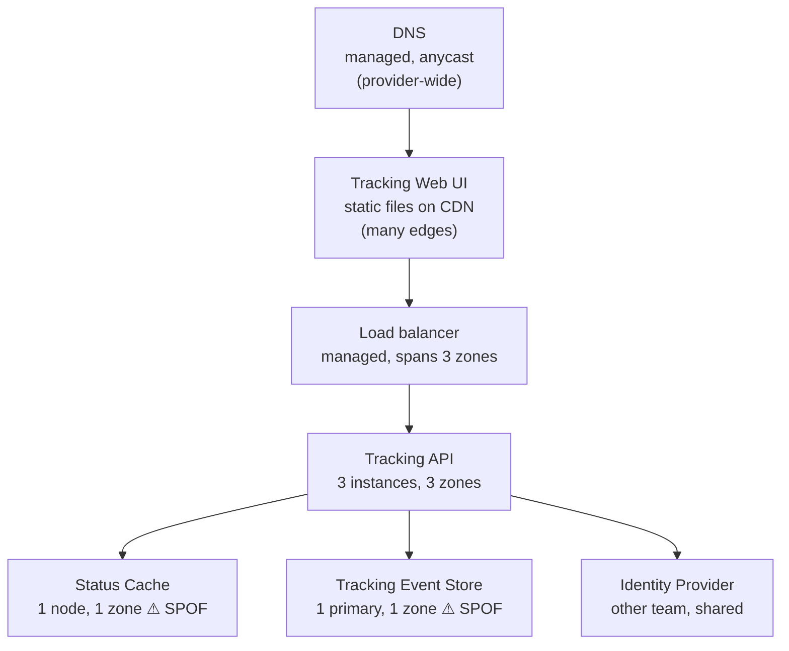
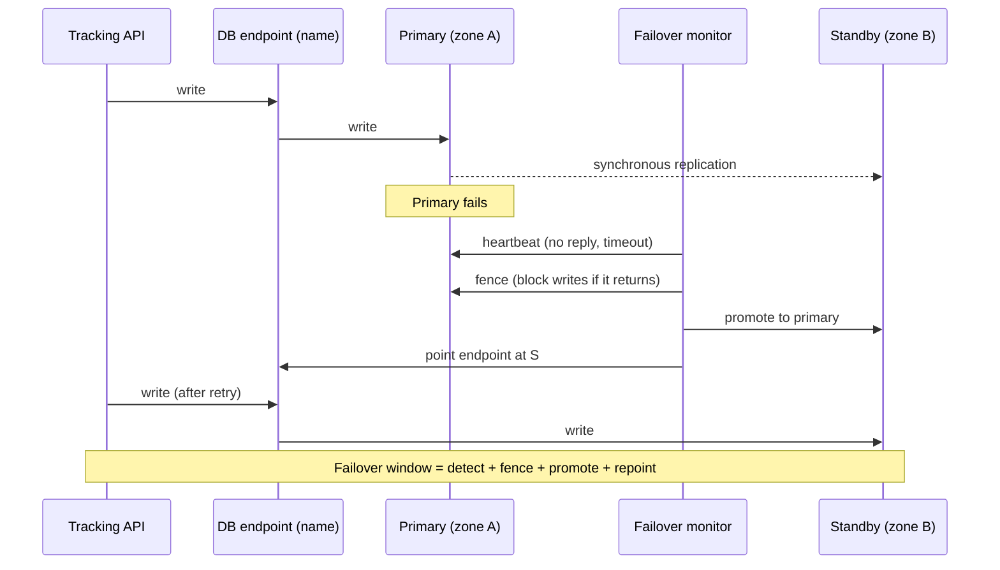
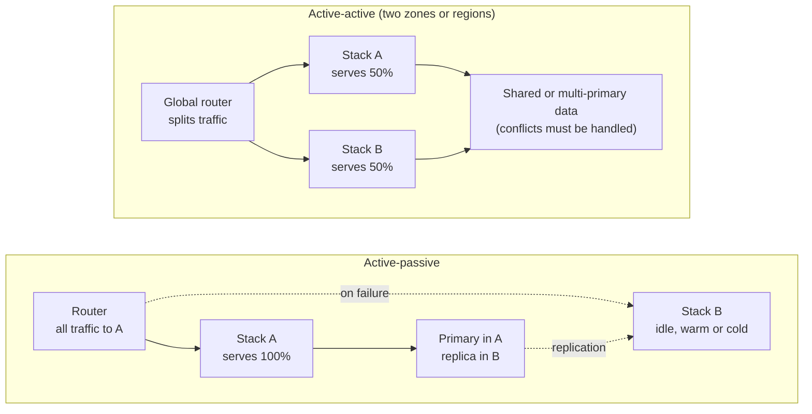
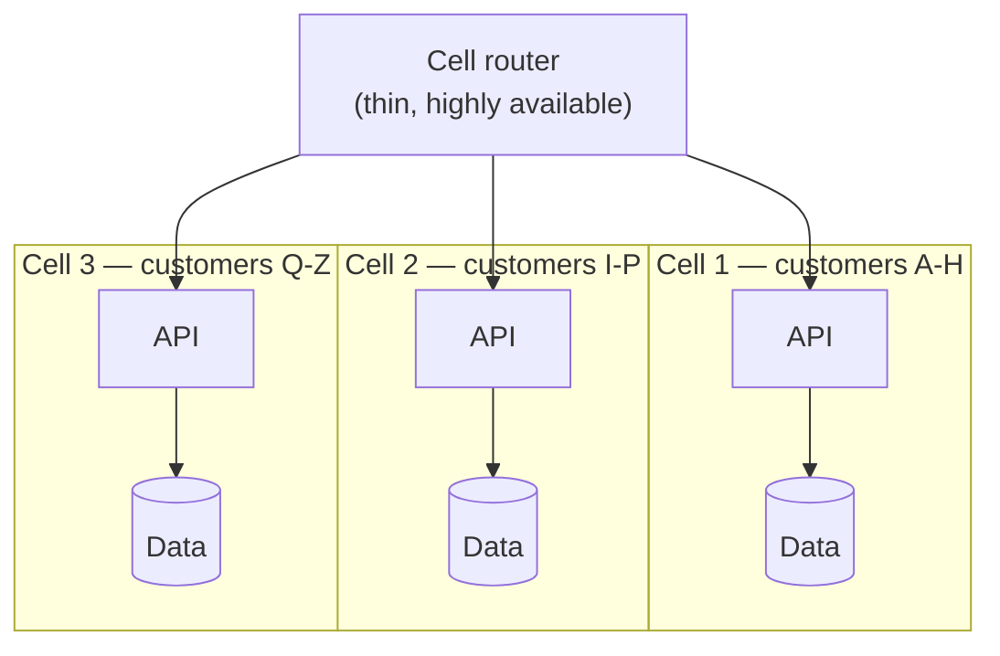
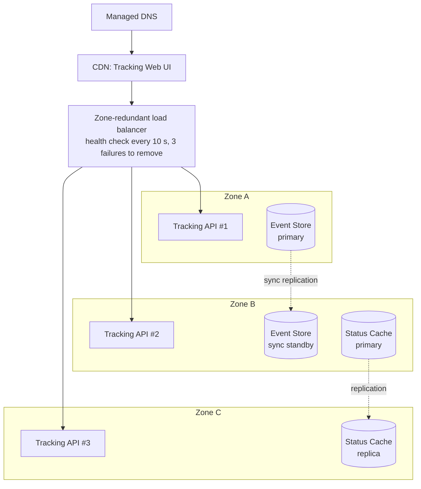

# High availability design

> High availability is redundancy placed across independent fault domains, plus a way to detect
> failure and switch over faster than the availability target allows you to be down. The arithmetic
> tells you which component to fix next.

!!! abstract "Page facts"
    **Level:** Mixed (concepts are Level 1-2; multi-region and cell-based design are Level 3) ·
    **Status:** Draft · **Time:** 60-75 minutes · **Last verified:** 2026-11-15

## Learning objectives

After this page you should be able to:

- Find the single points of failure in a container or deployment diagram, including the ones that
  hide in shared dependencies.
- Explain fault domains (host, rack, zone, region, provider, deploy) and choose which ones a design
  must survive to meet its target.
- Design load balancing, health checks, and failover for stateless tiers, and failover for databases
  and DNS, with their timing.
- Compare active-active and active-passive topologies, multi-zone and multi-region deployments, and
  cell-based architectures, and say when each is worth its cost.
- Compute the availability of a request path from per-component assumptions and use the result to
  decide what to change.

## Prerequisites

- [Quality attributes and trade-offs](../architecture-fundamentals/quality-attributes-and-trade-offs.md)
  — the "nines" table and the serial/parallel composition rules are introduced there.
- [The C4 model](../architecture-fundamentals/c4-model.md) — the deployment diagram is where
  availability design is drawn.
- [Capacity estimation](../performance-and-scalability/capacity-estimation.md) — the minimum instance
  count is set by availability, and N−1 instances must carry the peak.

## The problem this solves

Every component fails: disks, hosts, power feeds, network links, whole zones, cloud control planes,
and the deploy you ran on Tuesday. A target like "99.9% per month" (NFR-2 in the AtlasMart example)
allows about 44 minutes of downtime a month. One unplanned database restart and one bad deploy can
spend that. High availability (HA) design is how you decide, before the outage, which failures the
system absorbs without customers noticing, which it survives with reduced function, and which you
accept. Without it, "we have redundancy" usually means two copies of the application sharing one
database, one load balancer configuration, and one deploy pipeline.

## What it is

**High availability** is the property of continuing to serve requests through component failures,
achieved by combining four things:

| Ingredient | What it does | Typical mechanism |
|---|---|---|
| Redundancy | More than one of each thing that can fail | N+1 instances, replicas, standby databases |
| Fault domain separation | Redundant copies fail independently | Different hosts, zones, regions, deploy waves |
| Detection | Notice that a copy has failed | Health checks, heartbeats, monitors |
| Failover | Move traffic or role to a healthy copy | Load balancer removal, replica promotion, DNS change |

Availability is measured (NFR-2 says *how*: synthetic checks every minute from two regions), and the
target is a budget. HA design spends that budget deliberately: a database failover that takes 60
seconds costs one minute of the 44.

## Mental model

A hospital's power supply. The grid is one feed; a generator is a second; the uninterruptible power
supply (UPS) bridges the seconds the generator takes to start; a transfer switch detects the grid
failing and switches. Each piece maps to HA: redundancy (generator), detection and failover
(transfer switch), and the *failover window* that the UPS exists to cover. The hospital also keeps
the generator in a different building from the grid intake, because a flood that reaches one must
not reach both: that is fault-domain separation.

**Where the analogy breaks:** power has no state. A database standby is not a generator; it must
hold the same data as the primary at the moment of failure, and promoting it while the old primary
is still alive produces two primaries ("split brain"). Stateful failover is where HA gets hard, and
most of this page's cautions are about state.

## Key terms

| Term | Meaning on this page |
|---|---|
| Single point of failure (SPOF) | A component whose failure alone makes the system unavailable |
| Fault domain | A set of resources that can fail together for one cause: a host, a rack, a zone, a region, a deploy |
| Availability zone (AZ) | A provider's fault domain with separate power, cooling, and network, close enough to others for synchronous replication |
| Region | A group of zones in one geography; far enough from other regions that replication is asynchronous |
| Multi-AZ | Deploying redundant copies across zones in one region |
| Active-active | All copies serve traffic at once |
| Active-passive | One copy serves; the other waits and takes over on failure |
| Health check | A periodic probe that decides whether a copy receives traffic |
| Failover | The switch of traffic or role from a failed copy to a healthy one |
| Failover window | The time between failure and the completion of failover; counts as downtime unless masked |
| Cell | A self-contained copy of the whole stack serving a slice of customers, isolated from other cells |
| Static stability | The property of keeping running through a dependency failure without needing that dependency to recover first |

## How it works

### Step 1 — Find the single points of failure

Take the container diagram and the deployment diagram and ask of every box and every arrow: "if
this disappears for ten minutes, what does the customer see?" Then ask the same of the things that
are *not* drawn: DNS, the identity provider, certificates, the deploy pipeline, the cloud control
plane, a shared secret store, a quota. SPOFs hide in four places:

1. **Singletons by design**: one database primary, one scheduler, one message broker node.
2. **Shared dependencies**: all instances use the same identity provider, DNS zone, or configuration
   service.
3. **Shared fault domains**: three instances that all run in one zone, or on one host.
4. **Process**: one deploy pipeline that updates every instance at once; one person who knows the
   failover procedure.

**Figure 1 — The request path with fault-domain membership.** Each box is a component the tracking
view needs; the label shows how many copies exist and across how many zones. A box with one copy, or
copies in one zone, is a SPOF for the corresponding fault domain.

How to read it: follow the arrows from DNS to the database; every box must work for a tracking view
to load. The two boxes marked with a warning sign have one copy in one zone, which is the starting
point of the worked example below.

### Step 2 — Decide which fault domains to survive

Fault domains nest. A design survives a domain if every component it needs has a healthy copy outside
that domain, and the system can reach it. The target decides how far up the ladder you go:

| Fault domain | Survive it by | Who needs it |
|---|---|---|
| Process or host | Several instances on different hosts | Almost every production system |
| Rack or power feed | Providers hide this inside zones; on-premises, spread across racks | On-premises systems |
| Availability zone | Multi-AZ: instances, replicas, and load balancer in two or more zones | Anything with a 99.9% target or higher |
| Region | Multi-region with data replication and global routing | Systems whose target or regulation cannot tolerate a regional event |
| Provider or account | Multi-cloud or a second account; very expensive | Rare: regulated or sovereign workloads |
| Deploy | Staged rollout by zone or cell; automatic rollback | Everyone; bad deploys cause more downtime than hardware |

The zone is the workhorse. Zones within a region are close enough that synchronous database
replication is practical, so a multi-AZ design can fail over with no data loss. Regions are far
apart, so replication is asynchronous and a regional failover usually loses the most recent writes
(a recovery point objective, RPO, greater than zero).

### Step 3 — Make the stateless tier redundant: load balancing and health checks

Stateless tiers (API instances, workers) are the easy part. Run at least one instance per zone and
N+1 overall, put a load balancer in front, and let health checks decide which instances receive
traffic. Three design points matter:

- **What the health check tests.** A shallow check ("process answers on port 8080") catches crashes.
  A deep check ("can reach the database") catches more but can cause a stampede: if the database
  blips, every instance reports unhealthy at once, the load balancer removes them all, and a
  dependency blip becomes a total outage. The usual compromise is a shallow liveness check for
  removal and a separate readiness check that is allowed to fail without removing the last healthy
  instances.
- **Timing.** Check interval × unhealthy threshold is the time a failed instance keeps receiving
  traffic. Ten-second checks with three failures means 30 seconds of errors for a share of requests.
  Faster detection means more false positives; the budget decides.
- **Capacity after failure.** With three instances across three zones, losing a zone leaves two
  instances to carry the peak. The capacity page showed one instance handles the design peak at 70%
  utilization, so two is fine. If it were not, the design would need four.

Sessions and in-memory state are what make a tier stateful by accident. Keep session state in a
shared store or a signed token, so any instance can serve any request.

### Step 4 — Fail over the stateful tier: databases

A database primary is a singleton by design because it is where writes are ordered. HA for it means
a **standby** that is kept up to date and can be **promoted**:

- **Synchronous standby** (in another zone): each commit is acknowledged only after the standby has
  it. Failover loses no committed data (RPO 0) at the cost of write latency across zones and of
  stalling writes if the standby is unreachable.
- **Asynchronous replica**: the primary acknowledges first and ships changes after. Cheaper and
  usable across regions, but failover can lose the unshipped tail (RPO > 0).
- **Promotion mechanics**: a monitor detects the primary failing (heartbeat timeout), chooses the
  most up-to-date standby, promotes it, and redirects clients (a DNS name, a virtual IP, or a proxy
  endpoint). The old primary must be fenced so it cannot accept writes if it comes back. The whole
  sequence typically takes tens of seconds to a few minutes with managed services; the exact number
  is a measured property of your setup and belongs in the availability calculation.
- **Read replicas** improve read capacity and can serve stale reads during failover; they are not
  by themselves an HA mechanism for writes.

**Figure 2 — Database failover sequence.** The monitor is the component that decides; fencing
prevents split brain; the client-facing name hides the change.

How to read it: time runs downward; the dashed arrow is replication before the failure; everything
between "Primary fails" and the first successful write on the standby is the failover window that
the availability arithmetic has to account for.

### Step 5 — Fail over the edge: DNS and global routing

DNS is both a dependency and a failover tool. As a dependency, use a managed, anycast DNS provider
(a provider-wide fault domain, with very high measured availability; check the provider's published
figures, not folklore). As a tool, **DNS failover** changes the answer for a name when a health
check fails, sending clients to another load balancer or region. Two limits:

- **Time to live (TTL).** Clients and resolvers cache answers for the TTL; a 60-second TTL means up to
  a minute after the record changes, some clients still go to the dead endpoint. Low TTLs cost more
  queries and still do not bind badly behaved clients that ignore TTLs.
- **Health check scope.** A DNS health check sees the endpoint from outside; it cannot tell that the
  region is up but its database is not, unless the health endpoint checks that.

**Global routing** goes further: an anycast or global load balancer with a single IP steers each
client to the nearest healthy region at the connection level, without waiting for DNS caches. It is
the standard front door for multi-region active-active designs.

### Step 6 — Choose a topology: active-active or active-passive

**Figure 3 — Active-active and active-passive.** In active-active both sides serve; in
active-passive one side waits. The database arrow is the difference that matters.

How to read it: solid arrows carry traffic now; dotted arrows are what happens on failure. The
active-active side has no failover window for the stateless tier but must solve data consistency; the
active-passive side has simpler data but pays for idle capacity and a failover window.

| Topology | Strengths | Costs and risks |
|---|---|---|
| Active-active | No failover window for stateless tiers; capacity is used; failover is exercised constantly | Writes to shared state need a single primary or conflict resolution; cross-site latency for synchronous data |
| Active-passive, warm | Simple data model (one primary); the passive side can be smaller | Failover window; passive side drifts if not exercised; paying for idle capacity |
| Active-passive, cold | Cheapest | Recovery takes long (provision, restore, verify); really a disaster-recovery posture, not HA |

Within one region, active-active across zones is the norm for stateless tiers, with a single-primary
database that is active-passive across zones. Across regions, active-active is rarer because the data
problem is harder; many systems run active-passive between regions and active-active within each.

### Step 7 — Multi-region, regional isolation, and cells

**Multi-region** protects against a regional event (a control-plane outage, a natural disaster, a
regional network failure) at the cost of asynchronous replication, a non-zero RPO, and a much larger
engineering and operating burden. Decide it on the target, the regulation, and the blast radius of
your business, not on fashion. A 99.9% target is usually met within one region; a 99.99% target with
no tolerance for regional events is where multi-region starts to pay.

**Regional isolation** means each region can keep running when another region, or a global control
plane, is down: no synchronous call to another region on the request path, and no dependency on a
global service to serve traffic (the "static stability" idea: the data plane keeps working with its
current configuration when the control plane is unavailable).

**Cell-based architecture** applies the same isolation inside a region. Customers are partitioned
into cells, each a complete copy of the stack with its own data store, sized small enough that a
cell failure affects a bounded share of customers and a bad deploy can be rolled out one cell at a
time. A thin routing layer maps a customer to a cell.

**Figure 4 — Cell-based architecture.** The router is the only shared component; each cell is
independent, so a failure in one cell is contained.

How to read it: a cell is a vertical slice; nothing crosses between cells. The router's availability
is now the ceiling for the whole system, so it must be simpler and more reliable than anything it
routes to.

### Step 8 — Do the arithmetic

From the quality-attributes page: components in **series** (all must work) multiply availabilities;
redundant components in **parallel** (any one suffices, independent failures) multiply
*un*availabilities. Three refinements for real designs:

1. **A failover pair is not fully parallel.** Primary and standby are parallel for *staying up*, but
   every failover costs a window of downtime. Model the pair as a unit with an availability that
   includes expected failover windows, or add the windows as a separate serial term.
2. **Dependencies you do not own count.** Identity providers, payment services, DNS, and the
   provider's control plane are in series with you unless the design makes them optional.
3. **A fallback moves a component from series to parallel.** If the API can serve from cache when the
   database is unavailable, the database and the cache are parallel for reads. The arithmetic shows
   exactly how much that fallback is worth.

The worked example below applies all three.

## Worked example: AtlasMart order tracking at 99.9%

NFR-2 requires the tracking view to be available 99.9% per calendar month, measured by synthetic
checks every minute from two regions. The budget is 0.1% × 730.5 h ≈ **43.8 minutes per month**. The
platform standard is one region with three zones.

### Starting point: SPOFs in the first design

From Figure 1: the Status Cache and the Tracking Event Store each run as one node in one zone. The
Identity Provider is a shared dependency on every page load (the SPA validates the session on each
request). The deploy pipeline updates all three API instances at once.

### Per-component assumptions

All figures are **assumptions for this fictional example**, of the kind you would replace with
measured values or the provider's published figures.

| Component | Assumed availability | Basis of the assumption |
|---|---|---|
| Managed DNS | 99.99% | Provider-wide anycast service |
| CDN serving the Tracking Web UI | 99.99% | Many edges; static files |
| Managed load balancer across 3 zones | 99.99% | Zone-redundant by construction |
| One Tracking API instance | 99.5% | Deploys, restarts, host failures, zone incidents |
| Database pair (primary + synchronous standby, automatic failover) | 99.95% | Includes expected failover windows of about a minute, a few times a month in the worst case |
| Status Cache (single node) | 99.9% | Single node, one zone |
| Identity Provider (other team's SLO) | 99.95% | Their published internal SLO |

### Calculation 1: the first design

- API tier, three instances in parallel across three zones:
  1 − (0.005 × 0.005 × 0.005) = 1 − 0.000000125 = **0.999999875**. Redundancy makes this tier a
  non-issue.
- The cache is on the request path but the API falls back to the database on a cache miss or cache
  error, so the cache is **not** in series for availability (it is for latency; see below).
- Everything else is in series:
  DNS × CDN × LB × API tier × DB pair × IdP
  = 0.9999 × 0.9999 × 0.9999 × 0.999999875 × 0.9995 × 0.9995
  ≈ 0.99970 × 0.99950 × 0.99950
  ≈ **0.99870, or 99.87%**.

That is roughly 57 minutes of expected downtime a month against a budget of 44. The design misses
NFR-2, and the arithmetic says why: two serial dependencies at 99.95% (the database pair and the
identity provider) between them consume 0.1%, the whole budget, before anything else fails.

### Calculation 2: two design changes

**Change A — take the identity provider off the request path.** The Tracking API validates session
tokens locally using the provider's signing keys, cached and refreshed in the background. An IdP
outage then stops *new logins* but not tracking views for signed-in customers. For the NFR-2
measurement (a synthetic check that views a status with a long-lived test session), the IdP leaves
the serial chain. New logins are covered by a different SLO owned by the identity team.

**Change B — serve stale status from the cache during database failover.** The cache working set
(about 1.8 GB, all in-transit orders) fits in memory, and status changes at most a few times a day
per order. When the database is unavailable, the API serves the cached status with a "last updated"
timestamp rather than an error. The cache becomes a zone-redundant pair (primary and replica in
different zones) so that it does not become the new SPOF. For reads, the database pair and the
cache pair are now in parallel.

- Cache pair in parallel: assume each node 99.9% → 1 − (0.001 × 0.001) = 0.999999.
- Database pair or cache pair (parallel for reads): 1 − (0.0005 × 0.000001) ≈ **0.9999995**.
- Series: 0.9999 × 0.9999 × 0.9999 × 0.999999875 × 0.9999995
  ≈ 0.99970 × 0.9999995 ≈ **0.99970, or 99.97%**.

Expected downtime drops to about 13 minutes a month, inside the 44-minute budget with margin for
the things the model omits (a bad deploy, a certificate expiry, a load balancer misconfiguration).

### What the design now looks like

**Figure 5 — Three-zone deployment of the Order Tracking System after the changes.** The load
balancer spans all zones; each zone has an API instance; the database primary and its synchronous
standby are in different zones; the cache has a replica in a third zone.

How to read it: any single zone can be lost. Zone A down: the standby in B is promoted (one failover
window), instances 2 and 3 carry the load. Zone B down: the primary keeps serving, the cache replica
in C takes over. Zone C down: nothing fails over at all.

### What the arithmetic did not cover

- **Deploys.** A bad deploy to all three instances at once takes the whole API tier down regardless
  of zones. The fix is process: roll out one zone at a time with automatic rollback on error-rate
  increase, so a bad build affects a third of capacity for a minute.
- **Correlated failures.** The parallel formula assumes independence. A configuration pushed to all
  cache nodes, an expired certificate, or a provider-wide incident violates it. The deploy rule above
  and separate change windows for the two cache nodes reduce the correlation; they cannot remove it.
- **Latency during degradation.** Serving from the database while the cache is down keeps the view
  available but may breach NFR-3 (p95 300 ms). The availability SLO and the latency SLO are separate
  budgets; the design is allowed to spend latency budget to protect availability, and the page should
  say so.

## Real-world architecture example

A typical managed-cloud deployment of a customer-facing API looks like Figure 5 with provider
products in each box: a zone-redundant application load balancer, an autoscaling group with a
minimum of one instance per zone, a managed relational database with a synchronous standby in a
second zone and automatic failover behind a stable endpoint name, a managed cache with a replica in
another zone, and a managed DNS zone with health-checked records. Multi-region versions add a
second copy of all of that, asynchronous cross-region database replication, and either DNS failover
with low TTLs or a global load balancer in front. Large multi-tenant services go further and run
many cells per region, each a copy of the stack behind a thin router, deploying to one cell at a
time and limiting any failure to one cell's customers. The exact products and their guarantees
change; consult the provider's current documentation for the figures that go into your calculation.

## Design choices and trade-offs

| Choice | Favor when | Avoid when |
|---|---|---|
| Multi-AZ, single region | Target up to about 99.95%; regional events are an accepted risk | Regulation or a stricter target demands surviving a regional event |
| Multi-region active-passive | Regional survival needed; write conflicts unacceptable; RPO of minutes tolerable | The team cannot exercise failover regularly (an unexercised passive region does not work when needed) |
| Multi-region active-active | Global users needing low latency; very high targets; data model tolerates partitioned writes | Strong consistency on writes is required and the team lacks the expertise for conflict handling |
| Synchronous database standby | RPO 0 required; zones close enough for low write latency | Standby is far away (region); write latency budget cannot absorb the round trip |
| Deep health checks | Removing a broken instance quickly matters more than the stampede risk | A dependency blip would remove every instance at once; use readiness separately from liveness |
| Cell-based architecture | Many tenants; blast-radius limits matter; staged deploys per cell wanted | Small systems; the routing layer and per-cell operations outweigh the benefit |
| Cache as read fallback | Working set fits; staleness is acceptable and shown to the user | Reads must be current (balances, inventory) |

## Failure modes and anti-patterns

- **Redundancy in one fault domain.** Three instances on one host or one zone. Detect: deployment
  diagram shows all copies in one zone. Prevent: placement rules that spread instances across zones.
- **Split brain.** Two database primaries after a failover without fencing. Detect: divergent data
  after an incident. Prevent: fencing or leases in the failover mechanism; never promote manually
  without confirming the old primary is stopped.
- **Health-check stampede.** Deep checks remove every instance when a dependency blips. Detect: all
  instances unhealthy simultaneously in load balancer logs. Prevent: shallow liveness, separate
  readiness, "fail open" when all targets are unhealthy.
- **Untested failover.** The standby has never been promoted; the passive region has never served
  traffic. Detect: no record of a failover drill. Prevent: scheduled failover exercises; active-active
  where the data model allows, so failover is exercised by normal operation.
- **Hidden shared dependency.** Both "independent" paths use the same DNS zone, certificate, secret
  store, or identity provider. Detect: list every dependency per path and compare. Prevent: make the
  dependency optional on the request path, or accept it in the arithmetic.
- **Capacity that does not survive N−1.** Three instances at 90% utilization each; losing one
  overloads the rest. Detect: utilization at peak above (N−1)/N of target. Prevent: size for the peak
  on N−1 instances.
- **Failover faster than the budget allows, or slower.** Aggressive detection flaps on transient
  errors; slow detection burns the budget. Detect: flapping targets, or failover windows longer than
  planned. Prevent: tune thresholds from measured false-positive rates and put the window in the
  arithmetic.
- **"Multi-region" with a single primary and no plan.** A second region that cannot take writes is a
  read cache, not a failover region. Detect: no documented promotion procedure and RPO. Prevent: write
  the runbook, measure the RPO, rehearse.

## Security considerations

- **Failover paths are attack paths.** The failover monitor can promote databases and change DNS; it
  needs strong authentication, least privilege, and audit logs. A compromised monitor can take the
  system down or redirect traffic.
- **Fencing and credentials.** The promoted standby must have the same access controls as the old
  primary; secrets and certificates must already be present in every zone and region that may take
  over, which means secret distribution is part of HA design.
- **Degraded modes change trust assumptions.** Serving cached status when the database is down must
  still enforce ownership (NFR-5): the cache entry must carry the owner, or the check must happen
  before the cache read.
- **Health endpoints leak.** A deep health endpoint that reports which dependency is failing is useful
  to an attacker; expose detail only to the load balancer and monitoring networks.

## Performance, reliability, and cost

- **Performance:** synchronous replication adds the cross-zone round trip to every commit (typically
  a few milliseconds within a region, far more across regions); health checks and failover add
  nothing to the hot path. Degraded modes trade latency for availability, which must be an explicit
  decision.
- **Reliability:** HA covers component failures; it does not cover data corruption, bad deploys, or
  operator error, which replicate faithfully to every copy. Backups, point-in-time recovery, and
  staged deploys are separate controls (the disaster-recovery pages cover the first two).
- **Cost:** redundancy roughly multiplies the footprint of the redundant tier: three zones means at
  least three API instances where load needs one; a standby doubles database cost; multi-region
  doubles everything plus cross-region transfer. The arithmetic is also the business case: show the
  minutes per month each extra copy buys and let the budget owner decide.

## Hands-on lab: compute and improve an availability model

1. Draw (or reuse) the deployment diagram of a system you know. List every component on the request
   path, including DNS, identity, certificates, and shared services that are not drawn.
2. Assign each component an availability figure and write down the basis (measured, provider's
   published figure, or your guess). Mark the guesses.
3. Compute the path availability: parallel groups first (multiply unavailabilities), then the serial
   chain (multiply availabilities). Convert the result to minutes per month.
4. Identify the single component that limits the result (usually the one with the lowest serial
   availability). Propose one change that moves it to parallel (a fallback) or raises its figure
   (redundancy), and recompute.
5. Add one failover window: estimate how long failover takes for the stateful component and how many
   times a month it might happen; subtract that from the budget.
6. Write three sentences: the limiting component, the change you would make first, and the assumption
   you trust least.

??? question "Hint: a three-component chain"
    Load balancer 99.99%, two API instances at 99.5% in parallel, one database at 99.9%:
    parallel tier = 1 − (0.005 × 0.005) = 0.999975; series = 0.9999 × 0.999975 × 0.999 ≈ 0.99887 ≈
    99.89% ≈ 49 minutes a month. The database limits it; a standby with one-minute failovers would
    raise it to roughly 99.95% and the chain to about 99.94%.

## Knowledge check

1. A design has four API instances in parallel at 99% each and a single database at 99.9%. What is
   the path availability, and which component should you improve first?
2. Why is a primary-standby database pair not simply "two components in parallel" in the arithmetic?
3. A deep health check tests the database connection. What failure does that create, and how do you
   keep the benefit without the risk?
4. In the worked example, why did taking the identity provider off the request path improve the
   measured availability, and what did it *not* improve?
5. When does multi-region active-active become worth its cost, and what is the data problem it
   introduces?

??? success "Answers"
    1. API tier: 1 − 0.01⁴ = 0.99999999; series with the database: ≈ 0.999 × 0.99999999 ≈ 99.9%.
       The database is the limiting component; adding API instances changes nothing measurable.
    2. Because each failover costs a window of downtime even when the standby is perfect, and because
       the two share causes (same configuration, same replication link). Model the pair as a unit whose
       figure includes expected failover windows.
    3. A health-check stampede: a short database blip makes every instance unhealthy at once and the
       load balancer removes them all. Use a shallow liveness check for removal and a separate
       readiness signal; configure the balancer to fail open when every target is unhealthy.
    4. Signed-in sessions no longer depend on the identity provider on every request, so IdP outages
       stop counting against the tracking-view SLO. New logins still depend on it; that is a different
       SLO owned by the identity team.
    5. When the target or regulation cannot tolerate a regional event, or when global users need
       low-latency writes near them. It introduces concurrent writes in different regions that must be
       routed to one primary or reconciled through conflict resolution, with a non-zero RPO under
       asynchronous replication.

## Architecture discussion questions

1. The business asks for 99.99% on the tracking view. Using the worked example's figures, what would
   have to change, what would it cost, and what would you propose instead of saying yes?
2. Your team has never run a failover drill in production. How would you introduce one with bounded
   risk, and what would you measure during it?
3. A product team wants to deploy to all three zones at once because staged rollouts take 40 minutes.
   How do you reason about that trade-off with the availability budget?

## Summary

High availability combines redundancy, fault-domain separation, detection, and failover. Start by
finding single points of failure, including undrawn and shared dependencies; decide which fault
domains the target requires surviving (zones for most, regions for few); make stateless tiers
redundant behind health-checked load balancers and stateful tiers redundant with standby promotion,
fencing, and a measured failover window; and use DNS failover or global routing at the edge. Then do
the arithmetic: parallel groups multiply unavailabilities, serial chains multiply availabilities, and
fallbacks move components from series to parallel. The AtlasMart example went from 99.87% to 99.97%
by removing one serial dependency and adding one fallback, not by adding instances.

## Related topics

- **Before:** [Quality attributes and trade-offs](../architecture-fundamentals/quality-attributes-and-trade-offs.md);
  [Capacity estimation](../performance-and-scalability/capacity-estimation.md)
- **Alongside:** [SLAs, SLOs, SLIs, error budgets, and recovery objectives](../architecture-fundamentals/slas-slos-slis-error-budgets-and-recovery-objectives.md)
  — the budget this page spends; [Distributed systems fundamentals](../distributed-systems/distributed-systems-fundamentals-time-and-coordination.md)
  — leases, fencing, and split brain in depth; [Caching architecture](../databases-and-storage/caching-architecture.md)
  — the cache fallback used in the worked example; [Networking fundamentals](../networking/networking-fundamentals-ip-cidr-routing-and-dns.md)
  — DNS and TTLs.
- **Planned:** reliability engineering, FMEA, chaos engineering (D13-T02); disaster recovery, backups,
  RTO/RPO strategies (D13-T03); advanced database architecture and replication strategies (D06-T03).

## References

| Source | Type | Checked |
|---|---|---|
| [Site Reliability Engineering, Appendix A: Availability Table](https://sre.google/sre-book/availability-table/) — Google | Book chapter (free online) | 2026-11-15 |
| [Site Reliability Engineering, chapter 22: Addressing Cascading Failures](https://sre.google/sre-book/addressing-cascading-failures/) — Google | Book chapter (free online) | 2026-11-15 |
| [AWS Well-Architected Framework, Reliability Pillar](https://docs.aws.amazon.com/wellarchitected/latest/reliability-pillar/welcome.html) — Amazon Web Services | Official documentation | 2026-11-15 |
| [Availability and Beyond: Understanding and Improving the Resilience of Distributed Systems on AWS](https://docs.aws.amazon.com/whitepapers/latest/availability-and-beyond-improving-resilience/availability-and-beyond-improving-resilience.html) — Amazon Web Services | Whitepaper (availability arithmetic, dependencies) | 2026-11-15 |
| [Static stability using Availability Zones](https://aws.amazon.com/builders-library/static-stability-using-availability-zones/) — Amazon Builders' Library | Article | 2026-11-15 |
| [Reducing the Scope of Impact with Cell-Based Architecture](https://docs.aws.amazon.com/wellarchitected/latest/reducing-scope-of-impact-with-cell-based-architecture/reducing-scope-of-impact-with-cell-based-architecture.html) — Amazon Web Services | Whitepaper | 2026-11-15 |
| [Reliability design principles](https://learn.microsoft.com/en-us/azure/well-architected/reliability/principles) — Microsoft Azure Well-Architected Framework | Official documentation | 2026-11-15 |
| Michael T. Nygard, *Release It!*, 2nd edition (Pragmatic Bookshelf, 2018), part I "Create Stability" | Book (stability patterns, failure modes) | 2026-11-15 |

## Review notes

- Canonical page for D13-T01. All inventory items are covered; "global routing", "regional
  isolation", and "cell-based architecture" are treated at overview depth and would benefit from a
  dedicated Level 3 page when D13-T02 and the multi-region exercise exist.
- Every availability figure in the worked example is an assumption for a fictional company and is
  labelled as such; no provider figure is quoted. A reviewer should check that no reader could mistake
  the per-component figures for vendor commitments.
- The arithmetic in Calculation 1 and 2 was done by hand; a reviewer should recompute
  0.9999³ × 0.999999875 × 0.9995 × 0.9995 and 0.9999³ × 0.999999875 × 0.9999995.
- Figure 2 is a sequence diagram with notes; verify it renders in dark mode (no custom styles used).
