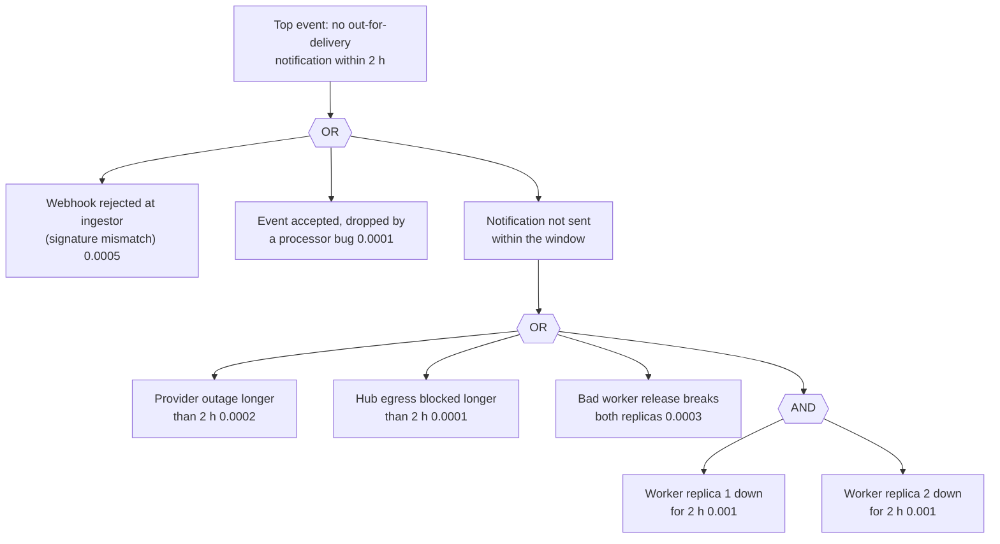
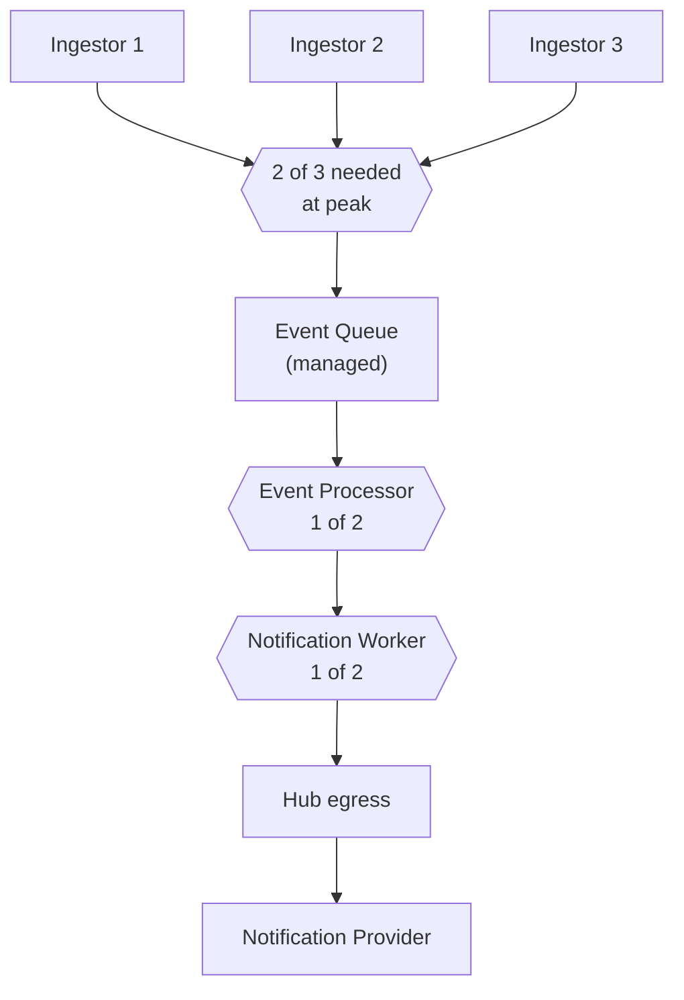
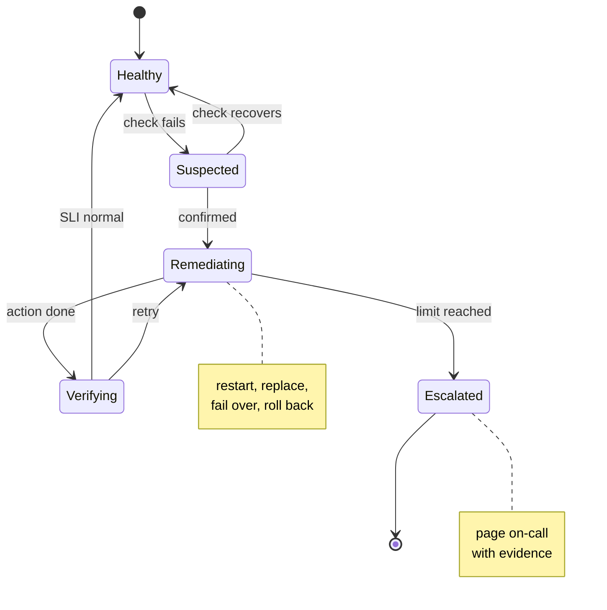
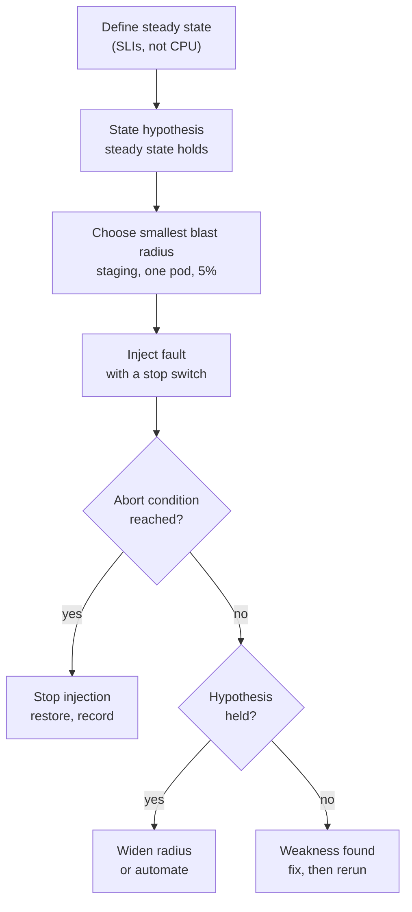

# Reliability engineering

> Reliability engineering is the habit of asking "how will this fail, how bad would that be, and how
> would we know?" before the failure happens, then building the containment and repair that answer
> it, and finally breaking the system on purpose to check the answers were true.

!!! abstract "Page facts"
    **Level:** Mixed (the analysis methods and redundancy arithmetic are Level 1-2; prioritizing with
    FMEA, designing self-healing, and running chaos experiments against an error budget are Level 3) ·
    **Status:** Draft · **Time:** 60-75 minutes · **Last verified:** 2026-11-27

## Learning objectives

After this page you should be able to:

- Run a failure mode and effects analysis (FMEA) on a request path, score severity, occurrence, and
  detection, and explain why the risk priority number (RPN) must not be the only ranking.
- Draw a small fault tree, find its minimal cut sets, and estimate the top-event probability.
- Compute the reliability of series, parallel, and k-out-of-n arrangements, and show how a
  common-cause failure erases most of the benefit of redundancy.
- Place fault-containment boundaries and design self-healing loops that know when to stop and call a
  human.
- Plan a chaos experiment and a game day with a steady-state hypothesis, a bounded blast radius, and
  abort conditions.
- Explain how SRE practice uses the error budget to decide which reliability work happens next.

## Prerequisites

- [High availability design](high-availability-design.md) — redundancy, fault domains, failover, and
  the availability arithmetic this page extends to k-out-of-n and common causes.
- [Resilience mechanics: timeouts, retries, and backpressure](../distributed-systems/resilience-mechanics-timeouts-retries-and-backpressure.md)
  — the per-call mechanisms (retries, breakers, bulkheads) that this page only names.
- [SLAs, SLOs, SLIs, error budgets, and recovery objectives](../architecture-fundamentals/slas-slos-slis-error-budgets-and-recovery-objectives.md)
  — the SLO definitions, budget arithmetic, burn rates, and budget policy used here.

## The problem this solves

High availability design answers "what if this box disappears?" for the boxes on the diagram. Real
outages come from elsewhere: a carrier rotates a signing secret and its webhooks are rejected for a
day, a firewall rule silently drops the notification provider, a release breaks both "redundant"
workers at once, or a never-run fallback fails when finally needed. Reliability engineering finds
these before customers do: enumerate failure modes, rank them, quantify what redundancy buys,
automate repair with limits, and inject faults to test it all, with the error budget setting the pace.

## What it is

**Reliability engineering** is the discipline of designing, analysing, testing, and operating a
system so that it performs correctly for a stated period under stated conditions (the glossary's
definition of reliability). Its toolkit falls into four groups:

| Group | Methods | Question it answers |
|---|---|---|
| Analyse | FMEA and FMECA, fault tree analysis, reliability block diagrams | How can it fail, how likely and how bad, and which component limits it? |
| Contain and repair | Redundancy models, fault isolation and containment, graceful degradation, self-healing, recovery orchestration, retries, circuit breakers, bulkheads | How do we keep a failure small and fix it without waiting for a person? |
| Verify | Reliability testing, fault injection, chaos engineering, game days | Do the containment and repair actually work, today, at load? |
| Operate | SRE, error budgets, SLO management | How reliable should it be, and what do we work on next? |

## Mental model

Think of an airline. Engineers list every part and what its failure would do (FMEA); investigators
work back from an accident to every combination of causes (a fault tree); the aircraft can fly on
fewer engines than it has (k-out-of-n); crews practise engine failures in simulators (game days); and
maintenance limits reflect how much risk the operator accepts (the error budget).

**Where the analogy breaks:** aircraft parts wear out at predictable, mostly independent rates.
Software fails when something changes (a release, a configuration, a certificate, a traffic pattern),
and the same change hits every copy at once. Past failure rates predict poorly, common causes undermine
redundancy, and the verification that matters most is of change and interactions.

## Key terms

| Term | Meaning on this page |
|---|---|
| Failure mode | One specific way a component can fail to do its job (stops, slows, returns wrong data, rejects valid input) |
| FMEA | Failure mode and effects analysis: a table of failure modes per component with their effects, causes, and current controls, scored to rank risk |
| FMECA | FMEA plus a criticality analysis that ranks each mode by severity against probability |
| Severity, occurrence, detection (S, O, D) | Ordinal scores, usually 1-10, for how bad the effect is, how often it happens, and how unlikely it is to be caught before it hurts |
| Risk priority number (RPN) | S × O × D; a rough ranking aid, not a measure of risk |
| Fault tree analysis (FTA) | A top-down diagram from one undesired event through AND/OR gates to the basic events that cause it |
| Minimal cut set | A smallest set of basic events that together cause the top event; a one-event cut set is a single point of failure |
| Reliability block diagram (RBD) | A diagram of which components must work (series) and which can substitute for each other (parallel, k-out-of-n) |
| k-out-of-n | A group of n copies that works while at least k of them work |
| Common-cause failure | One cause that fails several redundant copies at once (a release, a configuration, a shared dependency) |
| Fault containment | Boundaries that keep a failure inside one part of the system |
| Self-healing | Automated detection and repair of a failure, with limits and escalation |
| Recovery orchestration | Automated or scripted coordination of a multi-step recovery in a defined order |
| Fault injection | Deliberately introducing a fault (error, latency, crash, partition) to observe the system's response |
| Chaos engineering | Running fault-injection experiments against a steady-state hypothesis to find weaknesses before they cause incidents |
| Steady-state hypothesis | The measurable normal behavior a chaos experiment expects to hold while a failure is injected (glossary) |
| Game day | A scheduled, rehearsed exercise in which a team injects a realistic failure and practises detecting and recovering from it |
| SRE | Site reliability engineering: running production with software-engineering methods, driven by SLOs and error budgets |

## How it works

### Step 1 — FMEA: enumerate, score, rank

FMEA works bottom-up. For each component on the path (the container diagram is the checklist), list
each **failure mode**, its **effect** on the user, its likely **cause**, and the **current control**
that prevents or detects it. Then score, on agreed scales, the **severity (S)** of the effect,
the **occurrence (O)** of the cause, and **detection (D)**: how unlikely current controls are to
catch it before users are hurt (10 means nothing would notice).

The **RPN** is S × O × D, from 1 to 1,000. It is a useful first sort and a poor final one, because
the scores are ordinal (a 6 is not twice as bad as a 3) and the product hides very different risks
behind one number: S9 × O2 × D2 = 36 equals S2 × O3 × D6 = 36, yet the first is a near-miss with a
catastrophe. Practical rules that fix most of this:

1. **Severity first:** every top-band mode (data loss, wrong data at scale, exposure) gets an action.
2. **Then RPN** within the rest, against an agreed action threshold.
3. **Re-score after the action;** severity only falls if the design changes the effect itself.

**FMECA** adds a criticality analysis: each mode is placed on a matrix of severity class against
probability, or in its quantitative form ranked by an estimated failure rate; for software the
qualitative matrix usually suffices. The FMEA table is where "what if X fails?" questions get written
down, owned, and revisited: most of its value.

### Step 2 — Fault tree analysis: work back from one bad outcome

FMEA starts from components; **fault tree analysis** starts from one undesired **top event** and asks
what combinations of lower events cause it. An **OR gate** fires if any input occurs; an **AND gate**
only if all do. AND gates are where redundancy appears, and where common causes hide.

**Figure 1 — Fault tree for a missed out-for-delivery notification at AtlasMart.** The top event is
"the customer gets no out-for-delivery notification within two hours of the status change" (the
two-hour useful window is an assumption for this page). Probabilities are the fraction of
notifications affected per month, assumed for the example.

How to read it: start at the top and read each gate as "caused by any of" (OR) or "caused only by all
of" (AND). The hexagons are gates; the rectangles at the leaves are basic events with their assumed
probabilities.

The **minimal cut sets** are {E1}, {E2}, {E3}, {E4}, {E7}, and {E5, E6}. Five of the six are single
events: single points of failure for this outcome. With small, independent probabilities the top
event is close to the sum of the cut-set probabilities (the rare-event approximation):

> 0.0005 + 0.0001 + 0.0002 + 0.0001 + 0.0003 + (0.001 × 0.001) ≈ **0.0012**, or 0.12% of notifications

At about 120,000 notifications a day (the
[integration page](../application-and-api-architecture/integration-architecture.md)'s figure) that is
roughly 144 missed notifications a day on average, arriving in bursts. The tree's lesson is in the
AND gate: two worker replicas contribute one in a million, so a third replica would buy nothing. The
same release on both replicas (E7) contributes 300 times more. Effort belongs on E1 and E7.

### Step 3 — Reliability block diagrams and redundancy arithmetic

An RBD redraws the path as the blocks that must work. The
[quality-attributes page](../architecture-fundamentals/quality-attributes-and-trade-offs.md) gives the
two basic rules; the HA page applies them. Three refinements matter for real designs.

**k-out-of-n.** A group of n identical copies, each working with probability R, that works while at
least k work:

> R(k of n) = Σ from i = k to n of C(n, i) × Rⁱ × (1 − R)ⁿ⁻ⁱ

1-of-n is ordinary parallel redundancy; n-of-n is series. The case that matters is in between: a tier
that needs two of its three replicas to carry the peak. With R = 0.99 per replica:

- 1-of-3: 1 − 0.01³ = 0.999999
- 2-of-3: 3R² − 2R³ = 2.9403 − 1.940598 = **0.999702**
- one replica alone: 0.99

So "three replicas" is worth six nines only if one can carry the load; if two are needed, it is
worth three and a half. Capacity planning and reliability arithmetic must use the same k.

**Common-cause failure.** The parallel formula assumes independence. A simple correction, the
**beta-factor model**, assumes a fraction β of each copy's failures hit all copies together.
Unavailability is then about β × u + ((1 − β) × u)ⁿ. With u = 0.01 per copy and β = 0.1:

- Two copies: 0.001 + 0.009² ≈ 0.00108, availability ≈ 99.89%
- Three copies: 0.001 + 0.009³ ≈ 0.0010007, availability ≈ 99.90%

Without the common cause, three copies would give 99.9999%. With 10% common cause, the third copy is
almost worthless; reducing β (staged releases, different change windows, independent dependencies)
is worth more than adding copies.

**Reliability over a mission time.** Availability is the long-run fraction of time up; reliability is
the probability of no failure over a period. With a constant failure rate,
R(t) = e^(−t / MTBF). The SLO page's assumed MTBF of 1,440 hours gives a probability of a month (720
hours) without an availability incident of e^(−0.5) ≈ **0.61**: an incident in roughly four months of
ten, even though availability is 99.948%. Both numbers are true; they answer different questions.

| Redundancy model | How it works | Typical use |
|---|---|---|
| Active (hot) | All copies serve; any can take the load | Stateless API replicas across zones |
| Standby, warm | A running copy kept in sync, promoted on failure | Database synchronous standby |
| Standby, cold | Resources provisioned and restored only on failure | Backup-and-restore DR tiers |
| N+1, N+M | N needed for the load, 1 or M spare | Replica counts sized for zone loss |
| 2N | A full second copy of everything | Critical power and network paths |
| k-out-of-n (quorum) | A majority or other k must agree or survive | Consensus clusters, erasure coding |

**Figure 2 — Reliability block diagram of the notification path.** Replica availabilities of 0.995,
a managed queue at 0.9999, hub egress at 0.9995, and the provider at 0.999 are assumptions for this
page.

How to read it: everything below the vote is in series. The ingestor group (assumed to need two
replicas at the 70 events/s peak) is 2-of-3 at 0.995: 0.99992525. The whole chain is
0.99992525 × 0.9999 × 0.999975 × 0.999975 × 0.9995 × 0.999 ≈ **0.99828**, about 76 minutes a month
in which a notification could not be sent at once.

That number misleads usefully: the queue turns a downstream outage into delay, not loss. For "sent
eventually", only the blocks up to the queue are in series (0.99992525 × 0.9999 ≈ 0.99983, about 8
minutes a month); for "sent within two hours", downstream blocks count only for longer outages, which
is what the fault tree models. Decide which question the RBD answers before trusting it.

### Step 4 — Contain the fault, then degrade gracefully

**Fault containment** draws boundaries so a failure stays small. Each boundary has a different cost:

| Boundary | Contains | Mechanism |
|---|---|---|
| Call | A slow or failing dependency | Timeouts, retries with budgets, circuit breakers |
| Pool | One dependency exhausting shared workers | Bulkheads |
| Instance and process | A crash or leak | Restarts, replicas, readiness checks |
| Zone | A data-centre failure | Multi-zone placement |
| Release wave | A bad change | Canary and staged rollout |
| Tenant, carrier, cell | One customer's traffic or data | Per-tenant limits, cells, shuffle sharding |
| Account and region | Credentials, quotas, regional events | Account boundaries, multi-region |

Retries, circuit breakers, and bulkheads are covered in depth, with AtlasMart's settings, on the
[resilience mechanics page](../distributed-systems/resilience-mechanics-timeouts-retries-and-backpressure.md).
Here they are three entries in the containment table: **retries** absorb transient faults but must be
budgeted and confined to one layer; **circuit breakers** stop calls to a dependency that is failing;
**bulkheads** give each dependency its own bounded pool. Cells, shuffle sharding, and blast-radius
design are on the [advanced resilience page](advanced-resilience-and-failure-containment.md).

**Graceful degradation** is what a contained failure looks like to the user: a reduced but labelled
answer. Design it as a ladder of modes per user journey (full service, stale data with a notice,
core function only, read-only, a clear error), each with a trigger and an exit condition. A mode that
has never been switched on in a test is a hope, not a design.

### Step 5 — Self-healing and recovery orchestration

**Self-healing** is a control loop: observe, decide, act, verify. Kubernetes restarting a container
that fails liveness, a controller replacing a missing replica, an autoscaler adding capacity, a
managed database promoting its standby, and a GitOps agent reverting drift are all self-healing loops.
The design questions are the same for each: what signal triggers it, what action it takes, how it
checks the action worked, and when it gives up.

**Figure 3 — A self-healing loop with limits.** Repair is retried a bounded number of times, then
escalated to a human with the evidence.

How to read it: "confirmed" means several consecutive failed checks, which filters noise. The loop
between Remediating and Verifying is capped (for example three attempts in 30 minutes); after that,
more automation would only repeat a fix that is not working.

Three guardrails keep automation from becoming the outage:

- **Rate-limit the action.** Cap how many replicas, nodes, or zones a loop may act on per interval;
  restarting everything at once is a self-inflicted outage.
- **Know when automation is blind.** If the signal may be wrong (a monitoring outage makes everything
  look down), the loop must stop rather than "repair" healthy components.
- **Let humans pause it.** A GitOps agent reverting a manual hotfix, or an autoscaler fighting a
  deliberate scale-down, slows recovery; the incident commander needs a documented pause switch.

**Recovery orchestration** coordinates multi-step recovery: fail over the database, then verify,
then drain the queue backlog, then re-enable notifications. It turns a runbook into an ordered,
checked script with a human approval at the decision points (AtlasMart's region failover is a human
decision, per the DR assumption). The order itself, and why it matters, is the subject of recovery
sequencing on the [advanced resilience page](advanced-resilience-and-failure-containment.md).

### Step 6 — Reliability testing, fault injection, chaos engineering, and game days

**Reliability testing** is a ladder; each rung tests something the one below cannot:

| Test | What it proves | Where |
|---|---|---|
| Unit tests of fallbacks and error paths | The degraded code path returns the right answer | CI |
| Integration tests with fault injection | Timeouts, retries, and breakers behave with a real broken dependency | CI, staging |
| Load, stress, and soak tests | Capacity and degradation at and beyond the design peak | Staging ([testing page](../foundations/software-testing-types-and-strategies.md)) |
| Failover drills | Promotion, fencing, and client reconnection work within the budgeted window | Staging, then production |
| Chaos experiments | The steady state survives a real fault in a realistic environment | Staging, then production with a bounded blast radius |
| Game days | People, runbooks, alerts, and tooling work together under a realistic failure | Any, scheduled |
| DR tests | Recovery time and point achieved match RTO and RPO | Recovery region ([DR strategies](disaster-recovery-strategies.md)) |

**Fault injection** is the mechanism: return errors, add latency, kill processes, fill disks, drop
packets, block egress, fail over a database. **Chaos engineering** is the method around it. The
[Principles of Chaos Engineering](https://principlesofchaos.org/) describe experiments that define a
steady state as measurable system output, hypothesise that it holds in both a control and an
experimental group, introduce variables that mirror real-world events, and try to disprove the
hypothesis. Its advanced principles add running in production, automating experiments to run
continuously, and minimising the blast radius. The [testing page](../foundations/software-testing-types-and-strategies.md)
gives the four-step basics; an architect adds the safety design:

**Figure 4 — A chaos experiment with its safety controls.** The abort check runs continuously while
the fault is active.

How to read it: an experiment ends in one of three ways: aborted (the system or the team was not
ready), passed (widen the blast radius or automate it), or failed (a weakness was found before it
caused an incident, which is the point).

The safety design an architect should insist on: abort conditions written in SLO terms (for example,
the fast-burn alert), a stop switch tested before the experiment, the error budget checked first (no
experiments when the budget policy forbids risk), and the owners of every affected dependency told.

A **game day** rehearses the humans as well as the system: a facilitator injects a scenario, the
on-call team responds with real alerts and runbooks, and an observer records time to detect, decide,
and recover. Its findings are often procedural (an alert routed to the wrong team, a runbook step
needing access nobody on call has), and are tracked like postmortem actions.

| Need | AWS | Azure | Google Cloud |
|---|---|---|---|
| Managed fault-injection experiments | AWS Fault Injection Service | Azure Chaos Studio | No first-party managed service is named on this page; open-source tools such as Chaos Mesh or LitmusChaos run on any Kubernetes cluster, including Google Kubernetes Engine |

### Step 7 — SRE and error-budget-based SLO management

**Site reliability engineering (SRE)** treats operations as a software problem. Its central
mechanism is the one on the [SLO page](../architecture-fundamentals/slas-slos-slis-error-budgets-and-recovery-objectives.md):
an SLO, an error budget, and a policy for spending it. This page does not repeat the arithmetic; it
shows how the budget steers reliability engineering:

- **The budget decides the pace of risk.** With budget left, releases and chaos experiments proceed;
  when it runs low, effort shifts to reliability work and experiments on that path pause.
- **Budget spend, attributed by cause, ranks the backlog.** Tag each incident's budget cost with its
  cause (release, dependency, capacity, infrastructure). FMEA ranks failures you can imagine; budget
  attribution ranks failures you have had.
- **SLOs are reviewed quarterly** against achieved performance, complaints, and spend: tighten only
  with evidence users need more, loosen if unachievable at sensible cost, refine a misleading SLI.
- **Paging follows the budget** (fast burn pages, the rest is a ticket); see
  [monitoring, alerting, and on-call](../observability-and-sre/monitoring-alerting-and-on-call.md) and
  [incident management](../observability-and-sre/incident-management-and-sre-practices.md).

## Worked example: AtlasMart FMEA of the tracking path

Scope: from a carrier's webhook to the customer seeing the status and receiving the out-for-delivery
notification. The Order Tracking System's team (assumption: a six-engineer on-call rotation, one week
each, paging only on SLO burn) runs the FMEA in a two-hour session.

### Scales (assumptions agreed for this FMEA)

| Score | Severity (S) | Occurrence (O) | Detection (D) |
|---|---|---|---|
| 9-10 | Acknowledged event lost, wrong data at scale, or data exposure (NFR-5, NFR-7) | Weekly or more (10) | Nothing would notice (10), or only an audit would (9) |
| 7-8 | A customer-facing function unavailable for many customers | About monthly (7) | Customers would report it first |
| 4-6 | Degraded: delayed, duplicated, or stale beyond an NFR | About quarterly (5) | Visible on a dashboard or in logs, but nobody is alerted |
| 1-3 | Within NFR bounds; internal only | About yearly (3); not expected in five years (1) | An alert pages within minutes, before customers notice |

### The analysis

| ID | Component | Failure mode | Effect | Current control | S | O | D | RPN |
|---|---|---|---|---|---|---|---|---|
| F1 | Webhook Ingestor | Rejects valid webhooks after a carrier rotates its signing secret | That carrier's scans never arrive; stale status, missed notifications | Gateway 4xx dashboard, no per-carrier alert | 7 | 4 | 7 | 196 |
| F2 | Tracking Event Store | A bad migration or bug writes wrong statuses to many rows (replicated faithfully to the standby) | Wrong status shown and wrong notifications sent | Monthly SLO-D reconciliation checks presence, not correctness | 9 | 2 | 8 | 144 |
| F3 | Hub egress firewall | A rule change drops the Notification Provider's endpoints | Every notification fails; tracking unaffected | Worker error logs; no alert on provider-call failures | 7 | 3 | 6 | 126 |
| F4 | Tracking API | A bad release reaches all replicas | Errors or wrong data on the tracking view | Progressive canary (5% → 25% → 100%) gated on SLO metrics | 8 | 4 | 3 | 96 |
| F5 | Notification Worker | Provider outage or slowdown | Notifications delayed | Breaker metrics; DLQ alert | 6 | 4 | 4 | 96 |
| F6 | Status Cache | An invalidation is lost | Status up to 30 s staler | None; the TTL bounds it | 2 | 5 | 8 | 80 |
| F7 | Notification Worker | Crash after the provider accepted a send but before the queue acknowledgement | Duplicate notification (FR-3) unless the provider honours the idempotency key | Idempotent request identifiers | 4 | 3 | 6 | 72 |
| F8 | Tracking API | Event Store slow | Labelled stale answers, higher latency | Timeouts, breaker, last-known-good copies, burn alerts | 6 | 4 | 3 | 72 |
| F9 | Event Processor | Consumer lag grows | Freshness (NFR-1) breached | NFR-8 lag alert (p95 > 120 s for 5 min) | 5 | 5 | 2 | 50 |
| F10 | Event Store primary | Node or zone failure | About a minute of failover | Managed failover with a synchronous standby | 6 | 3 | 2 | 36 |

### Prioritise: severity first, then RPN

Applying the rules from Step 1 (severity 9 or more always; then RPN of 100 or more, an agreed
threshold):

1. **F2** first, despite ranking second by RPN: it is the only top-band severity, and the HA design
   cannot help because corruption replicates to the standby.
2. **F1** (196) and **F3** (126): both are failures nobody would be told about.
3. F4 and F5 (96) are below the threshold; F5 is designed in detail as a degraded mode on the
   [advanced resilience page](advanced-resilience-and-failure-containment.md).

Notice what the RPN alone would have hidden: F6 (80) outranks F10 (36), yet F6 is harmless by design
and F10 is a real minute of downtime. A low-severity, poorly detected mode scores high because
detection is multiplied in, which is why severity is read first.

### Actions and the revised scores

| ID | Action | Owner | S | O | D | New RPN |
|---|---|---|---|---|---|---|
| F2 | Expand-and-contract migrations only; a nightly job that replays each shipment's event history and flags rows whose stored status disagrees; point-in-time restore of affected rows rehearsed | Tracking team | 9 | 1 | 4 | 36 |
| F1 | Accept both the old and the new signing secret during an agreed overlap; alert when one carrier's rejected-signature rate exceeds 1% for 5 minutes | Tracking team with carrier integrations | 7 | 2 | 2 | 28 |
| F3 | Egress allow-list kept as code with a pipeline test that the provider's endpoints pass; a synthetic notification to an internal test recipient every 5 minutes, alerting after three failures | Platform team (hub) | 7 | 2 | 2 | 28 |

The thresholds (1%, 5 minutes, three failures) are assumptions to tune. Severity did not change for
any of them: the actions make the failures rarer and visible, not milder. Making F3 milder is a
design change (a degraded mode when egress fails), and that is a different page's job.

### From FMEA to experiments: the quarterly game day

The DR assumption already schedules a quarterly game day. The FMEA decides what it tests:

| Experiment | Hypothesis | Blast radius | Abort if |
|---|---|---|---|
| Rotate the signing secret of an internal test carrier | No webhook from it is rejected; the new per-carrier alert would fire if one were | The test carrier only, in staging then production | Any real carrier's rejection rate rises |
| Block egress from the Notification Worker to the provider for 30 minutes | Notifications are delayed, none lost or duplicated; the synthetic check alerts within 15 minutes | Staging only until the drain path has passed twice | Not applicable in staging; stop if the queue nears its retention limit |
| Fail over the Event Store primary at design load (210 reads/s, 70 events/s) | The SLO-A probe passes; reads get labelled last-known-good answers; reconciliation shows no acknowledged event lost | Staging, then production with the incident commander present | The fast-burn alert fires (burn rate 14.4 over 1 hour) or failover exceeds 5 minutes |

### Feeding the error budget loop

SLO-A's budget is 43.8 minutes a month, 131.4 minutes a quarter. Suppose (assumption) last quarter's
attributed spend was 18 minutes from releases, 3 from Event Store failovers, 1 from a cache node
replacement, and 2 unexplained: 24 minutes, 18% of the quarter's budget. Releases dominate, which
matches F4's place in the FMEA, so the next reliability item is tighter canary analysis, not more
replicas. The healthy budget also means the policy allows the production failover experiment above.

## Real-world architecture example

In mature organizations these methods are part of delivery, not one-off events. Design reviews
require a failure-mode table per new dependency, with high-severity rows closed before launch. Fault
trees appear in postmortems of the worst incidents. Fault injection runs in CI and, for mature
services, continuously in production at a small blast radius, with SLO burn as the abort signal.
Game days are calendared and end with tracked actions, and the SRE function runs the quarterly review
where reliability work is prioritised alongside features.

## Design choices and trade-offs

| Choice | Favor when | Avoid when |
|---|---|---|
| FMEA per path | A new system or dependency; you need a shared, owned list of risks | You expect it to be exact; scores are judgment, re-score with evidence |
| Fault tree for one top event | One outcome matters most (data loss, missed notification, payment error) | You want a complete inventory; trees cover one event each |
| Quantitative RBD | Comparing redundancy options; sizing k for capacity and reliability together | Inputs are guesses presented as facts; or the path is asynchronous and the question is undefined |
| More replicas | Failures are independent and k is well below n | Common causes dominate; reduce β first |
| Automated self-healing | The failure is frequent, the fix is safe and reversible, the signal is reliable | The fix is risky, the signal can be wrong, or the action is irreversible (region failover) |
| Chaos in production | Staging differs from production in ways that matter, and the team has passed the same experiment in staging | No stop switch, no abort condition, budget exhausted, or the team has not rehearsed in staging |
| Game days | Testing people, runbooks, and access, not only software | As a substitute for automated tests of the same path |
| Budget-gated reliability work | SLOs are trusted and budget spend is attributed | SLOs are new or unmeasured; fix the SLI first |

## Failure modes and anti-patterns

- **RPN worship.** Ranking purely by S × O × D buries catastrophic but rare modes. Detect: a top-band
  severity row with no action. Prevent: severity-first rule.
- **FMEA as a document.** Filled in once for a review and never re-scored. Detect: the table predates
  the last three incidents. Prevent: update it in every postmortem and at each quarterly review.
- **Redundancy arithmetic that ignores common causes.** Three replicas "give six nines" while all run
  the same release. Detect: incidents that took out every copy at once. Prevent: model β; stage
  changes; separate change windows.
- **Self-healing that fights the responders.** An agent reverts a hotfix or restarts everything.
  Detect: actions in the audit log during incidents that nobody requested. Prevent: rate limits, a
  pause switch, escalation after a bounded number of attempts.
- **Chaos without a hypothesis.** Breaking things to "see what happens". Prevent: written steady
  state, hypothesis, blast radius, and abort condition before any injection.
- **Untested fallbacks.** A degraded mode that has never been switched on. Detect: no experiment or
  test exercises it. Prevent: every degraded mode appears in the experiment plan.

## Security considerations

- **Fault-injection tools are privileged.** They can stop instances and fail over databases: scope
  their roles per target, require approval for production experiments, and audit-log every run.
- **Degraded modes keep security checks.** No FMEA action may "fix" availability by skipping
  ownership checks (NFR-5) or webhook signature verification; F1's dual-secret overlap keeps
  verification on, with two valid secrets for a bounded period.
- **Security failures belong in the FMEA.** Expired certificates, revoked credentials, a key policy
  mistake blocking database decryption, and a denial-of-service flood are failure modes with effects
  and detection like any other.
- **Game days rehearse break-glass access.** Check that emergency access works, is logged, and is
  revoked afterwards; it is often the first thing that fails.

## Performance, reliability, and cost

- **Performance:** fault injection with latency is the only realistic way to test tail behavior under
  failure; error injection alone misses the slow-dependency failures that cascade.
- **Reliability:** analysis finds single-event cut sets cheaply; verification proves the repairs. The
  biggest gains usually come from reducing common causes and improving detection, not adding copies.
- **Cost:** an FMEA costs hours, a game day a day of several people, production chaos tooling and an
  experiment budget; F3 alone, undetected, could silently fail every notification for hours.

## Hands-on lab: rank failure modes and test redundancy arithmetic

A local Python exercise (standard library only, about 30 minutes):

1. Put the FMEA table above in a CSV (`id,s,o,d`). Write a script that computes RPN and sorts first by
   "severity ≥ 9", then by RPN. Confirm F2 comes first even though F1 has the higher RPN.
2. Implement the k-out-of-n formula with `math.comb` and print 1-of-3, 2-of-3, and 3-of-3 for
   R = 0.99.
3. Check it by Monte Carlo: with `random.seed(42)`, simulate 1,000,000 trials of three replicas each
   up with probability 0.99, and count trials with at least two up. Compare with step 2.
4. Add a common cause: in each trial, with probability β × 0.01 all three replicas fail together;
   otherwise each fails independently with probability (1 − β) × 0.01. Plot or print 1-of-3
   availability for β = 0, 0.01, 0.05, 0.1.
5. Encode Figure 1's fault tree as nested OR and AND functions over basic-event probabilities and
   compute the exact top-event probability, 1 − Π(1 − p) over the cut sets, versus the sum.
6. Write two sentences: which change to the tree lowers the top event most, and why the AND gate does
   not matter.

??? question "Hint: why does the third replica barely help at β = 0.1?"
    The common-cause term β × u = 0.1 × 0.01 = 0.001 is paid once, however many replicas there are.
    The independent term (0.009)ⁿ is already 0.000081 at n = 2 and 0.00000073 at n = 3, so the total
    stays near 0.001. Only lowering β (or u) moves it.

## Knowledge check

1. Two failure modes have RPNs of 120 (S2, O6, D10) and 54 (S9, O3, D2). Which do you act on first,
   and why?
2. A tier has four replicas at 0.99 each and needs three to carry the peak. What is its reliability?
3. In a fault tree, what is a one-event minimal cut set, and what does an AND gate assume?
4. Name three guardrails that stop a self-healing loop from making an outage worse.
5. What makes a fault-injection exercise a chaos experiment rather than "breaking things"?

??? success "Answers"
    1. The 54: severity 9 is a top-band effect and must be acted on regardless of RPN. The 120 is a
       harmless effect (S2) that scores high mainly because detection is poor.
    2. 3-of-4: 4R³(1 − R) + R⁴ = 4 × 0.970299 × 0.01 + 0.96059601 = 0.03881196 + 0.96059601 ≈
       0.99941.
    3. A single basic event that alone causes the top event: a single point of failure for that
       outcome. An AND gate assumes its inputs are independent; a common cause that triggers all of
       them is really a separate single-event cut set.
    4. A cap on how many components it acts on per interval; a bounded number of attempts before
       escalating to a human; a pause switch for incidents; and stopping when the signal itself may be
       wrong.
    5. A written steady state measured as user-facing output, a hypothesis that it holds, the
       smallest blast radius that tests it, abort conditions and a tested stop switch, and a recorded
       result that leads to a fix or a wider experiment.

## Architecture discussion questions

1. The platform team proposes running every product team's chaos experiments in production from next
   quarter. What preconditions would you require per service, and how would the error budget policy
   gate them?
2. AtlasMart's FMEA scores were set by the team that built the system. How would you reduce the bias
   in occurrence and detection scores, and which data would you bring to the next session?
3. Leadership asks for a single reliability number for the notification path. Using the RBD and fault
   tree on this page, explain why there are at least two honest answers and which you would report.

## Summary

Reliability engineering moves failure from surprise to plan. FMEA lists failure modes with severity,
occurrence, and detection; RPN is a first sort, but severity is read first. Fault trees work back from
one outcome to its minimal cut sets and expose single points of failure and hidden common causes.
Reliability block diagrams quantify redundancy, where k-out-of-n and the beta factor show that copies
help only when k is small and failures are independent. Containment boundaries keep failures small,
graceful degradation keeps them useful, and self-healing repairs them within limits before calling a
human. Fault injection, chaos experiments, and game days prove all of it, gated by the error budget,
which SRE also uses to rank the next reliability work. For AtlasMart, the FMEA put a corruption risk
and two silent failures ahead of adding replicas, and turned them into a game-day plan.

## Related topics

- **Before:** [High availability design](high-availability-design.md);
  [Resilience mechanics: timeouts, retries, and backpressure](../distributed-systems/resilience-mechanics-timeouts-retries-and-backpressure.md);
  [SLAs, SLOs, SLIs, error budgets, and recovery objectives](../architecture-fundamentals/slas-slos-slis-error-budgets-and-recovery-objectives.md)
- **Alongside:** [Advanced resilience and failure containment](advanced-resilience-and-failure-containment.md)
  — blast radius, cascades, split brain, recovery sequencing; [Disaster recovery strategies](disaster-recovery-strategies.md);
  [Monitoring, alerting, and on-call](../observability-and-sre/monitoring-alerting-and-on-call.md);
  [Incident management and SRE practices](../observability-and-sre/incident-management-and-sre-practices.md);
  [Software testing types and strategies](../foundations/software-testing-types-and-strategies.md);
  [Distributed system patterns](../software-architecture/distributed-system-patterns.md).
- **Planned:** advanced database architecture and replication strategies (D06-T03).

## References

| Source | Type | Checked |
|---|---|---|
| [Principles of Chaos Engineering](https://principlesofchaos.org/) | Community manifesto (steady state, real-world events, production, automation, blast radius) | 2026-11-27 |
| [Site Reliability Engineering: Testing for Reliability](https://sre.google/sre-book/testing-reliability/) — Google | Book chapter (free online) | 2026-11-27 |
| [The Site Reliability Workbook: Error Budget Policy](https://sre.google/workbook/error-budget-policy/) — Google | Book chapter (free online; budget-driven prioritisation) | 2026-11-27 |
| [Architecture strategies for performing failure mode analysis](https://learn.microsoft.com/en-us/azure/well-architected/reliability/failure-mode-analysis) — Microsoft Azure Well-Architected Framework | Official guidance | 2026-11-27 |
| [Architecture strategies for designing a reliability testing strategy](https://learn.microsoft.com/en-us/azure/well-architected/reliability/testing-strategy) and [for self-healing and self-preservation](https://learn.microsoft.com/en-us/azure/well-architected/reliability/self-preservation) — Microsoft Azure Well-Architected Framework | Official guidance | 2026-11-27 |
| [REL12-BP04 Test resiliency using chaos engineering](https://docs.aws.amazon.com/wellarchitected/latest/reliability-pillar/rel_testing_resiliency_failure_injection_resiliency.html) — AWS Well-Architected Framework, Reliability Pillar | Official guidance | 2026-11-27 |
| [What is AWS Fault Injection Service?](https://docs.aws.amazon.com/fis/latest/userguide/what-is.html), [What is Azure Chaos Studio?](https://learn.microsoft.com/en-us/azure/chaos-studio/chaos-studio-overview), [Chaos Mesh](https://chaos-mesh.org/), [LitmusChaos](https://litmuschaos.io/) | Official product documentation (names in the equivalence table) | 2026-11-27 |
| W. E. Vesely et al., *Fault Tree Handbook*, NUREG-0492 (US Nuclear Regulatory Commission, 1981) | Handbook (gates, minimal cut sets, quantification) | 2026-11-27 |

## Review notes

- Canonical page for D13-T02. In depth: FMEA (with RPN and its limits), fault tree analysis, reliability
  block diagrams with k-out-of-n and the beta-factor common-cause model, fault containment, self-healing
  guardrails, chaos engineering and game days, error-budget-driven prioritisation. Only defined or
  briefly treated: FMECA (criticality matrix described, no quantitative criticality numbers), redundancy
  models (one table), graceful degradation (a paragraph; detail on the resilience and advanced
  resilience pages), recovery orchestration (sequencing deferred to D13-T04), retries, circuit
  breakers, and bulkheads (definition depth, linked to D04-T04), reliability testing (one table), SLO
  management (cadence and attribution only; arithmetic stays on D01-T06).
- NUREG-0492 is cited without a link: the NRC page returns 403 to scripts. A reviewer may add the NRC
  library link after checking it in a browser.
- The Google Cloud cell of the equivalence table deliberately names no managed fault-injection
  service; a reviewer should check whether one exists on Google Cloud's current documentation before
  adding it. AWS Fault Injection Service and Azure Chaos Studio names were checked on their pages
  (AWS title "What is AWS Fault Injection Service? - AWS Fault Injection Service").
- New AtlasMart assumptions: the two-hour useful window for out-for-delivery notifications; the
  fault-tree probabilities (0.0005, 0.0001, 0.0002, 0.0001, 0.0003, 0.001 per worker replica);
  per-replica availability 0.995, managed queue 0.9999, hub egress 0.9995, provider 0.999 for the RBD;
  the ingestor needing 2 of 3 replicas at the 70 events/s peak; the FMEA scales and scores; action
  thresholds (1% for 5 minutes, synthetic notification every 5 minutes, three failures); last
  quarter's attributed budget spend (18 + 3 + 1 + 2 = 24 minutes). The 120,000 notifications/day
  figure is from the integration page; MTBF 1,440 h from the SLO page.
- Arithmetic checked with a script (2-of-3 at 0.99 and 0.995, the chains, beta factor, e^(−0.5),
  fault-tree sum 0.001201 versus exact 0.0012005).
- Figure 1 uses hexagon gate nodes; Figure 3 is a state diagram with two notes. Check both render.
