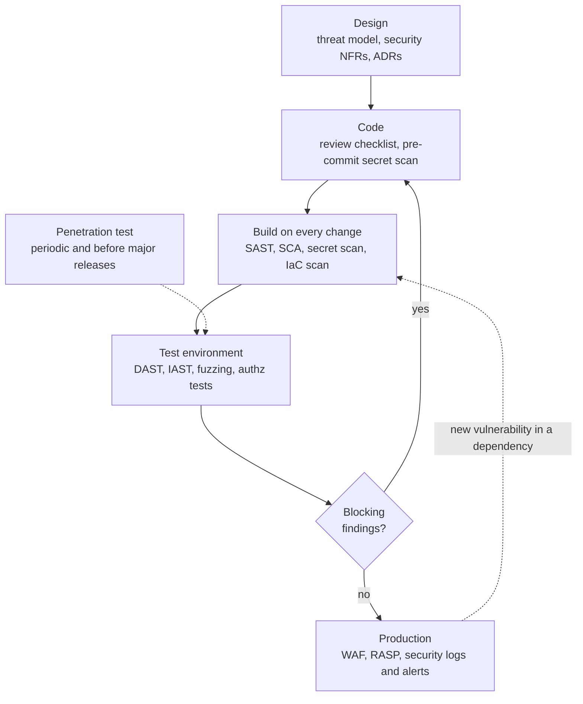
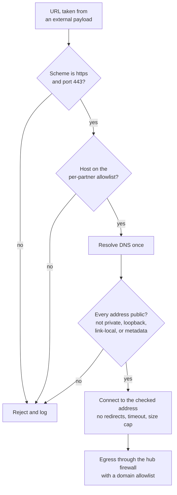
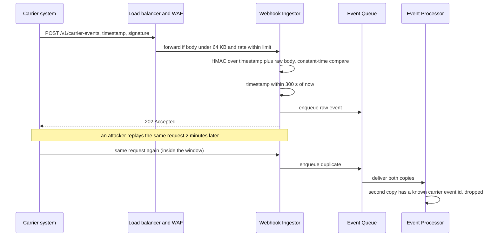

# Application security

> Most breaches of a web application do not break cryptography or networks; they ask the application
> to do something its authors never meant to allow. Application security is the discipline of
> designing, building, and testing code so that hostile input and hostile callers get nowhere.

!!! abstract "Page facts"
    **Level:** Intermediate (the vulnerability classes are Level 1-2; placing controls in the SDLC and
    reviewing a design are Level 3) · **Status:** Draft · **Time:** 60-75 minutes ·
    **Last verified:** 2026-11-21

## Learning objectives

After this page you should be able to:

- Describe a secure SDLC and name the security activity that belongs in each phase.
- Name the categories of the current OWASP Top 10 (2025) and OWASP API Security Top 10 (2023) and
  give a concrete example of each that applies to a service you know.
- Explain the difference between input validation and output encoding, and why neither replaces the
  other.
- Explain how SQL injection, XSS, CSRF, SSRF, broken object level authorization, and session hijacking
  work, and choose the primary defense for each.
- Place SAST, SCA, secret scanning, DAST, IAST, RASP, fuzzing, and penetration testing in a delivery
  pipeline, and say what each finds and misses.

## Prerequisites

- [Security principles and threat modeling](security-principles-and-threat-modeling.md) — trust
  boundaries, STRIDE, and least privilege are the vocabulary this page uses.
- [Identity and access management](identity-and-access-management.md) — authentication, OAuth 2.0
  and OIDC tokens, and sessions.
- [API design](../application-and-api-architecture/api-design-rest-graphql-grpc-and-async-apis.md) —
  the Tracking API contract and the carrier webhook contract reviewed below.

## The problem this solves

A network firewall lets HTTPS through to the application, because that is the point of the
application. Everything after that is the code's responsibility: every field, header, file, and URL
in a request is chosen by whoever sent it. Teams that treat security as a scan run the week before
launch find the same classes of bug again and again (queries built from strings, objects returned to
whoever asks for them, secrets in repositories), and find them when fixing is most expensive.
Application security moves those decisions earlier, into requirements, design, libraries, and the
pipeline, so the common classes cannot be written in the first place and the rest are caught by
automation before release.

## What it is

**Application security** is the set of design practices, coding practices, and verification
activities that keep an application's own logic from being abused: injection, broken authentication
and authorization, data exposure, unsafe handling of other systems' responses, and vulnerable
dependencies. It complements network and infrastructure security, which protect the platform the
code runs on, and data security, which protects what the code stores.

A **secure software development lifecycle (secure SDLC)** builds security activities into each phase
of ordinary delivery instead of adding a final gate. NIST's Secure Software Development Framework
(SP 800-218) groups the practices into four families: prepare the organization, protect the
software (its source, build, and releases), produce well-secured software, and respond to
vulnerabilities. OWASP's Application Security Verification Standard (ASVS) turns the "produce"
part into testable requirements at three levels of rigor.

Two community lists give the common vocabulary. The **OWASP Top 10** ranks risk categories for web
applications; its current edition is 2025. The **OWASP API Security Top 10** does the same for APIs;
its current edition is 2023. Both are awareness documents, not complete standards: passing them is a
floor.

| OWASP Top 10:2025 | What it covers | Where it shows up in a typical service |
|---|---|---|
| A01 Broken Access Control | Acting outside one's permissions; this edition also maps SSRF and CSRF here | Reading another customer's order by changing an id |
| A02 Security Misconfiguration | Insecure defaults, verbose errors, open admin interfaces, permissive CORS | Debug mode or stack traces enabled in production |
| A03 Software Supply Chain Failures | Vulnerable, unmaintained, or compromised dependencies, build tools, and images | A library with a known critical vulnerability in the container image |
| A04 Cryptographic Failures | Missing or weak encryption, poor key handling, weak randomness | Signing secrets hard-coded or generated with a non-cryptographic random generator |
| A05 Injection | Untrusted data interpreted as code or commands: SQL, OS command, XSS | A search query built by string concatenation |
| A06 Insecure Design | Missing controls that no implementation can add later | No rate limit on a flow that leaks whether an order exists |
| A07 Authentication Failures | Weak login, credential stuffing, broken session handling | Session ids that survive logout or password change |
| A08 Software or Data Integrity Failures | Trusting code, updates, or data without verifying integrity | Accepting webhook payloads without checking a signature |
| A09 Security Logging and Alerting Failures | Attacks not recorded or not acted on | Failed signature checks never logged or alerted |
| A10 Mishandling of Exceptional Conditions | Errors that fail open, leak detail, or leave inconsistent state | An authorization check that returns "allow" when the policy service times out |

| OWASP API Security Top 10:2023 | In one line |
|---|---|
| API1 Broken Object Level Authorization (BOLA) | The API returns or changes an object without checking the caller may access that specific object |
| API2 Broken Authentication | Weak token validation, missing checks on token lifetime, audience, or signature |
| API3 Broken Object Property Level Authorization | Returning fields the caller should not see, or accepting writes to fields they should not set (mass assignment) |
| API4 Unrestricted Resource Consumption | No limits on request rate, payload size, page size, or expensive operations |
| API5 Broken Function Level Authorization | A customer can call an agent-only or admin-only operation |
| API6 Unrestricted Access to Sensitive Business Flows | Automating a legitimate flow at scale (scraping, bulk enumeration, stock hoarding) |
| API7 Server Side Request Forgery | The API fetches a URL the caller controls |
| API8 Security Misconfiguration | Same idea as A02, applied to gateways, CORS, TLS, and error handling |
| API9 Improper Inventory Management | Forgotten old versions, test hosts, and undocumented endpoints |
| API10 Unsafe Consumption of APIs | Trusting data from third-party APIs more than user input |

SSRF, a category of its own in 2021, is folded into A01 in 2025; cite the edition you mean.

## Mental model

Think of the application as a bank clerk who follows written procedures. **Injection** is a customer
handing over a form whose "name" field says "and also transfer everything to me", and a clerk who
reads the whole form aloud as one instruction. **Broken access control** is a clerk who hands over
any safe-deposit box whose number you can recite. **SSRF** is persuading the clerk to walk into the
back office and fetch something on your behalf. **CSRF** is someone slipping a signed withdrawal slip
into your stack of papers while you are at the counter. The defenses map too: forms with separate
boxes the clerk never reads as instructions (parameterized queries), checking the box's owner against
your identity card (object-level authorization), a list of rooms the clerk may enter (egress
allowlists), and asking for a fresh confirmation code on each slip (anti-CSRF tokens).

**Where the analogy breaks:** a clerk notices when something is odd; code does exactly what it was
written to do, thousands of times a second, for callers that are often not people at all.

## Key terms

| Term | Meaning on this page |
|---|---|
| Secure SDLC | A delivery lifecycle with security activities in every phase, from requirements and threat modeling to incident response |
| Trust boundary | A line in a system where data or control passes between parts with different levels of trust; every input crossing it must be checked |
| Input validation | Checking that incoming data has the expected type, length, format, and range, rejecting anything else (allowlist, not denylist) |
| Output encoding | Converting data for the context it is written into (HTML, attribute, URL, JavaScript, SQL) so it is treated as data, not code |
| Injection | Untrusted data reaching an interpreter (SQL, shell, template, browser) as part of a command |
| Cross-site scripting (XSS) | Injection into a web page: attacker-controlled script runs in another user's browser with that user's session |
| Cross-site request forgery (CSRF) | A hostile site makes the victim's browser send a request that the target site accepts because the browser attaches the victim's cookies |
| Server-side request forgery (SSRF) | The server is tricked into making a network request to a destination the attacker chooses, often an internal one |
| BOLA | Broken object level authorization: access to a specific object is not checked against the caller |
| Session hijacking | Taking over an authenticated session by stealing or fixing its session identifier |
| SAST / DAST / IAST | Static (source), dynamic (running app from outside), and interactive (instrumented running app) application security testing |
| SCA | Software composition analysis: inventory of third-party components and their known vulnerabilities and licenses |
| RASP | Runtime application self-protection: an agent inside the running application that detects and blocks attacks |
| Fuzzing | Feeding large numbers of generated, malformed, or unexpected inputs to find crashes and wrong behavior |

## How it works

### Step 1 — Put security activities into every phase of delivery

A secure SDLC is ordinary delivery with a security question in every phase. The architect owns the
first two phases and the shape of the pipeline:

1. **Requirements:** write security NFRs as testable statements (AtlasMart's NFR-5: owner-only
   access, signed webhooks, agent access logged), and pick an ASVS level per application.
2. **Design:** threat-model each new data flow across a trust boundary, choose frameworks that make
   the safe path the default (an ORM or query builder, an auto-escaping template engine, a central
   authorization layer), and record the decisions in ADRs.
3. **Code, build, test, release, and run:** the activities in Figure 1. The build gate blocks only on
   high-confidence, high-severity findings so teams keep trusting it.
4. **Respond:** a vulnerability intake path (including external reports), triage by exploitability,
   and a fix-and-learn loop that adds a test or a rule so the class does not return.

**Figure 1 — Security testing toolbox placed in the pipeline.** Each box is a delivery phase with the
security activities that run there.



How to read it: solid arrows are the normal flow of a change; the gate sends blocking findings back
to the developer. Dashed arrows are triggers outside the flow: a penetration test exercises the test
(or production) environment on a schedule, and SCA re-runs against deployed versions when a new
vulnerability is published, even if no code changed.

### Step 2 — Validate input at the boundary, encode output at the sink

Two different defenses are often confused:

- **Input validation** happens where data enters (the API handler, the webhook endpoint). It checks
  syntax and meaning against an allowlist: a shipment id is a UUID, a page size is an integer from 1
  to 100, an event type is one of a fixed set. It rejects early, keeps junk out of storage, and
  shrinks the attack surface. It cannot make a free-text field safe, because a legitimate name may
  contain an apostrophe and a legitimate comment may contain angle brackets.
- **Output encoding** happens where data leaves for an interpreter (the SQL driver, the HTML
  template, a shell, a log line). It converts data for that specific context so it is always treated
  as data. The same string needs different encoding for an HTML body, an HTML attribute, a URL, and a
  JavaScript string, which is why only the code at the sink knows the right encoding.

Use both, with APIs that separate code from data at every sink (parameterized queries,
auto-escaping templates, argument lists instead of shell strings); denylists of "dangerous
characters" fail because each interpreter has its own syntax.

### Step 3 — Injection: SQL as the textbook case

**SQL injection** happens when input becomes part of the SQL text. The minimal example below uses
Python's built-in `sqlite3`; the same shape applies to any database driver.

```python
import sqlite3

conn = sqlite3.connect(":memory:")
conn.execute("CREATE TABLE shipment (id TEXT, customer_id TEXT, status TEXT)")
conn.executemany("INSERT INTO shipment VALUES (?, ?, ?)", [
    ("s-1", "c-100", "IN_TRANSIT"), ("s-2", "c-100", "DELIVERED"),
    ("s-3", "c-200", "OUT_FOR_DELIVERY"),
])

def shipments_unsafe(customer_id: str):
    # Vulnerable: the input becomes part of the SQL text.
    sql = "SELECT id, status FROM shipment WHERE customer_id = '" + customer_id + "'"
    return conn.execute(sql).fetchall()

def shipments_safe(customer_id: str):
    # Fixed: the SQL text is constant; the value is sent separately as a parameter.
    sql = "SELECT id, status FROM shipment WHERE customer_id = ?"
    return conn.execute(sql, (customer_id,)).fetchall()

hostile = "x' OR '1'='1"
print(shipments_unsafe(hostile))  # all three rows, including customer c-200's shipment
print(shipments_safe(hostile))    # [] - no customer has that literal id
```

With the hostile input the unsafe query's `WHERE` clause becomes always true and returns every
customer's shipments; the parameterized query treats the whole string as a value. Placeholder syntax
differs by driver (`?` for `sqlite3`, `%s` for common PostgreSQL drivers), but the rule is the same:
never format values into SQL text. Identifiers such as column names for sorting cannot be parameters;
map them from an allowlist (`{"date": "created_at"}`) instead. ORMs are safe until someone uses their
raw-SQL escape hatch with string formatting, so SAST rules should flag that pattern. The same idea
covers OS commands (pass an argument list, never a shell string), LDAP, XPath, and template engines.

### Step 4 — Browser-side attacks: XSS, CSRF, and session hijacking

**XSS** is injection into HTML. *Stored* XSS saves the script (in a comment, a profile field, a
carrier's location text) and serves it to every viewer; *reflected* XSS bounces it off a request
parameter; *DOM-based* XSS happens entirely in client-side code that writes untrusted data into the
page. Defenses, in order: a framework or template engine that encodes by default (and a review rule
against its "raw HTML" escape hatch), contextual output encoding where you must build HTML by hand,
sanitizing with a maintained library when rich HTML is a requirement, and a Content Security Policy
that restricts where scripts may load from as defense in depth.

**CSRF** exploits the fact that browsers attach cookies to requests automatically. If a site
authenticates with a session cookie, a page on another site can make the victim's browser submit a
state-changing request, and the cookie goes with it. Defenses: mark session cookies `SameSite`
(Lax or Strict), require an anti-CSRF token (a per-session or per-request value the hostile site
cannot read) on state-changing requests, check the `Origin` header, and never change state on `GET`.
APIs that authenticate with a bearer token in the `Authorization` header are not exposed to classic
CSRF, because browsers do not attach that header automatically; they become exposed again the moment
the token moves into a cookie.

**Session hijacking** is taking over someone's authenticated session: stealing the session id (via
XSS, an unencrypted connection, a log file, or a leaked URL) or fixing it in advance (session
fixation, where the attacker plants a known id before login). Defenses: TLS everywhere, cookies
marked `Secure` and `HttpOnly` so scripts cannot read them, a new session id issued at login and at
privilege change, idle and absolute timeouts, server-side revocation on logout and password change,
and session ids never placed in URLs or logs.

### Step 5 — SSRF: when the server makes requests for the caller

Any feature that fetches a URL supplied from outside (webhook callbacks, link previews, image
imports, "fetch the proof-of-delivery photo from this carrier link") can be turned into a request
from inside your network. The server can usually reach things the attacker cannot: internal admin
endpoints, databases with no authentication on a private address, and the cloud provider's instance
metadata endpoint (a link-local address that, on some configurations, hands out the workload's
temporary credentials). Validating the URL string is not enough, because a public-looking hostname
can resolve to an internal address, and a redirect can send the request elsewhere after the check.

**Figure 2 — A defensive URL fetcher.** Every check happens after parsing and DNS resolution, and the
connection is made to the address that was checked.



How to read it: the application-level checks (top) and the network-level allowlist (bottom) are
independent layers; either alone stops most SSRF, and both together survive a bug in one of them.
Connecting to the already-checked address defeats DNS rebinding, where a second lookup returns a
different, internal address.

Also run fetching in a separate component with minimal cloud permissions, and require the metadata
service's session-token mode where the provider offers it.

### Step 6 — Broken access control and BOLA

Access control is the most common serious failure in both OWASP lists, because frameworks
authenticate by default but cannot know who may see which object. Three levels must each be checked
on the server, for every request: **function level** (may this caller use the operation at all? a
customer may not call agent search), **object level** (may this caller act on this specific object?
`c-100` may read shipment `s-1` only if it belongs to one of `c-100`'s orders), and **property
level** (which fields may this caller see or set? a customer may not set `estimated_delivery`).

BOLA is the object-level failure: the handler authenticates the token, reads `shipmentId` from the
path, and loads the shipment without checking ownership. Random, unguessable ids make enumeration
harder but are not authorization. The robust pattern is to scope the query by the caller's identity
taken from the validated token, never from the request body, so a foreign id simply is not found:

```python
def shipment_events(conn, shipment_id: str, customer_id: str):
    # customer_id comes from the validated access token (subject claim), not from the request.
    row = conn.execute(
        "SELECT s.id FROM shipment s JOIN customer_order o ON o.id = s.order_id "
        "WHERE s.id = ? AND o.customer_id = ?", (shipment_id, customer_id)).fetchone()
    if row is None:
        return 404   # same answer for "does not exist" and "not yours"
    ...
```

Write the ownership rule once (a policy function or a repository method that always takes the
caller), and write a test per endpoint in which customer A asks for customer B's object.

### Step 7 — Dependencies, secrets, and secure coding habits

**Dependency vulnerabilities:** most of a modern service's code is third-party. SCA builds the
inventory (often as a software bill of materials) and matches it against vulnerability databases on
every build and again whenever a new vulnerability is published. Prioritize by whether the vulnerable
function is reachable and exposed, not by score alone, and keep dependencies current in small, regular
updates so an urgent patch is not also a major upgrade. Supply-chain integrity (pinning, provenance,
signing) is covered on the [infrastructure and supply-chain security](infrastructure-and-supply-chain-security.md)
page.

**Secrets leakage:** keys leak through repositories (history included), image layers, CI logs, error
messages, and client bundles. Prevent with secret scanning, a secrets manager read at runtime by
workload identity, and short-lived credentials. After a leak, rotate first; deleting the commit does
not un-leak it.

**Secure coding habits** that prevent whole classes: compare secrets in constant time, use the
platform's cryptographic random generator, fail closed when a security dependency errors (OWASP
A10:2025), return generic errors to callers and detailed ones to logs, set limits on every input
(body size, page size, recursion depth), and log security events without personal data or secrets.

### Step 8 — The testing toolbox

| Technique | Examines | Runs | Finds well | Misses |
|---|---|---|---|---|
| SAST | Source or bytecode, without running it | Every change, in the IDE and CI | Injection sinks, dangerous APIs, hard-coded secrets | Authorization logic, configuration, anything depending on runtime data |
| SCA | Dependency manifests, lock files, images | Every build, plus on new vulnerability feeds | Known-vulnerable and unmaintained components, license issues | Vulnerabilities in your own code, unknown flaws |
| Secret scanning | Commits, history, images, logs | Pre-commit and server-side | Leaked keys and tokens | Secrets in formats it does not recognize |
| DAST | The running application, from outside, like an attacker | Nightly or per deployment to a test environment | Misconfiguration, missing headers, reflected injection, exposed endpoints | Code paths its crawler never reaches; business logic |
| IAST | The running application, via an agent inside it, during functional tests | Test environment, alongside automated tests | Confirmed data flows from input to sink, with the line of code | Paths the tests do not exercise |
| RASP | Production traffic, via an agent inside the application | Production | Blocking exploitation attempts against known sinks at runtime | Root causes (it is a compensating control); costs latency |
| Fuzzing | Parsers and handlers fed generated malformed inputs | Continuously or nightly on critical parsers | Crashes, hangs, unhandled exceptions, memory errors | Logic flaws where the output looks valid |
| Penetration testing | The whole system, by skilled humans | Periodically and before major releases | Chained and business-logic flaws, BOLA, design gaps | Breadth; it is a sample at one point in time |

No single tool covers authorization. The most effective control for BOLA and function-level failures
is an explicit test per endpoint and per role, written by the team that knows the rules.

## Worked example: an application-security review of the Webhook Ingestor and Tracking API

AtlasMart's security architect reviews the two internet-facing components of the Order Tracking
System before the sale-day peak. The scope, from the [API design](../application-and-api-architecture/api-design-rest-graphql-grpc-and-async-apis.md)
page: `POST /v1/carrier-events` (Webhook Ingestor, called by carrier systems) and the customer and
agent operations on `/v1/orders/{orderId}` and `/v1/shipments/{shipmentId}/...` (Tracking API,
called by the Tracking Web UI with an access token from the customer Identity Provider).

### Finding 1 — Webhook authenticity: HMAC, constant-time compare, replay window

The contract requires an HMAC-SHA256 signature over the timestamp header plus the raw body, with a
per-carrier secret. Review points:

- **Verify over the raw bytes, before parsing.** Re-serializing parsed JSON changes whitespace and
  key order and breaks verification, and parsing first exposes the parser to unauthenticated input.
- **Constant-time comparison.** `==` on strings returns as soon as a character differs; the timing
  difference can, in principle, let an attacker discover a valid signature byte by byte. Python's
  `hmac.compare_digest` takes time independent of where the inputs differ.
- **Replay window.** A captured valid request stays valid forever unless the timestamp is bounded.
  The Ingestor rejects timestamps more than 300 s from its clock (an AtlasMart assumption: wide
  enough for carrier clock skew and retries, short enough to limit replays); within the window, the
  Event Processor's deduplication on the carrier event id makes a replay harmless.
- **Secret rotation without downtime.** Each carrier may have two active secrets (read from the
  secrets manager, never from code) during a rotation; the Ingestor accepts either.

```python
import hashlib, hmac

REPLAY_WINDOW_S = 300  # AtlasMart assumption: 5 minutes

def verify(secrets_for_carrier: list[bytes], timestamp: str, raw_body: bytes,
           signature: str, now: float) -> bool:
    message = timestamp.encode() + raw_body          # same construction as the contract
    if not any(hmac.compare_digest(hmac.new(s, message, hashlib.sha256).hexdigest(), signature)
               for s in secrets_for_carrier):        # one or two secrets during rotation
        return False
    try:
        return abs(now - int(timestamp)) <= REPLAY_WINDOW_S
    except ValueError:
        return False
```

**Figure 3 — Verifying a carrier webhook.** The order of checks, and what happens to a replay.



How to read it: time runs downward. Signature and window checks reject forgeries and old replays at
the edge of the service; replays inside the window get through the Ingestor but are absorbed by the
idempotent Event Processor, so no single control has to be perfect.

### Finding 2 — BOLA on shipment ids

`/v1/orders/{orderId}` already returns `404` for "not yours" (NFR-5), but the review found that
`/v1/shipments/{shipmentId}/events` loaded events by `shipmentId` alone, and shipment ids were
sequential: a signed-in customer could walk the id space and read every shipment's timeline. Fixes,
in priority order: scope the query by the token's subject as in Step 6; switch new shipment ids to
random UUIDs (defense in depth, not the fix); add an authorization test for every path parameter of
every operation; and alert on one customer receiving many `404`s in a short period. Agents reach
shipments through a separate agent role checked at function level, and every agent read is logged
with the agent identity (NFR-5).

### Finding 3 — SSRF if the Ingestor ever fetches carrier URLs

Today the Ingestor never makes outbound requests. A proposed feature would download a
proof-of-delivery photo from a URL in the carrier payload. The review's decision: the Ingestor stays
fetch-free (its pods keep an egress policy that allows only the queue and the secrets manager); a
separate Media Fetcher worker, consuming from the queue, implements Figure 2 with a per-carrier
domain allowlist, no redirects, and no cloud permissions beyond writing to one storage bucket, and
its egress goes through the hub inspection firewall with the same allowlist. A carrier URL pointing at
the metadata address or `10.10.32.0/22` (the private-data subnet in zone a) is rejected twice, by the
fetcher and by the firewall.

### Finding 4 — Logging without personal data

Security logs must show attacks without becoming a store of personal data. The review set these
rules:

| Event | Logged | Not logged |
|---|---|---|
| Webhook signature or window failure | Carrier id, source address, reason, request id | Body, signature, secret |
| Webhook accepted | Carrier id, carrier event id, request id | Location text, body |
| Customer `404` on another customer's object | Customer subject id (opaque), path template, object id, request id | Name, email, token |
| Agent read of an order | Agent identity, order id, timestamp (retained 13 months, NFR-5) | Order contents |

The customer subject id is the Identity Provider's opaque identifier; a logging filter strips tokens
and cookies, and raw request bodies are never logged in production.

### Review outcome

| Finding | Severity (team rating) | Decision |
|---|---|---|
| BOLA on shipment events | High | Fix before sale day; tests and alert added |
| Webhook replay window not documented | Medium | Set 300 s, document, add rotation with two secrets |
| SSRF in proposed media download | High if built as proposed | Separate fetcher with allowlist and egress control |
| Raw bodies logged at debug level | Medium | Remove; logging filter for tokens |
| Verbose stack traces on `500` | Low | Generic problem response; detail to logs only |

## Real-world architecture example

In a typical mid-size product organization a central application security team owns standards,
threat-modeling facilitation, and pipeline templates; product teams own their findings. SAST, SCA,
and secret scanning run on every pull request; DAST runs nightly against staging; critical parsers
are fuzzed continuously; an external penetration test happens yearly and before major launches; a
vulnerability disclosure policy lets outsiders report issues. The API gateway and WAF filter at the
edge, and the services still do all validation and authorization, because the edge cannot know who
owns which object.

## Design choices and trade-offs

| Choice | Favor when | Avoid when |
|---|---|---|
| Central authorization layer or policy engine | Many services share ownership and role rules | One small service with one rule; a library function is enough |
| Strict schema validation (reject unknown fields) | Public and partner-facing inputs, webhooks | You need forward compatibility and document "ignore unknown fields" instead |
| Blocking SAST gate | Rules are tuned and high-confidence | The tool produces many false positives; teams will learn to bypass it |
| RASP in production | Legacy code you cannot fix quickly; high-value targets | Latency budgets are tight and the code can be fixed at the source |
| WAF at the edge | Internet-facing apps; virtual patching while a fix ships | As the main defense; it cannot see authorization logic |
| Bearer tokens in headers | APIs called by SPAs and services | Server-rendered sites where cookies are simpler; then use SameSite plus CSRF tokens |
| In-house fetching of external URLs | Unavoidable features such as partner callbacks | You can ask the partner to push the content to you instead |

## Failure modes and anti-patterns

- **Authentication mistaken for authorization.** "The token is valid" is treated as "the caller may
  see this". Detect: cross-customer tests fail; many `404`s per customer in logs. Prevent: scope
  queries by caller identity, test every endpoint.
- **Denylist validation.** Filtering "bad" characters instead of encoding at the sink. Detect: review
  finds regex-based sanitizers. Prevent: parameterized APIs and auto-escaping templates.
- **Scanner noise ignored.** A noisy gate gets bypassed. Detect: rising suppressions. Prevent: block
  only on tuned rules, triage the rest weekly.
- **Fail-open security dependency.** A check returns "allow" on timeout. Detect: chaos tests on the
  policy service. Prevent: fail closed and alert.
- **Secrets deleted but not rotated.** Prevent: a rotation runbook triggered by any scanning hit.
- **Forgotten API versions.** An old `/v0` without the BOLA fix stays reachable (API9). Detect: API
  inventory compared with gateway routes. Prevent: retire versions on a schedule.

## Security considerations

- **Trust third-party data like user input.** Carrier payloads and partner API responses are inputs
  (API10:2023).
- **Defense in depth.** Edge (WAF, rate limits), service (validation, authorization), data
  (least-privilege database roles), and egress (allowlists) each stop a class independently.
- **Security logging is personal-data processing.** Minimize it; [data security and privacy](data-security-and-privacy.md)
  covers retention. Testing tools are privileged too: pen tests need written scope and authorization.

## Performance, reliability, and cost

- **Performance:** HMAC checks on 500 B events and parameterized queries cost microseconds; RASP
  and inline WAF rules add latency to measure against the 300 ms p95 budget (NFR-3).
- **Reliability:** fail-closed controls turn a security dependency outage into an availability
  incident; keep them local (cached token-signing keys and secrets) so NFR-2 does not depend on
  another service per request.
- **Cost:** triage time costs more than tools; put the costliest activity (manual pen testing) on
  the riskiest surfaces.

## Hands-on lab: authentication and validation for a small API

The full lab is [Lab 10: a REST API with authentication and request validation](../labs/lab-10-rest-api-auth-and-validation.md).
It runs a toy Tracking API locally that verifies short-lived bearer tokens, returns a shipment
only to its owner (the BOLA defense), validates JSON bodies, and is then probed with a set of bad
requests (missing, forged, and expired tokens, someone else's shipment, broken bodies). A shorter
version, using only the Python standard library:

1. Run the SQL injection example from Step 3 and confirm the unsafe function returns three rows for
   the hostile input and the safe function returns none.
2. Add a second table `customer_order` and implement `shipment_events` from Step 6; write a test in
   which customer `c-100` requests `s-3` and must get `404`.
3. Implement `verify` from the worked example with a secret generated at runtime by
   `secrets.token_bytes(32)`; show that a valid request passes, a one-byte change in the body fails,
   and the same request with `now` 600 s later fails.
4. Write an input validator for the webhook body: required fields, an allowlist of event types, and
   a maximum length for location text; reject anything else with a list of field errors.
5. Stretch: write a ten-line fuzzer that mutates a valid body randomly (seeded) 10,000 times and
   asserts the validator never raises an unhandled exception.

??? question "Hint: why does step 3 check the signature before the timestamp?"
    Both must pass, so the order does not change the outcome; checking the signature first means the
    timestamp you then trust is authenticated. What matters is that nothing parses the body first.

## Knowledge check

1. Why is input validation alone not a sufficient defense against XSS in a free-text field?
2. An API uses random UUIDs for shipment ids. A colleague says BOLA is therefore not a concern. What
   is wrong with the argument?
3. Why does a bearer token in the `Authorization` header protect against classic CSRF, and what change
   would remove that protection?
4. Name two reasons a URL fetcher must check the resolved IP address rather than the hostname string.
5. Which testing technique would most likely find a vulnerable version of a JSON library, and which
   would most likely find a business-logic flaw that lets a customer reschedule someone else's
   delivery?

??? success "Answers"
    1. A legitimate value may contain characters that are dangerous in HTML, so validation cannot
       reject them; the protection must be encoding for the output context (or an auto-escaping
       template) at the point the value is written into the page.
    2. Unguessable ids make enumeration harder, but ids leak (shared links, logs, browser history);
       ownership must be checked on every request regardless of id format.
    3. Browsers attach cookies to cross-site requests automatically but never add an `Authorization`
       header on their own, so a hostile page cannot make the browser send the token. Storing the
       token in a cookie brings CSRF back.
    4. A public-looking name can resolve to a private, loopback, or metadata address, and a second
       lookup at connection time can return a different address (DNS rebinding).
    5. SCA finds the known-vulnerable library. The business-logic flaw is most likely found by an
       explicit authorization test or a penetration test; scanners do not know the ownership rules.

## Architecture discussion questions

1. AtlasMart wants carriers to register their own callback URLs so the Tracking API can push delivery
   changes back to them. Design the registration and delivery path so it cannot become an SSRF
   vector, and say where each control lives.
2. The platform team proposes moving all authorization into the API gateway so services stay simple.
   Which checks can the gateway do well, which must stay in the services, and why?
3. A RASP vendor promises to "eliminate injection without code changes". Argue for or against adding
   it to the Tracking API given NFR-3 and the team's current SAST and test coverage.

## Summary

Application security puts security into every delivery phase: threat models and safe-by-default
frameworks in design, SAST, SCA, and secret scanning on every change, DAST, IAST, fuzzing, and
authorization tests before release, WAF, logging, and patching in production. The OWASP Top 10:2025
and API Top 10:2023 name the classes; broken access control leads both. Validate at the boundary,
encode at the sink, parameterize queries, treat any server-side URL fetch as SSRF risk, and scope
every object read by the caller. AtlasMart's review fixed BOLA, bounded webhook replays, isolated a
URL fetcher, and removed personal data from logs.

## Related topics

- **Before:** [Security principles and threat modeling](security-principles-and-threat-modeling.md);
  [Identity and access management](identity-and-access-management.md);
  [API design](../application-and-api-architecture/api-design-rest-graphql-grpc-and-async-apis.md)
- **Alongside:** [Data security and privacy](data-security-and-privacy.md);
  [Network security architecture](network-security-architecture.md) — WAF, egress filtering;
  [Infrastructure and supply-chain security](infrastructure-and-supply-chain-security.md) — SBOM,
  signing, provenance; [Security operations](security-operations.md) — acting on security logs;
  [Software testing types and strategies](../foundations/software-testing-types-and-strategies.md);
  [Lab 10](../labs/lab-10-rest-api-auth-and-validation.md).
- **Planned:** DevSecOps and secure delivery, the pipeline mechanics of SAST, SCA, and signing gates
  (D16-T04).

## References

| Source | Type | Checked |
|---|---|---|
| [OWASP Top 10:2025](https://top10.owasp.org/2025/) — OWASP Foundation | Standard (awareness list; category names used above) | 2026-11-21 |
| [OWASP API Security Top 10 2023](https://api-security.owasp.org/editions/2023/en/0x11-t10/) — OWASP Foundation | Standard (API risk categories) | 2026-11-21 |
| [Secure Software Development Framework (SSDF) Version 1.1, SP 800-218](https://csrc.nist.gov/pubs/sp/800/218/final) — NIST | Standard (secure SDLC practice groups) | 2026-11-21 |
| [Application Security Verification Standard](https://owasp.org/www-project-application-security-verification-standard/) — OWASP Foundation | Standard (testable security requirements) | 2026-11-21 |
| [SQL Injection Prevention Cheat Sheet](https://cheatsheetseries.owasp.org/cheatsheets/SQL_Injection_Prevention_Cheat_Sheet.html) — OWASP | Guidance (parameterized queries, allowlisted identifiers) | 2026-11-21 |
| [Cross Site Scripting Prevention Cheat Sheet](https://cheatsheetseries.owasp.org/cheatsheets/Cross_Site_Scripting_Prevention_Cheat_Sheet.html) — OWASP | Guidance (contextual output encoding) | 2026-11-21 |
| [Server Side Request Forgery Prevention Cheat Sheet](https://cheatsheetseries.owasp.org/cheatsheets/Server_Side_Request_Forgery_Prevention_Cheat_Sheet.html) — OWASP | Guidance (allowlists, address checks) | 2026-11-21 |
| [hmac — Keyed-Hashing for Message Authentication](https://docs.python.org/3/library/hmac.html) — Python documentation | Official documentation (`compare_digest`) | 2026-11-21 |

## Review notes

- Canonical page for D12-T04. In depth: secure SDLC, OWASP Top 10:2025 and API Top 10:2023 (names
  checked on owasp.org 2026-11-21), validation versus encoding, SQL injection, XSS, CSRF, SSRF, BOLA,
  session hijacking, the testing toolbox. Defined only: dependency vulnerabilities (deep on the
  supply-chain page), secrets leakage, secure coding, IAST, RASP, fuzzing, pen testing, ASVS.
- That SSRF was rolled into A01 in 2025 is stated on the OWASP Top 10:2025 introduction page
  (`top10.owasp.org/2025/0x00_2025-Introduction/`); that SSRF and CSRF are mapped CWEs of A01 is on
  the A01:2025 page. That SSRF was A10 in 2021 is from the 2021 edition and not re-checked here.
- SQL injection and HMAC snippets were run locally: unsafe query 3 rows, safe 0; `verify` True,
  False (old secret removed), False (tampered), False (600 s later). `shipment_events` not executed.
- The Lab 10 summary was written from the lab page's description and headings on 2026-11-21.
- New AtlasMart assumptions: 300 s replay window; two secrets per carrier during rotation; formerly
  sequential shipment ids (a teaching scenario) moving to UUIDs; a proposed Media Fetcher worker;
  severities are team ratings, not CVSS. The 64 KB body limit is from the design patterns page.
