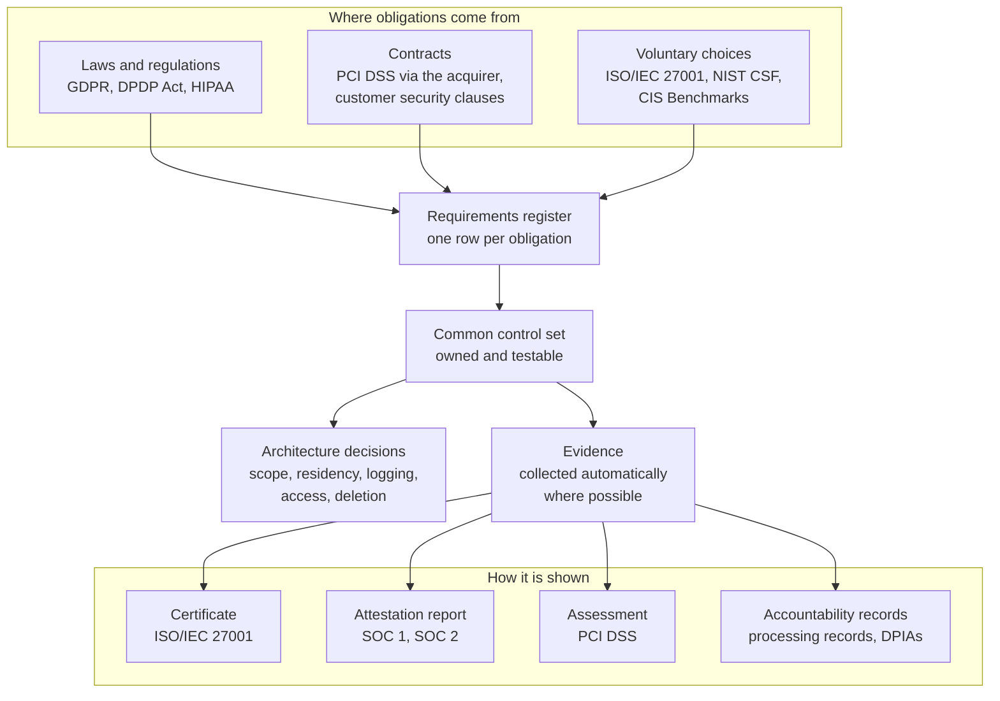
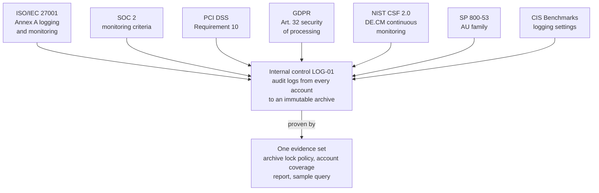
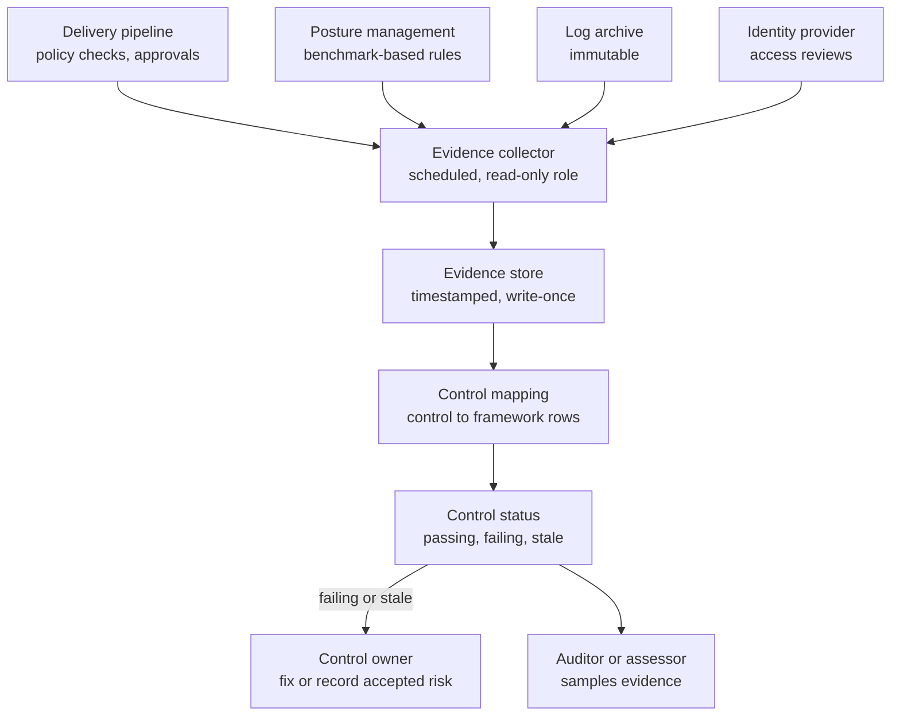
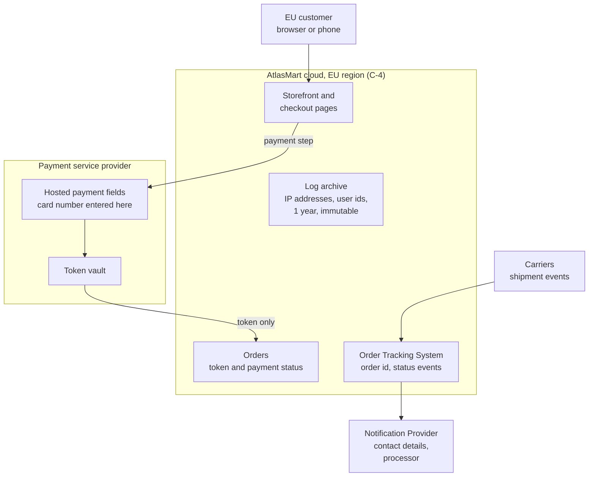

# Compliance and regulatory frameworks

> Compliance frameworks are external requirements (laws, contracts, and voluntary standards) that
> shape what a system must do with data and how the organization must prove it. The architect's job
> is not to interpret the law but to turn agreed obligations into a small set of testable controls,
> build them into the platform, and make the evidence fall out of normal operation.

!!! abstract "Page facts"
    **Level:** Intermediate (what each framework is and who issues it is Level 1; control mapping and
    evidence automation are Level 2; scoping a system and designing residency, retention, and deletion
    are Level 3) · **Status:** Draft · **Time:** 60-90 minutes · **Last verified:** 2026-11-21

!!! warning "Not legal advice"
    This page is educational. It is not legal advice and does not tell you whether any law or
    standard applies to your organization. Applicability depends on facts (where you are
    established, whose data you process, what you sell, what contracts you signed) and laws change.
    Read the primary sources linked here, check their current status, and take applicability
    questions to qualified counsel and your compliance team.

## Learning objectives

After this page you should be able to:

- Classify a framework as a law or regulation, a contractual standard, a voluntary standard or
  guidance, or an attestation or certification, and name who issues it.
- Describe in general terms who ISO/IEC 27001, SOC 1 and SOC 2, PCI DSS, HIPAA, GDPR, India's DPDP
  Act, NIST CSF, NIST SP 800-53, CIS Benchmarks, and FedRAMP are aimed at, without claiming they
  apply to a given company.
- Explain what an architect changes because of each: scope boundaries, data location, logging,
  access control, retention and deletion, vendor contracts, and evidence.
- Build a control mapping in which one internal control satisfies requirements from several
  frameworks, and explain why that beats one project per framework.
- Design evidence collection that runs continuously instead of in a pre-audit scramble.
- Scope a system's likely compliance drivers and write the questions to take to counsel.

## Prerequisites

- [Security principles and threat modeling](security-principles-and-threat-modeling.md) — risk,
  controls, and trust boundaries are the vocabulary every framework uses.
- [Data security and privacy](data-security-and-privacy.md) — classification, encryption,
  tokenization, pseudonymization, residency, and retention mechanisms that this page asks for.
- [Security operations](security-operations.md) — audit logs, SIEM, and incident response, which
  produce much of the evidence auditors sample.
- [Constraints, assumptions, dependencies, risks, and scope](../architecture-fundamentals/constraints-assumptions-dependencies-risks-and-scope.md)
  — regulations reach a design as constraints.

## The problem this solves

Without a deliberate approach, compliance arrives as surprises. Sales promises a customer a SOC 2
report; an acquirer asks which PCI DSS validation was completed; a privacy regulator asks for
processing records; a customer asks for erasure and nobody knows which stores, backups, and logs
hold their data. Each request becomes a separate project, the same evidence is gathered again and
again, and the architecture is patched afterwards: card data has spread across services, personal
data has been copied to another region, and "immutable" logs can be edited by the people they record.

Architecture decides most of the cost. Keeping card data out of your systems shrinks an assessment;
keeping personal data in one region removes transfer questions; deletion designed in is cheap, and
retrofitted it is a migration. This page gives the vocabulary and a method to decide early.

## What it is

**Compliance** is demonstrating that an organization meets a defined set of external requirements.
It has two halves: doing the thing (the control works) and proving it (evidence an outsider
accepts). Frameworks differ in where their authority comes from:

| Type | Authority | Examples on this page | What "compliant" means |
|---|---|---|---|
| Law or regulation | A legislature or regulator; enforced with penalties | GDPR, India's DPDP Act 2023 and Rules, HIPAA, NIS2, DORA | Obligations met; the regulator decides if challenged |
| Contractual standard | A contract (for example with a card acquirer or a customer) | PCI DSS; customer security clauses; FedRAMP for selling cloud services to US federal agencies | Assessed or validated as the contract requires |
| Voluntary standard or guidance | A standards body or agency; adopted by choice | ISO/IEC 27001, NIST CSF 2.0, NIST SP 800-53, CIS Benchmarks | Adopted, sometimes certified against |
| Attestation or certification | An independent auditor or certification body | ISO/IEC 27001 certificate, SOC 1 and SOC 2 reports, PCI DSS Report on Compliance | An opinion or certificate for a defined scope and period |

A voluntary framework can become mandatory through a contract, and a law can be met using a
voluntary framework as the method. "SOC 2 compliant" is loose wording: a SOC 2 report is an
auditor's opinion about a described system, not a certificate of compliance with a law.

## Mental model

Think of a building that must satisfy the building code (law), the insurer's requirements
(contract), and the owner's chosen green-building standard (voluntary). One fire door, specified
once, satisfies all three clauses, and its inspection certificate is shown to all three.
Compliance architecture is the same: **one control, many frameworks, one evidence trail**.

**Where the analogy breaks:** buildings are inspected once and change slowly; software changes many
times a day, so a control that passed last month may be off today. Evidence must be continuous.
And unlike a building code, privacy law governs purposes and people's rights, not just physical
safety: a perfectly secured database can still be unlawful if the data should not be there at all.

## Key terms

| Term | Meaning on this page |
|---|---|
| Control | A safeguard or practice that addresses a risk or requirement, with an owner and a way to test it |
| Control mapping | A table linking each internal control to the framework requirements it helps satisfy |
| Evidence | Records showing a control is designed and operating: configurations, logs, tickets, reports |
| Attestation | An independent practitioner's report giving an opinion on a described system and its controls (for example SOC 2) |
| Certification | A certificate from an accredited body stating an organization conforms to a standard (for example ISO/IEC 27001) |
| Scope | The systems, data, people, and locations a framework or assessment covers |
| Controller / data fiduciary | Under GDPR (controller) or India's DPDP Act (data fiduciary): who decides why and how personal data is processed |
| Processor | Processes personal data on behalf of a controller or data fiduciary, under contract |
| Lawful basis | Under GDPR Article 6, one of six grounds that make processing lawful (for example contract or consent) |
| DPIA | Data protection impact assessment: a documented assessment before high-risk processing (GDPR Article 35) |
| Cardholder data environment (CDE) | The people, processes, and systems that store, process, or transmit card data, plus those connected to them |
| Data residency | Where data is physically stored and processed; a design choice, sometimes required by law or contract |
| Retention period | How long a data category is kept before deletion, justified by purpose or legal requirement |

## How it works

### Step 1 — Turn obligations into one register and one control set

Every framework reaches the design by the same path: obligations from laws, contracts, and chosen
standards are captured in a requirements register; the register is satisfied by a common set of
controls; controls become architecture decisions and produce evidence; and the evidence feeds each
form of proof (certificate, attestation report, assessment, or accountability records).

**Figure 1 — From obligation to proof.** Three sources of obligation feed one register and one
control set; the same evidence supports four kinds of proof.



How to read it: start at the top. Everything passes through the register and the control set,
which lets one control serve many frameworks. Counsel and the compliance team own the register;
architects own the controls' design and the evidence plumbing.

### Step 2 — Know each framework: type, issuer, audience, and design impact

The first table is the quick reference; every link is the issuer's own page. Check it for the
current version before relying on any detail here.

| Framework | Type | Issued by | Aimed at, in general terms | Primary source |
|---|---|---|---|---|
| ISO/IEC 27001:2022 (amended 2024) | Voluntary standard; certifiable | ISO and IEC | Any organization wanting a certified information security management system | [iso.org](https://www.iso.org/standard/27001) |
| SOC 1 and SOC 2 | Attestation reports | AICPA (framework); performed by independent CPA firms | Service organizations whose customers need assurance about their controls | [AICPA SOC suite](https://www.aicpa-cima.com/resources/landing/system-and-organization-controls-soc-suite-of-services) |
| PCI DSS v4.0.1 | Contractual industry standard | PCI Security Standards Council | Entities that store, process, or transmit payment card data, or can affect its security | [PCI SSC document library](https://www.pcisecuritystandards.org/document_library/) |
| HIPAA Privacy, Security, and Breach Notification Rules | US regulation | US Department of Health and Human Services (HHS) | US covered entities (health plans, clearinghouses, many providers) and their business associates | [HHS Security Rule](https://www.hhs.gov/hipaa/for-professionals/security/index.html) |
| GDPR, Regulation (EU) 2016/679 | EU regulation | European Parliament and Council | Processing of personal data by organizations established in the EU, and some outside it | [EUR-Lex](https://eur-lex.europa.eu/legal-content/EN/TXT/?uri=CELEX:32016R0679) |
| Digital Personal Data Protection Act 2023 and DPDP Rules 2025 | Indian law and rules | Parliament of India; Rules by the Ministry of Electronics and IT | Processing of digital personal data in India, and some outside it | [MeitY: DPDP Rules 2025](https://www.meity.gov.in/static/uploads/2025/11/53450e6e5dc0bfa85ebd78686cadad39.pdf) |
| NIST Cybersecurity Framework (CSF) 2.0 | Voluntary guidance | US National Institute of Standards and Technology | Any organization organizing a cybersecurity program | [nist.gov/cyberframework](https://www.nist.gov/cyberframework) |
| NIST SP 800-53 Rev. 5 | Control catalog | NIST | Mandatory for US federal information systems; reused elsewhere as a control vocabulary | [csrc.nist.gov](https://csrc.nist.gov/pubs/sp/800/53/r5/upd1/final) |
| CIS Benchmarks | Voluntary configuration guides | Center for Internet Security | Anyone hardening operating systems, cloud accounts, Kubernetes, and software | [cisecurity.org](https://www.cisecurity.org/cis-benchmarks) |
| FedRAMP | US government program | US General Services Administration | Cloud service providers selling to US federal agencies | [fedramp.gov](https://www.fedramp.gov/) |
| NIS2 Directive, (EU) 2022/2555 | EU directive, applied through national law | European Parliament and Council | Essential and important entities in listed sectors: cybersecurity risk management and incident reporting | [EUR-Lex](https://eur-lex.europa.eu/legal-content/EN/TXT/?uri=CELEX:32022L2555) |
| DORA, Regulation (EU) 2022/2554 | EU regulation; applies from 17 January 2025 | European Parliament and Council | EU financial entities, and oversight of critical ICT third-party providers | [EUR-Lex](https://eur-lex.europa.eu/legal-content/EN/TXT/?uri=CELEX:32022R2554) |
| Sector supervisors' rules | Supervisory rules | National banking, insurance, health, energy, and telecom regulators | Regulated firms: outsourcing, cloud use, incident reporting, data location | The supervisor's own site |

The second table gives the facts an architect needs and the design change each framework drives.

| Framework | Key facts (checked 2026-11-21) | What the architect changes |
|---|---|---|
| ISO/IEC 27001 | Specifies an **information security management system (ISMS)**: scoping, risk assessment and treatment, internal audit, management review, improvement. Annex A lists reference controls, selected in a Statement of Applicability. Current edition 2022, with Amd 1:2024 (climate action changes). ISO does not certify; accredited certification bodies do, with periodic surveillance audits | A clearly drawn ISMS scope (products, accounts, locations); a risk register linked to architecture decisions; controls that can be shown working |
| HIPAA | The Privacy Rule governs use and disclosure of protected health information; the Security Rule requires administrative, physical, and technical safeguards for electronic protected health information, starting from a risk analysis; the Breach Notification Rule sets notification duties. Business associates sign business associate agreements. HHS has proposed Security Rule changes: check HHS for whether they are final | For in-scope systems: access and audit controls on health data, encryption decisions documented against the risk analysis, cloud services used only under a business associate agreement |
| India's DPDP Act and Rules | Act No. 22 of 2023, assented 11 August 2023. Terms: **data fiduciary** (decides purpose and means), **data principal** (the individual), Data Protection Board of India (enforces). Section 3 reaches processing outside India connected with offering goods or services to people in India; Section 16 lets the government restrict transfers to notified countries. Rules notified November 2025 with phased commencement in Rule 1: some rules at once, the consent manager rule after one year, most fiduciary obligations (notice, security safeguards, breach intimation, retention, rights, children's data, transfers) after eighteen months. **Check the current status on MeitY's site** | Consent and notice records per purpose; breach intimation to the Board and each affected individual; erasure when the purpose is served; once in force, keeping certain processing logs for a minimum period, which interacts with erasure |
| NIST CSF 2.0 | NIST CSWP 29, published 26 February 2024. Six functions: **Govern, Identify, Protect, Detect, Respond, Recover**; Govern (new in 2.0) includes understanding legal and regulatory requirements (category GV.OC). Organizational Profiles describe current and target state; Tiers describe rigor | Little directly: a program-level map in which architecture work (segmentation, logging, recovery) is placed and gap-assessed |
| NIST SP 800-53 Rev. 5 | *Security and Privacy Controls for Information Systems and Organizations*: 20 control families, such as Access Control (AC), Audit and Accountability (AU), Identification and Authentication (IA), System and Information Integrity (SI). Published September 2020; release 5.2.0 (August 2025) was the latest on the publication page when checked. Baselines are in SP 800-53B. Underpins FedRAMP's Rev5 path | Where it applies: specific, parameterized controls (for example AU-11, audit record retention) and implementation statements per system; elsewhere, precise identifiers for mappings |
| CIS Benchmarks | Consensus-developed, vendor-neutral secure configuration guides for operating systems, cloud accounts, Kubernetes, databases, and other software | Hardened base images; infrastructure modules with benchmark settings as defaults; posture rules that report drift |
| FedRAMP | Standardizes security assessment of cloud services used by US federal agencies. In transition: the site describes a legacy Rev5 path and a newer FedRAMP 20x path under Consolidated Rules for 2026; read fedramp.gov before planning anything | Usually a separately bounded environment for federal customers, with its own controls, personnel rules, and continuous monitoring reports |
| NIS2, DORA, sector rules | Definition depth only on this page: sector rules add incident reporting, third-party oversight, and resilience requirements on top of the general ones | Incident reporting paths, third-party registers, and resilience testing that the security operations and DR designs must absorb |

Three frameworks need more depth because they shape data architecture most often.

**SOC 1 and SOC 2.** Independent CPA firms issue these reports under AICPA attestation standards.
**SOC 1** covers a service organization's controls relevant to its customers' **internal control
over financial reporting** (a payroll or billing processor, for example); its main readers are
customers' auditors. **SOC 2** covers controls relevant to the AICPA **trust services criteria**:
security, availability, processing integrity, confidentiality, and privacy; security is always in
scope, the others are chosen. A **Type 1** report gives an opinion on the system description and
control design at a point in time; a **Type 2** report adds operating effectiveness over a period,
which is why customers usually ask for Type 2. SOC 3 is a shorter general-use report. AICPA has
published proposed updated criteria for comment, so check the current version. *What the architect
changes:* a system boundary that matches the report description, evidence retained for the whole
period, and **complementary user entity controls**, the controls a report says its customers must
operate. When you consume a provider's SOC 2 report, those are yours.

**PCI DSS.** Published by the PCI Security Standards Council, it is not a law: card brands and
acquirers make it a contractual requirement and decide what validation each merchant or service
provider performs (a self-assessment questionnaire or an assessor's Report on Compliance). Version
4.0.1 is the version featured in the Council's document library as of this page's check date. Its
numbered requirements include Requirement 8 (identifying users and authenticating access) and
Requirement 10 (logging and monitoring access). *What the architect changes:* mostly **scope**.
Everything that stores, processes, or transmits card data, and everything connected to it, is in
the cardholder data environment. Tokenization through a payment service provider (PSP), with card
entry on the provider's hosted page or embedded fields, keeps card numbers out of your systems and
shrinks scope sharply; but the pages that lead customers to the payment step can still affect its
security, so scope narrows rather than disappears. Segmentation of whatever remains is the second
lever.

**GDPR.** Regulation (EU) 2016/679 has applied since 25 May 2018 (Article 99). Article 3 sets its
reach: organizations established in the EU, and organizations outside it that offer goods or
services to people in the EU or monitor their behaviour there. Five areas drive design:

- **Principles (Article 5):** lawfulness, fairness and transparency; purpose limitation; data
  minimisation; accuracy; storage limitation; integrity and confidentiality; and accountability
  (being able to show all of the above). Minimisation and storage limitation become schema and
  retention decisions.
- **Lawful basis (Article 6):** each purpose needs one of six bases: consent, contract, legal
  obligation, vital interests, public task, or legitimate interests. Consent must be recorded and
  withdrawable, and processing must stop when it is withdrawn.
- **DPIA (Article 35):** processing likely to result in high risk needs a documented impact
  assessment beforehand; architects supply the data flows, stores, recipients, and safeguards.
- **Data subject rights (Articles 15 to 22):** access, rectification, erasure, restriction,
  portability, objection, and safeguards on solely automated decisions. Each needs a way to find a
  person's data in every store, which works only if data is keyed by a subject identifier.
- **Transfers (Chapter V, Articles 44 to 49):** personal data leaving the European Economic Area
  needs an adequacy decision, appropriate safeguards such as standard contractual clauses or
  binding corporate rules, or a narrow derogation. Remote access from outside the EU, a support
  vendor abroad, or a monitoring tool hosted elsewhere can all raise transfer questions.

Also relevant: data protection by design and by default (Article 25), processor contracts
(Article 28), records of processing activities (Article 30), security of processing (Article 32),
and notifying the supervisory authority of a breach without undue delay and, where feasible, within
72 hours of becoming aware (Article 33). Amendments were proposed in 2025; check EUR-Lex for the
text in force.

### Step 3 — Map one control to many frameworks

Frameworks overlap heavily because they address the same risks. A **common control framework**
defines each control once, in the organization's own words, with an owner, a test, and an evidence
source, and maps it to every requirement it helps satisfy.

**Figure 2 — One control, many frameworks.** A single logging control with one evidence set,
mapped to seven frameworks. References are at family or requirement level; a real mapping cites
the exact clause of the edition in use.



How to read it: arrows point from a framework requirement to the control that helps meet it. The
evidence is collected once and shown to every auditor. When a framework changes version, only its
mapping rows change; the control, the design, and the evidence usually stay the same.

A mapping is a judgment, not arithmetic. A control "helps satisfy" a requirement; the auditor
decides whether it is sufficient for that framework's wording and scope. Keep the mapping in
version control next to the controls, and have the compliance team review it.

### Step 4 — Collect evidence continuously

Auditors sample evidence that a control is **designed** (a policy, a configuration) and
**operating** (records over time). Collected by hand before each audit, evidence is expensive,
inconsistent, and only proves the control worked on the day someone looked. **Continuous
compliance** means collecting it on a schedule from the systems that already know the answer.

**Figure 3 — A continuous evidence pipeline.** Existing platform systems feed a read-only collector;
control status is visible all year.



How to read it: the four sources at the top are platform components that exist for operational
reasons; the collector only reads from them. The store is write-once so evidence cannot be edited
after the fact. "Stale" means the latest evidence is older than the control's collection interval,
which is itself a finding.

Good evidence practice for architects:

- **Prefer system-generated over human-generated evidence.** A configuration export with a timestamp
  beats a screenshot; a pipeline log of an approval beats an email.
- **Policy as code doubles as evidence.** A rule that blocks unencrypted storage in the pipeline is
  both the control and the record that it ran.
- **Give the collector its own least-privilege read-only identity,** and log its access.
- **Match the evidence period to the audit period:** a SOC 2 Type 2 needs records across the whole
  period, so evidence retention must outlast it.
- **Inherit what you can.** Cloud providers publish their own attestations ([AWS Artifact](https://docs.aws.amazon.com/artifact/latest/ug/what-is-aws-artifact.html), the
  [Microsoft Service Trust Portal](https://learn.microsoft.com/en-us/purview/get-started-with-service-trust-portal), and Google Cloud's [Compliance Reports Manager](https://cloud.google.com/security/compliance/compliance-reports-manager)). They cover the
  provider's side of the shared responsibility model; read their complementary user entity
  controls, because those are yours.

### Step 5 — Residency, retention, and deletion: the recurring themes

Three questions appear in almost every framework and decide much of the data architecture.

| Theme | The question | What pushes on it | Design patterns |
|---|---|---|---|
| Residency | Where may this data be stored and processed, and from where accessed? | Laws rarely mandate local storage in general terms: GDPR regulates transfers rather than requiring EU storage, and the DPDP Act allows transfers except to countries the government restricts. Contracts, sector rules, and company policy are often stricter | Pin stores and backups to approved regions with organization-wide policies; check where managed services send telemetry, support data, and replicas; treat administrator and support access as part of residency |
| Retention | How long is each category kept, and why? | Storage limitation (GDPR) and erasure when the purpose is served (DPDP) push short; tax, accounting, sector rules, and security investigations push long | A **retention schedule** per data category (period, justification, owner, deletion mechanism), enforced by lifecycle policies, time partitioning so old data is dropped cheaply, and TTLs on caches and queues |
| Deletion | Can you delete one person's data everywhere, and prove it? | Erasure requests and the end of retention periods; copies in replicas, caches, indexes, analytics extracts, logs, and backups | Key personal data by a subject identifier; keep personal data out of logs and event payloads (use identifiers or tokens); let backups expire without restore to production, or use **crypto-shredding** (destroying per-subject or per-period keys); record each deletion as an event that does not contain the deleted data |

Retention and deletion collide when one rule says keep and another says erase. Resolve that in the
retention schedule with counsel, not in code.

## Worked example: AtlasMart's compliance scoping

The facts below come from the AtlasMart running example; nothing here says any law applies to
AtlasMart. **Applicability depends on facts; AtlasMart should ask counsel.** The architect's
contribution is an accurate data inventory, a scoping table, and good questions.

### The facts that drive scoping

- An online retailer serving EU customers from one EU cloud region; constraint C-4 keeps EU
  customer data there (a company decision, stricter than transfer rules alone would require).
- **Assumption (Phase 4 platform):** card payments are handled by a payment service provider
  through tokenization; card numbers never touch AtlasMart systems. AtlasMart stores only tokens and
  payment status.
- No health data is collected as such.
- The Order Tracking System stores order identifiers, shipment status events, and customer
  identifiers; NFR-6 says it stores no delivery addresses. The Notification Worker sends messages
  through an external Notification Provider, which needs a phone number or email address.
- **Assumption (Phase 4 platform):** audit, flow, and DNS logs from all 29 accounts go to an
  immutable log archive with 1-year retention. These logs contain IP addresses and user
  identifiers, which are personal data in many contexts.

**Figure 4 — AtlasMart's data flows relevant to scoping.** Card data stays inside the PSP's
boundary; personal data stays in the EU region except where an external processor receives it.



How to read it: the PSP subgraph is where the cardholder data environment proper lives; AtlasMart's
checkout pages are drawn next to it because they can still affect the payment step. Everything
inside the EU region box is personal-data processing; the arrow to the Notification Provider is a
disclosure to a processor and a possible transfer, depending on where the provider processes.

### Scoping table

| Framework | Likely relevance (depends on facts; ask counsel) | Why | What the architecture does |
|---|---|---|---|
| GDPR | Likely relevant | EU customers' personal data processed by a retailer in the EU | Data inventory and processing records per purpose; retention schedule; subject-rights tooling keyed by customer id; DPAs with the Notification Provider and other processors; region pinning per C-4 |
| PCI DSS | Likely relevant, with reduced scope | AtlasMart accepts card payments; tokenization narrows scope but checkout pages can affect the payment step | Card entry only in PSP-hosted fields; no card data in logs or tickets; checkout pages change-controlled and monitored; validation type confirmed with the acquirer |
| ISO/IEC 27001, SOC 2 | Business choice | No law requires them; B2B partners or investors may ask | Build the common control set now so either can be pursued later without redesign |
| NIST CSF 2.0 | Useful, voluntary | Organizes the security program and its gap assessment | Use the six functions to structure the security roadmap |
| CIS Benchmarks | Useful, voluntary | Measurable configuration baseline | Posture management rules and base images aligned to the relevant benchmarks |
| NIST SP 800-53 | Reference only | Not a US federal system | Use control identifiers as precise vocabulary in the mapping |
| HIPAA | Appears out of scope on these facts | No health data; not a US covered entity or business associate | None; recheck if a health product line or US health partner appears |
| FedRAMP | Appears out of scope | AtlasMart does not sell cloud services to US federal agencies | None |
| DPDP Act (India) | Appears out of scope on these facts | No stated offering to people in India or processing in India | Recheck if AtlasMart uses an India-based vendor or ships to India |
| NIS2, DORA | Ask counsel | DORA targets financial entities; NIS2 depends on sector, size, and national law | Incident reporting process in the security operations runbook can absorb either if needed |

### What the architecture does about GDPR, concretely

1. **Data inventory as code.** Each data store's infrastructure module carries tags for data
   category, personal-data flag, owner, and retention period; posture rules fail any store without
   them. The processing records are generated from these tags plus a purpose register kept by the
   privacy team.
2. **Minimisation in the tracking path.** NFR-6 already keeps delivery addresses out of tracking.
   Notifications are sent by customer id; the Notification Worker looks up contact details at send
   time and does not copy them into events or logs.
3. **Retention.** Tracking events and orders get periods set with counsel (not decided here);
   tables are partitioned by month so expiry is a partition drop. The 1-year log archive retention
   is an assumption to justify in the retention schedule (security investigation needs) and to
   record in the processing records.
4. **Erasure.** A deletion workflow, triggered by a verified request, fans out by customer id to
   each store that holds personal data and records completion per store. Logs and backups follow the
   documented expiry approach in Step 5.
5. **Region pinning.** Organization policies deny creating storage outside the EU region in all
   workload accounts; replicas and backups stay in-region per C-4; support access uses workforce SSO
   from approved locations.

### Questions to take to counsel

- Which lawful basis applies to each purpose (order fulfilment, delivery notifications, fraud
  checks, marketing, analytics), and which need consent records?
- Could purchase history for some product categories reveal health information and count as a
  special category of data under GDPR Article 9?
- Where does the Notification Provider process data, and does any processing or support access
  outside the EEA need transfer safeguards?
- What retention periods apply to orders, tracking events, and security logs, and how should a
  conflict between a keep rule and an erasure request be resolved?
- Which PCI DSS validation does the acquirer require for this integration, and does the checkout
  page design (redirect or embedded fields) change it?
- Does AtlasMart's sector, size, or any member-state law bring it within NIS2's national
  implementation?
- If AtlasMart engages a support or engineering vendor in India, how do Sections 3 and 17 of the
  DPDP Act apply to that processing?

## Real-world architecture example

Organizations that hold several attestations at once tend to converge on one pattern: a small
governance, risk, and compliance team owns one control library mapped to every framework in scope;
infrastructure modules embed controls as defaults (encryption on, logging on, region pinned), so
teams on the golden path inherit them; posture management evaluates accounts continuously and the
evidence store snapshots results; payment pages use a PSP's hosted components; and auditors get
read access to the evidence store for the audit period instead of a folder of screenshots.
Compliance cost scales with how many systems are in scope and how manual the evidence is, and both
are design decisions.

## Design choices and trade-offs

| Choice | Favor when | Avoid when |
|---|---|---|
| Outsource card capture to a PSP with tokenization | You accept cards but do not need card numbers yourself | Your business model requires handling card data directly (then budget for a full CDE) |
| Common control framework mapped to many frameworks | Two or more frameworks are in scope, or soon will be | A single small assessment where the mapping overhead exceeds the work |
| Separate, bounded environment for a regulated customer segment | One segment (federal, health, payments) has much stricter rules than the rest | Requirements are similar everywhere; two environments double operations |
| Single-region data residency by policy | Law, contract, or customers require it, or it simplifies transfer analysis | Latency or resilience needs a second region and the rules permit it (then document transfers) |
| Continuous automated evidence | Recurring audits, Type 2 periods, many controls | One-off checks where scripting costs more than collecting by hand |
| Crypto-shredding for erasure | Data spreads into backups and logs you cannot edit | Key management maturity is low; losing a key destroys data you needed |
| Pursue ISO/IEC 27001 or SOC 2 | Customers or partners require it in contracts | No one will read it; build the controls first and decide later |

## Failure modes and anti-patterns

- **Checkbox compliance.** Controls exist on paper but not in systems. Detect: evidence is
  documents, never system output; incidents occur in "compliant" areas. Prevent: every control has a
  technical test or an automated evidence source.
- **Scope creep in payments.** Card numbers leak into logs, support tickets, or analytics. Detect:
  data discovery scans for card-number patterns. Prevent: hosted payment fields, log redaction, and
  a rule that card data never enters AtlasMart-owned systems.
- **One project per framework.** The same evidence is collected several times with different
  wording. Detect: duplicate evidence requests to the same team. Prevent: a common control set and
  one evidence store.
- **Undeletable personal data.** Personal data in immutable logs, event streams, or backups with no
  expiry. Detect: erasure requests that cannot be completed. Prevent: identifiers instead of
  personal data in logs, documented backup expiry, crypto-shredding.
- **Silent residency drift.** A new managed service replicates or sends telemetry outside the
  approved region. Detect: organization-wide region policies and posture rules. Prevent: an
  approved-services list with residency notes, reviewed at design review.
- **Stale evidence.** Collectors break and nobody notices until the audit. Detect: an evidence
  freshness check per control (the lab below). Prevent: alerts on stale evidence, owned like any
  other operational alert.
- **The architect as lawyer.** Engineers decide that a law does or does not apply. Prevent: record
  applicability decisions from counsel in the requirements register, with dates.

## Security considerations

- **Compliance is a floor, not a security strategy.** Frameworks describe minimum outcomes; threat
  modeling decides what this system needs beyond them.
- **The evidence store is sensitive.** It contains configurations, access lists, and samples of
  logs: protect it with least privilege, write-once storage, and audit logging of its own.
- **Audit logs must be tamper-evident.** Logs that the people they record can edit are not
  evidence; the log archive account's separate ownership and immutability are the control.
- **Compliance data is personal data too:** access reviews and logs identify staff and need their
  own retention periods.
- **Vendors extend scope.** Every processor and PSP integration is a trust boundary; read their
  reports and contracts, and design for their failure or compromise.

## Performance, reliability, and cost

- **Performance:** most controls cost little at runtime (encryption, logging), but synchronous
  compliance checks on hot paths (calling a consent service on every request, for example) add
  latency; cache consent decisions with a short bound and invalidate on withdrawal.
- **Reliability:** residency constraints limit failover options: a second region outside the
  approved area may not be available for disaster recovery. Decide the recovery design and the
  residency rule together, and record the trade-off in an ADR.
- **Cost:** the largest compliance costs are scope (how many systems are assessed) and manual
  effort (evidence gathering, access reviews). Tokenization, segmentation, and automated evidence
  reduce both. Long retention multiplies storage and makes erasure harder; short, justified
  retention is usually cheaper and lower-risk.

## Hands-on lab: an evidence freshness check

Build a tiny control library with framework mappings and find which framework requirements lose
their evidence when one control's evidence goes stale. Standard library Python 3.12 or later; the
dates and limits are illustrative values for the exercise, not AtlasMart facts.

1. Save this as `evidence_check.py`:

    ```python
    from collections import defaultdict
    from datetime import date

    TODAY = date(2026, 11, 21)
    CONTROLS = {
        "LOG-01 audit logs to immutable archive": {
            "maps_to": ["PCI DSS Req 10", "NIST 800-53 AU", "CSF DE.CM", "GDPR Art 32"],
            "last_evidence": date(2026, 11, 20), "max_age_days": 7},
        "IAM-02 workforce SSO with MFA": {
            "maps_to": ["PCI DSS Req 8", "NIST 800-53 IA", "CSF PR.AA", "GDPR Art 32"],
            "last_evidence": date(2026, 9, 30), "max_age_days": 30},
        "RET-03 tracking events deleted after retention": {
            "maps_to": ["GDPR Art 5(1)(e)", "NIST 800-53 SI-12"],
            "last_evidence": date(2026, 11, 1), "max_age_days": 31},
    }

    stale_by_requirement = defaultdict(list)
    for name, ctl in CONTROLS.items():
        age = (TODAY - ctl["last_evidence"]).days
        status = "STALE" if age > ctl["max_age_days"] else "ok"
        print(f"{status:5}  {name}  (evidence {age} days old, limit {ctl['max_age_days']})")
        if status == "STALE":
            for req in ctl["maps_to"]:
                stale_by_requirement[req].append(name.split()[0])

    print("\nRequirements with stale evidence:")
    for req in sorted(stale_by_requirement):
        print(f"  {req}: {', '.join(stale_by_requirement[req])}")
    ```

2. Run `python3 evidence_check.py`. You should see:

    ```text
    ok     LOG-01 audit logs to immutable archive  (evidence 1 days old, limit 7)
    STALE  IAM-02 workforce SSO with MFA  (evidence 52 days old, limit 30)
    ok     RET-03 tracking events deleted after retention  (evidence 20 days old, limit 31)

    Requirements with stale evidence:
      CSF PR.AA: IAM-02
      GDPR Art 32: IAM-02
      NIST 800-53 IA: IAM-02
      PCI DSS Req 8: IAM-02
    ```

3. Change `last_evidence` for LOG-01 to `date(2026, 10, 1)` and run again. Note how many
   requirements across how many frameworks are affected by one broken collector.
4. Add a fourth control of your own (for example, region pinning for data stores) and map it to the
   frameworks you think it supports. Write one sentence per mapping justifying it.
5. Stretch: add an `owner` field and print one line per owner listing their stale controls, which
   is the shape of a real alert.

??? question "Hint: why is a stale control a finding even if the control still works?"
    An auditor can only accept what can be shown. If the last evidence is older than the control's
    stated interval, there is a period in which nobody can prove the control operated, and for a
    Type 2 report or a recurring assessment that gap is itself an exception. That is why evidence
    freshness is monitored like any other operational signal.

## Knowledge check

1. Classify each as law or regulation, contractual standard, voluntary standard or guidance, or
   attestation: GDPR, PCI DSS, NIST CSF 2.0, a SOC 2 Type 2 report.
2. What is the difference between a SOC 2 Type 1 and a Type 2 report, and why do customers usually
   ask for Type 2?
3. AtlasMart uses PSP-hosted payment fields and stores only tokens. Why does that narrow PCI DSS
   scope without removing it?
4. Name three places personal data hides that make an erasure request hard, and one design pattern
   for each.
5. Why does a common control framework reduce cost when a company pursues ISO/IEC 27001 and SOC 2
   in the same year?

??? success "Answers"
    1. GDPR is a regulation (law). PCI DSS is a contractual industry standard enforced through card
       brands and acquirers. NIST CSF 2.0 is voluntary guidance. A SOC 2 Type 2 report is an
       attestation by an independent CPA firm.
    2. Type 1 gives an opinion on the system description and control design at a point in time;
       Type 2 adds whether controls operated effectively over a period. Customers want evidence that
       controls work in practice over time, not only that they were designed well.
    3. Card numbers no longer enter AtlasMart systems, so most of its estate is outside the
       cardholder data environment. But AtlasMart's checkout pages lead the customer to the payment
       step and could be tampered with to redirect or capture input, so some requirements still
       apply to them; the acquirer decides which validation is needed.
    4. Logs (keep identifiers or tokens instead of personal data), backups (documented expiry
       without restore to production, or crypto-shredding), and analytics or search copies (key them
       by subject id and include them in the deletion fan-out); caches and queues need TTLs.
    5. Most requirements overlap: one control with one evidence set satisfies both, so the work and
       evidence are done once and only the mapping differs.

## Architecture discussion questions

1. AtlasMart's product team proposes a second region outside the EU for disaster recovery. Which
   questions would you take to counsel, what alternatives keep within C-4, and how would you record
   the decision?
2. A large B2B partner asks AtlasMart for a SOC 2 Type 2 report within nine months. What must be in
   place before the observation period starts, and which parts of the existing platform already
   produce usable evidence?
3. The security team wants five years of audit logs for investigations; the privacy team wants the
   shortest justifiable retention. How would you design storage, access, and pseudonymization so
   both concerns are addressed, and who decides the period?

## Summary

Compliance frameworks come from laws (GDPR, India's DPDP Act, HIPAA), contracts (PCI DSS, FedRAMP
for federal cloud sales), and voluntary standards (ISO/IEC 27001, NIST CSF 2.0, SP 800-53, CIS
Benchmarks), and are proven through certificates, attestation reports such as SOC 1 and SOC 2,
assessments, and accountability records. Whether any of them applies depends on facts and is
counsel's call. The architect's job is to turn agreed obligations into one owned, testable control
set mapped to every framework, collect evidence continuously from the platform, and design scope,
residency, retention, and deletion deliberately. For AtlasMart, tokenization keeps card data with
the PSP, GDPR-driven data inventory and deletion are designed in, and the open questions go to
counsel in writing.

## Related topics

- **Before:** [Security principles and threat modeling](security-principles-and-threat-modeling.md);
  [Data security and privacy](data-security-and-privacy.md);
  [Constraints, assumptions, dependencies, risks, and scope](../architecture-fundamentals/constraints-assumptions-dependencies-risks-and-scope.md)
- **Alongside:** [Security operations](security-operations.md) — audit logs and incident reporting;
  [Identity and access management](identity-and-access-management.md) — access reviews and MFA
  evidence; [Infrastructure and supply-chain security](infrastructure-and-supply-chain-security.md)
  — posture management and policy as code;
  [Multi-account strategy and infrastructure automation](../cloud-architecture/multi-account-strategy-and-infrastructure-automation.md)
  — organization policies for region pinning; [Trade-offs, principles, ADRs, and architecture governance](../architecture-fundamentals/trade-offs-principles-adrs-and-architecture-governance.md).
- **Planned:** disaster recovery strategies and residency-constrained recovery (D13-T03); DevSecOps
  compliance gates and policy as code (D16); enterprise architecture governance (D18); cloud
  adoption and Well-Architected frameworks (D28).

## References

| Source | Type | Checked |
|---|---|---|
| [ISO/IEC 27001 — Information security management systems](https://www.iso.org/standard/27001) — ISO | Standard (catalog page; edition 2022 with Amd 1:2024) | 2026-11-21 |
| [System and Organization Controls (SOC) suite of services](https://www.aicpa-cima.com/resources/landing/system-and-organization-controls-soc-suite-of-services) — AICPA and CIMA | Official guidance (SOC reports, trust services criteria) | 2026-11-21 |
| [PCI DSS document library](https://www.pcisecuritystandards.org/document_library/) — PCI Security Standards Council | Standard (PCI DSS v4.0.1) | 2026-11-21 |
| [The Security Rule](https://www.hhs.gov/hipaa/for-professionals/security/index.html) — US Department of Health and Human Services | Regulator guidance (HIPAA) | 2026-11-21 |
| [Regulation (EU) 2016/679 (GDPR)](https://eur-lex.europa.eu/legal-content/EN/TXT/?uri=CELEX:32016R0679) — EUR-Lex | Law (official text) | 2026-11-21 |
| [Digital Personal Data Protection Rules, 2025](https://www.meity.gov.in/static/uploads/2025/11/53450e6e5dc0bfa85ebd78686cadad39.pdf) and [Digital Personal Data Protection Act, 2023](https://www.meity.gov.in/static/uploads/2024/06/2bf1f0e9f04e6fb4f8fef35e82c42aa5.pdf) — MeitY, Government of India | Law and rules (Gazette text) | 2026-11-21 |
| [The NIST Cybersecurity Framework (CSF) 2.0, NIST CSWP 29](https://www.nist.gov/publications/nist-cybersecurity-framework-csf-20) — NIST | Official guidance | 2026-11-21 |
| [SP 800-53 Rev. 5, Security and Privacy Controls for Information Systems and Organizations](https://csrc.nist.gov/pubs/sp/800/53/r5/upd1/final) — NIST | Standard (control catalog) | 2026-11-21 |

## Review notes

- Canonical page for D12-T08. In depth: GDPR (principles, lawful basis, DPIA, rights, transfers),
  PCI DSS scope and tokenization, SOC 1 and SOC 2 (Type 1, Type 2, trust services criteria),
  control mapping, continuous evidence, residency, retention, and deletion. Only defined (one table
  row or paragraph): ISO/IEC 27001, HIPAA, India's DPDP Act and Rules, NIST CSF 2.0, NIST SP 800-53,
  CIS Benchmarks, FedRAMP, and industry rules (NIS2, DORA, sector supervisors).
- Links: iso.org and hhs.gov return 403 to scripted requests (curl and fetch tools), like doi.org;
  kept because they are the issuers' own pages; check them in a browser.
  meity.gov.in/data-protection-framework returns 200 but renders client-side, so the Gazette PDFs
  (200) are cited. Every other link returned 200.
- Version facts verified 2026-11-21: ISO/IEC 27001:2022 with Amd 1:2024 (ISO catalog listings via
  search, since iso.org blocks scripts); PCI DSS v4.0.1 featured in the PCI SSC library; CSF 2.0
  date, CSWP 29, and six functions from the CSWP 29 PDF; SP 800-53 release 5.2.0 from csrc and the
  20 families from NIST's OSCAL catalog; GDPR article titles, the 72-hour wording, and 25 May 2018
  from EUR-Lex; DPDP Act number, assent date, Sections 3, 16, 17, and the Rules' Rule 1 phasing from
  the MeitY Gazette PDFs; DORA's 17 January 2025 date from EUR-Lex. PCI DSS Requirement 8 and 10
  titles were checked against secondary copies (the official PDF sits behind a licence page).
- Deliberately omitted (unverifiable at the primary source or in motion): HIPAA Security Rule
  proposal dates and status; FedRAMP certification classes and dates; exact DPDP commencement days
  (sources differ between 13 and 14 November 2025); CIS profile levels; ISO Annex A control numbers
  (paywalled, so Figure 2 names topics). GDPR amendment proposals (2025) are mentioned only as
  "proposed; check EUR-Lex".
- No new AtlasMart numbers; uses existing assumptions (PSP tokenization, 29 accounts, 1-year
  immutable log archive, C-4, NFR-6). Scoping states likely relevance only, with "ask counsel".
- The mini-lab script was run with Python 3.14.7; the output shown is real. Figure 2 has seven
  boxes in its top row: check legibility in the browser.
