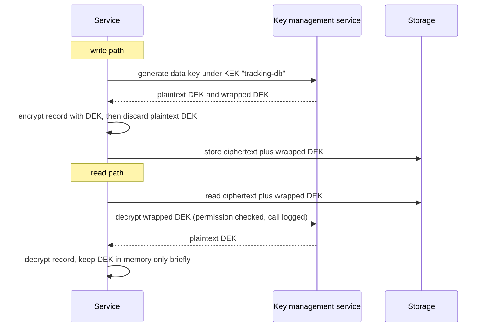
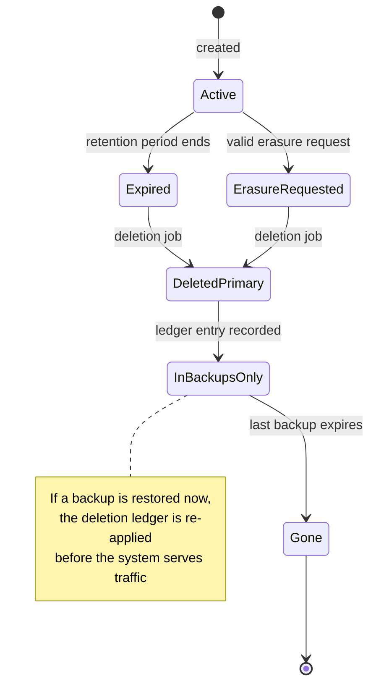
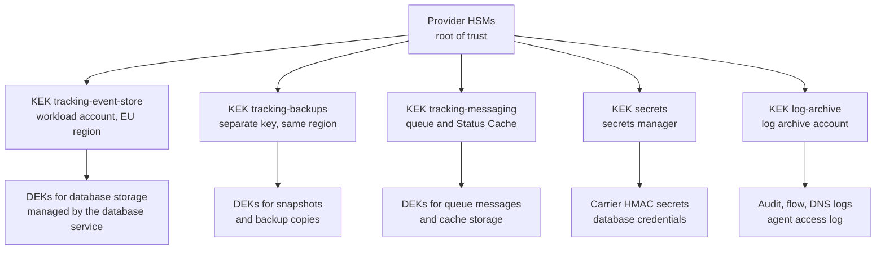

# Data security and privacy

> Data security keeps data confidential, intact, and available to the right parties; privacy limits
> what personal data is collected, how it is used, and how long it is kept. Both start with knowing
> what data you have, and both end with being able to delete it, including from backups.

!!! abstract "Page facts"
    **Level:** Intermediate (classification, encryption types, and de-identification are Level 1-2;
    key hierarchies, residency, and deletion design are Level 3) · **Status:** Draft ·
    **Time:** 60-75 minutes · **Last verified:** 2026-11-21

!!! warning "Not legal advice"
    This page mentions the EU General Data Protection Regulation (GDPR) to explain architectural
    consequences. Whether a law applies to a system, and what it requires, depends on facts; ask
    counsel. Links go to the regulation's official text.

## Learning objectives

After this page you should be able to:

- Build a data classification scheme and attach handling rules (encryption, access, logging,
  retention) to each level.
- Distinguish encryption at rest, in transit, and in use, and the protection each storage-level,
  database-level, and field-level option actually provides.
- Explain envelope encryption with a key management service, the role of an HSM, PKI basics, and how
  key rotation works without re-encrypting all data.
- Compare tokenization, masking, pseudonymization, and anonymization, and explain why pseudonymized
  data is still personal data under the GDPR.
- Design DLP and exfiltration controls, and explain privacy by design, residency versus
  sovereignty, and retention and deletion, including deletion from backups.

## Prerequisites

- [Security principles and threat modeling](security-principles-and-threat-modeling.md) — the CIA
  triad, least privilege, and trust boundaries.
- [Identity and access management](identity-and-access-management.md) — who may call the key
  management service, and workload identity.
- [Application security](application-security.md) — secrets leakage and logging without personal
  data, which this page builds on.

## The problem this solves

Data ends up in more places than anyone drew on the architecture diagram: the primary database, its
standby, nightly backups, a cache, a queue, a dead-letter queue, logs, analytics exports, test
copies, and laptops. Each copy is a chance to leak, and each copy is a place where data outlives its
purpose. Encrypting "the database" with a checkbox does not stop an over-privileged service account
from reading everything, and deleting a customer's rows does not delete them from last week's
backup. Without classification nobody knows which copies matter; without key management encryption
is only as strong as wherever the key was left; without retention rules data is kept forever by
default, and every year of extra data is extra breach impact.

## What it is

**Data security** is the set of controls that protect data's confidentiality, integrity, and
availability across its lifecycle: create, store, use, share, archive, and destroy. **Privacy** is
the appropriate handling of personal data: collecting only what is needed, using it only for stated
purposes, keeping it only as long as needed, and respecting people's rights over it. Security is
necessary for privacy but not sufficient: a perfectly encrypted database that holds data nobody needs
is secure and still a privacy problem.

The architect's toolkit, in the order this page uses it: **classify** data and attach handling rules;
**encrypt** it at rest, in transit, and where needed in use, with keys held in a **key management
service (KMS)** backed by **hardware security modules (HSMs)**; manage **secrets** and **certificates**
separately from code; **reduce** sensitive data with tokenization, masking, pseudonymization, or
anonymization; **watch** for leaks with data loss prevention (DLP) and exfiltration controls; and
**design for privacy**: residency, minimization, retention, and deletion.

## Mental model

Think of a building with locked filing cabinets. **Classification** is the colored label on each
folder that says which cabinet it belongs in. **Encryption at rest** is the cabinet lock; it stops a
thief who carries the cabinet away, not an employee who has the key. **Envelope encryption** is
locking every drawer with its own small key, then keeping all the small keys in envelopes that only
the building's vault can open; the vault never lends out its master key, it opens envelopes for
people on its list and records every opening. **Pseudonymization** is replacing names on folders with
codes and keeping the code book in a different room. **Anonymization** is shredding the code book and
blurring the contents until no one could work out whose folder it was. **Retention** is the
shredding schedule, and backups are the photocopies in the basement that the schedule must also
cover.

**Where the analogy breaks:** digital copies are free and invisible, so the "photocopies" multiply
without anyone deciding to make them (replicas, caches, logs). And a stolen digital key leaves the
original in place, so you may not know it was taken; that is why key use is logged and keys are
rotated.

## Key terms

| Term | Meaning on this page |
|---|---|
| Data classification | Assigning each data type a sensitivity level that determines its handling rules |
| Personal data | Information relating to an identified or identifiable natural person (the GDPR's term; other laws use similar ones) |
| Encryption at rest / in transit / in use | Protecting stored data, data moving over a network (usually TLS), and data while it is being processed |
| Confidential computing | Processing data inside a hardware-based, attested trusted execution environment so the host operator cannot read it in memory |
| Key management service (KMS) | A managed service that creates, stores, and uses keys without exposing root keys, with access policies and audit logs |
| HSM | Hardware security module: tamper-resistant hardware that generates and uses keys so they never leave it in plaintext |
| Envelope encryption | Encrypting data with a data encryption key (DEK) and encrypting (wrapping) the DEK with a key encryption key (KEK) held in a KMS |
| Key rotation | Replacing a key with a new version on a schedule or after suspected compromise |
| PKI | Public key infrastructure: certificate authorities, certificates, and the processes that bind public keys to identities |
| Tokenization | Replacing a sensitive value with a non-sensitive token; the mapping is kept in a separate, protected vault |
| Pseudonymization | Processing personal data so it cannot be attributed to a person without additional information kept separately |
| Anonymization | Irreversibly removing the ability to identify a person by any means reasonably likely to be used |
| DLP | Data loss prevention: discovering sensitive data and detecting or blocking its movement to places it should not go |
| Data residency / sovereignty | Where data is physically stored and processed / whose laws and authorities can govern or compel access to it |
| Crypto-shredding | Making data unreadable everywhere, including backups, by destroying the key that encrypts it |

## How it works

### Step 1 — Classify data and attach handling rules

A classification scheme has few levels (four is common) and each level carries rules. A scheme with
labels but no rules is decoration.

| Level | Examples | Handling rules (illustrative) |
|---|---|---|
| Public | Published prices, help articles | Integrity protection only |
| Internal | Architecture documents, aggregated metrics | Workforce access, encryption at rest by default |
| Confidential | Personal data, order history, tracking events | Need-to-know access, encryption at rest and in transit, access logged, retention limit, no copies in non-prod |
| Restricted | Secrets, keys, payment card data, special-category data | Dedicated stores, customer-managed keys, two-person administration, DLP alerts on any movement |

Classification is applied per data element (a column, a field, an event attribute), then rolled up:
a table, log stream, or backup takes the highest level of anything inside it. Labels travel as
metadata (resource tags, schema annotations, catalog entries) so tools can enforce rules: a backup
job copies tags, a DLP scanner compares what it finds with what the label says, and a pipeline blocks
a Confidential table from being copied to a development account.

### Step 2 — Encrypt at rest, in transit, and in use

**In transit:** TLS on every connection, including inside the private network (to the database, the
cache, the queue), with certificate validation turned on; mutual TLS where both sides must prove
identity. Internal traffic is not trusted just because it is internal.

**At rest:** the options differ in which attacker they stop.

| Layer | How it works | Stops | Does not stop |
|---|---|---|---|
| Storage or disk encryption | The provider encrypts volumes, objects, and snapshots transparently | Lost or improperly disposed media, someone reading raw storage | Anyone who can query the database or call the storage API |
| Database encryption (transparent data encryption) | The database engine encrypts its files and backups | The same, plus stolen database files or backup copies | Database users and the application's own credentials |
| Field or column encryption (application-level) | The application encrypts specific values before writing them; the database stores ciphertext | Database administrators, SQL injection that dumps tables, over-broad read access | A compromised application that holds the key; it also prevents the database from indexing or searching the plaintext |

Storage-level encryption is nearly free and should be on everywhere. Field-level encryption is
reserved for the few Restricted values that many people or services can otherwise reach, because it
costs query capability and adds key handling to application code.

**In use:** data must be decrypted to be processed, so it sits in plaintext in memory. **Confidential
computing** runs the processing inside a trusted execution environment: hardware keeps the memory
encrypted and isolated from the host operating system and the cloud operator, and **attestation**
lets a key service verify what code is running before releasing a key to it. It addresses threats
from the infrastructure operator; it does not fix bugs in the code inside the enclave.

### Step 3 — Envelope encryption with a KMS

Encrypting gigabytes by sending them to a KMS would be slow and would expose the data to the network
path. **Envelope encryption** splits the work: a fresh **data encryption key (DEK)** encrypts the data
locally; the KMS encrypts (wraps) the DEK with a **key encryption key (KEK)** that never leaves the
KMS; the wrapped DEK is stored next to the ciphertext. Reading reverses it: send the wrapped DEK to
the KMS, which checks the caller's permission, logs the call, and returns the plaintext DEK for local
decryption.

**Figure 1 — Envelope encryption on write and read.** The KEK stays inside the KMS; only the small DEK
crosses the network.

How to read it: time runs downward. Every KMS call is an authorization decision and an audit record,
so access to the KEK is the real access control on the data. Services that encrypt at storage level
do exactly this on your behalf and cache DEKs, which is why KMS call volume grows with the number of
DEKs, not the number of records.

Why the split matters architecturally:

- **Rotation is cheap.** Rotating the KEK creates a new key version for future wraps; old versions
  stay available to unwrap existing DEKs, so no data is re-encrypted. Re-wrapping existing DEKs
  under the new version is a small job if policy requires it.
- **Revocation is fast.** Disabling the KEK makes every DEK under it unusable at once (after cached
  DEKs expire), which is also how **crypto-shredding** works: destroy the key and every copy of the
  data, backups included, becomes unreadable.
- **Separation of duties.** The people who administer storage need not be the people who may use
  keys; KMS policies and storage permissions are granted separately.

**HSMs** sit under the KMS: they generate and use root keys inside tamper-resistant hardware
validated against FIPS 140, so even the provider's operators cannot extract them in plaintext. Most
designs use the KMS's HSM-backed keys; a dedicated single-tenant HSM is for cases that require
exclusive control, specific algorithms, or legacy interfaces such as PKCS #11.

| Generic capability | AWS | Azure | Google Cloud |
|---|---|---|---|
| Key management service | [AWS Key Management Service (AWS KMS)](https://docs.aws.amazon.com/kms/latest/developerguide/overview.html) | [Azure Key Vault](https://learn.microsoft.com/azure/key-vault/general/overview) (keys; Premium tier for HSM-protected keys) | [Cloud Key Management Service (Cloud KMS)](https://docs.cloud.google.com/kms/docs/envelope-encryption) |
| HSM option beyond the default | [AWS CloudHSM](https://docs.aws.amazon.com/cloudhsm/latest/userguide/introduction.html) (single-tenant clusters) | [Azure Key Vault Managed HSM](https://learn.microsoft.com/azure/key-vault/managed-hsm/overview) (single-tenant) | [Cloud HSM](https://docs.cloud.google.com/kms/docs/hsm) (HSM-protected keys used through Cloud KMS) |
| Secrets manager | [AWS Secrets Manager](https://docs.aws.amazon.com/secretsmanager/latest/userguide/intro.html) | Azure Key Vault (secrets) | [Secret Manager](https://docs.cloud.google.com/secret-manager/docs/overview) |

Names verified against each provider's documentation on 2026-11-21. Capabilities, tiers, limits, and
prices change; check the provider's current documentation.

### Step 4 — Key rotation and PKI basics

**Rotation** limits how much data one key protects and how long a stolen key is useful. Rotate KEKs
on a schedule (AtlasMart's platform standard is yearly, an assumption from the platform baseline) and
immediately after suspected compromise; generate a new DEK per object or per write rather than
rotating DEKs; and rotate secrets and certificates on their own, usually shorter, schedules. NIST SP
800-57 Part 1 frames this as a **cryptoperiod**: the time a key is authorized for use, chosen from
the key's type, the volume it protects, and the threat.

**Public key infrastructure** binds public keys to identities. A **certificate authority (CA)** signs
certificates; clients trust a small set of root CAs and verify the chain from a server's certificate
through intermediate CAs to a root. Public CAs issue certificates for internet-facing names; a
**private CA** issues them for internal services, often for mutual TLS in a service mesh. The
operational lessons are the same for both: automate issuance and renewal (expired certificates are a
classic outage), keep CA private keys in HSMs, prefer short-lived certificates over relying on
revocation checks, and keep an inventory of every certificate and its owner.

### Step 5 — Secrets management

Secrets (database passwords, API keys, webhook signing secrets) are not encryption keys but need the
same care. A **secrets manager** stores them encrypted under a KMS key, releases them only to
authenticated workload identities, logs every read, and can rotate them. Better still, remove the
secret: workload identity federation instead of cloud access keys, IAM-based database authentication
where supported, and short-lived dynamic credentials issued per workload. The anti-patterns are the
ones from the [application security](application-security.md) page: secrets in code, images, CI
logs, and environment files committed by mistake.

### Step 6 — Reduce what is sensitive: tokenization, masking, pseudonymization, anonymization

The safest sensitive data is data you do not hold. When you must hold something, these techniques
reduce what an attacker or an over-curious insider can learn.

| Technique | What it does | Reversible? | Personal data under the GDPR? | Typical use |
|---|---|---|---|---|
| Tokenization | Replaces a value with a random token; the mapping lives in a separate vault | Yes, by the vault holder | Yes for anyone who can reach the vault; outside that, it depends on facts (ask counsel) | Card numbers held by a payment provider; reducing systems in compliance scope |
| Masking (static) | Replaces values in a copy with realistic fakes or redacted values | No, if done properly | Depends on what remains linkable | Test and development data sets |
| Masking (dynamic) | Shows a redacted view (`****1234`) at read time; stored data unchanged | Not applicable: the original is still stored | Yes: the stored data is unchanged | Support screens, reports |
| Pseudonymization | Replaces direct identifiers with pseudonyms (a keyed hash or lookup); the key or table is kept separately | Yes, with the separately kept information | **Yes** | Analytics, logs, research data sets |
| Anonymization | Aggregates, generalizes, or adds noise so no individual can be identified by means reasonably likely to be used | No | No, if it truly meets that standard | Published statistics, long-term trend data |
| Encryption | Transforms data so only key holders can read it | Yes, with the key | Yes | Everything Confidential and above |

The GDPR is explicit on the key distinction. Article 4(5) defines pseudonymisation as processing
such that data can no longer be attributed to a person without additional information that is kept
separately and protected. Recital 26 says pseudonymised data that could be attributed to a person by
using additional information should be considered information on an identifiable person, so it
remains personal data; only anonymous information, where identification is no longer reasonably
likely, falls outside the regulation's principles. Articles 25 and 32 name pseudonymisation (and, in
Article 32, encryption) as examples of appropriate measures. In practice: pseudonymization lowers
risk and is encouraged, but it does not take data out of scope, and anonymization is much harder than
it looks, because combinations of ordinary attributes (postcode area, date, rare event) can single a
person out. An unkeyed hash of an email address is weak pseudonymization: anyone can hash a list of
candidate addresses and compare.

### Step 7 — DLP and exfiltration prevention

**Data loss prevention** combines discovery (scanning storage, databases, logs, and repositories for
patterns such as card numbers, national identifiers, and addresses, and comparing with labels) with
enforcement points where data leaves: email and endpoints for people, egress gateways and storage
policies for systems. For cloud workloads, exfiltration prevention is mostly architecture:

- **No public paths to data stores:** private endpoints, storage policies that deny access from
  outside the organization's networks and identities.
- **Egress control:** workloads reach the internet only through the hub firewall with an allowlist,
  so a compromised service cannot upload to an arbitrary host.
- **Least-privilege data access:** a service that needs one shipment at a time gets no bulk export
  permission; bulk reads and unusual download volumes alert.
- **Key policies as a second gate:** data copied to another account is unreadable if the key policy
  does not grant that account decrypt permission.
- **Monitoring:** KMS decrypt calls, storage access logs, and database audit logs flow to the SIEM
  ([security operations](security-operations.md)).

### Step 8 — Privacy by design, residency, retention, and deletion

**Privacy by design** (GDPR Article 25 calls it data protection by design and by default) makes
privacy a design input: collect the minimum, separate identifiers from content, default to the most
private setting, and make retention and deletion features of the system rather than manual tasks.

**Residency** is where data is stored and processed: a region, a country. **Sovereignty** is whose
law governs the data and who can compel access to it, which can include the jurisdiction of the
provider's parent company regardless of where the servers are. Residency is an architecture
property you can verify (deployment regions, replication targets, backup copies, log destinations,
support access paths, third-party processors); sovereignty is a legal question that architecture
can only influence, for example with customer-managed keys or keys held outside the provider. Ask
counsel which one a requirement means.

**Retention and deletion.** The GDPR's storage limitation principle (Article 5(1)(e)) asks that
personal data be kept in identifiable form no longer than its purposes need. Architecturally, every
data store needs a retention period with a reason, an automated deletion mechanism, and an answer to
"what about the copies?":

- **Primary stores:** scheduled deletion jobs or time-partitioned tables dropped whole.
- **Caches and queues:** TTLs and message retention settings.
- **Logs:** retention per log class, with personal data minimized at the source.
- **Backups:** usually immutable by design, so individual records cannot be removed from them. The
  practical approaches are to keep backup retention short and documented so deleted data ages out,
  to record erased identifiers in a deletion ledger that is re-applied after any restore, or to
  crypto-shred with per-tenant or per-customer keys where the design can afford it.
- **Media:** when storage is decommissioned, sanitize it; NIST SP 800-88 Rev. 2 covers sanitization
  methods, including cryptographic erase. In the cloud the provider does this, and your evidence is
  its attestation.

**Figure 2 — The lifecycle of a personal-data record and its copies.** Deletion is complete only when
every copy has gone.

How to read it: the record leaves the primary store at one moment but survives in backups until the
longest backup retention has passed. The deletion ledger closes the gap a restore would otherwise
reopen.

## Worked example: AtlasMart Order Tracking data

### Classification

The Order Tracking System's data, classified with the four-level scheme above. "Personal" means
relating to an identifiable person, directly or by linking through the Order Management System.

| Data element | Where it lives | Personal? | Level | Notes |
|---|---|---|---|---|
| Delivery address | Order Management System only | Yes | Confidential | **Not stored** in tracking (NFR-6); tracking references the order by order id |
| Order id, shipment id | Event Store, Status Cache, queue, logs | Yes (pseudonymous: linkable via the OMS) | Confidential | Internal identifiers; treat as personal data |
| Customer subject id | Event Store (ownership), logs | Yes (pseudonymous) | Confidential | Opaque id from the customer Identity Provider, not an email address |
| Scan events (type, carrier timestamp, location text) | Event Store, queue, Status Cache | Yes, linked to a shipment | Confidential | Location text is free text from carriers and could contain an address; normalized (below) |
| Notification history (channel, template id, time, delivery result) | Event Store | Yes | Confidential | Email address and phone number are looked up from the OMS at send time and not stored (assumption) |
| Agent access log | Log archive account | Yes (employee data) | Confidential | Agent identity, order id, time; retained 13 months (NFR-5) |
| Carrier webhook secrets | Secrets manager | No | Restricted | Two active per carrier during rotation |
| Payment card data | Payment service provider only | Yes | Restricted | Never touches AtlasMart systems; the provider tokenizes it. Order Tracking does not even hold the token |
| Per-carrier lag statistics | Metrics store | No (aggregated, no ids) | Internal | Anonymous aggregate for NFR-8 dashboards |

Two design decisions follow. First, **location text is normalized**: the Event Processor maps the
carrier's free-text location to a depot or town code from a reference list and drops the original
text (an AtlasMart assumption), so a carrier that writes "left with neighbour at number 12" cannot put
an address into a store that NFR-6 says holds none. A weekly DLP scan of the Event Store and logs for
address-like patterns checks that the normalization works. Second, **EU data stays in the EU region
(C-4)**: the Event Store, its standby, backups, Status Cache, queue, logs, and KMS keys are all in the
one EU region; the review also covers the copies that are easy to forget, namely the log archive
account's region, the Notification Provider's processing location, and support access from outside
the EU. Whether any of these is a restricted transfer is a question for counsel; the architecture's
job is to make every location visible.

### Key hierarchy

All keys are customer-managed KMS keys in the EU region, HSM-backed by the provider, rotated yearly
(platform assumption), with key policies that separate administrators (who can manage but not use
keys) from the workload identities that use them.

**Figure 3 — AtlasMart Order Tracking key hierarchy (prod).** Arrows mean "wraps" or "encrypts".

How to read it: one KEK per data store and purpose, so a policy mistake on one key exposes one store,
and disabling one key stops one store. Separate backup and log-archive keys mean an attacker with the
workload's identity cannot read backups or tamper with audit evidence. No field-level encryption is
used: after NFR-6 and location normalization, no Restricted field remains in the Event Store, and
storage-level encryption plus owner-scoped queries (the BOLA fix on the [application
security](application-security.md) page) protect the Confidential data. That decision is recorded in
an ADR and revisited if a Restricted field is ever added.

### Retention table

Retention periods below are AtlasMart assumptions for teaching, chosen by the product and privacy
teams with counsel; the arithmetic shows their consequences.

| Data | Retention | Mechanism | Reason |
|---|---|---|---|
| Shipments, scan events, notification history | 180 days after delivery (assumption) | Monthly partitions dropped by a scheduled job | Customer "past orders" view and carrier disputes |
| Status Cache entries | 30 s TTL | Cache expiry | Freshness (NFR-1) |
| Event Queue messages | Until processed; dead-letter queue 7 days (assumption) | Queue retention setting; check the provider's maximum | Replay of failed events |
| Application logs | 30 days (assumption) | Log store retention | Debugging; ids only, no bodies |
| Agent access log | 13 months (NFR-5) | Log archive lifecycle rule | Accountability for agent access |
| Audit, flow, DNS logs | 1 year (platform assumption) | Immutable log archive | Security investigations |
| Database point-in-time recovery | 7 days (assumption) | Database setting | NFR-7 (RPO 5 min) |
| Daily database snapshots | 35 days (assumption) | Backup plan | Recovery from logical corruption |
| Per-carrier lag statistics | 2 years (assumption) | Metrics store | Anonymous aggregate, no ids |

Consequences, with the arithmetic:

- **Storage:** 480,000 events/day × 500 B = 240 MB/day of event payload. Events live for about 5 days
  in transit plus 180 days after delivery, so roughly 185 days × 240 MB ≈ 44.4 GB of event data before
  indexes and overhead, a modest size for the Event Store.
- **Deletion from backups:** a shipment deleted on day 180 after delivery remains in daily snapshots
  for up to 35 more days, so it is fully gone by day 180 + 35 = 215. For an erasure request, rows go
  from the primary at once and from backups within 35 days; the order ids are written to a deletion
  ledger, and the restore runbook re-applies the ledger before the restored database serves traffic.
  Whether this timing meets an erasure obligation (GDPR Article 17 describes the right) depends on
  facts; ask counsel.
- **Crypto-shredding** per customer was considered and rejected: one DEK per customer across 2,000,000
  registered customers would add key management to every write and read, for a data set already
  deleted on a 180-day cycle.

## Real-world architecture example

A common enterprise pattern puts a data catalog at the center: schemas are annotated with
classification at design time, scanners compare stored data with those labels, and pipelines refuse
to move Confidential data into lower environments (test data comes from static masking or
generators instead). Keys are customer-managed in each workload account with a central key
administration role in the security account; key usage logs feed the SIEM, where an alert fires on
decrypt calls from unusual identities. Payment data is outsourced to a payment provider through
tokenization, which narrows the compliance scope of every other system. Analytics teams receive
pseudonymized extracts with a keyed hash whose key stays with the data owner, and published
statistics go through an anonymization review.

## Design choices and trade-offs

| Choice | Favor when | Avoid when |
|---|---|---|
| Provider-managed keys | Low-sensitivity data, minimal operations | You must control rotation, revocation, or who can decrypt |
| Customer-managed KMS keys | Confidential and Restricted data; separation of duties; crypto-shredding | Teams cannot operate key policies safely; a key deletion would be catastrophic without safeguards |
| Dedicated single-tenant HSM | Regulation or contracts require exclusive key custody or specific interfaces | A KMS with HSM-backed keys meets the requirement at much lower operational cost |
| Field-level encryption | A few Restricted fields reachable by many people or services | You need to search, sort, or index those fields in the database |
| Tokenization through a provider | Card data and similar values you never need to read | You need the real value often; every use becomes a vault call |
| Pseudonymized analytics extracts | Analysts need per-person patterns, not identities | You can answer the question with aggregates (anonymize instead) |
| Short backup retention for deletion | Erasure needs to complete in weeks | Recovery from slowly discovered corruption needs long history |

## Failure modes and anti-patterns

- **"Encrypted at rest, so it's secure."** Storage encryption is on, but a broad service role can
  read everything. Detect: access reviews show wide data-plane permissions. Prevent: least-privilege
  data access and per-store keys.
- **Key deletion or loss.** A KEK scheduled for deletion makes data unrecoverable. Detect: alerts on
  key disable and deletion schedule events. Prevent: deletion waiting periods, restricted key
  administration, and tested key recovery.
- **Personal data in logs.** Request bodies or emails logged "for debugging". Detect: DLP scans of log
  stores. Prevent: logging filters, structured logs with explicit fields.
- **Production copies in test.** A database refresh puts real customers into a less protected
  environment. Prevent: static masking or synthetic data, enforced by pipeline policy.
- **Unbounded retention.** No deletion job exists, so data is kept forever. Detect: data age metrics
  per store. Prevent: retention as a launch criterion.
- **Restore resurrects deleted data.** Prevent: a deletion ledger re-applied after restore, tested in
  DR drills.
- **Residency drift.** A new log sink, analytics tool, or processor is outside the EU region. Detect:
  policy-as-code checks on allowed regions. Prevent: organization-level region restrictions.

## Security considerations

- **The KMS policy is the data access policy.** Review it with the same rigor as database grants, and
  keep key administrators separate from key users.
- **Logs of decrypt calls are evidence.** Send them to the immutable log archive; an attacker with
  data access will try to remove them.
- **Tokens and pseudonyms leak structure.** Frequency and timing patterns can re-identify people; do
  not treat a pseudonymized data set as public.
- **Backups are a high-value target.** Separate keys, separate accounts where possible, immutability,
  and restore permissions held by few people.

## Performance, reliability, and cost

- **Performance:** storage-level encryption has negligible overhead on modern hardware; field-level
  encryption adds work per field and prevents database-side search. Envelope encryption keeps KMS off
  the per-record path by caching DEKs briefly.
- **Reliability:** the KMS becomes a hard dependency: if a key is disabled or the KMS is unreachable,
  dependent stores stop working once cached DEKs expire. Keep keys in the same region as the data,
  monitor key state, and include key availability in DR planning (NFR-7).
- **Cost:** drivers are the number of customer-managed keys, the number of KMS requests (proportional
  to DEK operations, not records), dedicated HSMs (a large fixed cost), DLP scan volume, and storage
  for retained data and backups. Shorter retention lowers both storage and breach impact. Check the
  provider's current pricing documentation.

## Hands-on lab: envelope encryption and pseudonymization in Python

This page has no dedicated lab page in this batch. The mini-lab below runs locally and uses only the
Python standard library, so it uses HMAC-based constructions rather than a production cipher; the
point is the key structure, not the algorithm. Never use these toy constructions for real data.

1. Generate a "KEK" with `secrets.token_bytes(32)` held in a `FakeKMS` class with `wrap(dek)` and
   `unwrap(wrapped)` methods that check a caller name against an allowlist and log each call.
2. For each of five records, generate a fresh DEK, "encrypt" the record (for example XOR with an
   HMAC-SHA256 keystream), store the ciphertext and the wrapped DEK, and discard the plaintext DEK.
3. "Rotate" the KEK by adding a version 2 to `FakeKMS`; confirm old records still decrypt (version 1
   unwraps them) and new records use version 2.
4. Delete KEK version 1 and confirm the old records can no longer be decrypted: crypto-shredding.
5. Pseudonymize customer ids with `hmac.new(pseudo_key, customer_id, sha256)`; show that the same id
   always maps to the same pseudonym, and that without `pseudo_key` you cannot reverse it, but with a
   plain `sha256` and a list of candidate ids you can.

??? question "Hint: why does step 5 show that the pseudonymized data is still personal data?"
    Whoever holds `pseudo_key` and a list of customer ids can recompute every pseudonym and link it
    back. That is the "additional information kept separately" the GDPR's definition describes, so
    the data remains attributable to people. Destroying the key and aggregating the data are steps
    toward anonymization, which then needs its own re-identification analysis.

## Knowledge check

1. The Event Store uses storage-level encryption with a customer-managed key. Name one attacker it
   stops and one it does not.
2. In envelope encryption, why does rotating the KEK not require re-encrypting all data?
3. A team replaces customer emails with unkeyed SHA-256 hashes in an analytics extract and calls the
   result anonymous. What is wrong on two counts?
4. Distinguish data residency from data sovereignty, and name one architectural measure that addresses
   each.
5. An erasure request deletes a customer's shipments today. Using AtlasMart's retention table, when is
   the data gone from every copy, and what prevents a restore from bringing it back?

??? success "Answers"
    1. It stops someone who obtains the raw disks, snapshots, or storage media without key access. It
       does not stop the Tracking API's identity, a database user, or SQL injection, all of which
       read decrypted data through the database.
    2. Data is encrypted with DEKs; the KEK only wraps DEKs. A new KEK version wraps future DEKs while
       old versions stay available to unwrap existing ones; at most the small wrapped DEKs are
       re-wrapped.
    3. Unkeyed hashes of emails can be reversed by hashing candidate addresses (weak pseudonymization,
       not anonymization), and even keyed pseudonyms are still personal data under GDPR Recital 26
       because they can be attributed to a person with additional information.
    4. Residency is where data is stored and processed: pin all stores, backups, logs, and keys to the
       EU region and enforce allowed regions by policy. Sovereignty is whose laws and authorities can
       reach the data: customer-managed or externally held keys reduce what the provider alone can
       disclose; the legal analysis belongs to counsel.
    5. Rows are deleted from the primary at once; daily snapshots keep them for up to 35 days and the
       7-day point-in-time window ages out sooner, so after 35 days no copy remains. The deletion
       ledger is re-applied after any restore before traffic is served.

## Architecture discussion questions

1. AtlasMart's marketing team wants a two-year history of delivery events per customer for
   personalization. What would you ask, which of tokenization, pseudonymization, or aggregation would
   you propose, and how would it change the classification and retention tables?
2. A regulator-facing team asks for keys held outside the cloud provider. Discuss the availability
   cost, the operational responsibilities, and what threat it actually addresses.
3. Should AtlasMart adopt per-customer DEKs to make erasure immediate, including in backups? Argue
   both sides using the numbers on this page.

## Summary

Data security and privacy start with classification: every data element gets a level, and each level
carries handling rules. Encrypt everything in transit and at rest; use storage-level encryption
everywhere, database encryption for files and backups, and field-level encryption only for the few
Restricted values that need it; confidential computing protects data in use from the infrastructure
operator. Envelope encryption keeps KEKs inside an HSM-backed KMS, makes rotation cheap and
revocation fast, and turns key policy into data access policy. Secrets live in a secrets manager or
disappear behind workload identity. Tokenization, masking, pseudonymization, and anonymization reduce
sensitivity, but pseudonymized data remains personal data under the GDPR. DLP and egress controls
catch leaks; privacy by design, residency, and automated retention and deletion, including backups
and restores, finish the job. AtlasMart keeps addresses out of tracking, normalizes carrier location
text, uses one KEK per store in the EU region, and deletes tracking data 180 days after delivery with
backups gone 35 days later.

## Related topics

- **Before:** [Security principles and threat modeling](security-principles-and-threat-modeling.md);
  [Identity and access management](identity-and-access-management.md);
  [Application security](application-security.md)
- **Alongside:** [Compliance and regulatory frameworks](compliance-and-regulatory-frameworks.md) —
  GDPR, PCI DSS, and evidence; [Security operations](security-operations.md) — monitoring key and
  data access; [Infrastructure and supply-chain security](infrastructure-and-supply-chain-security.md);
  [Network security architecture](network-security-architecture.md) — egress control and private
  endpoints; [Relational databases and SQL internals](../databases-and-storage/relational-databases-and-sql-internals.md).
- **Planned:** disaster recovery, including backup design and restore testing (D13-T03).

## References

| Source | Type | Checked |
|---|---|---|
| [Regulation (EU) 2016/679 (General Data Protection Regulation)](https://eur-lex.europa.eu/eli/reg/2016/679/oj) — EUR-Lex | Primary law (Recital 26; Articles 4(5), 5(1)(e), 17, 25, 32) | 2026-11-21 |
| [Recommendation for Key Management: Part 1, SP 800-57 Part 1 Rev. 5](https://csrc.nist.gov/pubs/sp/800/57/pt1/r5/final) — NIST | Standard (key types, cryptoperiods) | 2026-11-21 |
| [Guidelines for Media Sanitization, SP 800-88 Rev. 2](https://csrc.nist.gov/pubs/sp/800/88/r2/final) — NIST | Standard (sanitization, cryptographic erase) | 2026-11-21 |
| [Cryptographic Storage Cheat Sheet](https://cheatsheetseries.owasp.org/cheatsheets/Cryptographic_Storage_Cheat_Sheet.html) — OWASP | Guidance (what and how to encrypt, key handling) | 2026-11-21 |
| [Secrets Management Cheat Sheet](https://cheatsheetseries.owasp.org/cheatsheets/Secrets_Management_Cheat_Sheet.html) — OWASP | Guidance (secrets lifecycle and rotation) | 2026-11-21 |
| [Envelope encryption](https://docs.cloud.google.com/kms/docs/envelope-encryption) — Google Cloud documentation | Official documentation (DEK, KEK, rotation guidance) | 2026-11-21 |
| [AWS Key Management Service overview](https://docs.aws.amazon.com/kms/latest/developerguide/overview.html) — AWS documentation | Official documentation (key hierarchy, HSM-backed keys) | 2026-11-21 |
| [Confidential Computing Consortium](https://confidentialcomputing.io/) — Linux Foundation project | Industry body (confidential computing definition) | 2026-11-21 |

## Review notes

- Canonical page for D12-T05. In depth: classification, encryption at rest and in transit, envelope
  encryption with a KMS, key rotation, tokenization/masking/pseudonymization/anonymization, residency
  versus sovereignty, retention and deletion including backups. Defined only (a paragraph or table
  row): confidential computing (definition depth, as briefed), HSM, PKI basics, secrets management
  (secrets leakage is on the application security page), database and column encryption (a table),
  DLP and exfiltration prevention (a bulleted list).
- GDPR statements (Article 4(5), Recital 26, Articles 5(1)(e), 17, 25, 32) were checked against the
  EUR-Lex text on 2026-11-21 and paraphrased; a privacy professional should review the wording. The
  page avoids saying the GDPR applies to AtlasMart and points to counsel.
- Provider product names in the equivalence table were verified on each linked page on 2026-11-21
  (AWS KMS, AWS CloudHSM, AWS Secrets Manager, Azure Key Vault including Premium tier and Managed HSM,
  Cloud KMS, Cloud HSM, Secret Manager). Google Cloud docs now redirect from `cloud.google.com` to
  `docs.cloud.google.com`; the new host is used.
- NIST SP 800-88 Rev. 2 (September 2025) supersedes Rev. 1; the page cites Rev. 2.
- The mini-lab is described but not provided as code; a reviewer may turn it into a full lab.
- New AtlasMart assumptions: location text normalized to depot or town codes; contact details looked
  up from the OMS at send time and not stored; KEK layout (five keys); the retention periods (180 days
  after delivery, DLQ 7 days, application logs 30 days, PITR 7 days, snapshots 35 days, lag statistics
  2 years); the deletion ledger; per-customer crypto-shredding rejected. Arithmetic: 480,000 × 500 B =
  240 MB/day; 185 days ≈ 44.4 GB; 180 + 35 = 215 days.
