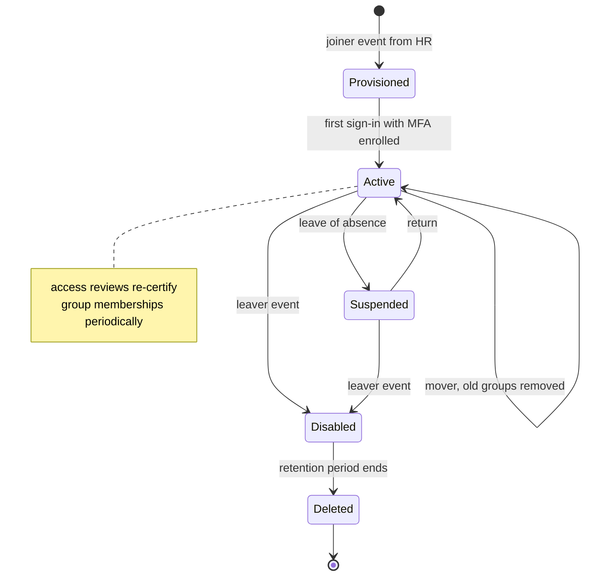
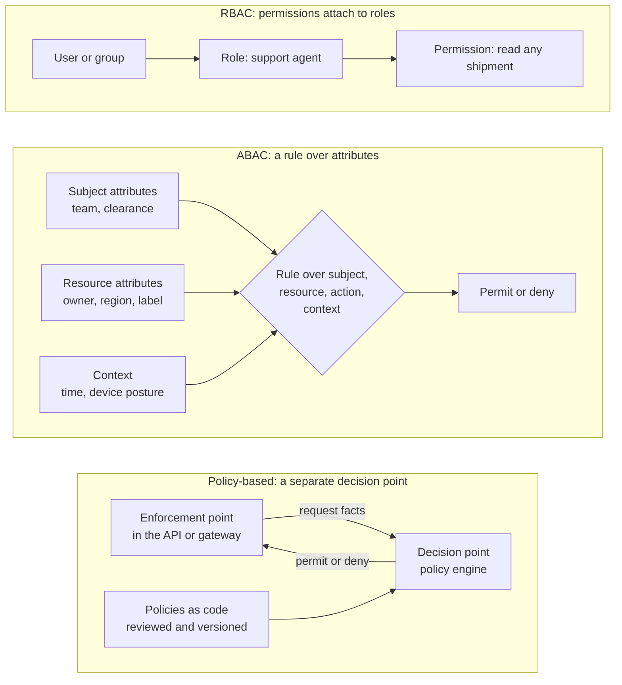
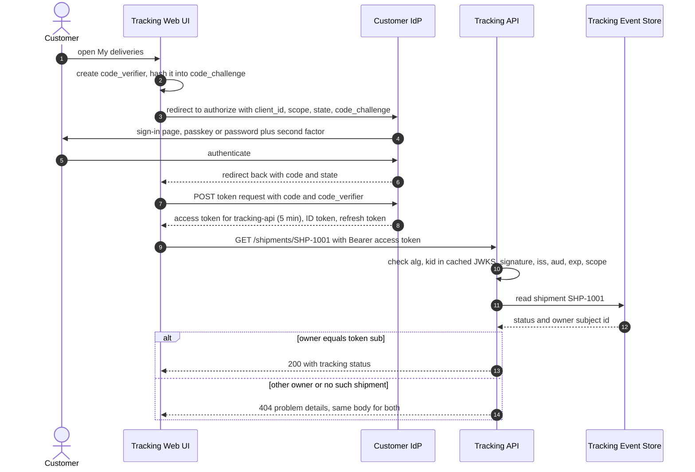
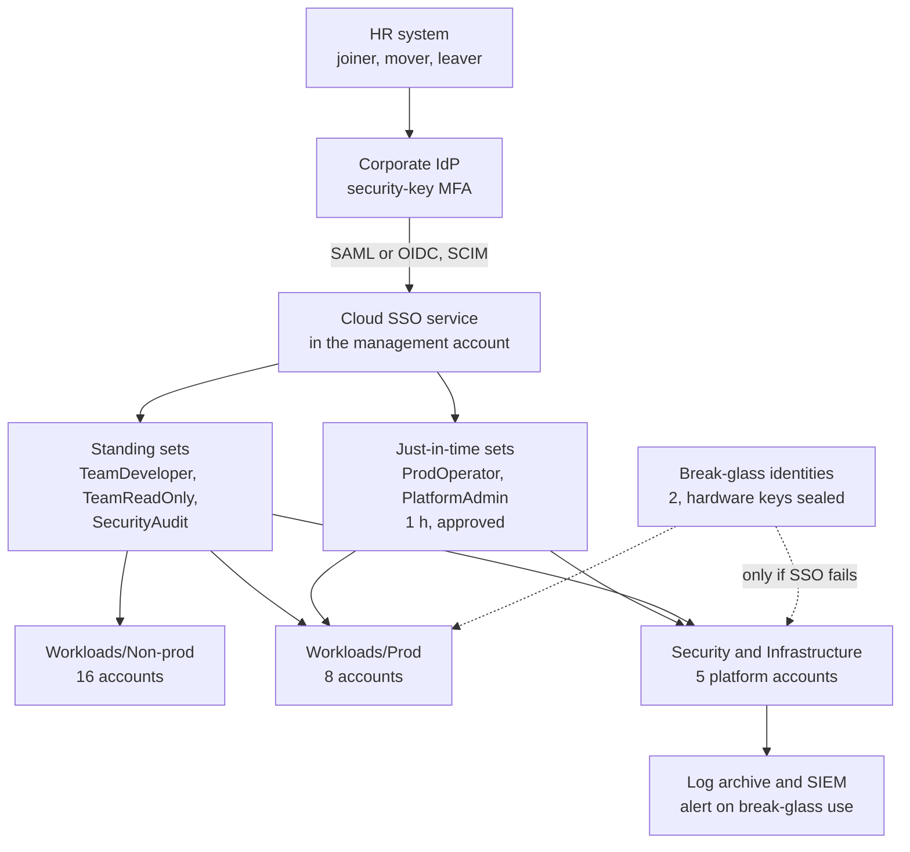

# Identity and access management

> Identity and access management (IAM) answers two questions on every request: who is this, and may
> they do this to that? Most breaches that do not start with a software bug start with a wrong answer
> to one of them. The architect's job is to put each answer in exactly one trustworthy place.

!!! abstract "Page facts"
    **Level:** Intermediate (authentication, authorization, OAuth 2.0, OIDC, and JWT validation are
    Level 1-2; choosing an authorization model, designing workload identity and privileged access, and
    the AtlasMart account design are Level 3) · **Status:** Draft · **Time:** 75-100 minutes ·
    **Last verified:** 2026-11-21

## Learning objectives

After this page you should be able to:

- Separate authentication from authorization and place each in the right component.
- Explain the joiner-mover-leaver lifecycle, federation, SSO, SAML versus OIDC, and ID versus access tokens.
- Trace the authorization code flow with PKCE and client credentials, and list the JWT checks a
  resource server must make.
- Choose between RBAC, ABAC, and policy-based access, and design JIT privileged access with break-glass.
- Replace static keys with workload identity, and state the limits of API keys.

## Prerequisites

- [Security principles and threat modeling](security-principles-and-threat-modeling.md) — least
  privilege, defense in depth, Zero Trust, and trust boundaries, which this page applies to identity.
- [Transport and application protocols](../networking/transport-and-application-protocols.md) — TLS and
  HTTP headers; every token on this page travels in a TLS-protected header.
- [API design: REST, GraphQL, gRPC, and async APIs](../application-and-api-architecture/api-design-rest-graphql-grpc-and-async-apis.md)
  — resources and status codes, which is where 401, 403, and 404 come from.

## The problem this solves

Before central identity, each application kept its own password table. People reused passwords,
leavers kept accounts nobody remembered, services shared passwords copied into configuration and
source control, and nobody could answer "who can access customer data?". IAM centralizes who a person
or workload is, how they prove it, and when that ends, and gives every application a standard way to
consume the answer, leaving each application only the decision that is truly its own: may this caller
touch this object?

## What it is

**Identity and access management** is the set of processes, services, and protocols that establish
digital identities, verify them when used, decide what each may do, and keep those decisions correct
over time. It has four parts:

| Part | Question it answers | Examples on this page |
|---|---|---|
| Identity | Who or what exists? | People (workforce, customers, partners), workloads, devices |
| Authentication (AuthN) | Is the caller really that identity? | Passwords, MFA, passkeys, client certificates, workload tokens |
| Authorization (AuthZ) | May this identity perform this action on this resource now? | RBAC, ABAC, policy engines, OAuth scopes, owner checks |
| Governance | Are the grants still right, and can we prove it? | Lifecycle automation, access reviews, audit logs, separation of duties |

Populations differ: **workforce identity** (few people, powerful access), **customer identity**
(millions of people, each limited to their own data), and **machine identity** (workloads, pipelines,
devices), usually served by separate identity providers.

## Mental model

Picture an office building. **Authentication** is reception checking a passport and issuing a badge;
**federation** is reception accepting a partner company's badge instead. The **badge** is a token:
photo (subject), issuer's logo (issuer), floors it opens (scope, audience), expiry date.
**Authorization** happens at each door's reader. **RBAC** is "engineers open lab doors"; **ABAC** adds
"on weekdays, if safety training is current". **Just-in-time access** opens the server room for one
hour after approval; **break-glass** is the sealed key by the fire exit; the **leaver** step collects
the badge.

**Where the analogy breaks:** a physical badge is hard to copy; a bearer token is a string, and
whoever holds a copy is treated as its owner until it expires. And the most important door check in
software, "is this the caller's own shipment?", has no physical equivalent: it is a decision about a
specific object, made by the application, on every request.

## Key terms

| Term | Meaning on this page |
|---|---|
| Authentication | Verifying that a caller controls the identity it claims |
| Authorization | Deciding whether an authenticated caller may perform an action on a resource |
| Identity provider (IdP) | The service that authenticates users and issues assertions or tokens about them |
| Federation | Trusting identities asserted by another organization's or system's IdP |
| Single sign-on (SSO) | One authentication at the IdP giving access to many applications |
| MFA | Multi-factor authentication: proof from two or more independent factor types |
| Phishing-resistant authenticator | One whose output is bound to the genuine site, so a look-alike site cannot reuse it (FIDO2/WebAuthn passkeys, smart cards) |
| OAuth 2.0 | A framework for issuing a client limited, delegated access to a resource on behalf of a user or itself |
| OpenID Connect (OIDC) | An identity layer on OAuth 2.0 that adds the ID token and standard user claims |
| Access token | A credential the client presents to a resource server; its audience is that API |
| ID token | A JWT telling the client who signed in; its audience is the client, never an API |
| JWT | JSON Web Token: a signed (sometimes encrypted) set of claims in a compact URL-safe string |
| JWKS | JSON Web Key Set: the published public keys a verifier uses to check token signatures |
| Scope | A named permission a client requests and the user or policy grants, carried in the token |
| RBAC / ABAC | Role-based / attribute-based access control |
| PAM | Privileged access management: controls for the accounts that can change or read everything |
| JIT access | Just-in-time access: privileges granted on request for a short time, not held standing |
| Workload identity | A short-lived, platform-issued identity for a running workload, replacing stored secrets |

## How it works

### Step 1 — Authentication: factors, MFA, and phishing resistance

A **factor** is a kind of evidence: something you know (password), have (security key, phone), or are
(a fingerprint, usually unlocking a device-held key). **MFA** needs two different kinds. One-time codes
and push approvals defeat password reuse but are still phishable: a fake page relays the code in real
time, and repeated push prompts wear users down ("MFA fatigue").

A **phishing-resistant** authenticator binds its response to the origin it is talking to, using
public-key cryptography: a passkey or security key implementing FIDO2/WebAuthn signs a challenge that
includes the real site's origin, so a look-alike site gets nothing reusable. NIST's
[SP 800-63B-4](https://pages.nist.gov/800-63-4/sp800-63b.html) requires a phishing-resistant option at
AAL2 and a phishing-resistant authenticator at AAL3. Practical rule: phishing-resistant MFA for all
production and administrative access; passkeys offered to customers where the IdP supports them.

### Step 2 — The identity lifecycle: joiner, mover, leaver

The HR system is the source of truth for people; the IdP consumes it and provisions applications
through a protocol such as SCIM.

**Figure 1 — The joiner-mover-leaver lifecycle.** States of one workforce identity; the transitions are
driven by HR events, not by tickets someone remembers to file.

How to read it: the mover loop is where privilege accumulates, because adding new access is
requested and removing old access is not; a mover event must remove the groups of the old role, not
only add those of the new one. The leaver transition must fire automatically, because a missed
leaver produces no error, only a working account nobody is watching.

Disabling a user at the IdP stops new sign-ins, not sessions and refresh tokens already issued, so the
leaver process revokes those too. Non-human identities need an owner and an expiry as well.

### Step 3 — Federation and SSO: SAML and OpenID Connect

**Federation** means an application (the relying party or service provider) trusts an IdP to
authenticate users and receives a signed statement about who they are. **SSO** is the user-visible
result: sign in once at the IdP, then reach many applications without signing in again. Two protocols
dominate:

| | SAML 2.0 | OpenID Connect |
|---|---|---|
| Built on | XML, signed assertions, browser redirects and form posts | OAuth 2.0, JSON, JWTs, HTTPS endpoints |
| Typical use | Workforce SSO into enterprise and SaaS web applications | Workforce and customer SSO, mobile and single-page apps, APIs |
| Result for the app | A SAML assertion (subject, attributes, audience, validity window) | An ID token (and an access token for APIs) |
| API access | Not designed for it | Native, through OAuth access tokens |

[SAML 2.0](https://docs.oasis-open.org/security/saml/v2.0/saml-core-2.0-os.pdf) persists in enterprise
software; new designs choose OIDC. Both need signature, audience, and validity checks as in Step 6.
Three older directory technologies still sit behind many corporate IdPs:

| Technology | What it is | Where you meet it |
|---|---|---|
| [LDAP](https://www.rfc-editor.org/rfc/rfc4511) | A protocol for reading and writing a hierarchical directory of users, groups, and devices | Applications that look up group membership or bind with a password against a directory |
| Active Directory | Microsoft's on-premises directory service, using LDAP and Kerberos, with group policy for Windows machines | The source of workforce identities in many enterprises, often synchronized to a cloud IdP |
| [Kerberos](https://www.rfc-editor.org/rfc/rfc4120) | A ticket-based network authentication protocol using a trusted key distribution center | Windows domain sign-in and intranet services; tickets are time-limited, so clock skew breaks it |

### Step 4 — OAuth 2.0: delegated access without sharing passwords

[OAuth 2.0 (RFC 6749)](https://www.rfc-editor.org/rfc/rfc6749) lets a **client** (an app) obtain an
**access token** from an **authorization server** so that it can call a **resource server** (an API),
for a **resource owner** (a user) or for itself. It is about authorization, not sign-in.

**Authorization code flow with PKCE** (for any app a user signs into):

1. The client creates a random **code verifier** and sends its SHA-256 hash, the **code challenge**, in
   a browser redirect to the authorization server, along with its client id, redirect URI, requested
   scopes, and a random `state` value.
2. The user authenticates at the authorization server (the IdP) and, where needed, consents.
3. The authorization server redirects back to the exact registered redirect URI with a short-lived,
   single-use **authorization code**.
4. The client posts the code and the original verifier to the token endpoint. The server hashes the
   verifier and compares it with the stored challenge, so a code stolen in transit is useless without
   the verifier, which never left the client.
5. The client receives an access token (and, with OIDC, an ID token; optionally a refresh token).

[PKCE (RFC 7636)](https://www.rfc-editor.org/rfc/rfc7636) was designed for mobile apps; the
[OAuth 2.0 Security Best Current Practice (RFC 9700)](https://www.rfc-editor.org/rfc/rfc9700)
now requires it for public clients (apps that cannot keep a secret, such as browser and mobile apps)
and recommends it for confidential ones. The same document says the implicit grant should not be
used and the resource owner password credentials grant must not be used, and that refresh tokens for
public clients must be sender-constrained or rotated on every use.

**Client credentials flow** (a service acting as itself): the client authenticates with its own
credential, ideally a platform-signed assertion (Step 8) or certificate rather than a stored secret.

### Step 5 — OpenID Connect: ID token versus access token

[OpenID Connect Core](https://openid.net/specs/openid-connect-core-1_0.html) adds sign-in to OAuth:
requesting the `openid` scope returns an **ID token**, a JWT that tells the client who authenticated,
when, and how. Confusing the two tokens is a common and serious mistake:

| | ID token | Access token |
|---|---|---|
| Audience (`aud`) | The client application | The API (resource server) |
| Purpose | Tell the client who signed in, so it can start a session | Authorize calls to the API |
| Who validates it | The client, including the `nonce` it sent | The API, on every request |
| Should it be sent to an API? | Never | Yes, as `Authorization: Bearer ...` |
| Format | Always a JWT | A JWT or an opaque string, at the IdP's choice |

### Step 6 — Validating a JWT at the resource server

A [JWT (RFC 7519)](https://www.rfc-editor.org/rfc/rfc7519) has three base64url parts: a header (which
algorithm and key signed it), a payload of claims, and a signature. The payload is encoded, not
encrypted; anyone holding the token can read it. Before trusting any claim, a resource server must
check, in a fixed order, the rules that [RFC 8725](https://www.rfc-editor.org/rfc/rfc8725) collects:

1. **Algorithm allow-list** (for example RS256 or ES256). Never let the token's `alg` choose; reject
   `none`. Otherwise a forgery can declare it needs no signature, or make a verifier use a public key
   as an HMAC secret.
2. **Explicit type:** check `typ` (for example `at+jwt`) so an ID token cannot pass as an access token.
3. **Key by `kid` from the issuer's configured JWKS**, cached, refetched (rate-limited) on an unknown
   `kid`; never from a URL in the header. Two keys overlapping is how **key rotation** works.
4. **Signature**, verified by a vetted library.
5. **Issuer (`iss`)** equals the expected IdP; **audience (`aud`)** contains this API.
6. **Time:** `exp` future, `nbf` past, `iat` not future, with a small skew leeway.
7. **Scope** covers the action; then the application checks the object (Step 7).

Every failure returns the same 401 with `WWW-Authenticate: Bearer error="invalid_token"`; the specific
reason goes to the server's log. [Lab 10](../labs/lab-10-rest-api-auth-and-validation.md) implements
these checks by hand so you can watch each one fail.

### Step 7 — Authorization models: RBAC, ABAC, and policy-based access

**Function-level** authorization asks whether this caller may use an operation at all (roles,
scopes); **object-level** authorization asks whether it may use it on this object ("is SHP-1002 this
customer's shipment?"), which needs data about the object. Missing the second is broken object-level
authorization (BOLA, or IDOR), first in the
[OWASP API Security Top 10 (2023)](https://owasp.org/API-Security/editions/2023/en/0xa1-broken-object-level-authorization/).

**Figure 2 — Three ways to make an access decision.** RBAC attaches permissions to roles, ABAC
evaluates a rule over attributes, and policy-based access moves the decision into a separate,
versioned policy service.

How to read it: RBAC is simple to audit ("who has role X?") but explodes into many roles when
decisions depend on context. ABAC, described in [NIST SP 800-162](https://csrc.nist.gov/pubs/sp/800/162/upd2/final),
expresses "same team and same region" in one rule but is harder to answer "who can access this?".
Policy-based access is an architecture rather than a model: either RBAC or ABAC rules can live in a
policy engine, gaining central review, testing, and a decision log, at the cost of a dependency on
every request (usually run as a local library or sidecar for latency).

Real systems combine them: scopes at the gateway, an ownership rule in the service, attributes for
sensitive actions. Relationship-based access (permissions follow "member of the project that owns
it") is a further variant.

### Step 8 — Workload identity and service-to-service authentication

The anti-pattern is a **static key**: long-lived, stored in configuration, copied around, rarely
rotated. **Workload identity** replaces it with a short-lived credential the platform issues to a
running workload, proving where it runs, which the workload exchanges for access:

- Cloud compute (virtual machines, functions, containers) gets a role whose temporary credentials
  the platform delivers and rotates automatically.
- In Kubernetes, a service account token projected into the pod is a short-lived OIDC-style JWT;
  the cloud provider is configured to trust the cluster's issuer and maps the service account to a
  cloud role (workload identity federation).
- Between services, identity is proven with mutual TLS using certificates issued per workload
  (the [SPIFFE](https://spiffe.io/docs/latest/spiffe-about/overview/) standard defines such workload
  identities, and service meshes automate them) or with OAuth client credentials tokens whose audience
  is the called service.

**Machine identities** covers these plus device certificates, bots, and CI/CD pipelines (which can
federate to the cloud with OIDC instead of storing deploy keys); each needs an owner (Step 2).

**API keys** identify a calling application, not a user, so they cannot carry per-user authorization;
they are long-lived bearer secrets that work from anywhere once leaked and drift into code and logs.
If you must use them: one per consumer and environment, narrow scopes, a secrets manager, hashed
server-side, rotated with two valid during the overlap. Never treat one inside a browser or app as secret.

### Step 9 — Privileged access: PAM, JIT, JEA, and break-glass

**Privileged access management (PAM)** covers identities that can change infrastructure, read all
data, or grant access:

- **No standing privilege.** Read-only by default; **just-in-time (JIT) access** grants a privileged
  role for a short, approved, ticketed window and removes it automatically.
- **Just enough administration (JEA).** Narrow what an elevated session can do, not only when it can
  do it: task-specific roles or pre-approved commands instead of full administrator rights. The term
  comes from a [PowerShell feature](https://learn.microsoft.com/en-us/powershell/scripting/security/remoting/jea/overview)
  that restricts remote sessions to allowed commands; the principle applies everywhere.
- **Strong authentication and recording.** Phishing-resistant MFA, managed devices, and session
  logging for privileged sessions.
- **Break-glass access.** A few emergency identities independent of SSO, sealed, alerting on use, and
  tested on a schedule.

### Step 10 — Sessions, governance, and access reviews

After sign-in, a web application keeps its own **session**: idle and absolute timeouts, a new session
id at sign-in, `Secure`, `HttpOnly`, `SameSite` cookies, server-side invalidation at sign-out, and
re-authentication before sensitive actions. Lifetimes trade convenience against how long a stolen
session or disabled user keeps working.

**Governance** keeps grants correct: an entitlement inventory, lifecycle automation, separation of
duties, audit logs, and **access reviews**, where owners re-certify access and the rest is removed.
Review privileged access often, review groups rather than permissions, and show last-used dates.

### Provider equivalents

Product names change; each name below was checked against the linked page on 2026-11-21.

| Concept | AWS | Azure | Google Cloud |
|---|---|---|---|
| Workforce SSO into cloud accounts, with per-role access | [IAM Identity Center](https://docs.aws.amazon.com/singlesignon/latest/userguide/what-is.html) with [permission sets](https://docs.aws.amazon.com/singlesignon/latest/userguide/permissionsetsconcept.html) | [Microsoft Entra ID](https://learn.microsoft.com/en-us/entra/fundamentals/whatis) | [Workforce Identity Federation](https://cloud.google.com/iam/docs/workforce-identity-federation) |
| Workload identity without static keys | [IAM roles](https://docs.aws.amazon.com/IAM/latest/UserGuide/id_roles.html) | [Managed identities for Azure resources](https://learn.microsoft.com/en-us/entra/identity/managed-identities-azure-resources/overview) | [Service accounts](https://cloud.google.com/iam/docs/service-account-overview) and [Workload Identity Federation](https://cloud.google.com/iam/docs/workload-identity-federation) |
| Just-in-time privileged access | Check the provider's current documentation | [Privileged Identity Management](https://learn.microsoft.com/en-us/entra/id-governance/privileged-identity-management/pim-configure) (Microsoft Entra ID Governance) | [Privileged Access Manager](https://cloud.google.com/iam/docs/pam-overview) |

## Worked example: AtlasMart customer and workforce identity

AtlasMart (fictional) has two identity problems: 2,000,000 customers who must see only their own
shipments (NFR-5), and the engineers who run the Order Tracking System across 29 cloud accounts.

### The customer flow: from sign-in to an owner-only read

Customers sign in through AtlasMart's customer identity provider using OIDC (Phase 4 assumption). The
Tracking Web UI is a public client, so it uses the authorization code flow with PKCE. The access token
it receives is a JWT with `aud` = `tracking-api`, the scope `tracking:read`, and `sub` = the
customer's opaque subject id; its lifetime is 5 minutes (assumption, matching Lab 10). Each shipment
row in the Tracking Event Store holds the owning customer's subject id, supplied by the Order
Management System when the shipment is created (assumption). Neither the token nor the shipment holds
a delivery address (NFR-6).

**Figure 3 — Customer sign-in and an owner-only shipment read.** The Tracking API trusts nothing the
browser says except a token it has verified itself.

How to read it: steps 2-8 happen once per sign-in; step 9 onwards happens on every tracking read,
without calling the IdP. The UI uses the ID token only to show "signed in"; it never sends it to the API.
The `alt` block is NFR-5: the owner check is in the API, against the database, on every request.

Three design decisions follow.

**Local JWT validation instead of token introspection.** At the 210 reads/s design peak, asking the
IdP about every token would add 210 introspection calls per second (70 per Tracking API replica), add a
network round trip to every read against the 300 ms p95 budget (NFR-3), and make the IdP a hard
dependency of every tracking read, so its outages would count against NFR-2. With local validation,
each replica fetches the JWKS at startup, caches it, and refetches only on an unknown `kid`, at most
once a minute (assumption). If the IdP goes down, customers already signed in keep tracking parcels
until their tokens expire; only new sign-ins fail.

**The price is revocation delay:** a revoked token works until `exp`, at most 5 minutes. AtlasMart
accepts that for status reads and delivery preferences (correctable, no address); a payment or
account-change API would need introspection or sender-constrained tokens.

**404, not 403, for someone else's shipment.** Shipment ids appear in emails and on labels, so they
are guessable. Returning the same 404 for "not yours" and "does not exist" stops a caller from
learning which ids exist, while the audit log records `not_owner` for investigation. Lab 10 implements
exactly this.

Other identities: carrier webhooks carry an HMAC signature with a per-carrier secret (NFR-5), rotated
with two secrets valid during the switch; the Notification Worker uses the Notification Provider's API
key (its only option), held in the secrets manager, send-only, rotated yearly (assumption). Inside the
platform, each pod runs under its own Kubernetes service account federated to a cloud role scoped to
its own database, queue, or secrets; no static cloud keys exist (Phase 4 assumption).

### The workforce flow: SSO into 29 accounts

AtlasMart has 29 cloud accounts (Phase 4 assumption): 8 teams × 3 environments = 24 workload
accounts plus 5 platform accounts. Engineers have no long-lived keys: they sign in at the corporate IdP
with a security key, and the federated cloud SSO service offers an account and a **permission set** (a
role template applied per account). Permission sets and assignments (assumptions for this page):

| Permission set | Granted to | Accounts | Standing or JIT |
|---|---|---|---|
| TeamDeveloper | Each product team's group | That team's dev and staging (2 per team) | Standing |
| TeamReadOnly | Each product team's group | That team's prod (1 per team) | Standing |
| SecurityAudit (read-only) | Security team | All 29 | Standing |
| ProdOperator | Each team's on-call group | That team's prod | JIT: 1 hour, second-person approval, ticket required |
| PlatformAdmin | Platform team | The 5 platform accounts | JIT: 1 hour, approval, ticket required |
| Break-glass | 2 emergency identities outside SSO | Management account, able to reach all | Sealed; alert on any use |

Standing assignments: 8 × 2 (TeamDeveloper) + 8 × 1 (TeamReadOnly) + 29 (SecurityAudit) = 53.
Eligible-only (JIT) assignments: 8 (ProdOperator) + 5 (PlatformAdmin) = 13. Nobody holds standing
write access to production: normal production changes go through the platform team's deployment
pipeline (constraint C-2), whose own identity federates to a deploy role rather than storing keys.

**Figure 4 — AtlasMart workforce access across the 29 accounts.** Solid lines are normal access through
SSO; dotted lines are the break-glass path used only when SSO is unavailable.

How to read it: every human path starts at the HR-driven IdP, so a leaver loses access to all 29
accounts at once. Production write access exists only through the JIT box. The break-glass path skips
SSO by design, which is why it is watched hardest.

An open console session survives a leaver event until its session duration ends, so prod permission
sets use 1 hour (assumption) and the leaver runbook revokes active sessions. Team leads review group
membership with last-used data (assumption: quarterly for prod and platform, half-yearly otherwise);
break-glass is tested quarterly (assumption): sign in, confirm the SIEM alert, reseal.

## Real-world architecture example

A typical estate: a workforce IdP synchronized from an on-premises directory, federating by SAML and
OIDC into SaaS tools and cloud consoles; a separate customer identity service with passkeys; a
gateway validating tokens; services enforcing ownership; mesh or platform identities between
services; pipelines federating with OIDC; JIT tooling and access reviews. Incidents come from the
seams: an internal API without an owner check, a pre-federation pipeline key, a contractor with no
end date.

## Design choices and trade-offs

| Choice | Favor when | Avoid when |
|---|---|---|
| Self-contained JWT access tokens, validated locally | High request rates, latency budgets, APIs that must survive IdP outages | You need instant revocation for high-risk actions |
| Opaque tokens with introspection | Immediate revocation matters more than latency; few calls | Hundreds of calls per second per API, or the IdP is not highly available |
| OIDC (rather than SAML) for SSO | New applications, mobile and single-page clients, APIs | The application supports only SAML |
| Public client in the browser with PKCE | Simple architecture, short-lived tokens | Tokens in the browser are unacceptable; consider a backend-for-frontend that keeps tokens server-side |
| RBAC | Stable job functions, a need to answer "who has access?" simply | Decisions depend on ownership, region, time, or device |
| ABAC or a policy engine | Context-dependent rules, many resource types, central audit of decisions | A small system with a handful of roles |
| JIT elevation with approval | Production operations, platform administration | Emergencies when the approver or IdP is unavailable (that is break-glass) |
| Workload identity | Anything running on a platform that can issue it | Third parties that support only API keys (then contain the key) |
| API keys | Identifying a calling application, metering, low-risk third-party APIs | Per-user authorization, or any key that would ship inside client code |

## Failure modes and anti-patterns

- **Broken object-level authorization.** The API checks the token but not ownership, so changing an id
  in the URL returns someone else's data. Detect: tests that call each endpoint with a second user's
  token; logs of 404 or 403 bursts per caller. Prevent: an owner or tenancy check in the service on
  every object, covered by automated tests.
- **Trusting `alg`, skipping `aud`, or accepting ID tokens at APIs.** Forged or misdirected tokens are
  accepted. Detect: negative tests like Lab 10's. Prevent: a vetted library with an algorithm
  allow-list, expected issuer and audience, and `typ` checks.
- **Phishable MFA on privileged accounts.** SMS codes or push prompts for administrators. Detect: MFA
  method inventory. Prevent: security keys or passkeys for all privileged and production access.
- **Orphaned and accumulated access.** Leavers with working accounts, movers with old groups, service
  accounts without owners. Detect: reconcile IdP and application accounts against HR; last-used
  reports. Prevent: HR-driven lifecycle, expiry on every non-human credential, regular reviews.
- **Static keys in code and pipelines.** Detect: secret scanning in repositories and images; cloud
  reports of key age. Prevent: workload identity and OIDC federation for pipelines; block creation of
  long-lived user keys by policy.
- **The IdP as an unplanned single point of failure.** Prevent: tested break-glass identities, and
  local token validation so running applications keep working.

## Security considerations

- **Tokens are bearer credentials:** TLS only, never in URLs or logs, short-lived. Sender-constrained
  tokens (RFC 9700) reduce the value of a stolen one. Token failures look uniform to clients; reasons
  go to a monitored audit log.
- **Protect the IdP**, the highest-value target: few administrators, phishing-resistant MFA, alerts on
  configuration changes, signing keys in a key management service.
- **Least privilege applies to machines.** A workload role that can read every secret turns one
  compromised pod into a compromised platform; scope each role to its own resources.
- **Consent and data minimization.** Request only the scopes and claims a client needs; customer
  tokens should carry an opaque subject id, not an email or address (NFR-6). Whether particular data
  protection rules apply depends on facts; ask counsel.
- **Know the revocation delay** (token lifetime, session duration, permission cache TTL) per action.

## Performance, reliability, and cost

- **Performance:** local JWT validation is CPU work with no network call; introspection or a remote
  policy decision adds a round trip per request. Cache JWKS keys, run policy engines beside the
  service, and measure verification cost under load.
- **Reliability:** with local validation the IdP is on the sign-in path only. Plan for IdP outages, JWKS
  rotation (two keys overlap), and clock skew (small leeway); break-glass covers the workforce side.
- **Cost:** identity services are often priced per active user or authentication (check the provider's
  current documentation); AtlasMart's driver is 2,000,000 registered and 400,000 daily active
  customers. Access reviews and lifecycle work are the larger, operational cost.

## Hands-on lab: REST API authentication and validation

The full lab is [Lab 10: Build a small REST API with authentication and request validation](../labs/lab-10-rest-api-auth-and-validation.md):
a standard-library toy Tracking API, a token issuer with a runtime key, and 15 good and bad requests
with the status and server-side reason for each. In outline:

1. Run `python3 client_demo.py` and confirm 15 of 15 cases return the expected status.
2. Compare the response bodies of the five bad-token cases, then the server log reasons.
3. Compare 401 (who are you?), 403 (missing scope), and 404 (not your shipment).
4. Remove the audience check from the verifier and see which case now succeeds.
5. Read the 422 problem-details body and find why an `address` field can never be stored.

??? question "Hint: why does removing the audience check matter if the signature is still checked?"
    The signature proves the token came from AtlasMart's IdP, not that it was meant for the Tracking
    API. Without the audience check, a token the IdP issued for the loyalty service, or any other
    service that receives customer tokens, can be replayed against tracking. Signature answers "who
    issued it"; audience answers "for whom".

## Knowledge check

1. A colleague says "we use OAuth for login". What is imprecise about that, and what would you add?
2. Why does PKCE stop a stolen authorization code from being exchanged for tokens?
3. List, in order, the checks a resource server makes on a JWT access token before using its claims.
4. An API validates tokens perfectly but a customer can read any order by changing the id in the URL.
   What is this class of flaw called, and where must the fix live?
5. Why should a disabled user's access be measured in "token lifetime plus session duration" rather
   than "immediately", and what can shorten it?

??? success "Answers"
    1. OAuth 2.0 is delegated authorization (access tokens for APIs); sign-in needs OpenID Connect,
       whose ID token tells the client who authenticated.
    2. Only a hash of the verifier travels with the request; redeeming the code needs the verifier
       itself, which an interceptor does not have.
    3. Algorithm on an allow-list (never `none`, never chosen by the token), type where used, key by
       `kid` from the issuer's trusted JWKS, signature, issuer, audience, expiry and not-before with
       small leeway, then scopes; then the application's own object-level checks.
    4. Broken object-level authorization (BOLA, or IDOR). The fix is an ownership or tenancy check in
       the service that holds the data, on every request, ideally with tests using a second user.
    5. Disabling stops new sign-ins; issued tokens and sessions live until they expire. Shorter
       lifetimes, revoking sessions and refresh tokens at leave, and introspection shorten it.

## Architecture discussion questions

1. AtlasMart wants customers to track a parcel from a link in the dispatch email without signing in.
   How would you design that link so it does not weaken NFR-5, and what would it be allowed to show?
2. The Tracking API team proposes a central policy engine for all authorization decisions across
   AtlasMart. What would you move into it, what would you keep in the service, and how would you
   protect the 300 ms p95 budget and 99.9% availability target?
3. During an incident the corporate IdP is unreachable and production is degraded. Walk through who
   can do what, how the break-glass path is used and controlled, and what you would change afterwards.

## Summary

IAM separates authentication (ideally phishing-resistant MFA) from authorization (function and object
level) and keeps both correct through the identity lifecycle and access reviews. SSO centralizes
sign-in through SAML or OIDC; OAuth 2.0 issues access tokens, via authorization code plus PKCE for
users and client credentials for services. A JWT is trusted only after the allow-listed algorithm,
JWKS key, signature, issuer, audience, and expiry check out. Workloads get platform-issued identities,
and privileged access is just-in-time with a tested break-glass path. AtlasMart validates customer
tokens locally with owner-only reads, and gives engineers SSO into 29 accounts with no standing
production write access.

## Related topics

- **Before:** [Security principles and threat modeling](security-principles-and-threat-modeling.md);
  [Transport and application protocols](../networking/transport-and-application-protocols.md);
  [API design: REST, GraphQL, gRPC, and async APIs](../application-and-api-architecture/api-design-rest-graphql-grpc-and-async-apis.md)
- **Alongside:** [Application security](application-security.md) — broken access control, sessions,
  and API security; [Network security architecture](network-security-architecture.md) — mTLS and
  Zero Trust network access; [Data security and privacy](data-security-and-privacy.md) — keys,
  secrets, and tokenization; [Multi-account strategy and infrastructure automation](../cloud-architecture/multi-account-strategy-and-infrastructure-automation.md)
  — the 29 accounts this page grants access to;
  [Infrastructure and supply-chain security](infrastructure-and-supply-chain-security.md) — CIEM and
  pipeline identity; [Lab 10](../labs/lab-10-rest-api-auth-and-validation.md).
- **Planned:** DevSecOps and platform engineering, including pipeline federation (D16); the security
  pillar of well-architected frameworks (D28).

## References

| Source | Type | Checked |
|---|---|---|
| [RFC 6749: The OAuth 2.0 Authorization Framework](https://www.rfc-editor.org/rfc/rfc6749) — IETF | Standard | 2026-11-21 |
| [RFC 7636: Proof Key for Code Exchange by OAuth Public Clients](https://www.rfc-editor.org/rfc/rfc7636) — IETF | Standard (PKCE) | 2026-11-21 |
| [RFC 9700: Best Current Practice for OAuth 2.0 Security](https://www.rfc-editor.org/rfc/rfc9700) — IETF | Standard (PKCE requirements, deprecated grants, refresh tokens) | 2026-11-21 |
| [RFC 7519: JSON Web Token (JWT)](https://www.rfc-editor.org/rfc/rfc7519) — IETF | Standard | 2026-11-21 |
| [RFC 8725: JSON Web Token Best Current Practices](https://www.rfc-editor.org/rfc/rfc8725) — IETF | Standard (validation rules) | 2026-11-21 |
| [OpenID Connect Core 1.0](https://openid.net/specs/openid-connect-core-1_0.html) — OpenID Foundation | Standard (ID token) | 2026-11-21 |
| [SP 800-63B-4: Authentication and Authenticator Management](https://pages.nist.gov/800-63-4/sp800-63b.html) — NIST | Standard (assurance levels, phishing resistance) | 2026-11-21 |
| [SP 800-162: Guide to Attribute Based Access Control](https://csrc.nist.gov/pubs/sp/800/162/upd2/final) — NIST | Guidance (ABAC) | 2026-11-21 |

## Review notes

- Canonical page for D12-T02. In depth: authentication and MFA (phishing resistance), identity
  lifecycle, federation and SSO, OAuth 2.0 (authorization code with PKCE, client credentials), OIDC (ID
  versus access token), JWT validation, RBAC/ABAC/policy-based access, workload identity and
  service-to-service authentication, API keys, PAM with JIT and break-glass. Only defined: SAML
  (comparison table), LDAP, Active Directory, Kerberos (definition table), JEA (one paragraph),
  machine identities (umbrella paragraph), sessions and governance/access reviews (one section, no
  figure), relationship-based access (one sentence).
- Inline links (200 on 2026-11-21, outside the References table): SAML 2.0 core, RFC 4511, RFC 4120,
  SPIFFE, PowerShell JEA, OWASP API1:2023, and nine provider pages whose titles confirm the product
  names. No AWS just-in-time product is named because none was verified.
- The SP 800-63B-4 (AAL2/AAL3) and RFC 9700 (PKCE, implicit and password grants, refresh tokens)
  statements were checked against the documents' text on 2026-11-21.
- New AtlasMart assumptions introduced here: customer access-token lifetime 5 minutes; shipment rows
  carry the customer's opaque subject id from the Order Management System; JWKS refetch at most once a
  minute; Notification Provider API key rotated yearly; the six permission sets and their assignment
  table (53 standing and 13 JIT assignments, arithmetic shown); JIT and prod console session duration
  1 hour; access reviews quarterly for prod and platform, half-yearly for non-prod; two break-glass
  identities tested quarterly. The 70 introspection calls per replica is arithmetic (210 / 3).
- Figure 2 stacks three subgraphs with `~~~`; verify they render one above the other.
