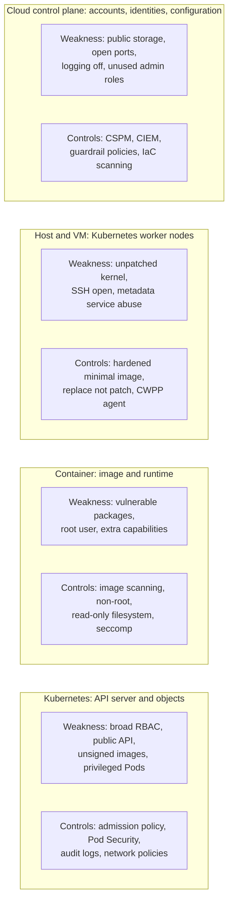
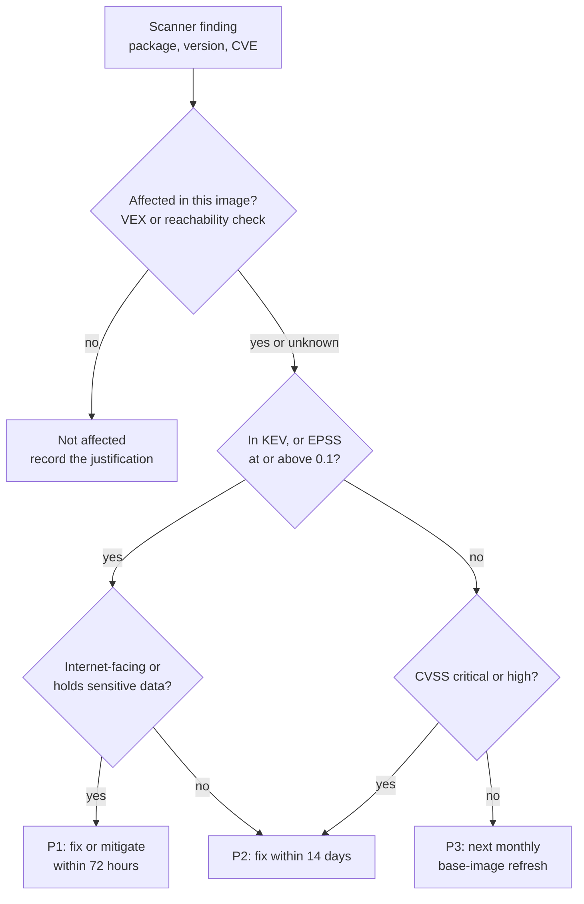
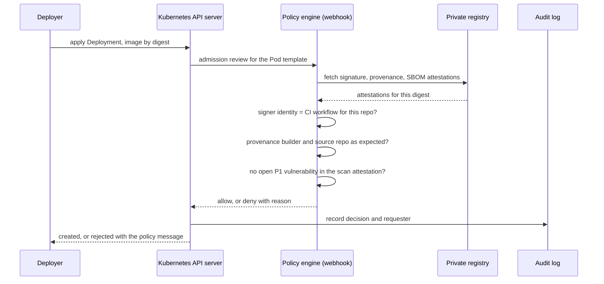
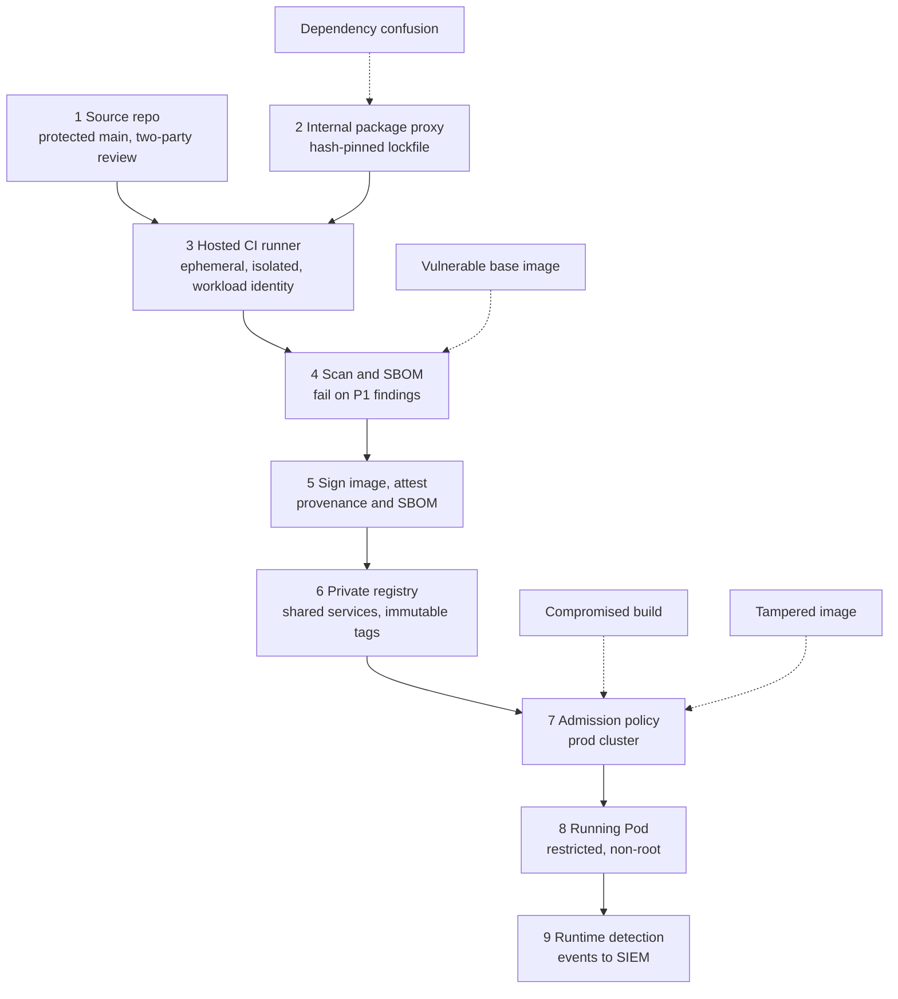

# Infrastructure and supply-chain security

> Infrastructure security protects the layers your code runs on; supply-chain security protects the
> path your code travels to get there. An architect's job is to put one verifiable control at every
> hand-off from commit to running pod, so that a single compromised step cannot silently reach
> production.

!!! abstract "Page facts"
    **Level:** Intermediate (the layers and tool categories are Level 1-2; risk-based prioritization,
    the SLSA target, and the commit-to-pod control design are Level 3) · **Status:** Draft ·
    **Time:** 60-90 minutes · **Last verified:** 2026-11-21

## Learning objectives

After this page you should be able to:

- Name the security concerns of each infrastructure layer (cloud control plane, host and VM,
  container, Kubernetes) and the control category that addresses each one.
- Distinguish CSPM, CWPP, and CIEM, and explain why vendors bundle them as CNAPP.
- Rank vulnerabilities by risk rather than by severity score alone, using known-exploited status,
  exploit probability, reachability, and asset criticality.
- Explain what an SBOM, a provenance attestation, and an artifact signature each prove, and what
  none of them proves.
- Use the SLSA Build and Source tracks to set a realistic supply-chain target.
- Design a commit-to-pod path in which each stage has a control, and say which attack class each
  control would have caught.

## Prerequisites

- [Security principles and threat modeling](security-principles-and-threat-modeling.md) — defense in
  depth, least privilege, and trust boundaries are applied here to the build and run path.
- [Containers and images](../containers-and-kubernetes/containers-and-images.md) — layers, registries,
  tags versus digests.
- [Kubernetes architecture and workloads](../containers-and-kubernetes/kubernetes-architecture-and-workloads.md)
  — the API server, admission, nodes, and Pods.
- [Computers, operating systems, and Linux for architects](../foundations/computers-operating-systems-and-linux-for-architects.md)
  — processes, users, and cgroups, which container isolation is built from.

## The problem this solves

A modern service is mostly other people's code: a base image, an operating system's packages, a
language runtime, and hundreds of open-source libraries, assembled by a build system, stored in a
registry, and run on machines the team never logs into. Each of those is a place where something can
be wrong (a known vulnerability) or be made wrong (an attacker who publishes a look-alike package,
tampers with a build, or overwrites an image). Firewalls and login screens do not help, because the
malicious code arrives through the front door, built and deployed by the organization's own pipeline.

At the same time the infrastructure itself drifts: a storage bucket made public for a test, a node
image a year out of date, a role with permissions nobody uses. Without continuous checks these
accumulate faster than any review can find them. This topic gives the architect the vocabulary and
the control points to make both problems visible and bounded.

## What it is

**Infrastructure security** is the set of controls that keep the platforms under an application
trustworthy: the cloud control plane (accounts, identities, configuration), the hosts and virtual
machines, the container runtime, and the orchestrator. **Software supply-chain security** is the set
of controls that make sure the artifact running in production is the one the organization intended to
build, from the intended source, with known contents.

The two meet in three questions every architect should be able to answer for each workload:

1. **What is running?** An inventory of images, their contents (SBOM), and the hosts they run on.
2. **Where did it come from?** Provenance and signatures that tie a running artifact to a source
   commit and a build process.
3. **Is it still safe?** Continuous vulnerability, configuration, and permission assessment, and
   runtime detection for what assessment cannot predict.

## Mental model

Think of a food supply chain. **Infrastructure security** is the hygiene of the kitchen: clean
surfaces, working fridges, locked storerooms, inspections. **Supply-chain security** is knowing your
ingredients: a label listing every ingredient (the SBOM), a record of which farm and which factory
produced each batch (provenance), a tamper-evident seal on the package (the signature), a recall list
of known-bad batches (vulnerability feeds and the known-exploited catalogue), and a receiving clerk who
refuses deliveries without a seal or from an unknown factory (admission policy).

**Where the analogy breaks:** food spoils on its own; software does not, but it is "recalled" every
day as new vulnerabilities are found in code that has not changed. The label is also only as honest as
the factory that printed it: an SBOM written by a compromised build lists what the attacker wants you
to see. That is why provenance must be generated by a build platform the build steps cannot tamper
with, and why every seal must be checked against the identity you expect, not merely "some valid
signature".

## Key terms

| Term | Meaning on this page |
|---|---|
| Defense in depth | Layered, independent controls so that one failure does not expose the asset |
| CSPM | Cloud security posture management: continuous checks of cloud account configuration against policy |
| CWPP | Cloud workload protection platform: vulnerability, hardening, and runtime protection for hosts, VMs, containers, and functions |
| CIEM | Cloud infrastructure entitlement management: inventory and right-sizing of who (and what) can do what across cloud accounts |
| CNAPP | Cloud-native application protection platform: an industry category that bundles CSPM, CWPP, CIEM, and pipeline scanning |
| SBOM | Software bill of materials: a machine-readable list of the components in an artifact, with versions and identifiers |
| Provenance | Verifiable metadata describing how an artifact was built: source, builder, inputs, and parameters |
| Attestation | A signed statement about an artifact (for example its provenance, its SBOM, or a scan result) |
| Artifact signing | Attaching a cryptographic signature to an artifact's digest so consumers can verify who produced it and that it is unchanged |
| SLSA | Supply-chain Levels for Software Artifacts: a framework of incremental tracks and levels for supply-chain integrity |
| Admission control | Kubernetes API-server checks that can reject or modify an object before it is stored |
| Policy as code | Security and compliance rules written as versioned, testable code and evaluated automatically |
| KEV | CISA's Known Exploited Vulnerabilities catalogue: vulnerabilities with evidence of exploitation in the wild |
| EPSS | Exploit Prediction Scoring System (FIRST): a daily estimate of the probability a vulnerability will be exploited in the next 30 days |
| Trust boundary | A line across which the level of trust changes, for example between a pull request from a fork and the signing step; controls belong there |
| Blast radius | The share of users, functions, or systems affected when one component fails or one credential is compromised |

## How it works

### Step 1 — Secure each infrastructure layer

Each layer has its own threats and its own owner under the cloud shared-responsibility model: the
provider secures the physical hosts and hypervisor; the customer secures everything it configures.

**Figure 1 — Infrastructure layers, their typical weaknesses, and control categories.** Each band is
one layer, from the cloud control plane at the top to the workload at the bottom.

How to read it: within each band the left box names what usually goes wrong and the right box the
control category. Runtime detection (Step 6) spans the host, container, and Kubernetes bands.

**Host and VM.** Use a minimal, hardened node image from the provider or the platform team, aligned
with a hardening benchmark such as the CIS Benchmarks (see
[Compliance and regulatory frameworks](compliance-and-regulatory-frameworks.md)). Disable interactive
SSH; use the provider's session-manager style access when someone truly must log in. Require the
token-protected mode of the instance metadata service where the provider offers one, because a
server-side request forgery bug in a Pod can otherwise read the node's credentials. Patch by
**replacement**: build a new node image and roll nodes, rather than patching running machines that then
drift apart.

**Container.** Run as a non-root user, drop Linux capabilities the process does not need, use a
read-only root filesystem, and apply the runtime's default seccomp profile. A container shares the host
kernel, so a kernel vulnerability or a privileged container is a path to the node. Details and the
image model are on [Containers and images](../containers-and-kubernetes/containers-and-images.md).

**Kubernetes.** Keep the API server endpoint private, map human access through SSO to narrow RBAC roles,
enable audit logging, encrypt Secrets at rest, apply network policies, and enforce the `restricted`
Pod Security Standard through Pod Security Admission in workload namespaces. Admission policy (Step 5)
is the last gate before code runs. See
[Kubernetes architecture and workloads](../containers-and-kubernetes/kubernetes-architecture-and-workloads.md)
and [Kubernetes networking, storage, and service mesh](../containers-and-kubernetes/kubernetes-networking-storage-and-service-mesh.md).

### Step 2 — Assess posture continuously: CSPM, CWPP, CIEM, CNAPP

Point-in-time reviews miss drift, so three families of tools assess continuously. They answer
different questions and read different data:

| Category | Question it answers | Data it reads | Typical finding |
|---|---|---|---|
| CSPM | Is the cloud configured safely? | Provider configuration APIs, IaC templates | Storage bucket readable by anyone; audit logging disabled in one account |
| CWPP | Are the workloads safe? | Agents or agentless disk snapshots on hosts, VMs, containers; image registries | Node image with a known-exploited kernel flaw; shell spawned in a container |
| CIEM | Who can do what, and do they need it? | Identity policies, role trust, access logs | CI role can delete the registry; a role unused for 90 days still holds admin |
| CNAPP | Which combination of findings forms a real attack path? | All of the above, correlated | Internet-facing Pod with a critical flaw whose node role can read customer data |

**CNAPP** is an analyst-coined market category rather than a standard; its value is correlation. A
medium misconfiguration, a medium vulnerability, and an over-broad role are each easy to ignore, but
together they can form a path from the internet to customer data. Whether you buy one platform or
combine separate tools, the architectural requirement is the same: findings from all layers land in
one place (for AtlasMart, the security tooling account) with enough context (owner, environment,
exposure) to rank them.

**IaC scanning** applies CSPM-style rules to templates before they are applied, which is cheaper than
finding the misconfiguration in a live account. [Lab 15](../labs/lab-15-infrastructure-module-and-static-checks.md)
runs static checks on an infrastructure module.

### Step 3 — Manage vulnerabilities by risk, not by score

A container image scan routinely reports dozens to hundreds of findings. Treating every "critical"
as urgent is impossible and also wrong: a severity score such as CVSS describes how bad exploitation
would be in general, not how likely it is or whether it matters in your system. Risk-based
prioritization combines four inputs:

1. **Known exploitation.** Is the vulnerability in CISA's KEV catalogue? Evidence of exploitation in the
   wild is the strongest single signal.
2. **Exploit probability.** FIRST's EPSS estimates the probability of exploitation activity in the next
   30 days; it helps rank the long tail of findings that are not (yet) in KEV.
3. **Reachability and exposure.** Is the vulnerable package loaded and its vulnerable function reachable?
   Is the workload internet-facing? A flaw in a build-time tool that is not in the final image is not a
   runtime risk.
4. **Asset criticality.** What data and permissions does the workload have? The same flaw matters more
   in the Webhook Ingestor (internet-facing, writes to the Event Queue) than in an internal report job.

**Figure 2 — Risk-based triage of one vulnerability finding.** The tiers and deadlines are AtlasMart
assumptions, set by its security team, not values from any standard.

How to read it: start at the top and follow one finding. "Unknown" reachability is treated as
affected. A **VEX** (vulnerability exploitability exchange) document is a supplier's machine-readable
statement that a product is or is not affected by a given vulnerability, which lets scanners suppress
findings with a recorded reason instead of a silent ignore.

**Patch management** is the delivery side. For containers it means rebuilding images on a schedule
(new base image, refreshed packages) and on demand for P1 findings, then redeploying; for nodes it means
rolling a new node image; for managed services it means tracking the provider's maintenance windows and
version end-of-life dates. The measure that matters is **time to remediate per tier**, tracked against
the tier deadline, not the raw count of open findings.

### Step 4 — Know what you ship: SBOM, pinning, provenance, signatures

**SBOM.** A software bill of materials lists every component of an artifact with a version and an
identifier such as a package URL. The two widely used formats are **SPDX** (a Linux Foundation project,
published as ISO/IEC 5962:2021) and **CycloneDX** (an OWASP project, standardized by Ecma International
as ECMA-424, which also covers VEX and other bill-of-materials types). Either works; choose the one your
scanners and registry consume. Generate the SBOM in the build, from the final image, and store it as an
attestation next to the image. Its payoff comes on the day a new vulnerability is announced: "which of
our running images contain library X at version Y?" becomes a query, not a week of archaeology.

**Dependency pinning and lockfiles.** A lockfile records the exact version, and ideally the content
hash, of every direct and transitive dependency, so two builds of the same commit fetch the same bytes.
Hash pinning turns a substituted package into a build failure. The same rule applies to base images
(reference by digest, not by a moving tag) and to CI building blocks (pin third-party pipeline actions
to a commit, not a branch). Pinning trades automatic updates for control, so pair it with an automated
update bot that opens reviewed pull requests.

**Provenance and build integrity.** Provenance is a signed record produced by the build platform: which
source repository and commit, which build definition, which builder, which inputs. **in-toto** is a CNCF
framework for supply-chain integrity whose attestation format (a signed statement wrapping a typed
predicate) is the envelope SLSA provenance uses. Provenance is only trustworthy if the build steps
cannot forge it, which is the point of SLSA's higher build levels.

**Artifact signing.** A signature over the image digest proves that a holder of a particular key or
identity vouched for exactly those bytes. **Sigstore** is an open-source project that makes this
practical: **cosign** signs and verifies container images and other artifacts; **Fulcio** is a
certificate authority that issues a short-lived signing certificate bound to an OpenID Connect identity
(for example a specific CI workflow); **Rekor** is an append-only transparency log that records each
signing event. In "keyless" mode the private key exists only for the signing operation, so there is no
long-lived signing key to steal; verifiers check the certificate's identity and the log entry. The
alternative is a long-lived key held in the provider's KMS, which works offline but must be protected
and rotated.

**What none of these proves:** that the source code is benign. A signed, provenance-attested image built
from a malicious commit is faithfully malicious. Source controls (review, branch protection) and
detection cover that gap.

### Step 5 — Set a target with SLSA, and enforce it at admission

**SLSA** (Supply-chain Levels for Software Artifacts) is an OpenSSF framework. At the time of checking,
the current approved specification is **v1.2**, organized into tracks with levels:

| Track and level | Name in the spec | What it adds |
|---|---|---|
| Build L0 | No guarantees | No SLSA; for local development and test builds |
| Build L1 | Provenance exists | A consistent build process that automatically produces provenance |
| Build L2 | Hosted build platform | Builds run on a hosted platform that signs its own provenance; consumers verify it |
| Build L3 | Hardened builds | Strong isolation between build runs and signing secrets kept away from user-defined steps |
| Source L1 | Version controlled | Source lives in a modern version control system |
| Source L2 | History & Provenance | Continuous, retained history and tamper-resistant records of how each revision was made |
| Source L3 | Continuous technical controls | The organization's controls are enforced on protected branches and tags, with published evidence |
| Source L4 | Two-party review | Changes to protected branches need approval from two trusted people |

Levels are incremental and per track, so "we are SLSA 3" is ambiguous; say "Build L3 for production
images". Check the spec version before quoting it, because SLSA evolves.

**Policy as code at admission.** Kubernetes admission control lets the API server reject a Pod before
it is stored. Built-in options cover Pod hardening: **Pod Security Admission** enforces the
`privileged`, `baseline`, or `restricted` profiles per namespace, and **ValidatingAdmissionPolicy**
(stable since Kubernetes v1.30) evaluates rules written in CEL, the Common Expression Language.
Verifying signatures and attestations needs a policy engine running as an admission webhook (open-source
examples include Kyverno and the Sigstore policy-controller), because it must fetch data from the
registry. Write these policies in version control, test them in CI against sample manifests, and roll
them out in audit mode before enforce mode.

**Figure 3 — Admission-time verification of an image.** The deployer can be a person, a pipeline, or a
GitOps controller; the check is the same.

How to read it: time runs downward. The policy checks identity and origin, not merely "has a
signature": any valid signature from an unexpected signer must fail. The audit record is what security
operations uses later.

### Step 6 — Detect at runtime what prevention missed

Prevention reduces risk to known patterns; **runtime detection** watches behavior. Sensors on each node
(often eBPF-based) observe system calls, process starts, file writes, and network connections in
containers, and raise events such as "shell started in a container that never runs a shell", "write
to a binary directory", or "outbound connection to an address never contacted before". Falco, a CNCF
project, is an open-source example. Kubernetes audit logs and cloud audit logs add the control-plane
view. Runtime findings feed the SIEM described in [Security operations](security-operations.md); a
runtime sensor that nobody watches is a cost, not a control.

## Worked example: AtlasMart's path from commit to running pod

AtlasMart's Order Tracking services (Tracking API, Webhook Ingestor, Event Processor) run in the prod
managed Kubernetes cluster. CI builds container images, signs them, and pushes them to the private
registry in the shared services account (all from the platform assumptions). This section places one
control at each stage and checks it against four attack classes.

### The path and its controls

**Figure 4 — AtlasMart's commit-to-pod path with a control at each stage.** Solid arrows are the path
of the artifact; dotted arrows point from an attack class to the control that stops it.

How to read it: follow the numbers. Two attack classes are caught at admission (stage 7) because that
is where identity and origin are verified; the registry also rescans stored images daily (an AtlasMart
assumption), which the figure omits to stay readable.

| Stage | Control | Evidence it leaves |
|---|---|---|
| 1 Source | Protected `main`, two-party review, no direct pushes (aiming at SLSA Source L4 for the tracking repositories) | Review records on each merge |
| 2 Dependencies | Builds resolve packages only through an internal proxy; internal package names are reserved there and never fetched from public indexes; lockfiles carry hashes | Lockfile diff in the pull request |
| 3 Build | Hosted, ephemeral runners, one job per fresh environment; the job gets short-lived cloud credentials by workload identity (no stored keys); signing happens in a platform step user code cannot reach (target SLSA Build L3) | Provenance naming repo, commit, workflow, builder |
| 4 Scan | Image scan and SBOM from the final image; triage by Figure 2; build fails on any P1 | Scan and SBOM attestations |
| 5 Sign | Keyless signature bound to the CI workflow identity, logged in a transparency log | Signature and log entry |
| 6 Registry | Push allowed only to the CI role; tags immutable; daily rescan of stored images against new advisories | Registry audit log, rescan findings |
| 7 Admission | Image must be referenced by digest, signed by the expected workflow identity, with provenance from the expected repo and builder; `restricted` Pod Security | Allow and deny decisions in the Kubernetes audit log |
| 8 Run | Non-root, read-only root filesystem, dropped capabilities, network policies | Pod spec in version control |
| 9 Detect | Runtime sensor on each node, rules for shells, unexpected writes and egress | Alerts in the SIEM |

### What each control would have caught

**Dependency confusion.** The attack class: an attacker publishes a package to a public index under
the same name as an internal package, with a higher version, hoping a build resolves the public one.
At AtlasMart the internal proxy never looks up reserved internal names on public indexes (stage 2), and
even if it did, the lockfile hash would not match and the build would fail. Without stage 2, nothing
later would catch it: the build is genuine, the provenance honest, the signature valid. Supply-chain
controls must sit where the substitution happens.

**Compromised build.** The attack class: an attacker gains control of a build step (a malicious
pipeline plugin, a poisoned shared runner, a stolen credential used to run a build elsewhere) and
injects code into the artifact. Hardened, isolated runners (stage 3) make this harder; the decisive
check is at admission (stage 7): an image built outside the approved platform has no provenance from
the expected builder, and its signature is not bound to the CI workflow identity, so the policy denies
it. Build L3's isolation matters because at lower levels a malicious step could forge provenance from
inside the same job.

**Tampered image.** The attack class: someone with registry write access, or a stolen push token,
replaces an image after it was built. Immutable tags (stage 6) stop overwriting a tag; deploying by
digest and verifying the signature over that digest (stage 7) stop any image that CI did not sign. The
[Security operations](security-operations.md) tabletop walks through this case when a CI token leaks.

**Vulnerable base image.** Not an attack on the pipeline but the most common real problem: the base
image contains a library with a known-exploited flaw. Stage 4 fails the build for P1 findings; stage 6's
daily rescan catches flaws disclosed after the image was built, and the SBOMs answer "which running
images contain it?" so the rebuild is targeted.

### Prioritizing one scan

Assume (for illustration) that the Tracking API image's latest scan reports 120 findings. Triage by
Figure 2, with counts that are AtlasMart assumptions:

| Tier | Findings | Why | Action |
|---|---|---|---|
| Not affected | 15 | Packages present only in a build stage, or a VEX statement from the supplier | Record the justification, suppress |
| P1 | 1 | A library flaw listed in KEV; the Tracking API is internet-facing | Rebuild on a patched base image within 72 hours; until then, a WAF rule if one applies |
| P2 | 8 | CVSS high, reachable, not known exploited | Fix within 14 days |
| P3 | 96 | Low exploit likelihood, not internet-relevant | Next monthly base-image refresh |
| Total | 15 + 1 + 8 + 96 = 120 | | |

Severity alone would have sent the team after every critical and high finding at once. Ranking by
exploitation and exposure leaves one urgent item and eight scheduled ones, which a team can actually
finish.

### Patching the nodes

The prod cluster has 6 worker nodes, 2 per zone (platform assumption). A new node image is rolled one
node at a time: cordon, drain (respecting Pod disruption budgets so the Tracking API keeps at least 2 of
its 3 replicas), replace, wait for readiness. If one node takes about 10 minutes (an assumption to
measure), the roll takes 6 × 10 = 60 minutes, during which capacity is 5 of 6 nodes. For a P1 kernel
flaw that hour is the remediation floor; schedule the roll outside the sale-day peak.

## Real-world architecture example

Large platform teams converge on one shape: a "golden" pipeline on hosted ephemeral runners that
generates SBOM and provenance, signs with a workload identity, and publishes to a central registry; an
admission policy that accepts only that pipeline's images (and third-party images signed by each
publisher's expected identity); posture management feeding one findings queue; and a monthly rebuild
of every service. The design work is in the exceptions: break-glass deployments, unsigned vendor
images, and legacy pipelines.

## Design choices and trade-offs

| Choice | Favor when | Avoid when |
|---|---|---|
| Keyless signing tied to CI identity | CI platform issues OIDC tokens; you want no long-lived signing key | Builds must run offline, or policy requires keys in your own HSM |
| KMS-held signing key | Offline or air-gapped verification; established key ceremonies | Many teams and pipelines would share one key (large blast radius) |
| Enforce admission policy (deny) | Policy has run in audit mode and exceptions are known | First rollout; you would block deployments you have not inventoried |
| Hash-pinned lockfiles | Production services, reproducible builds | Prototypes where churn outweighs risk (still pin before production) |
| Fail builds on findings | Tier is P1 or a known-exploited flaw | All CVSS high findings: teams learn to bypass the gate |
| One CNAPP platform | Small security team needs correlation out of the box | Mature teams with tools they trust; risk of lock-in to one view |
| Agentless workload scanning | Broad coverage quickly, no agent to run | You need runtime detection, which requires a sensor |
| Replace nodes rather than patch | Managed node groups and stateless workloads | Long-lived stateful hosts where replacement is costly (plan to remove them) |

## Failure modes and anti-patterns

- **"Signed" without identity checks.** The policy accepts any valid signature. Detect: test that an
  image signed by a different identity is denied. Prevent: pin the expected issuer and subject per
  repository.
- **Tags instead of digests.** A tag is moved to a different image after verification. Detect: admission
  policy reporting tag references. Prevent: require digests, immutable tags.
- **Severity-only queues.** Thousands of "critical" findings, none fixed. Detect: remediation time per
  tier is not measured. Prevent: risk tiers with KEV, EPSS, and exposure.
- **SBOM shelfware.** SBOMs generated but never queried. Detect: nobody can answer "where is library X?"
  in minutes. Prevent: store SBOMs as attestations and index them.
- **Long-lived CI secrets.** A static registry token or cloud key stored in CI variables. Detect: CIEM
  showing keys older than policy; secret scanning. Prevent: workload identity for every pipeline.
- **Exception sprawl.** Every team gets a namespace exempt from admission policy. Detect: count of
  exemptions over time. Prevent: exemptions with owners and expiry dates.
- **Posture findings without owners.** CSPM finds 2,000 issues across 29 accounts and nobody acts.
  Prevent: route each finding to the owning team's queue with account tags.

## Security considerations

- **The pipeline is production.** CI runners, the registry, and the signing identity can change what
  runs in production, so protect them like production: least-privilege roles, audit logs to the log
  archive, and alerts on changes to pipeline definitions.
- **Trust boundaries in the build.** Untrusted inputs (pull requests from forks, third-party actions,
  public packages) must not run with access to signing or deployment credentials.
- **Break-glass deployments** bypass admission policy by design; log them loudly, alert on each use,
  and require a follow-up review.
- **Runtime sensors are privileged.** A node agent sees everything on the host; treat its vendor and its
  update channel as part of your supply chain.
- **Scope honestly.** These controls show where code came from; they do not show the code is safe. Keep
  application security testing ([Application security](application-security.md)) in the pipeline.

## Performance, reliability, and cost

- **Performance:** admission verification adds a registry round trip per Pod creation; cache
  verification results by digest. Scanning and SBOM generation add build minutes; run them in parallel
  with tests.
- **Reliability:** an admission webhook is now on the deployment path. If the policy engine is down,
  `fail closed` blocks all deployments (including fixes) and `fail open` admits unverified images. Run
  it with several replicas across zones, exempt system namespaces, and choose fail closed for workload
  namespaces with an audited break-glass path.
- **Cost:** drivers are scanner and posture-tool licences (often per node, per image, or per account),
  build minutes, storage for SBOMs and attestations, and runtime-sensor overhead on every node. Check
  the provider's and vendor's current pricing documentation; do not estimate from list prices on this
  page.

## Hands-on lab: hash pinning and an admission check

Local, free, Python standard library only. It shows why digests and hashes defeat substitution.

1. Create a folder `artifacts/` with three small files standing in for packages (`liba-1.0.tar`,
   `libb-2.1.tar`, `app.tar`) containing any text.
2. Write a script that computes the SHA-256 of each file with `hashlib` and writes a `lock.json`
   mapping file name to digest: your lockfile.
3. Write `verify.py` that recomputes each digest and exits non-zero on any mismatch. Run it: it passes.
4. Append one byte to `libb-2.1.tar` (the "substituted package") and run `verify.py` again: it fails,
   naming the file.
5. Write `admit.py` that reads a Pod spec as JSON and denies it if the image is not of the form
   `name@sha256:<64 hex>` or if the digest is not in a list of "signed" digests you keep in
   `signed.json`. Try a tag reference, an unknown digest, and a listed one.
6. Stretch: in a local cluster ([Lab 12](../labs/lab-12-local-kubernetes-deployment.md)), label a
   namespace Pod Security `restricted` and try to create a Pod that runs as root.

??? question "Hint: what does step 5 not prove that a real admission policy must?"
    A list of digests proves only that someone added the digest to the list. A real policy verifies a
    cryptographic signature over the digest and checks that the signer is the expected CI identity,
    and that provenance names the expected source and builder. Your `signed.json` is the stand-in for
    that verification, and whoever can edit it controls what runs.

## Knowledge check

1. A CSPM tool, a CWPP tool, and a CIEM tool each report one finding about the same workload. Which
   finding comes from which tool: a node image with a kernel flaw; a storage bucket open to the
   internet; a Pod's role that can read every secret in the account?
2. Why is CVSS severity alone a poor way to order a vulnerability backlog, and which two public signals
   improve it?
3. An image is signed, has provenance, and has an SBOM. Name one threat each of these addresses, and one
   threat none of them addresses.
4. What does SLSA Build L3 add over Build L2, and why does it matter for provenance?
5. Why must an admission policy check the signer's identity rather than only "is there a valid
   signature"?

??? success "Answers"
    1. Kernel flaw: CWPP (workload). Open bucket: CSPM (configuration). Over-broad role: CIEM
       (entitlements). A CNAPP would correlate them if they form one path.
    2. Severity describes potential impact, not likelihood or relevance, so it ranks far more items as
       urgent than a team can fix. CISA's KEV catalogue (known exploitation) and FIRST's EPSS
       (probability of exploitation in the next 30 days) add likelihood; reachability and exposure add
       relevance.
    3. Signature: tampering after the build. Provenance: an artifact built from an unexpected source or
       builder. SBOM: not knowing which images contain a newly vulnerable component. None addresses
       malicious code committed to the real repository and built by the real pipeline; source review and
       runtime detection must.
    4. Hardened builds: strong isolation between runs and signing secrets unreachable from user-defined
       steps. Without it, a malicious step in the same job could produce provenance that looks genuine.
    5. Anyone can sign anything with their own key or identity. Only a signature from the identity you
       expect (this repository's CI workflow) shows the image came from your pipeline.

## Architecture discussion questions

1. AtlasMart wants to run a vendor's monitoring agent image that is not signed. Design the exception:
   who approves it, how it is pinned and scanned, and how it expires.
2. The policy engine webhook fails during a P1 rollout. Argue for fail open or fail closed in the prod
   cluster, and describe the break-glass path you would accept.
3. One platform team proposes a single CNAPP product for all 29 accounts; another wants separate best-
   of-breed tools. Which factors decide it for a security team of three people?

## Summary

Infrastructure security hardens each layer (cloud control plane, host and VM, container, Kubernetes)
and assesses it continuously: CSPM for configuration, CWPP for workloads, CIEM for entitlements, with
CNAPP as the correlating umbrella. Vulnerability management ranks by known exploitation (KEV),
exploit probability (EPSS), reachability, and criticality, and patches by rebuilding and replacing.
Supply-chain security makes artifacts knowable (SBOM in SPDX or CycloneDX), reproducible (pinned,
hashed dependencies), and verifiable (provenance and signatures, for example with in-toto attestations
and Sigstore), with SLSA v1.2's Build and Source tracks as the yardstick. Admission policy turns those
proofs into a gate, and runtime detection covers what prevention misses. At AtlasMart, each of nine
stages from commit to pod has one control, and four attack classes are each stopped at a named stage.

## Related topics

- **Before:** [Security principles and threat modeling](security-principles-and-threat-modeling.md);
  [Containers and images](../containers-and-kubernetes/containers-and-images.md);
  [Kubernetes architecture and workloads](../containers-and-kubernetes/kubernetes-architecture-and-workloads.md).
- **Alongside:** [Identity and access management](identity-and-access-management.md) (workload identity
  for pipelines); [Application security](application-security.md) (SAST, SCA, DAST);
  [Security operations](security-operations.md) (where runtime and posture findings go);
  [Multi-account strategy and infrastructure automation](../cloud-architecture/multi-account-strategy-and-infrastructure-automation.md);
  [Cloud-native ecosystem tools](../containers-and-kubernetes/cloud-native-ecosystem-tools.md);
  [Lab 15](../labs/lab-15-infrastructure-module-and-static-checks.md).
- **Planned:** DevSecOps and secure CI/CD pipelines (D16); GitOps (Lab 13, batch 4B).

## References

| Source | Type | Checked |
|---|---|---|
| [SLSA specification v1.2](https://slsa.dev/spec/v1.2/), including [Build track basics](https://slsa.dev/spec/v1.2/build-track-basics) and [Source track requirements](https://slsa.dev/spec/v1.2/source-requirements) — OpenSSF | Specification (tracks and level names) | 2026-11-21 |
| [Known Exploited Vulnerabilities Catalog](https://www.cisa.gov/known-exploited-vulnerabilities-catalog) — CISA | Government catalogue | 2026-11-21 |
| [Exploit Prediction Scoring System (EPSS)](https://www.first.org/epss/) — FIRST | Standards body model (30-day exploitation probability) | 2026-11-21 |
| [Sigstore documentation](https://docs.sigstore.dev/) — Sigstore project | Official documentation (cosign, Fulcio, Rekor, keyless signing) | 2026-11-21 |
| [in-toto](https://in-toto.io/) — in-toto project (CNCF) | Framework and specification | 2026-11-21 |
| [SPDX](https://spdx.dev/) — Linux Foundation; [CycloneDX specification overview](https://cyclonedx.org/specification/overview/) — OWASP / Ecma | Specifications (SBOM formats) | 2026-11-21 |
| [Validating Admission Policy](https://kubernetes.io/docs/reference/access-authn-authz/validating-admission-policy/) and [Pod Security Admission](https://kubernetes.io/docs/concepts/security/pod-security-admission/) — Kubernetes documentation | Official documentation | 2026-11-21 |
| [NIST SP 800-190, Application Container Security Guide](https://csrc.nist.gov/pubs/sp/800/190/final) — NIST | Government guidance | 2026-11-21 |

## Review notes

- Canonical page for D12-T06. In depth: infrastructure layers, CSPM/CWPP/CIEM, vulnerability and patch
  management with risk-based prioritization, SBOM, dependency pinning, provenance, artifact signing,
  build integrity, SLSA, admission-time policy as code. Only defined or covered briefly: CNAPP (as a
  market category), VM and host security beyond the bullets in Step 1, IaC scanning (delegated to
  Lab 15 and D16), runtime detection (one section; detection engineering is on the security operations
  page), VEX.
- Verified on 2026-11-21: SLSA v1.2 is the approved spec, with Build L0-L3 and Source L1-L4 names as
  printed. ValidatingAdmissionPolicy stable since v1.30 per the
  Kubernetes page. EPSS 30-day window per first.org. CycloneDX as ECMA-424 per cyclonedx.org; SPDX as
  ISO/IEC 5962:2021 per spdx.dev. in-toto.io lists in-toto as a CNCF graduated project (this page
  says only "CNCF framework"). Re-check versions at review.
- "SLSA provenance is an in-toto attestation predicate" is stated from the SLSA provenance format; the
  reviewer may wish to add the provenance page as a reference.
- Tool names given as open-source examples only (Kyverno, Sigstore policy-controller, Falco); no versions
  are pinned and no vendor CNAPP products are named. No provider equivalence table: every control is
  generic, so a reviewer may add one (with current product names) if useful.
- New AtlasMart assumptions: vulnerability tiers P1 72 h / P2 14 days / P3 monthly refresh, EPSS
  threshold 0.1; daily registry rescan; 120-finding scan split 15/1/8/96; about 10 minutes per node
  replacement (6 × 10 = 60 minutes per roll); internal package proxy; SLSA targets (Build L3, Source L4
  for tracking repositories).
- Figure 1 stacks four subgraphs with `~~~`; Figure 4 has 13 nodes with dotted attack arrows. Check
  both render legibly.
